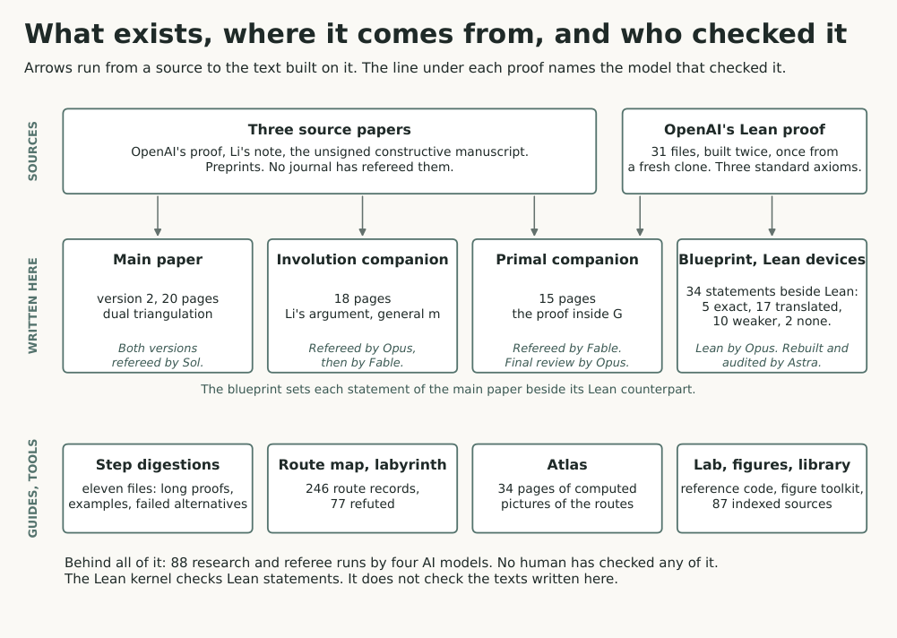
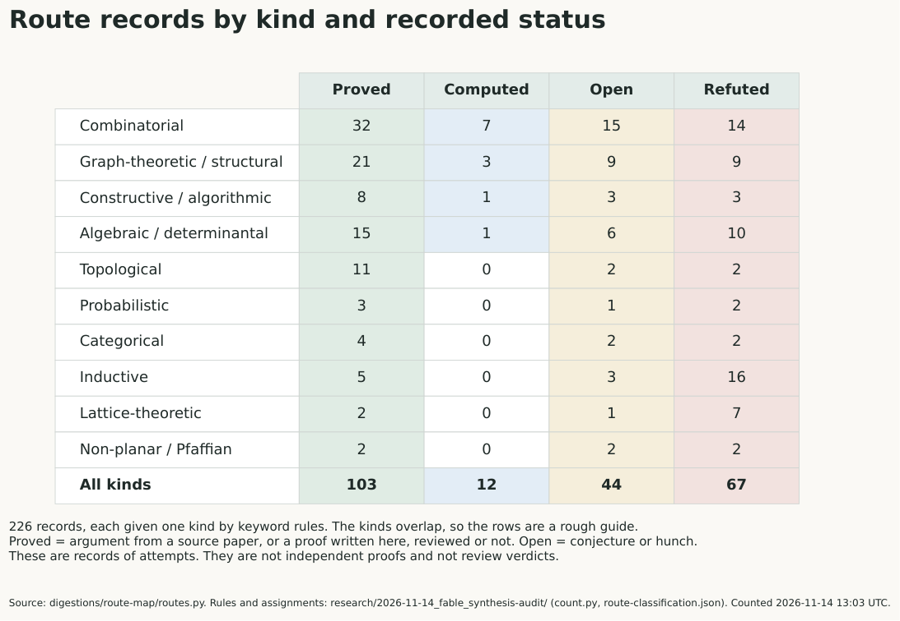

# What the mathathon found

Snapshot of 14 November 2026. GPT-6 Astra wrote this document, Fable 5.2 checked every claim against its source ([ledger](../research/2026-11-14_fable_synthesis-audit/FACT-CHECK.md)), and Opus 5.5 brought it up to date ([change log](../research/2026-11-14_opus_synthesis-final/CHANGELOG.md)). No human has checked it or any proof it describes. Detail is in the [fact table](../research/2026-11-14_opus_reconcile/FACTS.md) and the [run index](../research/INDEX.md).

Names follow the main paper. A **good state** is what most reports call a tree matching. A **good pair** is their forest pair or tree pair. A **cover** is the set of undirected cycles of a pair, and $m$ is the least number of cycles in a cover, their $c_{\min}$.

## 1. The answer in one page

**How the proof works.** A Hamiltonian cycle needs degree two at every vertex and one component. In a cubic graph $G$, deleting a perfect matching gives degree two, so the whole problem is connectivity. Pass to the planar dual $T$, a triangulation whose triangles are coloured black and white. A perfect matching of $G$ becomes a selection, one side of every triangle, and its complement is connected exactly when the selection contains no cycle. So the theorem asks for an acyclic selection through a prescribed side $e_0$.

Fix a black triangle $t_0$ at $e_0$; its corners are roots. A state chooses one corner in every other black triangle and uses every vertex that is not a root exactly once. A state is good when the sides opposite its chosen corners form a forest with exactly one root in each tree. A good state forces a selection through a tree on the faces. That selection is acyclic by the disk identity: a directed cycle of sides leaving chosen corners encloses exactly one more white triangle than black.

Nobody knows how to point to a good state, so the proof counts. A pair is two states that differ in every triangle. Each pair gets a sign, and a weight that depends only on its second state. If the opposite sides of the second state contain a cycle, reversing that cycle changes the first state, keeps the weight and flips the sign, so all such pairs cancel. The same sum, grouped by the cycles along which the two states differ, is a repeated difference. Its first surviving term is a product of positive numbers, the counts of white triangles inside those cycles. So the sum is nonzero, and a good state exists as soon as one pair exists. A flow argument gives a pair when $T$ has no separating triangle. Otherwise the induction cuts along one, and the prescribed side makes the halves agree.

**What we added.** No new theorem about Barnette's conjecture. The proof is OpenAI's. We wrote a 20-page exposition with one running example, three companion notes, a statement-by-statement link to the Lean formalisation, and Lean files that check the paper's own sign and counting step. Section 3 lists four changes that shorten the argument and a step the OpenAI paper leaves tacit, now proved. Around the proof we have an exact criterion for the first pair, the set of Hamiltonian cycles the construction finds, counts on explicit families, and a map of 246 attempted routes, 77 of them recorded as refuted.

**What is solid.** OpenAI's Lean proof builds locally on the three standard axioms. That certifies OpenAI's formal route, not our text. Sol, a different model from the paper's authors, refereed version 1 and found the route sound, with eight corrections off the route. On the final text of version 2 Sol again found that it follows, after eight small corrections of wording and scope. Astra rebuilt Opus's Lean for the sign and counting step from a fresh clone and audited it. Of the 34 statements on the paper's route, 5 have an exact Lean counterpart, 17 match after a translation to Lean's model that nobody has formalised, 10 have only a weaker or different form in Lean, and 2 have none. Each companion note passed review by a model other than its author, the primal and involution notes twice. All of these checks are by AI models. No human has checked any of it.

**What is open.** A proof without the signed count; section 6 says why shortcuts fail. A polynomial-time way to find the cycle. The bound that there are at least $2^m$ good states. A direct proof for non-planar Pfaffian graphs. A complete formal proof of our own route.

## 2. What exists now

[Vector PDF](synthesis-figures/products.pdf).

| Product | What it is, and its review status |
|---|---|
| [Main paper](../paper/main/barnette.pdf) | Version 2, 20 pages. Refereed in both versions. [Version 1](../paper/main/history/barnette-v1.pdf), 18 pages, is kept. |
| [Primal companion](../proofs/primal/primal.pdf) | 15 pages. The whole proof in $G$, without the dual, close to the Lean route. Refereed, then accepted in a final review. |
| [Involution companion](../proofs/involutions/involutions.pdf) | 18 pages. Li's argument for general $m$, written out as two sign-reversing involutions. Refereed twice. |
| [Sign-free note](../proofs/sign-free/sign-free.pdf) | 11 pages. What can be proved without signs, and where that stops. Refereed by Sol. Figure 5 was redrawn after the referee. |
| [Proof blueprint](../proofs/blueprint/BLUEPRINT.md) | Each statement of the main paper beside its counterparts elsewhere and in Lean. One model's judgements. |
| [Lean devices](../proofs/lean/README.md) | 866 lines of Lean for the paper's sign and counting step, section 4. Rebuilt and audited by Astra. |
| [Step digestions](steps/00-overview.md) | Eleven files with longer proofs, worked examples and failed alternatives for each step. Audited. |
| [Route map](route-map/ROUTE-MAP.md) | 246 route records sorted by the step they address. Start with [how it works](route-map/HOW-IT-WORKS.md). |
| [Atlas](atlas/atlas.pdf) | 34 pages of computed pictures of 30 routes. Readings of one proof, not 30 proofs. Audited; the last repair is not. |
| [Labyrinth](../labyrinth/README.md) | Claims and their dependencies as structured data. |
| [Reference lab](../workings/barnette_lab/README.md) | Code that enumerates states and pairs and recovers cycles. |
| [Library](../papers/INDEX.md) | 87 sources with access status, and a bibliography. |

## 3. Simplifications worth keeping

**The disk identity as a face balance.** For a directed cycle of chosen sides, $W=B+1$. It needs the state and is false for arbitrary cycles. Astra, Fable and Sol checked it. [Combinatorics referee](../research/2026-11-14_astra_referee-combinatorics/REPORT.md)

**A sign made of local signs.** $\epsilon(r,s)=\prod_t\delta(r(t),s(t))$, where $\delta$ is $+1$ when the black face lies left of the arrow. It replaces the phase $i^J$ up to the constant $i^{-n}$. Opus and Fable found it, Sol checked it, and it compiles in Lean. [Draft B review](../research/2026-11-14_fable_review-draft-B/REPORT.md)

**Heights along paths of faces.** Fix a path of faces from every white face to $t_0$, and count with sign the black faces where the path turns around the chosen corner. Reversing a clockwise cycle raises the total by the number of white faces inside, so the spokes of the OpenAI paper go. Fable supplied it and Sol checked it. [Main referee](../research/2026-11-14_sol_referee-main/REPORT.md)

**A finite difference in place of the exponential.** The $2^c$ orientations of a cover with $c$ cycles form a cube. The alternating sum of $\omega^m$ over it vanishes when $c>m$ and is a signed product of white-face counts when $c=m$. Sol checked the proof and Opus proved it in Lean. A second form, found by Astra and refereed by Fable, uses linear weights and one integer polynomial. [Determinant referee](../research/2026-11-14_fable_referee-determinants/REPORT.md)

**Connectivity inside a cycle.** Both drafts applied Euler's formula to the inside of a cycle without proving it connected. Fable supplied a five-line lemma; Sol checked it is not circular.

**An exact criterion for the first pair.** A pair exists exactly when no separating triangle has black faces along its inner side, away from $t_0$, so gluing is needed only there. The constructive manuscript states it, Opus proved it, Sol checked it. [Integration](../research/2026-11-14_sol_referee-structure/INTEGRATION.md)

**Which cycles the construction finds.** For fixed $t_0$ and $e_0$, different good states give different Hamiltonian cycles, and some cycles are missed: a cycle avoiding the edge yields a state, and the construction finds it exactly when that state is good. On the hexagonal prism with $e_0$ on the equator there are three states, two good, and four cycles avoiding the edge. Astra and Fable proved this and Sol checked it. [Structure referee](../research/2026-11-14_sol_referee-structure/REPORT.md)

**Counts.** With $g$ good states at a root and $h$ Hamiltonian cycles, $3g\le h$ and $g\ge 2m$, by Fable, checked by Astra. In $G$, a cover is an edge set $S$ with prescribed local degrees, not the deleted matching, and its number of cycles is $\kappa(G-S)-1$; Astra proved this and Sol checked it. [Cover referee](../research/2026-11-14_sol_referee-covers/REFEREE-covers.md)

**Families.** The prism over a $2j$-gon has $2j+2$ Hamiltonian cycles, so no exponential lower bound in the number of vertices holds. A graph with $b$ irreducible pieces has at least $2^b$ cycles avoiding any given edge and at least $3\cdot2^b$ in all; the cube's six make this sharp. Sol proved these, a second Sol run refereed them, and Fable, a different model, replayed every number it could reach. [Different-model referee](../research/2026-11-14_fable_referee-families/INTEGRATION.md)

## 4. The three papers connected

The dependency audit found no error in the three papers and one shared skeleton of fourteen steps. [Skeleton](../research/2026-11-14_fable_dependency-graph/skeleton.md)

The papers differ at four steps: the first pair, the weights, the nonvanishing count and the last step. The [correspondence table](../research/2026-11-14_fable_dependency-graph/correspondence.md) translates each object between them. OpenAI's paper and the manuscript close as written, Li's note once four routine steps are supplied. The involution companion is Li's proof unpacked, not a new route. [Dependency report](../research/2026-11-14_fable_dependency-graph/REPORT.md)

The Lean proof never uses faces or the Jordan curve theorem. It uses an algebraic dual, one flow and linear factors, and inducts on the avoided edge. It never states the two-induced-trees theorem and does not formalise the Pfaffian corollary. Opus built its 31 files, 8,936 lines, and the build prints only `propext`, `Classical.choice` and `Quot.sound`. [Lean report](../research/2026-11-14_opus_lean-formalisation/REPORT.md)

Opus's 866 further lines check, in Lean's model: the local sign and its closed formula; $\epsilon = i^n$ times OpenAI's phase; the cancellation only in the case where no pair has an acyclic $Q_s$, which is all the existence proof uses; the finite difference; and nonvanishing by $\epsilon\,\omega^m$ with Lean's flow weights, not the paper's heights. Astra, a different model, rebuilt them from a fresh clone and checked all 29 theorems against the paper. OpenAI's main theorem rebuilds on them and no longer reaches the six phase and polynomial lemmas they replace, though it still reaches Mathlib's polynomial algebra. Not checked: the heights, Lemma 4.5 in full, the topological Lemma 2.2, the two induced trees, and the drawing. Astra also showed that a proposed target, every Hamiltonian cycle avoiding the edge coming from a good state, is false on the hexagonal prism; the paper never claimed it. [Independent check](../research/2026-11-14_astra_lean-check/REPORT.md), [blueprint](../proofs/blueprint/BLUEPRINT.md)

## 5. Proof routes and failures

Sizes count vertices of $T$ unless marked primal. "First" means an exhaustive search found nothing smaller. "Witness" claims no minimality. The [route map](route-map/ROUTE-MAP.md) lists every refutation.

| Kind | What worked | What failed, and what remains |
|---|---|---|
| Combinatorial | The refereed proof. | Choosing the highest or lowest state, or turning all cycles of a smallest cover one way, fails at 12 once reflections are counted. A 13-vertex instance has six good states and $m=2$, so good states do not split into cubes of four. [Referee](../research/2026-11-14_astra_referee-combinatorics/REPORT.md) |
| Graph-theoretic | Pair criterion and three-matroid description, refereed. Two-tree packing, refereed by its author's model. | A two-matroid relaxation fails on the hexagonal prism, 8 vertices: four of its six solutions are not states. The linear program has a half-integral vertex at 13, a witness. A cover with no good state occurs at 16. [Structure](../research/2026-11-14_sol_referee-structure/REPORT.md), [packing referee](../research/2026-11-14_opus_referee-rainbow/REFEREE-packing.md) |
| Constructive | The lab recovers cycles. | No polynomial bound. Strict descent fails first at 16 for pairs and at 8 for rainbow trees. A lookahead of two moves fails first at 21, of three at a 40-vertex witness. The surplus walk cycles at 38, a witness. A search over plateaus has not failed yet. [Lab](../workings/barnette_lab/README.md) |
| Algebraic | Two determinants and the linear weights, refereed. | The plain determinant fails on the hexagonal prism, and doubled edges fail at 9. No sign change on the variables makes all coefficients one sign, by a 13-vertex witness, but signs on the incidences of both states work on all 5,088 rooted instances with a pair up to 16 vertices, unproved in general. The number of good states can vanish modulo 2, 3, 4, 5, 7 and 11, witnesses at 6, 13, 9, 14, 16 and 26; the case 11 was not replayed. Refereed by Fable. [Algebra](../research/2026-11-14_sol_route-algebra/REPORT.md), [algebra referee](../research/2026-11-14_fable_referee-families/REFEREE-algebra.md) |
| Topological | A Gauss-Bonnet reading of the disk identity and a dual rank formula, by Opus, refereed by Fable. Intuition, not a second proof. | The plain Euler characteristic loses the grading. Fable's own new results, refereed by Opus, hold: a rainbow tree exists exactly when a pair does, it lies in a unique cover, and the number of good states is even without signs. Exchange descent is open. [Topology referee](../research/2026-11-14_fable_referee-topology/REPORT.md) |
| Probabilistic | Explicit families show that good states can be exponentially rare. | The target degree vector lies on a face of the degree polytope, so only spanning-tree laws supported on that face can have it as mean. That excludes full-support measures only. Real zeros fail at 9 and zeros on the unit circle at 12. Reviewed by a second Sol run, then by Fable. [Probability referee](../research/2026-11-14_fable_referee-families/REFEREE-probabilistic.md) |
| Categorical | Cutting along a cycle and recording a boundary pattern composes: 3 patterns on triangles, 6 on quadrilaterals, given the theorem. | On 5-cycles the patterns depend on the piece, witness at 9. Not reviewed. [Report](../research/2026-11-14_fable_route-categorical/REPORT.md) |
| Inductive | Splitting of states, a lift criterion and a rotation, refereed. A one-sided step, written. | The converse of the lift criterion fails at 11. "Some good state lifts" fails at 18. Selecting inward fails at 11, 13 and 14. Repair by the partner fails at 16, by one cycle at 17, by any reorientation of a fixed cover at 18. Lemmas G and X are open. [Referee](../research/2026-11-14_fable_induction-completion/REPORT.md), [later lemmas](../research/2026-11-14_astra_induction-lemmas/REPORT.md) |
| Lattice | Covers form a distributive lattice. | Both extremes fail first at 18. "An extreme or an irreducible element" fails at a 33-vertex witness with a separating triangle; without one the question is open. Levels with a fixed number of cycles can be disconnected, witnesses at 18. [Referee](../research/2026-11-14_sol_referee-conjectures/REPORT.md) |
| Non-planar | The Pfaffian corollary follows from the theorem through Gorsky, Steiner and Wiederrecht. | On the Heawood graph, 14 primal vertices, the cancellation survives but the count is zero. A direct proof is open. Not reviewed. [Report](../research/2026-11-14_astra_route-pfaffian/REPORT.md) |

[Vector PDF](synthesis-figures/route-outcomes.pdf). The chart counts the records of [routes.py](route-map/routes.py). Keyword rules in [count.py](../research/2026-11-14_opus_synthesis-final/synthesis-audit/count.py) give each record one kind, and the kinds overlap, so the rows are a rough guide. "Proved" joins source arguments and proofs written here, reviewed or not. "Open" joins conjectures and hunches.

## 6. Why the signed count seems necessary

This section is an interpretation. Nobody has proved that an unsigned proof is impossible.

Each half of the target is easy inside any cover: it contains a spanning tree of the white faces meeting the degree condition at the black faces, and another meeting it at the vertices. A good state needs both in one tree. Opus proved this; a fresh Opus instance refereed it. [Packing report](../research/2026-11-14_opus_two-tree-packing/REPORT.md)

A 16-vertex cover contains no good state, however its cycles are oriented. The midpoint $(r+s)/2$ of any of its pairs satisfies the linear program and lies outside the convex hull of good states. So a method must sometimes leave the cover it started in. Choosing a canonical cover fails too, by the lattice counterexamples at 18 and 33. The signed count compares all covers at once. Nothing we tried does that without signs, and the refutations rule out named shortcuts, not every unsigned proof. The [sign-free note](../proofs/sign-free/sign-free.pdf) proves what can be done without signs and draws this cover.

## 7. Open problems, ranked

Census sizes are in section 11.

1. **Close the induction without the signed count.** Contract at a vertex of degree four. Lemma G asks that, without separating triangles and above 6 vertices, some such contraction stays simple and keeps a pair. Lemma X asks, when both contractions at a vertex have good states, that some good state of a contraction is not exceptional. G holds on every instance tested, and so does a stronger inequality than X: contraction never increases the number of good states. Astra proved G when there is no chordless 5-cycle and showed that every repair confined to one cover fails. The next step is a move that changes the cover. [Missing lemmas](../research/2026-11-14_fable_induction-completion/MISSING-LEMMA.md)

2. **Prove at least $2^m$ good states.** It holds through 22 vertices, and through 24 without separating triangles. The cases of one and two covers are proved and refereed, and families attain equality for every $m$, which is unbounded. The next step is the two-cover calculation for more covers. Induction on levels with a fixed number of cycles cannot work, because such levels can be disconnected. [Conjecture referee](../research/2026-11-14_sol_referee-conjectures/REPORT.md)

3. **Prove descent with plateaus.** Pair descent says that reversals reach a good pair without ever increasing the number of cycles of $Q_s$. It holds through 23 vertices and on 230 random triangulations up to 80; Astra's referee reproduced it with its own code through 20 and on a 40-graph batch at 40. Every sharper rule in section 5 fails, and so do 27 named alternative potentials. Rainbow descent says the same for exchanges on rainbow trees. Fable checked it for every root through 17 vertices, for 1,485 of the 1,543 triangulations at 18, and in samples to 120; Opus finished seven more at 18, which leaves 51. [Descent study](../research/2026-11-14_fable_descent/REPORT.md), [descent referee](../research/2026-11-14_astra_referee-descent/REPORT.md)

4. **Find a polynomial-time construction.** Testing one orientation of a cover is linear; searching all covers has no polynomial bound. Random sampling fails in general: good states can be exponentially rare even without separating triangles. [Families](../research/2026-11-14_sol_counting-families/REPORT.md)

5. **Prove the non-planar statement directly.** Start from the Heawood graph, where the count vanishes.

6. **Finish formalising our route.** Section 4 of the paper still needs the bridge from heights to Lean's flow weights and Lemma 4.5 in full, about 530 to 1,010 Lean lines by Opus's estimate. The connectivity lemma needs a Jordan curve theorem, which Mathlib lacks. [What remains](../proofs/blueprint/FORMALISATION.md)

## 8. What the literature review established

Several older originals were never opened, and the list says which.

1. The target, two induced trees in the dual, is Stein's from 1971, in the form of Alt, Payne, Schmidt and Wood from 2016. Both were opened. [History](../research/2026-11-14_opus_history-literature/REPORT.md)
2. The avoided edge and the reduction at separating triangles go back to Kelmans, whose papers were not opened. We know them only through Hertel's survey and Alt and coauthors.
3. States are the corner choices of Tutte's trinity theory, known here through Hine and Kálmán. The disk identity and the signed count over pairs appear in none of the 23 Barnette papers collected. [Novelty note](../research/2026-11-14_astra_older-approaches/NOVELTY.md)
4. Earlier partial results cover faces of size four and six, leapfrog graphs and, in a preprint, faces of size at most eight. Before the proof, Brinkmann, Goedgebeur and McKay checked graphs up to 90 primal vertices in 2022. [Results table](../research/2026-11-14_opus_history-literature/RESULTS-TABLE.md)
5. A proposed link between the parity condition of Bagheri Gh., Feder, Fleischner and Subi and the black-inner triangle obstruction is false on the truncated octahedron.
6. The constructive manuscript is unsigned. No author or public source was found. [Library report](../research/2026-11-14_astra_literature-consolidation/REPORT.md)
7. The 1969 Waterloo page that states the conjecture was not obtained. Our attribution rests on the bibliography of Alt and coauthors. OpenAI's paper attributes the conjecture to Grünbaum, a discrepancy between sources that nobody has resolved. [Citation audit](../research/2026-11-14_astra_citation-audit/REPORT.md)
8. The OpenAI proof is a preprint that no journal has refereed. A third party reports that two Lean kernels accept the formal proof, and our two builds agree.

## 9. What the earlier rewrite taught us

An earlier rewrite of another paper gave a [style guide](../research/2026-11-14_astra_exposition-method/STYLE-GUIDE.md) of 22 rules, which the merge followed. A cold reader of version 1 still found the opening overloaded, three steps without their reason, and nine of thirteen floats cutting into a proof or a sentence. Version 2 answers with a five-step plan on page 1 and no figure inside a proof. [Cold read](../research/2026-11-14_fable_coldread-main/REPORT.md)

## 10. Review status and limits

"Refereed" means that a run of another AI model read a stated argument and, in most cases, wrote its own checking code. It is not journal review, human approval or formal verification. When a referee proves something new, that result has no second reader.

| Work | Written by | Checked by | Not covered |
|---|---|---|---|
| OpenAI's Lean proof | OpenAI | Lean kernel, in builds by Opus and Astra | Our texts |
| Main paper, version 1 | Opus, merging drafts by Astra and Opus | Sol: follows, eight corrections. Fable: cold read, 40 edits | |
| Main paper, version 2 | Astra, 17 finishing edits by Opus | Sol, final text: follows, eight small corrections. Opus: cold read. Astra: proofread, seven wording edits | |
| Primal companion | Astra | Fable: follows, one gap closed. Opus: final review, accept, then a proofread | |
| Involution companion | Sol | Opus: follows, 15 edits. Fable, on the revision: follows after a fix. Opus: proofread | |
| Sign-free note | Fable | Sol: follows, one false sentence corrected | Figure 5 as redrawn |
| Blueprint | Opus, statuses from Astra's Lean audit | Nobody | The 27 matches after translation or in weaker form |
| Lean devices | Opus | Lean kernel. Astra: fresh rebuild, all 29 statements | The heights, Lemma 4.5 in full, the drawing |
| Weight-free proof, counts | Fable | Astra | |
| Pair criterion, gluing, recovery | Opus, Astra | Sol | |
| Determinants, linear weights | Sol, Astra | Fable | Parts of the lab |
| Topology | Opus | Fable. Opus refereed Fable's rainbow results | Step X beyond its finite checks |
| Lattice conjectures | Opus | Sol | Sol's 33-vertex refutation |
| Induction | Opus | Fable. Astra checked Fable's lemmas and its own partial G | Lemmas G and X |
| Descent study | Fable | Astra: census through 20, batch at 40, PPADS argument | The census from 21 to 23 vertices |
| Cycle covers | Astra | Sol | The census from 17 to 24 vertices |
| Families, probability, algebra | Sol | A second Sol run, then Fable on all three: numbers agree | Tube recurrences for every length, the mod 11 witness, sampling numbers |
| Packing | Opus | Opus, a fresh instance, with its own code | P2 |
| Category, Pfaffian | Fable, Astra | Nobody | |
| Step digestions | Fable | Astra, then Opus twice | |
| Atlas | Sol, finished by Fable | Sol: 78 checks pass, wording errors fixed | The two new pages, the last repair |
| This synthesis | Astra, then Opus | Fable | The closing runs and this cut |

Three reviews were by the author's own model: Sol on families and probability, since checked by Fable, Opus on packing, and Astra on its own partial G. Two disputes were settled by a model that was not a party.

**Real sign against Lean's phase.** The primal referee feared a factor depending on the number of cycles. Opus showed that the ratio is the constant $i^n$, or $i^{-n}$ with corners reversed, proved it in Lean and checked 24,856 pairs; Astra checked 174,763 sign words. [Adjudication](../research/2026-11-14_opus_cross-audit/ADJUDICATION.md)

**279 against 213 marked objects.** Two counts of Li's marked objects disagreed because the count depends on the drawing: 69 drawings give 35 values from 103 to 363. The signed sum, $-9$, never changes. [Discrepancy note](../research/2026-11-14_opus_referee-involutions/DISCREPANCY-279-213.md)

**First failures.** Counting mirror images separately moved two counterexamples down to 12 vertices, and several saved "lattice extremes" were greedy end points; the true extremes fail first at 18. [Structure referee](../research/2026-11-14_sol_referee-structure/REPORT.md)

## 11. Numbers and snapshot

<!-- inventory-start -->
The inventory was taken at 2026-11-14 15:22 UTC by [count.py](../research/2026-11-14_opus_synthesis-final/synthesis-audit/count.py), with output in [counts.json](../research/2026-11-14_opus_synthesis-final/synthesis-audit/counts.json). It counts folders and files. It reruns no census.

There are 88 run folders and 88 of them hold a final report. By folder name, 21 are GPT-6 Astra, 24 Fable 5.2, 22 Opus 5.5 and 21 GPT-6.1 Sol. The route map has 246 records: 46 arguments from the sources, 65 proofs written here, 14 computations, 19 conjectures, 25 hunches and 77 refutations. Those are recorded statuses, not review verdicts.

| PDF | Pages |
|---|---:|
| [Main paper, version 2, at the time of the count](../paper/main/barnette.pdf) | 20 |
| [Main paper, version 1](../paper/main/history/barnette-v1.pdf) | 18 |
| [Primal companion](../proofs/primal/primal.pdf) | 15 |
| [Involution companion](../proofs/involutions/involutions.pdf) | 18 |
| [Atlas](atlas/atlas.pdf) | 34 |

The eleven step files hold about 29,000 words, counting headings and link text.
<!-- inventory-end -->

The censuses cover different populations and must not be added up. The numbers are quoted from the reports, not rerun. [Ledger of computations](../research/2026-11-14_astra_synthesis/EVIDENCE.md)

| Claim tested | Range | Size | Computed by |
|---|---|---|---|
| At least $2^m$ good states | every root, to 22 vertices | 4,656,948 rooted instances with a pair | Opus, reproduced by Sol |
| The same, no separating triangle | to 24 vertices | 23,824,742 rooted faces | Astra. Sol replayed 3,374 through 16 |
| Pair descent | every root, to 23 vertices | 193,623,384 pairs | Fable. Astra reproduced 3,373,400 pairs through 20 |
| Rainbow descent | every root, to 17 vertices | 69,458,112 rainbow trees, the rest by a proposition | Fable. Opus repeated it through 12 |
| Lemma G | 8 to 19 vertices | 62,416 rooted instances | Fable. Astra's criterion agrees |
| Contraction inequality | to 18 vertices | 1,202,792 contractions | Fable |
| Sign against phase | to 16 vertices | 24,856 pairs | Opus |
| Main paper's identities | to 12 vertices | 262 rooted faces of 15 triangulations | Sol |

<!-- late-start -->
**Runs still open at this snapshot.** None. Every run folder holds a final report.
<!-- late-end -->

## 12. The closing runs

These reported in the last two hours.

- **Sign-free note.** Fable wrote [the note](../proofs/sign-free/sign-free.pdf) and tested every statement through 12 vertices. Sol, a different model, [refereed it](../research/2026-11-14_sol_referee-sign-free/REPORT.md): every proved result follows, one sentence about root spokes was false and is corrected, stale descent ranges are updated, and Sol's code reproduces the counts. Step X stays a conjecture. Fable then [redrew Figure 5](../research/2026-11-14_fable_sign-free-figure/REPORT.md), whose vertices 4 and 5 had coincided. Nobody has reviewed the new figure. Figures 1 to 4 still draw the sides of $t_0$ across inner edges.
- **Descent referee.** Astra's [referee](../research/2026-11-14_astra_referee-descent/REPORT.md), in section 7, also reproduced the 7,940 induction exceptions. Pair descent, G and X stay open.
- **Citation audit.** Astra [found](../research/2026-11-14_astra_citation-audit/REPORT.md) 63 cite commands with 23 keys, none missing, all matching their sources; some metadata fields stay unverified. Kelmans and the Waterloo page are known only through secondary sources. [PDF-RIGHTS.md](../research/2026-11-14_astra_citation-audit/PDF-RIGHTS.md) records the 50 research PDFs.
- **Release check.** Sol [built every product](../research/2026-11-14_sol_release-check/REPORT.md) from two fresh clones; the 14 unit tests and 1,209 rooted lab runs pass. Two gates were red: this document's length, fixed by this pass, and a caption-length gate of the optional figure review, still red. Astra's [final recheck](../research/2026-11-14_astra_final-recheck/REPORT.md) of a later commit passes, except one atlas figure that overflows when built standalone.
- **Paper proofread.** Astra found no proof gap and seven wording edits, which the coordinator applied. Verification notes left the printed bibliography, so [refs.bib](../paper/main/refs.bib) now differs from [the canonical bibliography](../papers/barnette.bib) in its note and annote fields.
- **Notes proofread.** Opus removed process residue from the primal and involution notes, changing no mathematics ([report](../research/2026-11-14_opus_notes-proofread/REPORT.md)). Fable fixed nine figure label defects ([report](../research/2026-11-14_fable_notes-figures/REPORT.md)). `proofs/primal/primal.tex` is now the source; regenerating it from PRIMAL-PROOF.md would undo the proofread.
- **Atlas repair.** Fable [resynchronised](../research/2026-11-14_fable_atlas-repair/REPORT.md) pages 26, 29 and 30 with the final status data, and `verify.py` passes. Not audited.

## Housekeeping for the owner

These decisions are yours.

1. **Author lines.** The main paper and the primal, involution and sign-free notes all have an empty `\author{}`.
2. **Third-party PDFs.** Two research folders hold 50 PDFs of other people's papers, about 50 MB: [machinery literature](../research/2026-11-14_sol_machinery-literature/pdf/) and [history literature](../research/2026-11-14_opus_history-literature/pdf/). The repository is private, but nobody established the right to redistribute them; [PDF-RIGHTS.md](../research/2026-11-14_astra_citation-audit/PDF-RIGHTS.md) gives the licence evidence and a recommendation for each. The [cleanup proposal](../research/2026-11-14_opus_cross-audit/CLEANUP-PROPOSAL.md), items C3 to C5, suggests moving the few the proof uses into the library and replacing the rest by links. Decide before the repository is shared.
3. **The Lean build directory.** `E:\lbb`, about 7.7 GB, lies outside the repository and is needed to rebuild `proofs/lean/`. Keep it until you decide. Astra's clone `E:\lb2` is already deleted. The [Lean README](../proofs/lean/README.md) says how to rebuild.
4. **Two temporary clones.** `E:\rc-sol-1114` and `E:\rc-sol-late`, from the release check, could not be deleted automatically. Delete them by hand.
5. **Drafts A and B.** `paper/draft-A/` and `paper/draft-B/` are superseded and kept as records. Leave them, or move them under a history folder.
6. **Figure proof sheets.** [research/2026-11-14_sol_figures-polish/](../research/2026-11-14_sol_figures-polish/) holds 41 MB of rasterised proof sheets. Keep or delete.
7. **Gluing with perfect matchings.** The [blueprint](../proofs/blueprint/FORMALISATION.md) recommends stating the paper's gluing step with perfect matchings, as Lean does, which would drop the two induced trees. Nobody has made that change.
8. **Length of the paper.** It has 20 pages, and the last holds only references.
9. **What to read first.** No human has read anything here. Start with Section 4 of the [main paper](../paper/main/barnette.pdf), the signed count. Then the [referee's report](../research/2026-11-14_sol_referee-main-v2/REFEREE.md) on version 2, which lists every obligation it checked, and [how it works](route-map/HOW-IT-WORKS.md) for a short tour.
