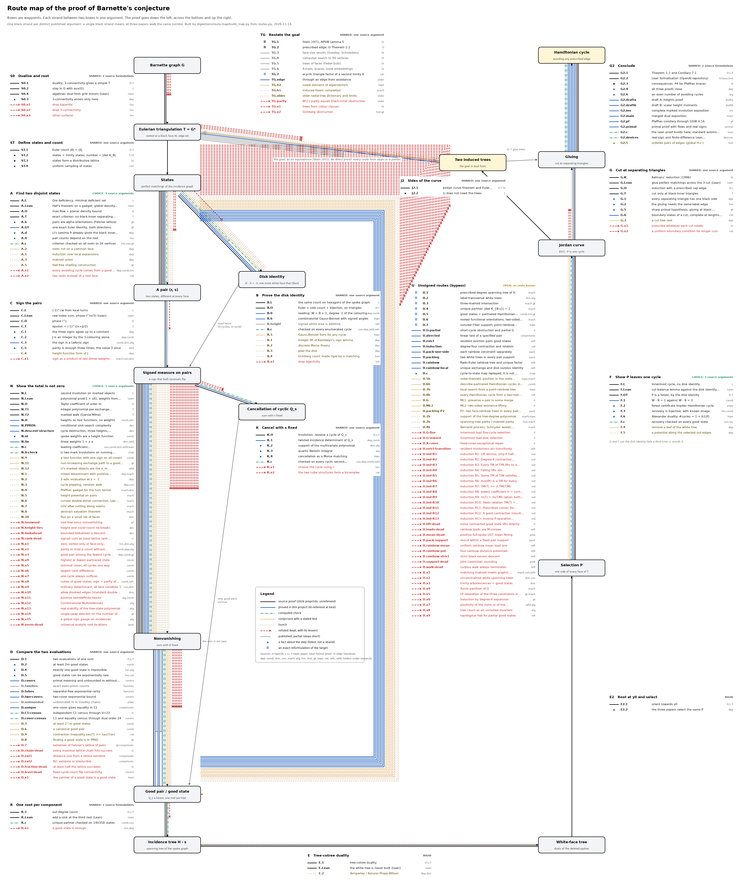
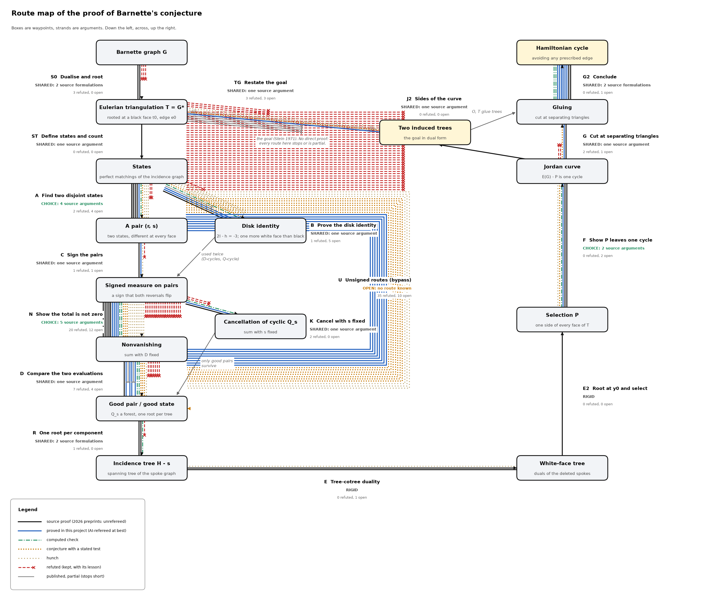

# Route map of the proof of Barnette's conjecture

Generated by `build_map.py` from `routes.py` on 2026-11-14. Do not edit this file. Edit `routes.py`, `ROUTE-MAP.head.md` or `ROUTE-MAP.tail.md` and rebuild.

Names follow the main paper (`paper/main/barnette.tex`): a *good state* is a state `s` whose `Q_s` is a forest with one root in each component (the trees paper's tree matching), a *good pair* is a pair whose second state is good, a *cover* is `D` with directions forgotten, `m` is the least number of cycles of a cover (earlier versions wrote `cmin`), and `q(s)` is the number of cycles of `Q_s`. `#TM` still counts good states. Other names are listed in [the glossary](../steps/GLOSSARY.md#synonyms).

Summary.

1. The proof is one chain of 16 waypoints. Every published proof (OpenAI, Li, the trees paper, the Lean formalisation) passes through the same chain. Nobody has a second way to reach a good state.
2. The chain is forced at the disk identity, the sign, the cancellation with `s` fixed, the comparison, tree-cotree duality and the gluing. It is free at three steps: the first pair (A), the nonvanishing (N) and the last step from the selection to one cycle (F).
3. The direct edge from the triangulation to two induced trees, which is where every attack before 2026 worked, has no complete route.
4. The bypass from states to a good state with no signed count has nine exact reformulations and no existence argument, with the failed relaxations retained next to them. Every relaxation tested drops a constraint and fails on a small example, most often the hexagonal prism.
5. This file lists {N} routes: {LIT} published, {PH} proved in this project (none human-checked), {CO} computed, {CJ} conjectures, {HU} hunches and {RE} refuted, each refuted one with its lesson and a saved counterexample or explicitly certified minimum.

The final update includes rainbow R and unique-factor completion, the partial contraction G theorem, ordinary tree packing and its remaining P2, the descent failures, the v2 written-route verdicts and the author-compiled real-sign Lean replacement. New proof claims keep their individual AI review states. See [the ranked open problems](../steps/09-what-is-still-open.md).

## The picture

Files: `route-map.pdf` and `route-map.svg` (vector, zoomable), `route-map.png` (150 dpi), `route-map-overview.*` (the same map without the route lists), `route-kinds.*` (a matrix of steps against kinds of argument, near the end of this file), `route-map.dot` (Graphviz source, one edge per route), `routes.json` (the data).

## How to read it

The proof goes down the left side, across the bottom and up the right side. The left side finds a good state. The right side turns it into a Hamiltonian cycle. The top edge, from the triangulation straight to two induced trees, is the goal stated as an equivalence. It is drawn grey because no proof crosses it directly.

A strand between two boxes is an argument that crosses that step.

| Style | Status | Meaning |
| --- | --- | --- |
| black, solid | `LIT` | supplied source result; 2026 preprints are unrefereed. One strand per distinct argument, so a single black strand means the papers agree up to translation |
| blue, solid | `PROVED-HERE` | full proof written in an agent folder. Review state is given in the table of the step |
| green, dash-dot | `COMPUTED` | checked by a script on a stated range |
| orange, dotted | `CONJECTURE` | precise statement with a test |
| pale, dotted | `HUNCH` | a direction with a reason and a first test |
| red, dashed, ending in a cross | `REFUTED` | tried and closed. The lesson and the counterexample are listed under the step |
| grey, short | published, partial | a published result that crosses the step only for a subclass |

Rows marked with a dot are facts about the step. Rows marked with the sign for "identical" are exact reformulations of the target. Neither is an argument that crosses, so neither is drawn as a strand.

Sources. O is `papers/OpenAI-Barnette.pdf`, L is Li's note, T is the trees paper, Lean is the formal proof in OpenAI's repository as read by the lean-formalisation agent, lit is older literature. Lower-case tags are agent folders: dep `research/2026-11-14_fable_dependency-graph`, comb `..._fable_route-combinatorics`, dim `..._astra_route-dimers`, con `..._sol_route-constructive`, mach `..._sol_machinery-literature`, alg `..._sol_route-algebra`, lim `..._astra_limits`, hist `..._opus_history-literature`, gt `..._opus_route-graph-theory`, topo `..._opus_route-topology`, lean `..._opus_lean-formalisation`, expo `..._astra_exposition-method`, refc `..._astra_referee-combinatorics`, refd `..._fable_referee-determinants`.

Status. The three 2026 papers are unrefereed preprints. `LIT` on a 2026 statement means "stated and proved in a paper we hold". `PROVED-HERE` results were written by AI agents. "AI-refereed" means one independent AI referee with its own code returned a verdict. Nothing here has been checked by a human.
