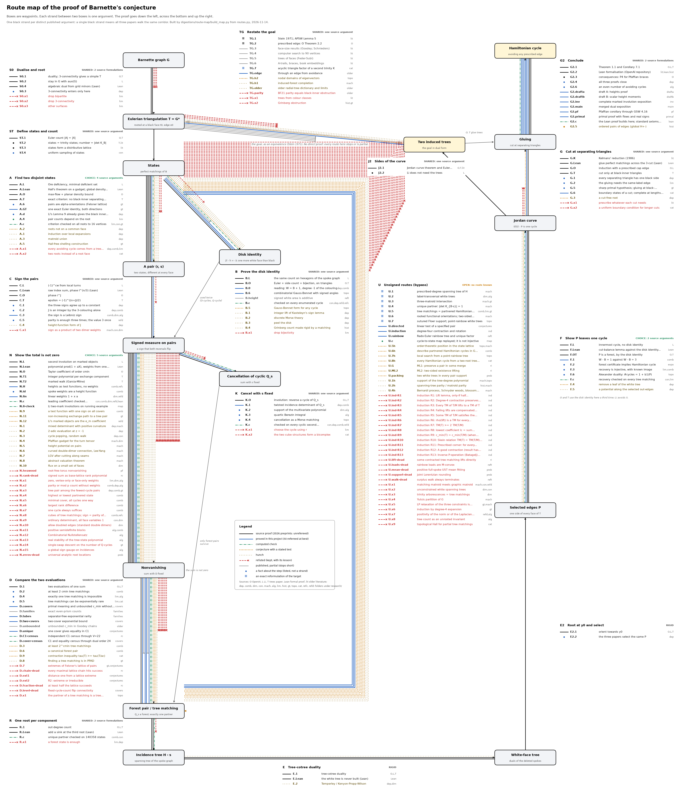
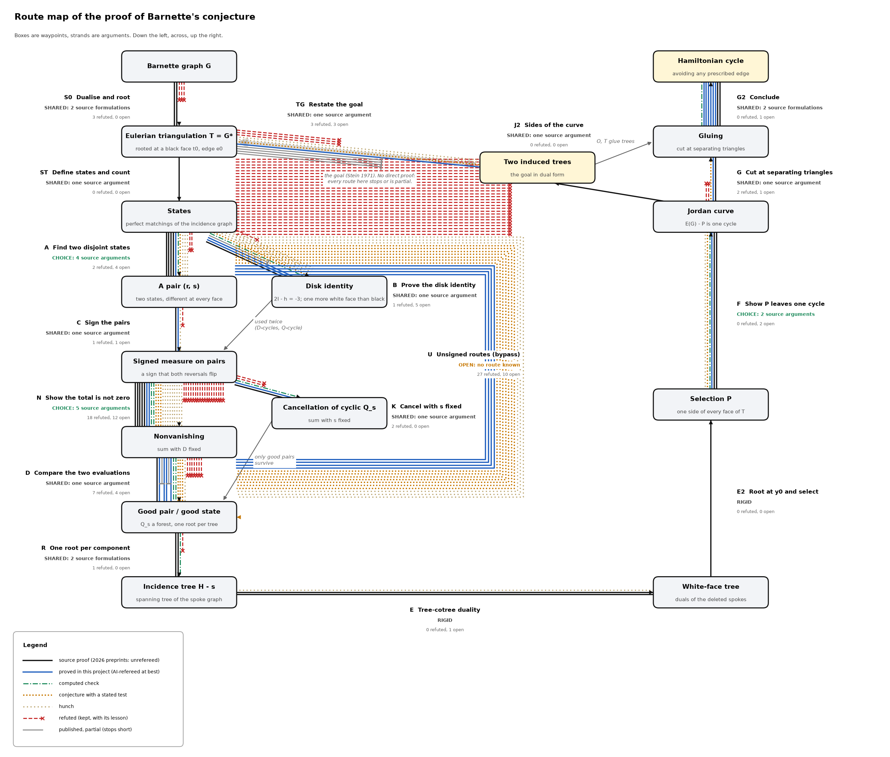
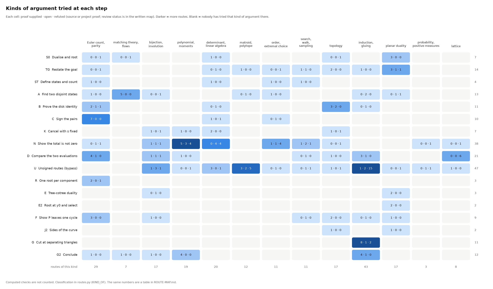

# Route map of the proof of Barnette's conjecture

Generated by `build_map.py` from `routes.py` on 2026-11-14. Do not edit this file. Edit `routes.py`, `ROUTE-MAP.head.md` or `ROUTE-MAP.tail.md` and rebuild.

Summary.

1. The proof is one chain of 16 waypoints. Every published proof (OpenAI, Li, the trees paper, the Lean formalisation) passes through the same chain. Nobody has a second way to reach a tree matching.
2. The chain is forced at the disk identity, the sign, the cancellation with `s` fixed, the comparison, tree-cotree duality and the gluing. It is free at three steps: the first pair (A), the nonvanishing (N) and the last step from the selected edges to one cycle (F).
3. The direct edge from the triangulation to two induced trees, which is where every attack before 2026 worked, has no complete route.
4. The bypass from states to a tree matching with no signed count has nine exact reformulations and no existence argument, with nine refuted relaxations next to them. Every relaxation tested drops a constraint and fails on a small example, most often the hexagonal prism.
5. This file lists 226 routes: 46 published, 57 proved in this project (none human-checked), 12 computed, 19 conjectures, 25 hunches and 67 refuted, each refuted one with its lesson and smallest known counterexample.

## The picture

Files: `route-map.pdf` and `route-map.svg` (vector, zoomable), `route-map.png` (150 dpi), `route-map-overview.*` (the same map without the route lists), `route-kinds.*` (a matrix of steps against kinds of argument, near the end of this file), `route-map.dot` (Graphviz source, one edge per route), `routes.json` (the data).

## How to read it

The proof goes down the left side, across the bottom and up the right side. The left side finds a tree matching. The right side turns it into a Hamiltonian cycle. The top edge, from the triangulation straight to two induced trees, is the goal stated as an equivalence. It is drawn grey because no proof crosses it directly.

A strand between two boxes is an argument that crosses that step.

| Style | Status | Meaning |
| --- | --- | --- |
| black, solid | `LIT` | supplied source result; 2026 preprints are unrefereed. One strand per distinct argument, so a single black strand means the papers agree up to translation |
| blue, solid | `PROVED-HERE` | full proof written in an agent folder. Review state is given in the table of the step |
| green, dash-dot | `COMPUTED` | checked by a script on a stated range |
| orange, dotted | `CONJECTURE` | precise statement with a test |
| pale, dotted | `HUNCH` | a direction with a reason and a first test |
| red, dashed, ending in a cross | `REFUTED` | tried and closed. The lesson and the counterexample are listed under the step |
| grey, short | published, partial | a published result that crosses the step only for a subclass |

Rows marked with a dot are facts about the step. Rows marked with the sign for "identical" are exact reformulations of the target. Neither is an argument that crosses, so neither is drawn as a strand.

Sources. O is `papers/OpenAI-Barnette.pdf`, L is Li's note, T is the trees paper, Lean is the formal proof in OpenAI's repository as read by the lean-formalisation agent, lit is older literature. Lower-case tags are agent folders: dep `research/2026-11-14_fable_dependency-graph`, comb `..._fable_route-combinatorics`, dim `..._astra_route-dimers`, con `..._sol_route-constructive`, mach `..._sol_machinery-literature`, alg `..._sol_route-algebra`, lim `..._astra_limits`, hist `..._opus_history-literature`, gt `..._opus_route-graph-theory`, topo `..._opus_route-topology`, lean `..._opus_lean-formalisation`, expo `..._astra_exposition-method`, refc `..._astra_referee-combinatorics`, refd `..._fable_referee-determinants`.

Status. The three 2026 papers are unrefereed preprints. `LIT` on a 2026 statement means "stated and proved in a paper we hold". `PROVED-HERE` results were written by AI agents. "AI-refereed" means one independent AI referee with its own code returned a verdict. Nothing here has been checked by a human.

## Counts

16 waypoints, 17 steps, 226 routes: 46 `LIT`, 57 `PROVED-HERE`, 12 `COMPUTED`, 19 `CONJECTURE`, 25 `HUNCH`, 67 `REFUTED`.

| Step | From | To | Verdict | Published arguments | `LIT` | `PROVED-HERE` | `COMPUTED` | `CONJECTURE` | `HUNCH` | `REFUTED` |
| --- | --- | --- | --- | --- | --- | --- | --- | --- | --- | --- |
| S0 Dualise and root | G | T | forced | 2 | 3 | 1 | 0 | 0 | 0 | 3 |
| TG Restate the goal | T | 2T | forced | 0 | 6 | 2 | 0 | 1 | 2 | 3 |
| ST Define states and count | T | S | forced | 1 | 3 | 1 | 0 | 0 | 0 | 0 |
| A Find two disjoint states | S | P | free | 4 | 4 | 3 | 2 | 1 | 3 | 2 |
| B Prove the disk identity | T, S | DI | forced | 1 | 2 | 3 | 1 | 1 | 4 | 1 |
| C Sign the pairs | P, DI | M | forced | 1 | 4 | 4 | 0 | 0 | 1 | 1 |
| K Cancel with s fixed | M | K | forced | 1 | 1 | 4 | 1 | 0 | 0 | 2 |
| N Show the total is not zero | M | N | free | 5 | 5 | 3 | 2 | 3 | 9 | 18 |
| D Compare the two evaluations | K, N | FP | forced | 1 | 1 | 9 | 2 | 3 | 1 | 7 |
| U Unsigned routes (bypass) | S | FP | open | 0 | 0 | 10 | 1 | 7 | 3 | 27 |
| R One root per component | FP | IT | forced | 2 | 2 | 0 | 1 | 0 | 0 | 1 |
| E Tree-cotree duality | IT | WT | rigid | 2 | 2 | 0 | 0 | 0 | 1 | 0 |
| E2 Root at y0 and select | WT | SE | rigid | 1 | 1 | 1 | 0 | 0 | 0 | 0 |
| F Show P leaves one cycle | SE | JC | free | 2 | 3 | 4 | 1 | 1 | 1 | 0 |
| J2 Sides of the curve | JC | 2T | forced | 1 | 2 | 0 | 0 | 0 | 0 | 0 |
| G Cut at separating triangles | JC, 2T | GL | forced | 1 | 4 | 4 | 0 | 1 | 0 | 2 |
| G2 Conclude | GL | HC | forced | 2 | 3 | 8 | 1 | 1 | 0 | 0 |

## Waypoints

| Id | Waypoint | What it is |
| --- | --- | --- |
| G | Barnette graph G | Cubic, bipartite, 3-connected, planar. The claim is that G has a Hamiltonian cycle, and more: one that avoids any prescribed edge. |
| T | Dual Eulerian triangulation (T, t0, e0) | T = G* is a simple sphere triangulation with faces coloured black and white. Root it at a black face t0 with an edge e0. Vertices of G are faces of T, faces of G are vertices of T. |
| 2T | Two induced trees | The goal in dual form. G has a Hamiltonian cycle avoiding e0* if and only if V(T) splits into two sets, each inducing a tree, with both ends of e0 in one of them (Stein 1971; APSW 2016). |
| S | States | A state is a bijection s from the bounded black faces A to the non-root vertices X with s(t) a corner of t. It is a perfect matching of the incidence graph B. \|A\| = \|X\| = n. |
| P | A pair (r, s) | Two states that differ at every face. The partner r is the certificate that orients Q_s: the edge opposite s(t) in t is directed out of r(t). |
| DI | Disk identity | A directed cycle of state edges of length h with l black faces of its disk along it has 2l - h = -3. Equivalently its disk holds exactly one more white face than black faces. |
| M | Signed measure on pairs | Every pair gets a sign (i^J in O, (-1)^cw in L, epsilon in T). Reversing a cycle of D(r, s) flips it, and reversing a cycle of Q_s flips it. The whole proof is one signed sum over pairs, weighted by a function of s. |
| K | Cancellation of cyclic Q_s | Sum with s fixed. If Q_s has a cycle, reversing it changes r, keeps s and the weight, and flips the sign. So only pairs with Q_s a forest survive. |
| N | Nonvanishing | Sum with the undirected cycle set D fixed. With weights whose circulation is positive on every counterclockwise spoke cycle, the lowest-order term is a positive count of the covers with fewest cycles. |
| FP | Forest pair / tree matching | A pair with Q_s a forest. Equivalently a state s with H - s a spanning tree of the spoke graph. Equivalently a state with exactly one partner. |
| IT | Incidence tree H - s | Delete the n matched spokes from the spoke graph H. What is left is a spanning tree: every black centre keeps two spokes, t0 keeps three. |
| WT | White-face tree | The duals of the n deleted spokes form a spanning tree on the white faces (tree-cotree duality in the plane). |
| SE | Selected edges P | Root the white tree at y0, the white face across e0. Each tree edge selects one side of its black face. With e0 this is one edge in every face of T, a perfect matching of G. |
| JC | Jordan curve | E(G) - P is 2-regular. It is a single cycle, hence a Jordan curve on the sphere, and its two sides are the two induced trees. |
| GL | Gluing | If a separating triangle blocks the state method at this root, cut along it, cap both sides, solve each with the cap edge prescribed, and glue. |
| HC | Hamiltonian cycle | Every Barnette graph has a Hamiltonian cycle avoiding any prescribed edge (O Theorem 1.1, Corollary 7.1). |

## Steps and routes

For every step: what must be shown, how much freedom the known proofs have, then every route. A route marked *fact* or *reformulation* is listed with the step it belongs to and is not drawn as a strand.

### S0. Dualise and root (G to T)

What must be shown. 3-connected cubic plane graphs are the duals of simple triangulations, and bipartite means the faces of T 2-colour. This is the only place 3-connectivity is used.

Freedom. No freedom in the statement. Li keeps the primal language through the auxiliary graph aux(G); the objects are the same.

| Id | Route | Status | Source | Statement |
| --- | --- | --- | --- | --- |
| S0.1 | duality; 3-connectivity gives a simple T | `LIT` | O proof of Thm 1.1; APSW 2016 Section 1 | The dual of a 3-connected cubic plane graph is a simple triangulation; G bipartite iff T Eulerian iff the faces of T 2-colour iff the vertices 3-colour. |
| S0.2 | stay in G with aux(G) | `LIT` | L Section 2 | Li works in the primal graph with the face/black-vertex incidence graph. aux(G) is T with a centre in every face. |
| S0.4 | algebraic dual from grid minors (Lean) | `LIT` | lean/DIFFERENCES.md items 1-6 | The formal proof never uses faces or the Jordan curve theorem. A drawn graph is a minor of a grid, the grid has an explicit algebraic dual, and duality survives deletion and contraction. |
| S0.3 | 3-connectivity enters only here (fact) | `PROVED-HERE`, unreviewed | dep/audit-openai.md, REPORT.md | In O, 3-connectivity is used once, to exclude loops and parallel edges in the dual. Simplicity is then used in the flow bound and the gluing. |
| S0.x1 | drop bipartite | `REFUTED` | lim/HYPOTHESES.md; examples/K4.json, Tutte46.json | Without bipartiteness there is no proper face colouring of T, so states are not defined. |
| S0.x2 | drop 3-connectivity | `REFUTED` | lim/HYPOTHESES.md; examples/theta_cube_26.json | A 2-connected cubic bipartite planar graph can be non-Hamiltonian. Its dual has parallel edges. |
| S0.x3 | other surfaces | `REFUTED` | lim/HYPOTHESES.md; examples/torus_3x3.json | On an orientable surface of genus g, \|A\| - \|X\| = 2g, so states with three roots do not exist for g > 0, and the two-tree target is impossible on the torus by an edge count. |

- **S0.x1, refuted.** Lesson: Odd degrees obstruct the algebra itself, before any question of Hamiltonicity. Best max-cut colourings of K4, BBL38 and Tutte's graph leave 2, 7 and 9 monochromatic adjacencies. Smallest known counterexample: K4 (4 vertices): the dual has all degrees odd. Tutte's 46-vertex graph is the non-Hamiltonian witness.
- **S0.x2, refuted.** Lesson: The proof stops at the pair: the 26-vertex theta of three cubes-minus-an-edge has 8 states and no disjoint pair at each of its 26 roots. The disk identity itself survives in the multimap. Smallest known counterexample: theta of three copies of cube-minus-edge, 26 vertices (minimum by Asano-Saito-Exoo-Harary 1982, abstract only).
- **S0.x3, refuted.** Lesson: The first obstruction is cardinality. A surface version needs a different state and a different target (one edge per triangle with connected complementary dual). Smallest known counterexample: 3 x 3 periodic triangular grid on the torus: no two induced trees, yet the dual has 36 Hamiltonian cycles.

### TG. Restate the goal (T to 2T)

What must be shown. A Hamiltonian cycle of G is a Jordan curve; the faces of G on each side are vertices of T inducing a tree. Known since Stein. All pre-2026 attacks tried to cross here directly.

Freedom. This is the edge that 57 years of partial results worked on. None of them reaches all Barnette graphs.

| Id | Route | Status | Source | Statement |
| --- | --- | --- | --- | --- |
| TG.1 | Stein 1971; APSW Lemma 5 (reformulation) | `LIT` | Stein, Pacific J. Math. 37 (1971), Thm 2.2; APSW 2016, Lemma 5 | T* is Hamiltonian iff V(T) splits into two induced forests, which for triangulations are two induced trees. |
| TG.2 | prescribed edge: O Theorem 2.2 (reformulation) | `LIT` | O Thm 2.2; hist/EQUIVALENTS.md 9, 14a | With e0 inside one tree the cycle avoids e0*. This is the H- form of Kelmans and Hertel, equivalent to the conjecture. |
| TG.3 | face-size results (Goodey; Schnieders) (partial) | `LIT` | Goodey 1975; Feder-Subi 2006; Schnieders 2025 (hist/RESULTS-TABLE.md) | Hamiltonicity when all faces have size at most 6 (Goodey), at most 8 (Schnieders, 339 million computer cases). Partial: local reductions cannot see 3-connectivity, which becomes necessary at face size 10. |
| TG.4 | computer search to 90 vertices (partial) | `LIT` | Brinkmann-Goedgebeur-McKay, Math. Comp. 2022 | All Barnette graphs up to 90 vertices are Hamiltonian. |
| TG.5 | trees of faces (Feder-Subi) (partial) | `LIT` | Feder-Subi 2006; Bagheri Gh. et al. 2021 | Contract a colour class of faces and look for a quasi spanning tree of faces. Polynomial when the remaining faces have 2 or 3 sides, NP-complete in general. The closest older relative of the incidence tree. |
| TG.6 | A-trails, braces, book embeddings (partial) | `LIT` | hist/EQUIVALENTS.md 6, 11, 12 | Equivalent formulations in other languages. None supplied an existence mechanism. |
| TG.7 | acyclic triangle factor of a second trinity K (reformulation) | `PROVED-HERE`, unreviewed | cat/PROOF.md Prop. 5 | Hamiltonian cycles with a root on each side are the acyclic triangle factors of a second trinity K built from T. A symmetric restatement of the goal. |
| TG.edge | through an edge from avoidance | `PROVED-HERE`, unreviewed | older/BRIDGES.md; older/NOVELTY.md | At an endpoint of a prescribed edge e, avoid either other incident edge. Degree two then forces e. Through-edge Hamiltonicity follows from universal edge avoidance. Unreviewed conditional deduction. |
| TG.h2 | nodal domains of eigenvectors | `CONJECTURE` | topo/PREDICTIONS.md P10 | Sign patterns of Laplacian eigenvectors of T almost never give two induced trees (predicted below 5 per cent). |
| TG.h1 | induced-forest completion | `HUNCH` | mach/ROUTE-IDEAS.md 18 | Start from a large induced forest and exchange vertices until both sides are trees. |
| TG.older | older radial-tree dictionary and limits | `HUNCH` | older/BRIDGES.md; older/REPORT.md | The final report gives a radial/permeating-tree dictionary and rejects a direct identification with H-s. A direct Pfaffian transfer still lacks balanced incidence objects, disk identity and recovery. |
| TG.parity | BF21 parity equals black-inner obstruction | `REFUTED` | older/BRIDGES.md; older/REPORT.md | Identify the even-interior condition of the older contracted graph with the black-inner separator obstruction. |
| TG.x1 | trees from colour classes | `REFUTED` | APSW 2016 (limitation theorem); hist/WHAT-WAS-HARD.md 5 | Build a permeating subtree containing all or none of a colour class of the vertex 3-colouring. |
| TG.x2 | Grinberg obstruction | `REFUTED` | hist/WHAT-WAS-HARD.md 2; gt/PROOFS.md (Grinberg's identity is automatic for two induced trees) | Use Grinberg's formula with a modulus to decide Hamiltonicity. |

- **TG.h2, conjecture.** Test: Run over the sample of the topology agent; outcome pending in topo/ROUTES.md.
- **TG.h1, hunch.** Farthest from the pair machinery. The general Albertson-Berman conjecture cannot be an input: 2026 preprints report counterexamples. Test: Enumerate maximum induced forests on small Eulerian triangulations and look for a trapped configuration.
- **TG.older, hunch.** A classical reduction could transport the missing root data. Test: Replay the named prism, truncated-octahedron and Pfaffian tests when the report is available.
- **TG.parity, refuted.** Lesson: The two conditions belong to different incidence constructions; the radial tree is not H-s. Smallest known counterexample: Truncated-octahedron contraction, author certificate not yet independently replayed.
- **TG.x1, refuted.** Lesson: APSW give Eulerian triangulations in which every permeating subtree contains at least k and misses at least k vertices of every colour class. The trees of the 2026 proofs come from a matching, not from colour classes. Smallest known counterexample: APSW 2016, family for every k (not reconstructed here).
- **TG.x2, refuted.** Lesson: A Barnette graph has f_4 = 6 + sum (k/2 - 3) f_k, so at least six faces of weight 2 and the classical modulus argument cannot apply. PROVED-HERE in the history folder. Smallest known counterexample: Any Barnette graph: at least six 4-faces.

### ST. Define states and count (T to S)

What must be shown. Euler's formula gives equally many black and white faces k and k + 2 vertices, so |A| = |X| = k - 1. Without this equality there is nothing to match.

Freedom. States are Tutte's trinity states with the colours swapped. Their number is a determinant.

| Id | Route | Status | Source | Statement |
| --- | --- | --- | --- | --- |
| ST.1 | Euler count \|A\| = \|X\| | `LIT` | O (2.1); T (2); L omits it | k black faces, k white faces, k + 2 vertices, so n = k - 1 on both sides of B. |
| ST.2 | states = trinity states; number = \|det K_B\| (fact) | `LIT` | T Lemma 6.1; Hine-Kalman 2018 Thm 4.3, Lemma 4.4 (dim/ROUTES.md) | All states have one permutation sign, so their number is \|det K_B\|, Tutte's magic number, the number of arborescences of each of the three trinity graphs. |
| ST.3 | states form a distributive lattice (fact) | `LIT` | Hine-Kalman 2018 (clock theorem); mach/REFORMULATIONS.md 9 | Clock moves connect all states. The tree matchings are a subset of this lattice with no known description. |
| ST.4 | uniform sampling of states (fact) | `PROVED-HERE`, AI-refereed (con) | con/ALGORITHMS.md | Because all extensions of a partial matching have one sign, residual determinants count them, and a state can be sampled uniformly in polynomial time. This does not sample tree matchings. |

### A. Find two disjoint states (S to P)

What must be shown. The incidence graph B must contain two edge-disjoint perfect matchings. This is where a separating triangle can obstruct, and the only place the papers use 'no separating triangle'.

Freedom. Four published arguments (flow with a density bound; Ore deficiency with a minimal set; the exact criterion; Hall on a gadget in the Lean proof). They prove different amounts.

| Id | Route | Status | Source | Statement |
| --- | --- | --- | --- | --- |
| A.L | Ore deficiency, minimal deficient set | `LIT` | L Lemma 9, Theorem 10 (Ore), Claim 12 | A minimal deficient set yields a non-trivial 3-edge cut. The balance \|B'\| = \|F'\| needed for Ore is not stated in the note. |
| A.Lean | Hall's theorem on a gadget; global density bound (Lean) | `LIT` | lean/DIFFERENCES.md items 9-11 | Max-flow is replaced by Hall's theorem on a doubled incidence graph, and the density bound is proved for all of T[U] at once from a rank inequality. |
| A.O | max-flow + planar density bound | `LIT` | O Prop. 3.1, (3.1)-(3.4) | No separating triangle implies the Hall-type condition for two disjoint matchings, by bounding every component of T[U]. |
| A.T | exact criterion: no black-inner separating triangle | `LIT` | T Thm 1.2 (ii) iff (iii), Section 3 | A pair exists if and only if t0 lies on the black side of every separating triangle. |
| A.6 | pairs are alpha-orientations (Felsner lattice) (fact) | `PROVED-HERE`, under review (gt) | gt/PROOFS.md Lemma 3.1 | Pairs up to reversing D-cycles are the alpha-orientations of H - t0 with out-degrees 2, d_x - 2, d_r - 1. They form a distributive lattice. |
| A.GT | one exact Euler identity, both directions | `PROVED-HERE`, under review (gt) | gt/PROOFS.md Lemma 2.2, Thm 2.1 | m - b - (2p - 4) = (1/2) sum over non-face regions of (beta - (d - 4)). Every region contributes at most 0 except a black-inner separating triangle, which contributes +1. |
| A.d | Li's Lemma 9 already gives the black inner boundary (fact) | `PROVED-HERE`, unreviewed | dep/correspondence.md 3.7 | For a minimal deficient set all three cut edges have their black end inside, so Li's proof gives (iii) implies (ii) of T Theorem 1.2. |
| A.4 | pair counts depend on the root (fact) | `COMPUTED` | lim/data/roots.json | In plantri graph 12_2 one black root has 9 states, 10 pairs, 8 tree matchings; every other black root has 9, 2, 2. |
| A.c | criterion checked on all roots to 16 vertices | `COMPUTED` | lim/code/campaign.py 14 (1206 roots); con/VERIFICATION.md (77 runs); gt (all 7868 rooted instances up to 16 vertices against max-flow) | Pair existence agrees with absence of a black-inner separating triangle at every root tested. |
| A.2 | roots not on a common face | `CONJECTURE` | dep/skeleton.md G2 | For every simple 2-coloured triangulation some triple of roots of three colours, not necessarily the corners of a face, admits two disjoint states. The categorical agent tested the two-root version: the obstruction moves and the recovery lemma fails without a root face (A.x2). |
| A.1 | induction over local expansions | `HUNCH` | dep/skeleton.md A1 | Grow rooted Eulerian triangulations by vertex splits and show a pair survives each split. |
| A.3 | matroid union | `HUNCH` | dep/skeleton.md A3 | Two disjoint matchings as a basis of a union of transversal matroids. |
| A.5 | Hall-free shelling construction | `HUNCH` | gt/ROUTES.md F2 | Build a pair by a canonical ordering from t0 inward, as for Schnyder woods. |
| A.x1 | every avoiding cycle comes from a tree matching | `REFUTED` | posed in dep/skeleton.md A2; refuted by comb/ROUTES.md 12 (E8) and lim/examples/prism_recovery.json | If every Hamiltonian cycle avoiding e0* came from a tree matching, known Hamiltonicity results would give pairs with no flow argument. |
| A.x2 | two roots instead of a root face | `REFUTED` | cat/REPORT.md (what failed); cat/CATEGORICAL.md | Root at two vertices not tied to a face; every root pair then has a two-root tree matching, and it gives a Hamiltonian cycle. |

- **A.2, conjecture.** Test: On the smallest black-inner example (9 vertices, lim/examples/t9_0.json, outer face 2) enumerate all root triples and count pairs.
- **A.1, hunch.** Would replace the flow argument by a local rule. Test: For each expansion look for a local map from pairs to pairs; check on all pairs for n <= 15.
- **A.3, hunch.** Expected to reduce to the same deficiency count. Recorded so nobody spends an afternoon on it. Test: Write the rank formula and compare with O (3.1).
- **A.5, hunch.** The certificate of non-existence is always one triangle, which is how density conditions behave when a shelling exists. Test: Implement a shelling of the 55 triangulations up to 14 vertices and compare with the flow pairs.
- **A.x1, refuted.** Lesson: The recovery map is injective and not onto. A cycle avoiding e0* always defines a state, and that state is a tree matching or has no partner at all. Most avoiding cycles are of the second kind (ratio up to 26). Smallest known counterexample: Hexagonal prism (dual with 8 vertices): 4 cycles avoid the edge, 2 tree matchings.
- **A.x2, refuted.** Lesson: Two roots move the obstruction and do not remove it, and O Lemma 6.2 needs all roots on one side of every selected cycle, which a root face guarantees. This is what the face root is for. Smallest known counterexample: Existence: plantri graph 12_6, 51 of 66 root pairs. Recovery: a two-root tree matching with no Hamiltonian cycle at 8 vertices.

### B. Prove the disk identity (T + S to DI)

What must be shown. Euler's formula on the disk, a signed count of sides, and B = I + l, which holds because a state is a bijection.

Freedom. Euler double count in the sources; the signed-angle Gauss-Bonnet derivation is independently AI-refereed with boundary corrections. No human check.

| Id | Route | Status | Source | Statement |
| --- | --- | --- | --- | --- |
| B.L | the same count on hexagons of the spoke graph | `LIT` | L Claim 25 | t_in = \|C\|/4 - 3/2 for an alternating cycle of the spoke graph. Same identity with t_in = l (dep/correspondence.md 3.2). |
| B.O | Euler + side count + bijection, on triangles | `LIT` | O Lemma 4.1, (4.1), (4.2); T Lemma 4.1 | B + W = 2I + h - 2, 3(B - W) = 2l - h and B = I + l give 2l - h = -3. T adds that the length is odd. |
| B.0 | reading: W = B + 1, degree -1 of the colouring | `PROVED-HERE`, AI-refereed (comb) | dep/skeleton.md B0; comb/PROOF.md Section 1 | With the vertex 3-colouring c, delta(v, w) = c(w) - c(v) mod 3. The identity says the disk of a directed state cycle holds one more white face than black faces; the colouring map has degree -1 on it. |
| B.6 | combinatorial Gauss-Bonnet with signed angles | `PROVED-HERE`, under review (topo) | topo/REPORT.md item 1; topo/ROUTES.md; reft/REFEREE.md | The state defines a flat signed-angle structure, and a vertex-local identity says turning equals minus colour winding. The disk identity is then the theorem of turning tangents. Orientation-free form: every chosen-edge disk has W = B + 1. Independently AI-refereed in the topology referee report; human checking pending. Apply the referee corrections where relevant. The proof uses Euler counting, not a smooth turning-tangents theorem. Boundary flatness and exclusion of the outer face are required. |
| B.height | signed white area is additive (partial) | `PROVED-HERE`, unreviewed | reft/REFEREE.md Section (h) | The referee supplies a winding-number proof of height equals signed white area without separating triangles. This new proof has not itself had a second referee. |
| B.c | checked on every enumerated cycle | `COMPUTED` | con/VERIFICATION.md (1466 directed cycles); dep/scripts/check_nodes.py; refd/code/results.json | All disk equalities hold on every cycle enumerated, with all outgoing choices for n <= 6. |
| B.5 | Gauss-Bonnet form for any cycle | `CONJECTURE` | topo/PREDICTIONS.md P2 | For a state s and a simple cycle C avoiding the roots, B - W = 2m - h + 2, with m the boundary vertices whose matched face lies inside. The topology agent reports the orientation-free form W = B + 1 as proved (B.6); the status of this exact formula is in topo/ROUTES.md. |
| B.1 | integer lift of Kasteleyn's sign lemma | `HUNCH` | dep/skeleton.md B1 | The faces of the spoke graph are hexagons, 6 = 2 mod 4, which is Kasteleyn's condition. The common sign of all states uses only the parity part of the disk identity. |
| B.2 | discrete Morse theory | `HUNCH` | dep/skeleton.md B2 | Read the state as a pairing of black faces with vertices in the disk and compute the degree from the unpaired cells. |
| B.3 | peel the disk | `HUNCH` | dep/skeleton.md B3 | Remove a boundary vertex with its matched black face and show 2l - h does not change. |
| B.4 | Grinberg count made rigid by a matching | `HUNCH` | hist/WHAT-WAS-HARD.md 2 | 3(B - W) = 2l - h is a Grinberg balance in the dual; the bijection adds B = I + l. |
| B.x1 | drop bijectivity | `REFUTED` | lim/examples/nonbijective_disk.json | Let each black face choose a corner with no injectivity requirement. |

- **B.5, conjecture.** Test: Outcome pending in topo/ROUTES.md.
- **B.1, hunch.** The disk identity may be a flatness condition for a Z/4 or complex signing of spokes. Test: Derive t_out - t_in = 3 from a flatness condition for such a signing.
- **B.2, hunch.** B = I + l looks like a cancellation of cells. Test: Write the pairing as a discrete vector field and check that one white face is always left over.
- **B.3, hunch.** An inductive proof with a picture per step. Test: Implement the peeling on enumerated cycles.
- **B.4, hunch.** Places the one new lemma next to the oldest tool of the subject. Test: State Grinberg's formula for the dual disk and compare term by term.
- **B.x1, refuted.** Lesson: With defect d = B - I - l the identity becomes 2l - h = -3 - 3d. The state condition is exactly d = 0. Every interior vertex must be covered once. Smallest known counterexample: 9 vertices: a directed 4-cycle with delta-sum 0; vertex 8 is used twice, d = -1.

### C. Sign the pairs (P + DI to M)

What must be shown. Define the sign and show that both reversals flip it. The disk identity is used twice here: on the cycles of D and on the cycle of Q_s.

Freedom. Three notations for one sign. The complex phase is packaging; a real sign is enough.

| Id | Route | Status | Source | Statement |
| --- | --- | --- | --- | --- |
| C.L | (-1)^cw from local turns | `LIT` | L Lemmas 16, 17, Claim 26 | cw' = #clockwise - #counterclockwise cycles. cw' = -J (dep/correspondence.md 3.1). |
| C.Lean | raw index sum, phase I^(n/3) (Lean) | `LIT` | lean/DIFFERENCES.md item 14 | The formal proof never shows J is an integer. It keeps the sum of delta and needs only phase(n +- 6) = -phase(n). |
| C.O | phase i^J | `LIT` | O (5.1), Lemma 5.2 | J = (1/3) sum of delta(r(t), s(t)) is an integer; both reversals change J by 2. |
| C.T | epsilon = (-1)^((n+J)/2) | `LIT` | T Lemma 4.2, (8) | A real sign; moves (a) and (b) flip it. |
| C.1 | the three signs agree up to a constant (fact) | `PROVED-HERE`, unreviewed | dep/correspondence.md 3.1 | i^J = i^(-n) epsilon, and Z(x) = i^(-n) times the sum of T's polynomials over exchange components. |
| C.2 | J is an integer by the 3-colouring alone (fact) | `PROVED-HERE`, AI-refereed (comb) | dep/skeleton.md B0; comb/PROOF.md 1 | 3J = sum c(s(t)) - sum c(r(t)) = 0 mod 3 because r and s are bijections. J is clockwise minus counterclockwise cycles of D, the total colour winding. |
| C.3 | the sign is a Leibniz sign | `PROVED-HERE`, AI-refereed (comb, dim) | comb/PROOF.md 4; dim/PROOF.md 2; alg/PROOF.md 1 | After a gauge by the 3-colouring the sign of a pair is the product of the local turns delta, the sign of a term in an incidence determinant. The real sign is prod_t delta(r(t), s(t)). |
| C.5 | parity is enough three times; the value 3 once (fact) | `PROVED-HERE`, unreviewed | refd/SIGNIFICANCE.md | In the real-sign form, reversing a Q_s-cycle or a D-cycle multiplies the sign by (-1)^length. So the cancellation, the forest lemma and the permutation sign need only that state cycles are odd. The value 3 is needed once, to align the signs of the minimal D groups. |
| C.4 | height-function form of J | `HUNCH` | dep/skeleton.md C2 | The Q_s-reversal can change the cycle structure of D completely and J still moves by exactly 2. |
| C.x1 | sign as a product of two dimer weights | `REFUTED` | mach/REFORMULATIONS.md 3; con/ALGORITHMS.md; dim/PROOF.md 6 | Write the local phase as alpha(r(t)) beta(s(t)) and get Z as a product of two incidence determinants. |

- **C.4, hunch.** Suggests J(r, s) = g(s) - g(r) plus a term local to Q_s, like a dimer height. Test: Fit g on the enumerated pairs of the n = 15 and n = 23 examples.
- **C.x1, refuted.** Lesson: At a face with three non-root corners the two cyclic triple products of the phase have ratio -1, and any separated weight gives ratio 1. Disjointness of r and s is what stops the sum from being one determinant. Smallest known counterexample: One black triangle with three non-root corners.

### K. Cancel with s fixed (M to K)

What must be shown. The reversed cycle of Q_s must be chosen from s alone, so that the map is an involution that keeps the weight.

Freedom. All three papers use the same involution. It is the statement that a twisted incidence determinant of Q_s vanishes on a cycle.

| Id | Route | Status | Source | Statement |
| --- | --- | --- | --- | --- |
| K.O | involution: reverse a cycle of Q_s | `LIT` | O Lemma 5.2; L iota_1; T beta, Prop. 2.1 | Cycles of Q_s are directed by r. Reversing one chosen from s alone changes r, keeps the weight and flips the sign. T classifies all components: the number of partners is 0 or 2^k. |
| K.1 | twisted incidence determinant of Q_s | `PROVED-HERE`, AI-refereed (comb) | dep/skeleton.md C1; comb/PROOF.md Prop. 5 | For fixed s the partner sum is kappa det N_s, where N_s is the incidence matrix of Q_s reduced at the roots. It vanishes exactly when Q_s has a cycle. Lemma 5.2 is 'the rows of an incidence matrix around a cycle are dependent'. |
| K.2 | support of the multivariate polynomial (fact) | `PROVED-HERE`, AI-refereed (dim) | dim/PROOF.md 4; alg/PROOF.md 1 | With one variable per incidence, F(w) has coefficient +1 or -1 on each tree matching and 0 on every other state. So CT F(w)F(1/w) is the number of tree matchings. |
| K.3 | quartic Berezin integral (fact) | `PROVED-HERE`, unreviewed | alg/PROOF.md 5 | F(w) is a two-species Grassmann integral with one quartic term per black face. It has an exact Gaussian decoupling, with no assured sign. |
| K.4 | cancellation as a Morse matching (fact) | `PROVED-HERE`, under review (topo) | topo/REPORT.md item 2; reft/REFEREE.md | Pairs are combinatorial vector fields, tree pairs are gradient fields, and the cancellation reverses a closed orbit. The matching is acyclic and its critical cells are the forest pairs. Its Euler characteristic Z(1) is always 0, so a graded version is needed. Independently AI-refereed in the topology referee report; human checking pending. Apply the referee corrections where relevant. Correct grading: J = J_ccw - 2 times the number of clockwise Q-cycles. Pair each root with its outer-centre spoke in the Forman reading. Numerical checks of the Boolean levels only reach k <= 1. |
| K.c | checked on every cyclic second state | `COMPUTED` | con/VERIFICATION.md; dep/scripts/check_nodes.py (35 cases); comb/lab/dets.py 12; refd/code/results.json | Every state with a cycle in Q_s has zero signed partner sum; the partner count is 2^k or 0 on 140358 states (comb/lab/extra2.py 16). |
| K.x1 | choose the cycle using r | `REFUTED` | lim/HYPOTHESES.md (disk identity and bijectivity) | Let the reversed cycle depend on the partner. |
| K.x2 | the two cube structures form a bicomplex | `REFUTED` | cat/REPORT.md (what failed) | Treat reversal of Q-cycles and reversal of D-cycles as two commuting differentials and read the proof as homology. |

- **K.x1, refuted.** Lesson: The reversal changes r, so a rule that reads r need not pick the same cycle on the way back. The choice must be a function of s. No smallest counterexample was searched. Smallest known counterexample: none recorded; the argument is a proof that the involution property can fail, not an instance
- **K.x2, refuted.** Lesson: The two reversals do not commute. The homological packaging is a restatement and gives no new existence argument. Smallest known counterexample: 12 of 624 pairs up to 12 vertices.

### N. Show the total is not zero (M to N)

What must be shown. Weights that depend on s only and separate the two orientations of every D-cycle. Then group by D and find a term that cannot cancel.

Freedom. The widest step: five published arguments, two more proved here, and a long list of refuted shortcuts. Every route that works still minimises over the number of cycles.

| Id | Route | Status | Source | Statement |
| --- | --- | --- | --- | --- |
| N.L | second involution on marked objects | `LIT` | L Section 4, Defs 14, 20-23, Appendix B | Weights are signed crossings of vertical rays. A sign-reversing involution on lists of cmin marks; its fixed points share a sign. For cmin > 1 three verifications are left to the reader (dep/audit-li.md). |
| N.Lean | polynomial prod(1 + aX), weights from one flow on G (Lean) | `LIT` | lean/DIFFERENCES.md items 15-18 | Z is a polynomial, not an exponential sum, and Lemma 5.3 is replaced by a single flow on G with charge +1 at every white vertex. Proved for an abstract triangle system with two hypotheses on cycle index sums. |
| N.O | Taylor coefficient of order cmin | `LIT` | O Lemma 5.3, (5.3)-(5.5) | Unit circulations from dual paths, a slide of edges onto spokes, Z(x) = sum over D of prod (-i e^{xL+} + i e^{xL-}); the coefficient of x^cmin is a nonzero multiple of a positive sum. |
| N.T1 | integer polynomial per exchange component | `LIT` | T Lemma 5.1, Thm 5.2, (11) | Integer weights 0 <= a <= 6n; Z_C(z) = sum eps z^omega has a nonzero coefficient of (z - 1)^m. Every exchange component contains tree pairs of both signs. |
| N.T2 | marked walk (Garsia-Milne) | `LIT` | T Thm 5.3 | Alternate the two involutions on tokens; the walk ends at a tree pair or restarts with fewer D-cycles. Never computes cmin. 2^O(n log n) time. |
| N.H | heights as test functions, no weights | `PROVED-HERE`, AI-refereed (comb) | comb/PROOF.md Sections 2-3 (Theorem B); refc/REWRITTEN-PROP-5-1.md (self-contained rewrite by the referee) | Test the signed measure against a product of cmin heights at white faces. Pairs with one D form a cube, partners of one s form a cube, and the product is a cmin-fold difference that survives only on covers with exactly cmin cycles. |
| N.id | spoke weights are a height function (fact) | `PROVED-HERE`, AI-refereed (comb) | comb/PROOF.md 2.3 | omega(s) is the volume under the height of s, and L+(C) - L-(C) is the number of white faces inside C, which is B + 1. |
| N.lin | linear weights 1 + x a | `PROVED-HERE`, AI-refereed (dim) | dim/PROOF.md 7; refd/SIGNIFICANCE.md Section 2 (full proof with real signs and parity only) | Replace e^{xa} by 1 + xa. The polynomial has degree at most n and the same leading coefficient; on the forest side it is a signed elementary symmetric moment. The Lean proof uses the same polynomial (lean/DIFFERENCES.md item 16). |
| N.c | leading coefficient checked exactly | `COMPUTED` | con/supplemental.py (49 groups); comb/lab/dets.py 12; dim/code/linear.py; refd/code/results.json; lean/REPORT.md item 5 (71224 rooted triangulations up to 18 vertices) | The first nonzero coefficient equals the signed sum of products of enclosed face counts on every instance tested. |
| N.li-check | Li two-mark involutions on running example | `COMPUTED` | research/2026-11-14_astra_audit-digestions/code/verify.py; outputs/verification.json | 213 marked objects; iota1 fixes 141, iota2 fixes 9 of one sign; signed count -9. Closure, involutivity and sign reversal checked exhaustively on this instance. |
| N.9 | a test function with one sign on all covers | `CONJECTURE` | comb/REPORT.md, open question 2 | There is a test function of s for which every cycle cover contributes with the same sign, so that no minimum over the number of cycles is taken. |
| N.11 | non-increasing exchange path to a tree pair | `CONJECTURE` | rc/REFEREE.md; conjectures/REPORT.md | C3: from every ordered pair, D-swaps and Q-reversals that never increase the number of Q-cycles reach a forest pair. Independent exhaustive reachability through V=16 and on both saved plateau traps; author reports 940 successful starts. |
| N.12 | Li's marked objects are the e_m coefficient | `CONJECTURE` | refd/REPORT.md (still open) | Li's objects with cmin distinct marks are the elementary symmetric reading of the linear-weight coefficient. |
| N.1 | mixed determinant with positive curvature | `HUNCH` | dep/skeleton.md D1; mach/ROUTE-IDEAS.md 1 | Z = [prod z_t] det(sum z_t M_t) is n! times a mixed discriminant of rank-two blocks. Prove it nonzero from structural hypotheses. |
| N.2 | 2-adic evaluation at z = -1 | `HUNCH` | dep/skeleton.md D3 | Choose weights with every L+ - L- odd and evaluate T's polynomial at -1. |
| N.3 | cycle popping, random walk | `HUNCH` | dep/skeleton.md D4; con/ALGORITHMS.md (exchange walks) | The two moves pop cycles of Q_s and of D, as in Wilson's algorithm. Show the walk hits a tree pair fast. |
| N.4 | Pfaffian gadget for the turn tensor | `HUNCH` | mach/ROUTE-IDEAS.md 6; dim/ROUTES.md | Replace each black face by a planar matchgate with signature q^delta on distinct ordered corners and zero on equal corners. |
| N.5 | height potential on pairs | `HUNCH` | mach/ROUTE-IDEAS.md 7 | A combination of the two state heights that decreases along some exchange move at every non-tree pair. |
| N.6 | curved double-dimer connection, Lee-Yang | `HUNCH` | mach/ROUTE-IDEAS.md 15; mach/REFORMULATIONS.md 8 | Realise the loop factor -i e^{xL+} + i e^{xL-} as the trace of a non-flat connection. |
| N.7 | LGV after cutting along seams | `HUNCH` | mach/ROUTE-IDEAS.md 8 | Cut the pair diagram into non-intersecting paths and use a Lindstrom-Gessel-Viennot determinant. |
| N.8 | abstract valuation theorem | `HUNCH` | mach/ROUTE-IDEAS.md 17 | Axiomatise: a finite signed cycle system, two involutions, a positive circulation. |
| N.10 | flux on a small set of faces | `HUNCH` | dim/ROUTES.md (economical weights) | Put positive flux only on a set of faces that meets the interior of every feasible D-cycle. |
| N.heawood | root-free torus nonvanishing | `REFUTED` | pf/PROOFS.md; pf/data/results.json; pf/data/verification.json | Transfer spherical signed nonvanishing directly to Heawood on the torus. |
| N.rank-dead | signed sum as base-lattice rank polynomial | `REFUTED` | rc/LATTICE-READING.md; rc/data/examples.json | Read the pair sum from the ordinary rank polynomial of the factor lattice. |
| N.x1 | zero, vertex-only or face-only weights | `REFUTED` | lim/data/zero_weights.json; dim/PROOF.md 6; alg/PROOF.md 1 | Use weights alpha_t + beta_v, or none. |
| N.x2 | parity or mod p count without weights | `REFUTED` | comb/ROUTES.md 8; dep/skeleton.md D3; alg/PROOF.md 2; alg/TABLES.md (residues mod 2, 3, 4, 5, 7, 11) | Show the number of tree matchings is odd, or nonzero mod p. |
| N.x3 | tree pair among the fewest-cycle pairs | `REFUTED` | dep/skeleton.md D2; comb/ROUTES.md 7 (E2d, E3); refc/REFEREE.md; gt/ROUTES.md O3 (a 40-vertex one-cycle cover with no tree pair) | Among the pairs with the fewest D-cycles one has Q_s a forest; or every cycle cover D has a forest orientation. |
| N.x4 | highest or lowest partnered state | `REFUTED` | comb/ROUTES.md 4 (E1, E1c); refc/REFEREE.md; gt/ROUTES.md O1 (extremes of the whole matching lattice fail at 10 vertices) | The top (bottom) partnered state of the lattice is a tree matching. |
| N.x5 | minimal cover, all cycles one way | `REFUTED` | comb/ROUTES.md 5 (E2, E2c); refc/REFEREE.md | Take D with cmin cycles and orient all of them counterclockwise (or clockwise). |
| N.x6 | largest rank difference | `REFUTED` | comb/ROUTES.md 6 (E5) | The pair maximising omega(s) - omega(r) is a forest pair. |
| N.x7 | one cycle always suffices | `REFUTED` | comb/ROUTES.md 13 | cmin = 1, so a first-order argument is enough. |
| N.x8 | cubes of tree matchings; sign = parity of rank | `REFUTED` | comb/ROUTES.md 9, 10 | Tree matchings split into cubes of dimension cmin; or eps(s) = (-1)^omega(s) up to a constant. |
| N.x9 | ordinary determinant, all face variables 1 | `REFUTED` | con/ALGORITHMS.md, data/exact_determinant.json; dim/IDENTITIES.md | Evaluate det(sum_t M_t) with no coefficient extraction. |
| N.x10 | allow doubled edges (standard double dimers) | `REFUTED` | dim/PROOF.md 3; dim/ROUTES.md | Add a diagonal so that r and s may share edges, as in Kenyon's double-dimer determinant. |
| N.x11 | positive semidefinite blocks | `REFUTED` | alg/PROOF.md 4; comb/ROUTES.md 3 | Find a gauge in which the local matrices M_t are positive semidefinite, then use mixed-discriminant positivity. |
| N.x12 | Combinatorial Nullstellensatz | `REFUTED` | alg/PROOF.md 1 | Get a nonzero evaluation of F from the coefficient form of Alon's theorem. |
| N.x13 | real stability of the tree-state polynomial | `REFUTED` | alg/PROOF.md 3 | The unsigned generating polynomial of tree matchings is real stable, like spanning-tree polynomials. |
| N.x14 | single-swap descent on the number of Q-cycles | `REFUTED` | gt/ROUTES.md D1, D2 | From every pair with a cycle in Q_s some single exchange lowers the number of cycles. |
| N.x15 | a global sign gauge on incidences | `REFUTED` | alg/PROOF.md 2; alg/REPORT.md | Flip signs of incidence variables so that all tree matchings get the same coefficient sign. |
| N.zeros-dead | universal analytic root locations | `REFUTED` | prob/PROOFS.md; prob/code/secondary.py | Signed z-polynomials have unit-circle roots or linear-weight polynomials have only real roots. |

- **N.9, conjecture.** Test: On the 479 cases with more than 2^cmin tree matchings (comb/data/rows_v16.json), search low-degree polynomials in the heights.
- **N.11, conjecture.** Test: Find a potential on plateau components, or search for a closed positive-cycle component at larger orders.
- **N.12, conjecture.** Test: Enumerate Li's objects on an instance with cmin = 2 and compare the signed count with the coefficient of x^2 in F(1 + xa) for unit marks.
- **N.1, hunch.** At a = 1 the matrix is the adjacency matrix of T[X] with a U(1) connection of holonomy i around black and -i around white triangles. Test: Compute rank(sum over S of W_t) against |S| on cases with and without pairs; look for a non-diagonal normalisation.
- **N.2, hunch.** A count mod powers of 2 that sees the weights. Test: Check on the examples whether such weights exist and the value is nonzero.
- **N.3, hunch.** All 320 random and greedy trials from ten bad starts ended within ten moves (con, COMPUTED, small sample). Test: Measure hitting times on exchange components of growing size; look for a potential.
- **N.4, hunch.** Would remove the coefficient extraction and give a polynomial-time evaluation. Test: Check the Grassmann-Pluecker identities of the six-value signature with the boundary order fixed.
- **N.5, hunch.** Would turn existence into descent. Test: Search for a non-tree local minimum of each candidate on small exchange graphs.
- **N.6, hunch.** Each loop factor is -2i e^{xm} sinh(x Delta/2); zeros lie on the imaginary axis loop by loop. Test: Solve the connection equations on two bipyramids and test trace identities on nested loops.
- **N.7, hunch.** A fixed path matrix would make the sum a single determinant. Test: Do the cut on the cube and on the first instance with two D-cycles.
- **N.8, hunch.** Would say which planar hypotheses do the work. Test: List the axioms and find the first one that fails on a torus or a disk with four roots.
- **N.10, hunch.** Smaller weights, smaller degrees. Test: Compute minimum hitting sets of cycle interiors on the enumerated instances.
- **N.heawood, refuted.** Lesson: Cancellation survives while nonvanishing fails; the spherical disk value is indispensable for this route. Smallest known counterexample: Heawood: 24 states, 48 pairs, D seven-cycles, odd Q cycles; every state contribution cancels and polynomial is identically zero.
- **N.rank-dead, refuted.** Lesson: The orientation cube above each lattice element carries indispensable sign and weight data. Smallest known counterexample: Octahedron and hexagonal-prism dual have identical singleton lattice but different signed polynomials; opposite signs already lie above one ideal.
- **N.x1, refuted.** Lesson: Such weights are pure gauge: every state has the same total, and the signed count is 0 = 0. What is needed is positive circulation on cycles, not positive weights. Smallest known counterexample: Cube (octahedron dual, 6 vertices): two pairs with J = +1 and -1, Z = i - i = 0.
- **N.x2, refuted.** Lesson: The number of tree matchings is always even (the two signs balance), and T = P - 2 N_1 mod 4 is compatible with T = 0. The weighted sum is the refinement that works; the first degree at which anything survives is cmin. No modulus among 2, 3, 4, 5, 7, 11 gives a universally nonzero residue; the positive counts seen are 2, 4, 6, 8, 10, 12, 14, 16, 22. Smallest known counterexample: Octahedron: 2 tree matchings, signed count 0.
- **N.x3, refuted.** Lesson: Reversals inside one fixed cycle cover cannot be guaranteed to reach a forest pair, so a proof must move between covers. The leading coefficient is nonzero because of the fewest-cycle covers, but the surviving pairs can live in other covers. A statement that held on 1794 cases failed at the next size. (Scope as corrected by the referee.) Smallest known counterexample: 16 vertices, class 158, t0 = (2,7,3): a single 13-cycle whose two orientations both have a triangle in Q_s; its 12 tree matchings lie in two other covers. Also the octahedron with every face split in four (n = 15).
- **N.x4, refuted.** Lesson: For an extreme s every D has all cycles one way, but reversing a cycle of Q_s changes the number of D-cycles by two and extremality does not forbid it. Smallest known counterexample: 12 vertices, class 6, t0 = (2,7,3) for the highest state, and its mirror image for the lowest (the referee's correction: the author's enumeration identified reflections and reported 14).
- **N.x5, refuted.** Lesson: The leading coefficient sums over all minimal covers and prefers no orientation. Smallest known counterexample: 12 vertices, class 6, t0 = (2,7,3) for counterclockwise, and its mirror image for clockwise (referee's correction; the author reported 13).
- **N.x6, refuted.** Lesson: Maximality forces the cycles of Q_s to be counterclockwise and nothing more. Smallest known counterexample: 12 vertices, class 6, t0 = (2,7,3).
- **N.x7, refuted.** Lesson: cmin reaches 3 without separating triangles (192 of 3374 rooted cases up to 16 vertices) and 4 with them. A first-order argument is not enough and Li's Appendix B is needed. Unboundedness of cmin is not proved. Smallest known counterexample: 9 vertices: octahedron with an octahedron glued into a face, cmin = 2.
- **N.x8, refuted.** Lesson: Z(q)/(q - 1)^cmin can have mixed signs, which refutes a rank-compatible signed cube decomposition. An abstract partition into cubes of dimension cmin is refuted by cardinality (referee). Smallest known counterexample: Signs: 14 vertices, class 24, face 6, Z = -1 + 2q + q^5 - 2q^6. Cardinality: a 13-vertex instance with 6 tree matchings and cmin = 2 (refc/code/cube_cardinality.json). Sign = parity of rank fails at 8 vertices.
- **N.x9, refuted.** Lesson: Without extraction a black face can supply two transitions and another none; the extra terms can cancel the answer. Testing only the cube or the octahedron would have hidden this. Smallest known counterexample: Hexagonal prism dual (8 vertices): squarefree coefficient 45/64 at z = 5/4, all-one evaluation 0.
- **N.x10, refuted.** Lesson: Nonvanishing becomes too easy: F_lambda(1) = lambda^n times the number of states, which is positive even with no pair. An SL2 connection does not kill doubled edges. Smallest known counterexample: A rooted 9-vertex gluing with 4 states, no pair, doubled value 4.
- **N.x11, refuted.** Lesson: Each block is, after multiplication by i, Hermitian of trace zero and rank two, signature (1, 1, 0). No similarity or congruence changes that. The determinant explains the cancellation and does not replace the planar positivity. Smallest known counterexample: Any black face with two or three non-root corners.
- **N.x12, refuted.** Lesson: Naming a nonzero monomial of F already names a tree matching. Substituting w = a_t b_v kills F. Smallest known counterexample: Any instance: F(a_t b_v) = 0.
- **N.x13, refuted.** Lesson: Projecting onto matchings destroys stability. Smallest known counterexample: Cube: abc + def vanishes at a = b = c = e^{i pi/6}, d = e = f = i.
- **N.x14, refuted.** Lesson: A swap along a Hamiltonian D-cycle exchanges r and s, so it cannot lower the count both ways. Exhaustive data up to 15 vertices had made it look true. Smallest known counterexample: 50 vertices, 4-connected (gt/code/data/deeptrap_50_1.json); two swaps suffice there.
- **N.x15, refuted.** Lesson: A GF(2) inconsistency certificate: six tree states in which every incidence appears an even number of times, three with negative sign. Smallest known counterexample: A 13-vertex instance with six tree matchings.
- **N.zeros-dead, refuted.** Lesson: Family product factorizations do not establish a universal zero-location argument. Smallest known counterexample: V=12 exact factors (z-1)(z^2+3) and x(x+1)(2x+1)(2x^2+5x+4); real-rooted z already fails at V=10.

### D. Compare the two evaluations (K + N to FP)

What must be shown. The same sum is supported on forest pairs (by K) and is not zero (by N). So a forest pair exists.

Freedom. The comparison is one line. No canonical forest pair is known: every extremal choice tried is refuted.

| Id | Route | Status | Source | Statement |
| --- | --- | --- | --- | --- |
| D.1 | two evaluations of one sum | `LIT` | O Prop. 5.1; L Key Lemma 7; T Thm 5.2 | Supported on forest pairs, and not zero. |
| D.2 | at least 2 cmin tree matchings (fact) | `PROVED-HERE`, AI-refereed (comb) | comb/PROOF.md Corollary 3 | The signed measure on tree matchings kills all polynomials of degree below cmin in the rank, and the two signs are equally frequent. |
| D.4 | exactly one tree matching is impossible (fact) | `PROVED-HERE`, under review (lim) | lim/HYPOTHESES.md; alg/PROOF.md 2 (after T Thm 5.2) | The signed unweighted sum over tree matchings is zero, so their number is even. The cube has two. |
| D.5 | tree matchings can be exponentially rare (fact) | `PROVED-HERE`, under review (lim) | lim/HYPOTHESES.md (rarity); code/rarity.py q <= 6; cat/PROOF.md Prop. 6 (states, pairs and tree matchings multiply under insertion into a white face) | Gluing q hexagonal-prism duals into white faces gives 3^q states and 2^q tree matchings. |
| D.covers | primal meaning and unbounded c_min without separators | `PROVED-HERE`, unreviewed | covers/PROOFS.md; covers/data/family.json | For an admissible edge deletion S, c(D)=components(G-S)-1. Explicit T_m, V=3m+2, has no separating triangle, one cover with m-2 triangles and one pentagon, c_min=m-1 and #TM=2^(m-1). Author proof and finite checks, unreviewed. |
| D.families | exact even-prism counts (partial) | `PROVED-HERE`, unreviewed | families/FAMILIES.md Section 1 | For a prism of order 4m: m states, two tree matchings, c_min=1 and normalized polynomial z^(m-1)-1. Full proof supplied, independent review pending. |
| D.tubes | separator-free exponential rarity | `PROVED-HERE`, unreviewed | families/FAMILIES.md; families/data/ | Width-four nanotubes have S_L=Fib_(2L+3), #TM=2 and c_min=1. Stationary transfer certificates also cover width six. All-length transfer reasoning is author proved; finite arithmetic and matrices remain unreviewed. |
| D.two-covers | two-cover exponential bound | `PROVED-HERE`, unreviewed | covers/PROOFS.md | Two covers with c1,c2 cycles and j shared component cycles have overlap a either zero or 2^j and TM=2^c1+2^c2-2a. This proves C1 for two covers. Strictness has one unexcluded planar overlap configuration. Unreviewed. |
| D.unbounded | unbounded c_min in Goodey chains (partial) | `PROVED-HERE`, unreviewed | older/BRIDGES.md; older/REPORT.md | End-rooted chains of k octahedra have k D-components in every pair, while primal faces have size four or six. Separating triangles are allowed. Author proof, not yet independently refereed. |
| D.unique | one cover gives equality in C1 | `PROVED-HERE`, unreviewed | rc/REFEREE.md | If there is one factor, Q-cycle reversal would create another factor. All its 2^c orientations are tree pairs, and unique partners make their second states distinct. Thus #TM=2^c_min. Converse open. |
| D.C1-census | independent C1 census through V=22 | `COMPUTED` | rc/code/count.cpp; rc/data/fast_census_summary.json; rc/REFEREE.md | All 9,531,638 facial roots through V=22, 4,656,948 feasible: C1 and equality iff one factor pass. Independent Python and C++ implementations agree through V=18; author and referee totals agree through V=22. |
| D.cover-census | C1 and equality census through dual order 24 | `COMPUTED` | covers/code/README.md; covers/data/census.json | 23,824,742 facial roots of 4-connected Eulerian triangulations, V<=24: no C1 or equality-characterization violation. Maximum c_min=6 at V=23. T4 under review, not an independent certification of the inherited C engine. |
| D.3 | at least 2^cmin tree matchings | `CONJECTURE` | rc/REFEREE.md; covers/CENSUS.md | C1: every feasible root has #TM >= 2^c_min. Independently replayed on all rooted Eulerian triangulations through V=22; extended evidence on 23,824,742 separator-free facial roots through V=24. Equality iff one cover is also open beyond this range. |
| D.6 | a canonical forest pair | `CONJECTURE` | comb/REPORT.md step 3 | Under a bijection from states to trinity arborescences, tree matchings have a tree description that singles one out. |
| D.9 | contraction inequality tau(T) >= tau(T/ac) | `CONJECTURE` | ri/MISSING-LEMMA.md; ri/data/census_*.json | Contraction inequality #TM(T) >= #TM(T/M), conjectural on the rooted degree-four merge class. Checked on 1,202,792 rooted contractions through V=18. It does not imply that any contracted tree matching lifts directly. |
| D.8 | finding a tree matching is in PPAD | `HUNCH` | gt/REPORT.md (leads) | Each phase of the marked walk follows a path in a graph of degree at most 2 with alternating signs. |
| D.7 | extremes of Felsner's lattice of pairs | `REFUTED` | rc/REFEREE.md; rc/data/v18.json; rc/data/census_18.json | C2 is false. Both true lattice extremes can have no forest pair. Independent exhaustive minimum-order check finds 26 failures at V=18 and none below. |
| D.chain-dead | every maximal lattice chain hits success | `REFUTED` | rc/REFEREE.md; rc/data/r3.json; rc/data/R2_glued_V33.json | Every maximal chain contains an element carrying a tree pair. |
| D.ext1 | distance one from a lattice extreme | `REFUTED` | rc/REFEREE.md; rc/data/r1.json | R1: success within cover-distance one of an extreme. |
| D.ext2 | R2: extreme or irreducible | `REFUTED` | rc/LATTICE-READING.md Section 6; rc/data/R2_glued_V33.json | A bottom, top, join-irreducible or meet-irreducible element need not carry a tree pair. |
| D.fraction-dead | at least half the lattice succeeds | `REFUTED` | rc/REFEREE.md; rc/data/r5.json; rc/data/R2_glued_V33.json | At least half the factor lattice admits a successful direction choice. |
| D.level-dead | fixed-cycle-count flip connectivity | `REFUTED` | covers/data/levels.json; covers/PROOFS.md | Covers with the same c, including minimum-c covers, form a connected flip level. |
| D.x1 | the partner of a tree matching is a tree matching | `REFUTED` | topo/REPORT.md item 5 | Swapping r and s would then be a free involution on tree matchings and explain why their number is even. |

- **D.3, conjecture.** Test: Prove the two-cover exceptional-overlap exclusion, then extend the overlap calculation to several covers.
- **D.6, conjecture.** Test: Write the Hine-Kalman bijection on the 12-vertex class 6 example where every extremal rule fails, and look at the images of its 8 tree matchings.
- **D.9, conjecture.** Test: Prove an injection from exceptional to non-exceptional matchings; distinguish direct lift from rotation.
- **D.8, hunch.** Would place the search problem between polynomial time and the 3^(N/4) enumeration. Test: Write one phase of T Theorem 5.3 as an END-OF-LINE instance with polynomial-size circuits for the two involutions.
- **D.7, refuted.** Lesson: Exact extremes are computable by two shortest paths, but neither must succeed. Greedy facial terminals are not necessarily extremes. Smallest known counterexample: V=18, four-element diamond lattice, 54 states, 20 pairs and 12 tree states.
- **D.chain-dead, refuted.** Lesson: A chain can complete one coordinate block before entering the next and miss every success. Smallest known counterexample: Saved V=60 chain of seven elements; V=33 gluing already refutes it. No minimum claim.
- **D.ext1, refuted.** Lesson: No fixed distance bound works in the general class; separating-triangle-free restriction remains a separate test. Smallest known counterexample: Saved V=24 witness has nearest success at distance two; glued V=33 family gives unbounded distance.
- **D.ext2, refuted.** Lesson: Success need not occur at lattice boundary elements. This witness has separating triangles and does not settle a separator-free restriction. Smallest known counterexample: V=33 rigid-face sum of two V=18 witnesses; lattice B_4, 400 pairs, 144 tree pairs, all ten candidates fail. Two implementations agree. No minimum-order claim.
- **D.fraction-dead, refuted.** Lesson: Independent witness blocks multiply the successful fraction down to 2^-q. Smallest known counterexample: Saved V=70 gives 654/1410=109/235; V=33 gluing gives 4/16. No minimum claim.
- **D.level-dead, refuted.** Lesson: Do not assume that minimizing c gives a convex or connected lattice level. Smallest known counterexample: V=18 flip squares with labels 3,1,5,3 and 1,3,3,1; no smaller failure in the separator-free search.
- **D.x1, refuted.** Lesson: The evenness is a signed cancellation, Z(1) = 0, and not a free involution. Forest pairs are not symmetric in r and s. Smallest known counterexample: 6 failures among 442 tree matchings tested (topo data; smallest instance not recorded here).

### U. Unsigned routes (bypass) (S to FP)

What must be shown. Find a tree matching with no signed sum: as a prescribed-degree spanning tree, a three-matroid intersection, a constrained white tree, a point of the state lattice.

Freedom. Contraction induction stops at ML1 and ML2; rainbow exchange and two-tree packing remain conjectural at this snapshot. The natural two-matroid and LP shortcuts fail.

| Id | Route | Status | Source | Statement |
| --- | --- | --- | --- | --- |
| U.1 | prescribed-degree spanning tree of H (reformulation) | `PROVED-HERE`, unreviewed | mach/REFORMULATIONS.md 1, 4 | [y^{d*}] det L_H(y) is the number of tree matchings: a positive coefficient of the tree-degree polynomial. Existence would follow from a support theorem for that polynomial. |
| U.2 | label-transversal white trees (reformulation) | `PROVED-HERE`, AI-refereed (dim) | dim/PROOF.md 5; alg/PROOF.md 3 | Tree matchings are the spanning trees of the restricted white-face graph whose edge labels use every t and every v once. A doubly squarefree coefficient of a Laplacian determinant counts them, by Cauchy-Binet with all terms nonnegative. |
| U.3 | three-matroid intersection (reformulation) | `PROVED-HERE`, under review (gt) | mach/REFORMULATIONS.md 6; gt/PROOFS.md Section 1 | A tree matching is a common basis of the stated three matroids. The natural triple is irredundant. This does not rule out a different two-matroid encoding or a min-max theorem. |
| U.4 | unique partner: \|det K_{B-s}\| = 1 (reformulation) | `PROVED-HERE`, unreviewed | mach/REFORMULATIONS.md 2 (after T Prop. 2.1) | Zeroing the entries of s in K_B gives a determinant equal to the number of partners up to sign. A tree matching is a state where it is 1. |
| U.5 | tree matchings = partnered Hamiltonian cycles (reformulation) | `PROVED-HERE`, AI-refereed (comb) | comb/PROOF.md Prop. 7; lim/HYPOTHESES.md; gt/PROOFS.md Thm 7.2 (explicit left inverse; image = partitions with acyclic white parent map) | Tree matchings are in bijection with the Hamiltonian cycles avoiding e0* whose state has a partner. So 3 #TM <= #HC(G). |
| U.6 | rooted functional orientations; two-sided hypertrees (reformulation) | `PROVED-HERE`, unreviewed | mach/REFORMULATIONS.md 5, 7 | Two more exact restatements of the target, as an orientation problem and as a simultaneous hypertree realisation. |
| U.7 | sutured Floer support; point-rainbow white trees (reformulation) | `PROVED-HERE`, under review (topo) | topo/REPORT.md; reft/REFEREE.md; reft/RAINBOW.md | The topology dictionary was AI-refereed. New Theorem R in reft/RAINBOW.md proves the point-rainbow criterion by Rado plus Euler, independent of signed nonvanishing. That new proof is T2 unreviewed. |
| U.directed | linear test of a specified pair | `PROVED-HERE`, unreviewed | rc/LATTICE-READING.md Section 2; rc/REFEREE.md | A pair is a tree pair iff its selected centre-exit digraph has no directed cycle. DFS tests a given pair in linear time. Choosing directions for all cycles of a specified factor is unresolved. Exhaustively verified through V=18. |
| U.induction | degree-four contraction and rotation | `PROVED-HERE`, unreviewed | ind/PROOFS.md; ri/REFEREE.md | State splitting, exact lift criterion, local sufficient condition, rotation and partial injection are AI-refereed. One-sided existence lifting is proved in ri/RESIDUAL-CASES.md; this new extension is unreviewed. Full induction has two missing lemmas. |
| U.rainbow | Rado-Euler rainbow tree and unique factor | `PROVED-HERE`, unreviewed | reft/RAINBOW.md | Theorem R proves rainbow existence exactly at feasible roots. Theorem S completes each rainbow tree to a unique incidence 2-factor. Reversible surplus walks give fixed-point-free involutions on tree matchings. New proofs T2 unreviewed. |
| U.c | cycle-to-state map replayed; it is not injective (fact) | `COMPUTED` | map/spotcheck.py (bipyramids of rim 4, 6, 8, every edge of t0) | Every Hamiltonian cycle avoiding e0* gives a state, and that state is a tree matching or has no partner. Two cycles can give the same unpartnered state: on the hexagonal prism 4 avoiding cycles give 3 states, on the rim-8 bipyramid 6 cycles give 4 states. |
| U.5h | order-theoretic position in the state lattice | `CONJECTURE` | topo/PREDICTIONS.md P6; mach/REFORMULATIONS.md 9 | Outcome (topo): the tree matchings are neither an interval nor an antichain of the clock lattice, and the top and bottom states are often tree matchings. No order-theoretic pattern was found. |
| U.6h | describe partnered Hamiltonian cycles in G alone | `CONJECTURE` | comb/REPORT.md, open question 3 | There is a description, without states, of the Hamiltonian cycles of G avoiding e0* whose state has a partner. |
| U.7h | local search from a point-rainbow tree | `CONJECTURE` | reft/RAINBOW.md; reft/REPORT.md | Conjecture X: every point-rainbow tree reaches a tree matching by exchanges never increasing black excess, allowing plateaus. Exhaustive through V=17; sampled to V=120. Surplus walk alone can cycle. |
| U.8h | every Hamiltonian cycle from a two-root tree matching | `CONJECTURE` | cat/REPORT.md (table); COMPUTED up to 12 vertices | With two roots allowed to vary, the state method sees every Hamiltonian cycle. |
| U.G | ML1: preserve a pair in some merge | `CONJECTURE` | ri/MISSING-LEMMA.md | Every separator-free rooted T with V>6 has a non-root degree-four vertex and a simple opposite-neighbour merge with a pair. All 62,416 separator-free facial roots, 8<=V<=19, pass. |
| U.ML2 | ML2: two-sided existence lifting | `CONJECTURE` | ri/MISSING-LEMMA.md; ri/RESIDUAL-CASES.md | If both contractions at a non-root degree-four vertex have tree matchings, not all matchings of either contraction are exceptional. One-sided case is proved; all tested cases through V=18 pass. |
| U.packing | two white trees in every pair support | `CONJECTURE` | prob/NEXT-PREDICTION.md; prob/REPORT.md | Every selected pair support partitions into two white spanning trees. 278 nonvacuous rank tests and 27 larger packings through V=120 support it. Packing supplies fractional feasibility, not degree-preserving rounding. |
| U.1h | support of the tree-degree polynomial | `HUNCH` | mach/ROUTE-IDEAS.md 2; topo/PREDICTIONS.md P8, P9 | Show the target degree vector d* lies in the support of det L_H(y), from plane incidence inequalities. |
| U.2h | spanning-tree parity / matroid parity | `HUNCH` | hist/REPORT.md (leads); mach/ROUTE-IDEAS.md 10 | 'Each black centre keeps exactly two of its three spokes' looks like the spanning tree parity problem that Feder and Subi solve in polynomial time for 2- and 3-sided faces. |
| U.4h | Bernardi process, Schnyder woods, blossom trees | `HUNCH` | mach/ROUTE-IDEAS.md 4, 11, 12, 13 | A canonical tree or orientation of the map might produce a tree matching directly. |
| U.ind-R1 | induction R1: Lift lemma, only-if half (route-graph-theory PROOFS Lemma 6. | `REFUTED` | ind/data/failed_inductions.json; ri/REFEREE.md | Lift lemma, only-if half (route-graph-theory PROOFS Lemma 6.2(iii)): if the lift s of s' is a TM then s' is a TM R8 lowest-coefficient claim was not independently replayed; R13 checked only at V=6. Other specified witnesses confirmed in ri/REFEREE.md. |
| U.ind-R2 | induction R2: Degree-4 contraction preserves the existence of a pair | `REFUTED` | ind/data/failed_inductions.json; ri/REFEREE.md | Degree-4 contraction preserves the existence of a pair R8 lowest-coefficient claim was not independently replayed; R13 checked only at V=6. Other specified witnesses confirmed in ri/REFEREE.md. |
| U.ind-R3 | induction R3: Every TM of T/M lifts to a TM of T | `REFUTED` | ind/data/failed_inductions.json; ri/REFEREE.md | Every TM of T/M lifts to a TM of T R8 lowest-coefficient claim was not independently replayed; R13 checked only at V=6. Other specified witnesses confirmed in ri/REFEREE.md. |
| U.ind-R4 | induction R4: Failing lifts are compensated within the same type (B >= b) | `REFUTED` | ind/data/failed_inductions.json; ri/REFEREE.md | Failing lifts are compensated within the same type (B >= b) R8 lowest-coefficient claim was not independently replayed; R13 checked only at V=6. Other specified witnesses confirmed in ri/REFEREE.md. |
| U.ind-R5 | induction R5: Some TM of T/M satisfies the local condition LC (edge a v in | `REFUTED` | ind/data/failed_inductions.json; ri/REFEREE.md | Some TM of T/M satisfies the local condition LC (edge a v in Q) R8 lowest-coefficient claim was not independently replayed; R13 checked only at V=6. Other specified witnesses confirmed in ri/REFEREE.md. |
| U.ind-R6 | induction R6: rho(lift) is a TM for every failing lift | `REFUTED` | ind/data/failed_inductions.json; ri/REFEREE.md | rho(lift) is a TM for every failing lift R8 lowest-coefficient claim was not independently replayed; R13 checked only at V=6. Other specified witnesses confirmed in ri/REFEREE.md. |
| U.ind-R7 | induction R7: TM(T) >= 2 TM(T/M) | `REFUTED` | ind/data/failed_inductions.json; ri/REFEREE.md | TM(T) >= 2 TM(T/M) R8 lowest-coefficient claim was not independently replayed; R13 checked only at V=6. Other specified witnesses confirmed in ri/REFEREE.md. |
| U.ind-R8 | induction R8: lowest coefficient lc = sum over D with c_min cycles of prod | `REFUTED` | ind/data/failed_inductions.json; ri/REFEREE.md | lowest coefficient lc = sum over D with c_min cycles of prod_C (white faces inside C) is monotone under contraction R8 lowest-coefficient claim was not independently replayed; R13 checked only at V=6. Other specified witnesses confirmed in ri/REFEREE.md. |
| U.ind-R9 | induction R9: c_min(T) = c_min(T/M) (when both have pairs) | `REFUTED` | ind/data/failed_inductions.json; ri/REFEREE.md | c_min(T) = c_min(T/M) (when both have pairs) R8 lowest-coefficient claim was not independently replayed; R13 checked only at V=6. Other specified witnesses confirmed in ri/REFEREE.md. |
| U.ind-R10 | induction R10: Skein relation TM(T) = TM(T/M) + TM(T/N) (both merges define | `REFUTED` | ind/data/failed_inductions.json; ri/REFEREE.md | Skein relation TM(T) = TM(T/M) + TM(T/N) (both merges defined) R8 lowest-coefficient claim was not independently replayed; R13 checked only at V=6. Other specified witnesses confirmed in ri/REFEREE.md. |
| U.ind-R11 | induction R11: Prescribed corner: for every face t in A and non-root corner | `REFUTED` | ind/data/failed_inductions.json; ri/REFEREE.md | Prescribed corner: for every face t in A and non-root corner u, some TM has s(t)=u (HCs); same for the mate r (HCr) R8 lowest-coefficient claim was not independently replayed; R13 checked only at V=6. Other specified witnesses confirmed in ri/REFEREE.md. |
| U.ind-R12 | induction R12: A good contraction (result has a pair) always exists | `REFUTED` | ind/data/failed_inductions.json; ri/REFEREE.md | A good contraction (result has a pair) always exists R8 lowest-coefficient claim was not independently replayed; R13 checked only at V=6. Other specified witnesses confirmed in ri/REFEREE.md. |
| U.ind-R13 | induction R13: Inverse P-operation (Batagelj) preserves pairs | `REFUTED` | ind/data/failed_inductions.json; ri/REFEREE.md | Inverse P-operation (Batagelj) preserves pairs R8 lowest-coefficient claim was not independently replayed; R13 checked only at V=6. Other specified witnesses confirmed in ri/REFEREE.md. |
| U.lift-dead | some contracted tree matching lifts directly | `REFUTED` | ri/data/nolift_18.jsonl; ri/REFEREE.md | If T/M has tree matchings, at least one lifts directly to T. |
| U.loads-dead | rainbow loads are M-convex | `REFUTED` | reft/RAINBOW.md; reft/data/loads_sampled_6_13.json | Rainbow load vectors satisfy simultaneous M-exchange. |
| U.mean-dead | positive full-spoke UST mean fitting | `REFUTED` | prob/PROOFS.md Sections 1-3 | Finite positive weights attain the target degrees on all of H. |
| U.support-dead | joint Lorentzian rounding | `REFUTED` | prob/PROOFS.md; prob/code/campaign.py | Joint endpoint degree support inherits M-convexity from the spanning-tree polynomial. |
| U.walk-dead | surplus walk always terminates | `REFUTED` | reft/RAINBOW.md; reft/data/ | The surplus walk alone reaches smaller black excess. |
| U.x1 | matching matroid meets graphic matroid | `REFUTED` | mach/REFORMULATIONS.md 6; con/data/other_candidates.json; refd/REFEREE-constructive.md | Treat the two endpoint constraints as one matroid and use Edmonds' two-matroid intersection. |
| U.x2 | unconstrained white spanning trees | `REFUTED` | dim/ROUTES.md; con/ALGORITHMS.md (wilson_candidate) | Every spanning tree of the white-face graph, or of its restriction to duals of B, gives a tree matching. |
| U.x3 | trinity arborescences = tree matchings | `REFUTED` | dim/ROUTES.md (trees and trinity) | The Hine-Kalman bijection carries all states to arborescences; perhaps every arborescence is a tree matching. |
| U.x4 | Yutsis partition of G | `REFUTED` | mach/REFORMULATIONS.md 11 | Identify the two induced trees with a Yutsis decomposition of the cubic graph. |
| U.x5 | LP relaxation of the three constraints is integral | `REFUTED` | gt/ROUTES.md M1-M4; posed in mach/ROUTE-IDEAS.md 5 | Perfect matchings of B intersected with complements of spanning trees of H form an integral polytope. |
| U.x6 | induction by degree-4 expansion | `REFUTED` | gt/ROUTES.md I1; gt/PROOFS.md | Lift a tree matching through the expansion of a degree-4 vertex. |
| U.x7 | positivity of the norm or of the Laplacian terms | `REFUTED` | refd/REPORT.md; alg/PROOF.md 6 | CT F(w)F(1/w) and the constrained Laplacian coefficient are sums of nonnegative terms, so they are positive. |
| U.x8 | tree count as an unrooted invariant | `REFUTED` | alg/REPORT.md; alg/invariants.json | The number of tree matchings equals a fixed evaluation of a Tutte, Penrose, Tait or flow invariant of G. |
| U.x9 | topological Hall for partial tree matchings | `REFUTED` | cat/REPORT.md (what failed) | Get a tree matching from connectivity of the complex of partial tree matchings. |

- **U.5h, conjecture.** Test: Decided on the topology agent's sample (166 lattices); a description of the subset is still missing.
- **U.6h, conjecture.** Test: For the hexagonal prism list the 2 partnered and 2 unpartnered avoiding cycles and compare their face sequences; then test any candidate rule on the 176726 unpartnered cycles of the survey.
- **U.7h, conjecture.** Test: Use both kinds of plateau moves; analyze periodic witnesses at V=38 before proposing another deterministic rule.
- **U.8h, conjecture.** Test: Decide it at 13 to 16 vertices; if it holds, find the modified disk identity for cycles that separate the roots.
- **U.G, conjecture.** Test: Use short-cycle obstructions and minimal tight sets in MISSING-LEMMA.md; referee the reduction first.
- **U.ML2, conjecture.** Test: Bound the exceptional fraction by one half, or construct a sign-free injection into non-exceptional matchings.
- **U.packing, conjecture.** Test: Check Nash-Williams rank inequalities by the disk count; consume the dedicated packing report when available.
- **U.1h, hunch.** An unsigned target: no cancellation to explain. If every lattice point of the degree polytope were realised (P9), convexity would finish. Test: Enumerate H-trees on the cube and the hexagonal bipyramid; compare the support with the lattice points of its convex hull.
- **U.2h, hunch.** If it is a matroid parity instance, Lovasz gives a polynomial algorithm, against 3^(N/4). Test: Design the gadget for one black centre and two adjacent centres; enumerate feasible parity solutions against partial spoke choices.
- **U.4h, hunch.** Each theory uses three colours and rooted trees on triangulations, as the target does. Test: On the octahedron and the hexagonal bipyramid, test every facewise corner rule for bijectivity on X and for the forest condition.
- **U.ind-R1, refuted.** Lesson: splitting v can open a cycle of tau'; s TM iff split(tau')+a v1 is a spanning tree of T-x (PROOFS Prop 2.1) Smallest known counterexample: smallest={'V': 6, 'gid': 0, 't0': 0, 'x': 3, 'merge': '5->0', 'note': 'T/M has a parallel pair'}; smallest_simple={'V': 11, 'gid': 1, 't0': 0, 'x': 5, 'merge': '6->4'}; range=V<=17, 13,210 of 131,336 simple contractions
- **U.ind-R2, refuted.** Lesson: contraction can create a black-inner separating triangle; choose the contraction (conjecture G) Smallest known counterexample: smallest_simple={'V': 11, 'gid': 1, 't0': 0, 'x': 5, 'merge': '6->4'}; range=V<=17, fails in 7,510 of 131,336 simple contractions
- **U.ind-R3, refuted.** Lesson: the lift condition a in K2 is global; failing TMs must be sent to N-type TMs (rotation rho) Smallest known counterexample: smallest={'V': 8, 'gid': 0, 't0': 0, 'x': 4, 'merge': '5->0'}; smallest_root_free={'V': 10, 'gid': 1, 't0': 3, 'x': 8, 'merge': '9->7'}; range=V<=17, fails in 41,873 of 131,336 simple contractions
- **U.ind-R4, refuted.** Lesson: compensation comes from the other contraction's type (C >= b holds) Smallest known counterexample: smallest={'V': 8, 'gid': 0, 't0': 0, 'x': 4, 'merge': '5->0'}; range=V<=17
- **U.ind-R5, refuted.** Lesson: a one-edge local prescription is too strong as an induction hypothesis Smallest known counterexample: smallest={'V': 10, 'gid': 1, 't0': 3, 'x': 9, 'merge': '2->8'}; range=V<=17, fails in 6,474 of 131,336 simple contractions
- **U.ind-R6, refuted.** Lesson: rotation covers 98.3%; the case b in K2' needs a second rule Smallest known counterexample: smallest={'V': 13, 'gid': 7, 't0': '(0,4,5)', 'x': 10, 'merge': '8->4', 'note': 'x has a root neighbour'}; smallest_root_free={'V': 14, 'gid': 12, 't0': '(5,11,6)', 'x': 2, 'merge': '9->0'}; range=V<=16: 466 of 28,189 failing lifts
- **U.ind-R7, refuted.** Lesson: contraction inequality is tight: TM(T) = TM(T/M) occurs often Smallest known counterexample: smallest={'V': 8, 'gid': 0, 't0': 0, 'x': 4, 'merge': '5->0'}; range=V<=17
- **U.ind-R8, refuted.** Lesson: c_min can drop under expansion (1 vs 3), resetting lc; signed-polynomial data is not monotone Smallest known counterexample: smallest={'V': 14, 'gid': 12, 't0': 3, 'x': 2, 'merge': '3->1', 'values': 'lc 5 vs 7'}; range=V<=17, 86 failures
- **U.ind-R9, refuted.** Lesson: expansion can merge D-cycles Smallest known counterexample: smallest={'V': 14, 'gid': 7, 't0': 1, 'x': 12, 'merge': '10->6', 'values': 'c_min 1 vs 3'}; range=V<=17; c_min(T) <= c_min(T/M) always holds, equality fails in 358 simple contractions
- **U.ind-R10, refuted.** Lesson: only #states satisfies the deletion-contraction identity (PROOFS Prop 1.1); TM and pairs do not, because pairs mix M- and N-types Smallest known counterexample: smallest={'V': 6, 'gid': 0, 't0': 0, 'x': 3}; smallest_strict_less={'V': 13, 'gid': 7, 't0': 3, 'x': 10}; range=V<=17: fails in 24,600 of 172,436 vertex-root pairs, in both directions; least squares over V<=16 leaves max residual 14.5
- **U.ind-R11, refuted.** Lesson: local prescriptions at a face are generally impossible; consistent with NP-completeness of prescribing edge sets Smallest known counterexample: smallest={'V': 8, 'gid': 0, 't0': 0, 'face': '(3,6,5)', 'corner': 3}; range=V<=17: HCs holds in only 20 of 13,130 rooted instances with a pair (8 of them octahedron roots)
- **U.ind-R12, refuted.** Lesson: separating triangles must be handled by gluing (multiplicativity), not contraction Smallest known counterexample: smallest={'V': 9, 'gid': 0, 't0': 1, 'note': 'T has a separating triangle'}; range=V<=17; no failure without separating triangles
- **U.ind-R13, refuted.** Lesson: P-reduction is less useful than Q-reduction; TM(T) >= TM(T'') still holds Smallest known counterexample: smallest={'V': 6, 'note': 'octahedron: every P-reduction is non-simple and loses the pair'}; range=V<=17: 15,226 of 58,593 P-reductions (rooted, avoiding t0) lose the pair
- **U.lift-dead, refuted.** Lesson: Direct lifting is stronger than existence lifting. Rotation is essential, and counting inequality does not imply direct lift. Smallest known counterexample: V=18 graph 309, root (5,0,6), x=11, merge {10,2}; both matchings fail to lift, both rotate. 50 such rooted contractions.
- **U.loads-dead, refuted.** Lesson: Singleton-factor tests made the exchange property vacuous; include instances with several factors. Smallest known counterexample: V=12, first instances with two factors; author search, unreviewed.
- **U.mean-dead, refuted.** Lesson: Condition to the forced-spoke face before fitting means; fractional feasibility still does not round exact joint degrees. Smallest known counterexample: Cube: root and outer-centre target degrees are maximal, but every spoke can be absent.
- **U.support-dead, refuted.** Lesson: The joint substitution is bilinear. One-sided Lorentzian closure supplies no joint-degree theorem. Smallest known counterexample: Six-cycle hand witness; cube spoke graph among 128 spanning trees.
- **U.walk-dead, refuted.** Lesson: Conjecture X needs both plateau moves; a deterministic walk can miss the exit. Smallest known counterexample: Periodic walks at V=38, periods 48 and 68; minimum order unresolved in 17..38.
- **U.x1, refuted.** Lesson: Matchings are not a matroid (augmentation fails on K_{2,2}). With only the face partition and the white graphic matroid, the augmenting-path algorithm returns white trees that repeat vertices. Smallest known counterexample: Hexagonal prism: 4 of the 6 common bases of the two-matroid relaxation are not states (referee's correction, refd). Larger witness: truncated octahedron, eleven spokes repeating non-roots 3 and 4 (con/data/other_candidates.json).
- **U.x2, refuted.** Lesson: Both label constraints are needed. Rejection sampling accepted 0 of 100 trees on the larger named graphs. Smallest known counterexample: Octahedron: 128 white trees, 8 after restricting to duals of B, 2 tree matchings.
- **U.x3, refuted.** Lesson: Arborescences count all states. Tree matchings are a proper subset with no known one-colour criterion. Smallest known counterexample: Hexagonal prism dual: 3 arborescences in each colour, 2 tree matchings.
- **U.x4, refuted.** Lesson: Different ground sets: the vertices of G against the vertices of T. Smallest known counterexample: definitional
- **U.x5, refuted.** Lesson: The natural LP is not integral. This does not exclude all encodings of the special spoke class; the broad hardness result is under polynomial Turing reductions. Smallest known counterexample: A half-integral vertex at 13 vertices; minimality not proved. A feasible completion has one tree state and one non-tree state (structure referee INTEGRATION.md).
- **U.x6, refuted.** Lesson: States lift bijectively, but the lift of a tree matching is a tree matching only under a side condition at the split vertex that is not inherited. Contraction can create the obstruction. Smallest known counterexample: Contraction creates a black-inner triangle from 11 vertices on; not every tree matching lifts (708 of 1516 cases in gt/ROUTES.md I1).
- **U.x7, refuted.** Lesson: Both are positive exactly when F is not zero, and showing that is the paper's argument. The positivity in the proof sits on the D side, these on the s side. Smallest known counterexample: Obstructed roots of the double octahedron (9 vertices): 360 restricted white trees, 16 with one spoke per face, no tree matching.
- **U.x8, refuted.** Lesson: The count depends on the root. Smallest known counterexample: plantri graph 12_2: 2 or 8 tree matchings depending on the black root, all roots with a pair.
- **U.x9, refuted.** Lesson: The complex is not connected enough even in the smallest case. Smallest known counterexample: Octahedron: a two-face subcomplex is disconnected.

### R. One root per component (FP to IT)

What must be shown. The partner gives out-degree one at non-roots and zero at roots, so a tree component of Q_s has exactly one root. With the three spokes of t0 this makes H - s a spanning tree.

Freedom. Same count in all three papers. A forest without a partner is not enough.

| Id | Route | Status | Source | Statement |
| --- | --- | --- | --- | --- |
| R.1 | out-degree count | `LIT` | O Lemma 6.1; L Lemma 8; T (3), Prop. 2.1, Thm 1.2 | A tree component with v vertices and a roots has v - a out-edges and v - 1 edges, so a = 1. T: s is a tree matching iff it has exactly one partner. |
| R.Lean | add a sink at the third root (Lean) | `LIT` | lean/DIFFERENCES.md item 20 | Out-degree at most one and no directed cycle make a forest; no component count. |
| R.c | unique partner checked on 140358 states | `COMPUTED` | comb/lab/extra2.py 16; con/VERIFICATION.md | Brute force over all states: tree matching iff exactly one partner; the partner count is 2^k or 0. |
| R.x1 | a forest state is enough | `REFUTED` | lim/HYPOTHESES.md (forest versus rooted forest); dep/correspondence.md 3.5 | Call s good as soon as Q_s is acyclic, with no partner assumed. |

- **R.x1, refuted.** Lesson: Without the partner the out-degree count is unavailable: a component can hold two roots and another none. 'Forest', 'cycle-breaking' and 'tree matching' agree for pairs and differ for single states. Smallest known counterexample: Hexagonal prism dual: all 3 states have acyclic Q_s, only 2 are tree matchings.

### E. Tree-cotree duality (IT to WT)

What must be shown. The complement of a spanning tree of a plane graph is a spanning tree of the dual.

Freedom. Rigid as a statement. The Lean proof skips the node: it selects P inside G and never builds the white tree.

| Id | Route | Status | Source | Statement |
| --- | --- | --- | --- | --- |
| E.1 | tree-cotree duality | `LIT` | O Lemma 2.1; L Cor. 27; T 7.1 | The duals of the deleted spokes form a spanning tree on the white faces. |
| E.Lean | the white tree is never built (Lean) | `LIT` | lean/DIFFERENCES.md item 19 | The formal proof selects P inside G and skips the tree on the white faces. |
| E.2 | Temperley / Kenyon-Propp-Wilson | `HUNCH` | dep/skeleton.md E2; dim/ROUTES.md | Read the step as the tree-to-matching bijection of KPW. |

- **E.2, hunch.** KPW applied to the white graph encodes all its spanning trees and carries the label constraints along; it does not identify those dimers with B (dim). Test: Write the bijection for the octahedron and the n = 15 example.

### E2. Root at y0 and select (WT to SE)

What must be shown. Orient the white tree towards y0; the edge above each white face selects one side of a black face.

Freedom. Rigid. The three papers select the same set P.

| Id | Route | Status | Source | Statement |
| --- | --- | --- | --- | --- |
| E2.1 | orient towards y0 | `LIT` | O 6.1; L Claim 31; T 7.1 | Each tree edge is assigned to its end farther from y0 and selects the side of its black face bordering that end. |
| E2.2 | the three papers select the same P (fact) | `PROVED-HERE`, unreviewed | dep/correspondence.md 3.6 | Li's trace of the dual tree through black vertices gives the same set of edges of G. |

### F. Show P leaves one cycle (SE to JC)

What must be shown. P has one edge in every face of T, so E(G) - P is 2-regular. It must be connected.

Freedom. Two published arguments. O, T and the Lean proof count against the disk identity (a third use). Li uses an innermost cycle and needs neither the disk identity nor the partner.

| Id | Route | Status | Source | Statement |
| --- | --- | --- | --- | --- |
| F.L | innermost cycle, no disk identity | `LIT` | L Lemma 30 | If the complement had two cycles, an innermost one with no root face inside bounds a tree of faces, each with an out-step; some step is undone and two faces sit on one black vertex. |
| F.Lean | cut-balance lemma against the disk identity (Lean) | `LIT` | lean/DIFFERENCES.md items 21-22 | A directed cycle of selected edges is a state cycle; a cut all of whose edges lie in a perfect matching contradicts \|cut\| = 2\|black cut\| + 3. No induced trees, no Jordan curve. |
| F.OT | P is a forest, by the disk identity | `LIT` | O Lemma 6.2; T Lemma 7.1 | A cycle in P0 would be directed, and the selected-side count gives a disk with one black face fewer than the state requires. Then duality gives the cycle and the Jordan curve the two induced trees. |
| F.1 | W - B = 1 against W - B = 3 | `PROVED-HERE`, AI-refereed (comb) | comb/PROOF.md Section 5 | The disk-identity argument restated as two incompatible counts of white minus black faces. |
| F.2 | forest certificate implies Hamiltonian cycle (fact) | `PROVED-HERE`, unreviewed | expo/DEPENDENCY-AUDIT.md | Conditional conversion: a spanning forest selecting one side per face has a complementary dual that is a Hamiltonian cycle. |
| F.3 | recovery is injective, with known image (fact) | `PROVED-HERE`, AI-refereed (comb) | lim/HYPOTHESES.md; comb/PROOF.md Section 6 | For fixed t0 and e0 the map from tree matchings to cycles is injective. Its image is the set of avoiding cycles whose state is a tree matching. |
| F.6 | Alexander duality: #cycles = 1 + b1(P) (fact) | `PROVED-HERE`, under review (topo) | topo/REPORT.md item 2; reft/REFEREE.md | The complement of the 2-factor retracts onto P, so the number of cycles is one more than the first Betti number of P. Independently AI-refereed in the topology referee report; human checking pending. Apply the referee corrections where relevant. |
| F.c | recovery checked on every tree matching | `COMPUTED` | con/VERIFICATION.md (744 recoveries); lim/code/campaign.py 14 (3618 certificates) | Every selected P is a two-component forest and both sides induce trees. |
| F.4 | remove a leaf of the white tree | `CONJECTURE` | dep/skeleton.md F1 | Removing a leaf of the white tree with the black face whose spoke it crosses leaves a rooted triangulation with a tree matching, and the cycle of the larger graph is a local detour. |
| F.5 | a potential along the selected out-edges | `HUNCH` | dep/skeleton.md F2 | Follow selected out-edges from a vertex to a root; a quantity that decreases along the walk proves connectivity. |

- **F.4, conjecture.** Test: Implement leaf removal on the trees produced by dep/scripts/check_nodes.py and check validity of the smaller object.
- **F.5, hunch.** A third proof of the last step, perhaps the shortest. Test: Compute the change of white-tree depth along each selected out-edge.

### J2. Sides of the curve (JC to 2T)

What must be shown. The two sides of the Jordan curve are the two induced trees, and e0 lies in one of them.

Freedom. Li skips this node and glues Hamiltonian cycles directly.

| Id | Route | Status | Source | Statement |
| --- | --- | --- | --- | --- |
| J2.1 | Jordan curve theorem and Euler count | `LIT` | O end of 6.2; T Lemma 7.1; APSW Lemma 5 | Each side of the cycle induces a connected acyclic subgraph of T. |
| J2.2 | Li does not need the trees (fact) | `LIT` | L Section 5 | Li goes from P to the Hamiltonian cycle and glues cycles. |

### G. Cut at separating triangles (JC + 2T to GL)

What must be shown. The prescribed edge is what lets two solutions agree on the cap. An unbounded prescription would be NP-hard.

Freedom. Same induction in all three papers, known since Kelmans 1986. The trees paper cuts less often.

| Id | Route | Status | Source | Statement |
| --- | --- | --- | --- | --- |
| G.K | Kelmans' reduction (1986) | `LIT` | Kelmans 1986/1994 via APSW 2016 Thm 8; Hertel 2005 | The reduction to cyclically 4-edge-connected graphs with an (x+ y+) or avoided-edge hypothesis was known. O re-proves it without citing it for this step. |
| G.Lean | glue perfect matchings across the 3-cut (Lean) | `LIT` | lean/DIFFERENCES.md items 23-25 | Strong induction on the H- form: a perfect matching containing e with connected complement. Splitting is contraction. |
| G.O | induction with a prescribed cap edge | `LIT` | O Section 7; L Appendix C | Cut at a separating triangle, cap, solve one side, prescribe the same-label edge on the other, glue. O inducts on Theorem 2.2, L takes a minimum counterexample. |
| G.T | cut only at black-inner triangles | `LIT` | T 7.3 | The exact criterion says when a cut is needed. |
| G.1 | every separating triangle has one black side (fact) | `PROVED-HERE`, unreviewed | dep/audit-trees.md T-F1; dep/skeleton.md G1 | The state method needs no cut exactly when t0 is on the black side of every separating triangle. Changing the root or swapping colours can avoid cuts, not always. |
| G.2 | the gluing needs the same-label edge (fact) | `PROVED-HERE`, under review (lim) | lim/HYPOTHESES.md (separating triangles) | Trees of the two pieces meet in one vertex or one edge; prescribing the cap edge supplies the agreement. The smallest separating example has 9 vertices. |
| G.5 | sharp primal hypothesis; gluing at black-inner cuts (fact) | `PROVED-HERE`, under review (gt) | gt/PROOFS.md; gt/ROUTES.md G | In G the obstruction is a non-trivial 3-edge cut whose black-ended side avoids b0. Li's cyclic 4-edge-connectivity is sufficient and not sharp: 1714 of 4494 rooted instances with separating triangles still have pairs. |
| G.6 | boundary states of a cut; complete at lengths 3 and 4 | `PROVED-HERE`, unreviewed | cat/PROOF.md; pf/REPORT.md | Boundary vectors glue by the Temperley-Lieb pairing. Triangular cuts realise all three patterns conditional on the supplied theorem. For quadrilateral ++-- boundaries, six patterns requires chordlessness; a chorded piece can have five (pf/REPORT.md replay). |
| G.3 | a cut-free root | `CONJECTURE` | dep/skeleton.md G1 | Count how often some root (black face on the black side of all separating triangles, or the same with colours swapped) exists. |
| G.x1 | prescribe whatever each cut needs | `REFUTED` | Bagheri Gh. et al. 2022, proof of Thm 4.6; hist/WHAT-WAS-HARD.md 6 | Strengthen the induction hypothesis to an arbitrary set of prescribed edges. |
| G.x2 | a uniform boundary condition for longer cuts | `REFUTED` | cat/PROOF.md Prop. 4; cat/EXPERIMENTS.md | Induct along cuts of length 5 or more with a boundary condition that every piece satisfies. |

- **G.3, conjecture.** Test: Over generated Barnette graphs with several separating triangles, compute the fraction with a cut-free root; three triangles with alternating black sides should give the first failure.
- **G.x1, refuted.** Lesson: Hamiltonicity through an arbitrary prescribed edge set is NP-complete for Barnette graphs. The hypothesis must prescribe something bounded: one avoided edge. Smallest known counterexample: reduction from Akiyama-Nishizeki-Saito instances
- **G.x2, refuted.** Lesson: The realised boundary patterns depend on the piece from length 5 on. The prescribed edge is the complete boundary datum of a triangular cut, and that is why the induction stops at separating triangles. Smallest known counterexample: A piece with 9 vertices and a 5-cycle boundary (cat data); checked up to 13 vertices.

### G2. Conclude (GL to HC)

What must be shown. Induction on the number of vertices, or a minimum counterexample.

Freedom. None.

| Id | Route | Status | Source | Statement |
| --- | --- | --- | --- | --- |
| G2.1 | Theorem 1.1 and Corollary 7.1 | `LIT` | O Thm 1.1, Cor. 7.1; L Thm 3; T Thm 1.1 | Every Barnette graph has a Hamiltonian cycle avoiding any prescribed edge. |
| G2.2 | Lean formalisation (OpenAI repository) | `LIT` | hist/REPORT.md; lean/graph/ | 31 Lean files, 8936 lines, importing only Mathlib. The formal statement is the conjecture as usually stated (lean/DIFFERENCES.md A). Corollary 7.2 and Theorem 2.2 are not formalised. |
| G2.3 | consequences: P4 for Pfaffian braces (fact) | `LIT` | O Cor. 7.2 via Gorsky-Steiner-Wiederrecht Thm 4.16 | The auditor could not open the cited theorem; the corollary is indeterminate in dep/audit-openai.md. |
| G2.4 | all three proofs close (fact) | `PROVED-HERE`, unreviewed | dep/REPORT.md (verdicts) | Reverse-Lamport audits: O and T follow as written; L follows once four routine unwritten steps are supplied. |
| G2.6 | an even number of avoiding cycles (fact) | `PROVED-HERE`, unreviewed | alg/PROOF.md 2 (from Thomason 1978, Cor. 1.5) | Every cubic bipartite graph has an even number of Hamiltonian cycles avoiding each edge. |
| G2.drafta | draft A: heights proof | `PROVED-HERE`, unreviewed | paper/draft-A/barnette.tex; research/2026-11-14_opus_review-draft-A/REFEREE.md | Manuscript route through signed intersection heights. The draft referee reports FOLLOWS with sentence repairs; this entry does not certify that every repair is applied. |
| G2.draftb | draft B: scalar height moments | `PROVED-HERE`, unreviewed | paper/draft-B/barnette.tex; research/2026-11-14_opus_manuscript-B/REPORT.md | A manuscript route entirely in T. It uses the scalar height moment sum epsilon times omega(s)^m and an m-fold finite difference, then recovers via the tree of faces Y_s from Q_s plus two root sides. No plane spoke graph is needed. Author audit exists; final independent review pending. |
| G2.inv | complete marked involution exposition | `PROVED-HERE`, under review (inv) | proofs/involutions/; research/2026-11-14_sol_li-completion/ | Written bijective route through marked objects and two involutions. Under independent AI referee; no final verdict at integration. |
| G2.main | merged dual exposition | `PROVED-HERE`, under review (main) | paper/main/barnette.tex; research/2026-11-14_sol_referee-main/REFEREE.md; research/2026-11-14_sol_referee-main/EDITS.md | Merged dual proof independently AI-refereed: FOLLOWS for Theorem 1.1, including the inside-cycle connectivity repair. Eight replacements proposed; application not checked here. Off-route Remark 4.10 is Laurent, not an ordinary polynomial with the chosen heights. Second cold read remains pending. |
| G2.pf | Pfaffian corollary through GSW 4.16 | `PROVED-HERE`, unreviewed | pf/GSW-CHAIN.md | Conditional on the supplied planar theorem, the opened GSW Theorems 4.4, 4.9, 4.12, 1.7 and 4.16 imply Corollary 7.2. One-step trisum gluing uses six path signatures. New inference unreviewed. |
| G2.primal | primal proof with flows and real signs | `PROVED-HERE`, unreviewed | proofs/primal/STATUS.md; revp/REPORT.md; research/2026-11-14_fable_referee-primal/REFEREE.md | Full primal proof, independently AI-refereed before revision; missing local sign calculation and map conventions repaired. Revision disputes referee M4: its phase ratio simplifies to i^n, constant in the circuit count. Revised supplementary claims and this disagreement have author verification only. |
| G2.c | the Lean proof builds here; standard axioms only | `COMPUTED` | lean/REPORT.md item 1; lean/build/axioms.out (Lean 4.34.1, Mathlib d13f23b7) | #print axioms gives propext, Classical.choice, Quot.sound. No sorry, admit, axiom or native_decide in the 31 files. |
| G2.5 | ordered pairs of edges (global H+-) (fact) | `CONJECTURE` | hist/REPORT.md (still open) | Some Hamiltonian cycle contains x and avoids y for any two edges. Not implied by the theorem. |

- **G2.5, conjecture.** Test: lim/data/strengthenings.json searched every edge pair on the small corpus; extend the search or find a counterexample across a 3-edge cut.

## Which kinds of argument have been tried where

Each cell gives established · open · refuted: routes that are published or proved here, routes that are conjectures or hunches, and refuted routes. Computed checks are not counted. An empty cell is a kind of argument nobody has tried at that step.

| Step | Euler count, parity | matching theory, flows | bijection, involution | polynomial, moments | determinant, linear algebra | matroid, polytope | order, extremal choice | search, walk, sampling | topology | induction, gluing | planar duality | probability, positive measures | lattice |
| --- | --- | --- | --- | --- | --- | --- | --- | --- | --- | --- | --- | --- | --- |
| S0 Dualise and root | 0 · 0 · 1 | 0 · 0 · 1 |  |  | 1 · 0 · 0 |  |  |  | 0 · 0 · 1 |  | 3 · 0 · 0 |  |  |
| TG Restate the goal | 0 · 0 · 1 |  |  |  | 0 · 1 · 0 | 1 · 0 · 0 | 0 · 0 · 1 | 1 · 1 · 0 | 2 · 0 · 0 | 1 · 0 · 0 | 3 · 1 · 1 |  |  |
| ST Define states and count | 1 · 0 · 0 |  |  |  | 1 · 0 · 0 |  | 1 · 0 · 0 | 1 · 0 · 0 |  |  |  |  |  |
| A Find two disjoint states | 1 · 0 · 0 | 5 · 0 · 0 | 0 · 0 · 1 |  |  | 0 · 1 · 0 | 1 · 0 · 0 |  |  | 0 · 2 · 0 | 0 · 1 · 1 |  |  |
| B Prove the disk identity | 2 · 1 · 1 |  |  |  | 0 · 1 · 0 |  |  |  | 3 · 2 · 0 | 0 · 1 · 0 |  |  |  |
| C Sign the pairs | 7 · 0 · 0 |  |  |  | 1 · 0 · 1 |  | 0 · 1 · 0 |  |  |  |  |  |  |
| K Cancel with s fixed |  |  | 1 · 0 · 1 | 1 · 0 · 0 | 2 · 0 · 0 |  |  |  | 1 · 0 · 1 |  |  |  |  |
| N Show the total is not zero | 0 · 1 · 1 |  | 1 · 1 · 1 | 5 · 3 · 4 | 0 · 4 · 4 |  | 1 · 1 · 4 | 1 · 2 · 1 | 0 · 0 · 1 |  |  | 0 · 0 · 1 | 0 · 0 · 1 |
| D Compare the two evaluations | 4 · 1 · 0 |  | 1 · 1 · 1 | 1 · 0 · 0 |  |  |  | 0 · 1 · 0 | 1 · 0 · 0 | 3 · 1 · 0 |  |  | 0 · 0 · 6 |
| U Unsigned routes (bypass) |  |  | 1 · 3 · 1 | 0 · 0 · 1 | 3 · 0 · 1 | 3 · 2 · 5 | 0 · 1 · 0 | 0 · 1 · 1 | 1 · 0 · 1 | 1 · 2 · 15 | 0 · 0 · 1 | 0 · 1 · 1 | 1 · 0 · 0 |
| R One root per component | 2 · 0 · 1 |  |  |  |  |  |  |  |  |  |  |  |  |
| E Tree-cotree duality |  |  | 0 · 1 · 0 |  |  |  |  |  |  |  | 2 · 0 · 0 |  |  |
| E2 Root at y0 and select |  |  |  |  |  |  |  |  |  |  | 2 · 0 · 0 |  |  |
| F Show P leaves one cycle | 3 · 0 · 0 |  | 1 · 0 · 0 |  |  |  |  | 0 · 1 · 0 | 2 · 0 · 0 | 0 · 1 · 0 | 1 · 0 · 0 |  |  |
| J2 Sides of the curve |  |  |  |  |  |  |  |  | 1 · 0 · 0 |  | 1 · 0 · 0 |  |  |
| G Cut at separating triangles |  |  |  |  |  |  |  |  |  | 8 · 1 · 2 |  |  |  |
| G2 Conclude | 1 · 0 · 0 | 1 · 0 · 0 | 1 · 0 · 0 | 4 · 0 · 0 |  |  |  |  |  | 4 · 1 · 0 |  |  |  |

The cells count supplied proofs, open routes and refutations, not independently established theorems. Review states are attached to the written route entries.

- Induction now has local contraction and rotation proofs at U, with ML1 and ML2 still open; gluing alone is no longer the whole column.
- Topological disk and Morse readings are AI-refereed with corrections. The newer Rado-Euler rainbow and unique-factor proofs are unreviewed; exchange X remains conjectural.
- Probability has a mean-fitting obstruction, failed zero-location shortcuts and the two-tree packing question. Exact rounding remains separate.
- The lattice column retains the failed extreme and irreducible rules and the linear test of a specified pair. It does not assert an efficient direction-choice algorithm.
- Matroid reformulations do not prove existence. The natural two-matroid relaxation and the natural integral-LP claim fail.

## Shared steps and live alternatives

The supplied proofs share the disk identity, a sign-reversing cancellation with the second state fixed, and a nonzero lowest coefficient after regrouping by covers. The partner certifies root connectivity. These are statements about the supplied routes, not impossibility theorems for other proofs.

The failed shortcuts are kept as routes with lessons and certificates. C2 fails first at V=18. R2, extreme or irreducible, fails at V=33. Natural two-matroid and integral-LP relaxations fail; exact reformulations alone supply no existence proof. The signed sum cannot be recovered from the ordinary rank polynomial of the factor lattice.

The contraction route has two missing lemmas, ML1 and ML2. C3 allows plateaus among pairs. Rainbow exchange X allows plateaus among white trees, while the surplus walk alone can cycle. Two-tree packing is tracked separately from exact degree rounding. These are the current unsigned doors; their finite evidence is not a proof.

## Limits of this map

- The map integrates attributed reports and named AI referee verdicts. New results in a referee's own report remain unreviewed unless another review is named. Nothing is human-checked.
- The independently checked full invariant-value frontier remains at dual order 16. The C1 census reaches 22 for all facial roots and 24 only for separator-free inputs. The latter is T4 under review.
- The upstream Lean proof was built locally. Machine checking applies to its formal statement, not every new research claim or written route.
- A counterexample order is a witness size, not a minimum, unless an exhaustive minimum-order check is explicitly named. V=33 R2 is not claimed minimal.
- Sources still running at the final scan are listed in the map-update report. The generated figures and catalogue come from routes.py; the dashboard also uses seed.py and make_frontier.py.
