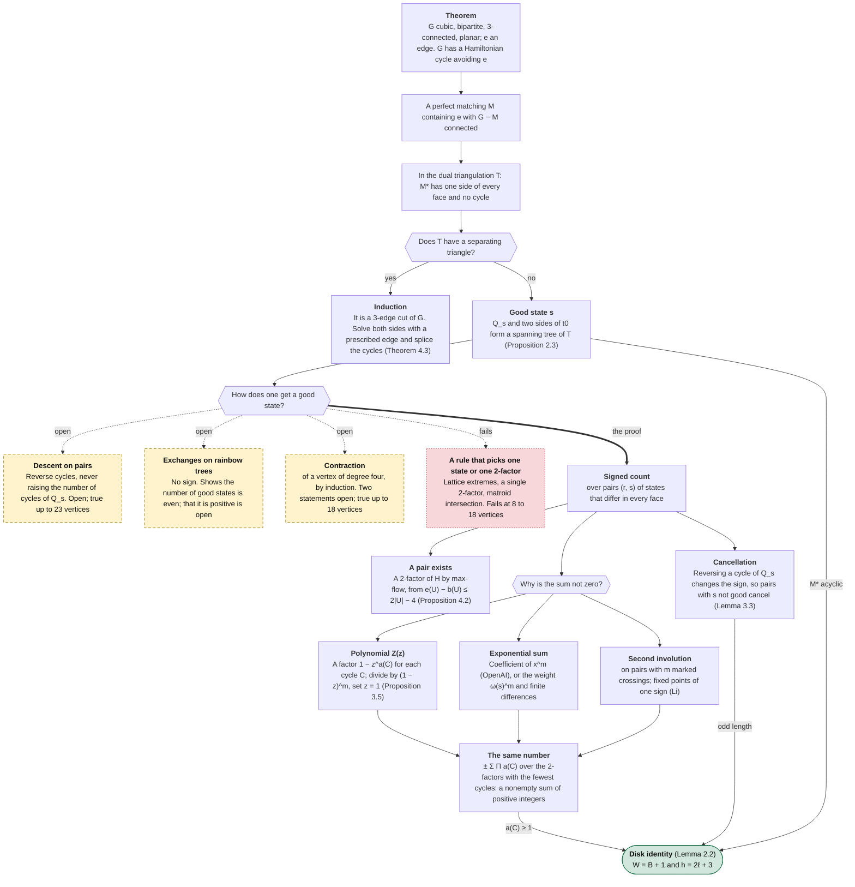

# Routes to the theorem and around it

Notation and terms are those of [the paper](../paper/barnette.pdf), and statements are cited by their numbers there. We write $q(s)$ for the number of cycles of $Q_s$ and $g$ for the number of good states. Sizes are numbers of vertices of $T$; the graph $G$ then has $2|V(T)|-4$ vertices.

## Map

Read the diagram from the top. An arrow from one box to another means that the first follows once the second is established. The solid route is the proof, and all of it rests on the disk identity at the bottom. Dashed boxes are other ways to a good state: yellow ones are open, the red one fails. Sections 1 to 4 go through the boxes in turn.

## 1. The route of the paper

A Hamiltonian cycle of $G$ is the complement of a perfect matching $M$ with $G-M$ connected, that is, with $M^*$ acyclic in $T$. Orienting the forest $M^*-e_0$ towards the corners of $t_0$ turns it into a state, so one looks for a state from which the matching can be rebuilt: a good state. A good state gives $M$ through the spanning tree $G-S_s^*$, and the disk identity (Lemma 2.2) shows that $M^*$ is acyclic (Proposition 2.3). A second state $r$ that differs from $s$ in every face orients $Q_s$ and reduces "good" to "$Q_s$ has no cycle" (Lemma 3.1); replacing $r$ by $r^K$ for a cycle $K$ of $Q_s$ keeps $s$ and changes the sign (Lemma 3.2), so the pairs with $s$ not good cancel in $Z(z)=\sum\varepsilon(r,s)z^{\omega(s)}$ (Lemma 3.3). Grouped by 2-factors of $H$, the same sum is $\sum_F\pm z^{\omega_F}\prod_C(1-z^{a(C)})$ (Lemma 3.4), the sign depends only on $n$ and $c(F)$, and so $Z(z)/(1-z)^m$ is not zero at $z=1$ (Proposition 3.5). A pair exists when $T$ has no separating triangle, by a flow argument and an edge count (Lemma 4.1, Proposition 4.2); separating triangles are handled by induction, and the prescribed edge makes the two halves agree (Theorem 4.3).

## 2. Presentations of the count

All published versions prove that some sum $\sum_{(r,s)}\varepsilon(r,s)f(s)$ is not zero, and all look at the lowest order $m$ at which something survives. They differ in $f$.

- **The polynomial.** $f(s)=z^{\omega(s)}$, and one evaluates $Z(z)/(1-z)^m$ at $z=1$, where it equals $(-1)^{(n+m)/2}\sum_{c(F)=m}\prod_C a(C)$.
- **The exponential sum** (OpenAI). $f(s)=e^{x\omega(s)}$ with the phase $i^J=i^{-n}\varepsilon(r,s)$, and one extracts the coefficient of $x^m$. Substituting $z=e^x$ gives the polynomial; the weights come from a circulation, which is the flux across the arcs $\gamma_y$.
- **The $m$-th power.** $f(s)=\omega(s)^m$, that is, $(z\,d/dz)^mZ$ at $z=1$. Over the $2^c$ pairs of one 2-factor the sum is an alternating sum over a cube, an iterated finite difference of $\omega^m$: it vanishes for $c>m$ and equals $\pm m!\prod_Ca(C)$ for $c=m$. Since $Z=(1-z)^mR(z)$, the total is $(-1)^m m!\,R(1)$.
- **Linear factors.** $f(s)=\prod_{t}(1+x\,\alpha(t,s(t)))$ for numbers $\alpha$ on the edges of $H$ whose sums over the two perfect matchings of a cycle differ by $a(C)$. A 2-factor with $c$ cycles contributes $\pm x^c\prod_Ca(C)$ plus higher terms, so the coefficient of $x^m$ is the same number again. The Lean formalisation of OpenAI uses this form.
- **The integer polynomial** (the anonymous manuscript). The real sign $\varepsilon$ and integer weights in place of the phase and the exponential; $Z(z)$ is this polynomial in the paper's normalisation.
- **Two involutions** (Li). $f(s)$ counts, with signs, the sets of $m$ distinct crossings of the arcs of $s$ with the arcs $\gamma_y$: the coefficient of $u^m$ in $\prod_\kappa(1+\sigma_\kappa u)$ over the crossings $\kappa$ with signs $\sigma_\kappa$. This is the exponential of a function that is additive over faces and equals $u\,\omega(s)$ to first order, so its coefficient of $u^m$ is once more $\pm\sum_{c(F)=m}\prod_Ca(C)$. Li does not factorise; a second sign-reversing involution on pairs with $m$ marked crossings leaves fixed points of one sign. The number of marked objects depends on the drawing, the signed count does not. This is written out in [involutions](../proofs/involutions/involutions.pdf).

**In $G$ instead of $T$.** Black faces are the vertices of one colour class of $G$, vertices of $T$ are faces of $G$, and a state assigns to every black vertex other than $t_0$ one of the three faces of $G$ at it, bijectively onto the faces not at $t_0$. A cycle of $Q_s$ or $D(r,s)$ is an edge cut of $G$; the duals of the edges of $D(r,s)$ form a set $S$ with one edge at every black vertex in $A$, and the number of cycles is the number of components of $G-S$ less one. A separating triangle is a 3-edge cut with more than one vertex on each side. Li's note is written this way.

## 3. Routes that do not work

The examples named in brackets are in [research/instances](../research/instances/README.md).

**One state alone.** For a single state, "$Q_s$ is acyclic" does not imply "good": for the dual of the hexagonal prism (8 vertices) and a suitable $t_0$ there are three states, all with $Q_s$ acyclic, and only two are good. The perfect matchings of the plane graph $H$ form a distributive lattice, but its extreme elements need not belong to any pair (10 vertices), and no rule tried selects a good state: the highest and the lowest state, and the pairs of a 2-factor with $m$ cycles with all cycles of $D(r,s)$ running the same way, fail at 12 vertices.

**A single 2-factor.** There is a triangulation with 16 vertices and a 2-factor of $H$ with one cycle, of length 13, such that neither of its two pairs has a good second state; the twelve good states belong to pairs of two other 2-factors [2-factor-without-good-state-16]. So the count cannot be carried out inside one 2-factor.

**Matroid intersection.** Map the edge $tx$ of $H$ to the side of $t$ opposite $x$. A good state is a common basis of three matroids on $E(H)$: one edge at every $t\in A$, one edge at every $x\in X$, and independence in the graphic matroid of $T$ with the three roots identified. Dropping the condition at the vertices already fails for the dual of the hexagonal prism, where four of the six common bases are not states. The linear relaxation of the three conditions is not integral: it has a half-integral vertex at 13 vertices.

**Extreme elements of the lattice of pairs.** The 2-factors of $H$ form a distributive lattice. Neither its minimum nor its maximum need have a pair with a good second state; the smallest example has 18 vertices [lattice-extremes-18]. Allowing in addition the join- and meet-irreducible elements fails at 33 vertices, in an example with a separating triangle [lattice-irreducibles-33]; without separating triangles this is open.

**Strict or bounded descent.** A pair can be changed by reversing a cycle of $D(r,s)$ or a cycle of $Q_s$. That some move always lowers $q(s)$ fails first at 16 vertices; that a pair with lower $q$ is always within two moves fails first at 21; within three moves fails at 40 [lookahead-three-40].

**Walks that cycle.** A deterministic walk by exchanges on rainbow trees (Section 4) can return to its start, after 48 exchanges, at 38 vertices [walk-cycling-38].

**Exchange arguments without a sign.** Rainbow trees (Section 4) exist by Rado's theorem, and exchanges on them prove that $g$ is even. They do not prove that $g$ is positive: that needs exchanges that bring the excess of a rainbow tree to zero, and it is false that some exchange always lowers the excess (8 vertices). See [sign-free](../proofs/sign-free/sign-free.pdf).

**Determinants and Pfaffians.** For fixed $s$, the sum of $\varepsilon(r,s)$ over $r$ is, up to a constant sign, the determinant of the incidence matrix of $Q_s$ reduced at the roots, which vanishes exactly when $Q_s$ has a cycle. Summing over $s$ gives $Z(1)$ as the coefficient of $\prod_tz_t$ in $\det\sum_tz_tM_t$ with one matrix $M_t$ of rank two for each face. No evaluation without this extraction is known. Setting all $z_t=1$ gives zero for the dual of the hexagonal prism. Allowing $r(t)=s(t)$, as for double dimers, gives a sum that is positive even when there is no pair (9 vertices). The sign is not a product $\alpha(t,r(t))\beta(t,s(t))$, as a face with three corners in $X$ shows, so the sum is not a product of two determinants.

**Dropping planarity.** For the Heawood graph, embedded in the torus, the analogous sum has 24 states and 48 pairs, and the cycles of $D(r,s)$ have length seven. The cancellation survives, since the cycles of $Q_s$ are odd, but the sum vanishes identically: the positivity of $a(C)$ is what is lost.

**Categorical reformulations.** Cutting $T$ along a cycle and recording, for a Hamiltonian cycle of $G$, the sides of the vertices of the cycle and their connections inside each piece gives a gluing rule for pieces. What remains of this is a table. Along a triangle there are three boundary patterns and every piece realises all three; this is the theorem. Along a quadrilateral a counting rule leaves six of eight patterns, and a piece realises all six unless it has a chord, when it realises five. Along 5-cycles the patterns realised depend on the piece (9 vertices), so there is no induction along longer cuts.

## 4. Beyond the theorem

**Known.**

- $T$ has a pair if and only if no separating triangle of $T$ has three black faces along its inner side. Cutting is needed only at such triangles.
- A state $s$ forms a pair with exactly $2^{q(s)}$ states or with none, so the good states are the states that form a pair with exactly one state; $g$ is even, and $g\ge 2m$. If $G$ has $h$ Hamiltonian cycles, then $3g\le h$.
- The number $m$ is unbounded without separating triangles: there are triangulations with $3j+2$ vertices, one 2-factor, $m=j-1$ and $2^{j-1}$ good states. The prism over a $2j$-gon has only $2j+2$ Hamiltonian cycles.
- Rainbow trees. Let $H^+$ be $H$ together with the roots and a point in $t_0$ joined to them. A *rainbow tree* is a map $\sigma\colon X\to A$, with $x$ a corner of $\sigma(x)$, such that removing the $n$ edges $x\sigma(x)$ from $H^+$ leaves a spanning tree; its *excess* is $\sum_{t\in A}\bigl||\sigma^{-1}(t)|-1\bigr|$. A state is good exactly when its inverse is a rainbow tree. A rainbow tree exists if and only if a pair does, and it lies in exactly one 2-factor of $H$. An *exchange* moves one $x$ to another face at $x$; exchanges give involutions without fixed points on the good states.
- Two trees in every 2-factor. The plane dual of $H^+$ is a graph on the white faces. For every 2-factor $F$ of $H$, the duals of its $2n$ edges split into two spanning trees of this graph, each with one edge at every $x\in X$; and they contain a spanning tree with one edge at every $t\in A$. By the example with 16 vertices, one tree cannot always meet both conditions.

**Up to small sizes.** From every pair a pair with good second state is reached by moves that never increase $q(s)$, up to 23 vertices. The bound $g\ge2^m$ holds up to 22 vertices.

**Open.** Monotone descent, the exchange step for rainbow trees, an induction by contracting vertices of degree four, the bound $g\ge 2^m$, and an algorithm of polynomial time; see [the open problems](../research/OPEN-PROBLEMS.md) and, for what is known about algorithms, [algorithm](../proofs/algorithm/algorithm.md).
