# Routes to the theorem and around it

Notation and terms are those of [the paper](../paper/barnette.pdf), and statements are cited by their numbers there. We write $q(s)$ for the number of cycles of $Q_s$ and $g$ for the number of good states. Sizes are numbers of vertices of $T$; the graph $G$ then has $2|V(T)|-4$ vertices.

## Map

Read the diagram from the top. An arrow from one box to another means that the first follows once the second is established. The solid route is the proof, and its signed count rests on the disk identity at the bottom. Dashed boxes are other ways to a good state: yellow ones are open, the red one fails. Sections 1 to 4 go through the boxes in turn, with a figure for each box that a picture helps.

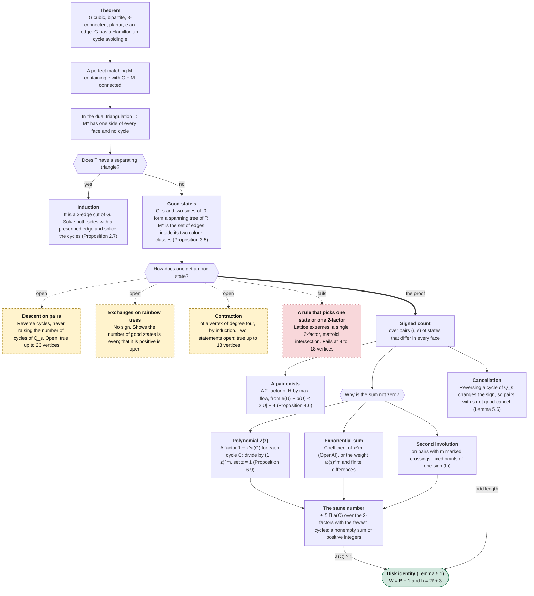

## 1. The route of the paper

**The induction.** A separating triangle of $T$ is a 3-edge cut of $G$. The two smaller graphs have Hamiltonian cycles by induction, and the prescribed edge makes them use the same two edges of the cut (Proposition 2.7). What remains is the case without separating triangle (Theorem 2.6).

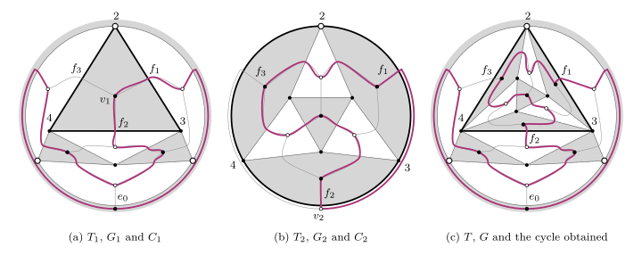

**Figure 1.** The induction for the triangulation $T$ of Figure 3(c), cut along the separating triangle $\Delta$ with corners $2,3,4$ (bold). The duals $f_1,f_2,f_3$ of the sides of $\Delta$ form a 3-edge cut of $G$. (a) $T_1$, in which $\Delta$ bounds a new black face, with the new vertex $v_1$ of $G_1$ and a Hamiltonian cycle $C_1$ of $G_1$ that avoids $e_0^*$; it passes through $v_1$ along $f_1$ and $f_2$. (b) $T_2$, the part of $T$ inside $\Delta$, drawn with its new white face outside, and a Hamiltonian cycle $C_2$ of $G_2$ that avoids $f_3$, and hence passes through $v_2$ along $f_1$ and $f_2$. (c) The paths $C_1-v_1$ and $C_2-v_2$ together with $f_1$ and $f_2$ form a Hamiltonian cycle of $G$ that avoids $e_0^*$.

**From a cycle to a good state.** A Hamiltonian cycle of $G$ is the complement of a perfect matching $M$ with $G-M$ connected, that is, with $M^*$ acyclic in $T$. Orienting the forest $M^*-e_0$ towards the corners of $t_0$ turns it into a state, so one looks for a state from which the matching can be rebuilt: a good state. A good state gives $M$ through the two colour classes of the spanning tree $S_s$: $M^*$ consists of the edges of $T$ with both ends in one class (Lemma 3.4). It contains no cycle, because a cycle would enclose a vertex of the other class, and following the chosen corners from this vertex leads to a cycle with fewer faces inside (Proposition 3.5).

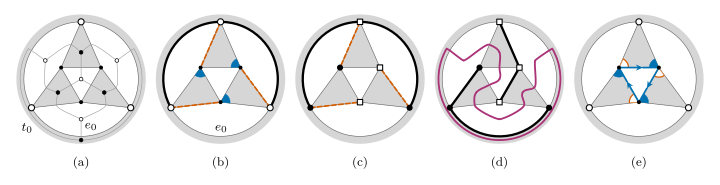

**Figure 2.** The construction for the cube $G$ and the octahedron $T$, with $t_0$ as the outer face (grey ring). (a) $T$ with black faces shaded, the roots (circles), the side $e_0$, and $G$ in grey. (b) A good state $s$, with a wedge at each corner $s(t)$: the sides in $Q_s$ (dashed) and the two sides of $t_0$ other than $e_0$ (bold) form a spanning tree of $T$. (c) The two colour classes of this tree (dots and squares). (d) The edges of $T$ with both ends in one class (bold) form two trees, and the Hamiltonian cycle crosses all other edges. (e) A pair $(r,s)$ (open and filled wedges) and the directed cycle formed by the edges $r(t)\to s(t)$. This is Figure 1 of the paper.

**A pair.** A pair is a 2-factor of $H$. It exists when $T$ has no separating triangle, by a flow argument and an edge count (Lemmas 4.2 and 4.4, Proposition 4.6).

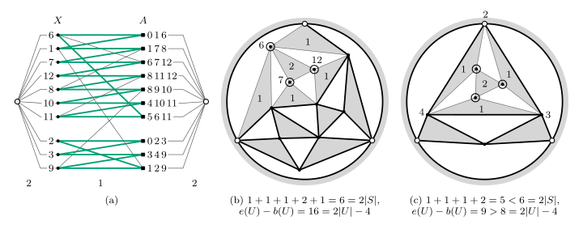

**Figure 3.** A pair exists. (a) The network for the triangulation of Figure 2 of the paper: a source, the vertices in $X$, the faces in $A$ (named by their corners), and a sink, with the capacities written below. The bold edges carry the maximum flow, of value $2n=20$; they form a 2-factor of $H$, that of Figure 2(c) of the paper. (b) A set $S\subseteq X$ (ringed). Each face of $A$ with a corner in $S$ carries the number $\min(2,|V(t)\cap S|)$, and the bold edges are those with both ends in $U=V(T)\setminus S$. Here the cut condition holds with equality, $6=2|S|$, which is the same as $e(U)-b(U)=16=2|U|-4$. (c) Two octahedra glued along the triangle $2\,3\,4$, with $S$ the three vertices inside it. The triangle is a face of the bold graph but not of $T$; the count gives $5<6$ and $e(U)-b(U)=9>8$, so there is no pair.

**The disk identity.** A cycle of $T$ each of whose edges contains the corner chosen in its black face has $W=B+1$ and $h=2\ell+3$ (Lemma 5.1). The cancellation and the count use it: it shows that the cycles reversed are odd, and that every cycle in the count has a white face inside.

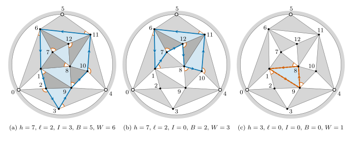

**Figure 4.** The disk identity on three cycles of the triangulation of Figure 2 of the paper. Open wedges mark $r(t)$ for the black faces inside the cycle and for the faces $t_f$ with a side on it; the black faces inside are dark, the white faces inside are tinted. (a) The cycle of length $7$ of $D(r,s)$ for the pair of Figure 5(a). Each of the $B=5$ black faces inside has its wedge at one of the $I=3$ vertices inside or at the tail of one of the $\ell=2$ edges whose black face is inside, so $B=I+\ell$. (b) The cycle of length $7$ of $D(r^K,s)$ for the pair of Figure 5(b). (c) The cycle $K$ of $Q_s$. In all three, $W=B+1$ and $h=2\ell+3$.

**Cancellation.** A second state $r$ that differs from $s$ in every face orients $Q_s$ and reduces \"good\" to \"$Q_s$ has no cycle\". Replacing $r$ by $r^K$ for a cycle $K$ of $Q_s$ keeps $s$ and changes the sign (Lemma 5.5), so the pairs with $s$ not good cancel in $Z(z)=\sum\varepsilon(r,s)z^{\omega(s)}$ (Lemma 5.6).

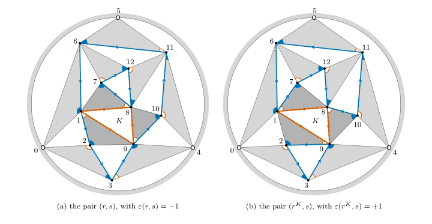

**Figure 5.** Cancellation. (a) The pair $(r,s)$ of Figure 2(a) of the paper: open wedges for $r$, filled wedges for $s$, solid arrows for $D(r,s)$, and the directed cycle $K$ of $Q_s$ (dashed), so $s$ is not good. (b) The pair $(r^K,s)$: in the three dark faces, whose sides in $Q_s$ form $K$, the open wedge has moved from $r(t)$ to $u(t)$, and $K$ runs the other way. The second state is the same, three factors of the sign have changed, and $\varepsilon(r,s)=-1$, $\varepsilon(r^K,s)=+1$. The two pairs have different 2-factors: the cycles of $D(r,s)$ enclose $6$ and $1$ white faces, those of $D(r^K,s)$ enclose $3$ and $1$.

**The count.** Grouped by 2-factors of $H$, the same sum is $\sum_F\pm z^{\omega_F}\prod_C(1-z^{a(C)})$ (Lemma 6.7): reversing a cycle $C$ of $D(r,s)$ changes the sign and raises the weight by $a(C)$ (Lemmas 6.2 and 6.6). The sign of the term of $F$ depends only on $n$ and $c(F)$, and so $Z(z)/(1-z)^m$ is not zero at $z=1$ (Proposition 6.9).

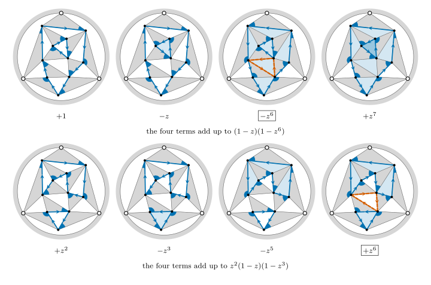

**Figure 6.** All eight pairs of the triangulation of Figure 2 of the paper, with the second state $s$ (wedges) and $D(r,s)$ (arrows); each row is one 2-factor of $H$. Below each pair is its term $\varepsilon(r,s)z^{\omega(s)}$ of $z^{-\omega_0}Z(z)$. Along a row the cycles are reversed one at a time, and a white face is tinted once for every counterclockwise cycle around it: the number of tints is the exponent, less $0$ in the first row and $2$ in the second (Lemma 6.6). The rows add up to $(1-z)(1-z^6)$ and $z^2(1-z)(1-z^3)$ (Lemma 6.7). The two framed pairs have the same second state, which is not good ($Q_s$ contains the dashed cycle), and their terms $\mp z^6$ cancel. The other six terms belong to the six good states, and $z^{-\omega_0}Z(z)=1-z+z^2-z^3-z^5+z^7$. Divided by $(1-z)^2$ this takes the value $6\cdot1+3\cdot1=9$ at $z=1$.

## 2. Presentations of the count

All published versions prove that some sum $\sum_{(r,s)}\varepsilon(r,s)f(s)$ is not zero, and all look at the lowest order $m$ at which something survives. They differ in $f$.

- **The polynomial.** $f(s)=z^{\omega(s)}$, and one evaluates $Z(z)/(1-z)^m$ at $z=1$, where it equals $(-1)^{(n+m)/2}\sum_{c(F)=m}\prod_C a(C)$.
- **The exponential sum** (OpenAI). $f(s)=e^{x\omega(s)}$ with the phase $i^J=i^{-n}\varepsilon(r,s)$, and one extracts the coefficient of $x^m$. Substituting $z=e^x$ gives the polynomial; the weights come from a circulation, which is the flux across the arcs $\gamma_y$.
- **The $m$-th power.** $f(s)=\omega(s)^m$, that is, $(z\,d/dz)^mZ$ at $z=1$. Over the $2^c$ pairs of one 2-factor the sum is an alternating sum over a cube, an iterated finite difference of $\omega^m$: it vanishes for $c>m$ and equals $\pm m!\prod_Ca(C)$ for $c=m$. Since $Z=(1-z)^mR(z)$, the total is $(-1)^m m!\,R(1)$.
- **Linear factors.** $f(s)=\prod_{t}(1+x\,\alpha(t,s(t)))$ for numbers $\alpha$ on the edges of $H$ whose sums over the two perfect matchings of a cycle differ by $a(C)$. A 2-factor with $c$ cycles contributes $\pm x^c\prod_Ca(C)$ plus higher terms, so the coefficient of $x^m$ is the same number again. The Lean formalisation of OpenAI uses this form.
- **The integer polynomial** (the paper). The real sign $\varepsilon$ and integer weights in place of the phase and the exponential; $Z(z)$ is this polynomial in the paper's normalisation.
- **Two involutions** (Li). $f(s)$ counts, with signs, the sets of $m$ distinct crossings of the arcs of $s$ with the arcs $\gamma_y$: the coefficient of $u^m$ in $\prod_\kappa(1+\sigma_\kappa u)$ over the crossings $\kappa$ with signs $\sigma_\kappa$. This is the exponential of a function that is additive over faces and equals $u\,\omega(s)$ to first order, so its coefficient of $u^m$ is once more $\pm\sum_{c(F)=m}\prod_Ca(C)$. Li does not factorise; a second sign-reversing involution on pairs with $m$ marked crossings leaves fixed points of one sign. The number of marked objects depends on the drawing, the signed count does not. This is written out in [involutions](../proofs/involutions/involutions.pdf).

  
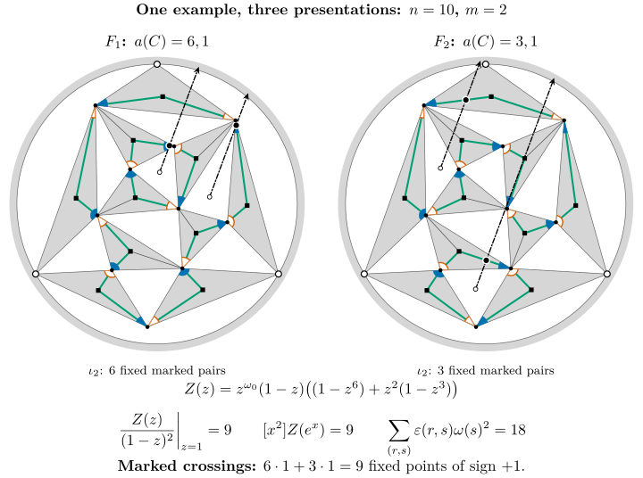

  **Figure 7.** The example of Figure 2 of the paper, with $n=10$ and $m=2$. Green edges show the two 2-factors of $H$. Each panel shows a fixed marked pair of Li's second involution: each cycle carries one marked crossing, the first crossing of its chosen $\gamma_y$, with $y$ inside the cycle. There are $6\cdot1+3\cdot1=9$ fixed points, all positive. The value of the polynomial quotient and the coefficient of $x^2$ in the exponential sum are also $9$; the sum with $\omega(s)^2$ is $2!\cdot9=18$.

**In $G$ instead of $T$.** Black faces are the vertices of one colour class of $G$, vertices of $T$ are faces of $G$, and a state assigns to every black vertex other than $t_0$ one of the three faces of $G$ at it, bijectively onto the faces not at $t_0$. A cycle of $Q_s$ or $D(r,s)$ is an edge cut of $G$; the duals of the edges of $D(r,s)$ form a set $S$ with one edge at every black vertex in $A$, and the number of cycles is the number of components of $G-S$ less one. A separating triangle is a 3-edge cut with more than one vertex on each side. Li's note is written this way.

## 3. Routes that do not work

The examples named in brackets are in [research/instances](../research/instances/README.md).

**One state alone.** For a single state, "$Q_s$ is acyclic" does not imply "good": for the dual of the hexagonal prism (8 vertices) and a suitable $t_0$ there are three states, all with $Q_s$ acyclic, and only two are good (Figure 8). The perfect matchings of the plane graph $H$ form a distributive lattice, but its extreme elements need not belong to any pair (10 vertices), and no rule tried selects a good state: the highest and the lowest state, and the pairs of a 2-factor with $m$ cycles with all cycles of $D(r,s)$ running the same way, fail at 12 vertices.

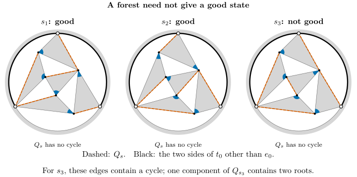

**Figure 8.** All three states of the dual of the hexagonal prism. Filled wedges mark the state, dashed edges form $Q_s$, and the bold black edges are the two sides of $t_0$ other than $e_0$. Every $Q_s$ is acyclic. For the third state one component of $Q_s$ contains two roots, so adding the black edges creates a cycle and the state is not good.

**A single 2-factor.** There is a triangulation with 16 vertices and a 2-factor of $H$ with one cycle, of length 13, such that neither of its two pairs has a good second state; the twelve good states belong to pairs of two other 2-factors [2-factor-without-good-state-16]. So the count cannot be carried out inside one 2-factor.

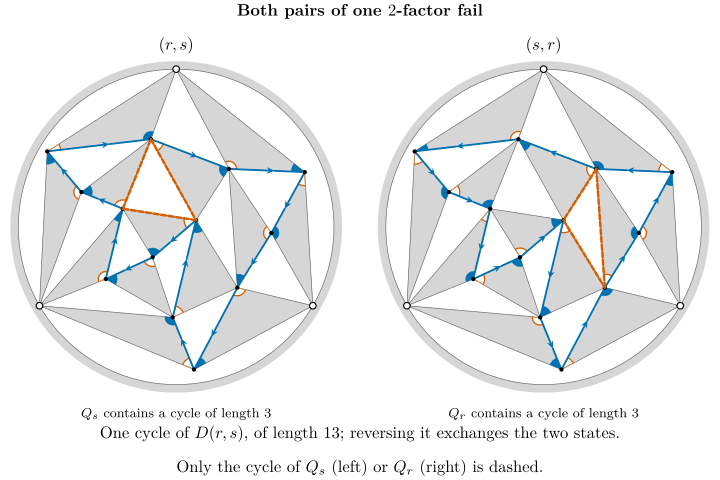

**Figure 9.** Both pairs of the 2-factor with one cycle in the example with 16 vertices. Solid arrows form the cycle of $D(r,s)$ of length $13$; reversing it exchanges $r$ and $s$. The dashed triangles are cycles of $Q_s$ on the left and of $Q_r$ on the right, so neither second state is good.

**Matroid intersection.** Map the edge $tx$ of $H$ to the side of $t$ opposite $x$. A good state is a common basis of three matroids on $E(H)$: one edge at every $t\in A$, one edge at every $x\in X$, and independence in the graphic matroid of $T$ with the three roots identified. Dropping the condition at the vertices already fails for the dual of the hexagonal prism, where four of the six common bases are not states. The linear relaxation of the three conditions is not integral: it has a half-integral vertex at 13 vertices.

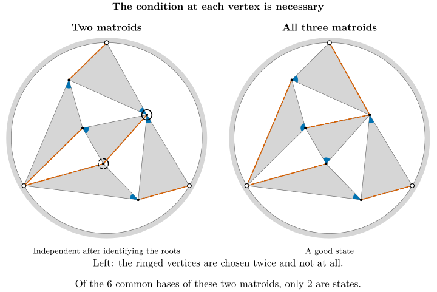

**Figure 10.** Dropping the condition at the vertices in the dual of the hexagonal prism. Left: one corner is chosen in every black face and the opposite sides are independent after the roots are identified, but the vertex with a solid ring is chosen twice and the vertex with a dashed ring never. Right: a good state, which satisfies all three conditions.

**Extreme elements of the lattice of pairs.** The 2-factors of $H$ form a distributive lattice. Neither its minimum nor its maximum need have a pair with a good second state; the smallest example has 18 vertices [lattice-extremes-18]. Allowing in addition the join- and meet-irreducible elements fails at 33 vertices, in an example with a separating triangle [lattice-irreducibles-33]; without separating triangles this is open.

**Strict or bounded descent.** A pair can be changed by reversing a cycle of $D(r,s)$ or a cycle of $Q_s$. That some move always lowers $q(s)$ fails first at 16 vertices; that a pair with lower $q$ is always within two moves fails first at 21; within three moves fails at 40 [lookahead-three-40].

**Walks that cycle.** A deterministic walk by exchanges on rainbow trees (Section 4) can return to its start, after 48 exchanges, at 38 vertices [walk-cycling-38].

**Exchange arguments without a sign.** Rainbow trees (Section 4) exist by Rado's theorem, and exchanges on them prove that $g$ is even. They do not prove that $g$ is positive: that needs exchanges that bring the excess of a rainbow tree to zero, and it is false that some exchange always lowers the excess (8 vertices). See [sign-free](../proofs/sign-free/sign-free.pdf).

**Determinants and Pfaffians.** For fixed $s$, the sum of $\varepsilon(r,s)$ over $r$ is, up to a constant sign, the determinant of the incidence matrix of $Q_s$ reduced at the roots, which vanishes exactly when $Q_s$ has a cycle. Summing over $s$ gives $Z(1)$ as the coefficient of $\prod_tz_t$ in $\det\sum_tz_tM_t$ with one matrix $M_t$ of rank two for each face. No evaluation without this extraction is known. Setting all $z_t=1$ gives zero for the dual of the hexagonal prism. Allowing $r(t)=s(t)$, as for double dimers, gives a sum that is positive even when there is no pair (9 vertices). The sign is not a product $\alpha(t,r(t))\beta(t,s(t))$, as a face with three corners in $X$ shows, so the sum is not a product of two determinants.

**Dropping planarity.** For the Heawood graph, embedded in the torus, the analogous sum has 24 states and 48 pairs, and the cycles of $D(r,s)$ have length seven. The cancellation survives, since the cycles of $Q_s$ are odd, but the sum vanishes identically: the positivity of $a(C)$ is what is lost.

**Categorical reformulations.** Cutting $T$ along a cycle and recording, for a Hamiltonian cycle of $G$, the sides of the vertices of the cycle and their connections inside each piece gives a gluing rule for pieces. What remains of this is a table. Along a triangle there are three boundary patterns and every piece realises all three; this is the theorem. Along a quadrilateral a counting rule leaves six of eight patterns, and a piece realises all six unless it has a chord, when it realises five. Along 5-cycles the patterns realised depend on the piece (9 vertices), so there is no induction along longer cuts.

## 4. Beyond the theorem

**Known.**

- $T$ has a pair if and only if no separating triangle of $T$ has three black faces along its inner side. Cutting is needed only at such triangles.
- A state $s$ forms a pair with exactly $2^{q(s)}$ states or with none, so the good states are the states that form a pair with exactly one state; $g$ is even, and $g\ge 2m$. If $G$ has $h$ Hamiltonian cycles, then $3g\le h$.
- The number $m$ is unbounded without separating triangles: there are triangulations with $3j+2$ vertices, one 2-factor, $m=j-1$ and $2^{j-1}$ good states. The prism over a $2j$-gon has only $2j+2$ Hamiltonian cycles.

  
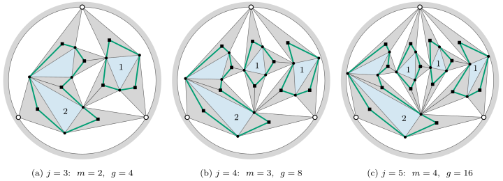

  **Figure 11.** The triangulations with $3j+2$ vertices for $j=3,4,5$. Take the double pyramid with apices $A$ and $B$ over the $2j$-gon $x_0y_0x_1y_1\cdots$, subdivide every edge $Bx_i$ by a vertex $z_i$ and join $z_i$ to $y_{i-1}$ and $y_i$; the roots are $A$ (top), $x_0$ and $y_0$. Shown is the only 2-factor of $H$ (thick), with the white faces inside its cycles tinted and counted. It has $j-2$ cycles around one white face each and one cycle around two, so $m=j-1$, and all $2^{j-1}$ pairs have a good second state.
- Rainbow trees. Let $H^+$ be $H$ together with the roots and a point in $t_0$ joined to them. A *rainbow tree* is a map $\sigma\colon X\to A$, with $x$ a corner of $\sigma(x)$, such that removing the $n$ edges $x\sigma(x)$ from $H^+$ leaves a spanning tree; its *excess* is $\sum_{t\in A}\bigl||\sigma^{-1}(t)|-1\bigr|$. A state is good exactly when its inverse is a rainbow tree. A rainbow tree exists if and only if a pair does, and it lies in exactly one 2-factor of $H$. An *exchange* moves one $x$ to another face at $x$; exchanges give involutions without fixed points on the good states.

  
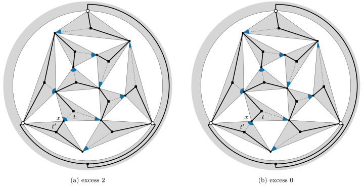

  **Figure 12.** A rainbow tree and an exchange, in the example of Figure 2 of the paper. Squares are the points $p_t$; the point of $t_0$ and its arcs to the roots are drawn in the outer ring. The thick arcs are the spanning tree of $H^+$ left when the $n$ arcs $x\sigma(x)$, dotted, are removed, and a wedge at $x$ in the face $\sigma(x)$ marks each removed arc. (a) Excess 2: two vertices are sent to the face $t$ and none to $t'$. (b) The exchange at $x$ moves $x$ from $t$ to $t'$. The excess is 0, the wedges form a good state $s$, and the tree is $Q_s$ with every side replaced by the two arcs through $p_t$, together with the three arcs at the point of $t_0$. This example has 1792 rainbow trees, six of them of excess 0. Of the ten exchanges of the tree in (a), one lowers the excess, two keep it and seven raise it.
- Two trees in every 2-factor. The plane dual of $H^+$ is a graph on the white faces. For every 2-factor $F$ of $H$, the duals of its $2n$ edges split into two spanning trees of this graph, each with one edge at every $x\in X$; and they contain a spanning tree with one edge at every $t\in A$. By the example with 16 vertices, one tree cannot always meet both conditions.

  
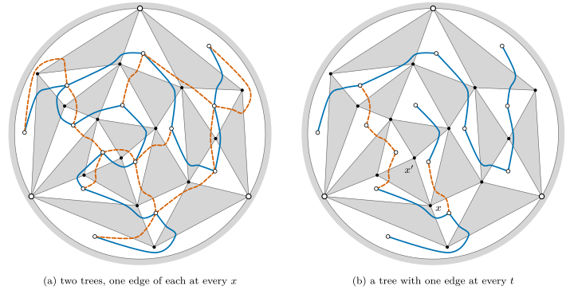

  **Figure 13.** The two trees, in the example with 16 vertices and its 2-factor $F$ with a single cycle. Small circles are the white faces. A curve that cuts the corner of a black face $t$ at a vertex $x$ is the dual of the arc of $H$ from $p_t$ to $x$: it joins the white faces across the two sides of $t$ at $x$. (a) The duals of the 26 arcs of $F$, split into two spanning trees, solid and dashed; each tree has one edge at every $x\in X$. (b) A spanning tree made of 13 of these edges, with one edge at every $t\in A$. It has two edges at $x$ and none at $x'$. No spanning tree among the 26 edges has one edge at every $x$ and one at every $t$, because neither pair of $F$ has a good second state.

**Up to small sizes.** From every pair a pair with good second state is reached by moves that never increase $q(s)$, up to 23 vertices. The bound $g\ge2^m$ holds up to 22 vertices.

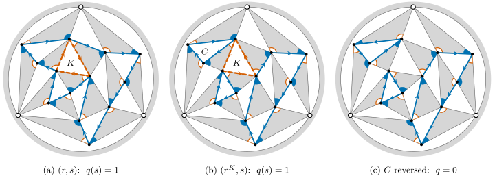

**Figure 14.** The two moves on pairs, in the example with 16 vertices. Open wedges mark $r$, filled wedges $s$, solid arrows are $D(r,s)$, and the dashed cycle is the cycle $K$ of $Q_s$. (a) A pair $(r,s)$ for which $D(r,s)$ is a single cycle of length 13 and $q(s)=1$. No single move lowers $q$: reversing the cycle of $D(r,s)$ gives the other pair of the same 2-factor, again with $q=1$. (b) Replacing $r$ by $r^K$ keeps $s$, so $q(s)=1$ still, but the 2-factor changes: $D(r^K,s)$ has three cycles, of lengths 3, 3 and 7. (c) Reversing the cycle $C$ of $D(r^K,s)$ changes $s$ on three faces, and $Q_s$ has no cycle left: the second state is good. Of the 18 pairs of this triangulation, the two in (a) are the only ones from which no single move lowers $q$.

**Open.** Monotone descent, the exchange step for rainbow trees, an induction by contracting vertices of degree four, the bound $g\ge 2^m$, and an algorithm of polynomial time; see [the open problems](../research/OPEN-PROBLEMS.md) and, for what is known about algorithms, [algorithm](../proofs/algorithm/algorithm.md).

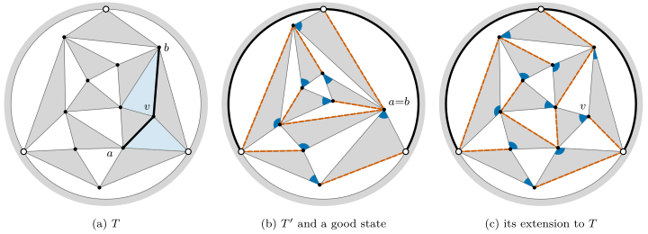

**Figure 15.** Contraction at a vertex of degree four, in the example of Figure 2 of the paper. (a) The vertex $v\in X$ has degree four, $a$ and $b$ are opposite neighbours of $v$, and the two white faces at $v$ are tinted. (b) The triangulation $T'$ with 11 vertices obtained by removing $v$ and identifying $a$ with $b$, so that the thick edges of (a) shrink to a point. It has four pairs and four good states. One good state is shown, with $Q_s$ dashed and the two sides of $t_0$ other than $e_0$ thick. (c) Its extension to $T$: every face of $T'$ keeps its corner, and the two black faces at $v$ take $v$ and $b$. It is good. Three of the four good states of $T'$ extend to good states of $T$; for the other contraction at $v$, two of four do.
