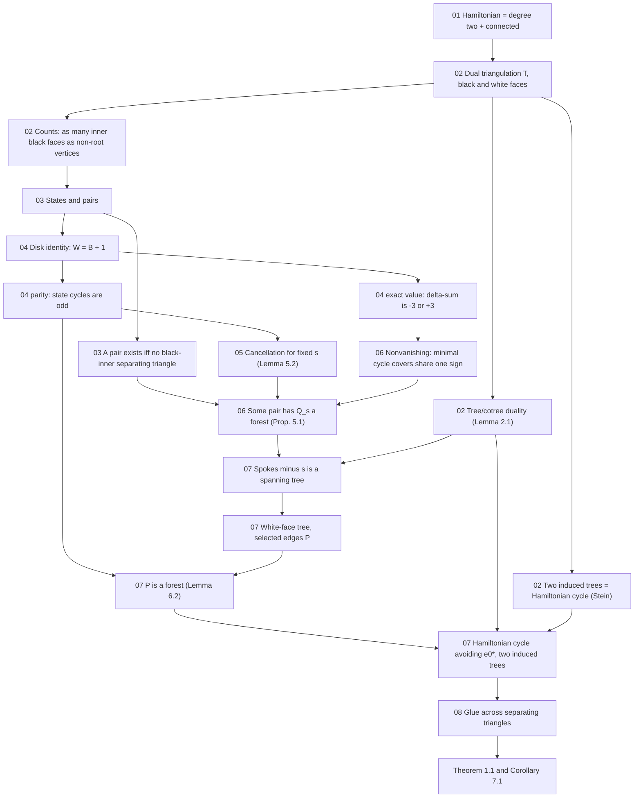

# 00. The whole proof in two pages

These digestions explain the proof of Barnette's conjecture one step at a time. This file is the map. It states the theorem, runs through the argument once without proofs, and shows which step depends on which.

## The theorem

**Theorem** (Barnette's conjecture, OpenAI 2026, Theorem 1.1). Every finite simple graph that is cubic, bipartite, planar and 3-connected has a Hamiltonian cycle.

Cubic means every vertex has three neighbours. Bipartite means the vertices split into black and white with every edge joining the two colours. Planar means the graph can be drawn in the plane without crossings. 3-connected means it has at least four vertices and stays connected when any two are removed. A Hamiltonian cycle passes through every vertex once. We call a graph with the four properties a Barnette graph and write $G$ for it. The cube is the smallest one.

The proof gives more. For every edge $e$ of $G$ there is a Hamiltonian cycle that does not use $e$ (Corollary 7.1). That stronger form is what makes the induction work, see step 08.

## The argument in ten sentences

1. A Hamiltonian cycle is a spanning subgraph with degree two everywhere that is also connected. Degree two is easy to arrange. Connectivity is the whole problem (step 01).
2. Pass to the dual $T = G^*$. It is a triangulation of the sphere whose faces are coloured black and white, opposite colours across every edge. A Hamiltonian cycle of $G$ is the same thing as a split of the vertices of $T$ into two sets that each induce a tree (step 02).
3. Pick a black face $t_0$ as the outer face. Its corners are the roots. There are as many other black faces as non-root vertices. A state gives every such black face one of its corners, using every non-root vertex once (step 03).
4. A state $s$ picks, in each black face, the edge opposite the chosen corner. Call this edge set $Q_s$. If $Q_s$ is a forest with one root in each component, the state can be turned into a Hamiltonian cycle. Such a state is a tree matching.
5. To certify and control $Q_s$ we use a second state $r$ that differs from $s$ in every face. The two together are a pair. A pair exists exactly when no separating triangle of $T$ has $t_0$ on its wrong side (step 03).
6. One counting lemma, the disk identity, says that a cycle built from edges leaving the corners chosen by a state encloses one more white face than black faces (step 04).
7. Give every pair a sign. For a fixed second state $s$ whose $Q_s$ has a cycle, reversing that cycle changes the first state and flips the sign, so all such pairs cancel (step 05).
8. Regroup the same signed sum by the cycles that $r$ and $s$ form together. With suitable weights the groups with the fewest cycles all contribute with one sign, so the sum is not zero. Hence some pair survives the cancellation, and its $Q_s$ is a forest (step 06).
9. Delete the spokes of that state from the graph joining black-face centres to corners. What remains is a spanning tree. Its dual is a tree on the white faces, which selects one edge in every face. The unselected edges, read in $G$, are a Hamiltonian cycle (step 07).
10. If $T$ has separating triangles, cut along one, solve the two pieces with matching boundary conditions, and glue (step 08).

Sentences 6 to 8 carry the new mathematics, the disk identity and the signed count it makes possible. The dual, the two trees, the avoided edge and the gluing were in the literature by 2016. States come from Tutte's theory of trinity and had not been used on this problem. This division is the reading of the project's literature review, `research/2026-11-14_opus_history-literature/WHAT-WAS-HARD.md` section 9, which marks it as its own judgement.

## Dependency diagram

Two things in this picture are worth a second look. The disk identity feeds three later steps, and two of them need only its parity. The exact value three is needed once, in step 06. And the pair is used twice, once to make the cancellation possible and once more to know that a forest $Q_s$ has one root per component.

## The documents

| File | Step | Sections of the papers |
| --- | --- | --- |
| [01](01-degree-two-and-connectivity.md) | why this is a connectivity problem | OpenAI 1; trees paper 1 |
| [02](02-dual-and-two-trees.md) | dual, colouring, two induced trees, tree/cotree | OpenAI 1.1, 2, proof of Thm 1.1 |
| [03](03-states-and-pairs.md) | states, pairs, existence of a pair | OpenAI 2, 3; Li Lemma 9; trees 2, 3 |
| [04](04-disk-identity.md) | the disk identity | OpenAI 4; Li Claim 25; trees Lemma 4.1 |
| [05](05-cancellation.md) | sign of a pair, reversal of a $Q_s$ cycle | OpenAI 5.1; Li Lemma 17; trees Lemma 4.2 |
| [06](06-nonvanishing.md) | the sum is not zero | OpenAI 5.2, 5.3; Li 4 and App. B; trees 5 |
| [07](07-recovery.md) | from a forest pair to the cycle | OpenAI 6; Li Lemma 30; trees 7 |
| [08](08-gluing-and-hypotheses.md) | separating triangles, role of each hypothesis | OpenAI 7; Li App. C; trees 7.3 |
| [09](09-what-is-still-open.md) | what nobody knows yet | trees 5.1, 6 |
| [GLOSSARY](GLOSSARY.md) | every term and symbol in the three papers' names | |

"OpenAI" is `papers/OpenAI-Barnette.pdf`, "Li" is `papers/A-Note-On-Barnette.pdf`, "trees paper" is `papers/barnette_trees.pdf`.

## Examples used throughout

All numbers were computed by `research/2026-11-14_fable_digestions/code/examples.py`, which shares no code with the project's reference implementation `workings/barnette_lab`. The script `crosscheck.py` in the same folder compares the two on the first three examples below. They agree on states, pairs, tree matchings and the signed polynomial.

| Name | $T$ | $G$ | Why it is here |
| --- | --- | --- | --- |
| cube | octahedron, 6 vertices | cube, 8 vertices | smallest case, everything can be done by hand |
| prism | double wheel with rim 6, 8 vertices | hexagonal prism, 12 vertices | smallest case where a state with a forest $Q_s$ is not a tree matching |
| double octahedron | 9 vertices | 14 vertices | smallest separating triangle |
| running example | 13 vertices, no separating triangle | 22 vertices | smallest case with a cancelling pair and a cycle that encloses a vertex. It is the example of `paper/figures/` |
| 16-vertex example | 16 vertices | 28 vertices | a set of cycles none of whose orientations works |

## How claims are marked

Every claim that is not in one of the three papers carries its review status in plain words where it is used. The words mean the following.

- "Published" means stated and proved in one of the three papers. All three are preprints. None has been through journal review. The OpenAI argument has a Lean 4 formalisation. An agent of this project rebuilt it and found that the main theorem depends only on the three standard axioms (`research/2026-11-14_opus_lean-formalisation/REPORT.md`, a computation, not refereed).
- "Proved in this project and checked by a second model" means a full proof is written in a research folder and a different model refereed it line by line and recomputed its claims with its own code. No human has read it.
- "Proved in this project, not yet refereed" means the proof exists in a research folder and nobody has checked it. Treat it as a lead.
- "Computed" means checked by a program on a stated finite range. It says nothing beyond that range.
- "Conjecture" means there is evidence and no proof.

Shared notation is that of `research/BRIEF.md`. It is collected in the [glossary](GLOSSARY.md).
