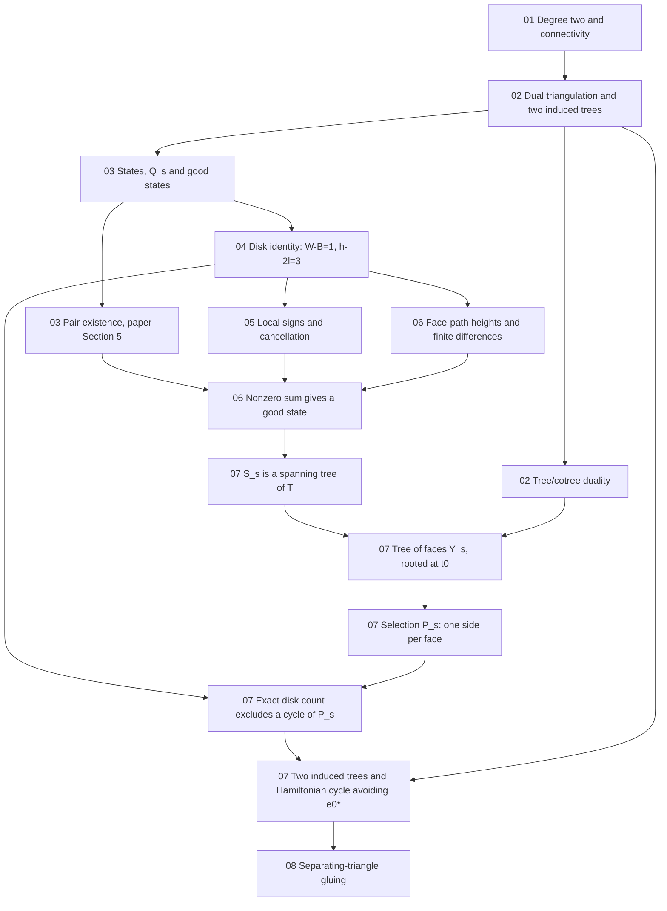

# 00. The whole proof in two pages

These digestions explain the proof one step at a time. This overview follows the final route of the [project paper](../../paper/main/barnette.pdf), with its vocabulary collected in the [glossary](GLOSSARY.md).

## The theorem and the target

`LIT`, OpenAI, Theorem 1.1 and Corollary 7.1 in the [supplied preprint](../../papers/OpenAI-Barnette.pdf). Every finite simple cubic, bipartite, planar, 3-connected graph has a Hamiltonian cycle avoiding any prescribed edge. Cubic means three neighbours per vertex; bipartite means every edge joins opposite vertex colours; 3-connected means deleting any two vertices leaves a connected graph. A Hamiltonian cycle visits every vertex once.

The theorem has a Lean proof. The [independent rebuild](../../research/2026-11-14_astra_lean-check/REPORT.md) confirms the formal theorem and the replacement real-sign route, but several translations from the paper remain unformalised. AI referees have checked the written arguments; no human check is recorded. `LIT` here records a supplied preprint, not journal review. New finite checks are marked `COMPUTED`; open claims are `CONJECTURE`.

## The argument in ten sentences

1. A spanning subgraph of degree two is a union of cycles; Hamiltonicity asks that it have just one component.
2. Pass to the dual sphere triangulation $T=G^*$, whose triangular faces have alternating black and white colours; a partition of $V(T)$ into two sets that each induce a tree gives a Hamiltonian cycle in $G$.
3. Fix a black root face $t_0=abo$ and its side $e_0=ab$; a state $s$ assigns each other black face a corner, using each non-root vertex exactly once.
4. Let $Q_s$ contain the side opposite each assigned corner; a state is good when $Q_s$ is a forest with one root per component, equivalently when $S_s=Q_s\cup\{ao,bo\}$ is a spanning tree of $T$.
5. A pair consists of states $r,s$ differing at every black face; the paper's density argument supplies a pair when there is no separating triangle, and the sharper criterion excludes exactly triangles with black inner boundary.
6. The disk identity counts the faces enclosed by a directed cycle of sides leaving assigned corners and gives one more white face than black face.
7. Give each pair the product of its local signs; for fixed $s$ with cyclic $Q_s$, a reversal changes $r$, preserves the weight and reverses the sign, so those pairs cancel.
8. Group the same sum by covers, the unoriented cycles of $D(r,s)$; face-path heights and a finite difference make every minimum-cycle cover contribute with the same sign, so the sum is nonzero and some surviving $s$ is good.
9. The edges outside $S_s$ join the faces of $T$ into a tree $Y_s$; root it at $t_0$ and let each black face select its side shared with its child, obtaining one selected side per face, whose crossing edges form a perfect matching in $G$ and whose complement is a Hamiltonian cycle avoiding $e_0^*$.
10. Cut along a separating triangle, solve the smaller pieces with the prescribed avoided edge, and glue their cycles.

These statements are `LIT` in the supplied preprints and proved in the project paper at the locations below. The disk identity has two distinct exact-count uses. Its value three enters the sign formula and the nonvanishing calculation; recovery also compares that value with the face excess one to exclude a selected cycle. Oddness alone does not justify the paper's recovery argument. The pair certifies both cancellation and the one-root-per-component conclusion. A forest without a partner need not be good.

## Dependencies

## Reading links

The section and lemma numbers refer to the [project paper](../../paper/main/barnette.pdf). Atlas page numbers name route pages; the combined [atlas](../atlas/atlas.pdf) also has a contents page before them.

| Digestion | Paper location | Current atlas page |
| --- | --- | --- |
| [01 Connectivity](01-degree-two-and-connectivity.md) | Introduction; Proposition 2.6, part 1 | [1 Chain](../atlas/pages/01-chain.pdf) |
| [02 Dual and two trees](02-dual-and-two-trees.md) | Section 2 | [1 Chain](../atlas/pages/01-chain.pdf), [24 Older methods](../atlas/pages/24-earlier.pdf) |
| [03 States and pairs](03-states-and-pairs.md) | Lemma 3.1, Definitions 3.2 and 3.4, Lemmas 3.5 and 4.2; Section 5 | [2 States](../atlas/pages/02-pairs.pdf) |
| [04 Disk identity](04-disk-identity.md) | Lemmas 3.7 and 3.8 | [3 Disk](../atlas/pages/03-disk.pdf) |
| [05 Cancellation](05-cancellation.md) | Lemmas 4.3 to 4.5 | [5 Sum](../atlas/pages/05-sum.pdf), [7 Involutions](../atlas/pages/07-involutions.pdf) |
| [06 Nonvanishing](06-nonvanishing.md) | Lemmas 4.6 and 4.7; Proposition 4.8 | [4 Heights](../atlas/pages/04-heights.pdf), [5 Sum](../atlas/pages/05-sum.pdf) |
| [07 Recovery](07-recovery.md) | Lemma 3.6, Proposition 3.9; Section 7 | [8 Recovery](../atlas/pages/08-recovery.pdf), [25 Image](../atlas/pages/25-produced.pdf) |
| [08 Gluing](08-gluing-and-hypotheses.md) | Sections 6 and 7 | [22 Cuts](../atlas/pages/22-cuts.pdf), [27 Hypotheses](../atlas/pages/27-hypotheses.pdf) |
| [09 Open questions](09-what-is-still-open.md) | Section 7 | [30 Open](../atlas/pages/30-open.pdf) |

## Which example is smallest?

`COMPUTED`, [fresh lab enumeration](../../research/2026-11-14_sol_digest-fixes/recompute.json), using [this script](../../research/2026-11-14_sol_digest-fixes/code/recompute.py). Among all plantri Eulerian sphere triangulations and all facial roots through dual order 12, the first partnered state with cyclic $Q_s$ occurs at 12. Such a state has cancelling partners. This agrees with the [combinatorics census](../../research/2026-11-14_fable_route-combinatorics/DATA.md).

The paper chooses a 13-vertex triangulation as its running example. Its depicted pair has a cycle of $D$ enclosing vertices. That choice illustrates the disk count and cancellation together; we make no smallest-order claim for that conjunction. The [recomputation](../../research/2026-11-14_sol_digest-fixes/worked-examples.txt) also checks the running example, cube and hexagonal prism against the independent second audit. See [09](09-what-is-still-open.md) for what efficient construction and alternative proofs still lack.
