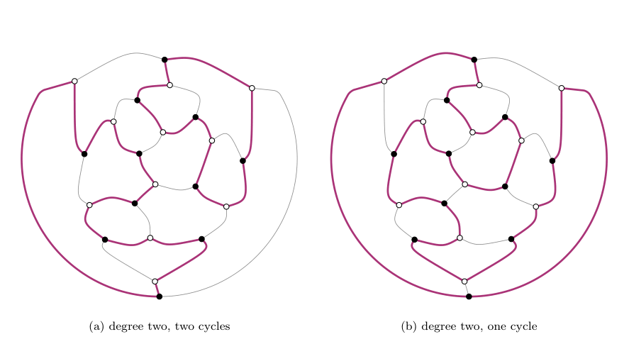

# 01. Degree two is free, connectivity is the problem

## What we want at this point and why

Before any machinery, we want to know what is hard about finding a Hamiltonian cycle in a Barnette graph $G$. The answer shapes the whole proof. Half of the definition of a Hamiltonian cycle comes for free in these graphs, and the other half is a global condition that no local rule controls. Every later step is a way to get hold of that global condition.

## The idea in plain words

A Hamiltonian cycle is a set of edges with two properties. Every vertex lies on exactly two of them, and the edges hang together in one piece. A set with the first property alone is called a 2-factor. It is a union of disjoint cycles that together cover all vertices.

In a cubic graph, choosing a 2-factor is the same as choosing the edges you leave out. Each vertex has three edges and keeps two, so it drops one. The dropped edges form a perfect matching, a set of edges that touches every vertex once. Bipartite cubic graphs have many perfect matchings. So 2-factors are cheap. What we cannot control by choosing a matching is how many cycles the leftover has.

## Precise statements

**Lemma 1** (standard). In a cubic graph, $F \mapsto E(G) \setminus F$ is a bijection between 2-factors and perfect matchings.

*Proof.* A spanning subgraph has degree two at every vertex exactly when its complement has degree one at every vertex. $\square$

**Lemma 2** (standard consequence of Hall's theorem, proved below). Every regular bipartite graph of positive degree has a perfect matching. A cubic bipartite graph is the union of three disjoint perfect matchings.

*Proof sketch.* For a set $S$ of black vertices, the $3|S|$ edges leaving $S$ end in the neighbours of $S$, and each neighbour absorbs at most three. So $S$ has at least $|S|$ neighbours and Hall's condition holds. Remove a perfect matching and repeat on the 2-regular remainder. $\square$

**Corollary.** A cubic bipartite graph $G$ is Hamiltonian if and only if it has a perfect matching $P$ such that $G - P$ is connected.

The assumptions used here are cubic and bipartite only. Planarity and 3-connectivity have not entered. They must enter later, because the corollary's condition fails for some cubic bipartite graphs, see "What does not work" below.

This reformulation is the one the proof ends with. Step 07 produces a set $P$ of edges of the dual triangulation with one edge in every face. Read in $G$, that is one edge at every vertex, a perfect matching, and the work is to show that the rest is connected.

## Worked example: the cube

Label the eight vertices of the cube $0,\dots,7$ with edges

$$01,\ 02,\ 03,\ 14,\ 16,\ 24,\ 25,\ 35,\ 36,\ 47,\ 57,\ 67.$$

These are the labels of the lab, where vertex $i$ of the cube is face $i$ of the octahedron in `paper/figures/octahedron.json`. Black vertices are $0,4,5,6$ and white vertices are $1,2,3,7$.

The cube has 9 perfect matchings, hence 9 2-factors. Six are Hamiltonian cycles. The other three are

| Omitted matching | What is left |
| --- | --- |
| $01,\ 24,\ 36,\ 57$ | two 4-cycles $0\,2\,5\,3$ and $1\,4\,7\,6$ |
| $02,\ 14,\ 35,\ 67$ | two 4-cycles $0\,1\,6\,3$ and $2\,4\,7\,5$ |
| $03,\ 16,\ 25,\ 47$ | two 4-cycles $0\,1\,4\,2$ and $3\,5\,7\,6$ |

Each bad 2-factor is a pair of opposite faces of the cube. Each omitted matching is a set of four parallel edges. So even here a third of all 2-factors are disconnected. The picture is `paper/figures/renders/01-cube.png`, panel (a), and `02-two-factors.png` for a larger graph.

In these three examples the share of connected 2-factors decreases. This table does not assert monotonicity for arbitrary graphs. These counts are computed by `examples.py`, by listing all perfect matchings and counting the components of each complement.

| Graph | Vertices | 2-factors | with 1, 2, 3, 4, 5 cycles |
| --- | --- | --- | --- |
| cube | 8 | 9 | 6, 3 |
| hexagonal prism | 12 | 20 | 8, 10, 2 |
| running example | 22 | 112 | 28, 52, 27, 4, 1 |

## What does not work

**Counting 2-factors.** For a bipartite planar graph, a suitably signed bipartite adjacency determinant counts perfect matchings in absolute value. For a general planar graph the corresponding formula is a Pfaffian, so 2-factors can be counted fast. The count does not see connectivity. Nothing in the 112 above tells you that 28 of them are connected. The proof of Barnette's conjecture is a count too, and its whole difficulty is to build one in which the disconnected objects cancel.

**Dropping a hypothesis.** The statement is false as soon as one of the four hypotheses goes. These are published results, cited here through the project's literature review `research/2026-11-14_opus_history-literature/` and the limits study `research/2026-11-14_astra_limits/HYPOTHESES.md`. I did not open the original papers.

- Not bipartite. Tutte's graph on 46 vertices is cubic, planar, 3-connected and not Hamiltonian (Tutte 1946).
- Not 3-connected. There is a cubic bipartite planar 2-connected graph on 26 vertices with no Hamiltonian cycle (Asano, Saito, Exoo, Harary 1982, known to the project from the abstract only). Deciding Hamiltonicity in that class is NP-complete (Akiyama, Nishizeki, Saito 1980).
- Not planar. Horton's graph is cubic, bipartite, 3-connected and not Hamiltonian.
- Not cubic. The 11-vertex graph with the 5 vertices of a triangular bipyramid on one side and its 6 faces on the other is planar, bipartite and 3-connected. Its two sides have different sizes, so it has no Hamiltonian cycle.

So no argument that uses only three of the hypotheses can work. Step 08 says where each one enters.

**Local repair.** A natural plan is to start from any 2-factor and merge its cycles one pair at a time by small exchanges around a face. The face-size results cited here use local structure (Goodey 1975 for faces of size 4 and 6, Schnieders 2025 for sizes up to 8). Schnieders explains why it stops there. With faces of unbounded size some faces are not covered by any bounded neighbourhood, and from face size 10 on the statement is true only because of 3-connectivity, which no bounded neighbourhood can certify. This is a quotation of his discussion as reported in `WHAT-WAS-HARD.md` section 3, not something checked here.

**Grinberg's criterion.** The classical tool for showing that a planar graph has no Hamiltonian cycle gives nothing for Barnette graphs. All faces are even, there are at least six 4-faces, and the usual divisibility argument has no modulus to work with. This is proved in `WHAT-WAS-HARD.md` section 2, in this project, not refereed.

## Other routes

- **Tutte paths.** Every 4-connected planar graph is Hamiltonian (Tutte 1956). A cubic graph is never 4-connected, and the method does not see a 2-colouring, so it cannot use bipartiteness. Status: published theorem, not applicable.
- **Matching theory.** Gorsky, Steiner and Wiederrecht (2023) translate the conjecture into a statement about Pfaffian graphs. The translation is an equivalence and gives no way to produce the cycle. Status: published. The OpenAI paper uses it for Corollary 7.2.
- **Counting connected objects with signs.** This is the route the proof takes. It was absent from the Barnette literature before 2026, according to a text search of 23 papers reported in `WHAT-WAS-HARD.md` section 9. That search is a computation by a project agent, not refereed.

## Where this is used next

Connectivity is awkward to prove directly. For plane graphs there is a clean exchange. A set of edges is connected and spanning exactly when the dual edges of its complement contain no cycle. Step 02 moves the problem to the dual of $G$ so that "the 2-factor is connected" becomes "a certain edge set is a forest". Acyclicity is the easier condition to work with, because a cycle is a concrete thing that an argument can reverse or count across.
