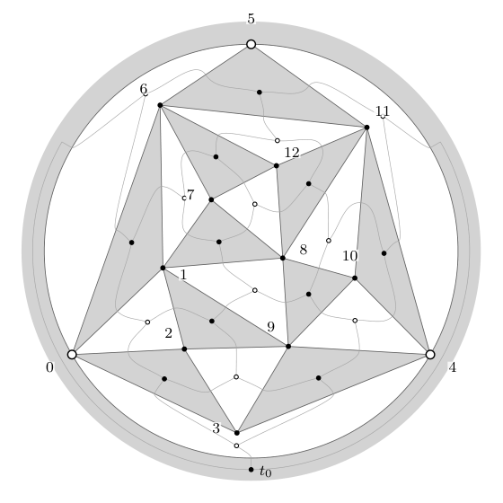

# 02. The dual triangulation and the two induced trees

Where this step lives elsewhere. Paper: Section 2 of [`barnette.pdf`](../../paper/main/barnette.pdf), Lemmas 2.1, 2.2 and 2.5, the counts (2.3) and Proposition 2.6, with Figures 1(b) and 2. Primal note: Lemmas 1, 2 and 12 of [`PRIMAL-PROOF.md`](../../proofs/primal/PRIMAL-PROOF.md) (rows "Face; edge as face link" and "Hamiltonian cycle G-P" of [`DICTIONARY.md`](../../proofs/primal/DICTIONARY.md)). Blueprint nodes `lem:dual`, `lem:connected`, `eq:counts`, `lem:duality.1`, `lem:duality.2`, `prop:target.1`, `prop:target.2` in [`BLUEPRINT.md`](../../proofs/blueprint/BLUEPRINT.md). Two of these have no Lean counterpart: Lemma 2.2 and Proposition 2.6(2), the two-trees statement. Atlas: page 1, [the chain](../atlas/pages/01-chain.pdf).

## What we want at this point and why

Step 01 left us with a connectivity problem in the cubic graph $G$. Here we move it to the dual graph $T = G^*$, where it becomes a problem about trees. Three things come out of this step and are used all the way to the end.

1. The setting. $T$ is a simple triangulation of the sphere with faces coloured black and white.
2. The target. A Hamiltonian cycle of $G$ is the same as a split of $V(T)$ into two sets that each induce a tree.
3. Two tools. The Euler counts that make a matching between black faces and vertices possible, and the tree/cotree duality that converts "connected" into "acyclic" and back.

## The idea in plain words

Draw $G$ on the sphere. Put a new vertex in every face of $G$ and join two new vertices when their faces share an edge. This is the dual $T$. Every vertex of $G$ has three edges, so it sits inside a triangle of $T$. The black and white vertices of $G$ become black and white triangles, and two triangles that share an edge have different colours.

A Hamiltonian cycle of $G$ is a closed curve on the sphere. It has two sides. Every face of $G$, that is every vertex of $T$, lies on one side. On each side the faces must hang together like a tree. If they formed a ring, the ring would surround a vertex of $G$ that the curve never reaches. This is Stein's observation from 1971, and it turns the search for one long cycle into the search for two trees.

Keep the two vertex sets separate: vertices of G become faces of T. A cycle through vertices of T would solve a different problem.

## Precise statements and proofs

### The dual is a simple triangulation with a face colouring

**Proposition 1** (OpenAI, proof of Theorem 1.1; paper Lemma 2.1). Let $G$ be cubic, bipartite, planar and 3-connected, embedded in the sphere. Then $T = G^*$ is a simple graph, every face of $T$ is a triangle, $T$ has at least four vertices, and the bipartition of $G$ colours the faces of $T$ black and white with different colours across every edge.

*Proof, with the hypotheses named.*

- *3-connected and cubic give no small edge cuts.* Suppose one or two edges separate $G$. A single vertex has three edges and two adjacent vertices have four leaving them, so each side of the cut has at least three vertices. Delete the ends of the cut edges on one side, at most two vertices. What is left of that side is not empty and is cut off from the other side. This contradicts 3-connectivity.
- *No small edge cuts give a simple dual.* A loop of $T$ is a closed curve crossing one edge of $G$, and two parallel edges of $T$ form a closed curve crossing two edges of $G$. Either would be an edge cut of size one or two.
- *Cubic gives triangles.* The face of $T$ around a vertex of $G$ is bounded by the three dual edges. In a simple graph a closed walk of length three is a triangle.
- *Bipartite gives the colouring.* Colour each triangle by the colour of the vertex of $G$ inside it. An edge of $T$ crosses an edge of $G$, whose ends have different colours.
- *Planar gives Euler's formula*, used next. $|V(T)| = 2 + |V(G)|/2 \ge 4$. $\square$

Every vertex of $T$ has even degree, because the triangles around it alternate in colour. Such a triangulation is called Eulerian. It also has a proper colouring of its vertices with three colours in which every black triangle reads $0,1,2$ counterclockwise. This colouring is used only as a side remark in steps 04 and 05. A short proof is in `research/2026-11-14_fable_referee-determinants/SIGNIFICANCE.md` section 3, proved in this project by the referee of the determinant reports and not itself refereed.

### The counts

**Lemma 2** (OpenAI (2.1); paper (2.3)). Let $k$ be the number of black faces of $T$. Then $T$ has $k$ white faces, $3k$ edges and $k+2$ vertices.

*Proof.* Every edge lies on exactly one black face and every black face has three edges, so $|E| = 3k$. The same holds for white faces. Euler's formula $|V| - |E| + |F| = 2$ gives $|V| = 2 + 3k - 2k$. $\square$

Euler's formula needs a connected graph, and the paper is careful about this. Its Lemma 2.2 says that a graph drawn on the sphere whose faces are all bounded by cycles is connected: the union of one component with the faces it bounds is open, so is the rest, and the sphere is connected. The same lemma is used again in step 04, for the inside of a cycle, and in step 08, for the pieces of a cut. The Lean proof has a different counterpart (`region_connected`) and the blueprint marks Lemma 2.2 as checked by a second model only.

Now choose one black face $t_0$ and call it the outer face. Its three vertices are the roots, $R$. Let $A$ be the set of the other black faces and $X$ the set of the other vertices. Then

$$|A| = k - 1 = |X|.$$

Call this number $n$. The equality is necessary for a state to be a bijection. It does not alone prove that an incidence matching exists; step 03 supplies the matching argument. It uses planarity through Euler's formula. On a torus the same count gives $|A| - |X| = 2$, and the proof stops before it starts. That remark is from `research/2026-11-14_astra_limits/HYPOTHESES.md`, proved in this project, not yet refereed. The count itself is two lines.

### Tree/cotree duality

**Lemma 3** (OpenAI Lemma 2.1; paper Lemma 2.5(2)). Let $M$ be a connected graph embedded in the sphere, loops and parallel edges allowed. If $F$ is the edge set of a spanning tree of $M$, the dual edges of $E(M) \setminus F$ form a spanning tree of $M^*$. If $F$ is only a spanning forest, the dual edges of $E(M) \setminus F$ form a connected spanning subgraph of $M^*$.

*Proof.* Contract the edges of the spanning tree $F$ one at a time. Contracting an edge keeps all faces and removes its dual edge, so the dual of the contracted graph is $M^*$ with the edges dual to $F$ deleted. The contracted graph has one vertex and is connected, and the dual of a connected plane graph is connected. The number of remaining dual edges is $|E| - |V| + 1 = |F(M)| - 1$ by Euler, one less than the number of vertices of $M^*$. A connected graph with that many edges is a tree. A forest extends to a spanning tree, and the complement of a smaller set is larger. $\square$

The paper proves the forest case differently, without contracting. If the dual of the complement were disconnected, take the faces $\Phi$ of one component and call an edge of $M$ a boundary edge if it has one face in $\Phi$ and one outside. Every boundary edge lies in $F$. Around each vertex, faces and edges alternate, and membership in $\Phi$ changes an even number of times, so every vertex meets an even number of boundary edges. A non-empty edge set with all degrees even contains a cycle, and that cycle lies in $F$. This version needs no Euler count and works for any acyclic $F$ at once.

The converse also holds and is used in step 07 (paper Lemma 2.5(1)). If $F$ contains a cycle $Z$, the dual edges that cross $Z$ are exactly those that join a face inside $Z$ to a face outside, by the Jordan curve theorem, and all of them are missing from the complement. So the complement is disconnected.

The assumption that matters is the sphere. On a surface of genus $g$ the complement of a spanning tree has $2g$ edges too many to be a tree.

### Two induced trees

A set $U \subseteq V(T)$ induces the subgraph $T[U]$ that has all edges of $T$ with both ends in $U$. "Induces a tree" is stronger than "contains a spanning tree of itself", because every extra edge between vertices of $U$ counts.

**Theorem 4** (paper Proposition 2.6. Stein 1971, Theorem 2.2. In this form Alt, Payne, Schmidt, Wood 2016, Lemma 5. Cited through `research/2026-11-14_opus_history-literature/EQUIVALENTS.md`, where both statements were read in the sources). For a partition $V(T) = U \cup U'$ the following are equivalent.

1. $T[U]$ and $T[U']$ are trees.
2. The edges of $T$ with one end in each class are dual to a Hamiltonian cycle of $G$.

*Proof.* Call an edge mixed if its ends are in different classes and plain otherwise.

(1) implies (2). A triangle with all three corners in one class would be a cycle in an induced tree. So every face has corners in both classes, hence exactly two mixed edges and one plain edge. In $G$, the duals of the mixed edges have degree two at every vertex. The plain edges are the edges of the two trees, a spanning forest of $T$. By Lemma 3 the duals of the remaining edges, the mixed ones, form a connected subgraph. Connected with all degrees two is one cycle through all vertices.

(2) implies (1). Draw the Hamiltonian cycle $C$ as a closed curve crossing each of its dual edges once. The class of a vertex of $T$ is the side of $C$ it lies on, and mixed edges are the crossed ones. Each face of $T$ contains one vertex of $G$, which has two edges on $C$, so each face has two mixed edges and one plain edge. Each plain edge is on two faces, so there are $2k/2 = k$ plain edges. They contain no cycle, since a cycle of plain edges is a closed curve that $C$ does not cross, with vertices of $G$ on both sides, and $C$ could not visit both. A forest with $k+2$ vertices and $k$ edges has two components. Each component lies in one class and both classes are non-empty, so each class is one component. The edges of $T[U]$ are exactly the plain edges inside $U$. So $T[U]$ is a tree. $\square$

The paper's Proposition 2.6 is the same theorem seen from the selection. An acyclic set $P$ with one side in every face gives the Hamiltonian cycle by Lemma 3 (part 1), and $P$ then has exactly two components, each inducing a tree (part 2). Part 2 is the one statement on this page that the Lean proof never states; the Lean gluing works with perfect matchings with connected complement instead.

The count in the second half explains a point of terminology. Stein speaks of two induced forests and later authors of two induced trees. In a triangulation these are the same, because the plain edges always number $k = |V| - 2$.

What the main theorem of the dual side says is this.

**Theorem 5** (OpenAI Theorem 2.2; paper Theorem 6.2, which states it as "an acyclic selection containing $e_0$"). Let $T$ be a simple sphere triangulation with a proper black and white face colouring, $t_0$ a face and $e_0$ an edge of $t_0$. Then $V(T)$ splits into two sets, each inducing a tree, with the ends of $e_0$ in one set and the third vertex of $t_0$ in the other.

The extra condition on $e_0$ says that $e_0$ is a plain edge, so the Hamiltonian cycle does not cross it. In $G$ the cycle avoids the edge dual to $e_0$. That prescription is carried through the whole proof because step 08 needs it.

## Worked example: the octahedron

The dual of the cube is the octahedron. With the labels of `paper/figures/octahedron.json` its coherently oriented face boundaries are listed below. Bounded faces run counterclockwise in the chosen drawing; the outer boundary has the opposite planar orientation. The faces are

| Face | Corners | Colour | | Face | Corners | Colour |
| --- | --- | --- | --- | --- | --- | --- |
| 0 | 0, 2, 1 | black, this is $t_0$ | | 4 | 1, 3, 5 | black |
| 1 | 0, 1, 5 | white | | 5 | 2, 4, 3 | black |
| 2 | 1, 2, 3 | white | | 6 | 0, 5, 4 | black |
| 3 | 2, 0, 4 | white | | 7 | 3, 4, 5 | white |

So $k = 4$. There are 4 white faces, 12 edges and 6 vertices, as Lemma 2 says. The roots are $0,1,2$, the set $X$ is $\{3,4,5\}$, the set $A$ is faces $4,5,6$, and $n = 3$.

Take $U = \{0,1,3\}$ and $U' = \{2,4,5\}$. In the octahedron each vertex is adjacent to all others except its opposite, and the opposite pairs are $\{0,3\}$, $\{1,4\}$, $\{2,5\}$. So $T[U]$ is the path $0 - 1 - 3$ and $T[U']$ is the path $2 - 4 - 5$. Both are trees. The plain edges are $01, 13, 24, 45$, one in each of the eight faces. The other eight edges are mixed, and their duals visit the faces in the order

$$0,\ 3,\ 6,\ 1,\ 4,\ 7,\ 5,\ 2,$$

a Hamiltonian cycle of the cube. The edge $e_0 = 01$ is plain, so the cycle avoids the cube edge between vertices 0 and 1. Step 07 shows how the proof finds this partition. The paper's Figure 1(e) shows the other partition the proof can return here, $\{0,1,4\}$ against $\{2,3,5\}$; the cube has exactly two good states and each gives one of these.

For a bigger picture of the passage from $G$ to $T$ see the running example.

## What does not work

**Two connected classes.** Splitting $V(T)$ into two sets that are each connected is easy and not enough. In the octahedron take $U = \{0,1,2\}$ and $U' = \{3,4,5\}$. Both induce triangles. The faces $0$ and $7$ have no mixed edge, so the corresponding vertices of the cube are not on the dual subgraph at all.

**Building the trees from the vertex colouring.** The three colour classes of the vertices of $T$ are a natural starting point, and several partial results build one tree from a whole colour class. Alt, Payne, Schmidt and Wood prove that this cannot work in general. There are triangulations in which every suitable tree must contain many vertices of each colour and miss many of each. This is a published limitation, reported in `WHAT-WAS-HARD.md` section 5. I did not read the original proof.

**Other surfaces.** On a torus the target itself is impossible. If both classes induced trees, each face would have one plain edge, giving $k$ plain edges, while two trees on $k$ vertices have $k - 2$ edges. A 9-vertex torus triangulation whose dual is Hamiltonian and which has no such partition is in `research/2026-11-14_astra_limits/examples/torus_3x3.json`. Proved and computed in this project, not yet refereed.

**Hamiltonian cycles of $T$.** Whitney's theorem gives a Hamiltonian cycle in every triangulation without separating triangles. That is a cycle through the vertices of $T$. We need one through its faces.

## Other routes

- **Stay in $G$.** The project's primal note proves the whole theorem in the cubic graph; its Lemma 2 is the cut-side version of Lemma 3 here, and its Lemma 12 is Theorem 4 read in $G$ (`proofs/primal/`, accepted by a second model in the cross-audit, no human reader). Li's note never forms $T$. It works with a graph that has the vertices of $G$ and the faces of $G$ as its vertices, and reaches the Hamiltonian cycle without the two trees. The Lean formalisation also stays in $G$ and replaces faces by algebraic duality (`research/2026-11-14_opus_lean-formalisation/REPORT.md`). Status: published, and formalised.
- **Weaken the target on other surfaces.** A target that makes sense on any surface is a set of edges with one edge in each triangle whose complementary dual is connected. Status: proposed in `astra_limits`, not refereed, no existence theorem.

## Where this is used next

- Step 03 uses $|A| = |X|$ to define states.
- Steps 04 to 06 use the fact that every edge of $T$ has exactly one black face. It lets a black face "own" its three edges.
- Step 07 uses Lemma 3 twice and the argument of Theorem 4 once.
- Step 08 uses Theorem 5 as the statement proved by induction.
