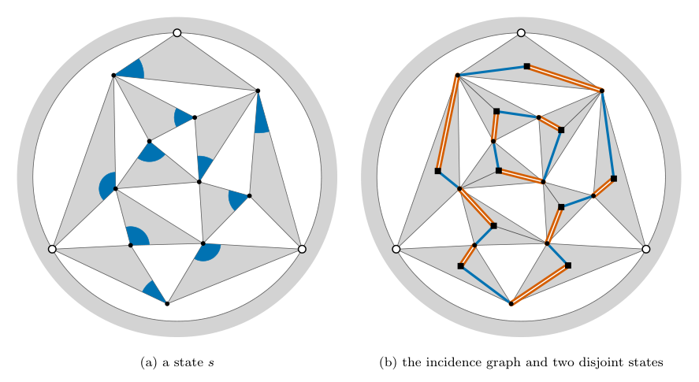
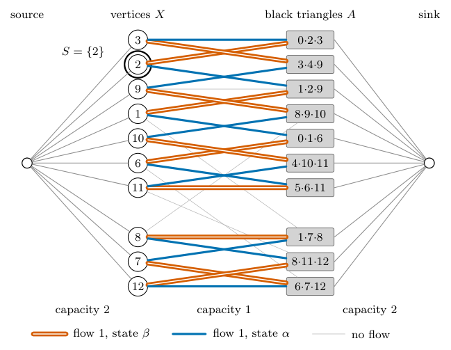

# 03. States, pairs, and when a pair exists

Review snapshot, 14 November 2026: the structure referee's `INTEGRATION.md` supplies the specific verdicts cited below. Its `REPORT.md` still calls itself a provisional work log. These are AI checks, with human review pending.

## What we want at this point and why

Step 02 turned the problem into finding two induced trees in the triangulation $T$, with a prescribed edge $e_0$ of the outer black face $t_0$ inside one of them. We now want a finite object to search for that encodes such a pair of trees. That object is a state. This step explains why states are the right object, why the proof needs two of them at once, and exactly when two exist.

Notation from step 02. $R$ is the set of three roots, $A$ the black faces other than $t_0$, $X$ the non-root vertices, and $|A| = |X| = n$.

## Why match black triangles to vertices

Start from the answer and look at its shadow. Suppose we had the two induced trees. Their edges form a set $P$ with one edge in every face, and $e_0 \in P$. Remove $e_0$. The tree that contained it falls into two pieces, so $P_0 = P \setminus \{e_0\}$ is a forest with three components, and each component contains exactly one root. Direct every edge of $P_0$ towards the root of its component. Then every non-root vertex is the tail of exactly one edge.

Each edge of $P_0$ lies in exactly one black face, and that face is in $A$, because the only edge of $P$ in $t_0$ is $e_0$. Each face of $A$ contains exactly one edge of $P_0$. So

$$t \ \longmapsto\ \text{the tail of the edge of } P_0 \text{ in } t$$

is a bijection from $A$ to $X$ that sends each black face to one of its own corners. The two trees leave behind a perfect matching between black faces and vertices. So a search for the trees can be organised as a search over such matchings.

This derivation is Proposition 7 of `research/2026-11-14_fable_route-combinatorics/PROOF.md` and Theorem 7.2 of `research/2026-11-14_opus_route-graph-theory/PROOFS.md`. Both are proved in this project and were checked by a second model, the first in `research/2026-11-14_astra_referee-combinatorics/`, the second in section 5 of `research/2026-11-14_sol_referee-structure/INTEGRATION.md`. Not yet read by a human. The published papers go in the other direction only, from the matching to the trees.

## Definitions

**State.** A bijection $s : A \to X$ with $s(t)$ a corner of $t$ for every $t$. Equivalently, a perfect matching of the bipartite incidence graph $B$ whose two sides are $A$ and $X$ and whose edges are the pairs $(t, v)$ with $v$ a corner of $t$. These are the Tutte states of trinity theory. Li calls them perfect matchings of $H$, the trees paper perfect matchings of $B$.

**Opposite edges.** For a state $s$, $Q_s$ is the graph on all of $V(T)$ whose edges are the side of $t$ opposite $s(t)$, one for each $t \in A$. These $n$ edges are distinct, since an edge has only one black face.

**Spoke graph.** Put a centre in every black face, $t_0$ included, and join it to its three corners by spokes. This graph is $H$. It has $2n+4$ vertices and $3n+3$ edges. A state is a set of $n$ spokes.

**Tree matching.** A state $s$ such that $H$ minus the spokes of $s$ is a spanning tree. Removing the spoke $(t, s(t))$ leaves the centre of $t$ as a vertex of degree two on a path between the other two corners, which is the edge of $Q_s$ with a subdivision point. The centre of $t_0$ ties the three roots together. So

$$H - s \text{ is a tree} \iff Q_s \text{ is a forest with exactly one root in each component.}$$

This equivalence is (3) of the trees paper. Step 07 turns a tree matching into the two induced trees.

**Pair.** Two states $r, s$ with $r(t) \neq s(t)$ for every $t \in A$. We also say that $r$ is a partner of $s$. The trees paper says mate. For a pair, $u(t)$ denotes the third corner of $t$.

## Why a second state

A single state does not tell you much about $Q_s$. A partner does three jobs.

**It orients $Q_s$.** The edge of $Q_s$ in $t$ joins the two corners other than $s(t)$, which are $r(t)$ and $u(t)$. Direct it from $r(t)$ to $u(t)$. Since $r$ is a bijection onto $X$, every non-root is the tail of exactly one edge and no root is a tail.

**Lemma 1** (trees paper, Proposition 2.1; the first half is OpenAI Lemma 6.1). Let $s$ be a state with a partner. Every component of $Q_s$ is a tree containing exactly one root, or contains no root and exactly one cycle. If there are $k$ components of the second kind, $s$ has exactly $2^k$ partners.

*Proof.* Take a component with $v$ vertices of which $a$ are roots. Its edges number $v - a$, one per tail. A connected graph has at least $v - 1$ edges, so $a \le 1$. If $a = 1$ it has $v - 1$ edges and is a tree, and all edges point to the root. If $a = 0$ it has $v$ edges, hence one cycle. The cycle runs one of two ways and everything else points to it. Conversely any such orientation gives a partner by reading off the tails, and the two directions of each cycle are free choices. $\square$

So with a partner, "forest" already implies "one root per component". And a tree matching is exactly a state with one partner.

**It gives something to move.** If $Q_s$ has a cycle, the cycle can be run the other way, and that changes $r$ without touching $s$. Step 05 uses this to cancel.

**It gives something to count.** The directed edges $r(t) \to s(t)$ form disjoint cycles through all of $X$. Step 06 groups pairs by these cycles.

## When does a pair exist

**Theorem 2** (trees paper, Theorem 1.2, (ii) $\Leftrightarrow$ (iii). OpenAI Proposition 3.1 and Li Lemma 9 prove the "if" direction when there is no separating triangle at all). A pair exists if and only if no separating triangle of $T$ has black inner boundary.

A separating triangle is a 3-cycle of $T$ with vertices on both sides. Its inner side is the side away from $t_0$. It has black inner boundary if the three faces on the inner side that touch its edges are black.

The proof has two parts.

### Part 1, from pairs to a counting condition

Two disjoint perfect matchings of $B$ together form a subgraph with degree two everywhere. Conversely such a subgraph is a union of even cycles, and taking alternate edges splits it into two disjoint perfect matchings. So we want a 2-factor of $B$.

Set up a flow. A source sends capacity 2 to each vertex of $X$, each incidence $(t,v)$ carries capacity 1, and each face of $A$ sends capacity 2 to a sink. A flow of value $2n$ with whole numbers is a 2-factor. By the max-flow min-cut theorem with integral capacities (Ford and Fulkerson 1956) such a flow exists if and only if every cut has capacity at least $2n$, which works out to

$$\sum_{t \in A} \min\bigl(2,\ |V(t) \cap S|\bigr) \ \ge\ 2|S| \qquad \text{for every } S \subseteq X. \tag{1}$$

In words, any set $S$ of vertices needs $2|S|$ incidences, and each black face can give at most two, and no more than it has corners in $S$.

Rewrite (1) in terms of $U = V(T) \setminus S$, which contains the roots. A black face with $j$ corners in $U$ contributes $\min(2, 3-j) = 2 - \max(0, j-1)$. The number $\max(0, j-1)$ is the number of edges of that face inside $T[U]$, minus one if all three corners are in $U$. Every edge has one black face. With $e(U)$ the number of edges of $T[U]$ and $b(U)$ the number of black faces with all corners in $U$, condition (1) becomes

$$e(U) - b(U) \ \le\ 2|U| - 4 \qquad \text{for every } U \supseteq R. \tag{2}$$

### Part 2, the Euler identity

**Lemma 3** (Euler identity, `research/2026-11-14_opus_route-graph-theory/PROOFS.md`, Lemma 2.2. Proved in this project and checked by a second model, whose restatement is section 1 of `research/2026-11-14_sol_referee-structure/INTEGRATION.md`. Not yet read by a human.) Let $K$ be a connected induced subgraph of $T$ with $p \ge 3$ vertices and $m$ edges. Some faces of the plane graph $K$ are faces of $T$. Call the others regions. Let $b$ be the number of black faces of $T$ that are faces of $K$. For a region $F_i$ let $d_i$ be the length of its boundary and $\beta_i$ the number of black faces of $T$ inside it minus the number of white ones. Then

$$m - b - (2p - 4) \ =\ \tfrac12 \sum_i \bigl(\beta_i - (d_i - 4)\bigr).$$

*Proof.* Let $w$ count the white faces of $T$ that are faces of $K$ and let $q$ be the number of regions. Euler gives $p - m + b + w + q = 2$. Counting edge sides gives $2m = 3b + 3w + \sum d_i$. Eliminate to get $m - b - (2p-4) = \tfrac12\bigl(w - b - \sum(d_i - 4)\bigr)$. Since $T$ has equally many black and white faces, $w - b = \sum \beta_i$. $\square$

The size of $\beta$ is controlled by a second count. Give each black face inside a region $+3$ and each white face $-3$ and spread these over their sides. Inner sides cancel in pairs. So $3\beta$ is a sum of $d$ signs, one per boundary side. Hence $\beta \equiv d \pmod 2$ and $|\beta| \le d/3$. For $d = 3$ this gives $\beta = \pm 1$, with $+1$ exactly when the three faces along the boundary are black. For $d \ge 4$ it gives $\beta \le d - 4$.

*Proof of Theorem 2.* If a separating triangle has black inner boundary, let $U$ be everything not strictly inside it. Then $T[U]$ has a single region, with $d = 3$ and $\beta = 1$, and Lemma 3 gives $e(U) - b(U) = 2|U| - 4 + 1$. So (2) fails by exactly one.

If no separating triangle has black inner boundary, take any $U \supseteq R$ and apply Lemma 3 to each component of $T[U]$. In the component of the roots, a region of length at least 4 contributes at most 0. A region of length 3 is the inner side of a separating triangle, which has $\beta = -1$ by assumption, and contributes 0. So that component satisfies $m - b \le 2p - 4$. If it has only three vertices it is $t_0$ itself, with $m - b = 3 - 1 = 2$, and the bound holds with equality. Any other component with at least four vertices has one region that contains $t_0$ and may contribute $1$, and so satisfies $m - b \le 2p - 3 \le 2p$. Smaller components have at most three edges, so $m - b \le 2p$ there too. Summing over the components gives (2). $\square$

Computed check. The criterion agrees with a direct flow computation on all 7,868 rooted triangulations with at most 16 vertices (`opus_route-graph-theory`, and independently on 1,206 rooted cases up to 14 vertices in `astra_limits`).

## Worked examples

**Octahedron.** $A$ is faces $4 = (1,3,5)$, $5 = (2,4,3)$, $6 = (0,5,4)$ and $X = \{3,4,5\}$. The incidence matrix with rows $4,5,6$ and columns $3,4,5$ is

$$\begin{pmatrix} 1 & 0 & 1 \\ 1 & 1 & 0 \\ 0 & 1 & 1 \end{pmatrix}.$$

It has two perfect matchings, the states $s_1 = (3,4,5)$ and $s_2 = (5,3,4)$, written as the images of faces $4,5,6$. They differ everywhere, so they form a pair in either order. $Q_{s_1}$ has the edges $15, 23, 04$ and $Q_{s_2}$ has $13, 24, 05$. Each is three single edges with one root each. Both states are tree matchings.

**Prism.** $T$ is the double wheel with apexes $6, 7$ and rim $0,\dots,5$, and $t_0 = (6,0,1)$. There are three states. Two of them form a pair and are tree matchings. The third sends the faces $(7,2,1), (6,2,3), (7,4,3), (6,4,5), (7,0,5)$ to $2, 3, 7, 4, 5$. Its opposite edges are $71, 62, 43, 65, 70$. That is a forest. Its components are $\{0,1,7\}$ with two roots, $\{2,5,6\}$ with one, and $\{3,4\}$ with none. It is not a tree matching and it has no partner. This is the smallest example showing that "forest" without a partner is not enough.

**Double octahedron.** Glue an octahedron with new vertices $6,7,8$ into the face $(3,4,5)$ of the octahedron. The triangle $3,4,5$ is now separating. Of the 14 possible outer faces, 8 give four states, four pairs and four tree matchings. The other 6 give four states and no pair. For $t_0 = (0,1,5)$ the inner faces along the triangle are black, namely $(3,4,8), (4,5,6), (5,3,7)$, together with the central face $(6,7,8)$. Take $S = \{6,7,8\}$. These three vertices need $6$ incidences. The four black faces that touch them supply $1 + 1 + 1 + 2 = 5$. Condition (1) fails by one.

**Running example.** 13 vertices, $n = 10$, no separating triangle. There are 12 states and 8 pairs. Seven states have a partner. Six of them have one partner each and are tree matchings. The seventh has two partners and a cycle in its $Q$. The figure shows the flow for one pair.

## What does not work

- **One state.** The prism example above. Also, in the octahedron with every face split in four, 34 of the 54 states have an acyclic $Q_s$ and are not tree matchings (`research/2026-11-14_fable_dependency-graph/correspondence.md`, note 3.5, computed).
- **Dropping the second bijection.** Keep $r$ a state and keep the choices distinct in each face, but drop the requirement that $s$ is a bijection. For any choice of one corner per face, the signed sum over states $r$ avoiding that choice is a determinant, and the sum over all choices is non-zero for an easy reason. It produces a choice function whose opposite edges form a rooted forest, but that function may use a vertex twice, and step 07 needs each vertex used once. So the whole difficulty is the second bijection. This is the side remark in section 4 of `fable_route-combinatorics/PROOF.md`, proved in this project and checked by a second model, not yet read by a human.
- **Graphs that are only 2-connected.** Then $T$ has parallel edges. On the 26-vertex non-Hamiltonian example every root has eight states and no pair, so the proof stops here and nowhere later (`astra_limits/HYPOTHESES.md`, computed in this project, not yet refereed).
- **Rooting anywhere.** Pairs depend on $t_0$. The double octahedron has them for 8 roots out of 14. This is why step 08 is needed.

## Other routes to a pair

- **Li's route.** Take a smallest set $S$ violating (1) and show that it is cut off by three edges of $G$. Published. The audit in `fable_dependency-graph/correspondence.md`, note 3.7, observes that Li's argument already yields the black inner boundary.
- **Pairs as orientations.** A 2-factor of $B$ is the same as an orientation of $H$ minus the centre of $t_0$ with prescribed out-degrees, so by a theorem of Felsner the 2-factors form a distributive lattice. Proved in `opus_route-graph-theory/PROOFS.md` section 3. The referee's integration notes do not list this lemma among the confirmed statements, so treat it as not yet refereed. Felsner's theorem was cited there from memory. The lattice does not single out a good pair, see step 09.
- **A construction without flows.** Unknown. The obstruction is always a single triangle, which suggests that an explicit ordering argument should exist, as it does for Schnyder woods. Nobody in the project found one.

## Where this is used next

Step 04 proves the counting lemma for cycles made of edges that leave the corners chosen by a state. Steps 05 and 06 assume that a pair exists and produce a pair whose second state is a tree matching.
