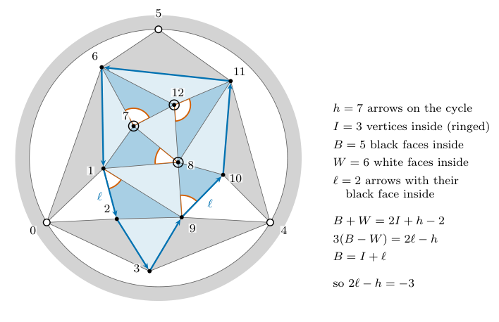

# 04. The disk identity

Where this step lives elsewhere. Paper: Lemma 3.7 (outdegree), the paragraph "The inside of a cycle" and Lemma 3.8 of [`barnette.pdf`](../../paper/main/barnette.pdf), with Figure 6. Primal note: Lemma 5, the cut-side identity, in [`PRIMAL-PROOF.md`](../../proofs/primal/PRIMAL-PROOF.md) (row "Bond; root-free shore" of [`DICTIONARY.md`](../../proofs/primal/DICTIONARY.md); Lean `state_disk_count`). Blueprint nodes `lem:outdegree`, `txt:inside`, `lem:disk` in [`BLUEPRINT.md`](../../proofs/blueprint/BLUEPRINT.md); the identity has a Lean counterpart on the cubic graph, the translation from disks to bonds is informal. Atlas: page 3, [the disk identity, three ways](../atlas/pages/03-disk.pdf).

## What we want at this point and why

Steps 05 and 06 attach a sign to every pair of states and need to know how that sign changes when a cycle is reversed. Step 07 needs to know that a certain edge set has no cycle. All three rest on one counting fact about cycles whose edges leave the corners chosen by a state. This step proves that fact, shows which part of it each later step uses, and shows what goes wrong without the bijection.

## The idea in plain words

Take a state $r$ and a closed curve in $T$ made of edges, each leaving the corner that $r$ chose in the black face owning the edge. Look at the disk the curve bounds. The state matches black faces with vertices. Inside the disk that matching is forced to be exact. Every interior vertex is matched to a black face in the disk, and a boundary vertex is matched into the disk exactly when its outgoing edge has its black face inside. So the number of black faces in the disk is known in terms of vertices. Euler's formula ties vertices to all faces. The two together fix the number of white faces. The result is that the disk always has exactly one more white face than black faces. No freedom is left.

## Setting and statement

$T$, $t_0$, $R$, $A$, $X$ are as in step 03. Draw $T$ in the plane with $t_0$ as the unbounded face.

For adjacent vertices $v, w$ let $\delta(v,w) = +1$ if the black face on the edge $vw$ lies to the left when going from $v$ to $w$, and $-1$ otherwise. So $\delta(w,v) = -\delta(v,w)$, and going counterclockwise around a bounded black face every step has $\delta = +1$.

Let $r$ be a state. A chosen edge system for $r$ picks, in every $t \in A$, one of the two sides of $t$ at $r(t)$ and directs it away from $r(t)$.

**Lemma** (disk identity; paper Lemma 3.8, OpenAI Lemma 4.1, Li Claim 25, trees paper Lemma 4.1). Let $C$ be a simple directed cycle in a chosen edge system for a state $r$. Let $h$ be its length. Then $C$ contains no root and encloses no root. In the disk bounded by $C$ let $B$ and $W$ be the numbers of black and white faces and $\ell$ the number of edges of $C$ whose black face is inside. Then

$$W = B + 1, \qquad h - 2\ell = 3.$$

Consequently

- the $\delta$-sum along $C$ is $-3$ if $C$ is counterclockwise and $+3$ if it is clockwise,
- $h$ is odd,
- the disk contains at least one white face.

The first form, with $\pm 3$, is how the OpenAI paper states it. The second form, $W = B+1$, came out of this project (`research/2026-11-14_fable_route-combinatorics/PROOF.md`) and is now the paper's statement, refereed with it. The two are equivalent by the count below.

Why is a cycle of chosen edges automatically directed? Every vertex has at most one outgoing chosen edge, so a cycle with $h$ edges has $h$ distinct tails on its $h$ vertices, and each vertex is the tail of one of its edges (paper Lemma 3.7). The same count says more: a connected piece with $\nu$ vertices, $\gamma$ of them without an outgoing edge, has $\nu - \gamma$ edges, so it is a tree with one sink or has exactly one cycle. Steps 03 and 07 use this.

## Proof, with each assumption named

*Roots are outside.* Only non-roots have an outgoing chosen edge, because $r$ maps into $X$. So $C$ has no root on it. The three roots are joined to each other by the sides of $t_0$, which is the unbounded face, so they lie outside $C$. Hence every vertex in the disk is a non-root and every black face in the disk belongs to $A$. This uses the choice of $t_0$ as the outer face.

Let $I$ be the number of vertices strictly inside $C$.

*Count 1, $B = I + \ell$. This is where the bijection is used.* Send each black face $t$ in the disk to $r(t)$. This map is injective because $r$ is. An interior vertex $v$ is $r(t)$ for some $t$ that has $v$ as a corner, and every face at an interior vertex lies in the disk. So every interior vertex is hit, which uses that $r$ is onto $X$. A vertex $v$ on $C$ has exactly one outgoing chosen edge, the edge of $C$ leaving it, and that edge lies in the black face matched to $v$. So $v$ is hit by a face in the disk exactly when that edge has its black face inside. That happens $\ell$ times. No vertex outside the disk is hit, since $r(t)$ is a corner of $t$.

*Count 2, edges. This uses the face colouring.* Every edge has one black and one white face. The edges of the disk whose black face is in the disk number $3B$. The remaining ones are the $h - \ell$ edges of $C$ with the black face outside. The same count with white gives

$$E = 3B + (h - \ell) = 3W + \ell.$$

*Count 3, Euler's formula for a disk. This uses planarity.*

$$(I + h) - E + (B + W) = 1.$$

Put $E = 3B + h - \ell$ into Count 3. The $h$ cancels and $I + \ell - 2B + W = 1$. With Count 1 this reads $W - B = 1$. Then Count 2 gives $h - 2\ell = 3(W - B) = 3$.

*Signs.* Going counterclockwise the disk is on the left, so an edge of $C$ has $\delta = +1$ exactly when its black face is inside. The sum is $\ell - (h - \ell) = -3$. Clockwise it is $+3$. And $h = 2\ell + 3$ is odd. $\square$

One point that the source papers pass over quickly. Count 3 is Euler's formula for the plane graph $R_C$ made of $C$ and everything of $T$ inside it, and Euler's formula needs $R_C$ to be connected. The paper says why it is. By the Jordan curve theorem the outside of $C$ is one face of $R_C$, bounded by $C$. Every other face of $R_C$ lies in a face of $T$ inside $C$, and every face of $T$ inside $C$ is a face of $R_C$, bounded by its triangle. So all faces of $R_C$ are bounded by cycles, and the connectivity lemma of step 02 (paper Lemma 2.2) makes $R_C$ connected. In the Lean formalisation the corresponding work costs about 500 lines (`research/2026-11-14_opus_lean-formalisation/REPORT.md`, item 4 of its summary).

The bounded disk always means the side away from the outer face. Reversing a traversal changes its delta-sum, but does not change B, W, I or the number of black-inside boundary edges.

## Worked examples

**Octahedron.** For the pair $r = (5,3,4)$, $s = (3,4,5)$ the edges $r(t) \to s(t)$ are $5 \to 3$, $3 \to 4$, $4 \to 5$. They form the cycle $3 \to 4 \to 5 \to 3$ around the white face $(3,4,5)$, counterclockwise. Here $h = 3$, $\ell = 0$, $B = 0$, $W = 1$, $I = 0$. Each step has its black face on the right, so the $\delta$-sum is $-3$.

**Running example.** Take the pair $(\beta, \alpha)$ of the paper (Example 3.3: $\beta$ is the good state, $\alpha$ the state whose $Q$ has a cycle). Its edges $\beta(t) \to \alpha(t)$ form two cycles. The long one is $6 \to 1 \to 2 \to 3 \to 9 \to 10 \to 11 \to 6$, counterclockwise, and its arrows leave corners chosen by $\beta$.

| Quantity | Value | Check |
| --- | --- | --- |
| $h$ | 7 | |
| $\ell$ | 2 | $h - 2\ell = 3$ |
| $I$ | 3 | the vertices $7, 8, 12$ |
| $B$ | 5 | $B = I + \ell = 3 + 2$ |
| $W$ | 6 | $W = B + 1$ |
| $E$ | 20 | $3B + h - \ell = 15 + 5$ and $3W + \ell = 18 + 2$ |
| Euler | | $(3 + 7) - 20 + (5 + 6) = 1$ |

The other cycle of that pair is the triangle $8 \to 7 \to 12 \to 8$, clockwise, with $h = 3$, $\ell = 0$, $B = 0$, $W = 1$ and $\delta$-sum $+3$. (An earlier version of this page wrote it as $8 \to 12 \to 7$, which is the counterclockwise orientation of another pair.) The pair $(\tilde\beta, \alpha)$ of step 05 has the counterclockwise 7-cycle $1 \to 7 \to 12 \to 8 \to 10 \to 11 \to 6 \to 1$ with $\ell = 2$, $I = 0$, $B = 2$, $W = 3$, and the triangle $9 \to 2 \to 3$. All these numbers were recomputed for this audit by `research/2026-11-14_opus_digestions-audit-2/code/recompute.py`, which asserts the identity and the sign convention on all 18 directed cycles of $D$ and $Q$ in the example.

## What "odd" buys and what "three" buys

The lemma is used in five places in the paper. Two need only that $h$ is odd, two need the exact value, and one needs a white face inside.

| Where | What is needed |
| --- | --- |
| Step 05, both reversals flip the sign of a pair (paper Lemma 4.4, first half) | $h$ odd |
| Step 05, all states have the same permutation sign (side remark) | $h$ odd |
| Step 05 and 06, the sign of a pair is $(-1)^{(n+c)/2}(-1)^{c^+}$ (paper Lemma 4.4, second half), so all covers with the fewest cycles contribute with one sign | the exact value, $-3$ counterclockwise and $+3$ clockwise |
| Step 07, the selection has no cycle (paper Proposition 3.9) | $W - B = 1$, against the $W - B = 3$ that a selected cycle would force. OpenAI's version needs only parity |
| Step 06, reversing a cycle raises the weight (paper Lemma 4.6) | $W \ge 1$ |

An earlier version of this table, taken from `research/2026-11-14_fable_referee-determinants/SIGNIFICANCE.md`, said the exact value was needed once. In the paper it is used twice, and the recovery step uses the white-face count, though a parity argument would also do there.

## Three readings of the same fact

**Colours.** The vertices of $T$ have a colouring $c$ with values in $\mathbb{Z}/3$ such that $\delta(v,w) \equiv c(w) - c(v) \pmod 3$ on every edge. Around a face the three steps add up to $\pm 3$, which is $0$ modulo 3, so $c$ is well defined. Along any closed walk the $\delta$-sum is three times the number of times the colour runs around $\mathbb{Z}/3$. The disk identity says that along a counterclockwise state cycle the colour winds exactly once, backwards. It also follows that for a pair,

$$J(r,s) = \tfrac13 \sum_{t \in A} \delta\bigl(r(t), s(t)\bigr) = \#\{\text{clockwise cycles}\} - \#\{\text{counterclockwise cycles}\},$$

where the cycles are those formed by the edges $r(t) \to s(t)$. The OpenAI paper uses the disk identity to show that $J$ is a whole number. The colouring shows it in one line with no disk. Both remarks are proved in this project and checked by a second model, not yet read by a human (`fable_route-combinatorics/PROOF.md` section 1 with its referee report, and `SIGNIFICANCE.md` section 3).

**Heights.** $W = B + 1 \ge 1$ says that a state cycle always has a white face inside. Step 06 turns "has a white face inside" into a positive number attached to every cycle, and that is all the positivity the proof has.

**The cubic graph.** In $G$ the cycle $C$ is a set of $h$ edges separating the vertices inside from those outside. The inside has one more white vertex than black vertices, and three more cut edges leave from white vertices than from black ones.

A fourth reading is a guess. `WHAT-WAS-HARD.md` section 2 points out that the count $3(B - W) = 2\ell - h$ is a Grinberg-type balance and that the state adds the rigid relation $B = I + \ell$ to it. That is an interpretation, marked as a hunch there.

## What does not work

**Arbitrary cycles.** The conclusion is false for cycles that do not come from a state.

- In the octahedron the 4-cycle $1 \to 2 \to 4 \to 5 \to 1$ around vertex $3$ has $\delta$-values $-1, +1, -1, +1$ and sum $0$. It passes through the roots $1$ and $2$.
- The boundary of any bounded black face, taken counterclockwise, has sum $+3$, the wrong sign. It is not a state cycle because one face would have to supply all three edges.

**A choice of corners that is not a bijection.** This is the instructive failure. In a 9-vertex triangulation choose a corner for each of the six faces of $A$ so that vertex 8 is chosen twice and vertex 7 never. The edges $1 \to 6$, $6 \to 3$, $3 \to 2$, $2 \to 1$ leave chosen corners, come from four different black faces and form a directed 4-cycle. Its disk has $B = 2$, $W = 2$, $I = 1$, $\ell = 2$, $h = 4$, and its $\delta$-sum is $0$. Count 1 fails. The interior vertex is the unused vertex 7, so $B = I + \ell - 1$.

In general write $d = B - I - \ell$. Counts 2 and 3 still hold and give

$$W - B = 1 + d, \qquad 2\ell - h = -3 - 3d.$$

A state has $d = 0$. The example has $d = -1$. The example is `research/2026-11-14_astra_limits/examples/nonbijective_disk.json`, found in this project and not yet refereed. I recomputed its disk with my own code and got the same numbers.

**Other surfaces.** A cycle that does not bound a disk has no Count 3. On a torus the lemma survives only for contractible cycles (`astra_limits/HYPOTHESES.md`, proved in this project, not yet refereed).

## Other routes to the lemma

- **In the cubic graph.** The project's primal note states it as a cut-side identity: the cycle $C$ is a bond of $G$, and the shore away from the root has one more white vertex than black (Lemma 5 of `proofs/primal/`). Accepted by a second model.
- **On spokes.** Li proves the same statement for cycles in the spoke graph, where all inner faces are hexagons. His "$M_1$ matches all vertices inside to each other" is Count 1. Published. The translation is note 3.2 of `fable_dependency-graph/correspondence.md`.
- **In the cubic graph.** The Lean proof replaces the disk by a set of vertices of $G$ cut off by the cycle and proves four counts there. Formalised.
- **Peeling or cancelling cells.** One could remove a boundary vertex together with its matched face and show that $2\ell - h$ does not change, or read Count 1 as a pairing of cells in the sense of discrete Morse theory. Both are hunches in `fable_dependency-graph/skeleton.md`, edges B2 and B3. Nobody tried them.

## Where this is used next

Step 05 uses the parity. Step 06 uses the exact value and the white face inside. Step 07 uses it once more for the state $s$ of a good pair.
