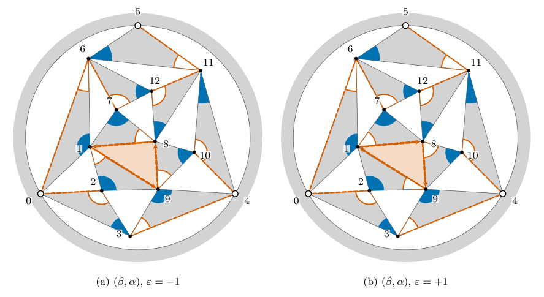

# 05. Cancellation: the signed count of pairs

Where this step lives elsewhere. Paper: Section 4 up to "Heights" of [`barnette.pdf`](../../paper/main/barnette.pdf): Lemma 4.3 (two reversals), Lemma 4.4 (the sign), Table 1, Lemma 4.5 (cancellation), Figures 8 and 9. Primal note: Lemma 7 of [`PRIMAL-PROOF.md`](../../proofs/primal/PRIMAL-PROOF.md) (row "Directed selected face links" of [`DICTIONARY.md`](../../proofs/primal/DICTIONARY.md)). Blueprint nodes `txt:D`, `lem:reversals`, `txt:delta`, `lem:sign`, `lem:cancel` in [`BLUEPRINT.md`](../../proofs/blueprint/BLUEPRINT.md). Lemma 4.3 has an exact Lean counterpart. Lemma 4.4, the real sign, had none in OpenAI's development; the project's own Lean file compiles it (`proofs/lean/`, compiled by its author, independent check pending). Atlas: page 4, [eight terms, grouped twice](../atlas/pages/04-sum.pdf); page 6, [cancellation as a pairing](../atlas/pages/06-involutions.pdf); page 10, [a dependent set of rows](../atlas/pages/10-rowdep.pdf).

## What we want at this point and why

We want a state $s$ with a partner whose opposite-edge graph $Q_s$ has no cycle. We cannot point at one. So we count. We give every pair $(r,s)$ a sign and a weight that depends on $s$ only, and add everything up. This step shows that all pairs whose $Q_s$ has a cycle drop out of the sum, whatever the weights are. Step 06 shows that the sum is not zero. Together they leave at least one pair whose $Q_s$ is a forest.

This step is the first half of the new idea of the proof. It is short, and it is where the partner earns its place.

## The idea in plain words

Fix $s$ and suppose $Q_s$ contains a cycle. A partner $r$ directs that cycle one way round, since each of its vertices must be the tail of one of its edges. Run the cycle the other way. This gives another partner $r'$ of the same $s$. Doing it twice gives $r$ back. So the partners of $s$ come in twins.

The twins have opposite signs. The cycle is made of edges leaving the corners chosen by $r$, so the disk identity applies to it, and its length is odd. Reversing it flips one local sign in each of an odd number of faces.

The weight of a pair depends only on $s$, and $s$ did not change. So the twins cancel exactly.

## Definitions

Let $(r,s)$ be a pair and $u(t)$ the third corner of $t$.

**The directed cycles $D(r,s)$.** Direct, in each $t \in A$, the edge from $r(t)$ to $s(t)$. Every non-root is $r(t)$ for one face and $s(t')$ for one face, so it has one edge out and one in. The edges form disjoint directed cycles through all of $X$. Different faces give different edges, so each cycle is a simple cycle of $T$. Its edges leave corners chosen by $r$, so step 04 applies. Each cycle has odd length. With the directions forgotten, the cycles of $D(r,s)$ are the *cover* of the pair, called a group in the OpenAI paper.

**The sign.**

$$\varepsilon(r,s) \;=\; \prod_{t \in A} \delta\bigl(r(t), s(t)\bigr) \;\in\; \{+1, -1\}.$$

By step 04 a counterclockwise cycle of length $h$ has $(h+3)/2$ factors $-1$ and a clockwise one has $(h-3)/2$. The lengths are odd and add up to $n$, so the number $c$ of cycles has the parity of $n$, and with $c^+$ counterclockwise cycles (paper Lemma 4.4)

$$\varepsilon(r,s) = (-1)^{(n+c)/2}\,(-1)^{c^+} = (-1)^{(n+J)/2}, \qquad J = \#\text{clockwise} - \#\text{counterclockwise}.$$

The product of local signs is now the standard form. The paper uses it, the trees paper uses the same real sign written through $J$, and the project's Lean file compiles it. The OpenAI paper uses the complex phase $i^{J}$, with $J = \tfrac13\sum_t \delta(r(t),s(t))$, and $i^J = i^{-n}\varepsilon$: the two differ by a constant that depends only on $n$. This was the "phase dispute" of the project and the cross-audit settled it (`research/2026-11-14_opus_cross-audit/ADJUDICATION.md`). Li uses $(-1)^{\lfloor -J/2 \rfloor}$, which agrees up to a constant by `research/2026-11-14_fable_dependency-graph/correspondence.md`, note 3.1 (not refereed).

**The signed sum.** Take any function $F$ on states. Put

$$S_F \;=\; \sum_{(r,s) \text{ a pair}} \varepsilon(r,s)\, F(s).$$

The papers choose $F(s) = e^{x\omega(s)}$ or $z^{\omega(s)}$ for a weight $\omega$. The choice does not matter in this step.

## Statement

**Lemma** (paper Lemma 4.5; OpenAI Lemma 5.2; Li Lemma 17 and the involution $\iota_1$; trees paper Lemma 4.2, move (b)). For a state $s$ put $\mu(s) = \sum_{r} \varepsilon(r,s)$, the sum over the partners of $s$.

1. If $Q_s$ contains a cycle, $\mu(s) = 0$.
2. If $s$ has a partner and $Q_s$ is a forest, $s$ has exactly one partner and $\mu(s) = \pm 1$.

Hence $S_F = \sum_{s \text{ good state}} \mu(s) F(s)$ for every $F$. (Good states are the trees paper's tree matchings, step 03.)

## Proof, with each assumption named

Part 2 is Lemma 1 of step 03 with $k = 0$.

Part 1. If $s$ has no partner there is nothing to add. Otherwise choose a simple cycle $Z$ of $Q_s$ by a rule that looks at $s$ only, for instance the first cycle in some fixed order.

*$Z$ is a directed cycle.* Let $r$ be a partner. The edge of $Q_s$ in $t$ joins $r(t)$ and $u(t)$. Direct it from $r(t)$ to $u(t)$. The tails are distinct non-roots because $r$ is injective into $X$. $Z$ has as many edges as vertices and each edge of $Z$ has its tail on $Z$, so every vertex of $Z$ is the tail of exactly one edge of $Z$. So $Z$ is directed and contains no root.

*Reversal gives a partner.* Define $r'(t) = u(t)$ on the faces whose $Q_s$-edge is on $Z$, and $r'(t) = r(t)$ elsewhere. Along $Z$ the heads are the same vertices as the tails, so $r'$ is again a bijection. Also $r'(t) \neq s(t)$. So $r'$ is a partner of $s$.

*It is an involution without fixed points.* For $r'$ the third corner on a face of $Z$ is $r(t)$. Since $Z$ was chosen from $s$ alone, the same rule applied to $r'$ picks the same $Z$ and gives back $r$. And $r' \neq r$. Here the rule "depends on $s$ only" is essential. A rule that looked at $r$ might pick a different cycle on the way back.

*The sign flips.* In a black triangle with corners $r, s, u$ the three directed edges $r \to s$, $s \to u$, $u \to r$ run the same way round, so they have the same $\delta$. Hence $\delta(u,s) = -\delta(s,u) = -\delta(r,s)$. So each face of $Z$ changes its factor, and

$$\varepsilon(r',s) = (-1)^{|Z|}\, \varepsilon(r,s).$$

$Z$ is a directed cycle of edges $r(t) \to u(t)$ leaving the corners chosen by the state $r$. By the disk identity $|Z|$ is odd. So $\varepsilon(r',s) = -\varepsilon(r,s)$, and the partners of $s$ cancel in twins. $\square$

What was used. Of the pair, that $r$ is injective, that $r(t) \neq s(t)$, and that no root is a value of $r$. Of the disk identity, only that state cycles have odd length. Planarity enters through that parity alone.

The OpenAI paper proves the flip in another way. It uses $\delta(u,s) - \delta(r,s) = 2\delta(r,u)$ and then the exact value $\pm 3$ of the $\delta$-sum of $Z$ to get $J(r',s) = J(r,s) \pm 2$. The parity version above is shorter and is the paper's. The same computation proves that reversing a cycle of $D(r,s)$ also flips $\varepsilon$: there every factor on the cycle becomes $\delta(s(t), r(t)) = -\delta(r(t),s(t))$. The recomputation script of this audit asserts $\varepsilon = (-1)^{(n+c)/2}(-1)^{c^+} = (-1)^{(n+J)/2}$ on every pair of the cube, the prism, the running example and the 16-vertex example.

Here a cube is a finite set of independent binary choices, not a subgraph of the triangulation. Its dimension counts cycles that can be reversed independently.

## The two families of cubes

The picture behind the proof is that the set of all pairs is cut into cubes in two different ways.

- Fix the undirected cycles of $D$. Each cycle can run either way, independently. With $c$ cycles this is a cube with $2^c$ pairs, and $\varepsilon$ alternates along every edge of the cube, because reversing a cycle of odd length flips an odd number of factors.
- Fix $s$. Its partners are the $2^{q(s)}$ orientations of the $q(s)$ cycles of $Q_s$, and $\varepsilon$ alternates there too.

Good states are the cubes of the second kind that have dimension zero. A sum of $\varepsilon F(s)$ over a cube of the second kind with $q(s) \ge 1$ vanishes for every $F$. A sum over a cube of the first kind does not, because $F(s)$ changes when a cycle of $D$ is reversed. Step 06 computes it.

## Worked example

**Running example.** We use the paper's names. There are 8 pairs. Seven states have a partner. For six of them $Q_s$ is a forest and there is one partner. The seventh is the paper's state $\alpha$,

$$\alpha = (1, 3, 7, 2, 9, 11, 6, 12, 8, 10),$$

the images of the black faces $0{\cdot}1{\cdot}6$, $0{\cdot}2{\cdot}3$, $1{\cdot}7{\cdot}8$, $1{\cdot}2{\cdot}9$, $3{\cdot}4{\cdot}9$, $4{\cdot}10{\cdot}11$, $5{\cdot}6{\cdot}11$, $6{\cdot}7{\cdot}12$, $8{\cdot}11{\cdot}12$, $8{\cdot}9{\cdot}10$ (a face is named by its corners; these are faces $0, 2, 7, 9, 11, 13, 15, 17, 19, 21$ of `paper/figures/running.json`). Its $Q_\alpha$ contains one cycle, the triangle on $1, 8, 9$ around a white face. It has two partners,

$$\beta = (6, 2, 8, 1, 3, 10, 11, 7, 12, 9), \qquad \tilde\beta = (6, 2, 1, 9, 3, 10, 11, 7, 12, 8).$$

$\beta$ directs the triangle as $8 \to 1 \to 9 \to 8$. Reversing it changes $\beta$ exactly in the faces $1{\cdot}7{\cdot}8$, $1{\cdot}2{\cdot}9$, $8{\cdot}9{\cdot}10$, from $8, 1, 9$ to $1, 9, 8$. The signs are $\varepsilon(\beta, \alpha) = -1$ and $\varepsilon(\tilde\beta, \alpha) = +1$, with $J = 0$ and $J = -2$. They cancel.

Notice what the reversal did to the cover. $D(\beta, \alpha)$ is the counterclockwise 7-cycle through $6,1,2,3,9,10,11$ and the clockwise triangle $8,7,12$. $D(\tilde\beta, \alpha)$ is the counterclockwise 7-cycle through $1,7,12,8,10,11,6$ and the counterclockwise triangle $9,2,3$. The twins live in different cubes of the first kind. Reversing a cycle of $Q_s$ rearranges $D$ completely and still moves $J$ by exactly two. All of this was recomputed for this audit.

**Small cases.** In the octahedron and the prism every state with a partner is a good state and nothing cancels. Among all triangulations with at most 11 vertices no state has both a partner and a cycle in $Q_s$. The first appears at 12 vertices (`research/2026-11-14_fable_route-combinatorics/DATA.md`, computed, confirmed by the referee's independent enumeration). So the cancellation cannot be seen on toy examples, and the paper chose its 13-vertex running example to show one together with a cycle of $D$ that encloses vertices.

## The determinant reading

For a fixed $s$ the sum $\mu(s)$ is a determinant. Let $d_s$ be the $n \times n$ matrix with a row for each $t \in A$ and a column for each non-root, whose row $t$ has $+1$ and $-1$ at the two non-root ends of the $Q_s$-edge of $t$ and zeros elsewhere. This is the incidence matrix of $Q_s$ with the three root columns removed. Expanding its determinant over bijections $r$ picks, in every row, one end of the edge. The non-zero terms are exactly the partners of $s$.

Now contract the three roots to one vertex. Then $d_s$ is the incidence matrix of $n$ edges on $n+1$ vertices with one column deleted. By the lemma behind the matrix-tree theorem its determinant is $\pm 1$ when the edges form a spanning tree and $0$ otherwise. The edges of $Q_s$ form a spanning tree after the contraction exactly when $Q_s$ is a forest with one root in each component.

So the cancellation lemma is the statement that the rows of an incidence matrix along a cycle are linearly dependent. With the edges of $Q_s$ oriented by the vertex colouring of step 04, the precise identity is

$$\mu(s) = (-1)^n\, \sigma\, \det d_s,$$

where $\sigma$ is the common permutation sign of all states. That all states have the same permutation sign is Lemma 6.1 of the trees paper. Its proof is again the parity of the disk identity, since two states differ by a permutation whose cycles are state cycles, hence odd, hence even permutations.

Status. The determinant formula is Proposition 5 of `fable_route-combinatorics/PROOF.md` in a complex form. The referee `research/2026-11-14_astra_referee-combinatorics/` confirmed it and sharpened it to the real identity displayed above. Both are proved in this project and checked by a second model, not yet read by a human. A second determinant form, in which the whole signed sum over pairs is one coefficient of a determinant, was proved independently by two agents and shown to be the same formula by a third (`SIGNIFICANCE.md` section 3). It explains the signs. It does not prove that the sum is non-zero, see step 06.

## What does not work

- **A rule for $Z$ that depends on $r$.** Then the map need not be an involution, and the pairing of terms breaks. Nobody recorded a smallest counterexample, because a rule has to be specified first (`research/2026-11-14_astra_limits/HYPOTHESES.md`, not yet refereed).
- **Cancellation without the sphere.** On the torus the Heawood graph's dual has 24 states and 48 pairs, all $Q$-cycles odd, and every state's contribution cancels: the whole polynomial is identically zero. Cancellation survives off the sphere and nonvanishing does not, because the disk identity's exact value is gone (`research/2026-11-14_astra_route-pfaffian/`, computed, atlas page [13](../atlas/pages/13-pfaffian.pdf)).
- **A weight that depends on $r$.** The twins must have equal weight. A function of $s$ guarantees this. More general weights are possible if they are invariant under the chosen involution.
- **Counting without signs.** A state is good exactly when it has an odd number of partners, namely one. So the number of good states has the parity of the number of pairs. That number is even, because $(r,s) \mapsto (s,r)$ has no fixed point. Counting modulo 2 proves nothing (`fable_dependency-graph/skeleton.md`, edge D3, proved there and not refereed).
- **Constant weight.** With $F = 1$ the cancellation works and the total is zero for a different reason. Each cube of the first kind sums to zero. The conclusion is that good states of sign $+1$ and $-1$ are equally many. In particular there are never exactly one. This says nothing about whether there are any. It is the reason step 06 needs weights.

## Where this is used next

Step 06 evaluates $S_F$ a second time, grouping pairs by the cycles of $D$, and finds an $F$ for which it is not zero.
