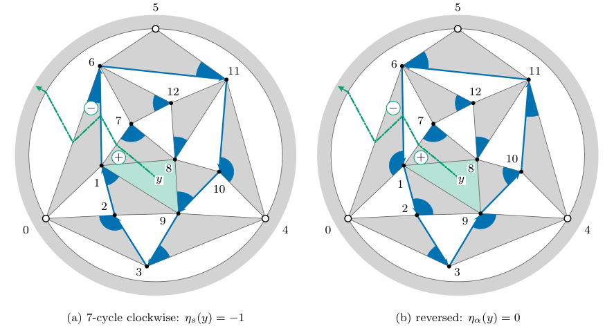
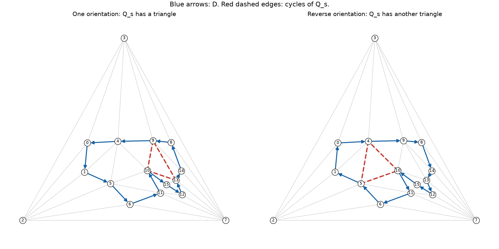

# 06. Nonvanishing: why the signed count is not zero

Where this step lives elsewhere. Paper: Section 4 from "Heights" on of [`barnette.pdf`](../../paper/main/barnette.pdf): Lemma 4.6 (heights), Lemma 4.7 (finite differences), Proposition 4.8, Example 4.9, Remark 4.10, Table 2, Figures 10 and 11, and "The polynomial behind the count" in Section 7. Primal note: Lemmas 6 and 8 of [`PRIMAL-PROOF.md`](../../proofs/primal/PRIMAL-PROOF.md) (row "White vertices on cut side" of [`DICTIONARY.md`](../../proofs/primal/DICTIONARY.md)). Blueprint nodes `txt:heights`, `lem:height`, `lem:difference`, `prop:good`, `rem:other-sums`, `rem:poly` in [`BLUEPRINT.md`](../../proofs/blueprint/BLUEPRINT.md). Atlas: page 5, [eight terms, grouped twice](../atlas/pages/05-sum.pdf); page 6, [the integer polynomial](../atlas/pages/06-polynomial.pdf); page 4, [the exponent is a volume](../atlas/pages/04-heights.pdf); page 10, [three written proofs of the key step](../atlas/pages/10-keystep.pdf); page 16, [the extreme state can have a cycle](../atlas/pages/16-canonical.pdf); page 29, [what is machine-checked](../atlas/pages/29-blueprint.pdf).

Review status, 14 November 2026. The heights, the finite difference and Proposition 4.8 are in the paper and were refereed with it by a second AI model (verdict: the proof follows). Lemma 4.7 is also proved in Lean (`research/2026-11-14_opus_blueprint/lean/FiniteDifference.lean`), and the project's Lean devices compile a replacement main theorem on OpenAI's development that avoids the complex phase (`proofs/lean/`, compiled by its author, independent check pending). No human has read any of it.

## What we want at this point and why

Step 05 gave, for any function $F$ on states,

$$\sum_{(r,s)} \varepsilon(r,s)\, F(s) \;=\; \sum_{s \text{ good}} F(s)\, \varepsilon(r_s, s),$$

where $r_s$ is the one partner of the good state $s$. If some $F$ makes the left side non-zero, the right side is not an empty sum and a good state exists. That is the paper's Proposition 4.8 (OpenAI Proposition 5.1): if a pair exists, a good state exists.

This is the hard step. With $F = 1$ the sum is always zero: reversing the cycle of $D(r,s)$ through a fixed vertex pairs every pair with one of opposite sign. So $F$ must see the difference between the two orientations of a cycle of $D$. The disk identity offers the handle. Every such cycle encloses at least one white face.

## The idea in plain words

Give each state a number, its weight, that goes up by a positive amount whenever a cycle of $D$ is turned from clockwise to counterclockwise. Then sort the pairs by their cover, the undirected cycles of $D$. A cover with $c$ cycles carries $2^c$ pairs, one per choice of orientations, and the sign flips with every reversal. So the signed sum over one cover is a $c$-fold difference of $F$, taken once along each cycle.

A $c$-fold difference kills every polynomial of degree below $c$, and on the $c$-th power of the weight it leaves $\pm c!$ times the product of the steps. Take $F = \omega^m$ with $m$ the smallest number of cycles of any cover. Covers with more cycles contribute nothing. Covers with exactly $m$ cycles contribute products of positive steps, all with the same sign. They cannot cancel.

## Heights along paths of faces

For each white face $y$ fix a path of faces $y = f_0, f_1, \dots, f_j = t_0$ in $G$, consecutive faces sharing a side, no face repeated. A black face $t \in A$ on the path is entered across one side and left across another, and these two sides meet in one corner $v$ of $t$. The path turns around $v$. Put

$$\kappa_y(t,v) = \begin{cases} +1 & \text{the path turns around } v \text{ in } t \text{ with } v \text{ on its left},\\ -1 & \text{it turns around } v \text{ with } v \text{ on its right},\\ 0 & \text{it misses } t \text{ or turns around another corner.}\end{cases}$$

In combinatorial terms, with $a'$ the far end of the entry side and $b'$ the far end of the exit side, $v$ is on the left exactly when $v, a', b'$ is the counterclockwise order of the corners of $t$. The height of a state at $y$ and its weight are

$$\eta_s(y) = \sum_{t \in A} \kappa_y\bigl(t, s(t)\bigr), \qquad \omega(s) = \sum_{y \text{ white}} \eta_s(y).$$

The height adds up the signs of the turned corners that carry the state's wedge.

In the running example take $y = \{1,8,9\}$. The shortest path of faces is $y$, $\{1,7,8\}$, $\{1,6,7\}$, $\{0,1,6\}$, $\{0,5,6\}$, $t_0$. It turns around $1$ in $\{1,7,8\}$, on its left, and around $6$ in $\{0,1,6\}$, on its right. The pair of the clockwise 7-cycle in the paper's figure has its second state's wedge at $6$ in $\{0,1,6\}$ and not at $1$ in $\{1,7,8\}$, so its height at $y$ is $-1$. Reversing the 7-cycle gives $(\beta,\alpha)$, and $\eta_\alpha(y) = 0$. The height went up by one, because $y$ lies inside the 7-cycle. (Recomputed for this audit.)

**Lemma H** (paper Lemma 4.6). Let $(r,s)$ be a pair, $C$ a clockwise cycle of $D(r,s)$, and $(r',s')$ the pair obtained by reversing $C$. Then $\eta_{s'}(y) - \eta_s(y)$ is $1$ if $y$ lies inside $C$ and $0$ otherwise. Hence $\omega(s') - \omega(s) = L(C)$, the number of white faces inside $C$, and $L(C) \ge 1$.

*Proof sketch.* Only the faces that supply $C$ change, from $s(t)$ to $r(t)$. Fix such a face $t$ and its side $g$ on $C$. If the path misses $t$ or turns around the third corner, it does not cross $g$ and $t$ contributes nothing. Otherwise the path crosses $g$ once inside $t$, and a check of the two cases (it turns around $r(t)$ or around $s(t)$) shows the contribution is $+1$ if that crossing goes from the left of $s(t) \to r(t)$ to its right, and $-1$ the other way. So the change of height counts the signed crossings of the path with $C$. After the reversal $C$ runs counterclockwise, its left is its inside, and by tree/cotree duality (step 02) the path changes sides only when it crosses $C$. It ends in $t_0$, outside. So the count is $1$ if $y$ is inside and $0$ if not. The disk identity gives $L(C) = W \ge 1$. $\square$

Since $\eta_s(y)$ is a sum over faces and different cycles of $D$ use different faces, the effects of reversing several cycles add up.

**Older forms of the same weights.** OpenAI attach real weights to the spokes from black-face centres to corners, built in their Lemma 5.3 as a circulation that is one around every white face. Li uses vertical rays from the white faces in a straight-line drawing and counts their crossings with spokes. The trees paper shifts integer weights into $[0, 6n]$. Earlier versions of these digestions used paths from each inner white face that cross spokes. All of these change by the same white-face count under a reversal, and the paper's Section 7 notes that its heights are OpenAI's weights for one choice of circulation and Li's crossing counts along fixed paths. The face-path form needs no spokes and no sliding argument, and the paper uses it. One source has the opposite sign: the involution note's $H(s)$ is $-\omega(s)$, so it falls where $\omega$ rises.

## The finite difference, and the proof

**Lemma D** (paper Lemma 4.7). For real numbers $\omega_0, L_1, \dots, L_c$ and an integer $0 \le m \le c$,

$$\sum_{x \in \{0,1\}^c} (-1)^{x_1 + \dots + x_c}\,\bigl(\omega_0 + x_1 L_1 + \dots + x_c L_c\bigr)^m = \begin{cases} 0 & m < c,\\ (-1)^c\, c!\, L_1 \cdots L_c & m = c.\end{cases}$$

*Proof.* Expand and use $x_i^j = x_i$. Each term is a constant times $\prod_{i \in I} x_i$ with $|I| \le m$. The sum over $x$ factors, and $\sum_{x_i} (-1)^{x_i} = 0$ kills every $i \notin I$. So only $I = \{1, \dots, c\}$ survives, which needs $m = c$, and those terms come from picking a different $x_i L_i$ in each of the $c$ factors, in $c!$ ways. $\square$

**Proposition** (paper Proposition 4.8; OpenAI Proposition 5.1). If $T$ has a pair, it has a good state.

*Proof.* Let $m \ge 1$ be the least number of cycles of a cover and $\Sigma = \sum_{(r,s)} \varepsilon(r,s)\, \omega(s)^m$. By step 05, $\Sigma$ is a sum over good states, so it is enough to show $\Sigma \ne 0$.

Sort the pairs by cover. If $(r,s)$ has cycles $C_1, \dots, C_c$ and $(r',s')$ has the same undirected edges, then in each face $(r'(t), s'(t))$ is $(r(t),s(t))$ or $(s(t),r(t))$, and consecutive faces along a cycle make the same choice, since otherwise a vertex would be the value of $r'$ at two faces. So the class has exactly $2^c$ pairs, one per orientation, all pairs by the second reversal of step 05. Index them by $x \in \{0,1\}^c$ with $x_i = 1$ when $C_i$ is counterclockwise. By step 05, $\varepsilon = (-1)^{(n+c)/2} (-1)^{\sum x_i}$. By Lemma H, $\omega = \omega_0 + \sum x_i L(C_i)$. Lemma D says the class contributes $0$ if $c > m$, and

$$(-1)^{(n+m)/2}(-1)^m\, m!\, L(C_1) \cdots L(C_m) = (-1)^{(n-m)/2}\, m!\, \prod_i L(C_i)$$

if $c = m$. Every $L(C_i) \ge 1$ and at least one class has $c = m$, so

$$\Sigma = (-1)^{(n-m)/2}\, m! \sum_{\text{covers with } m \text{ cycles}}\ \prod_{i=1}^m L(C_i) \;\ne\; 0. \qquad\square$$

What was used. The disk identity three times: odd cycle lengths for the sign flip, the exact value $\pm 3$ for the sign formula that gives all $m$-cycle covers the same leading sign, and a white face inside every cycle for $L(C) \ge 1$. The minimum is needed: a class with $c$ cycles leads with sign $(-1)^{(n-c)/2}$, which alternates as $c$ grows by two. Only the covers with the fewest cycles are sure to agree.

## Worked example, computed in full

The running example has $n = 10$, eight pairs and two covers, each with two cycles, so $m = 2$. All numbers below were recomputed for this audit with the paper's face paths (shortest paths, ties broken by the smallest face index); they agree with the paper's Table 2.

| Cover | Cycles, with $L$ = white faces inside |
| --- | --- |
| first | 7-cycle $6,1,2,3,9,10,11$ with $L = 6$; triangle $7,8,12$ with $L = 1$ |
| second | 7-cycle $1,7,12,8,10,11,6$ with $L = 3$; triangle $2,3,9$ with $L = 1$ |

| Cover | 7-cycle | triangle | $\varepsilon$ | $\omega(s)$ | second state |
| --- | --- | --- | --- | --- | --- |
| first | cw | cw | $+1$ | $-4$ | good |
| first | cw | ccw | $-1$ | $-3$ | good, $\beta$ |
| first | ccw | cw | $-1$ | $2$ | cycle in $Q$, $\alpha$ |
| first | ccw | ccw | $+1$ | $3$ | good |
| second | cw | cw | $+1$ | $-2$ | good |
| second | cw | ccw | $-1$ | $-1$ | good |
| second | ccw | cw | $-1$ | $1$ | good |
| second | ccw | ccw | $+1$ | $2$ | cycle in $Q$, $\alpha$ |

Reversing the triangle raises $\omega$ by 1 in both covers, reversing the 7-cycle raises it by 6 or 3. The values of $\varepsilon\,\omega^2$ add up to $16 - 9 - 4 + 9 = 12 = 2 \cdot 6 \cdot 1$ and $4 - 1 - 1 + 4 = 6 = 2 \cdot 3 \cdot 1$, so $\Sigma = 18$, while $\sum \varepsilon = \sum \varepsilon\,\omega = 0$. The two pairs with a cycle in $Q_s$ share the second state $\alpha$ and cancel. The six good states have three signs $+1$ and three $-1$.

**The cube.** One cover, the triangle $3,4,5$ around one white face, so $m = 1$. With the labels of step 02 the two states $(3,4,5)$ and $(5,3,4)$ have weights $0$ and $-1$. The pair with second state $(3,4,5)$ has the triangle counterclockwise and $\varepsilon = -1$; the other has $\varepsilon = +1$. So $\Sigma = \sum \varepsilon\,\omega = -1 = (-1)^{(3-1)/2} \cdot 1! \cdot 1$, as the proof predicts.

## The same sum in other dress

All versions probe one polynomial. Give each corner choice $(t,v)$ a variable $w_{t,v}$ and put $\Pi(w) = \sum_{(r,s)} \varepsilon(r,s) \prod_t w_{t,s(t)}$. By step 05 its monomials are exactly the good states, with coefficients $\pm 1$. Grouped by covers (paper, Section 7),

$$\Pi(w) = \sum_{D} (-1)^{(n - c(D))/2} \prod_{C \in D} \bigl(w^{C+} - w^{C-}\bigr),$$

where $w^{C\pm}$ is the product of $w_{t,v}$ over the faces of $C$ with $v$ the head of its edge when $C$ runs counterclockwise $(+)$ or clockwise $(-)$. Every factor vanishes at $w = 1$, so $\Pi$ vanishes there to order $m$. The versions differ in how they look near that point.

| Version | Sum | Lowest coefficient in the running example | Status |
| --- | --- | --- | --- |
| paper | $\sum \varepsilon\, \omega(s)^m$ | $\Sigma = 18 = 2!\,(6 + 3)$ | refereed with the paper |
| integer polynomial (trees paper, Remark 4.10) | $\sum \varepsilon\, z^{\omega(s)} = z^{-4} - z^{-3} + z^{-2} - z^{-1} - z + z^{3}$ | coefficient of $(z-1)^2$ is $9$ | published; recomputed |
| OpenAI | $\sum i^J e^{x\omega(s)}$, with $i^J = i^{-n}\varepsilon$ | $-9x^2$ | published; recomputed |
| linear substitution | $\sum \varepsilon \prod_t (1 + x\,\kappa(t,s(t)))$, $\kappa = \sum_y \kappa_y$ | $9x^2 + 5x^3$ | paper Section 7; recomputed |
| heights product | $\sum \varepsilon \prod_{i=1}^m \eta_s(y_i)$ for chosen white faces $y_i$ | $1$ for $y_1 = \{1,8,9\}$, $y_2 = \{7,8,12\}$; $2$ for $y_1 = y_2 = \{7,8,12\}$ | proved in this project, refereed |
| Li | signed count of pairs with $m$ distinct marked crossings of rays with spokes | $-9$ | published; reproduced by two programs |

The heights-product version needs no weights at all. The same expansion as in the proof shows that $\sum \varepsilon \prod_i \eta_s(y_i) = (-1)^{(n-m)/2} N$, where $N$ counts the ways to send $y_1, \dots, y_m$ bijectively to the cycles of an $m$-cycle cover with $y_i$ inside its cycle. In the example $\{1,8,9\}$ lies only inside the first 7-cycle and $\{7,8,12\}$ inside both cycles of the first cover, so $N = 1$, and with $y_1 = y_2 = \{7,8,12\}$, $N = 2$. The chosen faces may repeat; the indices stay distinct. Source: `research/2026-11-14_fable_route-combinatorics/PROOF.md`, refereed in `research/2026-11-14_astra_referee-combinatorics/`. The same computation with fewer than $m$ factors gives zero, which implies at least $2m$ good states (Corollary 3 there, refereed).

Li's objects depend on the drawing. The project's two runs of his construction count 213 and 279 marked objects on the same file, because one drawing is the mirror of the other; across 69 drawings the count ranges from 103 to 363, while the signed sum $-9$ never changes (`research/2026-11-14_opus_referee-involutions/DISCREPANCY-279-213.md`, computed). The sign $-9$ against $+9$ is the convention-dependent global factor.

## Why cancellation across covers cannot be avoided

A natural hope is to work inside one cover: show that one of its $2^c$ orientations is a good pair. It held on all 1,794 rooted triangulations with a pair and at most 15 vertices. It is false.

**The 16-vertex example.** The triangulation listed as class 158 in `research/2026-11-14_fable_route-combinatorics/data/counterexamples.txt`, rooted at the face $(2,7,3)$, has $n = 13$, 26 states, 18 pairs, 12 good states and three covers. One cover is a single cycle through all 13 non-roots,

$$0,\ 4,\ 9,\ 8,\ 14,\ 13,\ 12,\ 15,\ 10,\ 11,\ 6,\ 5,\ 1,$$

with 6 white faces inside. Counterclockwise, $Q_s$ contains the triangle $4, 5, 10$; clockwise, the triangle $9, 13, 10$. Neither orientation is a good pair. The other two covers have three cycles each and six good pairs each. (Recomputed for this audit: the counts, the three covers and where the good pairs sit.)

Here $m = 1$, and the cover that makes $\Sigma = 6$ non-zero is exactly the one that contains no solution. The proof shows that its terms cannot all be cancelled by the others. It does not say that they survive themselves. They do not. Status: found by `fable_route-combinatorics`, reproduced by its referee with independent code. It is the only failure among the 5,088 rooted triangulations with a pair and at most 16 vertices.

## Why canonical choices fail

If the count cannot be avoided, maybe a canonical choice can replace it. Each candidate below was tested and refuted; sizes are numbers of vertices of $T$, and unless said otherwise they are the smallest failures in an exhaustive search.

| Candidate | First failure | Source and review |
| --- | --- | --- |
| the partnered state of largest (or smallest) weight is good | 12 (its mirror image for smallest) | `fable_route-combinatorics/ROUTES.md`, sizes corrected by the referee |
| an $m$-cycle cover with all cycles counterclockwise (or all clockwise) | 12 (mirror) | same |
| the pair maximising $\omega(s) - \omega(r)$ | 12 | same |
| some cover with $m$ cycles contains a good pair; every cover does | 16 | the example above |
| good states split into cubes of dimension $m$ | 13: the running example has 6 good states and $m = 2$ | same, referee |
| the sign of a good state is the parity of its weight | 8 | same |
| the top or bottom of the lattice of states (Propp's rotations around white faces) is good | 10 (12 for "top or bottom") | `research/2026-11-14_opus_route-graph-theory/ROUTES.md` O1, computed, not refereed |
| the top or bottom of Felsner's lattice of pairs | 18 (no minimality claim) | `research/2026-11-14_sol_referee-conjectures/`, two implementations |
| an extreme or join-irreducible element of that lattice | 33, with separating triangles; separator-free case untested | same |
| a good pair within bounded lattice distance of an extreme | 24 needs distance two; a glued family needs unbounded distance | same |
| single-move descent in the number $q(s)$ of $Q$-cycles; lookahead two; lookahead three | 16; 21; 40 (not known least) | `research/2026-11-14_fable_descent/`, author census |

The reason given for the first row is convincing. For an extreme state every partner gives a cover with all cycles one way. Reversing a cycle of $Q_s$ changes the number of cycles of the cover by two, and extremality does not forbid that.

## What else does not work

- **Weights that do not separate orientations.** With all weights zero the cube gives $0$. Any weights that give every state the same total are pure gauge. What is needed is a positive step around cycles, not positive weights. With arbitrary weights the lowest coefficient can vanish while the polynomial does not (a 14-vertex example in `research/2026-11-14_sol_referee-structure/code/weights-leading-zero.json`).
- **Counting modulo a prime.** The number of good states is always even, since the two signs balance. No residue modulo 2, 3, 4, 5, 7 or 11 is non-zero in general (`research/2026-11-14_sol_route-algebra/`, computed).
- **One determinant.** The signed sum is one coefficient of a determinant with one variable per black face, and setting all variables to 1 does not give it. For the hexagonal prism the all-ones value is 0 while the wanted coefficient is $45/64$ at the test point used. The blocks are not positive semidefinite, so no positivity theorem applies (refereed in `research/2026-11-14_fable_referee-determinants/`).
- **Sums of squares and matrix-tree counts.** The number of good states is the sum of the squares of the coefficients of $\Pi$, and a restricted matrix-tree count has one positive term per good state. Both are positive exactly when $\Pi \ne 0$, which is what has to be shown. At the six roots of the double octahedron with no pair there are 360 restricted white trees, 16 use each face once, and none is a good state.

## Other routes, with status

- **Per component.** The trees paper proves that every component of the exchange graph contains a good pair. Published.
- **Two involutions.** The project's involution note (`proofs/involutions/`) turns Li's argument into two sign-reversing involutions, with rays or with face paths. A second AI referee found that both routes follow. No human reader.
- **A walk instead of a count.** The trees paper's marked walk follows the two involutions alternately. Published, with an exponential time bound. Step 09, door 7.
- **Monotone descent, C3.** From every pair, some sequence of reversals of $D$-cycles and $Q$-cycles reaches a good pair without ever increasing $q(s)$, plateaus allowed. Conjecture. All 49,325,864 pairs through 22 vertices pass, and every bounded variant tested is dead (the last row of the table above). It would not give a polynomial algorithm by itself. Step 09, door 5.
- **At least $2^m$ good states, C1.** Conjecture; the proved bound is $2m$. For one cover equality holds, and for two covers the count is known exactly (both refereed by a second model). A separator-free family on $3j + 2$ vertices has one cover, $m = j - 1$ and exactly $2^{j-1}$ good states (refereed). Step 09, door 4.
- **A Pfaffian or determinant for $\Pi$ without coefficient extraction.** A hunch. Nothing supports or excludes it.

## Where this is used next

We now have a good state $s$, with its unique partner. Step 07 turns it into the Hamiltonian cycle.
