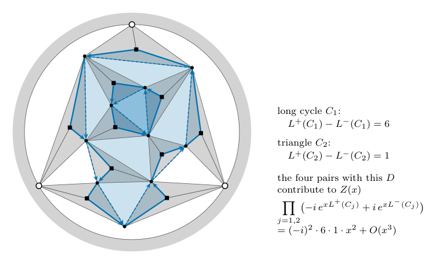
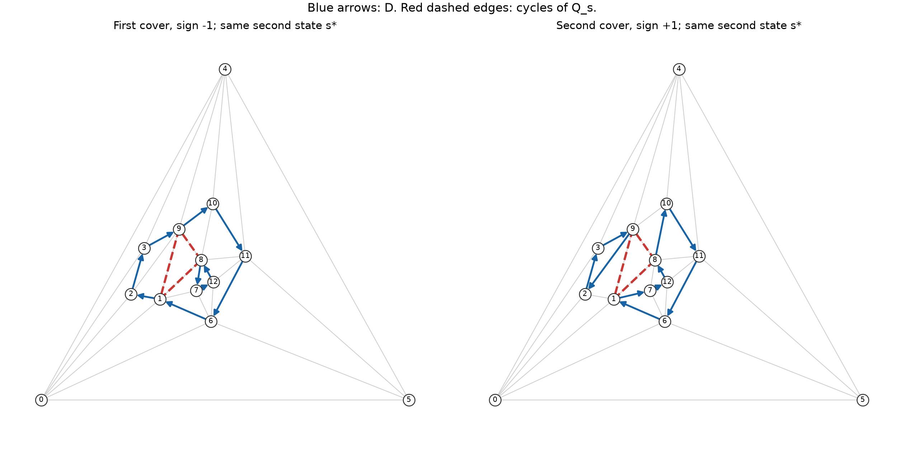

# 06. Nonvanishing: why the signed count is not zero

## What we want at this point and why

Step 05 gave, for any function $F$ on states,

$$S_F \;=\; \sum_{(r,s)} \varepsilon(r,s) F(s) \;=\; \sum_{s \text{ good state}} \mu(s) F(s), \qquad \mu(s) = \pm 1.$$

If we find one $F$ with $S_F \neq 0$, the right side is not an empty sum, and a good state exists (a tree matching in the trees paper). That is Proposition 5.1 of the OpenAI paper: if a pair exists, some pair $(r,s)$ has $Q_s$ a forest. For a pair, "forest" is the whole condition, because the partner puts one root in each tree (step 03, Lemma 1).

This is the hard step. The three papers do it in three ways, and two simplifications came out of this project. This file puts all five next to each other, proves the shortest one in full, and computes one example by every method. It then explains why no simpler kind of argument can work.

## The idea in plain words

Add up the same sum in a second way. Sort the pairs by the undirected cycles that the edges $r(t) \to s(t)$ form. Call such a set of cycles a cover, $D$ (a group in the OpenAI paper). The pairs with a given cover are its $2^c$ orientations, where $c$ is the number of cycles, and the sign alternates each time one cycle is reversed. So a cover contributes an alternating sum over a cube, which is a $c$-fold difference of $F$.

Now choose $F$ so that reversing a cycle from clockwise to counterclockwise always increases it, by an amount that is positive because the cycle has a white face inside. A $c$-fold difference of such a function is small for large $c$. The covers with the fewest cycles dominate, and by the exact form of the disk identity they all carry the same sign. So they cannot cancel each other.

## One polynomial, two expansions

All five arguments are about one object. Take a variable $w_{t,v}$ for every face $t \in A$ and corner $v$, write $w^s = \prod_t w_{t,s(t)}$, and put

$$\mathcal F(w) \;=\; \sum_{(r,s)} \varepsilon(r,s)\, w^s .$$

**Expansion over second states.** By step 05,

$$\mathcal F(w) = \sum_{s \text{ good state}} \mu(s)\, w^s .$$

Different states have different monomials. So the monomials of $\mathcal F$ are exactly the good states, with coefficients $\pm 1$, and a good state exists if and only if $\mathcal F$ is not the zero polynomial.

**Expansion over covers.** For a cycle $C$ of a cover let $w^{C+}$ be the product of $w_{t,\mathrm{head}}$ over the faces supplying $C$ when $C$ runs counterclockwise, and $w^{C-}$ the same for clockwise. A counterclockwise cycle of length $h$ contributes $(h+3)/2$ factors $-1$ to $\varepsilon$ by the disk identity. The lengths are odd and add up to $n$. So the all-counterclockwise orientation of a cover with $c$ cycles has sign $(-1)^{(n+3c)/2} = (-1)^{(n-c)/2}$, and each reversal flips it. Hence

$$\mathcal F(w) = \sum_{D} (-1)^{(n - c(D))/2} \prod_{C \in D} \bigl(w^{C+} - w^{C-}\bigr). \tag{$*$}$$

This is the one place in the whole proof where the exact value $3$ of the disk identity is needed. With parity alone the sign of a cover would not be determined by its number of cycles.

At $w = 1$ every factor vanishes. So $\mathcal F$ vanishes at the all-ones point to order at least $m$, the least number of cycles of any cover. The five arguments differ only in how they probe $\mathcal F$ near that point.

## The positivity that every version needs

Every version needs, for each cycle $C$ of each cover, a positive number that measures the difference between its two orientations. There is one source for it.

Put a centre in each face of $A$ and join it to the three corners by spokes. A white face is inner if it does not share an edge with $t_0$. There are $n - 2$ inner white faces. For each inner white face $y$ fix a path $\gamma_y$ in the plane from a point of $y$ to a point of $t_0$ that avoids vertices and centres and crosses spokes transversally. For a spoke directed from the centre of $t$ to the corner $v$, let $\kappa_y(t,v)$ be the number of times it crosses $\gamma_y$ from right to left minus the number from left to right. The height of a state at $y$ is

$$\eta_s(y) = \sum_{t \in A} \kappa_y\bigl(t, s(t)\bigr).$$

It is an integer and can be negative. Changing the paths shifts all heights at $y$ by a constant that does not depend on the state.

This is the main paper's height $\eta_s(y)$ and the letters follow it. The main paper builds the path from faces of $T$ and counts turn signs instead of crossings, which changes heights only by such constants; in both, the height at $y$ rises by one when a cycle around $y$ turns from clockwise to counterclockwise. Earlier versions of these digestions wrote $h_s(w)$. One source uses the opposite sign: the involution note's $H(s)$ is $-\sum_y \eta_s(y)$, so it falls where $\omega$ below rises, and with Li's rays as paths it agrees with this only up to a constant on each cover.

**Lemma H** (heights; `research/2026-11-14_fable_route-combinatorics/PROOF.md` Lemma 4, with the topological step written out in `research/2026-11-14_astra_referee-combinatorics/REWRITTEN-PROP-5-1.md`). Let $C$ be a cycle of a cover, and let $s_{\mathrm{cw}}$, $s_{\mathrm{ccw}}$ be the second states of two orientations of the cover that differ only in the direction of $C$. Then for every inner white face $y$

$$\eta_{s_{\mathrm{ccw}}}(y) - \eta_{s_{\mathrm{cw}}}(y) = \begin{cases} 1 & \text{if } y \text{ lies inside } C,\\ 0 & \text{otherwise.}\end{cases}$$

*Proof.* The two states differ only on the faces that supply $C$. In such a face, with $C$ running counterclockwise from corner $a$ to corner $b$, one state chooses $b$ and the other $a$. The spoke to $b$ minus the spoke to $a$ is the route from $a$ through the centre to $b$. Putting these routes together gives a closed curve $\Gamma$, the cycle $C$ with every edge pushed onto two spokes. The height difference is the signed number of crossings of $\gamma_y$ with $\Gamma$.

$\Gamma$ is a simple closed curve with the orientation of $C$. Each edge of $C$ comes from a different black face, so the routes do not meet except at the vertices of $C$. Each push moves an edge across the part of its black triangle between the edge and the two spokes, which contains no vertex and no other part of the curve. The pushes happen inside black faces, so a white face is inside $\Gamma$ exactly when it is inside $C$.

A counterclockwise simple closed curve crosses a path from $p$ to $q$ with signed count $[p \text{ inside}] - [q \text{ inside}]$. Here $p$ is in $y$ and $q$ is in $t_0$, which is outside. $\square$

By the disk identity the number of white faces inside $C$ is $W = B + 1 \ge 1$, and all of them are inner, since a white face next to $t_0$ has a root as a corner. So every cycle has an inside to detect.

The weights of the papers come from the same source. Put $a(t,v) = \sum_y \kappa_y(t,v)$ and $\omega(s) = \sum_t a(t,s(t)) = \sum_y \eta_s(y)$. Then reversing $C$ from clockwise to counterclockwise raises $\omega$ by the number of white faces inside $C$. In the OpenAI paper this number is $L^+(C) - L^-(C)$, built in Lemma 5.3 as a circulation that is one around every bounded face of the spoke graph. In Li's note the paths $\gamma_y$ are vertical rays in a straight-line drawing. In the trees paper the weights are shifted to lie between $0$ and $6n$.

## The five arguments side by side

Throughout, $m = m$ and $A_C > 0$ is the white-face count of $C$ or, in a weighted version, $L^+(C) - L^-(C)$.

| Version | What is summed | How it is shown non-zero | Needs |
| --- | --- | --- | --- |
| OpenAI, section 5 | $Z(x) = \sum i^{J} e^{x\omega(s)}$ | Taylor coefficient of $x^m$ is $(-i)^m \sum_{c(D) = m} \prod_C A_C$ | complex phases, an exponential, real weights from circulations |
| Li, section 4 and Appendix B | objects: a pair with $m$ marked crossings of rays with spokes of $s$ | involution $\iota_1$ fixes the objects with $Q_s$ a forest, $\iota_2$ has fixed points and all have one sign | a straight-line drawing in general position |
| trees paper, Theorem 5.2 | $Z_{\mathcal C}(z) = \sum \varepsilon\, z^{\omega(s)}$ over one exchange component | coefficient of $(z-1)^m$ is $(-1)^{(n-m)/2}\sum \prod A_C$ | integer weights. Gives a good pair in every component |
| linear weights | $P(x) = \mathcal F(1 + x a)$ | coefficient of $x^m$ is $(-1)^{(n-m)/2}\sum \prod A_C$ | real signs and a polynomial of degree at most $n$ |
| heights | $F(s) = \prod_{i=1}^m \eta_s(y_i)$ for chosen faces $y_i$ | $S_F = (-1)^{(n-m)/2} N$ with $N \ge 1$ a count | no weights at all |

The first three are published. They are the same computation. Li uses sets of distinct marked crossings, not ordered lists or marks with repetition. Identifying their signed count with a polynomial coefficient requires those multiplicities and signs to be checked. The three pair signs agree up to a constant (`research/2026-11-14_fable_dependency-graph/correspondence.md`, notes 3.1 and 3.3, proved in this project and not refereed).

The last two came out of this project. Linear weights are section 7 of `research/2026-11-14_astra_route-dimers/PROOF.md`. A second model refereed that proof and found it correct, then rewrote it with real signs in `research/2026-11-14_fable_referee-determinants/SIGNIFICANCE.md` section 2. The rewrite has had no second reader. Heights are sections 1 to 3 of `fable_route-combinatorics/PROOF.md`. A second model refereed them, found that the argument follows, and wrote a self-contained version. For both, no human has read the proof.

The trees paper also turns its argument into an algorithm, the marked walk. See step 09.

The chosen white faces y_i need not be distinct: nested cycles can use the same face. The indices i remain distinct, so the expansion counts bijections of indices even when face names repeat.

## Full proof of the heights version

**Proposition** (OpenAI Proposition 5.1). If a pair exists, some pair $(r,s)$ has $Q_s$ a forest.

*Proof.* Let $m \ge 1$ be the least number of cycles of a cover. Fix a cover $D^*$ with $m$ cycles $C_1, \dots, C_m$ and choose an inner white face $y_i$ inside $C_i$. Put $F(s) = \prod_{i=1}^m \eta_s(y_i)$.

Take any cover $D$ with $c$ cycles. Label its orientations by $x \in \{0,1\}^c$, with $x_C = 1$ when $C$ is counterclockwise. Let $b_i$ be the height at $y_i$ in the all-clockwise orientation. By Lemma H, applied one cycle at a time, the height at $y_i$ in orientation $x$ is $b_i + \sum_C x_C [y_i \text{ inside } C]$. The sign of orientation $x$ is $(-1)^{(n-c)/2} (-1)^{c - \sum x_C}$, which is $(-1)^{(n+c)/2}(-1)^{\sum x_C}$. So the cover contributes

$$(-1)^{(n+c)/2} \sum_{x \in \{0,1\}^c} (-1)^{\sum_C x_C} \prod_{i=1}^m \Bigl(b_i + \sum_C x_C\,[y_i \text{ inside } C]\Bigr).$$

Expand the product into monomials in the $x_C$. Since $x_C^2 = x_C$, each monomial is a product of distinct variables. A monomial that misses some variable $x_C$ sums to zero over $x_C \in \{0,1\}$ because of the alternating sign. A monomial that contains all $c$ variables needs $c \le m$ factors. Since $c \ge m$, only covers with $c = m$ contribute, and for them each factor supplies a different variable. The surviving terms are the bijections $\beta$ from $\{1,\dots,m\}$ to the cycles of $D$ with $y_i$ inside $\beta(i)$, each with coefficient $(-1)^m$ from $x = (1,\dots,1)$. So the cover contributes $(-1)^{(n-m)/2}$ times the number of such bijections.

All covers contribute with the same sign or contribute zero. $D^*$ contributes at least one, the bijection $i \mapsto C_i$. Hence $S_F \neq 0$. By step 05, $S_F$ is a sum over good states. So a good state $s$ exists, and with its partner it is a pair with $Q_s$ a forest. $\square$

What was used. The disk identity three times, for the alternation of the sign on a cover, for the common sign of all covers with $m$ cycles, and for a white face inside each cycle. Planarity once more, in the fact that a counterclockwise closed curve winds once and never minus once around each point inside. The minimum over $c$ because covers whose cycle numbers differ by two have opposite leading signs.

The same computation with $j < m$ factors gives zero. So the signed measure $\sum \mu(s)\delta_s$ on good states kills every polynomial of degree less than $m$ in the heights. One consequence is that there are at least $2m$ good states (`fable_route-combinatorics/PROOF.md`, Corollary 3, confirmed by the referee).

## Worked example, computed in full

The running example has $n = 10$, eight pairs and two covers, each with two cycles. So $m = 2$. White faces are named by their index in `paper/figures/running.json`.

| Cover | Cycle, counterclockwise | Length | White faces inside |
| --- | --- | --- | --- |
| $D_1$ | $2, 3, 9, 10, 11, 6, 1$ | 7 | $6, 8, 10, 16, 18, 20$ |
| $D_1$ | $8, 12, 7$ | 3 | $18$ |
| $D_2$ | $7, 12, 8, 10, 11, 6, 1$ | 7 | $6, 16, 20$ |
| $D_2$ | $3, 9, 2$ | 3 | $10$ |

The eight pairs, with $\omega(s) = \sum_y \eta_s(y)$ for the paths chosen by the script:

| Cover | Counterclockwise cycles | $J$ | $\varepsilon$ | $\omega(s)$ | $Q_s$ |
| --- | --- | --- | --- | --- | --- |
| $D_1$ | none | $2$ | $+1$ | $-4$ | forest |
| $D_1$ | triangle | $0$ | $-1$ | $-3$ | forest |
| $D_1$ | 7-cycle | $0$ | $-1$ | $2$ | has a cycle |
| $D_1$ | both | $-2$ | $+1$ | $3$ | forest |
| $D_2$ | none | $2$ | $+1$ | $-2$ | forest |
| $D_2$ | triangle | $0$ | $-1$ | $-1$ | forest |
| $D_2$ | 7-cycle | $0$ | $-1$ | $1$ | forest |
| $D_2$ | both | $-2$ | $+1$ | $2$ | has a cycle |

The two rows with a cycle have the same second state $s^*$ of step 05. Reversing the triangle raises $\omega$ by 1 in both covers. Reversing the 7-cycle raises it by 6 in $D_1$ and by 3 in $D_2$. These are the white-face counts.

**As an integer polynomial** (trees paper). Sum $\varepsilon z^{\omega(s)}$.

$$D_1:\ z^{-4}(1 - z)(1 - z^6) = z^{-4} - z^{-3} - z^{2} + z^{3}, \qquad D_2:\ z^{-2}(1 - z)(1 - z^3) = z^{-2} - z^{-1} - z + z^{2}.$$

The term $-z^2$ of $D_1$ and the term $+z^2$ of $D_2$ cancel. These are the two partners of $s^*$. What is left is

$$Z(z) = z^{-4} - z^{-3} + z^{-2} - z^{-1} - z + z^{3},$$

six terms, one for each good state. $Z(1) = 0$ and $Z'(1) = 0$, and the coefficient of $(z-1)^2$ is $6 \cdot 1 + 3 \cdot 1 = 9$, with sign $(-1)^{(10-2)/2} = +1$. The lab run recorded in `research/2026-11-14_astra_audit-digestions/outputs/verification.json` gives $1-z^2-z^4+z^5-z^6+z^7=z^3 Z(z^{-1})$. Its embedding reverses orientation and its weights add a state-independent shift. Comparison must allow reflection as well as a monomial factor; a shift alone does not describe this run.

**As an exponential sum** (OpenAI). $Z(x) = \sum i^J e^{x\omega(s)} = -\bigl(e^{-4x} - e^{-3x} + e^{-2x} - e^{-x} - e^{x} + e^{3x}\bigr)$. Its Taylor series starts with $-9x^2$, and $-9 = (-i)^2(6 \cdot 1 + 3 \cdot 1)$.

**With linear weights.** $P(x) = \mathcal F(1 + xa) = 9x^2 + 5x^3$, computed exactly by the script. The lowest coefficient is again 9.

**With heights.** Take $D^* = D_1$, $y_1 = 8$ inside the 7-cycle and $y_2 = 18$ inside the triangle. The six good states give

| $\mu(s)$ | $\omega(s)$ | $\eta_s(8)$ | $\eta_s(18)$ | $\mu(s)\,\eta_s(8)\,\eta_s(18)$ |
| --- | --- | --- | --- | --- |
| $+1$ | $3$ | $0$ | $0$ | $0$ |
| $-1$ | $1$ | $0$ | $-1$ | $0$ |
| $-1$ | $-1$ | $0$ | $-1$ | $0$ |
| $+1$ | $-2$ | $0$ | $-1$ | $0$ |
| $-1$ | $-3$ | $-1$ | $-1$ | $-1$ |
| $+1$ | $-4$ | $-1$ | $-2$ | $+2$ |

The total is $1$. The predicted value is $(-1)^{(n-m)/2} N$ with $N$ the number of ways to send $8$ and $18$ to different cycles of one cover that contain them. Face 8 lies only in the 7-cycle of $D_1$ and face 18 lies in both cycles of $D_1$ and in no cycle of $D_2$. So $N = 1$. With $y_1 = y_2 = 18$ the same sum is $2$, for the two bijections in $D_1$.

**Li's version, independently rerun with the lab.** There are 213 objects with two distinct marks. The involution note counts 279 on the same file, and both counts are right. The two runs use the same `running.json` and the same Tutte drawing recipe, except that roots 4 and 5 go to each other's anchor points, which reflects the drawing. Li's objects are crossings of rays with spokes, so their number depends on the drawing: 69 drawings give 35 different counts between 103 and 363. The signed sum $-9$ and the nine second-fixed objects do not change (`research/2026-11-14_opus_referee-involutions/DISCREPANCY-279-213.md`, computed). The first involution fixes 141 objects, of signs 66 positive and 75 negative. The second fixes 9 objects, all negative. Both signed sums are $-9$. Every image remains in the object set, each map squares to the identity, and every nonfixed orbit reverses sign. These are finite checks, not a general referee verdict on the implementation. All fixed points and the translation from lab face IDs to `running.json` are in `research/2026-11-14_astra_audit-digestions/outputs/verification.json`; the command is in that folder's README. The sign differs from the real-sign coefficient $+9$ by the convention-dependent global factor.

**The cube.** One cover with one cycle, the triangle $3,4,5$ around one white face. $\mathcal F = w^{s_2} - w^{s_1}$, the trees paper's polynomial is $1 - z$, the OpenAI sum is $i(1 - e^{x})$, and $P(x) = -x$.

## Why cancellation across covers cannot be avoided

A natural hope is to work inside one cover. Fix $D$, look at its $2^c$ orientations, and show that one of them is a good pair. The data supported this for a long time. It holds for all 1,794 rooted triangulations with a pair and at most 15 vertices. It is false.

**The 16-vertex example.** Take the triangulation with 16 vertices listed as class 158 in `research/2026-11-14_fable_route-combinatorics/data/counterexamples.txt`, rooted at the face $(2,7,3)$. Then $n = 13$. There are 26 states, 18 pairs, 12 good states and three covers. One cover is a single cycle through all 13 non-roots,

$$0,\ 4,\ 9,\ 8,\ 14,\ 13,\ 12,\ 15,\ 10,\ 11,\ 6,\ 5,\ 1,$$

with 6 white faces inside. Counterclockwise, $Q_s$ contains the triangle $4, 5, 10$. Clockwise, $Q_s$ contains the triangle $9, 13, 10$. Neither orientation is a good pair. All 12 good states come from the other two covers, which have three cycles each and six good pairs each.

Here $m = 1$, and the cover that makes the lowest coefficient non-zero is exactly the one that contains no solution. The coefficient of $x$ in $P(x) = \mathcal F(1 + xa)$ is 6, the white-face count of the long cycle. The proof shows that the terms of this cover cannot all be cancelled by the others. It does not say that they survive themselves. They do not. Both are cancelled, and the good states sit in the covers with three cycles.

Status. Found by `fable_route-combinatorics`, reproduced by its referee with independent code, and recomputed by my script from the face list. It is the only failure among the 5,088 rooted triangulations with a pair and at most 16 vertices.

The same lesson was first seen on a larger example in `fable_dependency-graph/skeleton.md`, lead D2. In the octahedron with every face split in four, which has 18 vertices, the 4 pairs with one cycle all have a cycle in $Q_s$, and the 12 good pairs all have three cycles. That one is computed and not refereed.

## Why extremal choices fail

If the count cannot be avoided, maybe a canonical choice can replace it. Every candidate that was tried fails on a small example. Sizes are numbers of vertices of $T$. The tests ran over all rooted triangulations up to 16 vertices.

| Candidate | Fails at | Evidence |
| --- | --- | --- |
| the state with a partner of largest $\omega$ is a good state | 12 | fails in 95 of 5,088 cases |
| the same with smallest $\omega$ | 12, on the mirror image | fails in 56 of 5,088 |
| a cover with $m$ cycles, all counterclockwise | 12 | fails in 163 |
| the same, all clockwise | 12, on the mirror image | fails in 119 |
| the pair maximising $\omega(s) - \omega(r)$ | 12 | fails in 101 |
| among the pairs with fewest cycles one is a good pair | 16 | the example above |
| every cover contains a good pair | 16 | 1 of 5,088 |
| good states split into cubes of dimension $m$ | 13 | 6 good states and $m = 2$, as in the running example |
| the sign of a good state is the parity of $\omega$ | 8 | fails in 3,837 |

All rows are computed in `fable_route-combinatorics/ROUTES.md`. The referee reproduced the explicit examples and corrected two sizes. The original report gave 14 and 13 for the second and fourth rows because its enumeration identified mirror images, and these statements are sensitive to orientation. I checked this on the 12-vertex example. As listed, nine states have a partner, and the one with the largest $\omega$ is the only one that is not a good state. The all-counterclockwise orientation of its one-cycle cover is not a good pair. On the mirror image the state with the smallest $\omega$ fails and the all-clockwise orientation fails. The failure counts in the table are for one orientation of each triangulation. The referee also warned that these examples refute the stated rules, not every conceivable rule.

The reason given in `ROUTES.md` for the first row is convincing. For an extreme $s$, every partner gives a cover with all cycles one way. Reversing a cycle of $Q_s$ changes the number of cycles of the cover by two, and nothing forbids that.

## What else does not work

- **Weights that do not separate orientations.** With all weights zero the cube gives $Z(x) = i + (-i) = 0$ for all $x$. The same happens for any weights that give all states the same $\omega$. What is needed is a positive circulation around cycles, not positive weights (`research/2026-11-14_astra_limits/HYPOTHESES.md`, not yet refereed, and a two-line check). Positivity is a convenient sufficient condition and not a necessary one. With arbitrary weights the lowest coefficient can vanish while the sum does not. The referee of that report saved a 14-vertex example with integer weights in `research/2026-11-14_sol_referee-structure/code/weights-leading-zero.json`. I did not rerun it.
- **One determinant.** The signed sum is the coefficient of $y_1 \cdots y_n$ in the determinant of a matrix with one variable $y_t$ per black face. Setting all $y_t = 1$ does not give that coefficient. For the hexagonal prism the determinant with $y = 1$ is zero while the wanted coefficient is $45/64$ at the test point used. Extracting the coefficient takes $2^n$ determinants. The matrices are not positive semidefinite, so no known positivity theorem applies. Refereed in `fable_referee-determinants/` and found correct.
- **The coefficient norm.** The number of good states is the sum of the squares of the coefficients of $\mathcal F$, and nothing cancels in a sum of squares. That formula is correct and useless for existence. It says that the number of good states is the number of non-zero coefficients, and existence means showing that one is non-zero (`SIGNIFICANCE.md` section 1).
- **Positive terms in a matrix-tree count.** A constrained spanning-tree count has one positive term per good state. Positive terms do not make a sum non-empty. At the six roots of the double octahedron that have no pair there are 360 spanning trees of the restricted white-face graph, 16 use each face once, and none is a good state (same source).

## Other routes, with status

- **Per component.** The trees paper proves the stronger statement that every component of the exchange graph contains a good pair. Published.
- **A walk instead of a count.** The marked walk of the trees paper follows the two involutions alternately. Published, exponential bound. Step 09.
- **A Pfaffian or determinant for $\mathcal F$ without coefficient extraction.** A hunch. Nothing supports or excludes it.
- **Descent.** From every pair there is a path of cycle reversals along which the number of cycles of $Q_s$ never increases and reaches zero. A conjecture in `research/2026-11-14_opus_route-graph-theory/REPORT.md`, with the stronger single-step version refuted at 50 vertices. Not yet refereed.

## Where this is used next

We now have a pair $(r,s)$ with $Q_s$ a forest, hence a good state $s$. Step 07 turns it into the Hamiltonian cycle.
