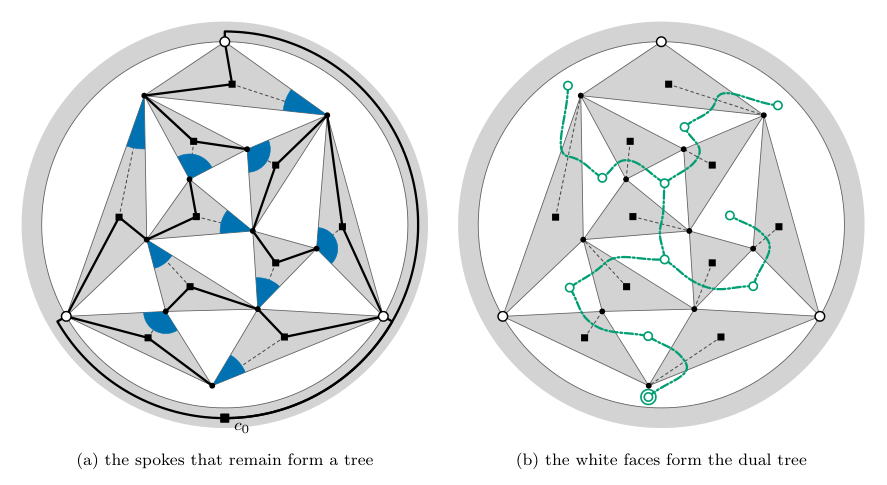
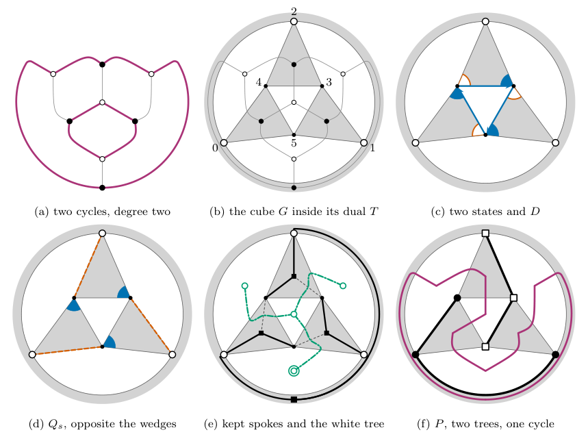
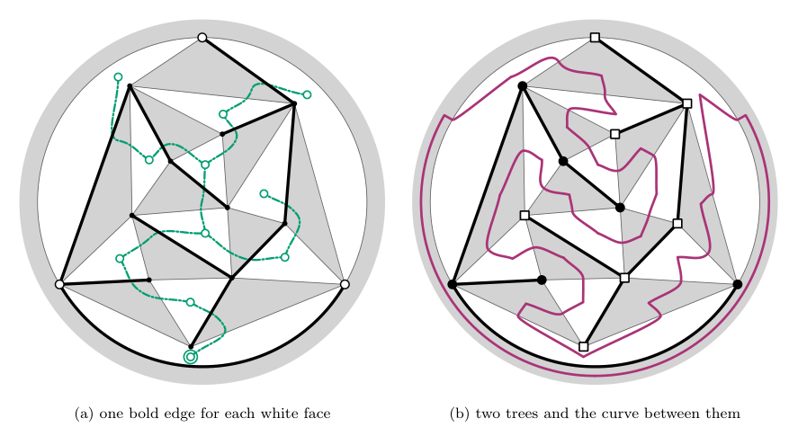

# 07. Recovery: from a good pair to the Hamiltonian cycle

Where this step lives elsewhere. Paper: Lemma 3.6 (the tree of faces), Proposition 3.9 (the selection has no cycle), Example 3.10, Figure 5, and "Which Hamiltonian cycles arise" in Section 7 of [`barnette.pdf`](../../paper/main/barnette.pdf). Primal note: Lemmas 9 to 12 of [`PRIMAL-PROOF.md`](../../proofs/primal/PRIMAL-PROOF.md) (rows "Forest Q_s with a partner", "Compatible perfect matching P" and "Hamiltonian cycle G-P" of [`DICTIONARY.md`](../../proofs/primal/DICTIONARY.md)). Blueprint nodes `lem:good`, `lem:Y`, `prop:recover`, `ex:recover`, `rem:which` in [`BLUEPRINT.md`](../../proofs/blueprint/BLUEPRINT.md); the Lean counterpart of Lemma 3.6 is weaker (Hall gives some matching inside $Y_s$, not the paper's $P_s$), and the route only needs what is checked. Atlas: page 8, [from a good state to the cycle](../atlas/pages/08-recovery.pdf); page 9, [the same proof inside the cubic graph](../atlas/pages/09-primal.pdf); page 25, [which cycles the proof can produce](../atlas/pages/25-produced.pdf).

Review status, 14 November 2026. Links 1 to 5 are the paper's Section 3, refereed with it by a second AI model. The description of which cycles are produced is the paper's Section 7 and was found independently three times in this project. No human has read either.

## What we want at this point and why

Step 06 produced a good pair $(r,s)$: its opposite-edge graph $Q_s$ is a forest, and since $s$ has the partner $r$, each tree of that forest contains one root. So $s$ is a good state (the trees paper's tree matching). That is a statement about $n$ edges opposite chosen corners. The theorem asks for a Hamiltonian cycle of $G$ that avoids the edge dual to $e_0$, or equally for two induced trees of $T$ with $e_0$ inside one of them. This step is the translation. It is a chain of six links, and each link is either a planar duality or a count.

$$\text{good state} \to \text{spanning tree } S_s \to \text{tree of faces } Y_s \to \text{selection } P_s \to P_s \text{ is acyclic} \to \text{one cycle in } G \to \text{two induced trees}.$$

## The idea in plain words

A good state forbids $n + 2$ edges of $T$: in each black face the side opposite the chosen corner, and in $t_0$ the two sides other than $e_0$. Step 03 showed that these edges form a spanning tree $S_s$ of $T$. By planar duality the faces of $T$, joined across the edges that are not forbidden, then also form a tree, $Y_s$. A tree has at most one perfect matching, and this one has exactly one. Matching each face with a neighbour across a shared side is the same as selecting one side in every face, and that selection is what we want. The disk identity shows it has no cycle, and by duality its complement in $G$ is one cycle.

There are two different roots here. The three vertices of $t_0$ root the components of $Q_s$; the face $t_0$ roots the tree of faces.

## The six links

Fix a pair $(r,s)$ with $Q_s$ a forest, the outer face $t_0$, an edge $e_0$ of $t_0$, and let $y_0$ be the white face on the other side of $e_0$.

### Link 1. The forbidden edges form a spanning tree

Put $S_s = Q_s \cup \{ao, bo\}$, where $e_0 = ab$ and $o$ is the third root. Step 03 (paper Lemma 3.5) shows that $s$ is good exactly when $S_s$ is a spanning tree of $T$. The partner was needed to know that $s$ is good; from here on only $s$ is used.

### Link 2. The tree of faces

Let $Y_s$ be the graph whose nodes are the $2k$ faces of $T$, two faces adjacent when they share a side not in $S_s$. It is a subgraph of $G$. By tree/cotree duality (step 02, applied to $M = T$ and the spanning tree $S_s$), $Y_s$ is a spanning tree of $G$. A face $t \in A$ has exactly one side in $S_s$, its side in $Q_s$, so it has degree two in $Y_s$. The face $t_0$ has $ao, bo \in S_s$ and $e_0 \notin S_s$, so it has degree one, and its neighbour is the white face $y_0$ across $e_0$.

Suppressing the black nodes of degree two gives a tree on the white faces, rooted at $y_0$: two white faces are joined when they lie across the two sides of some $t \in A$ at $s(t)$. Call it $W_s$. The paper's Figure 5(a) draws it. Earlier versions of these digestions, and the three source papers, built this white-face tree from spokes, as the dual of the spoke graph minus the spokes of $s$. It is the same tree; $Y_s$ needs no spokes.

### Link 3. The selection

Root $Y_s$ at $t_0$. Colours alternate along its edges. $t_0$ has one child, every $t \in A$ has a parent and therefore exactly one child, and every white face has a parent, which is black. Let $P_s$ consist of the side that each black face shares with its child (paper Lemma 3.6).

Every black face has exactly one side in $P_s$. A white face $y$ is the only child of its parent, so the side towards its parent is in $P_s$. Any other side of $y$ is shared with a black child $t$ of $y$, and $t$ selects the side towards its own child, which is not $y$; since two faces share at most one side, that side of $y$ is not selected. So every face of $T$ has exactly one side in $P_s$: $P_s$ is a selection, the main paper's word. It contains $e_0$, the side between $t_0$ and $y_0$. For $t \in A$ the side shared with its child is not in $Q_s$, so it is one of the two sides at $s(t)$.

Put $P_0 = P_s \setminus \{e_0\}$. In these digestions "selected" always refers to $P_s$, never to the edges $r(t) \to s(t)$ of $D$; the primal note uses the word for both.

### Link 4. $P_s$ has no cycle

**Lemma** (paper Proposition 3.9; OpenAI Lemma 6.2; trees paper Lemma 7.1). $P_s$ has no cycle and has exactly two components.

*Proof.* Direct each edge of $P_0$ away from $s(t)$, where $t$ is the black face that contains it. Every non-root is $s(t)$ for one $t$, so it has out-degree one, and roots have out-degree zero.

Suppose $P_0$ has a cycle $C$. With out-degree at most one everywhere it is a directed cycle. Its edges leave corners chosen by the state $s$, so the disk identity of step 04 applies. The disk has $W = B + 1$ and $h - 2\ell = 3$, with $h$ the length and $\ell$ the number of edges of $C$ whose black face is inside.

Now count the faces of the disk through $P$. Each face has one selected edge and each edge lies in one black and one white face, so $P$ pairs black faces with white faces. A face of the disk is paired with a face of the disk unless its selected edge is on $C$. All $h$ edges of $C$ are selected. They use up $\ell$ black faces and $h - \ell$ white faces of the disk. The remaining faces pair off inside, so $B - \ell = W - (h - \ell)$, that is $W - B = h - 2\ell = 3$. But $W - B = 1$. So $P_0$ is a forest.

In a forest with out-degree one at non-roots and zero at roots, every component contains exactly one root, by the count of Lemma 1 in step 03. So $P_0$ has three components. The edge $e_0$ joins two different roots, hence two components. Adding it keeps the graph acyclic and leaves two components. $\square$

The assumptions used are that $s$ is a bijection, for the disk identity, and that each face has exactly one selected edge. This is the paper's argument, which came from Lemma 6 of `research/2026-11-14_fable_route-combinatorics/PROOF.md`. In words: a cycle of chosen sides encloses one more white face than black, but a selection running along it would force three more. The source papers reach $2\ell - h = 0$ instead and contradict the oddness of $h$.

### Link 5. One cycle in $G$

Take the edges of $G$ dual to the edges of $T$ that are not in $P$. Every face of $T$ has two unselected sides, so this subgraph has degree two at every vertex of $G$. $P$ is a spanning forest of $T$, so by tree/cotree duality the duals of the remaining edges are connected. A connected graph with all degrees two is a single cycle through all vertices. It does not use the dual of $e_0$, because $e_0 \in P$.

### Link 6. Two induced trees

Apply Theorem 4 of step 02 to this Hamiltonian cycle. The two sides of the cycle split $V(T)$ into two sets, each inducing a tree, and the edges with both ends on one side are exactly those of $P$. So the two trees are the two components of $P$. Inside $t_0$ the only edge of $P$ is $e_0$. Its ends are in one set and the third root is in the other. This is Theorem 2.2 of the OpenAI paper for rooted triangulations that have a pair.

## Worked example: the cube

Octahedron, $t_0 = (0,2,1)$, $e_0 = 01$, state $s = (3,4,5)$ on the faces $4 = (1,3,5)$, $5 = (2,4,3)$, $6 = (0,5,4)$. The white faces are $1 = (0,1,5)$, $2 = (1,2,3)$, $3 = (2,0,4)$, $7 = (3,4,5)$, and $y_0 = 1$.

| Black face | $s(t)$ | Sides at $s(t)$ | White faces across them | Edge of $W_s$ |
| --- | --- | --- | --- | --- |
| 4 | 3 | $13$, $35$ | 2, 7 | $2 - 7$ |
| 5 | 4 | $24$, $43$ | 3, 7 | $3 - 7$ |
| 6 | 5 | $05$, $54$ | 1, 7 | $1 - 7$ |

$W_s$ is a star with centre 7. Rooted at $y_0 = 1$, face 7 has parent 1 through black face 6, and faces 2 and 3 have parent 7 through black faces 4 and 5.

| White face | Its black face | Selected side |
| --- | --- | --- |
| 7 | 6 | the side of $(0,5,4)$ bordering $(3,4,5)$, which is $45$ |
| 2 | 4 | the side of $(1,3,5)$ bordering $(1,2,3)$, which is $13$ |
| 3 | 5 | the side of $(2,4,3)$ bordering $(2,0,4)$, which is $24$ |
| 1 | $t_0$ | $e_0 = 01$ |

So $P = \{01, 13, 24, 45\}$, the two paths $0 - 1 - 3$ and $2 - 4 - 5$ of step 02. The eight unselected edges give the cycle of faces $0, 3, 6, 1, 4, 7, 5, 2$ in the cube. The other good state, $(5,3,4)$, is the solid state of the paper's Figure 1; it selects $35$, $23$, $04$ and gives the trees on $\{0,1,4\}$ and $\{2,3,5\}$ (paper Example 3.10). Both runs recomputed for this audit.

## Worked example: the running graph

Use the paper's good state $\beta = (6, 2, 8, 1, 3, 10, 11, 7, 12, 9)$, the partner of the state $\alpha$ whose $Q$ has a cycle (step 05). With $e_0 = 04$ the white root is $y_0 = 3$, the face $\{0,3,4\}$. Recomputed for this audit, and equal to the paper's Example 3.10:

$$P = \{02,\ 04,\ 06,\ 19,\ 39,\ 5\,11,\ 67,\ 78,\ 9\,10,\ 10\,11,\ 11\,12\},$$

eleven edges, one in each of the 22 faces. Its two components are $\{0, 2, 4, 6, 7, 8\}$ and $\{1, 3, 5, 9, 10, 11, 12\}$. The Hamiltonian cycle visits the 22 faces in the order

$$0, 1, 9, 10, 2, 3, 11, 12, 13, 14, 4, 5, 15, 16, 17, 18, 19, 20, 21, 8, 7, 6.$$

## Which Hamiltonian cycles are produced

The construction is a map from good states to Hamiltonian cycles avoiding the dual of $e_0$. Three facts describe it.

1. **It is injective.** Given the cycle, recover $P$, remove $e_0$, direct the three trees towards their roots, and read off the tails. This returns $s$. That is the derivation at the start of step 03 run backwards.
2. **Its image is known.** Every Hamiltonian cycle $C$ avoiding the dual of $e_0$ defines a state $s_C$ in that way. $C$ is produced by the construction exactly when $s_C$ is good. If it is not, $s_C$ has no partner at all.
3. **It is not onto.** In the prism with $t_0 = (6,0,1)$ and $e_0 = 01$, four Hamiltonian cycles avoid the dual of $e_0$ and there are two good states. For the other two choices of $e_0$ the numbers are two and two. The two cycles that are not produced fail for a reason that "$Q_{s_C}$ is a forest" would hide: $Q_{s_C}$ has no cycle, but a path of opposite edges joins two roots (computed in `research/2026-11-14_fable_atlas-review/REPORT.md`). So "good" must be read as "a forest with one root in each component", never as "a forest".

A consequence of the first fact is $3 \cdot \#\{\text{good states}\} \le \#\{\text{Hamiltonian cycles of } G\}$, since each cycle avoids exactly one of the three edges at the vertex of $G$ in $t_0$.

In the running example $G$ has 28 Hamiltonian cycles. Six avoid the dual of $e_0 = 04$, and there are six good states. So here every avoiding cycle is produced. Over all rooted triangulations with a pair and at most 16 vertices the number of avoiding cycles is between 1 and 26 times the number of good states.

Status. Facts 1 and 2 are Proposition 7 of `fable_route-combinatorics/PROOF.md`, Theorem 7.2 of `research/2026-11-14_opus_route-graph-theory/PROOFS.md` and a section of `research/2026-11-14_astra_limits/HYPOTHESES.md`, found independently three times. Two different second models checked them, in `research/2026-11-14_astra_referee-combinatorics/` and in section 5 of `research/2026-11-14_sol_referee-structure/INTEGRATION.md`. Not yet read by a human. Fact 3 is computed, by three programs, mine included.

The reading that matters for intuition is this. Proposition 5.1 does not find an arbitrary Hamiltonian cycle. It finds one of a special kind, one whose state has a partner, and that kind depends on the root $t_0$. A proof that tried to show that every Hamiltonian cycle comes from a good pair would be aiming at a false statement.

## What does not work

- **A state whose $Q_s$ is a forest but which has no partner.** The third state of the prism in step 03 has two roots in one component of $Q_s$ and none in another. Then adding $ao$ and $bo$ to $Q_s$ closes a cycle, so $S_s$ is not a tree, $Y_s$ is disconnected, and Link 3 has nothing to root.
- **A choice of corners that is not a bijection.** Links 1 to 3 go through for any choice of one corner per face whose opposite edges form a rooted forest, and such choices are easy to find, see step 03. Link 4 breaks, because the disk identity needs the bijection. This is the reason the proof insists on states.
- **Other surfaces.** On a torus the complement of a spanning tree has two edges too many to be a tree, so Link 2 fails, and the two-tree target of Link 6 is impossible by the count in step 02.

## Other routes

- **Li's Link 4.** Li does not show that $P$ is a forest. He assumes that the complement of $P$ in $G$ has more than one cycle, takes one with no root face inside, and finds two faces matched to the same black vertex. That uses neither the disk identity nor the partner, and it does not produce the induced trees, which he does not need. Published.
- **Entirely in $G$.** The primal note does Links 1 to 5 in the cubic graph (Lemmas 9 to 12). Its Lemma 12 needs less than a good state: any perfect matching $P$ whose edge at every black vertex lies on the face $s(b)$ has a Hamiltonian complement, and the pair and the forest are needed only to produce such a $P$. Accepted by a second model in the cross-audit. The Lean formalisation also does the recovery in $G$, with no spoke graph. Formalised.
- **Through Temperley's correspondence.** The papers point to the bijection between spanning trees and matchings of Kenyon, Propp and Wilson as a relative of Links 1 to 3. Nobody in the project wrote out an exact dictionary. A hunch.
- **By removing leaves.** Remove a leaf of $W_s$ together with its black face and show that a smaller rooted triangulation with a good state remains. A conjecture in `research/2026-11-14_fable_dependency-graph/skeleton.md`, edge F1, untested.

## Where this is used next

The theorem is now proved for every rooted triangulation that has a pair. Step 08 removes that assumption by cutting along separating triangles.
