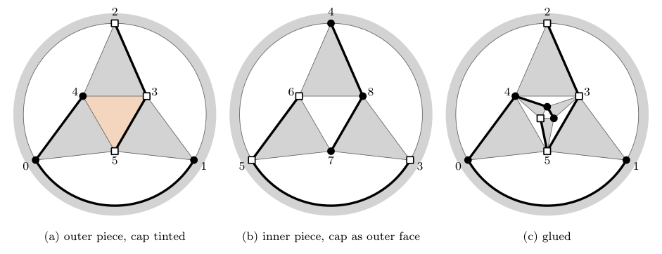

# 08. Gluing across separating triangles, and what each hypothesis is for

Where this step lives elsewhere. Paper: Section 6 (Lemma 6.1 on caps, Theorem 6.2, Figure 13), the proof of Theorem 1.1 and "Why each hypothesis is needed" in Section 7 of [`barnette.pdf`](../../paper/main/barnette.pdf). Primal note: Lemma 13 of [`PRIMAL-PROOF.md`](../../proofs/primal/PRIMAL-PROOF.md) (row "Nontrivial three-edge cut; cap" of [`DICTIONARY.md`](../../proofs/primal/DICTIONARY.md)). Blueprint nodes `lem:cap`, `thm:T`, `thm:main` in [`BLUEPRINT.md`](../../proofs/blueprint/BLUEPRINT.md). The statement of Theorem 6.2 has a Lean counterpart, but its proof glues acyclic selections through the two-trees statement, which Lean never states; the Lean glues perfect matchings with connected complements instead. Atlas: page 22, [what a small cut has to remember](../atlas/pages/22-cuts.pdf); page 23, [induction by removing a vertex of degree four](../atlas/pages/23-induction.pdf); page 26, [what breaks when a hypothesis is dropped](../atlas/pages/26-hypotheses.pdf).

Review status, 14 November 2026. The gluing is the paper's Section 6, refereed with it by a second AI model, and the sharper version below was confirmed in section 4 of `research/2026-11-14_sol_referee-structure/INTEGRATION.md`. No human has read either.

## What we want at this point and why

Steps 03 to 07 prove the two-trees theorem for a rooted triangulation $(T, t_0)$ that has a pair of states. By step 03 that fails exactly when some separating triangle has black inner boundary. This step removes the restriction by cutting $T$ along such a triangle and gluing solutions of the two pieces. It is the only induction in the proof, and it is the reason the theorem carries a prescribed edge $e_0$ from the start.

The second half of this file goes through the hypotheses of the theorem and of the method one at a time and says where each is used and what the smallest known failure looks like without it.

## The idea in plain words

A separating triangle cuts the sphere into two disks. Close each disk with a new triangular face, the cap. This gives two smaller triangulations of the same kind. Solve the piece that contains $t_0$. Its solution splits the three vertices of the triangle two against one. Now solve the other piece, asking for the same split on its cap. That request is an instance of the prescribed-edge condition, with the cap as outer face. The two solutions agree on the triangle and nowhere else do the pieces touch, so they glue.

The induction solves the outer piece first. Its boundary split then determines the prescription for the inner piece. Choosing the two solutions independently would not justify gluing.

## Statement and proof

**Theorem** (paper Theorem 6.2; OpenAI Theorem 2.2). Let $T$ be a simple sphere triangulation with faces properly coloured black and white, $t_0$ a face and $e_0$ an edge of $t_0$. Then $V(T)$ splits into two sets, each inducing a tree, with the ends of $e_0$ in one set and the third vertex of $t_0$ in the other.

*Proof.* Induction on the number of vertices. Swap the two colours if necessary so that $t_0$ is black.

*Case 1, a pair exists.* Steps 06 and 07 give the partition.

*Case 2, no pair exists.* By step 03 there is a separating triangle $\Delta$ with black inner boundary. Cut along $\Delta$ and cap both sides.

- *Both pieces are smaller simple triangulations.* Each side of $\Delta$ has a vertex strictly inside, so each piece has fewer vertices than $T$ and at least four.
- *The colouring extends to the caps.* On one side of $\Delta$ let $B$, $W$ count the black and white faces. Give each black face $+3$ and each white face $-3$ and spread these over the sides. Inner sides cancel. So $3(B - W)$ is a sum of three signs, one for each edge of $\Delta$, and a sum of three signs that is divisible by three has all three equal. The three faces along $\Delta$ on that side have one colour. Give the cap the other colour. This is the count of step 03 with $d = 3$.
- *Solve the outer piece* with the original $t_0$ and $e_0$. The cap is a triangle, and an induced tree contains no triangle, so both classes meet the cap. Exactly one edge $e_1$ of the cap has both ends in one class.
- *Solve the inner piece* with its cap as the outer face and $e_1$ as the prescribed edge. The theorem allows any face and any edge, with colours swapped if needed. Rename the two classes of this solution so that they agree with the outer solution on the three vertices of $\Delta$.
- *Glue.* For each class, the tree in the outer piece and the tree in the inner piece meet in the vertices of $\Delta$ of that class, which is either one vertex or the two ends of $e_1$ with the edge $e_1$. In both cases the intersection is connected, so the union is a tree. It is induced in $T$, because no edge of $T$ joins a vertex strictly inside $\Delta$ to a vertex strictly outside, and on $\Delta$ itself the two pieces have the same edges. The condition at $t_0$ is untouched. $\square$

The paper, the OpenAI paper and Li cut at any separating triangle as soon as there is one, and use the flow argument of step 03 only when there is none. The trees paper cuts only where Case 2 forces it. The version above is the trees paper's. The paper's version proves acyclicity of the glued selection directly: a cycle of $P_1 \cup P_2$ would leave the outer piece, and its part inside would be a path in $P_2$ of length at least two between two vertices of $\Delta$, while in $P_2$ the only such path is the edge $e_1$. It was rewritten in `research/2026-11-14_opus_route-graph-theory/PROOFS.md` section 5 and confirmed in section 4 of `research/2026-11-14_sol_referee-structure/INTEGRATION.md`.

**From the theorem to Barnette's conjecture.** By step 02 the partition is a Hamiltonian cycle of $G$ that avoids the edge dual to $e_0$. Every edge of $G$ is dual to an edge of $T$, and every edge of $T$ lies on a face. So for every edge $e$ of a Barnette graph there is a Hamiltonian cycle avoiding $e$. This is Corollary 7.1.

## Worked example

Take the double octahedron of step 03. Its faces are those of the octahedron on $0,\dots,5$ except $(3,4,5)$, together with $(3,4,8), (4,5,6), (5,3,7), (3,8,7), (4,6,8), (5,7,6), (6,7,8)$. Root it at $t_0 = (0,1,5)$ with $e_0 = 01$. Step 03 showed that this root has four states and no pair. The triangle $\Delta = \{3,4,5\}$ has black inner boundary.

*Outer piece.* The octahedron on $0,\dots,5$ with the cap $(3,4,5)$, rooted at $(0,1,5)$. It has a pair. The script picks the good state that sends the black faces $(1,2,3), (2,0,4), (3,4,5)$ to $2, 4, 3$, and recovery with $e_0 = 01$ gives the classes $\{0,1,4\}$ and $\{2,3,5\}$. On the cap, $3$ and $5$ are together and $4$ is alone. So $e_1 = 35$.

*Inner piece.* The octahedron on $3,\dots,8$, rooted at its cap with prescribed edge $35$. It has two good states. The first gives the classes $\{3,5,8\}$ and $\{4,6,7\}$.

*Glue.* The classes are

$$\{2,3,5\} \cup \{3,5,8\} = \{2,3,5,8\}, \qquad \{0,1,4\} \cup \{4,6,7\} = \{0,1,4,6,7\}.$$

The first pair of trees meets in the edge $35$, the second in the vertex $4$. In $T$ the first class induces the star with edges $23, 35, 38$ and the second the path $1 - 0 - 4 - 6 - 7$. Both are trees. The mixed edges give a cycle through all 14 faces, and it does not use the dual of $e_0$. The script `crosscheck.py` checks each of these statements.

## Why the prescribed edge is needed

Without a prescription the two pieces would be solved independently. Each solution splits $\Delta$ two against one, and there are three ways to do that. Nothing makes the two solutions choose the same way. If they disagree, the union of two trees of one class is disconnected or contains a cycle through $\Delta$.

So the induction needs a statement strong enough to dictate the split on a triangle. Prescribing which edge of one face lies inside a tree is exactly that much. The literature shows that one cannot ask for much more. Deciding whether a Barnette graph has a Hamiltonian cycle through an arbitrary prescribed set of edges is NP-complete, by a result of Bagheri Gh., Feder, Fleischner and Subi from 2022 that the history review reports in `research/2026-11-14_opus_history-literature/WHAT-WAS-HARD.md` section 6. I did not read that paper. The reduction to triangulations without separating triangles and the single avoided edge as the induction statement go back to Kelmans in 1986 and Hertel in 2005, by the same review. The OpenAI paper proves the gluing again without citing them.

## What each hypothesis is for

The first four rows are the hypotheses of the theorem. The rest are internal conditions of the method.

| Hypothesis | First place it is used | What goes wrong without it | Smallest example known to the project |
| --- | --- | --- | --- |
| bipartite | step 02, the faces of $T$ get two colours | an edge would have two black faces or none, so $Q_s$ and $\delta$ are undefined | $K_4$. Its dual is $K_4$, with odd degrees. $K_4$ is Hamiltonian, so the method fails and the conclusion does not. For the conclusion, Tutte's graph on 46 vertices; the smallest such graphs have 38 |
| cubic | step 02, the faces of $T$ are triangles | a larger face has no single edge opposite a corner, and one selected edge per face no longer leaves degree two | the 11-vertex graph of step 01, which has no Hamiltonian cycle |
| 3-connected | step 02, $T$ is simple | with parallel edges in $T$ the bound $\beta \le d - 4$ of step 03 fails for regions with two sides, and pairs need not exist | the 26-vertex graph made of three cubes minus an edge between two terminals. Every root has eight states and no pair |
| planar | step 02, Euler's formula | on a surface of genus $g$, $\lvert X\rvert = \lvert A\rvert - 2g$, so there are no states. Cycles need not bound disks. A spanning tree has no dual tree | for the method, a 9-vertex torus triangulation whose dual is Hamiltonian and which has no partition into two induced trees. For the conclusion, the 50-vertex Georges-Kelmans graph, the smallest non-Hamiltonian cubic bipartite 3-connected graph |
| a pair exists | step 05 | nothing to reverse, nothing to count | the double octahedron at 6 of its 14 roots. Handled by this step |
| states are bijections | step 04, Count 1 | cycles with $\delta$-sum $0$ appear | the 9-vertex example of step 04 |
| the two states differ everywhere | step 06 | the count becomes easy and its output useless | the remark in step 03 |
| the cycle in $Q_s$ is chosen from $s$ alone | step 05 | the reversal is not an involution | no example recorded |
| weights with positive circulation | step 06 | with zero weights the sum is identically zero | the cube |
| the prescribed edge | this step | the pieces do not glue | any separating triangle |

One point about 3-connectivity is easy to get wrong. On the 26-vertex example the disk identity still holds for cycles that bound disks. The first statement that fails is the existence of a pair. A proof reader looking for the place where 3-connectivity matters should look at the density count of step 03, not at step 04.

Status of the table. The first place each hypothesis is used can be read off the published proofs and the paper's Section 7, which checks the 26-vertex and 11-vertex examples in its text. The examples and the diagnosis of what fails first are from `research/2026-11-14_astra_limits/HYPOTHESES.md`. They are proved or computed in this project. The integration notes of the second model that is refereeing that report cover the pair criterion, the gluing, the image of the recovery map and the rarity family of step 09. They do not list the 26-vertex computation, the torus example or the non-bijective example among the confirmed statements. Treat those three as not yet refereed. I recomputed the non-bijective example and the double octahedron counts myself.

## What does not work

- **Choosing the root to avoid cutting.** For Hamiltonicity alone the root is free. In the double octahedron 8 of the 14 roots have a pair, so no cut is needed if one starts from one of them. Whether every triangulation has such a root is not known in the project. `research/2026-11-14_fable_dependency-graph/skeleton.md`, lead G1, expects it to fail when several separating triangles have their black sides arranged against each other and gives no example. Even where it works it does not give the prescribed edge at a prescribed face.
- **Roots that are not the corners of one face.** Lead G2 proposes roots of three different colours away from one face, but does not specify which black face to omit. Without that omission there are k black faces and k-1 nonroot vertices, so a bijection is impossible by counting. A corrected formulation and a replacement for the three outer spokes are needed before testing it.
- **Stronger prescriptions.** Kelmans showed the conjecture equivalent to: for two distinct edges $e, f$ on a common face there is a Hamiltonian cycle through $e$ avoiding $f$. So that now holds too. For two arbitrary edges it is open (paper, Section 7). A Hamiltonian cycle through any given edge follows at once from avoidance. Avoid another edge at one of its ends, and the cycle must use the other two. A cycle through any path with three edges follows from a published equivalence of Gorsky, Steiner and Wiederrecht, which the OpenAI paper uses for Corollary 7.2. A cycle through any path with four edges is false already on the cube. In the cube two vertices at distance two have two common neighbours. Take a path $v_0 v_1 v_2 v_3 v_4$ in which neither end is the second common neighbour $x$ of $v_1$ and $v_3$. A Hamiltonian cycle through the path uses both of its edges at $v_1$ and at $v_3$ inside the path. So $x$ has one usable edge left and cannot lie on the cycle. The observation is from `astra_limits/STRENGTHENINGS.md`, with an explicit path in `examples/P5_cube.json`. It is not refereed, and the argument here is complete as written.

## Other routes

- **Minimum counterexample.** Li phrases the same induction as a smallest counterexample in $G$, where cutting and capping is contracting one side of a 3-edge cut to a vertex. Published.
- **Induction by contracting a vertex of degree four.** Instead of cutting, contract a non-root vertex of degree four onto two opposite neighbours and lift a good state back. Two lemmas would close it. Induction G (also called ML1): some contraction keeps a pair; proved when there are no chordless five-cycles, not yet refereed, open in general, and true on all 62,416 separator-free rooted cases with 8 to 19 vertices. Induction X (ML2): some good state of a contraction lifts or rotates to one of $T$; open. Local lifting alone fails: at 18 vertices there is a rooted contraction where no good state of the contracted graph lifts directly, and another where every good state of one cover is exceptional, so a repair must sometimes change the cover. Computed in `research/2026-11-14_fable_induction-completion/` and `research/2026-11-14_astra_induction-lemmas/`, with the state-splitting and lift criterion refereed by a second model. Step 09, doors 2 and 3; atlas page [23](../atlas/pages/23-induction.pdf).
- **Longer cuts.** Why stop at triangles? Because the prescribed edge is the whole boundary datum of a triangular cut. For a separating cycle of length 5 the patterns a piece can realise already depend on the piece (a 9-vertex example, `research/2026-11-14_fable_route-categorical/`, computed). Atlas page [22](../atlas/pages/22-cuts.pdf).
- **The sharp hypothesis in $G$.** A pair exists exactly when every non-trivial 3-edge cut of $G$ has the vertex dual to $t_0$ on its black-ended side. Li's assumption that there is no such cut at all is sufficient and not necessary. Of the 4,494 rooted triangulations with a separating triangle and at most 16 vertices, 1,714 still have pairs. Proved in `opus_route-graph-theory/PROOFS.md` section 4 and confirmed in section 3 of the referee's integration notes. Not yet read by a human.

## Where this is used next

Nothing in the proof comes after this step. Step 09 lists what the proof leaves open.
