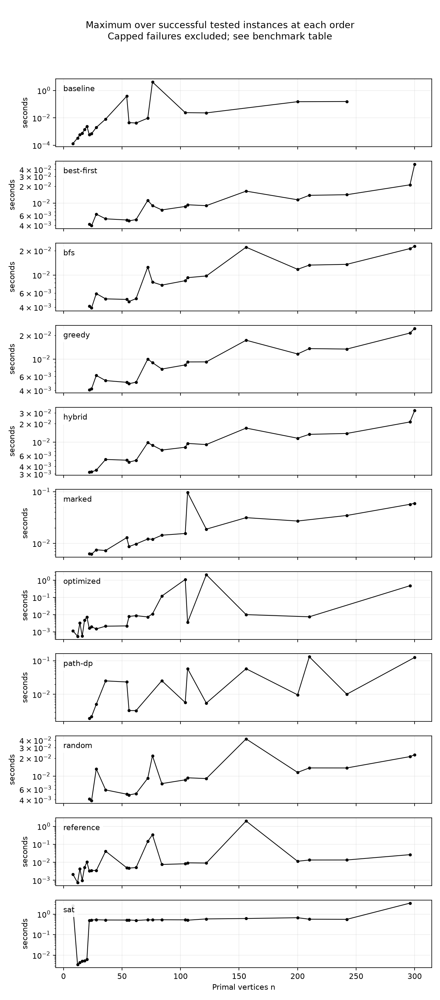
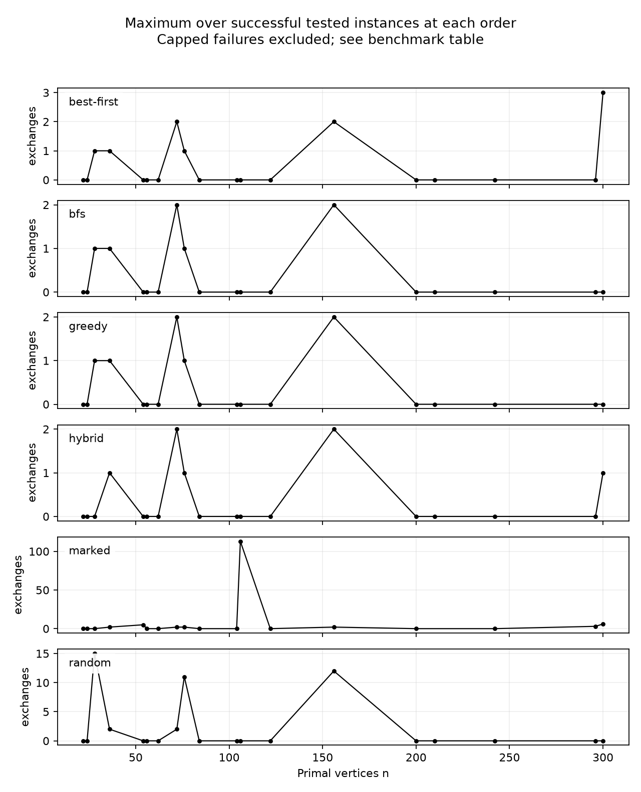
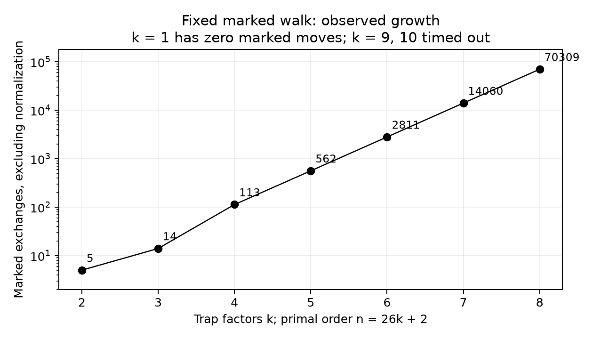

# Benchmarks

Every result in this file is COMPUTED, from `research/2026-11-14_astra_algorithm/experiments.py`. This is finite evidence. Timings do not establish a polynomial bound. All successful rows retain their cycle and forbidden edge, checked against primal adjacency by `optimized.verify`, which uses no dual or matching objects.

## Inputs and timing boundary

The census contains all 15 unrooted plantri Eulerian triangulations through dual order 12 and all 262 facial rootings. Each rooting uses the side joining its two least-labelled root vertices. This is not an all-edge benchmark; separate unit tests exercise every edge of the four named graphs. Four solvers run on every census input.

The larger campaign contains 30 inputs: width-4 and width-6 tubes with 2, 6, 12 and 24 layers; prism sums with 2, 6, 12 and 24 factors; three split-generated samples at each dual order 20, 40, 80 and 150; the saved 38- and 40-vertex periodic-evict graphs; and chains of 1, 2, 4 and 8 copies of the 16-vertex trap. Graphs and roots are saved in `families-instances.json`. The largest primal input has 300 vertices. The evict graphs are reused as inputs; their original rainbow-tree walk states are not pair-walk starting states.

The random generator starts from an octahedron and repeatedly splits a uniformly chosen vertex between two even-separated neighbours in its rotation, adding a degree-four vertex. Seeds are 7461, 7462 and 7463. Orders in one seed are nested samples. This distribution favours graphs obtainable by these insertions and is not uniform over Barnette graphs. Tube and prism generation imports the earlier family module read-only.

Times begin after construction of the rooted lab Instance. They include flow, the chosen search, recovery and any separator recursion. They exclude initial planarity checking, dense incidence-matrix construction, public input validation and the final independent certificate check. Each larger solver job has its own process and an eight-second wall cap including startup. CP-SAT has a six-second internal cap, one search worker and an AddCircuit formulation on both orientations of every allowed edge; no loops are supplied, so every vertex must be visited. OR-Tools was already installed. Its import is included in the recorded SAT time. Census timings use one process, so its first SAT call includes a cold import.

## Methods

`optimized` in the raw logs means rollback enumeration alone, with minimum-remaining-corners ordering and incremental matching repair. It has no initial flow hint. `hybrid` is the public implementation: flow, up to 32 deterministic unvisited-neighbour exchanges ranked by Q-cycle count, bounded path DP, then complete enumeration. `reference` is the existing lab solve function with its flow-first enumeration. `baseline` is primal Hamiltonian-path backtracking with a residual degree test.

`marked` is the manuscript ordered-token walk, capped at 2,000 moves. `random` and `greedy` are the reference exchange walks with seed 24 and 500-move caps. Greedy chooses randomly among neighbours of least Q-cycle count; it is not guaranteed monotone. BFS and best-first retain visited pairs and stop at 2,000 expansions. Best-first ranks by Q-cycle count. These caps are measurement limits, not existence failures. At dual order at most 16, pair methods start at the first enumerated nongood pair when one exists; larger pair methods start at the flow pair. Thus move and time comparisons with flow-first reference/hybrid are not comparisons from identical starting states.

`path-dp` is complete within a frontier-width limit of 16 and a table limit of 100,000. The hybrid uses limits 12 and 20,000. It orders black centres by their sorted corner triples. A width-limit rejection is reported as capped, not as no good state.

## Aggregate results

The table combines the census and family campaigns. Only optimized, reference, baseline and SAT have census rows. Maxima exclude censored runs.

| Method | Successes / runs | Capped or timed out | Largest successful n | Maximum successful seconds | Worst successful input |
|---|---:|---:|---:|---:|---|
| baseline | 280 / 292 | 12 | 242 | 4.133028 | evict-40 |
| best-first | 30 / 30 | 0 | 300 | 0.049673 | tube6-24 |
| bfs | 30 / 30 | 0 | 300 | 0.022676 | tube6-24 |
| greedy | 30 / 30 | 0 | 300 | 0.024517 | tube6-24 |
| hybrid | 30 / 30 | 0 | 300 | 0.032959 | tube6-24 |
| marked | 29 / 30 | 1 | 300 | 0.095954 | trap-chain-4 |
| optimized | 285 / 292 | 7 | 296 | 2.101999 | prism-sum-12 |
| path-dp | 19 / 30 | 11 | 300 | 0.130081 | trap-chain-8 |
| random | 30 / 30 | 0 | 300 | 0.042048 | tube6-12 |
| reference | 289 / 292 | 3 | 296 | 1.962786 | split-0-80 |
| sat | 291 / 292 | 1 | 296 | 3.422579 | split-1-150 |

| Walk | Maximum successful exchanges | Maximum phases | Maximum normalization reversals |
|---|---:|---:|---:|
| marked | 113 | 4 | 7 |
| random | 15 | not applicable | 0 |
| greedy | 2 | not applicable | 0 |
| bfs | 2 | not applicable | 0 |
| best-first | 3 | not applicable | 0 |
| hybrid | 2 | not applicable | 0 |

No error rows are omitted. The scripts distinguish no-pair and no-good-state from caps. A failed certificate aborts the run.





The figures use black lines and separate directly labelled panels. Zero-move runs are legitimate. Enumeration nodes, SAT branches and exchanges are different quantities and are not combined into one move count.

## Family comparisons

| Input | n | Rollback-only seconds | Reference seconds | Hybrid seconds | Path DP seconds |
|---|---:|---:|---:|---:|---:|
| tube4-2 | 24 | 0.001953 | 0.003542 | 0.003240 | 0.002196 |
| tube6-2 | 36 | 0.002119 | 0.041221 | 0.005190 | 0.005573 |
| prism-sum-2 | 22 | 0.001604 | 0.003311 | 0.003228 | 0.001941 |
| tube4-6 | 56 | 0.007838 | 0.004768 | 0.004693 | 0.003317 |
| tube6-6 | 84 | 0.120210 | 0.007572 | 0.007396 | 0.025385 |
| prism-sum-6 | 62 | 0.008670 | 0.005068 | 0.005022 | 0.003297 |
| tube4-12 | 104 | 1.106916 | 0.008250 | 0.008223 | 0.005722 |
| tube6-12 | 156 | timeout | timeout | 0.016280 | 0.057551 |
| prism-sum-12 | 122 | 2.101999 | 0.009071 | 0.009105 | 0.005504 |
| tube4-24 | 200 | timeout | 0.011378 | 0.011564 | 0.009697 |
| tube6-24 | 300 | timeout | timeout | 0.032959 | 0.124486 |
| prism-sum-24 | 242 | timeout | 0.013421 | 0.013842 | 0.010084 |
| split-0-20 | 36 | 0.001748 | 0.003862 | 0.003772 | 0.025086 |
| split-0-40 | 76 | 0.011024 | 0.006078 | 0.006113 | capped |
| split-0-80 | 156 | 0.009971 | 1.962786 | 0.016952 | capped |
| split-0-150 | 296 | timeout | 0.017941 | 0.019870 | capped |
| split-1-20 | 36 | 0.001739 | 0.003745 | 0.003662 | 0.008405 |
| split-1-40 | 76 | 0.003375 | 0.005945 | 0.006255 | capped |
| split-1-80 | 156 | 0.007507 | 1.752881 | 0.015710 | capped |
| split-1-150 | 296 | 0.479562 | 0.026509 | 0.021365 | capped |
| split-2-20 | 36 | 0.001760 | 0.003849 | 0.003560 | 0.013002 |
| split-2-40 | 76 | 0.003132 | 0.005736 | 0.005729 | capped |
| split-2-80 | 156 | timeout | 0.010456 | 0.010394 | capped |
| split-2-150 | 296 | timeout | timeout | 0.019421 | capped |
| evict-38 | 72 | 0.007308 | 0.144530 | 0.009789 | capped |
| evict-40 | 76 | 0.005298 | 0.337872 | 0.008869 | capped |
| trap-chain-1 | 28 | 0.001472 | 0.003485 | 0.003464 | 0.005088 |
| trap-chain-2 | 54 | 0.002197 | 0.004989 | 0.005047 | 0.023315 |
| trap-chain-4 | 106 | 0.003539 | 0.009298 | 0.009502 | 0.058057 |
| trap-chain-8 | 210 | 0.007456 | 0.013381 | 0.013388 | 0.130081 |

## Descriptive growth fits

For each method and named family below, fit log(time)=a+p log(n) by ordinary least squares over successful sizes. Only families with at least three distinct successful orders are included. A censored size is omitted and its count is printed. These tiny, structured samples and omitted timeouts cannot estimate asymptotic worst-case complexity.

| Family | Method | Successful observations | Censored observations | Fitted p |
|---|---|---:|---:|---:|
| tube4 | optimized | 3 | 1 | 4.164 |
| tube4 | reference | 4 | 0 | 0.574 |
| tube4 | hybrid | 4 | 0 | 0.622 |
| tube4 | path-dp | 4 | 0 | 0.710 |
| tube4 | baseline | 4 | 0 | 2.539 |
| tube4 | sat | 4 | 0 | 0.107 |
| tube6 | hybrid | 4 | 0 | 0.893 |
| tube6 | path-dp | 4 | 0 | 1.463 |
| tube6 | sat | 3 | 1 | 0.060 |
| prism-sum | optimized | 3 | 1 | 3.977 |
| prism-sum | reference | 4 | 0 | 0.599 |
| prism-sum | hybrid | 4 | 0 | 0.622 |
| prism-sum | path-dp | 4 | 0 | 0.683 |
| prism-sum | baseline | 4 | 0 | 2.307 |
| prism-sum | sat | 4 | 0 | 0.074 |
| trap-chain | optimized | 4 | 0 | 0.796 |
| trap-chain | reference | 4 | 0 | 0.693 |
| trap-chain | hybrid | 4 | 0 | 0.698 |
| trap-chain | path-dp | 4 | 0 | 1.581 |
| trap-chain | sat | 4 | 0 | 0.024 |
| split | optimized | 9 | 3 | 2.033 |
| split | reference | 11 | 1 | 1.590 |
| split | hybrid | 12 | 0 | 0.849 |
| split | sat | 12 | 0 | 0.422 |

## What the measurements support

The hybrid succeeds on all 30 larger inputs. Rollback enumeration alone is not the best dispatch: it times out on some narrow tubes despite cheap individual prefix tests. The path DP solves every tested tube and prism-sum input; their observed frontier widths are 8 for width-4 tubes and prism sums, and 10 for width-6 tubes. A small separator between layers matters more here than the global count of states.

The experiment does not establish a best pivot rule. It does not test height-guided or bidirectional pair search, a full restart portfolio, dynamic planar connectivity, a precomputed linear-time separator decomposition, or a sphere-cut solver. The current greedy rule can increase Q-cycle count, and C3 is not used for correctness. The largest sizes are those selected for this campaign, not a hardware maximum.

## Reproduction

Run from the repository root:

```powershell
python -B research/2026-11-14_astra_algorithm/experiments.py census
python -B research/2026-11-14_astra_algorithm/experiments.py families
python -B research/2026-11-14_astra_algorithm/experiments.py hybrid
python -B research/2026-11-14_astra_algorithm/experiments.py figures
python -B research/2026-11-14_astra_algorithm/metrics.py
```

Each campaign runs one worker at a time and stops after 480 seconds. Complete archived output has 1,048 census rows, 270 original-family rows and 60 hybrid/DP rows. Do not interpret a shorter rerun after its campaign cap as complete. `manifest.json` records versions and hashes. Figures and tables are generated by committed scripts. All timings are a single run, not repeated confidence intervals.

## A longer marked-walk sequence

This separate experiment fixes the flow constructor, spoke weights and cycle/token ordering on the recursively labelled trap chains. It uses the flow pair at every order, without substituting a nongood pair. The first run uses 20-second worker limits; the eight-factor rerun uses a 100,000-move cap and completed in under 80 seconds. Nine and ten factors remain time-censored. These rows are not mixed into the earlier eight-second comparison.

| Factors k | Primal n | Marked moves | Phases | Seconds |
|---|---:|---:|---:|---:|
| 1 | 28 | 0 | 1 | 0.003947 |
| 2 | 54 | 5 | 2 | 0.009877 |
| 3 | 80 | 14 | 3 | 0.021099 |
| 4 | 106 | 113 | 4 | 0.090834 |
| 5 | 132 | 562 | 5 | 0.443269 |
| 6 | 158 | 2811 | 6 | 2.452748 |
| 7 | 184 | 14060 | 7 | 14.103651 |
| 8 | 210 | 70309 | 8 | 79.794269 |

For k=4,...,8 the counts exactly equal `(9*5^(k-2)-2*k+9)/2`. Extension to all k>=4 is CONJECTURE, not a proved exponential lower bound. It concerns this marked algorithm and initialization; it is not a lower bound for shortest exchange paths, for the hybrid, or for the Hamiltonian search problem.



Reproduce with `python -B research/2026-11-14_astra_algorithm/marked_chains.py`, then `python -B research/2026-11-14_astra_algorithm/marked_chains.py 7 long`, followed by the checker and metrics scripts. The larger cap is needed to finish the eight-factor case.
