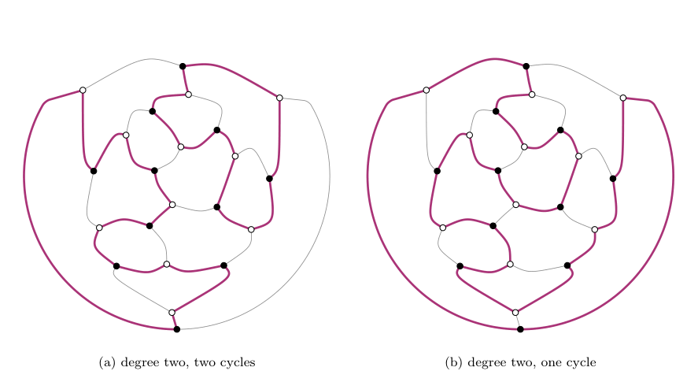
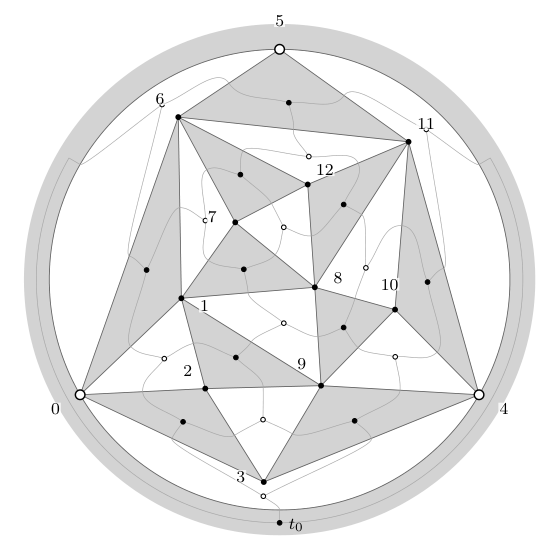
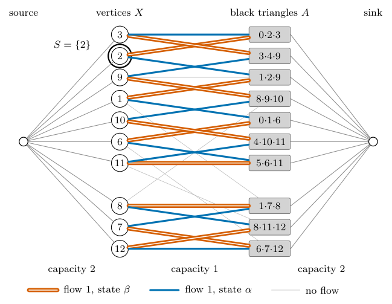
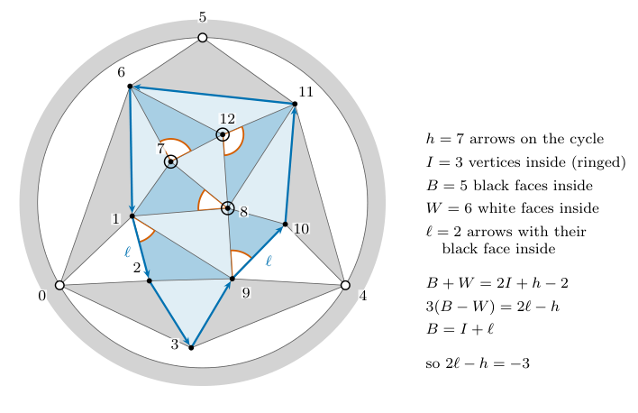
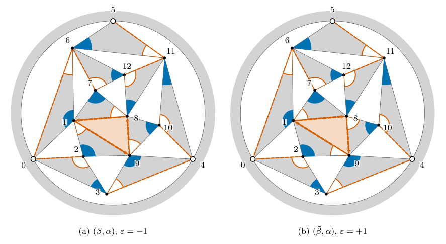
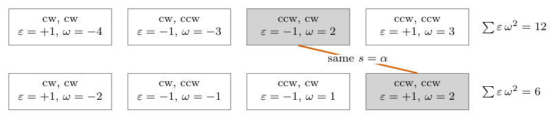
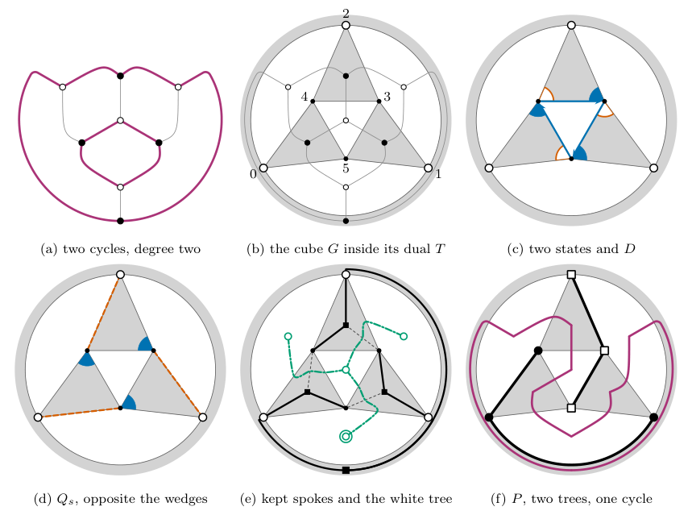
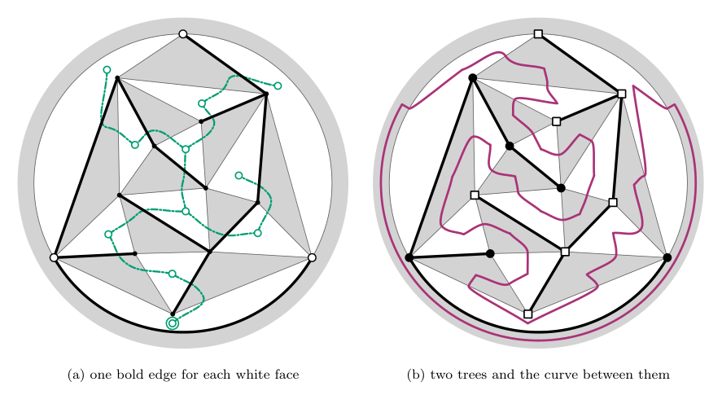
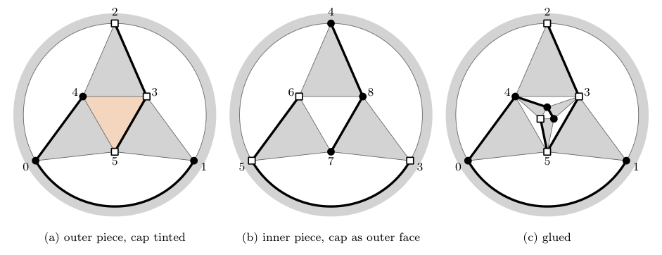

# Citation audit

Snapshot 14 November 2026. `LIT` below means a source-attribution check, including explicitly qualified preprints; it is not proof certification. `COMPUTED` applies only to extraction and link inventory. The sign-free document appeared during this run and is included in the final extraction. Every extracted cite command, with optional arguments intact, appears below. Prose records retain full paragraphs so sentence boundaries inside TeX do not hide qualifiers. Some records overlap deliberately.

The source-level checks are separate from project proof claims. A valid link does not verify a theorem, computation, or review status. Unchecked project reports are classified explicitly rather than promoted to LIT.

## Source-level decisions

### Thomason1978

LIT. verified by opening the source: Author-hosted scan HC.pdf rendered, printed pp. 261-262. Corollary 1.2 gives the odd-degree path parity; Corollary 1.5 gives g(v) = h(e,f) = H modulo 2 for cubic graphs. In a cubic bipartite graph the odd (n-1)-cycles are absent, so cycles avoiding a fixed edge are even. No claim that the total count is even in every cubic graph.

### Expo

LIT. verified by opening the source: Project exposition and existing AUX label map checked. Sign-free references match Lemma 2.5, Proposition 3.9, Lemma 3.8, Lemma 4.2, Proposition 4.8 and Proposition 5.2. Status PROVED-HERE, not published LIT; no new proof audit implied.

### Edmonds1973

LIT. verified from a secondary source: Schrijver Handbook pp. 1674, 1685-1686, opened. Out-branching result becomes the cited in-branching statement by reversing arcs. Publisher Academic Press confirmed in handbook bibliography; original not opened.

### NashWilliams1964

LIT. verified from a secondary source: Schrijver course Exercise 10.29, printed p. 189, opened online; follows from matroid covering Exercise 10.28. Cycle matroids permit parallel edges; loops are excluded in the sign-free statement. Original not opened.

### SchrijverCourse

LIT. verified by opening the source: Author PDF dated 23 March 2017, Exercises 10.26 and 10.29, printed pp. 188-189. Exact optional exercise numbers and statements match.

### SchrijverHandbook

LIT. verified by opening the source: Held publisher scan, Application 5.6 p. 1674 and pp. 1685-1686. Exact optional page numbers match. Distinct from the course notes.

### OpenAI2026

LIT. verified by opening the source: Supplied PDF, Theorem 1.1 p. 1; Proposition 3.1 pp. 3-4; Lemma 4.1 p. 5; Proposition 5.1 and Lemma 5.2 p. 6; Lemma 5.3 p. 7; Section 5.3 pp. 7-8; Section 6 pp. 8-9; Corollaries 7.1 and 7.2 p. 10. Numbered references match. Weights arise from paths in a component dual; the project face-path identification is an additional project argument.

### Li2026

LIT. verified by opening the source: Supplied PDF/arXiv 2610.30490v1. Lemma 9 pp. 3-4; Claim 12 p. 4; Section 4 definitions and one-mark maps pp. 4-8; Claim 25 p. 8; Definition 28 and Lemma 30 in Section 6; Lemmas 34-35 p. 11; Appendix B sketches the generalization; Appendix C pp. 12-13. The project correctly distinguishes its full multi-mark proof from the sketch.

### Anonymous2026

LIT. verified by opening the source: Supplied unsigned PDF, dated 18 October 2026, title page has no author. Theorem 1.1 p. 1 gives enumeration bound; Theorem 1.2 p. 2 gives pair/black-inner obstruction/tree equivalence; Proposition 2.1 gives incidence-tree criterion; Lemma 5.1 integer weights; Theorem 5.3 pp. 10-11 gives the marked walk, with a different runtime. No author or public publication claimed.

### Gorsky2023

LIT. verified by opening the source: Held arXiv 2202.11641v3, Theorem 4.3 p. 7 and Theorem 4.16 pp. 12-13. Equivalence (i) with (v) is exactly the cubic Pfaffian three-edge-path consequence. Use v3 numbering, not an unpinned version. Earlier consolidation page 8 for Theorem 4.3 is inaccurate for this held copy.

### Hertel2005

LIT. verified by opening the source: Held author report, Corollary 3 p. 7 gives universal edge avoidance; Theorem 10 attributes the stronger common-face edge use/avoidance result to Kelmans. Page 5 reports HMM at 64 vertices and Goodey quadrilaterals/hexagons. Historical discussion supports Tutte counterexample.

### Alt2016

LIT. verified by opening the source: Held arXiv 1312.3783v1, Lemma 5 p. 3 gives dual Hamiltonicity, a permeating induced tree, and a partition into two permeating induced trees; Section 5 gives Kelmans equivalences. Published author PDF opened online, reference 3 on printed p. 364 attributes Conjecture 5, proceedings p. 343, to Barnette.

### Stein1971

LIT. verified by opening the source: Held publisher scan, Theorem 2.2, printed p. 218, PDF p. 3, states the region-cycle B-set equivalence. Two-induced-trees wording is supplied by Alt Lemma 5, not quoted as Stein verbatim.

### Brinkmann2022

LIT. verified by opening the source: Held arXiv 2101.00943v2, Theorem 4.1(a) pp. 14-15 gives n <= 90; introduction gives 50-vertex Georges-Kelmans minimality. Article year 2022 differs from preprint year 2021.

### Schnieders2025

LIT. verified by opening the source: Held arXiv 2508.03531v1, Corollary 1.13 p. 2 states the face-size-at-most-eight result. Preprint statement checked; its 339,068,624 cases were not rerun.

### Hine2018

LIT. verified by opening the source: Held arXiv 1808.06091v1, abstract and introduction define triangle-vertex states after deleting a triangle and its vertices, credit Tutte, and state sphere lattice results. Colours are exchanged harmlessly between accounts.

### Tutte1946

LIT. verified from a secondary source: Hertel 2005 historical discussion and Kardos 2020 introduction. Original 1946 full text not obtained; publisher access failed. Bibliographic fields agree with prior Crossref record, DOI 10.1112/jlms/s1-21.2.98.

### Feder2006

LIT. verified by opening the source: Original ECCC TR06-015 scan, first page rendered and read. Abstract confirms that two of three face-colour classes may contain only quadrilaterals and hexagons. Manuscript date is 20 January 2004; report header is 2006. Keep report year 2006. This is not the triangle-parity condition of Bagheri Gh. et al. The readable 2008 author revision is a different version.

### Ford1956

LIT. verified from a secondary source: Integral max-flow form checked through Schrijver course Chapter 4; prior consolidation opened original Ford-Fulkerson pp. 399-404. This pass did not reopen that original.

### Akiyama1980

LIT. verified from a secondary source: Bagheri Gh. et al. 2022 introduction p. 2 explicitly attributes NP-completeness for 2-connected cubic planar bipartite graphs to reference 10. Original unavailable in held corpus.

### georges1989

LIT. verified from a secondary source: Brinkmann-Goedgebeur-McKay introduction identifies Georges and Kelmans independently and establishes minimality. Original Georges article not opened.

### holton-mckay1988

LIT. verified from a secondary source: Kardos 2020 introduction and figure 1 state the 38-vertex minimum. Original Holton-McKay article not opened; metadata retained as supplied pending publisher confirmation.

### OpenAI2026b

LIT. verified by opening the source: Local upstream git rev-parse HEAD returns 4eaee87548250b2682affda7d05d947c05554bae. Formal proof/build status is secondary to research/2026-11-14_astra_lean-check/REPORT.md; no Lean build was rerun in this citation audit.

### Barnette1969

LIT. verified from a secondary source: Published Alt et al. 2016 reference 3, printed p. 364, verifies Barnette, Conjecture 5, p. 343. Original proceedings page not obtained. This resolves the bibliography attribution secondarily, not the exact wording of the original page.

### BagheriGh2021

LIT. verified by opening the source: Held arXiv 1806.05483v3, Theorem 11 p. 22: even interior vertex counts in every triangle of the contracted graph, plus face and separating-digon hypotheses. This is the parity criterion, not Feder-Subi 2006.

### BagheriGh2022

LIT. verified by opening the source: Held arXiv 2212.02668v2, Theorem 4.2 gives restricted face-tree hardness; the proof of Theorem 4.6, p. 12, explicitly states prescribed-edge Hamiltonicity decision hardness. The application must retain its decision-problem scope.

### Kardos2020

LIT. verified by opening the source: Held arXiv 1409.2440v2, Theorem 1: cubic 3-connected planar with face sizes at most six, without bipartiteness. Do not confuse its specialized definition of Barnette graph with the project definition.

### Kenyon2000

LIT. verified by opening the source: Held math/9903025, Theorem 1 p. 5. Weight-preserving bijection requires incident distinguished vertex and face. Otherwise only injection.

### Juhasz2012

LIT. verified by opening the source: Held arXiv 1112.2632, Theorem 1.1 p. 2 identifies sutured Floer support with hypertrees for the associated plane bipartite graph. Does not assert Barnette Hamiltonicity.

### Rado1942

LIT. verified from a secondary source: Schrijver, A Course in Combinatorial Optimization, Exercise 10.26. Independent transversal iff every union of t sets has rank at least t. Original Rado not opened.

### Schrijver2017

LIT. verified by opening the source: Author course PDF, dated 23 March 2017; Exercises 10.26, 10.28 and 10.29. Covers Rado and Nash-Williams via matroid covering. Separate source from Polyhedral combinatorics.

### SchrijverUndated

LIT. verified by opening the source: Held Polyhedral combinatorics, Application 5.6 p. 1674 and p. 1686: Edmonds disjoint branchings. Reverse arcs for in-arborescences. This source does not replace the course citation for Exercises 10.26-10.29.

### Goodey1975

LIT. verified from a secondary source: Hertel 2005 Theorem 2 p. 5; original not obtained.

### Holton1985

LIT. verified from a secondary source: Hertel p. 5 and Bagheri Gh. 2022 p. 2 explicitly give the 64-vertex bound.

### Tutte1975

LIT. verified from a secondary source: Hine-Kalman introduction and bibliography. Original Duality and trinity not opened.

### Kelmans1994

LIT. verified from a secondary source: Hertel Corollary 3/Theorem 10 and Alt Section 5; no direct Kelmans citation remains in main paper. Route-map prose should name this secondary chain.

## Every extracted citation and context

### C1 paper/main/barnette.tex:56

Citation: `\cite[Theorem~1.1 and Corollary~7.1]{OpenAI2026}`.

LIT. `OpenAI2026`: verified by opening the source: Supplied PDF, Theorem 1.1 p. 1; Proposition 3.1 pp. 3-4; Lemma 4.1 p. 5; Proposition 5.1 and Lemma 5.2 p. 6; Lemma 5.3 p. 7; Section 5.3 pp. 7-8; Section 6 pp. 8-9; Corollaries 7.1 and 7.2 p. 10. Numbered references match. Weights arise from paths in a component dual; the project face-path identification is an additional project argument.

```text
\begin{theorem}[OpenAI {\cite[Theorem~1.1 and Corollary~7.1]{OpenAI2026}}]\label{thm:main}
Let $G$ be a finite simple graph that is cubic, bipartite, planar and $3$-connected, and let $e$ be an edge of $G$.
Then $G$ has a Hamiltonian cycle that does not contain $e$.
\end{theorem}
```

### C2 paper/main/barnette.tex:64

Citation: `\cite[Corollary~3]{Hertel2005}`.

LIT. `Hertel2005`: verified by opening the source: Held author report, Corollary 3 p. 7 gives universal edge avoidance; Theorem 10 attributes the stronger common-face edge use/avoidance result to Kelmans. Page 5 reports HMM at 64 vertices and Goodey quadrilaterals/hexagons. Historical discussion supports Tutte counterexample.

```text
Here $3$-connected means that $G$ has at least four vertices and stays connected after deleting any two of them.
Barnette's conjecture is the case without $e$.
The edge $e$ is there for the induction of Section~\ref{sec:glue}, which cuts $G$ into smaller graphs and needs their cycles to agree on the cut.
That the version with $e$ is equivalent to the conjecture goes back to Kelmans, as explained by Hertel \cite[Corollary~3]{Hertel2005} and by Gorsky, Steiner and Wiederrecht \cite[Theorem~4.3]{Gorsky2023}.
```

### C3 paper/main/barnette.tex:64

Citation: `\cite[Theorem~4.3]{Gorsky2023}`.

LIT. `Gorsky2023`: verified by opening the source: Held arXiv 2202.11641v3, Theorem 4.3 p. 7 and Theorem 4.16 pp. 12-13. Equivalence (i) with (v) is exactly the cubic Pfaffian three-edge-path consequence. Use v3 numbering, not an unpinned version. Earlier consolidation page 8 for Theorem 4.3 is inaccurate for this held copy.

```text
Here $3$-connected means that $G$ has at least four vertices and stays connected after deleting any two of them.
Barnette's conjecture is the case without $e$.
The edge $e$ is there for the induction of Section~\ref{sec:glue}, which cuts $G$ into smaller graphs and needs their cycles to agree on the cut.
That the version with $e$ is equivalent to the conjecture goes back to Kelmans, as explained by Hertel \cite[Corollary~3]{Hertel2005} and by Gorsky, Steiner and Wiederrecht \cite[Theorem~4.3]{Gorsky2023}.
```

### C4 paper/main/barnette.tex:103

Citation: `\cite{Hertel2005}`.

LIT. `Hertel2005`: verified by opening the source: Held author report, Corollary 3 p. 7 gives universal edge avoidance; Theorem 10 attributes the stronger common-face edge use/avoidance result to Kelmans. Page 5 reports HMM at 64 vertices and Goodey quadrilaterals/hexagons. Historical discussion supports Tutte counterexample.

```text
\subsection*{History and sources}
We follow Hertel's survey \cite{Hertel2005} for the older history.
Tait conjectured in 1884 that cubic $3$-connected planar graphs are Hamiltonian, and Tutte disproved this in 1946 with a non-bipartite example \cite{Tutte1946}.
Barnette asked whether bipartiteness rescues the statement.
Before 2026 the conjecture was known when all faces have four or six sides \cite{Hertel2005}, under conditions on two of the three face colour classes \cite{Feder2006}, and when all faces have at most eight sides \cite{Schnieders2025}.
Computer checks reached 64 vertices in work of Holton, Manvel and McKay \cite{Hertel2005}, and 90 vertices in work of Brinkmann, Goedgebeur and McKay \cite{Brinkmann2022}.
In a preprint dated 24 September 2026, OpenAI proved Theorem~\ref{thm:main} \cite{OpenAI2026}.
The paired-state argument, disk identity, flow argument and induction are theirs.
States are the corner choices of Tutte's theory of trinity, as explained by Hine and K\'alm\'an \cite{Hine2018}.
The target, two induced trees in $\T$, is Stein's reformulation \cite{Stein1971} in the form of Alt, Payne, Schmidt and Wood \cite[Lemma~5]{Alt2016}.
Two expositions followed, one by Li \cite{Li2026}, who works in $G$, and one in an unsigned manuscript \cite{Anonymous2026}, which adds an exact criterion for the first step and an enumeration algorithm.
Remark~\ref{rem:other-sums} and Section~\ref{sec:remarks} say how these accounts and ours differ.
```

### C5 paper/main/barnette.tex:104

Citation: `\cite{Tutte1946}`.

LIT. `Tutte1946`: verified from a secondary source: Hertel 2005 historical discussion and Kardos 2020 introduction. Original 1946 full text not obtained; publisher access failed. Bibliographic fields agree with prior Crossref record, DOI 10.1112/jlms/s1-21.2.98.

```text
\subsection*{History and sources}
We follow Hertel's survey \cite{Hertel2005} for the older history.
Tait conjectured in 1884 that cubic $3$-connected planar graphs are Hamiltonian, and Tutte disproved this in 1946 with a non-bipartite example \cite{Tutte1946}.
Barnette asked whether bipartiteness rescues the statement.
Before 2026 the conjecture was known when all faces have four or six sides \cite{Hertel2005}, under conditions on two of the three face colour classes \cite{Feder2006}, and when all faces have at most eight sides \cite{Schnieders2025}.
Computer checks reached 64 vertices in work of Holton, Manvel and McKay \cite{Hertel2005}, and 90 vertices in work of Brinkmann, Goedgebeur and McKay \cite{Brinkmann2022}.
In a preprint dated 24 September 2026, OpenAI proved Theorem~\ref{thm:main} \cite{OpenAI2026}.
The paired-state argument, disk identity, flow argument and induction are theirs.
States are the corner choices of Tutte's theory of trinity, as explained by Hine and K\'alm\'an \cite{Hine2018}.
The target, two induced trees in $\T$, is Stein's reformulation \cite{Stein1971} in the form of Alt, Payne, Schmidt and Wood \cite[Lemma~5]{Alt2016}.
Two expositions followed, one by Li \cite{Li2026}, who works in $G$, and one in an unsigned manuscript \cite{Anonymous2026}, which adds an exact criterion for the first step and an enumeration algorithm.
Remark~\ref{rem:other-sums} and Section~\ref{sec:remarks} say how these accounts and ours differ.
```

### C6 paper/main/barnette.tex:106

Citation: `\cite{Hertel2005}`.

LIT. `Hertel2005`: verified by opening the source: Held author report, Corollary 3 p. 7 gives universal edge avoidance; Theorem 10 attributes the stronger common-face edge use/avoidance result to Kelmans. Page 5 reports HMM at 64 vertices and Goodey quadrilaterals/hexagons. Historical discussion supports Tutte counterexample.

```text
\subsection*{History and sources}
We follow Hertel's survey \cite{Hertel2005} for the older history.
Tait conjectured in 1884 that cubic $3$-connected planar graphs are Hamiltonian, and Tutte disproved this in 1946 with a non-bipartite example \cite{Tutte1946}.
Barnette asked whether bipartiteness rescues the statement.
Before 2026 the conjecture was known when all faces have four or six sides \cite{Hertel2005}, under conditions on two of the three face colour classes \cite{Feder2006}, and when all faces have at most eight sides \cite{Schnieders2025}.
Computer checks reached 64 vertices in work of Holton, Manvel and McKay \cite{Hertel2005}, and 90 vertices in work of Brinkmann, Goedgebeur and McKay \cite{Brinkmann2022}.
In a preprint dated 24 September 2026, OpenAI proved Theorem~\ref{thm:main} \cite{OpenAI2026}.
The paired-state argument, disk identity, flow argument and induction are theirs.
States are the corner choices of Tutte's theory of trinity, as explained by Hine and K\'alm\'an \cite{Hine2018}.
The target, two induced trees in $\T$, is Stein's reformulation \cite{Stein1971} in the form of Alt, Payne, Schmidt and Wood \cite[Lemma~5]{Alt2016}.
Two expositions followed, one by Li \cite{Li2026}, who works in $G$, and one in an unsigned manuscript \cite{Anonymous2026}, which adds an exact criterion for the first step and an enumeration algorithm.
Remark~\ref{rem:other-sums} and Section~\ref{sec:remarks} say how these accounts and ours differ.
```

### C7 paper/main/barnette.tex:106

Citation: `\cite{Feder2006}`.

LIT. `Feder2006`: verified by opening the source: Original ECCC TR06-015 scan, first page rendered and read. Abstract confirms that two of three face-colour classes may contain only quadrilaterals and hexagons. Manuscript date is 20 January 2004; report header is 2006. Keep report year 2006. This is not the triangle-parity condition of Bagheri Gh. et al. The readable 2008 author revision is a different version.

```text
\subsection*{History and sources}
We follow Hertel's survey \cite{Hertel2005} for the older history.
Tait conjectured in 1884 that cubic $3$-connected planar graphs are Hamiltonian, and Tutte disproved this in 1946 with a non-bipartite example \cite{Tutte1946}.
Barnette asked whether bipartiteness rescues the statement.
Before 2026 the conjecture was known when all faces have four or six sides \cite{Hertel2005}, under conditions on two of the three face colour classes \cite{Feder2006}, and when all faces have at most eight sides \cite{Schnieders2025}.
Computer checks reached 64 vertices in work of Holton, Manvel and McKay \cite{Hertel2005}, and 90 vertices in work of Brinkmann, Goedgebeur and McKay \cite{Brinkmann2022}.
In a preprint dated 24 September 2026, OpenAI proved Theorem~\ref{thm:main} \cite{OpenAI2026}.
The paired-state argument, disk identity, flow argument and induction are theirs.
States are the corner choices of Tutte's theory of trinity, as explained by Hine and K\'alm\'an \cite{Hine2018}.
The target, two induced trees in $\T$, is Stein's reformulation \cite{Stein1971} in the form of Alt, Payne, Schmidt and Wood \cite[Lemma~5]{Alt2016}.
Two expositions followed, one by Li \cite{Li2026}, who works in $G$, and one in an unsigned manuscript \cite{Anonymous2026}, which adds an exact criterion for the first step and an enumeration algorithm.
Remark~\ref{rem:other-sums} and Section~\ref{sec:remarks} say how these accounts and ours differ.
```

### C8 paper/main/barnette.tex:106

Citation: `\cite{Schnieders2025}`.

LIT. `Schnieders2025`: verified by opening the source: Held arXiv 2508.03531v1, Corollary 1.13 p. 2 states the face-size-at-most-eight result. Preprint statement checked; its 339,068,624 cases were not rerun.

```text
\subsection*{History and sources}
We follow Hertel's survey \cite{Hertel2005} for the older history.
Tait conjectured in 1884 that cubic $3$-connected planar graphs are Hamiltonian, and Tutte disproved this in 1946 with a non-bipartite example \cite{Tutte1946}.
Barnette asked whether bipartiteness rescues the statement.
Before 2026 the conjecture was known when all faces have four or six sides \cite{Hertel2005}, under conditions on two of the three face colour classes \cite{Feder2006}, and when all faces have at most eight sides \cite{Schnieders2025}.
Computer checks reached 64 vertices in work of Holton, Manvel and McKay \cite{Hertel2005}, and 90 vertices in work of Brinkmann, Goedgebeur and McKay \cite{Brinkmann2022}.
In a preprint dated 24 September 2026, OpenAI proved Theorem~\ref{thm:main} \cite{OpenAI2026}.
The paired-state argument, disk identity, flow argument and induction are theirs.
States are the corner choices of Tutte's theory of trinity, as explained by Hine and K\'alm\'an \cite{Hine2018}.
The target, two induced trees in $\T$, is Stein's reformulation \cite{Stein1971} in the form of Alt, Payne, Schmidt and Wood \cite[Lemma~5]{Alt2016}.
Two expositions followed, one by Li \cite{Li2026}, who works in $G$, and one in an unsigned manuscript \cite{Anonymous2026}, which adds an exact criterion for the first step and an enumeration algorithm.
Remark~\ref{rem:other-sums} and Section~\ref{sec:remarks} say how these accounts and ours differ.
```

### C9 paper/main/barnette.tex:107

Citation: `\cite{Hertel2005}`.

LIT. `Hertel2005`: verified by opening the source: Held author report, Corollary 3 p. 7 gives universal edge avoidance; Theorem 10 attributes the stronger common-face edge use/avoidance result to Kelmans. Page 5 reports HMM at 64 vertices and Goodey quadrilaterals/hexagons. Historical discussion supports Tutte counterexample.

```text
\subsection*{History and sources}
We follow Hertel's survey \cite{Hertel2005} for the older history.
Tait conjectured in 1884 that cubic $3$-connected planar graphs are Hamiltonian, and Tutte disproved this in 1946 with a non-bipartite example \cite{Tutte1946}.
Barnette asked whether bipartiteness rescues the statement.
Before 2026 the conjecture was known when all faces have four or six sides \cite{Hertel2005}, under conditions on two of the three face colour classes \cite{Feder2006}, and when all faces have at most eight sides \cite{Schnieders2025}.
Computer checks reached 64 vertices in work of Holton, Manvel and McKay \cite{Hertel2005}, and 90 vertices in work of Brinkmann, Goedgebeur and McKay \cite{Brinkmann2022}.
In a preprint dated 24 September 2026, OpenAI proved Theorem~\ref{thm:main} \cite{OpenAI2026}.
The paired-state argument, disk identity, flow argument and induction are theirs.
States are the corner choices of Tutte's theory of trinity, as explained by Hine and K\'alm\'an \cite{Hine2018}.
The target, two induced trees in $\T$, is Stein's reformulation \cite{Stein1971} in the form of Alt, Payne, Schmidt and Wood \cite[Lemma~5]{Alt2016}.
Two expositions followed, one by Li \cite{Li2026}, who works in $G$, and one in an unsigned manuscript \cite{Anonymous2026}, which adds an exact criterion for the first step and an enumeration algorithm.
Remark~\ref{rem:other-sums} and Section~\ref{sec:remarks} say how these accounts and ours differ.
```

### C10 paper/main/barnette.tex:107

Citation: `\cite{Brinkmann2022}`.

LIT. `Brinkmann2022`: verified by opening the source: Held arXiv 2101.00943v2, Theorem 4.1(a) pp. 14-15 gives n <= 90; introduction gives 50-vertex Georges-Kelmans minimality. Article year 2022 differs from preprint year 2021.

```text
\subsection*{History and sources}
We follow Hertel's survey \cite{Hertel2005} for the older history.
Tait conjectured in 1884 that cubic $3$-connected planar graphs are Hamiltonian, and Tutte disproved this in 1946 with a non-bipartite example \cite{Tutte1946}.
Barnette asked whether bipartiteness rescues the statement.
Before 2026 the conjecture was known when all faces have four or six sides \cite{Hertel2005}, under conditions on two of the three face colour classes \cite{Feder2006}, and when all faces have at most eight sides \cite{Schnieders2025}.
Computer checks reached 64 vertices in work of Holton, Manvel and McKay \cite{Hertel2005}, and 90 vertices in work of Brinkmann, Goedgebeur and McKay \cite{Brinkmann2022}.
In a preprint dated 24 September 2026, OpenAI proved Theorem~\ref{thm:main} \cite{OpenAI2026}.
The paired-state argument, disk identity, flow argument and induction are theirs.
States are the corner choices of Tutte's theory of trinity, as explained by Hine and K\'alm\'an \cite{Hine2018}.
The target, two induced trees in $\T$, is Stein's reformulation \cite{Stein1971} in the form of Alt, Payne, Schmidt and Wood \cite[Lemma~5]{Alt2016}.
Two expositions followed, one by Li \cite{Li2026}, who works in $G$, and one in an unsigned manuscript \cite{Anonymous2026}, which adds an exact criterion for the first step and an enumeration algorithm.
Remark~\ref{rem:other-sums} and Section~\ref{sec:remarks} say how these accounts and ours differ.
```

### C11 paper/main/barnette.tex:108

Citation: `\cite{OpenAI2026}`.

LIT. `OpenAI2026`: verified by opening the source: Supplied PDF, Theorem 1.1 p. 1; Proposition 3.1 pp. 3-4; Lemma 4.1 p. 5; Proposition 5.1 and Lemma 5.2 p. 6; Lemma 5.3 p. 7; Section 5.3 pp. 7-8; Section 6 pp. 8-9; Corollaries 7.1 and 7.2 p. 10. Numbered references match. Weights arise from paths in a component dual; the project face-path identification is an additional project argument.

```text
\subsection*{History and sources}
We follow Hertel's survey \cite{Hertel2005} for the older history.
Tait conjectured in 1884 that cubic $3$-connected planar graphs are Hamiltonian, and Tutte disproved this in 1946 with a non-bipartite example \cite{Tutte1946}.
Barnette asked whether bipartiteness rescues the statement.
Before 2026 the conjecture was known when all faces have four or six sides \cite{Hertel2005}, under conditions on two of the three face colour classes \cite{Feder2006}, and when all faces have at most eight sides \cite{Schnieders2025}.
Computer checks reached 64 vertices in work of Holton, Manvel and McKay \cite{Hertel2005}, and 90 vertices in work of Brinkmann, Goedgebeur and McKay \cite{Brinkmann2022}.
In a preprint dated 24 September 2026, OpenAI proved Theorem~\ref{thm:main} \cite{OpenAI2026}.
The paired-state argument, disk identity, flow argument and induction are theirs.
States are the corner choices of Tutte's theory of trinity, as explained by Hine and K\'alm\'an \cite{Hine2018}.
The target, two induced trees in $\T$, is Stein's reformulation \cite{Stein1971} in the form of Alt, Payne, Schmidt and Wood \cite[Lemma~5]{Alt2016}.
Two expositions followed, one by Li \cite{Li2026}, who works in $G$, and one in an unsigned manuscript \cite{Anonymous2026}, which adds an exact criterion for the first step and an enumeration algorithm.
Remark~\ref{rem:other-sums} and Section~\ref{sec:remarks} say how these accounts and ours differ.
```

### C12 paper/main/barnette.tex:110

Citation: `\cite{Hine2018}`.

LIT. `Hine2018`: verified by opening the source: Held arXiv 1808.06091v1, abstract and introduction define triangle-vertex states after deleting a triangle and its vertices, credit Tutte, and state sphere lattice results. Colours are exchanged harmlessly between accounts.

```text
\subsection*{History and sources}
We follow Hertel's survey \cite{Hertel2005} for the older history.
Tait conjectured in 1884 that cubic $3$-connected planar graphs are Hamiltonian, and Tutte disproved this in 1946 with a non-bipartite example \cite{Tutte1946}.
Barnette asked whether bipartiteness rescues the statement.
Before 2026 the conjecture was known when all faces have four or six sides \cite{Hertel2005}, under conditions on two of the three face colour classes \cite{Feder2006}, and when all faces have at most eight sides \cite{Schnieders2025}.
Computer checks reached 64 vertices in work of Holton, Manvel and McKay \cite{Hertel2005}, and 90 vertices in work of Brinkmann, Goedgebeur and McKay \cite{Brinkmann2022}.
In a preprint dated 24 September 2026, OpenAI proved Theorem~\ref{thm:main} \cite{OpenAI2026}.
The paired-state argument, disk identity, flow argument and induction are theirs.
States are the corner choices of Tutte's theory of trinity, as explained by Hine and K\'alm\'an \cite{Hine2018}.
The target, two induced trees in $\T$, is Stein's reformulation \cite{Stein1971} in the form of Alt, Payne, Schmidt and Wood \cite[Lemma~5]{Alt2016}.
Two expositions followed, one by Li \cite{Li2026}, who works in $G$, and one in an unsigned manuscript \cite{Anonymous2026}, which adds an exact criterion for the first step and an enumeration algorithm.
Remark~\ref{rem:other-sums} and Section~\ref{sec:remarks} say how these accounts and ours differ.
```

### C13 paper/main/barnette.tex:111

Citation: `\cite{Stein1971}`.

LIT. `Stein1971`: verified by opening the source: Held publisher scan, Theorem 2.2, printed p. 218, PDF p. 3, states the region-cycle B-set equivalence. Two-induced-trees wording is supplied by Alt Lemma 5, not quoted as Stein verbatim.

```text
\subsection*{History and sources}
We follow Hertel's survey \cite{Hertel2005} for the older history.
Tait conjectured in 1884 that cubic $3$-connected planar graphs are Hamiltonian, and Tutte disproved this in 1946 with a non-bipartite example \cite{Tutte1946}.
Barnette asked whether bipartiteness rescues the statement.
Before 2026 the conjecture was known when all faces have four or six sides \cite{Hertel2005}, under conditions on two of the three face colour classes \cite{Feder2006}, and when all faces have at most eight sides \cite{Schnieders2025}.
Computer checks reached 64 vertices in work of Holton, Manvel and McKay \cite{Hertel2005}, and 90 vertices in work of Brinkmann, Goedgebeur and McKay \cite{Brinkmann2022}.
In a preprint dated 24 September 2026, OpenAI proved Theorem~\ref{thm:main} \cite{OpenAI2026}.
The paired-state argument, disk identity, flow argument and induction are theirs.
States are the corner choices of Tutte's theory of trinity, as explained by Hine and K\'alm\'an \cite{Hine2018}.
The target, two induced trees in $\T$, is Stein's reformulation \cite{Stein1971} in the form of Alt, Payne, Schmidt and Wood \cite[Lemma~5]{Alt2016}.
Two expositions followed, one by Li \cite{Li2026}, who works in $G$, and one in an unsigned manuscript \cite{Anonymous2026}, which adds an exact criterion for the first step and an enumeration algorithm.
Remark~\ref{rem:other-sums} and Section~\ref{sec:remarks} say how these accounts and ours differ.
```

### C14 paper/main/barnette.tex:111

Citation: `\cite[Lemma~5]{Alt2016}`.

LIT. `Alt2016`: verified by opening the source: Held arXiv 1312.3783v1, Lemma 5 p. 3 gives dual Hamiltonicity, a permeating induced tree, and a partition into two permeating induced trees; Section 5 gives Kelmans equivalences. Published author PDF opened online, reference 3 on printed p. 364 attributes Conjecture 5, proceedings p. 343, to Barnette.

```text
\subsection*{History and sources}
We follow Hertel's survey \cite{Hertel2005} for the older history.
Tait conjectured in 1884 that cubic $3$-connected planar graphs are Hamiltonian, and Tutte disproved this in 1946 with a non-bipartite example \cite{Tutte1946}.
Barnette asked whether bipartiteness rescues the statement.
Before 2026 the conjecture was known when all faces have four or six sides \cite{Hertel2005}, under conditions on two of the three face colour classes \cite{Feder2006}, and when all faces have at most eight sides \cite{Schnieders2025}.
Computer checks reached 64 vertices in work of Holton, Manvel and McKay \cite{Hertel2005}, and 90 vertices in work of Brinkmann, Goedgebeur and McKay \cite{Brinkmann2022}.
In a preprint dated 24 September 2026, OpenAI proved Theorem~\ref{thm:main} \cite{OpenAI2026}.
The paired-state argument, disk identity, flow argument and induction are theirs.
States are the corner choices of Tutte's theory of trinity, as explained by Hine and K\'alm\'an \cite{Hine2018}.
The target, two induced trees in $\T$, is Stein's reformulation \cite{Stein1971} in the form of Alt, Payne, Schmidt and Wood \cite[Lemma~5]{Alt2016}.
Two expositions followed, one by Li \cite{Li2026}, who works in $G$, and one in an unsigned manuscript \cite{Anonymous2026}, which adds an exact criterion for the first step and an enumeration algorithm.
Remark~\ref{rem:other-sums} and Section~\ref{sec:remarks} say how these accounts and ours differ.
```

### C15 paper/main/barnette.tex:112

Citation: `\cite{Li2026}`.

LIT. `Li2026`: verified by opening the source: Supplied PDF/arXiv 2610.30490v1. Lemma 9 pp. 3-4; Claim 12 p. 4; Section 4 definitions and one-mark maps pp. 4-8; Claim 25 p. 8; Definition 28 and Lemma 30 in Section 6; Lemmas 34-35 p. 11; Appendix B sketches the generalization; Appendix C pp. 12-13. The project correctly distinguishes its full multi-mark proof from the sketch.

```text
\subsection*{History and sources}
We follow Hertel's survey \cite{Hertel2005} for the older history.
Tait conjectured in 1884 that cubic $3$-connected planar graphs are Hamiltonian, and Tutte disproved this in 1946 with a non-bipartite example \cite{Tutte1946}.
Barnette asked whether bipartiteness rescues the statement.
Before 2026 the conjecture was known when all faces have four or six sides \cite{Hertel2005}, under conditions on two of the three face colour classes \cite{Feder2006}, and when all faces have at most eight sides \cite{Schnieders2025}.
Computer checks reached 64 vertices in work of Holton, Manvel and McKay \cite{Hertel2005}, and 90 vertices in work of Brinkmann, Goedgebeur and McKay \cite{Brinkmann2022}.
In a preprint dated 24 September 2026, OpenAI proved Theorem~\ref{thm:main} \cite{OpenAI2026}.
The paired-state argument, disk identity, flow argument and induction are theirs.
States are the corner choices of Tutte's theory of trinity, as explained by Hine and K\'alm\'an \cite{Hine2018}.
The target, two induced trees in $\T$, is Stein's reformulation \cite{Stein1971} in the form of Alt, Payne, Schmidt and Wood \cite[Lemma~5]{Alt2016}.
Two expositions followed, one by Li \cite{Li2026}, who works in $G$, and one in an unsigned manuscript \cite{Anonymous2026}, which adds an exact criterion for the first step and an enumeration algorithm.
Remark~\ref{rem:other-sums} and Section~\ref{sec:remarks} say how these accounts and ours differ.
```

### C16 paper/main/barnette.tex:112

Citation: `\cite{Anonymous2026}`.

LIT. `Anonymous2026`: verified by opening the source: Supplied unsigned PDF, dated 18 October 2026, title page has no author. Theorem 1.1 p. 1 gives enumeration bound; Theorem 1.2 p. 2 gives pair/black-inner obstruction/tree equivalence; Proposition 2.1 gives incidence-tree criterion; Lemma 5.1 integer weights; Theorem 5.3 pp. 10-11 gives the marked walk, with a different runtime. No author or public publication claimed.

```text
\subsection*{History and sources}
We follow Hertel's survey \cite{Hertel2005} for the older history.
Tait conjectured in 1884 that cubic $3$-connected planar graphs are Hamiltonian, and Tutte disproved this in 1946 with a non-bipartite example \cite{Tutte1946}.
Barnette asked whether bipartiteness rescues the statement.
Before 2026 the conjecture was known when all faces have four or six sides \cite{Hertel2005}, under conditions on two of the three face colour classes \cite{Feder2006}, and when all faces have at most eight sides \cite{Schnieders2025}.
Computer checks reached 64 vertices in work of Holton, Manvel and McKay \cite{Hertel2005}, and 90 vertices in work of Brinkmann, Goedgebeur and McKay \cite{Brinkmann2022}.
In a preprint dated 24 September 2026, OpenAI proved Theorem~\ref{thm:main} \cite{OpenAI2026}.
The paired-state argument, disk identity, flow argument and induction are theirs.
States are the corner choices of Tutte's theory of trinity, as explained by Hine and K\'alm\'an \cite{Hine2018}.
The target, two induced trees in $\T$, is Stein's reformulation \cite{Stein1971} in the form of Alt, Payne, Schmidt and Wood \cite[Lemma~5]{Alt2016}.
Two expositions followed, one by Li \cite{Li2026}, who works in $G$, and one in an unsigned manuscript \cite{Anonymous2026}, which adds an exact criterion for the first step and an enumeration algorithm.
Remark~\ref{rem:other-sums} and Section~\ref{sec:remarks} say how these accounts and ours differ.
```

### C17 paper/main/barnette.tex:242

Citation: `\cite{Stein1971,Alt2016}`.

LIT. `Stein1971`: verified by opening the source: Held publisher scan, Theorem 2.2, printed p. 218, PDF p. 3, states the region-cycle B-set equivalence. Two-induced-trees wording is supplied by Alt Lemma 5, not quoted as Stein verbatim.

LIT. `Alt2016`: verified by opening the source: Held arXiv 1312.3783v1, Lemma 5 p. 3 gives dual Hamiltonicity, a permeating induced tree, and a partition into two permeating induced trees; Section 5 gives Kelmans equivalences. Published author PDF opened online, reference 3 on printed p. 364 attributes Conjecture 5, proceedings p. 343, to Barnette.

```text
Part (1) shows that the two conditions on the target do different jobs: one side per face gives degree two, and acyclicity gives connectivity.
Part (2) is the two-induced-trees form \cite{Stein1971,Alt2016}, and we use it in Lemma~\ref{lem:selections-give-states} and in the gluing.
An acyclic selection containing an edge $e_0$ of $\T$ gives a Hamiltonian cycle of $G$ that avoids the edge crossing $e_0$, so Theorem~\ref{thm:main} asks for an acyclic selection containing a prescribed edge.
```

### C18 paper/main/barnette.tex:338

Citation: `\cite{Anonymous2026}`.

LIT. `Anonymous2026`: verified by opening the source: Supplied unsigned PDF, dated 18 October 2026, title page has no author. Theorem 1.1 p. 1 gives enumeration bound; Theorem 1.2 p. 2 gives pair/black-inner obstruction/tree equivalence; Proposition 2.1 gives incidence-tree criterion; Lemma 5.1 integer weights; Theorem 5.3 pp. 10-11 gives the marked walk, with a different runtime. No author or public publication claimed.

```text
The unsigned manuscript \cite{Anonymous2026} calls a good state a \emph{tree matching}.
```

### C19 paper/main/barnette.tex:846

Citation: `\cite{Anonymous2026}`.

LIT. `Anonymous2026`: verified by opening the source: Supplied unsigned PDF, dated 18 October 2026, title page has no author. Theorem 1.1 p. 1 gives enumeration bound; Theorem 1.2 p. 2 gives pair/black-inner obstruction/tree equivalence; Proposition 2.1 gives incidence-tree criterion; Lemma 5.1 integer weights; Theorem 5.3 pp. 10-11 gives the marked walk, with a different runtime. No author or public publication claimed.

```text
\begin{remark}\label{rem:other-sums}
OpenAI test the signed count against $\exp(x\,\omega(s))$ with the phase $i^{J}$, where $J=\frac13\sum_t\delta(r(t),s(t))$, and read off the Taylor coefficient of order $m$.
Since $i^{J}=i^{-n}\eps$, that coefficient is $i^{-n}\Sigma/m!$.
The unsigned manuscript \cite{Anonymous2026} uses nonnegative integer incidence weights to obtain an integer polynomial of this form.
For our signed heights, $\sum\eps(r,s)z^{\omega(s)}$ is an integer Laurent polynomial.
Its expansion at $z=1$ has coefficient $\sum\eps(r,s)\binom{\omega(s)}{m}=\Sigma/m!$ in degree $m$, where the binomial coefficient has its usual polynomial meaning also for negative integers $\omega(s)$. The lower moments vanish by Lemma~\ref{lem:difference}.
Li \cite{Li2026} marks $m$ distinct crossings, which gives a symmetric function of degree $m$ in the crossing signs in place of the power.
These nonvanishing arguments do not by themselves give an efficient construction.
\end{remark}
```

### C20 paper/main/barnette.tex:849

Citation: `\cite{Li2026}`.

LIT. `Li2026`: verified by opening the source: Supplied PDF/arXiv 2610.30490v1. Lemma 9 pp. 3-4; Claim 12 p. 4; Section 4 definitions and one-mark maps pp. 4-8; Claim 25 p. 8; Definition 28 and Lemma 30 in Section 6; Lemmas 34-35 p. 11; Appendix B sketches the generalization; Appendix C pp. 12-13. The project correctly distinguishes its full multi-mark proof from the sketch.

```text
\begin{remark}\label{rem:other-sums}
OpenAI test the signed count against $\exp(x\,\omega(s))$ with the phase $i^{J}$, where $J=\frac13\sum_t\delta(r(t),s(t))$, and read off the Taylor coefficient of order $m$.
Since $i^{J}=i^{-n}\eps$, that coefficient is $i^{-n}\Sigma/m!$.
The unsigned manuscript \cite{Anonymous2026} uses nonnegative integer incidence weights to obtain an integer polynomial of this form.
For our signed heights, $\sum\eps(r,s)z^{\omega(s)}$ is an integer Laurent polynomial.
Its expansion at $z=1$ has coefficient $\sum\eps(r,s)\binom{\omega(s)}{m}=\Sigma/m!$ in degree $m$, where the binomial coefficient has its usual polynomial meaning also for negative integers $\omega(s)$. The lower moments vanish by Lemma~\ref{lem:difference}.
Li \cite{Li2026} marks $m$ distinct crossings, which gives a symmetric function of degree $m$ in the crossing signs in place of the power.
These nonvanishing arguments do not by themselves give an efficient construction.
\end{remark}
```

### C21 paper/main/barnette.tex:864

Citation: `\cite{Ford1956}`.

LIT. `Ford1956`: verified from a secondary source: Integral max-flow form checked through Schrijver course Chapter 4; prior consolidation opened original Ford-Fulkerson pp. 399-404. This pass did not reopen that original.

```text
Give the edges of a network capacity $2$ from a source to each $x\in X$, capacity $1$ from $x$ to each face $t\in A$ with corner $x$, and capacity $2$ from each $t\in A$ to a sink.
An integral flow of value $2n$ saturates every source and sink edge, and the incidences that carry flow form the required subgraph.
A cut with $S\subseteq X$ on the source side and the best placement of each $t$ has capacity $2(n-|S|)+\sum_{t\in A}\min\bigl(2,|V(t)\cap S|\bigr)$, where $V(t)$ is the set of corners of $t$.
By the integral max-flow min-cut theorem \cite{Ford1956}, a pair exists if
\begin{equation}\label{eq:hall}
\sum_{t\in A}\min\bigl(2,|V(t)\cap S|\bigr)\ \ge\ 2|S|\qquad\text{for all } S\subseteq X .
\end{equation}
```

### C22 paper/main/barnette.tex:982

Citation: `\cite[Appendix~C]{Li2026}`.

LIT. `Li2026`: verified by opening the source: Supplied PDF/arXiv 2610.30490v1. Lemma 9 pp. 3-4; Claim 12 p. 4; Section 4 definitions and one-mark maps pp. 4-8; Claim 25 p. 8; Definition 28 and Lemma 30 in Section 6; Lemmas 34-35 p. 11; Appendix B sketches the generalization; Appendix C pp. 12-13. The project correctly distinguishes its full multi-mark proof from the sketch.

```text
The prescribed edge is what makes the gluing work: $P_2$ must use the same side of $\Delta$ as $P_1$, and an arbitrary acyclic selection of $\T_2$ need not.
Read in $G$, $\Delta$ is a cut of three edges, each piece is $G$ with one side of the cut contracted to a vertex, and the gluing joins two Hamiltonian cycles that use the same two cut edges. This is the form of the argument in \cite[Appendix~C]{Li2026}.
That it suffices to treat graphs without such cuts goes back to Kelmans; see \cite[Section~5]{Alt2016}.
```

### C23 paper/main/barnette.tex:983

Citation: `\cite[Section~5]{Alt2016}`.

LIT. `Alt2016`: verified by opening the source: Held arXiv 1312.3783v1, Lemma 5 p. 3 gives dual Hamiltonicity, a permeating induced tree, and a partition into two permeating induced trees; Section 5 gives Kelmans equivalences. Published author PDF opened online, reference 3 on printed p. 364 attributes Conjecture 5, proceedings p. 343, to Barnette.

```text
The prescribed edge is what makes the gluing work: $P_2$ must use the same side of $\Delta$ as $P_1$, and an arbitrary acyclic selection of $\T_2$ need not.
Read in $G$, $\Delta$ is a cut of three edges, each piece is $G$ with one side of the cut contracted to a vertex, and the gluing joins two Hamiltonian cycles that use the same two cut edges. This is the form of the argument in \cite[Appendix~C]{Li2026}.
That it suffices to treat graphs without such cuts goes back to Kelmans; see \cite[Section~5]{Alt2016}.
```

### C24 paper/main/barnette.tex:995

Citation: `\cite{OpenAI2026}`.

LIT. `OpenAI2026`: verified by opening the source: Supplied PDF, Theorem 1.1 p. 1; Proposition 3.1 pp. 3-4; Lemma 4.1 p. 5; Proposition 5.1 and Lemma 5.2 p. 6; Lemma 5.3 p. 7; Section 5.3 pp. 7-8; Section 6 pp. 8-9; Corollaries 7.1 and 7.2 p. 10. Numbered references match. Weights arise from paths in a component dual; the project face-path identification is an additional project argument.

```text
\subsection*{How this account differs from the sources}
The proof is that of \cite{OpenAI2026}, and its presentation here differs in four places.
The disk identity is stated as ``one more white face than black'', Lemma~\ref{lem:connected} makes Euler's formula applicable to the inside of a cycle, and Proposition~\ref{prop:recover} reads the acyclicity of the selection off that statement.
The sign of a pair is real, as in \cite{Anonymous2026}, and is written as a product of local signs.
The weights are heights read along paths of faces.
They are the weights that OpenAI construct in the proof of \cite[Lemma~5.3]{OpenAI2026} for one choice of their circulations, and they are Li's counts of crossings between half-rays and matching edges \cite[Section~4]{Li2026} taken along fixed paths.
This choice removes the spokes and the sliding argument of \cite[Section~5.3]{OpenAI2026}, and the finite difference of Lemma~\ref{lem:difference} replaces the exponential sum.
The tree of faces $Y_s$ is obtained from the opposite sides by planar duality in $\T$; in $G$ it is Li's black dual trace \cite[Section~6]{Li2026} with one extra leaf.
```

### C25 paper/main/barnette.tex:997

Citation: `\cite{Anonymous2026}`.

LIT. `Anonymous2026`: verified by opening the source: Supplied unsigned PDF, dated 18 October 2026, title page has no author. Theorem 1.1 p. 1 gives enumeration bound; Theorem 1.2 p. 2 gives pair/black-inner obstruction/tree equivalence; Proposition 2.1 gives incidence-tree criterion; Lemma 5.1 integer weights; Theorem 5.3 pp. 10-11 gives the marked walk, with a different runtime. No author or public publication claimed.

```text
\subsection*{How this account differs from the sources}
The proof is that of \cite{OpenAI2026}, and its presentation here differs in four places.
The disk identity is stated as ``one more white face than black'', Lemma~\ref{lem:connected} makes Euler's formula applicable to the inside of a cycle, and Proposition~\ref{prop:recover} reads the acyclicity of the selection off that statement.
The sign of a pair is real, as in \cite{Anonymous2026}, and is written as a product of local signs.
The weights are heights read along paths of faces.
They are the weights that OpenAI construct in the proof of \cite[Lemma~5.3]{OpenAI2026} for one choice of their circulations, and they are Li's counts of crossings between half-rays and matching edges \cite[Section~4]{Li2026} taken along fixed paths.
This choice removes the spokes and the sliding argument of \cite[Section~5.3]{OpenAI2026}, and the finite difference of Lemma~\ref{lem:difference} replaces the exponential sum.
The tree of faces $Y_s$ is obtained from the opposite sides by planar duality in $\T$; in $G$ it is Li's black dual trace \cite[Section~6]{Li2026} with one extra leaf.
```

### C26 paper/main/barnette.tex:999

Citation: `\cite[Lemma~5.3]{OpenAI2026}`.

LIT. `OpenAI2026`: verified by opening the source: Supplied PDF, Theorem 1.1 p. 1; Proposition 3.1 pp. 3-4; Lemma 4.1 p. 5; Proposition 5.1 and Lemma 5.2 p. 6; Lemma 5.3 p. 7; Section 5.3 pp. 7-8; Section 6 pp. 8-9; Corollaries 7.1 and 7.2 p. 10. Numbered references match. Weights arise from paths in a component dual; the project face-path identification is an additional project argument.

```text
\subsection*{How this account differs from the sources}
The proof is that of \cite{OpenAI2026}, and its presentation here differs in four places.
The disk identity is stated as ``one more white face than black'', Lemma~\ref{lem:connected} makes Euler's formula applicable to the inside of a cycle, and Proposition~\ref{prop:recover} reads the acyclicity of the selection off that statement.
The sign of a pair is real, as in \cite{Anonymous2026}, and is written as a product of local signs.
The weights are heights read along paths of faces.
They are the weights that OpenAI construct in the proof of \cite[Lemma~5.3]{OpenAI2026} for one choice of their circulations, and they are Li's counts of crossings between half-rays and matching edges \cite[Section~4]{Li2026} taken along fixed paths.
This choice removes the spokes and the sliding argument of \cite[Section~5.3]{OpenAI2026}, and the finite difference of Lemma~\ref{lem:difference} replaces the exponential sum.
The tree of faces $Y_s$ is obtained from the opposite sides by planar duality in $\T$; in $G$ it is Li's black dual trace \cite[Section~6]{Li2026} with one extra leaf.
```

### C27 paper/main/barnette.tex:999

Citation: `\cite[Section~4]{Li2026}`.

LIT. `Li2026`: verified by opening the source: Supplied PDF/arXiv 2610.30490v1. Lemma 9 pp. 3-4; Claim 12 p. 4; Section 4 definitions and one-mark maps pp. 4-8; Claim 25 p. 8; Definition 28 and Lemma 30 in Section 6; Lemmas 34-35 p. 11; Appendix B sketches the generalization; Appendix C pp. 12-13. The project correctly distinguishes its full multi-mark proof from the sketch.

```text
\subsection*{How this account differs from the sources}
The proof is that of \cite{OpenAI2026}, and its presentation here differs in four places.
The disk identity is stated as ``one more white face than black'', Lemma~\ref{lem:connected} makes Euler's formula applicable to the inside of a cycle, and Proposition~\ref{prop:recover} reads the acyclicity of the selection off that statement.
The sign of a pair is real, as in \cite{Anonymous2026}, and is written as a product of local signs.
The weights are heights read along paths of faces.
They are the weights that OpenAI construct in the proof of \cite[Lemma~5.3]{OpenAI2026} for one choice of their circulations, and they are Li's counts of crossings between half-rays and matching edges \cite[Section~4]{Li2026} taken along fixed paths.
This choice removes the spokes and the sliding argument of \cite[Section~5.3]{OpenAI2026}, and the finite difference of Lemma~\ref{lem:difference} replaces the exponential sum.
The tree of faces $Y_s$ is obtained from the opposite sides by planar duality in $\T$; in $G$ it is Li's black dual trace \cite[Section~6]{Li2026} with one extra leaf.
```

### C28 paper/main/barnette.tex:1000

Citation: `\cite[Section~5.3]{OpenAI2026}`.

LIT. `OpenAI2026`: verified by opening the source: Supplied PDF, Theorem 1.1 p. 1; Proposition 3.1 pp. 3-4; Lemma 4.1 p. 5; Proposition 5.1 and Lemma 5.2 p. 6; Lemma 5.3 p. 7; Section 5.3 pp. 7-8; Section 6 pp. 8-9; Corollaries 7.1 and 7.2 p. 10. Numbered references match. Weights arise from paths in a component dual; the project face-path identification is an additional project argument.

```text
\subsection*{How this account differs from the sources}
The proof is that of \cite{OpenAI2026}, and its presentation here differs in four places.
The disk identity is stated as ``one more white face than black'', Lemma~\ref{lem:connected} makes Euler's formula applicable to the inside of a cycle, and Proposition~\ref{prop:recover} reads the acyclicity of the selection off that statement.
The sign of a pair is real, as in \cite{Anonymous2026}, and is written as a product of local signs.
The weights are heights read along paths of faces.
They are the weights that OpenAI construct in the proof of \cite[Lemma~5.3]{OpenAI2026} for one choice of their circulations, and they are Li's counts of crossings between half-rays and matching edges \cite[Section~4]{Li2026} taken along fixed paths.
This choice removes the spokes and the sliding argument of \cite[Section~5.3]{OpenAI2026}, and the finite difference of Lemma~\ref{lem:difference} replaces the exponential sum.
The tree of faces $Y_s$ is obtained from the opposite sides by planar duality in $\T$; in $G$ it is Li's black dual trace \cite[Section~6]{Li2026} with one extra leaf.
```

### C29 paper/main/barnette.tex:1001

Citation: `\cite[Section~6]{Li2026}`.

LIT. `Li2026`: verified by opening the source: Supplied PDF/arXiv 2610.30490v1. Lemma 9 pp. 3-4; Claim 12 p. 4; Section 4 definitions and one-mark maps pp. 4-8; Claim 25 p. 8; Definition 28 and Lemma 30 in Section 6; Lemmas 34-35 p. 11; Appendix B sketches the generalization; Appendix C pp. 12-13. The project correctly distinguishes its full multi-mark proof from the sketch.

```text
\subsection*{How this account differs from the sources}
The proof is that of \cite{OpenAI2026}, and its presentation here differs in four places.
The disk identity is stated as ``one more white face than black'', Lemma~\ref{lem:connected} makes Euler's formula applicable to the inside of a cycle, and Proposition~\ref{prop:recover} reads the acyclicity of the selection off that statement.
The sign of a pair is real, as in \cite{Anonymous2026}, and is written as a product of local signs.
The weights are heights read along paths of faces.
They are the weights that OpenAI construct in the proof of \cite[Lemma~5.3]{OpenAI2026} for one choice of their circulations, and they are Li's counts of crossings between half-rays and matching edges \cite[Section~4]{Li2026} taken along fixed paths.
This choice removes the spokes and the sliding argument of \cite[Section~5.3]{OpenAI2026}, and the finite difference of Lemma~\ref{lem:difference} replaces the exponential sum.
The tree of faces $Y_s$ is obtained from the opposite sides by planar duality in $\T$; in $G$ it is Li's black dual trace \cite[Section~6]{Li2026} with one extra leaf.
```

### C30 paper/main/barnette.tex:1017

Citation: `\cite{Tutte1946}`.

LIT. `Tutte1946`: verified from a secondary source: Hertel 2005 historical discussion and Kardos 2020 introduction. Original 1946 full text not obtained; publisher access failed. Bibliographic fields agree with prior Crossref record, DOI 10.1112/jlms/s1-21.2.98.

```text
\subsection*{Why each hypothesis is needed}
\emph{Bipartite.} The colouring of the faces of $\T$ is the bipartition of $G$. It gives every edge one black face, which makes $Q_s$ and $D(r,s)$ consist of distinct edges and gives $|A|=|X|$.
Tutte's $46$-vertex graph \cite{Tutte1946} is cubic, planar and $3$-connected but not Hamiltonian. The smallest such graphs have $38$ vertices \cite{holton-mckay1988}.
```

### C31 paper/main/barnette.tex:1017

Citation: `\cite{holton-mckay1988}`.

LIT. `holton-mckay1988`: verified from a secondary source: Kardos 2020 introduction and figure 1 state the 38-vertex minimum. Original Holton-McKay article not opened; metadata retained as supplied pending publisher confirmation.

```text
\subsection*{Why each hypothesis is needed}
\emph{Bipartite.} The colouring of the faces of $\T$ is the bipartition of $G$. It gives every edge one black face, which makes $Q_s$ and $D(r,s)$ consist of distinct edges and gives $|A|=|X|$.
Tutte's $46$-vertex graph \cite{Tutte1946} is cubic, planar and $3$-connected but not Hamiltonian. The smallest such graphs have $38$ vertices \cite{holton-mckay1988}.
```

### C32 paper/main/barnette.tex:1019

Citation: `\cite{georges1989,Brinkmann2022}`.

LIT. `georges1989`: verified from a secondary source: Brinkmann-Goedgebeur-McKay introduction identifies Georges and Kelmans independently and establishes minimality. Original Georges article not opened.

LIT. `Brinkmann2022`: verified by opening the source: Held arXiv 2101.00943v2, Theorem 4.1(a) pp. 14-15 gives n <= 90; introduction gives 50-vertex Georges-Kelmans minimality. Article year 2022 differs from preprint year 2021.

```text
\emph{Planar.} On an orientable surface of genus $g$ the same counting gives $|V|=k+2-2g$, so $|X|=|A|-2g$ and there are no states when $g>0$. The smallest non-Hamiltonian cubic bipartite $3$-connected graph is the $50$-vertex graph of Georges and Kelmans \cite{georges1989,Brinkmann2022}.
```

### C33 paper/main/barnette.tex:1047

Citation: `\cite{Akiyama1980}`.

LIT. `Akiyama1980`: verified from a secondary source: Bagheri Gh. et al. 2022 introduction p. 2 explicitly attributes NP-completeness for 2-connected cubic planar bipartite graphs to reference 10. Original unavailable in held corpus.

```text
\emph{3-connected.} It is used once, to make $\T$ simple (Lemma~\ref{lem:dual}). Simplicity is used in the density bound, where a face of $H$ of length two would break $\bal(\Psi)\le d_{\Psi}-4$, and in the pieces of Section~\ref{sec:glue}.
Take two new vertices and three copies of the cube with one edge removed, and join the two ends of the removed edge in each copy to the two new vertices, one to each, respecting the bipartition.
The result is cubic, bipartite and planar with $26$ vertices.
Deleting both new vertices leaves three components, so it has no Hamiltonian cycle, because a cycle falls into at most two paths when two of its vertices are deleted.
It is $2$-connected all the same.
Each cube with an edge removed is $2$-connected and joins the two new vertices by a path, so deleting one vertex leaves a connected graph:
\begin{itemize}
\item after deleting a new vertex, the three copies are joined through the other new vertex;
\item after deleting a vertex of a copy, the rest of that copy is connected and joined to at least one new vertex, and the other two copies still join the two new vertices.
\end{itemize}
Deciding Hamiltonicity is NP-complete for $2$-connected cubic bipartite planar graphs \cite{Akiyama1980}.
```

### C34 paper/main/barnette.tex:1049

Citation: `\cite[Theorem~1.2]{Anonymous2026}`.

LIT. `Anonymous2026`: verified by opening the source: Supplied unsigned PDF, dated 18 October 2026, title page has no author. Theorem 1.1 p. 1 gives enumeration bound; Theorem 1.2 p. 2 gives pair/black-inner obstruction/tree equivalence; Proposition 2.1 gives incidence-tree criterion; Lemma 5.1 integer weights; Theorem 5.3 pp. 10-11 gives the marked walk, with a different runtime. No author or public publication claimed.

```text
\emph{No separating triangle.} Proposition~\ref{prop:pair} uses it once, and it is not necessary: by \cite[Theorem~1.2]{Anonymous2026}, a pair exists exactly when no separating triangle has black faces along all three of its sides on the side away from $t_0$. Two octahedra glued along a face ($9$ vertices) give the smallest examples, with a pair for one choice of $t_0$ and none for another of the same colour; an exhaustive check over every face rooting of every Eulerian sphere triangulation with at most $12$ vertices confirms this minimality.
```

### C35 paper/main/barnette.tex:1061

Citation: `\cite[Lemma~5.3]{OpenAI2026}`.

LIT. `OpenAI2026`: verified by opening the source: Supplied PDF, Theorem 1.1 p. 1; Proposition 3.1 pp. 3-4; Lemma 4.1 p. 5; Proposition 5.1 and Lemma 5.2 p. 6; Lemma 5.3 p. 7; Section 5.3 pp. 7-8; Section 6 pp. 8-9; Corollaries 7.1 and 7.2 p. 10. Numbered references match. Weights arise from paths in a component dual; the project face-path identification is an additional project argument.

```text
\subsection*{The polynomial behind the count}
Give each corner choice $(t,v)$ a variable $w_{t,v}$ and put $\Pi(w)=\sum_{(r,s)}\eps(r,s)\prod_{t\in A}w_{t,s(t)}$.
By Lemmas~\ref{lem:partner} and~\ref{lem:cancel} the coefficient of a state $s$ is $0$ unless $s$ is good, and $\pm1$ if it is. So the monomials of $\Pi$ are exactly the good states.
Grouping by the undirected cycles of $D$ as in Proposition~\ref{prop:good},
\[
\Pi(w)=\sum_{D}(-1)^{(n-c(D))/2}\prod_{C\in D}\bigl(w^{C+}-w^{C-}\bigr),
\]
where $w^{C\pm}$ is the product of $w_{t,v}$ over the faces of $C$, with $v$ the head of the edge of $C$ in $t$ when $C$ runs counterclockwise $(+)$ or clockwise $(-)$.
When a pair exists, Proposition~\ref{prop:good} proves $\Pi\neq0$.
This can also be read off at $w_{t,v}=1+\xi\kappa(t,v)$ with $\kappa=\sum_y\kappa_y$: each factor is then $\xi L(C)+O(\xi^2)$, and the classes with the fewest cycles have a common leading sign.
OpenAI's exponential sum is, up to the factor $i^{-n}$, the substitution $w_{t,v}=e^{\xi \mathfrak a(t,v)}$ with the spoke weights $\mathfrak a$ of \cite[Lemma~5.3]{OpenAI2026}.
```

### C36 paper/main/barnette.tex:1065

Citation: `\cite{Anonymous2026}`.

LIT. `Anonymous2026`: verified by opening the source: Supplied unsigned PDF, dated 18 October 2026, title page has no author. Theorem 1.1 p. 1 gives enumeration bound; Theorem 1.2 p. 2 gives pair/black-inner obstruction/tree equivalence; Proposition 2.1 gives incidence-tree criterion; Lemma 5.1 integer weights; Theorem 5.3 pp. 10-11 gives the marked walk, with a different runtime. No author or public publication claimed.

```text
\subsection*{No polynomial-time construction is known}
The proof shows that a good state exists but gives no efficient way to find one.
The unsigned manuscript \cite{Anonymous2026} states an algorithm that enumerates the good states in time polynomial in the number $|V(G)|$ of vertices times $3^{|V(G)|/4}$; we do not use it.
We know of no polynomial-time algorithm that finds a Hamiltonian cycle in every graph as in Theorem~\ref{thm:main}.
```

### C37 paper/main/barnette.tex:1069

Citation: `\cite[Theorem~4.16]{Gorsky2023}`.

LIT. `Gorsky2023`: verified by opening the source: Held arXiv 2202.11641v3, Theorem 4.3 p. 7 and Theorem 4.16 pp. 12-13. Equivalence (i) with (v) is exactly the cubic Pfaffian three-edge-path consequence. Use v3 numbering, not an unpinned version. Earlier consolidation page 8 for Theorem 4.3 is inaccurate for this held copy.

```text
\subsection*{Consequences and open questions}
By the equivalence of Gorsky, Steiner and Wiederrecht \cite[Theorem~4.16]{Gorsky2023}, Theorem~\ref{thm:main} implies that every cubic, $3$-connected, bipartite Pfaffian graph has a Hamiltonian cycle through any given path of three edges \cite[Corollary~7.2]{OpenAI2026}.
Kelmans showed that the conjecture is equivalent to the statement that for any two distinct edges $e,f$ on a common face there is a Hamiltonian cycle through $e$ that avoids $f$ (as explained in \cite{Hertel2005,Alt2016}), so that statement now holds too.
Whether the same holds for two arbitrary distinct edges $e,f$ remains open.
The argument above prescribes only an avoided edge, and the gluing needs exactly that.
The Pfaffian consequence uses a universal equivalence: it passes from the planar theorem to cubic Pfaffian braces through trisums, then to general cubic $3$-connected bipartite Pfaffian graphs through tight-cut decompositions, as proved in \cite[Theorem~4.16]{Gorsky2023}.
```

### C38 paper/main/barnette.tex:1069

Citation: `\cite[Corollary~7.2]{OpenAI2026}`.

LIT. `OpenAI2026`: verified by opening the source: Supplied PDF, Theorem 1.1 p. 1; Proposition 3.1 pp. 3-4; Lemma 4.1 p. 5; Proposition 5.1 and Lemma 5.2 p. 6; Lemma 5.3 p. 7; Section 5.3 pp. 7-8; Section 6 pp. 8-9; Corollaries 7.1 and 7.2 p. 10. Numbered references match. Weights arise from paths in a component dual; the project face-path identification is an additional project argument.

```text
\subsection*{Consequences and open questions}
By the equivalence of Gorsky, Steiner and Wiederrecht \cite[Theorem~4.16]{Gorsky2023}, Theorem~\ref{thm:main} implies that every cubic, $3$-connected, bipartite Pfaffian graph has a Hamiltonian cycle through any given path of three edges \cite[Corollary~7.2]{OpenAI2026}.
Kelmans showed that the conjecture is equivalent to the statement that for any two distinct edges $e,f$ on a common face there is a Hamiltonian cycle through $e$ that avoids $f$ (as explained in \cite{Hertel2005,Alt2016}), so that statement now holds too.
Whether the same holds for two arbitrary distinct edges $e,f$ remains open.
The argument above prescribes only an avoided edge, and the gluing needs exactly that.
The Pfaffian consequence uses a universal equivalence: it passes from the planar theorem to cubic Pfaffian braces through trisums, then to general cubic $3$-connected bipartite Pfaffian graphs through tight-cut decompositions, as proved in \cite[Theorem~4.16]{Gorsky2023}.
```

### C39 paper/main/barnette.tex:1070

Citation: `\cite{Hertel2005,Alt2016}`.

LIT. `Hertel2005`: verified by opening the source: Held author report, Corollary 3 p. 7 gives universal edge avoidance; Theorem 10 attributes the stronger common-face edge use/avoidance result to Kelmans. Page 5 reports HMM at 64 vertices and Goodey quadrilaterals/hexagons. Historical discussion supports Tutte counterexample.

LIT. `Alt2016`: verified by opening the source: Held arXiv 1312.3783v1, Lemma 5 p. 3 gives dual Hamiltonicity, a permeating induced tree, and a partition into two permeating induced trees; Section 5 gives Kelmans equivalences. Published author PDF opened online, reference 3 on printed p. 364 attributes Conjecture 5, proceedings p. 343, to Barnette.

```text
\subsection*{Consequences and open questions}
By the equivalence of Gorsky, Steiner and Wiederrecht \cite[Theorem~4.16]{Gorsky2023}, Theorem~\ref{thm:main} implies that every cubic, $3$-connected, bipartite Pfaffian graph has a Hamiltonian cycle through any given path of three edges \cite[Corollary~7.2]{OpenAI2026}.
Kelmans showed that the conjecture is equivalent to the statement that for any two distinct edges $e,f$ on a common face there is a Hamiltonian cycle through $e$ that avoids $f$ (as explained in \cite{Hertel2005,Alt2016}), so that statement now holds too.
Whether the same holds for two arbitrary distinct edges $e,f$ remains open.
The argument above prescribes only an avoided edge, and the gluing needs exactly that.
The Pfaffian consequence uses a universal equivalence: it passes from the planar theorem to cubic Pfaffian braces through trisums, then to general cubic $3$-connected bipartite Pfaffian graphs through tight-cut decompositions, as proved in \cite[Theorem~4.16]{Gorsky2023}.
```

### C40 paper/main/barnette.tex:1073

Citation: `\cite[Theorem~4.16]{Gorsky2023}`.

LIT. `Gorsky2023`: verified by opening the source: Held arXiv 2202.11641v3, Theorem 4.3 p. 7 and Theorem 4.16 pp. 12-13. Equivalence (i) with (v) is exactly the cubic Pfaffian three-edge-path consequence. Use v3 numbering, not an unpinned version. Earlier consolidation page 8 for Theorem 4.3 is inaccurate for this held copy.

```text
\subsection*{Consequences and open questions}
By the equivalence of Gorsky, Steiner and Wiederrecht \cite[Theorem~4.16]{Gorsky2023}, Theorem~\ref{thm:main} implies that every cubic, $3$-connected, bipartite Pfaffian graph has a Hamiltonian cycle through any given path of three edges \cite[Corollary~7.2]{OpenAI2026}.
Kelmans showed that the conjecture is equivalent to the statement that for any two distinct edges $e,f$ on a common face there is a Hamiltonian cycle through $e$ that avoids $f$ (as explained in \cite{Hertel2005,Alt2016}), so that statement now holds too.
Whether the same holds for two arbitrary distinct edges $e,f$ remains open.
The argument above prescribes only an avoided edge, and the gluing needs exactly that.
The Pfaffian consequence uses a universal equivalence: it passes from the planar theorem to cubic Pfaffian braces through trisums, then to general cubic $3$-connected bipartite Pfaffian graphs through tight-cut decompositions, as proved in \cite[Theorem~4.16]{Gorsky2023}.
```

### C41 paper/main/barnette.tex:1075

Citation: `\cite{OpenAI2026b}`.

LIT. `OpenAI2026b`: verified by opening the source: Local upstream git rev-parse HEAD returns 4eaee87548250b2682affda7d05d947c05554bae. Formal proof/build status is secondary to research/2026-11-14_astra_lean-check/REPORT.md; no Lean build was rerun in this citation audit.

```text
OpenAI's accompanying Lean formalisation gives a machine-checked proof of Barnette's conjecture \cite{OpenAI2026b}.
It argues through algebraic duality rather than a drawing, does not check this exposition statement by statement, and has no counterpart of Lemma~\ref{lem:connected} or of Proposition~\ref{prop:target}(2).
On top of it, in its algebraic model, Lemmas~\ref{lem:sign} and~\ref{lem:difference}, the case of Lemma~\ref{lem:cancel} that Proposition~\ref{prop:good} uses, and Proposition~\ref{prop:good} itself have been checked in Lean by the argument given here, with the formalisation's flow weights in place of the heights of Section~\ref{sec:pairs}.
With these in place of the complex phase and the polynomial of OpenAI's nonvanishing argument, their main theorem compiles unchanged.
The Lean files accompany this paper in the same repository, in the folder \texttt{proofs/lean}.
```

### C42 paper/main/barnette.tex:1084

Citation: `\cite{Li2026}`.

LIT. `Li2026`: verified by opening the source: Supplied PDF/arXiv 2610.30490v1. Lemma 9 pp. 3-4; Claim 12 p. 4; Section 4 definitions and one-mark maps pp. 4-8; Claim 25 p. 8; Definition 28 and Lemma 30 in Section 6; Lemmas 34-35 p. 11; Appendix B sketches the generalization; Appendix C pp. 12-13. The project correctly distinguishes its full multi-mark proof from the sketch.

```text
Two unpublished notes accompany this paper in the same repository.
\emph{Barnette's conjecture in the cubic graph} (\texttt{proofs/primal/primal.pdf}) gives the proof in the cubic graph $G$ itself, lemma by lemma and without the dual triangulation, with a dictionary between the two languages.
\emph{Two involutions for the good-pair lemma} (\texttt{proofs/involutions/involutions.pdf}) gives the bijective proof by two involutions.
It writes out in full the argument that Li \cite{Li2026} intended for Proposition~\ref{prop:good}, with marked crossings in place of the power $\omega^m$, and it is a term-by-term unpacking of Lemmas~\ref{lem:cancel}, \ref{lem:height} and~\ref{lem:difference} for one particular height.
```

### C43 paper/main/barnette.tex:36

Source attribution only. OpenAI2026: verified by opening the source: Supplied PDF, Theorem 1.1 p. 1; Proposition 3.1 pp. 3-4; Lemma 4.1 p. 5; Proposition 5.1 and Lemma 5.2 p. 6; Lemma 5.3 p. 7; Section 5.3 pp. 7-8; Section 6 pp. 8-9; Corollaries 7.1 and 7.2 p. 10. Numbered references match. Weights arise from paths in a component dual; the project face-path identification is an additional project argument.

```text
\begin{document}
\begin{abstract}
We give a self-contained exposition of OpenAI's 2026 proof of Barnette's conjecture, in the form that every cubic, bipartite, 3-connected planar graph has a Hamiltonian cycle avoiding any given edge.
In a cubic graph the complement of a perfect matching has degree two at every vertex, so the task is to find a perfect matching whose complement is connected.
In the planar dual, a triangulation whose triangles are coloured black and white, a perfect matching corresponds to a set of edges containing exactly one side of every triangle; the matching's complement in the original graph is connected exactly when this set contains no cycle.
We reduce the search for such a set to a choice of one corner in each black triangle.
A suitable choice exists because of a signed count over pairs of choices, in which the unsuitable ones cancel and a second grouping of the same sum shows that it is not zero.
The avoided edge is what lets an induction cut the triangulation along triangles that are not faces.
\end{abstract}
\maketitle
\raggedbottom
```

### C44 paper/main/barnette.tex:56

Source attribution only. OpenAI2026: verified by opening the source: Supplied PDF, Theorem 1.1 p. 1; Proposition 3.1 pp. 3-4; Lemma 4.1 p. 5; Proposition 5.1 and Lemma 5.2 p. 6; Lemma 5.3 p. 7; Section 5.3 pp. 7-8; Section 6 pp. 8-9; Corollaries 7.1 and 7.2 p. 10. Numbered references match. Weights arise from paths in a component dual; the project face-path identification is an additional project argument.

```text
\begin{theorem}[OpenAI {\cite[Theorem~1.1 and Corollary~7.1]{OpenAI2026}}]\label{thm:main}
Let $G$ be a finite simple graph that is cubic, bipartite, planar and $3$-connected, and let $e$ be an edge of $G$.
Then $G$ has a Hamiltonian cycle that does not contain $e$.
\end{theorem}
```

### C45 paper/main/barnette.tex:61

Source attribution only. Stein1971: verified by opening the source: Held publisher scan, Theorem 2.2, printed p. 218, PDF p. 3, states the region-cycle B-set equivalence. Two-induced-trees wording is supplied by Alt Lemma 5, not quoted as Stein verbatim.

Source attribution only. Hertel2005: verified by opening the source: Held author report, Corollary 3 p. 7 gives universal edge avoidance; Theorem 10 attributes the stronger common-face edge use/avoidance result to Kelmans. Page 5 reports HMM at 64 vertices and Goodey quadrilaterals/hexagons. Historical discussion supports Tutte counterexample.

```text
Here $3$-connected means that $G$ has at least four vertices and stays connected after deleting any two of them.
Barnette's conjecture is the case without $e$.
The edge $e$ is there for the induction of Section~\ref{sec:glue}, which cuts $G$ into smaller graphs and needs their cycles to agree on the cut.
That the version with $e$ is equivalent to the conjecture goes back to Kelmans, as explained by Hertel \cite[Corollary~3]{Hertel2005} and by Gorsky, Steiner and Wiederrecht \cite[Theorem~4.3]{Gorsky2023}.
```

### C46 paper/main/barnette.tex:102

Source attribution only. OpenAI2026: verified by opening the source: Supplied PDF, Theorem 1.1 p. 1; Proposition 3.1 pp. 3-4; Lemma 4.1 p. 5; Proposition 5.1 and Lemma 5.2 p. 6; Lemma 5.3 p. 7; Section 5.3 pp. 7-8; Section 6 pp. 8-9; Corollaries 7.1 and 7.2 p. 10. Numbered references match. Weights arise from paths in a component dual; the project face-path identification is an additional project argument.

Source attribution only. Li2026: verified by opening the source: Supplied PDF/arXiv 2610.30490v1. Lemma 9 pp. 3-4; Claim 12 p. 4; Section 4 definitions and one-mark maps pp. 4-8; Claim 25 p. 8; Definition 28 and Lemma 30 in Section 6; Lemmas 34-35 p. 11; Appendix B sketches the generalization; Appendix C pp. 12-13. The project correctly distinguishes its full multi-mark proof from the sketch.

Source attribution only. Stein1971: verified by opening the source: Held publisher scan, Theorem 2.2, printed p. 218, PDF p. 3, states the region-cycle B-set equivalence. Two-induced-trees wording is supplied by Alt Lemma 5, not quoted as Stein verbatim.

Source attribution only. Alt2016: verified by opening the source: Held arXiv 1312.3783v1, Lemma 5 p. 3 gives dual Hamiltonicity, a permeating induced tree, and a partition into two permeating induced trees; Section 5 gives Kelmans equivalences. Published author PDF opened online, reference 3 on printed p. 364 attributes Conjecture 5, proceedings p. 343, to Barnette.

Source attribution only. Hertel2005: verified by opening the source: Held author report, Corollary 3 p. 7 gives universal edge avoidance; Theorem 10 attributes the stronger common-face edge use/avoidance result to Kelmans. Page 5 reports HMM at 64 vertices and Goodey quadrilaterals/hexagons. Historical discussion supports Tutte counterexample.

Source attribution only. Brinkmann2022: verified by opening the source: Held arXiv 2101.00943v2, Theorem 4.1(a) pp. 14-15 gives n <= 90; introduction gives 50-vertex Georges-Kelmans minimality. Article year 2022 differs from preprint year 2021.

```text
\subsection*{History and sources}
We follow Hertel's survey \cite{Hertel2005} for the older history.
Tait conjectured in 1884 that cubic $3$-connected planar graphs are Hamiltonian, and Tutte disproved this in 1946 with a non-bipartite example \cite{Tutte1946}.
Barnette asked whether bipartiteness rescues the statement.
Before 2026 the conjecture was known when all faces have four or six sides \cite{Hertel2005}, under conditions on two of the three face colour classes \cite{Feder2006}, and when all faces have at most eight sides \cite{Schnieders2025}.
Computer checks reached 64 vertices in work of Holton, Manvel and McKay \cite{Hertel2005}, and 90 vertices in work of Brinkmann, Goedgebeur and McKay \cite{Brinkmann2022}.
In a preprint dated 24 September 2026, OpenAI proved Theorem~\ref{thm:main} \cite{OpenAI2026}.
The paired-state argument, disk identity, flow argument and induction are theirs.
States are the corner choices of Tutte's theory of trinity, as explained by Hine and K\'alm\'an \cite{Hine2018}.
The target, two induced trees in $\T$, is Stein's reformulation \cite{Stein1971} in the form of Alt, Payne, Schmidt and Wood \cite[Lemma~5]{Alt2016}.
Two expositions followed, one by Li \cite{Li2026}, who works in $G$, and one in an unsigned manuscript \cite{Anonymous2026}, which adds an exact criterion for the first step and an enumeration algorithm.
Remark~\ref{rem:other-sums} and Section~\ref{sec:remarks} say how these accounts and ours differ.
```

### C47 paper/main/barnette.tex:241

Source attribution only. Stein1971: verified by opening the source: Held publisher scan, Theorem 2.2, printed p. 218, PDF p. 3, states the region-cycle B-set equivalence. Two-induced-trees wording is supplied by Alt Lemma 5, not quoted as Stein verbatim.

```text
Part (1) shows that the two conditions on the target do different jobs: one side per face gives degree two, and acyclicity gives connectivity.
Part (2) is the two-induced-trees form \cite{Stein1971,Alt2016}, and we use it in Lemma~\ref{lem:selections-give-states} and in the gluing.
An acyclic selection containing an edge $e_0$ of $\T$ gives a Hamiltonian cycle of $G$ that avoids the edge crossing $e_0$, so Theorem~\ref{thm:main} asks for an acyclic selection containing a prescribed edge.
```

### C48 paper/main/barnette.tex:721

Source attribution only. OpenAI2026: verified by opening the source: Supplied PDF, Theorem 1.1 p. 1; Proposition 3.1 pp. 3-4; Lemma 4.1 p. 5; Proposition 5.1 and Lemma 5.2 p. 6; Lemma 5.3 p. 7; Section 5.3 pp. 7-8; Section 6 pp. 8-9; Corollaries 7.1 and 7.2 p. 10. Numbered references match. Weights arise from paths in a component dual; the project face-path identification is an additional project argument.

```text
\subsection*{The total is not zero}
It remains to choose $F$.
Call the undirected edge set of $D(r,s)$ the \emph{cover} of the pair; OpenAI call it a group.
Start with a single cycle.
On the cube the two states of Figure~\ref{fig:cube}(f) give two pairs, one in each order, with the same cover: the triangle $3,4,5$ around one white face.
Reversing the triangle turns one pair into the other, so by Lemmas~\ref{lem:sign} and~\ref{lem:height} the two pairs have opposite signs and weights that differ by $1$.
With $F=1$ the two terms cancel, and with $F=\omega$ they leave $\pm1$.
```

### C49 paper/main/barnette.tex:843

Source attribution only. OpenAI2026: verified by opening the source: Supplied PDF, Theorem 1.1 p. 1; Proposition 3.1 pp. 3-4; Lemma 4.1 p. 5; Proposition 5.1 and Lemma 5.2 p. 6; Lemma 5.3 p. 7; Section 5.3 pp. 7-8; Section 6 pp. 8-9; Corollaries 7.1 and 7.2 p. 10. Numbered references match. Weights arise from paths in a component dual; the project face-path identification is an additional project argument.

Source attribution only. Li2026: verified by opening the source: Supplied PDF/arXiv 2610.30490v1. Lemma 9 pp. 3-4; Claim 12 p. 4; Section 4 definitions and one-mark maps pp. 4-8; Claim 25 p. 8; Definition 28 and Lemma 30 in Section 6; Lemmas 34-35 p. 11; Appendix B sketches the generalization; Appendix C pp. 12-13. The project correctly distinguishes its full multi-mark proof from the sketch.

```text
\begin{remark}\label{rem:other-sums}
OpenAI test the signed count against $\exp(x\,\omega(s))$ with the phase $i^{J}$, where $J=\frac13\sum_t\delta(r(t),s(t))$, and read off the Taylor coefficient of order $m$.
Since $i^{J}=i^{-n}\eps$, that coefficient is $i^{-n}\Sigma/m!$.
The unsigned manuscript \cite{Anonymous2026} uses nonnegative integer incidence weights to obtain an integer polynomial of this form.
For our signed heights, $\sum\eps(r,s)z^{\omega(s)}$ is an integer Laurent polynomial.
Its expansion at $z=1$ has coefficient $\sum\eps(r,s)\binom{\omega(s)}{m}=\Sigma/m!$ in degree $m$, where the binomial coefficient has its usual polynomial meaning also for negative integers $\omega(s)$. The lower moments vanish by Lemma~\ref{lem:difference}.
Li \cite{Li2026} marks $m$ distinct crossings, which gives a symmetric function of degree $m$ in the crossing signs in place of the power.
These nonvanishing arguments do not by themselves give an efficient construction.
\end{remark}
```

### C50 paper/main/barnette.tex:861

Statement class: not verifiable in this pass. This context contains a project attribution, internal cross-reference, or unnumbered literature mention without a completed exact comparison. Retained for the owners to review.

```text
Give the edges of a network capacity $2$ from a source to each $x\in X$, capacity $1$ from $x$ to each face $t\in A$ with corner $x$, and capacity $2$ from each $t\in A$ to a sink.
An integral flow of value $2n$ saturates every source and sink edge, and the incidences that carry flow form the required subgraph.
A cut with $S\subseteq X$ on the source side and the best placement of each $t$ has capacity $2(n-|S|)+\sum_{t\in A}\min\bigl(2,|V(t)\cap S|\bigr)$, where $V(t)$ is the set of corners of $t$.
By the integral max-flow min-cut theorem \cite{Ford1956}, a pair exists if
\begin{equation}\label{eq:hall}
\sum_{t\in A}\min\bigl(2,|V(t)\cap S|\bigr)\ \ge\ 2|S|\qquad\text{for all } S\subseteq X .
\end{equation}
```

### C51 paper/main/barnette.tex:981

Statement class: not verifiable in this pass. This context contains a project attribution, internal cross-reference, or unnumbered literature mention without a completed exact comparison. Retained for the owners to review.

```text
The prescribed edge is what makes the gluing work: $P_2$ must use the same side of $\Delta$ as $P_1$, and an arbitrary acyclic selection of $\T_2$ need not.
Read in $G$, $\Delta$ is a cut of three edges, each piece is $G$ with one side of the cut contracted to a vertex, and the gluing joins two Hamiltonian cycles that use the same two cut edges. This is the form of the argument in \cite[Appendix~C]{Li2026}.
That it suffices to treat graphs without such cuts goes back to Kelmans; see \cite[Section~5]{Alt2016}.
```

### C52 paper/main/barnette.tex:994

Source attribution only. OpenAI2026: verified by opening the source: Supplied PDF, Theorem 1.1 p. 1; Proposition 3.1 pp. 3-4; Lemma 4.1 p. 5; Proposition 5.1 and Lemma 5.2 p. 6; Lemma 5.3 p. 7; Section 5.3 pp. 7-8; Section 6 pp. 8-9; Corollaries 7.1 and 7.2 p. 10. Numbered references match. Weights arise from paths in a component dual; the project face-path identification is an additional project argument.

Source attribution only. Li2026: verified by opening the source: Supplied PDF/arXiv 2610.30490v1. Lemma 9 pp. 3-4; Claim 12 p. 4; Section 4 definitions and one-mark maps pp. 4-8; Claim 25 p. 8; Definition 28 and Lemma 30 in Section 6; Lemmas 34-35 p. 11; Appendix B sketches the generalization; Appendix C pp. 12-13. The project correctly distinguishes its full multi-mark proof from the sketch.

```text
\subsection*{How this account differs from the sources}
The proof is that of \cite{OpenAI2026}, and its presentation here differs in four places.
The disk identity is stated as ``one more white face than black'', Lemma~\ref{lem:connected} makes Euler's formula applicable to the inside of a cycle, and Proposition~\ref{prop:recover} reads the acyclicity of the selection off that statement.
The sign of a pair is real, as in \cite{Anonymous2026}, and is written as a product of local signs.
The weights are heights read along paths of faces.
They are the weights that OpenAI construct in the proof of \cite[Lemma~5.3]{OpenAI2026} for one choice of their circulations, and they are Li's counts of crossings between half-rays and matching edges \cite[Section~4]{Li2026} taken along fixed paths.
This choice removes the spokes and the sliding argument of \cite[Section~5.3]{OpenAI2026}, and the finite difference of Lemma~\ref{lem:difference} replaces the exponential sum.
The tree of faces $Y_s$ is obtained from the opposite sides by planar duality in $\T$; in $G$ it is Li's black dual trace \cite[Section~6]{Li2026} with one extra leaf.
```

### C53 paper/main/barnette.tex:1015

Statement class: not verifiable in this pass. This context contains a project attribution, internal cross-reference, or unnumbered literature mention without a completed exact comparison. Retained for the owners to review.

```text
\subsection*{Why each hypothesis is needed}
\emph{Bipartite.} The colouring of the faces of $\T$ is the bipartition of $G$. It gives every edge one black face, which makes $Q_s$ and $D(r,s)$ consist of distinct edges and gives $|A|=|X|$.
Tutte's $46$-vertex graph \cite{Tutte1946} is cubic, planar and $3$-connected but not Hamiltonian. The smallest such graphs have $38$ vertices \cite{holton-mckay1988}.
```

### C54 paper/main/barnette.tex:1019

Source attribution only. Brinkmann2022: verified by opening the source: Held arXiv 2101.00943v2, Theorem 4.1(a) pp. 14-15 gives n <= 90; introduction gives 50-vertex Georges-Kelmans minimality. Article year 2022 differs from preprint year 2021.

```text
\emph{Planar.} On an orientable surface of genus $g$ the same counting gives $|V|=k+2-2g$, so $|X|=|A|-2g$ and there are no states when $g>0$. The smallest non-Hamiltonian cubic bipartite $3$-connected graph is the $50$-vertex graph of Georges and Kelmans \cite{georges1989,Brinkmann2022}.
```

### C55 paper/main/barnette.tex:1051

Source attribution only. OpenAI2026: verified by opening the source: Supplied PDF, Theorem 1.1 p. 1; Proposition 3.1 pp. 3-4; Lemma 4.1 p. 5; Proposition 5.1 and Lemma 5.2 p. 6; Lemma 5.3 p. 7; Section 5.3 pp. 7-8; Section 6 pp. 8-9; Corollaries 7.1 and 7.2 p. 10. Numbered references match. Weights arise from paths in a component dual; the project face-path identification is an additional project argument.

```text
\subsection*{The polynomial behind the count}
Give each corner choice $(t,v)$ a variable $w_{t,v}$ and put $\Pi(w)=\sum_{(r,s)}\eps(r,s)\prod_{t\in A}w_{t,s(t)}$.
By Lemmas~\ref{lem:partner} and~\ref{lem:cancel} the coefficient of a state $s$ is $0$ unless $s$ is good, and $\pm1$ if it is. So the monomials of $\Pi$ are exactly the good states.
Grouping by the undirected cycles of $D$ as in Proposition~\ref{prop:good},
\[
\Pi(w)=\sum_{D}(-1)^{(n-c(D))/2}\prod_{C\in D}\bigl(w^{C+}-w^{C-}\bigr),
\]
where $w^{C\pm}$ is the product of $w_{t,v}$ over the faces of $C$, with $v$ the head of the edge of $C$ in $t$ when $C$ runs counterclockwise $(+)$ or clockwise $(-)$.
When a pair exists, Proposition~\ref{prop:good} proves $\Pi\neq0$.
This can also be read off at $w_{t,v}=1+\xi\kappa(t,v)$ with $\kappa=\sum_y\kappa_y$: each factor is then $\xi L(C)+O(\xi^2)$, and the classes with the fewest cycles have a common leading sign.
OpenAI's exponential sum is, up to the factor $i^{-n}$, the substitution $w_{t,v}=e^{\xi \mathfrak a(t,v)}$ with the spoke weights $\mathfrak a$ of \cite[Lemma~5.3]{OpenAI2026}.
```

### C56 paper/main/barnette.tex:1068

Source attribution only. OpenAI2026: verified by opening the source: Supplied PDF, Theorem 1.1 p. 1; Proposition 3.1 pp. 3-4; Lemma 4.1 p. 5; Proposition 5.1 and Lemma 5.2 p. 6; Lemma 5.3 p. 7; Section 5.3 pp. 7-8; Section 6 pp. 8-9; Corollaries 7.1 and 7.2 p. 10. Numbered references match. Weights arise from paths in a component dual; the project face-path identification is an additional project argument.

Source attribution only. Stein1971: verified by opening the source: Held publisher scan, Theorem 2.2, printed p. 218, PDF p. 3, states the region-cycle B-set equivalence. Two-induced-trees wording is supplied by Alt Lemma 5, not quoted as Stein verbatim.

Source attribution only. Hertel2005: verified by opening the source: Held author report, Corollary 3 p. 7 gives universal edge avoidance; Theorem 10 attributes the stronger common-face edge use/avoidance result to Kelmans. Page 5 reports HMM at 64 vertices and Goodey quadrilaterals/hexagons. Historical discussion supports Tutte counterexample.

```text
\subsection*{Consequences and open questions}
By the equivalence of Gorsky, Steiner and Wiederrecht \cite[Theorem~4.16]{Gorsky2023}, Theorem~\ref{thm:main} implies that every cubic, $3$-connected, bipartite Pfaffian graph has a Hamiltonian cycle through any given path of three edges \cite[Corollary~7.2]{OpenAI2026}.
Kelmans showed that the conjecture is equivalent to the statement that for any two distinct edges $e,f$ on a common face there is a Hamiltonian cycle through $e$ that avoids $f$ (as explained in \cite{Hertel2005,Alt2016}), so that statement now holds too.
Whether the same holds for two arbitrary distinct edges $e,f$ remains open.
The argument above prescribes only an avoided edge, and the gluing needs exactly that.
The Pfaffian consequence uses a universal equivalence: it passes from the planar theorem to cubic Pfaffian braces through trisums, then to general cubic $3$-connected bipartite Pfaffian graphs through tight-cut decompositions, as proved in \cite[Theorem~4.16]{Gorsky2023}.
```

### C57 paper/main/barnette.tex:1075

Source attribution only. OpenAI2026: verified by opening the source: Supplied PDF, Theorem 1.1 p. 1; Proposition 3.1 pp. 3-4; Lemma 4.1 p. 5; Proposition 5.1 and Lemma 5.2 p. 6; Lemma 5.3 p. 7; Section 5.3 pp. 7-8; Section 6 pp. 8-9; Corollaries 7.1 and 7.2 p. 10. Numbered references match. Weights arise from paths in a component dual; the project face-path identification is an additional project argument.

```text
OpenAI's accompanying Lean formalisation gives a machine-checked proof of Barnette's conjecture \cite{OpenAI2026b}.
It argues through algebraic duality rather than a drawing, does not check this exposition statement by statement, and has no counterpart of Lemma~\ref{lem:connected} or of Proposition~\ref{prop:target}(2).
On top of it, in its algebraic model, Lemmas~\ref{lem:sign} and~\ref{lem:difference}, the case of Lemma~\ref{lem:cancel} that Proposition~\ref{prop:good} uses, and Proposition~\ref{prop:good} itself have been checked in Lean by the argument given here, with the formalisation's flow weights in place of the heights of Section~\ref{sec:pairs}.
With these in place of the complex phase and the polynomial of OpenAI's nonvanishing argument, their main theorem compiles unchanged.
The Lean files accompany this paper in the same repository, in the folder \texttt{proofs/lean}.
```

### C58 paper/main/barnette.tex:1081

Source attribution only. Li2026: verified by opening the source: Supplied PDF/arXiv 2610.30490v1. Lemma 9 pp. 3-4; Claim 12 p. 4; Section 4 definitions and one-mark maps pp. 4-8; Claim 25 p. 8; Definition 28 and Lemma 30 in Section 6; Lemmas 34-35 p. 11; Appendix B sketches the generalization; Appendix C pp. 12-13. The project correctly distinguishes its full multi-mark proof from the sketch.

```text
Two unpublished notes accompany this paper in the same repository.
\emph{Barnette's conjecture in the cubic graph} (\texttt{proofs/primal/primal.pdf}) gives the proof in the cubic graph $G$ itself, lemma by lemma and without the dual triangulation, with a dictionary between the two languages.
\emph{Two involutions for the good-pair lemma} (\texttt{proofs/involutions/involutions.pdf}) gives the bijective proof by two involutions.
It writes out in full the argument that Li \cite{Li2026} intended for Proposition~\ref{prop:good}, with marked crossings in place of the power $\omega^m$, and it is a term-by-term unpacking of Lemmas~\ref{lem:cancel}, \ref{lem:height} and~\ref{lem:difference} for one particular height.
```

### C59 proofs/primal/primal.tex:16

Source attribution only. OpenAI2026: verified by opening the source: Supplied PDF, Theorem 1.1 p. 1; Proposition 3.1 pp. 3-4; Lemma 4.1 p. 5; Proposition 5.1 and Lemma 5.2 p. 6; Lemma 5.3 p. 7; Section 5.3 pp. 7-8; Section 6 pp. 8-9; Corollaries 7.1 and 7.2 p. 10. Numbered references match. Weights arise from paths in a component dual; the project face-path identification is an additional project argument.

Source attribution only. Li2026: verified by opening the source: Supplied PDF/arXiv 2610.30490v1. Lemma 9 pp. 3-4; Claim 12 p. 4; Section 4 definitions and one-mark maps pp. 4-8; Claim 25 p. 8; Definition 28 and Lemma 30 in Section 6; Lemmas 34-35 p. 11; Appendix B sketches the generalization; Appendix C pp. 12-13. The project correctly distinguishes its full multi-mark proof from the sketch.

```text
Status: PROVED-HERE, a complete informal reconstruction, corrected after the independent Fable referee report; human review pending. The theorem is LIT, OpenAI, Theorem 1.1 and Corollary 7.1. The proof follows the checked Lean development at commit \nolinkurl{4eaee87548250b2682affda7d05d947c05554bae}, with two explicit departures: Li's primal deficit proof supplies the first pair, and real local signs replace Lean's complex phases. STATUS.md distinguishes restatements from these departures. Numerical checks are evidence about the implementation, not a proof of the theorem.
```

### C60 proofs/primal/primal.tex:18

Source attribution only. Li2026: verified by opening the source: Supplied PDF/arXiv 2610.30490v1. Lemma 9 pp. 3-4; Claim 12 p. 4; Section 4 definitions and one-mark maps pp. 4-8; Claim 25 p. 8; Definition 28 and Lemma 30 in Section 6; Lemmas 34-35 p. 11; Appendix B sketches the generalization; Appendix C pp. 12-13. The project correctly distinguishes its full multi-mark proof from the sketch.

```text
This note gives the proof of the project's main paper (\nolinkurl{paper/main/barnette.pdf}) in the cubic graph $G$ itself, lemma by lemma, with a dictionary at the end; two steps differ, since Li's deficit argument gives the first pair (Lemma 4) and flow potentials with a polynomial (Lemmas 6 and 8) replace the heights.
```

### C61 proofs/primal/primal.tex:88

COMPUTED link check: `e`, target not resolved as a repository path. Statement class: not verifiable from link existence alone; no independent content check is implied.

COMPUTED link check: `e`, target not resolved as a repository path. Statement class: not verifiable from link existence alone; no independent content check is implied.

Statement class: not verifiable in this pass. This context contains a project attribution, internal cross-reference, or unnumbered literature mention without a completed exact comparison. Retained for the owners to review.

```text
Proof. The real signed facial boundary vectors span the real cycle space by exactly the dimension proof in Lemma 2, orienting every facial boundary consistently. Give each crossed edge the value $\delta(f_i,\allowbreak f_{i+1})$ and the other edges value zero. Orient each facial boundary with that face on its left. If the transition $f\to g$ across $e=bw$ has $b$ on its left, the edge directed $b\to w$ has $g$ on its left and $f$ on its right. Thus $\delta(f,\allowbreak g)=[\partial g](e)=-[\partial f](e)$, also when the transition is reversed. Writing $x(e_i)=\delta(f_i,\allowbreak f_{i+1})$, its pairing with the boundary of $f_i$ is
```

### C62 proofs/primal/primal.tex:103

Source attribution only. Li2026: verified by opening the source: Supplied PDF/arXiv 2610.30490v1. Lemma 9 pp. 3-4; Claim 12 p. 4; Section 4 definitions and one-mark maps pp. 4-8; Claim 25 p. 8; Definition 28 and Lemma 30 in Section 6; Lemmas 34-35 p. 11; Appendix B sketches the generalization; Appendix C pp. 12-13. The project correctly distinguishes its full multi-mark proof from the sketch.

```text
\textbf{Lemma 4, a pair exists in the irreducible case.} PROVED-HERE, expanding Li, Lemma 9 and Claim 12; its conclusion matches Lean's \nolinkurl{ColoredDual.pair_nonempty}. Suppose every three-edge cut has a singleton shore. Then a pair exists.
```

### C63 proofs/primal/primal.tex:143

Source attribution only. Anonymous2026: verified by opening the source: Supplied unsigned PDF, dated 18 October 2026, title page has no author. Theorem 1.1 p. 1 gives enumeration bound; Theorem 1.2 p. 2 gives pair/black-inner obstruction/tree equivalence; Proposition 2.1 gives incidence-tree criterion; Lemma 5.1 integer weights; Theorem 5.3 pp. 10-11 gives the marked walk, with a different runtime. No author or public publication claimed.

```text
The stronger colour-sensitive obstruction is visible here: a deficient set produces a root-free three-edge cut whose inner ends are black. We will not need the converse or the sharper decomposition theorem from the constructive paper.
```

### C64 proofs/primal/primal.tex:147

Source attribution only. OpenAI2026: verified by opening the source: Supplied PDF, Theorem 1.1 p. 1; Proposition 3.1 pp. 3-4; Lemma 4.1 p. 5; Proposition 5.1 and Lemma 5.2 p. 6; Lemma 5.3 p. 7; Section 5.3 pp. 7-8; Section 6 pp. 8-9; Corollaries 7.1 and 7.2 p. 10. Numbered references match. Weights arise from paths in a component dual; the project face-path identification is an additional project argument.

```text
\textbf{Lemma 5, the cut-side identity.} PROVED-HERE, restating the conjunction of Lean's \nolinkurl{state_disk_count} and \nolinkurl{disk_boundary_imbalance}; LIT in equivalent form, OpenAI, Lemma 4.1. Let $r$ be a state. At each $b\in A$ choose one of the two edges of face $r(b)$ incident with $b$, directing its face link from $r(b)$ to its other face. Suppose some chosen links form a directed face circuit $C$. Let $S$ be its cut side, $h=|C|$, and let $\ell$ count its cut edges whose black endpoint belongs to $S$. Then
```

### C65 proofs/primal/primal.tex:268

Statement class: not verifiable in this pass. This context contains a project attribution, internal cross-reference, or unnumbered literature mention without a completed exact comparison. Retained for the owners to review.

```text
\textbf{Lemma 10, the selected matching.} PROVED-HERE, a constructive version of Lean's \nolinkurl{tree_matching} and \nolinkurl{recovery_matching}. Root $K$ at $b_0$. For every white vertex select its edge toward the root. These edges form a perfect matching $P\subseteq E(K)$ containing $e_0$.
```

### C66 proofs/primal/primal.tex:286

Source attribution only. Li2026: verified by opening the source: Supplied PDF/arXiv 2610.30490v1. Lemma 9 pp. 3-4; Claim 12 p. 4; Section 4 definitions and one-mark maps pp. 4-8; Claim 25 p. 8; Definition 28 and Lemma 30 in Section 6; Lemmas 34-35 p. 11; Appendix B sketches the generalization; Appendix C pp. 12-13. The project correctly distinguishes its full multi-mark proof from the sketch.

```text
\textbf{Lemma 13, caps and gluing.} PROVED-HERE, expanding Li, Appendix C, and matching the statements of Lean's \nolinkurl{cap_simple}, \nolinkurl{cap_cubic}, \nolinkurl{cap_threeConnected}, \nolinkurl{cap_coloring}, \nolinkurl{cap_glue_matching}, and \nolinkurl{cap_glue_connected}. Suppose $\partial S$ has size three and both shores have at least two vertices. Contract either shore to a new vertex, deleting internal loops. The resulting two capped graphs are smaller simple cubic bipartite 3-edge-connected plane graphs. Hamiltonian cycles in the caps that omit the same one of the three boundary edges glue to a Hamiltonian cycle of $G$.
```

### C67 proofs/primal/primal.tex:308

Statement class: not verifiable in this pass. This context contains a project attribution, internal cross-reference, or unnumbered literature mention without a completed exact comparison. Retained for the owners to review.

```text
The real-sign polynomial proof in Section 6 is the linear-weight refinement from research/2026-11-14\_fable\_referee-determinants/SIGNIFICANCE.md, Section 2. The flow and cut-side form of the disk identity come from the Lean development. The complete argument written here is an informal proof, not a new Lean file or a claim that this exact prose has been machine-checked.
```

### C68 proofs/primal/primal.tex:312

Source attribution only. OpenAI2026: verified by opening the source: Supplied PDF, Theorem 1.1 p. 1; Proposition 3.1 pp. 3-4; Lemma 4.1 p. 5; Proposition 5.1 and Lemma 5.2 p. 6; Lemma 5.3 p. 7; Section 5.3 pp. 7-8; Section 6 pp. 8-9; Corollaries 7.1 and 7.2 p. 10. Numbered references match. Weights arise from paths in a component dual; the project face-path identification is an additional project argument.

```text
LIT. OpenAI, \emph{Paired states and Hamiltonian cycles in cubic bipartite planar graphs}, September 24, 2026, especially Proposition 3.1, Lemma 4.1, Proposition 5.1, Lemmas 6.1 and 6.2, and Corollary 7.1. Repository copy: papers/OpenAI-Barnette.pdf.
```

### C69 proofs/primal/primal.tex:314

Source attribution only. Li2026: verified by opening the source: Supplied PDF/arXiv 2610.30490v1. Lemma 9 pp. 3-4; Claim 12 p. 4; Section 4 definitions and one-mark maps pp. 4-8; Claim 25 p. 8; Definition 28 and Lemma 30 in Section 6; Lemmas 34-35 p. 11; Appendix B sketches the generalization; Appendix C pp. 12-13. The project correctly distinguishes its full multi-mark proof from the sketch.

```text
LIT. Zhentao Li, \emph{A note on the proof of Barnette's conjecture}, arXiv:2610.30490v1, October 21, 2026, especially Lemma 9, Claim 12, Lemma 30, and Appendix C. Repository copy: papers/A-Note-On-Barnette.pdf. We use the written deficit proof, supply its balance and connectivity details, and do not rely on the sketched general case of Appendix B.
```

### C70 proofs/primal/primal.tex:316

Statement class: not verifiable in this pass. This context contains a project attribution, internal cross-reference, or unnumbered literature mention without a completed exact comparison. Retained for the owners to review.

```text
LIT. \emph{A constructive proof of Barnette's conjecture}, October 18, 2026, repository copy papers/barnette\_trees.pdf, Proposition 2.1 and Theorem 1.2. Its incidence-tree viewpoint helps explain the unique partner in the recovery case; its sharper obstruction theorem is not an input here.
```

### C71 proofs/primal/primal.tex:318

Statement class: not verifiable in this pass. This context contains a project attribution, internal cross-reference, or unnumbered literature mention without a completed exact comparison. Retained for the owners to review.

```text
Source-checked Lean statements and exact file locations are recorded in STATUS.md and the first reconstruction's LEAN-EXTRACTS.md. The revised reverse-Lamport audit is research/2026-11-14\_astra\_primal-revision/AUDIT.md. Exact example data remain in EXAMPLES.md; the PDF adds the dictionary and checked figures.
```

### C72 proofs/primal/primal.tex:331

Source attribution only. OpenAI2026: verified by opening the source: Supplied PDF, Theorem 1.1 p. 1; Proposition 3.1 pp. 3-4; Lemma 4.1 p. 5; Proposition 5.1 and Lemma 5.2 p. 6; Lemma 5.3 p. 7; Section 5.3 pp. 7-8; Section 6 pp. 8-9; Corollaries 7.1 and 7.2 p. 10. Numbered references match. Weights arise from paths in a component dual; the project face-path identification is an additional project argument.

Source attribution only. Li2026: verified by opening the source: Supplied PDF/arXiv 2610.30490v1. Lemma 9 pp. 3-4; Claim 12 p. 4; Section 4 definitions and one-mark maps pp. 4-8; Claim 25 p. 8; Definition 28 and Lemma 30 in Section 6; Lemmas 34-35 p. 11; Appendix B sketches the generalization; Appendix C pp. 12-13. The project correctly distinguishes its full multi-mark proof from the sketch.

Source attribution only. Anonymous2026: verified by opening the source: Supplied unsigned PDF, dated 18 October 2026, title page has no author. Theorem 1.1 p. 1 gives enumeration bound; Theorem 1.2 p. 2 gives pair/black-inner obstruction/tree equivalence; Proposition 2.1 gives incidence-tree criterion; Lemma 5.1 integer weights; Theorem 5.3 pp. 10-11 gives the marked walk, with a different runtime. No author or public publication claimed.

```text
COMPUTED before these proofs: the independent referee checked 25,272 forest-state/root-edge cases without a partner, 3,256 forest states with a partner, and 186,476 matching/root pairs on 56 graph records with 8 to 24 primal vertices. The records include the cube twice. The three observations held throughout that range. See the referee's code/README.md for commands. These finite observations motivated Remarks 14 and 15; they do not replace the proofs. The tree-matching criterion in research/2026-11-14\_sol\_referee-structure/INTEGRATION.md, Sections 5 and 7, describes the same one-root-per-component condition through the incidence graph. Remark 15 covers every Hamiltonian complement, but does not assert that every compatible state is itself a forest state with a partner.
\clearpage\section*{Primal-dual dictionary}
\begingroup\footnotesize\setlength{\tabcolsep}{3pt}\renewcommand{\arraystretch}{1.35}
\noindent\begin{tabularx}{\textwidth}{@{}*{6}{>{\raggedright\arraybackslash}X}@{}}\toprule
Object in G & Main paper, in T & OpenAI & Li & Constructive paper & Lean declaration\\\midrule
Black / white vertex & Black / white triangle & Black / white face & B / W & Black / white face & \nolinkurl{ColoredDual}\\
Face; edge as face link & Vertex; edge & Vertex; edge & Face-vertex; dual edge & Vertex; edge & Duality\\
Root vertex b0, its three faces & Outer black triangle t0, its corners & t0, R & b0 and its face neighbours & Outer centre, roots & State root\\
Incidences A to X & State: a corner in each black triangle & State & Perfect matching of H & Perfect matching of B & \nolinkurl{TriangleSystem.State}\\
Two disjoint states & Pair (r,s), different in every triangle & Pair (r,s) & Ordered 2-factor (M1,M2) & Matching pair & \nolinkurl{TriangleSystem.Pair}\\
Edge not on s(b), as face link & Opposite side, in Q\_s & Q\_s & Cycle-breaking test & Opposite-edge graph & oppositeGraph\\
Directed marked face links; undirected D & D(r,s); its cover & D(r,s); group & Cycles of M1 union M2 & D-cycles & StateCycle\\
Bond; root-free shore & Cycle; disk away from t0 & Disk identity & Claim 25 & Disk identity & \nolinkurl{circuit_cut; state_disk_count}\\
White vertices on cut side & White triangles inside disk & Positive circulation & White-vertex marks & Positive cycle slope & \nolinkurl{whiteCharge_cut_integral}\\
Forest Q\_s with a partner & Good state; good pair & Forest pair & Cycle-breaking 2-factor & Tree matching; unique mate & \nolinkurl{forest_pair_of_disk_circulation}\\
Compatible perfect matching P & Selection P, one side of every face & One selected edge per face & Matching P & Recovery, Section 7 & \nolinkurl{selected_forest}\\
Hamiltonian cycle G-P & Acyclic selection; two induced trees & Tree partition & Connected complement & Two induced trees & \nolinkurl{connected_complement_matching}\\
Nontrivial three-edge cut; cap & Separating triangle; capped piece & Gluing & Appendix C & Recursive gluing & \nolinkurl{cap_duality; cap_glue_connected}\\
\bottomrule\end{tabularx}\par\endgroup
\medskip
LIT for the source terminology; PROVED-HERE for the identifications. Sources: OpenAI, Sections 2--7; Li, Definitions 5--6, Lemmas 7--8, Claim 25 and Appendix C; the constructive paper, Sections 1, 4, 5 and 7. Lean namespaces and exact citation scopes are in STATUS.md. With aligned signs and weights, the real-sign polynomial is i to the power n times Lean's phase polynomial. The recovery tree here lies in G, whereas the sources also use a tree on white faces.
```

### C73 proofs/involutions/involutions.tex:1

Source attribution only. Li2026: verified by opening the source: Supplied PDF/arXiv 2610.30490v1. Lemma 9 pp. 3-4; Claim 12 p. 4; Section 4 definitions and one-mark maps pp. 4-8; Claim 25 p. 8; Definition 28 and Lemma 30 in Section 6; Lemmas 34-35 p. 11; Appendix B sketches the generalization; Appendix C pp. 12-13. The project correctly distinguishes its full multi-mark proof from the sketch.

```text
\documentclass[a4paper,11pt]{amsart}
\usepackage[margin=1in]{geometry}
\usepackage{amsmath,amssymb,amsthm,longtable,booktabs,graphicx}
\usepackage{../../paper/figures/barnette-figs}
\usepackage[hidelinks]{hyperref}
\newtheorem{theorem}{Theorem}
\newtheorem{lemma}[theorem]{Lemma}
\newtheorem{definition}[theorem]{Definition}
\newcommand{\Int}{\operatorname{Int}}
\newcommand{\sgn}{\operatorname{sgn}}
\title{Two involutions for the good-pair lemma}
% AUTHOR LINE: to be decided by the project owner
\author{}
\begin{document}
\begin{abstract}
We write out the intended multi-mark proof in Appendix B of Zhentao Li's note.
The proof uses finite signed sets and two explicit involutions. It uses no
generating function, limiting argument, or complex number. A finite alternating
path constructs a good pair. The coefficient comparison at the end is a
separate verification, not a premise of the proof.
\end{abstract}
\maketitle
\raggedbottom
```

### C74 proofs/involutions/involutions.tex:43

Source attribution only. Li2026: verified by opening the source: Supplied PDF/arXiv 2610.30490v1. Lemma 9 pp. 3-4; Claim 12 p. 4; Section 4 definitions and one-mark maps pp. 4-8; Claim 25 p. 8; Definition 28 and Lemma 30 in Section 6; Lemmas 34-35 p. 11; Appendix B sketches the generalization; Appendix C pp. 12-13. The project correctly distinguishes its full multi-mark proof from the sketch.

```text
This note accompanies the project's main paper, \emph{The proof of
Barnette's conjecture: an exposition}, in the same repository.
Through that Lemma~4.2, Theorem~\ref{main} is its Proposition~4.8. The proof
here is Li's intended proof written out in full, and in the form of
Section~\ref{paths} it is a term-by-term unpacking of the main paper's
Lemmas~4.5 to~4.7 for one particular height.
```

### C75 proofs/involutions/involutions.tex:50

Source attribution only. OpenAI2026: verified by opening the source: Supplied PDF, Theorem 1.1 p. 1; Proposition 3.1 pp. 3-4; Lemma 4.1 p. 5; Proposition 5.1 and Lemma 5.2 p. 6; Lemma 5.3 p. 7; Section 5.3 pp. 7-8; Section 6 pp. 8-9; Corollaries 7.1 and 7.2 p. 10. Numbered references match. Weights arise from paths in a component dual; the project face-path identification is an additional project argument.

Source attribution only. Li2026: verified by opening the source: Supplied PDF/arXiv 2610.30490v1. Lemma 9 pp. 3-4; Claim 12 p. 4; Section 4 definitions and one-mark maps pp. 4-8; Claim 25 p. 8; Definition 28 and Lemma 30 in Section 6; Lemmas 34-35 p. 11; Appendix B sketches the generalization; Appendix C pp. 12-13. The project correctly distinguishes its full multi-mark proof from the sketch.

```text
This is OpenAI Proposition 5.1. It is the cancellation part of Li's Key
Lemma 7. Li's preliminary existence of a pair requires additional graph
hypotheses; Theorem~\ref{main} does not. Throughout the proof we assume a pair
exists. We do not assume that $T$ has no separating triangle.
In Li's incidence language delete the outer black centre and its three
root corners, obtaining the balanced incidence graph on $A$ and $X$.
The union of the two states is a 2-factor there. After deleting the second
matching, each remaining black centre joins the two corners of its
opposite side, with root endpoints removed. A cycle is therefore exactly
a subdivided cycle of $Q_s$ avoiding roots. Every cycle of a partnered
$Q_s$ avoids roots by the outdegree argument in Lemma~\ref{one} below.
Consequently the forest conclusion is exactly Li's cycle-breaking condition.
```

### C76 proofs/involutions/involutions.tex:146

Source attribution only. Li2026: verified by opening the source: Supplied PDF/arXiv 2610.30490v1. Lemma 9 pp. 3-4; Claim 12 p. 4; Section 4 definitions and one-mark maps pp. 4-8; Claim 25 p. 8; Definition 28 and Lemma 30 in Section 6; Lemmas 34-35 p. 11; Appendix B sketches the generalization; Appendix C pp. 12-13. The project correctly distinguishes its full multi-mark proof from the sketch.

```text
This is the set convention in Li's Definition 14. Li orients his incidence
cycles oppositely to our two-spoke routes: his $\mathrm{cw}'=-J$ and each
of his crossing directions is the opposite of ours. These changes multiply
our sign by $(-1)^{n+m}=1$. Our sign therefore agrees with Li's.
An ordered list convention also works, including repeated tokens. Its
fixed objects are $m!$ labelled versions of ours. We use sets to avoid that
extra multiplicity.
```

### C77 proofs/involutions/involutions.tex:433

Statement class: not verifiable in this pass. This context contains a project attribution, internal cross-reference, or unnumbered literature mention without a completed exact comparison. Retained for the owners to review.

```text
This is the finite path argument of the Garsia--Milne involution principle,
proved here rather than invoked as a black box. It requires a minimum cover
at initialization. The marked construction in \emph{A constructive proof},
Section 5.1, starts at an arbitrary pair, uses ordered weight tokens and
may restart with fewer cycles. We make no efficiency claim for our
minimum search. A bound on the subsequent path is $|\Omega|-1$ moves.
```

### C78 proofs/involutions/involutions.tex:440

Source attribution only. Li2026: verified by opening the source: Supplied PDF/arXiv 2610.30490v1. Lemma 9 pp. 3-4; Claim 12 p. 4; Section 4 definitions and one-mark maps pp. 4-8; Claim 25 p. 8; Definition 28 and Lemma 30 in Section 6; Lemmas 34-35 p. 11; Appendix B sketches the generalization; Appendix C pp. 12-13. The project correctly distinguishes its full multi-mark proof from the sketch.

```text
\section{What Li's note leaves unwritten}
Li's Definitions 13--23 and Lemmas 34--35 give exactly the one-token
version. Claim 25 is the disk count and Lemma 17 is our first sign change.
Definition 14 states the set convention. Appendix B states the rule for an unmarked cycle,
the case of exactly $c_{\min}$ cycles with one mark each, the priority
rule (using the total order on cycles fixed in Li's Section 4.3), the
reversal along a single cycle in the exterior case, the fixed set and
its sign. It does not prove that all-marked objects have one mark per
cycle, that the map is an involution, or that it reverses sign; it says
only ``switch to the other edge'' in the interior nonfirst case, where
the cycle must also be reversed when the partner belongs to the other
matching; and it does not show that the fixed set is nonempty, which
needs an independent orientation choice on each minimum cycle.
The project's dependency audit of Li's note
(\texttt{research/2026-11-14\_fable\_dependency-graph/audit-li.md},
items L-F5 and L-F6) first identified these steps and sketched them.
Lemmas~\ref{two} and \ref{fixed} write them out for every $m$.
```

### C79 proofs/involutions/involutions.tex:458

Source attribution only. Li2026: verified by opening the source: Supplied PDF/arXiv 2610.30490v1. Lemma 9 pp. 3-4; Claim 12 p. 4; Section 4 definitions and one-mark maps pp. 4-8; Claim 25 p. 8; Definition 28 and Lemma 30 in Section 6; Lemmas 34-35 p. 11; Appendix B sketches the generalization; Appendix C pp. 12-13. The project correctly distinguishes its full multi-mark proof from the sketch.

```text
These cases occur early. At $m=2$ a set of two tokens can lie entirely
on one cycle, so Li's unmarked-cycle rule is used. At $m=3$ a reversal on
a singly marked cycle must leave the other two token directions intact,
as Li's $M_1\triangle C_i$ does; the global interchange $(M_2,M_1)$ of
Li's one-cycle case would not. Concrete pairs
and their images are recorded in \texttt{witnesses.json}. They use the
9-vertex class 0 root 0 and the 12-vertex class 0 root 0, respectively,
in the canonical census encoding. Their marked sets have 40 and 1200
objects and their second fixed sets have 4 and 28 objects.
The first separator-free example in this census with $m=3$ is the
14-vertex class 27, root 0. It has 826 marked objects and eight second-fixed
objects. Its full face list and a nonfixed move are recorded in
\texttt{nonseparating-witness.json}. Thus the multi-mark checks cannot be
bypassed by restricting to triangulations without separating triangles.
The interior nonfirst-crossing branch occurs already at $m=2$ on
11-vertex class 1, root 0. Its exact object and image appear in
\texttt{polynomial-comparison.json}.
```

### C80 proofs/involutions/involutions.tex:476

Source attribution only. Li2026: verified by opening the source: Supplied PDF/arXiv 2610.30490v1. Lemma 9 pp. 3-4; Claim 12 p. 4; Section 4 definitions and one-mark maps pp. 4-8; Claim 25 p. 8; Definition 28 and Lemma 30 in Section 6; Lemmas 34-35 p. 11; Appendix B sketches the generalization; Appendix C pp. 12-13. The project correctly distinguishes its full multi-mark proof from the sketch.

```text
Li also invokes the bipartite 2-factor criterion without explicitly
counting the two sides. For a cubic bipartite plane graph on $N$ vertices,
Euler gives $N/2+2$ faces. Removing the root black vertex and its three
incident faces leaves $N/2-1$ vertices on each incidence side. This supplies
the required balance condition. Our theorem assumes a pair and does not
use that criterion.
```

### C81 proofs/involutions/involutions.tex:483

Source attribution only. OpenAI2026: verified by opening the source: Supplied PDF, Theorem 1.1 p. 1; Proposition 3.1 pp. 3-4; Lemma 4.1 p. 5; Proposition 5.1 and Lemma 5.2 p. 6; Lemma 5.3 p. 7; Section 5.3 pp. 7-8; Section 6 pp. 8-9; Corollaries 7.1 and 7.2 p. 10. Numbered references match. Weights arise from paths in a component dual; the project face-path identification is an additional project argument.

Source attribution only. Li2026: verified by opening the source: Supplied PDF/arXiv 2610.30490v1. Lemma 9 pp. 3-4; Claim 12 p. 4; Section 4 definitions and one-mark maps pp. 4-8; Claim 25 p. 8; Definition 28 and Lemma 30 in Section 6; Lemmas 34-35 p. 11; Appendix B sketches the generalization; Appendix C pp. 12-13. The project correctly distinguishes its full multi-mark proof from the sketch.

Source attribution only. Anonymous2026: verified by opening the source: Supplied unsigned PDF, dated 18 October 2026, title page has no author. Theorem 1.1 p. 1 gives enumeration bound; Theorem 1.2 p. 2 gives pair/black-inner obstruction/tree equivalence; Proposition 2.1 gives incidence-tree criterion; Lemma 5.1 integer weights; Theorem 5.3 pp. 10-11 gives the marked walk, with a different runtime. No author or public publication claimed.

```text
\section{Relations and computational checks}\label{compare}
All statements in the preceding proof are PROVED-HERE, with their source
attributions detailed in \texttt{STATUS.md}. The disk identity and first
cancellation are LIT in OpenAI Lemmas 4.1 and 5.2. The two geometric maps
are LIT in Li's note; their complete multi-mark verifications are written
here. The finite-path construction is also used in the constructive paper,
but its ordered token model differs from ours.
```

### C82 proofs/involutions/involutions.tex:527

Statement class: not verifiable in this pass. This context contains a project attribution, internal cross-reference, or unnumbered literature mention without a completed exact comparison. Retained for the owners to review.

```text
COMPUTED. The independent verifier checks all roots of all 55 unrooted
classes with at most 14 triangulation vertices. The class list was compared
as canonical maps, not only by cardinality, with \texttt{plantri -ba}.
There are 1206 rooted instances, 880 with a pair. On all 221050 marked
objects it checks both involution identities, membership, sign reversal,
the forest fixed-set criterion, the second fixed-set count, and the
moment identity above. There are 4658 second fixed points. In our
drawings, alternating paths from all of them have length zero or two.
Path lengths depend on the drawing: an independent census with a
different generic direction finds a path of four moves, and the running
example with unsheared vertical rays has paths of six moves.
The revision verifier also checks all these roots with two breadth-first
face-path trees, breaking ties by increasing and decreasing face ID.
Their marked sets have 17832 and 18362 objects, respectively; both have
4658 second-fixed objects and maximum path length four. It checks every
object, all fixed starts, the turn-sign rules, the corrected coefficient,
and agreement of $F$ and the signed sum across both trees and the rays.
The code and raw outputs are in
\texttt{research/2026-11-14\_sol\_involutions-revision/}.
A second referee's code, written from the text alone, reproduces every
count in this paragraph in the same encoding. It repeats all checks of
the face-path version with a depth-first tree, a random spanning tree,
and independent random simple paths that form no tree; see
\texttt{research/2026-11-14\_fable\_referee-involutions-v2/}.
These are bounds in triangulation vertices; the corresponding cubic
graphs have at most 24 vertices.
An additional comparison computes the existing integer-weight polynomial's
coefficients directly at $z=1$ on all 880 paired roots. Lower coefficients
vanish and the absolute lowest coefficient agrees in every case. This check
uses the existing lab only as an external comparator, not to implement our maps.
```

### C83 proofs/involutions/involutions.tex:558

Statement class: not verifiable in this pass. This context contains a project attribution, internal cross-reference, or unnumbered literature mention without a completed exact comparison. Retained for the owners to review.

```text
The hard-family check includes circumference 4 and 6 tubes of lengths
0 through 2, stacks of 2 and 3 pieces, and the subdivided octahedron.
It measures every second-fixed starting object for each indicated root,
up to 20 triangulation vertices. The longest ray path in those particular drawings is two moves.
On the subdivided octahedron all 14 ray starts take two moves, whereas
the existing constructive walk, run from every pair, has maximum three
moves and eight total restarts. The starting conventions differ, so this
does not establish a speed advantage. Exact parameters and histograms
are in \texttt{families.json}.
```

### C84 proofs/involutions/involutions.tex:568

Source attribution only. Li2026: verified by opening the source: Supplied PDF/arXiv 2610.30490v1. Lemma 9 pp. 3-4; Claim 12 p. 4; Section 4 definitions and one-mark maps pp. 4-8; Claim 25 p. 8; Definition 28 and Lemma 30 in Section 6; Lemmas 34-35 p. 11; Appendix B sketches the generalization; Appendix C pp. 12-13. The project correctly distinguishes its full multi-mark proof from the sketch.

```text
\section{A completely listed example}
The current project example is \texttt{paper/figures/running.json},
with outer face 4 and roots $0,4,5$. The requested older name
\texttt{example.json} is absent. We copy the current input into this folder.
The exact rational layout is specified by \texttt{running-geometry.json}:
solve the uniform Dirichlet equations at nonroots with root positions
$(0,0),(100,0),(0,100)$ for roots $0,5,4$, respectively, in stored face order, then take the first positive
integer shear making all crossings generic. Centres are barycentres.
The listing uses that geometry, not the manuscript's optimized disk layout.
In it the stored triples of \texttt{running.json} run clockwise. The main
paper draws them counterclockwise, so our pictures of this example are
mirror images of the main paper's, and each turn sign $\kappa$ in
Figure~\ref{fig:paths} is the negative of the sign that the main paper's
height figure shows at the same turn. The signed sum is the same in
both orientations.
The project's Li replay (\texttt{workings/barnette\_lab}) uses the same
recipe with roots $4$ and $5$ interchanged. That drawing is the mirror
image of ours, its rays cross other spokes, and it has $213$ objects,
none of them among our $279$. Both lists are correct. The number of
objects, the first fixed set and the path lengths depend on the drawing.
The signed sum $-9$ and the second-fixed count of nine do not, by
Lemma~\ref{fixed}: over 69 generic drawings the object count ranges
from $103$ to $363$, taking 35 values; path lengths range from zero to six moves.
```

### C85 proofs/involutions/involutions.tex:604

Source attribution only. OpenAI2026: verified by opening the source: Supplied PDF, Theorem 1.1 p. 1; Proposition 3.1 pp. 3-4; Lemma 4.1 p. 5; Proposition 5.1 and Lemma 5.2 p. 6; Lemma 5.3 p. 7; Section 5.3 pp. 7-8; Section 6 pp. 8-9; Corollaries 7.1 and 7.2 p. 10. Numbered references match. Weights arise from paths in a component dual; the project face-path identification is an additional project argument.

Source attribution only. Li2026: verified by opening the source: Supplied PDF/arXiv 2610.30490v1. Lemma 9 pp. 3-4; Claim 12 p. 4; Section 4 definitions and one-mark maps pp. 4-8; Claim 25 p. 8; Definition 28 and Lemma 30 in Section 6; Lemmas 34-35 p. 11; Appendix B sketches the generalization; Appendix C pp. 12-13. The project correctly distinguishes its full multi-mark proof from the sketch.

```text
\begin{thebibliography}{9}
\bibitem{OAI} OpenAI, \emph{Paired states and Hamiltonian cycles in cubic
bipartite planar graphs}, September 2026, local source
\texttt{papers/OpenAI-Barnette.pdf}, Lemmas 4.1, 5.2 and Proposition 5.1.
\bibitem{Li} Zhentao Li, \emph{A note on the proof of Barnette's conjecture},
arXiv:2610.30490v1, 21 October 2026, Definitions 13--23, Claims 25--26,
Lemmas 34--35 and Appendix B.
\bibitem{trees} \emph{A constructive proof}, local project source
\texttt{papers/barnette\_trees.pdf}, Section 5.1, Theorem 5.3.
\end{thebibliography}
\end{document}
```

### C86 proofs/sign-free/sign-free.tex:46

Citation: `\cite{Expo}`.

LIT. `Expo`: verified by opening the source: Project exposition and existing AUX label map checked. Sign-free references match Lemma 2.5, Proposition 3.9, Lemma 3.8, Lemma 4.2, Proposition 4.8 and Proposition 5.2. Status PROVED-HERE, not published LIT; no new proof audit implied.

```text
We use the notation of the exposition \cite{Expo}.
$\T$ is a simple triangulation of the sphere whose faces are coloured black and white so that every edge has one face of each colour.
One black face $t_0$ is drawn as the outer face, its corners are the \emph{roots}, $A$ is the set of the other black faces, $X$ the set of vertices that are not roots, and $|A|=|X|=n$.
A \emph{state} is a bijection $s\colon A\to X$ with $s(t)$ a corner of $t$, that is, a perfect matching of the incidence graph $\cB$ on $A\cup X$.
$Q_s$ is the set of the $n$ sides opposite the corners $s(t)$, and $s$ is \emph{good} if $Q_s$ is a forest with exactly one root in each component.
A good state yields a Hamiltonian cycle of the cubic graph dual to $\T$ \cite[Proposition~3.9]{Expo}.
A \emph{pair} is two states $(r,s)$ with $r(t)\ne s(t)$ for all $t$; then $u(t)$ denotes the third corner of $t$.
The union of the two matchings of a pair is a spanning subgraph of $\cB$ with all degrees two, which we call a \emph{$2$-factor}.
A $2$-factor with $c$ cycles splits into two states in $2^{c-1}$ ways, and the $2^c$ ordered pairs obtained from it form one \emph{cover} in the sense of \cite{Expo}; we use the two words for the same object.
```

### C87 proofs/sign-free/sign-free.tex:51

Citation: `\cite[Proposition~3.9]{Expo}`.

LIT. `Expo`: verified by opening the source: Project exposition and existing AUX label map checked. Sign-free references match Lemma 2.5, Proposition 3.9, Lemma 3.8, Lemma 4.2, Proposition 4.8 and Proposition 5.2. Status PROVED-HERE, not published LIT; no new proof audit implied.

```text
We use the notation of the exposition \cite{Expo}.
$\T$ is a simple triangulation of the sphere whose faces are coloured black and white so that every edge has one face of each colour.
One black face $t_0$ is drawn as the outer face, its corners are the \emph{roots}, $A$ is the set of the other black faces, $X$ the set of vertices that are not roots, and $|A|=|X|=n$.
A \emph{state} is a bijection $s\colon A\to X$ with $s(t)$ a corner of $t$, that is, a perfect matching of the incidence graph $\cB$ on $A\cup X$.
$Q_s$ is the set of the $n$ sides opposite the corners $s(t)$, and $s$ is \emph{good} if $Q_s$ is a forest with exactly one root in each component.
A good state yields a Hamiltonian cycle of the cubic graph dual to $\T$ \cite[Proposition~3.9]{Expo}.
A \emph{pair} is two states $(r,s)$ with $r(t)\ne s(t)$ for all $t$; then $u(t)$ denotes the third corner of $t$.
The union of the two matchings of a pair is a spanning subgraph of $\cB$ with all degrees two, which we call a \emph{$2$-factor}.
A $2$-factor with $c$ cycles splits into two states in $2^{c-1}$ ways, and the $2^c$ ordered pairs obtained from it form one \emph{cover} in the sense of \cite{Expo}; we use the two words for the same object.
```

### C88 proofs/sign-free/sign-free.tex:54

Citation: `\cite{Expo}`.

LIT. `Expo`: verified by opening the source: Project exposition and existing AUX label map checked. Sign-free references match Lemma 2.5, Proposition 3.9, Lemma 3.8, Lemma 4.2, Proposition 4.8 and Proposition 5.2. Status PROVED-HERE, not published LIT; no new proof audit implied.

```text
We use the notation of the exposition \cite{Expo}.
$\T$ is a simple triangulation of the sphere whose faces are coloured black and white so that every edge has one face of each colour.
One black face $t_0$ is drawn as the outer face, its corners are the \emph{roots}, $A$ is the set of the other black faces, $X$ the set of vertices that are not roots, and $|A|=|X|=n$.
A \emph{state} is a bijection $s\colon A\to X$ with $s(t)$ a corner of $t$, that is, a perfect matching of the incidence graph $\cB$ on $A\cup X$.
$Q_s$ is the set of the $n$ sides opposite the corners $s(t)$, and $s$ is \emph{good} if $Q_s$ is a forest with exactly one root in each component.
A good state yields a Hamiltonian cycle of the cubic graph dual to $\T$ \cite[Proposition~3.9]{Expo}.
A \emph{pair} is two states $(r,s)$ with $r(t)\ne s(t)$ for all $t$; then $u(t)$ denotes the third corner of $t$.
The union of the two matchings of a pair is a spanning subgraph of $\cB$ with all degrees two, which we call a \emph{$2$-factor}.
A $2$-factor with $c$ cycles splits into two states in $2^{c-1}$ ways, and the $2^c$ ordered pairs obtained from it form one \emph{cover} in the sense of \cite{Expo}; we use the two words for the same object.
```

### C89 proofs/sign-free/sign-free.tex:56

Citation: `\cite[Proposition~4.8]{Expo}`.

LIT. `Expo`: verified by opening the source: Project exposition and existing AUX label map checked. Sign-free references match Lemma 2.5, Proposition 3.9, Lemma 3.8, Lemma 4.2, Proposition 4.8 and Proposition 5.2. Status PROVED-HERE, not published LIT; no new proof audit implied.

```text
The key lemma is \cite[Proposition~4.8]{Expo}, due to OpenAI \cite{OpenAI2026}.
```

### C90 proofs/sign-free/sign-free.tex:56

Citation: `\cite{OpenAI2026}`.

LIT. `OpenAI2026`: verified by opening the source: Supplied PDF, Theorem 1.1 p. 1; Proposition 3.1 pp. 3-4; Lemma 4.1 p. 5; Proposition 5.1 and Lemma 5.2 p. 6; Lemma 5.3 p. 7; Section 5.3 pp. 7-8; Section 6 pp. 8-9; Corollaries 7.1 and 7.2 p. 10. Numbered references match. Weights arise from paths in a component dual; the project face-path identification is an additional project argument.

```text
The key lemma is \cite[Proposition~4.8]{Expo}, due to OpenAI \cite{OpenAI2026}.
```

### C91 proofs/sign-free/sign-free.tex:62

Citation: `\cite{OpenAI2026,Li2026,Anonymous2026,Expo}`.

LIT. `OpenAI2026`: verified by opening the source: Supplied PDF, Theorem 1.1 p. 1; Proposition 3.1 pp. 3-4; Lemma 4.1 p. 5; Proposition 5.1 and Lemma 5.2 p. 6; Lemma 5.3 p. 7; Section 5.3 pp. 7-8; Section 6 pp. 8-9; Corollaries 7.1 and 7.2 p. 10. Numbered references match. Weights arise from paths in a component dual; the project face-path identification is an additional project argument.

LIT. `Li2026`: verified by opening the source: Supplied PDF/arXiv 2610.30490v1. Lemma 9 pp. 3-4; Claim 12 p. 4; Section 4 definitions and one-mark maps pp. 4-8; Claim 25 p. 8; Definition 28 and Lemma 30 in Section 6; Lemmas 34-35 p. 11; Appendix B sketches the generalization; Appendix C pp. 12-13. The project correctly distinguishes its full multi-mark proof from the sketch.

LIT. `Anonymous2026`: verified by opening the source: Supplied unsigned PDF, dated 18 October 2026, title page has no author. Theorem 1.1 p. 1 gives enumeration bound; Theorem 1.2 p. 2 gives pair/black-inner obstruction/tree equivalence; Proposition 2.1 gives incidence-tree criterion; Lemma 5.1 integer weights; Theorem 5.3 pp. 10-11 gives the marked walk, with a different runtime. No author or public publication claimed.

LIT. `Expo`: verified by opening the source: Project exposition and existing AUX label map checked. Sign-free references match Lemma 2.5, Proposition 3.9, Lemma 3.8, Lemma 4.2, Proposition 4.8 and Proposition 5.2. Status PROVED-HERE, not published LIT; no new proof audit implied.

```text
Every known proof gives each pair a sign, shows that the pairs whose second state is not good cancel, and shows by a second evaluation that the signed sum is not zero \cite{OpenAI2026,Li2026,Anonymous2026,Expo}.
The proof finds no good state.
It shows that the set of good states is not empty because a sum over it does not vanish.
Two things would be gained from a proof without signs.
The first is an algorithm: no polynomial-time construction of a Hamiltonian cycle in these graphs is known, and a direct argument might provide one.
The second is a reason.
The cancellation does not say why a good state exists, in the way Hall's theorem says why a matching exists.
```

### C92 proofs/sign-free/sign-free.tex:72

Citation: `\cite{Expo}`.

LIT. `Expo`: verified by opening the source: Project exposition and existing AUX label map checked. Sign-free references match Lemma 2.5, Proposition 3.9, Lemma 3.8, Lemma 4.2, Proposition 4.8 and Proposition 5.2. Status PROVED-HERE, not published LIT; no new proof audit implied.

```text
This note records how far one gets with no sign.
Sections~\ref{sec:R} to~\ref{sec:packing} contain complete proofs.
The existence of a pair, which \cite{Expo} takes from a flow, is equivalent to the existence of a \emph{rainbow tree}, a spanning tree on the white faces that meets one of the two conditions defining a good state (Theorems~\ref{thm:R} and~\ref{thm:S}).
The good states are paired off by $n$ involutions, so their number is even (Theorem~\ref{thm:even}).
Inside every cover, each of the two conditions can be met alone (Theorems~\ref{thm:twotrees} and~\ref{thm:edmonds}).
Section~\ref{sec:wall} shows where this stops.
One cover of a triangulation with $16$ vertices contains no good state, so every argument that stays inside a cover fails.
What is missing is Conjecture~\ref{conj:X}: from a rainbow tree, exchanges that never raise a certain excess reach a good state.
It holds for every instance with at most $17$ vertices.
Section~\ref{sec:gives} says what a proof of it would give.
```

### C93 proofs/sign-free/sign-free.tex:102

Citation: `\cite[Lemma~2.5]{Expo}`.

LIT. `Expo`: verified by opening the source: Project exposition and existing AUX label map checked. Sign-free references match Lemma 2.5, Proposition 3.9, Lemma 3.8, Lemma 4.2, Proposition 4.8 and Proposition 5.2. Status PROVED-HERE, not published LIT; no new proof audit implied.

```text
\begin{proof}
Let $w$ be a white face with corners $v_1,v_2,v_3$, and let $t_i$ be the black face across the side $v_iv_{i+1}$.
The closed curve $v_1,c(t_1),v_2,c(t_2),v_3,c(t_3)$ in $H$ bounds $w$ together with three thirds of black faces.
This region contains no vertex and no spoke, so it is a face of $H$.
Different white faces give different faces, and by Euler's formula $H$ has $(3n+3)-(2n+4)+2=n+1$ faces, so these are all.
The spoke $(t,v)$ lies between the two thirds of $t$ at $v$, which belong to the faces around the white faces across the two sides of $t$ at $v$.
The second sentence is the duality between spanning trees of a connected plane graph and of its dual \cite[Lemma~2.5]{Expo}.
\end{proof}
```

### C94 proofs/sign-free/sign-free.tex:136

Citation: `\cite{Expo}`.

LIT. `Expo`: verified by opening the source: Project exposition and existing AUX label map checked. Sign-free references match Lemma 2.5, Proposition 3.9, Lemma 3.8, Lemma 4.2, Proposition 4.8 and Proposition 5.2. Status PROVED-HERE, not published LIT; no new proof audit implied.

```text
\begin{figure}[H]
\centering
\input{figures/fig-rainbow.tex}
\caption{Two rainbow trees on the example of \cite{Expo}, with $13$ vertices and roots $0,4,5$. Black faces are shaded and the grey collar is the outer face $t_0$. A solid wedge in the face $\sigma(x)$ at $x$ marks each removed spoke, and the dash-dotted edges $e(\sigma(x),x)$ form a spanning tree on the $11$ white faces, drawn as small circles. (a) Excess $2$: the dark face $\{1,2,9\}$ has load $2$ and the face $\{0,2,3\}$ with the dashed outline has load $0$. (b) Excess $0$, a good state. The example has $1792$ rainbow trees, six of them good states.}
\label{fig:rainbow}
\end{figure}
```

### C95 proofs/sign-free/sign-free.tex:144

Citation: `\cite{Rado1942}`.

LIT. `Rado1942`: verified from a secondary source: Schrijver, A Course in Combinatorial Optimization, Exercise 10.26. Independent transversal iff every union of t sets has rank at least t. Original Rado not opened.

```text
A \emph{separating triangle} is a $3$-cycle of $\T$ with vertices on both sides.
It has \emph{black inner boundary} if the three faces along its sides, on the side away from $t_0$, are black.
We use Rado's theorem in the following form \cite{Rado1942}, \cite[Exercise~10.26]{SchrijverCourse}: subsets $X_1,\dots,X_m$ of the ground set of a matroid have an independent transversal if and only if the union of any $j$ of them has rank at least $j$.
```

### C96 proofs/sign-free/sign-free.tex:144

Citation: `\cite[Exercise~10.26]{SchrijverCourse}`.

LIT. `SchrijverCourse`: verified by opening the source: Author PDF dated 23 March 2017, Exercises 10.26 and 10.29, printed pp. 188-189. Exact optional exercise numbers and statements match.

```text
A \emph{separating triangle} is a $3$-cycle of $\T$ with vertices on both sides.
It has \emph{black inner boundary} if the three faces along its sides, on the side away from $t_0$, are black.
We use Rado's theorem in the following form \cite{Rado1942}, \cite[Exercise~10.26]{SchrijverCourse}: subsets $X_1,\dots,X_m$ of the ground set of a matroid have an independent transversal if and only if the union of any $j$ of them has rank at least $j$.
```

### C97 proofs/sign-free/sign-free.tex:206

Citation: `\cite{Expo}`.

LIT. `Expo`: verified by opening the source: Project exposition and existing AUX label map checked. Sign-free references match Lemma 2.5, Proposition 3.9, Lemma 3.8, Lemma 4.2, Proposition 4.8 and Proposition 5.2. Status PROVED-HERE, not published LIT; no new proof audit implied.

```text
For a $2$-factor $F$ of $\cB$, let $u(t)$ be the corner of $t\in A$ that is not joined to $t$ in $F$.
When $F$ is the union of a pair this is the third corner $u(t)$ of \cite{Expo}.
Let $G_u$ be the digraph on $V(\T)$ with an arc $v\to u(t)$ for each of the two corners $v$ of $t$ joined to $t$ in $F$, for every $t\in A$.
Its arcs run along the two sides of $t$ at $u(t)$.
Every vertex of $X$ has outdegree two, one arc through each of its two faces in $F$, and the roots have outdegree zero (Figure~\ref{fig:digraph}).
```

### C98 proofs/sign-free/sign-free.tex:260

Citation: `\cite[Lemma~4.2]{Expo}`.

LIT. `Expo`: verified by opening the source: Project exposition and existing AUX label map checked. Sign-free references match Lemma 2.5, Proposition 3.9, Lemma 3.8, Lemma 4.2, Proposition 4.8 and Proposition 5.2. Status PROVED-HERE, not published LIT; no new proof audit implied.

```text
For a pair $(r,s)$ and $\sigma=s^{-1}$ the arcs of Theorem~\ref{thm:S}(2) are $r(t)\to u(t)$.
This is the orientation of $Q_s$ in \cite[Lemma~4.2]{Expo}, and the statement that $s$ is good exactly when $Q_s$ has no cycle is the case of excess $0$.
```

### C99 proofs/sign-free/sign-free.tex:275

Citation: `\cite[Theorem~1.2]{Anonymous2026}`.

LIT. `Anonymous2026`: verified by opening the source: Supplied unsigned PDF, dated 18 October 2026, title page has no author. Theorem 1.1 p. 1 gives enumeration bound; Theorem 1.2 p. 2 gives pair/black-inner obstruction/tree equivalence; Proposition 2.1 gives incidence-tree criterion; Lemma 5.1 integer weights; Theorem 5.3 pp. 10-11 gives the marked walk, with a different runtime. No author or public publication claimed.

```text
The equivalence of the first and the third statement is \cite[Theorem~1.2]{Anonymous2026}.
The exposition proves one direction, for triangulations without separating triangles, by a flow \cite[Proposition~5.2]{Expo}.
There the max-flow min-cut theorem reduces the existence of a pair to the inequality $e(U)-b(U)\le2|U|-4$ for all sets $U$ of vertices that contain the roots, and Euler's formula proves it component by component.
Here Rado's theorem reduces it to \eqref{eq:rado}, which concerns only complements of connected sets and follows from the exact identity \eqref{eq:euler}.
Both arguments use planarity through one Euler count, and both are constructive.
The route through Rado gives more than a pair.
One half of the cover it produces is a rainbow tree, a selection whose arcs in $G_u$ have no directed cycle.
This already has the acyclicity that a good state needs and lacks only the face condition.
```

### C100 proofs/sign-free/sign-free.tex:276

Citation: `\cite[Proposition~5.2]{Expo}`.

LIT. `Expo`: verified by opening the source: Project exposition and existing AUX label map checked. Sign-free references match Lemma 2.5, Proposition 3.9, Lemma 3.8, Lemma 4.2, Proposition 4.8 and Proposition 5.2. Status PROVED-HERE, not published LIT; no new proof audit implied.

```text
The equivalence of the first and the third statement is \cite[Theorem~1.2]{Anonymous2026}.
The exposition proves one direction, for triangulations without separating triangles, by a flow \cite[Proposition~5.2]{Expo}.
There the max-flow min-cut theorem reduces the existence of a pair to the inequality $e(U)-b(U)\le2|U|-4$ for all sets $U$ of vertices that contain the roots, and Euler's formula proves it component by component.
Here Rado's theorem reduces it to \eqref{eq:rado}, which concerns only complements of connected sets and follows from the exact identity \eqref{eq:euler}.
Both arguments use planarity through one Euler count, and both are constructive.
The route through Rado gives more than a pair.
One half of the cover it produces is a rainbow tree, a selection whose arcs in $G_u$ have no directed cycle.
This already has the acyclicity that a good state needs and lacks only the face condition.
```

### C101 proofs/sign-free/sign-free.tex:432

Citation: `\cite{NashWilliams1964}`.

LIT. `NashWilliams1964`: verified from a secondary source: Schrijver course Exercise 10.29, printed p. 189, opened online; follows from matroid covering Exercise 10.28. Cycle matroids permit parallel edges; loops are excluded in the sign-free statement. Original not opened.

```text
We use two theorems on packing.
Nash-Williams \cite{NashWilliams1964}, \cite[Exercise~10.29]{SchrijverCourse}: the edges of a multigraph without loops can be partitioned into $k$ forests if and only if every nonempty set $Z$ of vertices spans at most $k(|Z|-1)$ edges.
Edmonds \cite{Edmonds1973}, \cite[pp.~1674 and 1685--1686]{SchrijverHandbook}: in a digraph with a vertex $\varrho$, the largest number of pairwise arc-disjoint spanning trees directed towards $\varrho$ equals the smallest number of arcs leaving a nonempty set of vertices that does not contain $\varrho$.
The source states this for trees directed away from $\varrho$; reverse all arcs.
```

### C102 proofs/sign-free/sign-free.tex:432

Citation: `\cite[Exercise~10.29]{SchrijverCourse}`.

LIT. `SchrijverCourse`: verified by opening the source: Author PDF dated 23 March 2017, Exercises 10.26 and 10.29, printed pp. 188-189. Exact optional exercise numbers and statements match.

```text
We use two theorems on packing.
Nash-Williams \cite{NashWilliams1964}, \cite[Exercise~10.29]{SchrijverCourse}: the edges of a multigraph without loops can be partitioned into $k$ forests if and only if every nonempty set $Z$ of vertices spans at most $k(|Z|-1)$ edges.
Edmonds \cite{Edmonds1973}, \cite[pp.~1674 and 1685--1686]{SchrijverHandbook}: in a digraph with a vertex $\varrho$, the largest number of pairwise arc-disjoint spanning trees directed towards $\varrho$ equals the smallest number of arcs leaving a nonempty set of vertices that does not contain $\varrho$.
The source states this for trees directed away from $\varrho$; reverse all arcs.
```

### C103 proofs/sign-free/sign-free.tex:433

Citation: `\cite{Edmonds1973}`.

LIT. `Edmonds1973`: verified from a secondary source: Schrijver Handbook pp. 1674, 1685-1686, opened. Out-branching result becomes the cited in-branching statement by reversing arcs. Publisher Academic Press confirmed in handbook bibliography; original not opened.

```text
We use two theorems on packing.
Nash-Williams \cite{NashWilliams1964}, \cite[Exercise~10.29]{SchrijverCourse}: the edges of a multigraph without loops can be partitioned into $k$ forests if and only if every nonempty set $Z$ of vertices spans at most $k(|Z|-1)$ edges.
Edmonds \cite{Edmonds1973}, \cite[pp.~1674 and 1685--1686]{SchrijverHandbook}: in a digraph with a vertex $\varrho$, the largest number of pairwise arc-disjoint spanning trees directed towards $\varrho$ equals the smallest number of arcs leaving a nonempty set of vertices that does not contain $\varrho$.
The source states this for trees directed away from $\varrho$; reverse all arcs.
```

### C104 proofs/sign-free/sign-free.tex:433

Citation: `\cite[pp.~1674 and 1685--1686]{SchrijverHandbook}`.

LIT. `SchrijverHandbook`: verified by opening the source: Held publisher scan, Application 5.6 p. 1674 and pp. 1685-1686. Exact optional page numbers match. Distinct from the course notes.

```text
We use two theorems on packing.
Nash-Williams \cite{NashWilliams1964}, \cite[Exercise~10.29]{SchrijverCourse}: the edges of a multigraph without loops can be partitioned into $k$ forests if and only if every nonempty set $Z$ of vertices spans at most $k(|Z|-1)$ edges.
Edmonds \cite{Edmonds1973}, \cite[pp.~1674 and 1685--1686]{SchrijverHandbook}: in a digraph with a vertex $\varrho$, the largest number of pairwise arc-disjoint spanning trees directed towards $\varrho$ equals the smallest number of arcs leaving a nonempty set of vertices that does not contain $\varrho$.
The source states this for trees directed away from $\varrho$; reverse all arcs.
```

### C105 proofs/sign-free/sign-free.tex:602

Citation: `\cite{Expo}`.

LIT. `Expo`: verified by opening the source: Project exposition and existing AUX label map checked. Sign-free references match Lemma 2.5, Proposition 3.9, Lemma 3.8, Lemma 4.2, Proposition 4.8 and Proposition 5.2. Status PROVED-HERE, not published LIT; no new proof audit implied.

```text
Suppose Conjecture~\ref{conj:X} were proved.
Theorem~\ref{thm:R} supplies a rainbow tree whenever no separating triangle has black inner boundary, the conjecture carries it to a good state, and Theorem~\ref{thm:S}(1) hands over the partner.
That is Theorem~\ref{thm:key} with no signed count, no weight and no sum over covers.
Planarity would enter through the identity \eqref{eq:euler} and through whatever the proof of the conjecture uses.
Barnette's conjecture would follow by the remaining steps of \cite{Expo}, which use no cancellation: the passage from a good state to a Hamiltonian cycle and the gluing along separating triangles.
Theorem~\ref{thm:even} would then give a second good state.
```

### C106 proofs/sign-free/sign-free.tex:614

Citation: `\cite[Lemma~3.8]{Expo}`.

LIT. `Expo`: verified by opening the source: Project exposition and existing AUX label map checked. Sign-free references match Lemma 2.5, Proposition 3.9, Lemma 3.8, Lemma 4.2, Proposition 4.8 and Proposition 5.2. Status PROVED-HERE, not published LIT; no new proof audit implied.

```text
Nothing in Section~\ref{sec:packing} brings the conjecture closer in a direct way, for the reason given after Proposition~\ref{prop:bad}.
The place to look is the exchange that leaves the cover.
A rainbow tree is an acyclic choice of arcs in $G_u$, its excess counts the faces with both arcs or no arc chosen, and correcting a face along a cycle of the cover works until the new arc closes a directed cycle.
That is the same event as a cycle of $Q_s$ in the signed proof, where the disk identity \cite[Lemma~3.8]{Expo} controls it.
The disk identity is not used anywhere in this note, and we expect that a proof of Conjecture~\ref{conj:X} has to use it.
```

### C107 proofs/sign-free/sign-free.tex:33

Source attribution only. Rado1942: verified from a secondary source: Schrijver, A Course in Combinatorial Optimization, Exercise 10.26. Independent transversal iff every union of t sets has rank at least t. Original Rado not opened.

```text
\begin{document}
\begin{abstract}
The proof of Barnette's conjecture rests on one lemma: a triangulation that has a pair of disjoint states has a good state, and the only known proofs get it from a signed count.
We collect what can be proved about this lemma with no sign at all.
A pair exists exactly when a certain spanning tree on the white faces exists, by Rado's theorem and one Euler count; each such tree lies in exactly one cover; the number of good states is even, by explicit involutions; and inside every cover each of the two conditions that define a good state can be met alone, by the theorems of Nash-Williams and Edmonds.
Both conditions cannot always be met inside one cover, as a triangulation with $16$ vertices shows, so a proof without signs has to move between covers.
We state the conjecture that would finish such a proof, with the range in which it has been checked and the natural stronger forms that fail.
\end{abstract}
\maketitle
\raggedbottom
```

### C108 proofs/sign-free/sign-free.tex:56

Source attribution only. OpenAI2026: verified by opening the source: Supplied PDF, Theorem 1.1 p. 1; Proposition 3.1 pp. 3-4; Lemma 4.1 p. 5; Proposition 5.1 and Lemma 5.2 p. 6; Lemma 5.3 p. 7; Section 5.3 pp. 7-8; Section 6 pp. 8-9; Corollaries 7.1 and 7.2 p. 10. Numbered references match. Weights arise from paths in a component dual; the project face-path identification is an additional project argument.

```text
The key lemma is \cite[Proposition~4.8]{Expo}, due to OpenAI \cite{OpenAI2026}.
```

### C109 proofs/sign-free/sign-free.tex:62

Source attribution only. OpenAI2026: verified by opening the source: Supplied PDF, Theorem 1.1 p. 1; Proposition 3.1 pp. 3-4; Lemma 4.1 p. 5; Proposition 5.1 and Lemma 5.2 p. 6; Lemma 5.3 p. 7; Section 5.3 pp. 7-8; Section 6 pp. 8-9; Corollaries 7.1 and 7.2 p. 10. Numbered references match. Weights arise from paths in a component dual; the project face-path identification is an additional project argument.

```text
Every known proof gives each pair a sign, shows that the pairs whose second state is not good cancel, and shows by a second evaluation that the signed sum is not zero \cite{OpenAI2026,Li2026,Anonymous2026,Expo}.
The proof finds no good state.
It shows that the set of good states is not empty because a sum over it does not vanish.
Two things would be gained from a proof without signs.
The first is an algorithm: no polynomial-time construction of a Hamiltonian cycle in these graphs is known, and a direct argument might provide one.
The second is a reason.
The cancellation does not say why a good state exists, in the way Hall's theorem says why a matching exists.
```

### C110 proofs/sign-free/sign-free.tex:142

Source attribution only. Rado1942: verified from a secondary source: Schrijver, A Course in Combinatorial Optimization, Exercise 10.26. Independent transversal iff every union of t sets has rank at least t. Original Rado not opened.

```text
A \emph{separating triangle} is a $3$-cycle of $\T$ with vertices on both sides.
It has \emph{black inner boundary} if the three faces along its sides, on the side away from $t_0$, are black.
We use Rado's theorem in the following form \cite{Rado1942}, \cite[Exercise~10.26]{SchrijverCourse}: subsets $X_1,\dots,X_m$ of the ground set of a matroid have an independent transversal if and only if the union of any $j$ of them has rank at least $j$.
```

### C111 proofs/sign-free/sign-free.tex:150

Source attribution only. Rado1942: verified from a secondary source: Schrijver, A Course in Combinatorial Optimization, Exercise 10.26. Independent transversal iff every union of t sets has rank at least t. Original Rado not opened.

```text
\begin{proof}
For $x\in X$ let $C_x=\{e(t,x):t\ni x\}$.
These sets are disjoint, and $C_x$ is a closed walk through the white faces at $x$.
By Lemma~\ref{lem:dual} a rainbow tree is an independent transversal of $(C_x)_{x\in X}$ in the cycle matroid of $W$, whose rank is $n$.
Two walks $C_x$ and $C_y$ share a white face exactly when $xy$ is an edge of $\T$.
So for $J\subseteq X$ the union of the $C_x$, $x\in J$, has one component for each component of the induced graph $\T[J]$, and different components use disjoint sets of white faces.
Its rank is $w(J)-\operatorname{comp}(\T[J])$, where $w(J)$ is the number of white faces with a corner in $J$.
Both $w$ and $|\cdot|$ add over the components of $\T[J]$, so by Rado's theorem a rainbow tree exists if and only if
\begin{equation}\label{eq:rado}
w(J)\ \ge\ |J|+1\qquad\text{for every nonempty } J\subseteq X \text{ with } \T[J] \text{ connected.}
\end{equation}
```

### C112 proofs/sign-free/sign-free.tex:193

Source attribution only. Rado1942: verified from a secondary source: Schrijver, A Course in Combinatorial Optimization, Exercise 10.26. Independent transversal iff every union of t sets has rank at least t. Original Rado not opened.

```text
Conversely let $\Delta$ be a separating triangle with black inner boundary, and let $J$ be the set of the $I\ge1$ vertices inside it.
Let $B$ and $W'$ count the black and white faces inside $\Delta$.
Euler's formula and the count of sides for the disk give $B+W'=2I+1$, and the signed count of sides gives $3(B-W')=3$.
So $W'=I$.
Every white face with a corner in $J$ lies inside $\Delta$, so $w(J)\le|J|$ and the union of the $C_x$, $x\in J$, has rank less than $|J|$.
By Rado's theorem there is no rainbow tree.
\end{proof}
```

### C113 proofs/sign-free/sign-free.tex:201

Source attribution only. Rado1942: verified from a secondary source: Schrijver, A Course in Combinatorial Optimization, Exercise 10.26. Independent transversal iff every union of t sets has rank at least t. Original Rado not opened.

```text
Rado's theorem is a case of matroid intersection, so a rainbow tree can be found in polynomial time when one exists.
```

### C114 proofs/sign-free/sign-free.tex:275

Source attribution only. Rado1942: verified from a secondary source: Schrijver, A Course in Combinatorial Optimization, Exercise 10.26. Independent transversal iff every union of t sets has rank at least t. Original Rado not opened.

```text
The equivalence of the first and the third statement is \cite[Theorem~1.2]{Anonymous2026}.
The exposition proves one direction, for triangulations without separating triangles, by a flow \cite[Proposition~5.2]{Expo}.
There the max-flow min-cut theorem reduces the existence of a pair to the inequality $e(U)-b(U)\le2|U|-4$ for all sets $U$ of vertices that contain the roots, and Euler's formula proves it component by component.
Here Rado's theorem reduces it to \eqref{eq:rado}, which concerns only complements of connected sets and follows from the exact identity \eqref{eq:euler}.
Both arguments use planarity through one Euler count, and both are constructive.
The route through Rado gives more than a pair.
One half of the cover it produces is a rainbow tree, a selection whose arcs in $G_u$ have no directed cycle.
This already has the acyclicity that a good state needs and lacks only the face condition.
```

### C115 proofs/sign-free/sign-free.tex:431

Statement class: not verifiable in this pass. This context contains a project attribution, internal cross-reference, or unnumbered literature mention without a completed exact comparison. Retained for the owners to review.

```text
We use two theorems on packing.
Nash-Williams \cite{NashWilliams1964}, \cite[Exercise~10.29]{SchrijverCourse}: the edges of a multigraph without loops can be partitioned into $k$ forests if and only if every nonempty set $Z$ of vertices spans at most $k(|Z|-1)$ edges.
Edmonds \cite{Edmonds1973}, \cite[pp.~1674 and 1685--1686]{SchrijverHandbook}: in a digraph with a vertex $\varrho$, the largest number of pairwise arc-disjoint spanning trees directed towards $\varrho$ equals the smallest number of arcs leaving a nonempty set of vertices that does not contain $\varrho$.
The source states this for trees directed away from $\varrho$; reverse all arcs.
```

### C116 proofs/sign-free/sign-free.tex:445

Statement class: not verifiable in this pass. This context contains a project attribution, internal cross-reference, or unnumbered literature mention without a completed exact comparison. Retained for the owners to review.

```text
\begin{proof}
Let $M_u$ be the multigraph obtained from $H$ by doubling the three spokes of $t_0$ and the spokes $(t,u(t))$, $t\in A$.
It has $6+2n+2n=2(|V(H)|-1)$ edges.
Let $Z$ be a set of vertices of $H$, let $U=Z\cap V(\T)$, and let $\mu_t$ be the number of edges of $M_u$ from the centre of $t$ to $U$.
If $U$ is empty, $Z$ spans no edge.
Otherwise $Z$ spans at most $2(|Z|-1)$ edges for every choice of centres in $Z$ exactly when
\begin{equation}\label{eq:nw}
\sum_{t\ \mathrm{black}}\max(0,\mu_t-2)\ \le\ 2|U|-2 .
\end{equation}
For $t_0$ the term is $2\max(0,\rho(U)-1)$.
For $t\in A$ we have $\mu_t=4$ if $j_t=3$, $\mu_t=3$ if $j_t=2$ and $u(t)\in U$, and $\mu_t\le2$ otherwise, so the term is at most $\max(0,j_t-1)$.
By \eqref{eq:shortfall}, in which $t_0$ accounts for $\max(0,\rho(U)-1)$, the left side of \eqref{eq:nw} is at most $e(U)-b(U)+\max(0,\rho(U)-1)$, and Lemma~\ref{lem:density} gives \eqref{eq:nw}.
By the theorem of Nash-Williams, $M_u$ is the union of two forests.
By the count of edges both are spanning trees, and each contains one copy of every doubled spoke.
So the complement in $H$ of each of them is the part of the single spokes that lies in the other, and by Lemma~\ref{lem:dual} these two parts are spanning trees of $W$.
\end{proof}
```

### C117 proofs/sign-free/sign-free.tex:475

Statement class: not verifiable in this pass. This context contains a project attribution, internal cross-reference, or unnumbered literature mention without a completed exact comparison. Retained for the owners to review.

```text
\begin{proof}
Identify the three roots to one vertex $\varrho$.
The resulting multigraph $\T/R$ has $n+1$ vertices, and the $2n$ sides give no loops, because an edge between two roots is a side of $t_0$.
A face $t\in A$ with $j_t$ corners in a set has at most $\max(0,j_t-1)$ of its two sides inside it.
Let $S$ be a nonempty set of vertices of $\T/R$.
If $\varrho\notin S$, then by \eqref{eq:shortfall} and Lemma~\ref{lem:density} the sides inside $S$ number at most $e(S)-b(S)\le2|S|-2$.
If $\varrho\in S$, let $U$ consist of $S\setminus\{\varrho\}$ and the three roots, so $|U|=|S|+2$; the sides inside number at most $e(U)-b(U)-2\le2|U|-6=2|S|-2$.
By the theorem of Nash-Williams the sides form two forests of $\T/R$, with $2n$ edges, hence two spanning trees.
A spanning tree of $\T/R$ is a spanning forest of $\T$ with one root in each of its three components.
In a pair, the side of $t$ opposite $r(t)$ joins $s(t)$ and $u(t)$, and the side opposite $s(t)$ joins $r(t)$ and $u(t)$.
\end{proof}
```

### C118 proofs/sign-free/sign-free.tex:492

Statement class: not verifiable in this pass. This context contains a project attribution, internal cross-reference, or unnumbered literature mention without a completed exact comparison. Retained for the owners to review.

```text
\begin{proof}
Merge the roots of $G_u$ into one vertex $\varrho$.
By Lemma~\ref{lem:orient}, a splitting $F=\sigma\cup\sigma'$ into two rainbow trees is a partition of the arcs into two spanning trees directed towards $\varrho$.
Conversely two such trees without a common arc have $n$ arcs each, one out of every vertex of $X$, so they use all arcs and give a splitting.
By the theorem of Edmonds they exist if at least two arcs leave every nonempty $Y\subseteq X$.
Every vertex of $Y$ has outdegree two, so this says that at most $2|Y|-2$ arcs have both ends in $Y$.
A face $t$ has such arcs only if $u(t)\in Y$, and then at most $j_t-1$ of them.
By \eqref{eq:shortfall} and Lemma~\ref{lem:density} with $\rho(Y)=0$ their number is at most $e(Y)-b(Y)\le2|Y|-2$.
\end{proof}
```

### C119 proofs/sign-free/sign-free.tex:507

Source attribution only. Rado1942: verified from a secondary source: Schrijver, A Course in Combinatorial Optimization, Exercise 10.26. Independent transversal iff every union of t sets has rank at least t. Original Rado not opened.

```text
\begin{proof}
The first is Theorem~\ref{thm:edmonds}.
For the second, the $2n$ edges of $F$ in $W$ are two forests by Theorem~\ref{thm:twotrees}, so every subset $Y$ of them has rank at least $|Y|/2$.
The $n$ sets $\{e(t,v):v\ne u(t)\}$ are disjoint and have two elements each, so the union of any $j$ of them has rank at least $j$.
Rado's theorem gives an independent transversal, which is a spanning tree with the face condition.
\end{proof}
```

### C120 proofs/sign-free/sign-free.tex:627

Source attribution only. OpenAI2026: verified by opening the source: Supplied PDF, Theorem 1.1 p. 1; Proposition 3.1 pp. 3-4; Lemma 4.1 p. 5; Proposition 5.1 and Lemma 5.2 p. 6; Lemma 5.3 p. 7; Section 5.3 pp. 7-8; Section 6 pp. 8-9; Corollaries 7.1 and 7.2 p. 10. Numbered references match. Weights arise from paths in a component dual; the project face-path identification is an additional project argument.

Source attribution only. Li2026: verified by opening the source: Supplied PDF/arXiv 2610.30490v1. Lemma 9 pp. 3-4; Claim 12 p. 4; Section 4 definitions and one-mark maps pp. 4-8; Claim 25 p. 8; Definition 28 and Lemma 30 in Section 6; Lemmas 34-35 p. 11; Appendix B sketches the generalization; Appendix C pp. 12-13. The project correctly distinguishes its full multi-mark proof from the sketch.

Source attribution only. Rado1942: verified from a secondary source: Schrijver, A Course in Combinatorial Optimization, Exercise 10.26. Independent transversal iff every union of t sets has rank at least t. Original Rado not opened.

```text
\begin{thebibliography}{9}
\bibitem{Anonymous2026} \emph{A constructive proof of Barnette's conjecture}, unsigned manuscript, dated 18 October 2026.
\bibitem{Edmonds1973} J. Edmonds, \emph{Edge-disjoint branchings}, in: Combinatorial Algorithms (R. Rustin, ed.), Academic Press, New York, 1973, pp.~91--96.
\bibitem{Expo} \emph{The proof of Barnette's conjecture: an exposition}, manuscript, 14 November 2026, in the same repository as this note (\texttt{paper/main/barnette.pdf}).
\bibitem{Li2026} Z. Li, \emph{A note on the proof of Barnette's conjecture}, arXiv:2610.30490v1, 2026.
\bibitem{NashWilliams1964} C. St.\,J. A. Nash-Williams, \emph{Decomposition of finite graphs into forests}, J. London Math. Soc. \textbf{39} (1964), 12.
\bibitem{OpenAI2026} OpenAI, \emph{Paired states and Hamiltonian cycles in cubic bipartite planar graphs}, preprint, 24 September 2026.
\bibitem{Rado1942} R. Rado, \emph{A theorem on independence relations}, Quart. J. Math. Oxford Ser. \textbf{13} (1942), 83--89.
\bibitem{SchrijverCourse} A. Schrijver, \emph{A course in combinatorial optimization}, lecture notes, CWI, Amsterdam, version of 23 March 2017.
\bibitem{SchrijverHandbook} A. Schrijver, \emph{Polyhedral combinatorics}, in: Handbook of Combinatorics (R. L. Graham, M. Gr\"otschel, L. Lov\'asz, eds.), Elsevier, Amsterdam, 1995, Chapter~30, pp.~1649--1704.
\end{thebibliography}
```

### C121 digestions/steps/00-overview.md:3

COMPUTED link check: `../../paper/main/barnette.pdf`, target exists. Statement class: not verifiable from link existence alone; no independent content check is implied.

COMPUTED link check: `GLOSSARY.md`, target not resolved as a repository path. Statement class: not verifiable from link existence alone; no independent content check is implied.

Statement class: not verifiable in this pass. This context contains a project attribution, internal cross-reference, or unnumbered literature mention without a completed exact comparison. Retained for the owners to review.

```text
These digestions explain the proof one step at a time. This overview follows the final route of the [project paper](../../paper/main/barnette.pdf), with its vocabulary collected in the [glossary](GLOSSARY.md).
```

### C122 digestions/steps/00-overview.md:7

Source attribution only. OpenAI2026: verified by opening the source: Supplied PDF, Theorem 1.1 p. 1; Proposition 3.1 pp. 3-4; Lemma 4.1 p. 5; Proposition 5.1 and Lemma 5.2 p. 6; Lemma 5.3 p. 7; Section 5.3 pp. 7-8; Section 6 pp. 8-9; Corollaries 7.1 and 7.2 p. 10. Numbered references match. Weights arise from paths in a component dual; the project face-path identification is an additional project argument.

COMPUTED link check: `../../papers/OpenAI-Barnette.pdf`, target exists. Statement class: not verifiable from link existence alone; no independent content check is implied.

```text
`LIT`, OpenAI, Theorem 1.1 and Corollary 7.1 in the [supplied preprint](../../papers/OpenAI-Barnette.pdf). Every finite simple cubic, bipartite, planar, 3-connected graph has a Hamiltonian cycle avoiding any prescribed edge. Cubic means three neighbours per vertex; bipartite means every edge joins opposite vertex colours; 3-connected means deleting any two vertices leaves a connected graph. A Hamiltonian cycle visits every vertex once.
```

### C123 digestions/steps/00-overview.md:9

COMPUTED link check: `../../research/2026-11-14_astra_lean-check/REPORT.md`, target exists. Statement class: not verifiable from link existence alone; no independent content check is implied.

Statement class: not verifiable in this pass. This context contains a project attribution, internal cross-reference, or unnumbered literature mention without a completed exact comparison. Retained for the owners to review.

```text
The theorem has a Lean proof. The [independent rebuild](../../research/2026-11-14_astra_lean-check/REPORT.md) confirms the formal theorem and the replacement real-sign route, but several translations from the paper remain unformalised. AI referees have checked the written arguments; no human check is recorded. `LIT` here records a supplied preprint, not journal review. New finite checks are marked `COMPUTED`; open claims are `CONJECTURE`.
```

### C124 digestions/steps/00-overview.md:24

Statement class: not verifiable in this pass. This context contains a project attribution, internal cross-reference, or unnumbered literature mention without a completed exact comparison. Retained for the owners to review.

```text
These statements are `LIT` in the supplied preprints and proved in the project paper at the locations below. The disk identity has two distinct exact-count uses. Its value three enters the sign formula and the nonvanishing calculation; recovery also compares that value with the face excess one to exclude a selected cycle. Oddness alone does not justify the paper's recovery argument. The pair certifies both cancellation and the one-root-per-component conclusion. A forest without a partner need not be good.
```

### C125 digestions/steps/00-overview.md:53

COMPUTED link check: `../../paper/main/barnette.pdf`, target exists. Statement class: not verifiable from link existence alone; no independent content check is implied.

COMPUTED link check: `../atlas/atlas.pdf`, target exists. Statement class: not verifiable from link existence alone; no independent content check is implied.

Statement class: not verifiable in this pass. This context contains a project attribution, internal cross-reference, or unnumbered literature mention without a completed exact comparison. Retained for the owners to review.

```text
The section and lemma numbers refer to the [project paper](../../paper/main/barnette.pdf). Atlas page numbers name route pages; the combined [atlas](../atlas/atlas.pdf) also has a contents page before them.
```

### C126 digestions/steps/00-overview.md:55

COMPUTED link check: `01-degree-two-and-connectivity.md`, target not resolved as a repository path. Statement class: not verifiable from link existence alone; no independent content check is implied.

COMPUTED link check: `../atlas/pages/01-chain.pdf`, target exists. Statement class: not verifiable from link existence alone; no independent content check is implied.

COMPUTED link check: `02-dual-and-two-trees.md`, target not resolved as a repository path. Statement class: not verifiable from link existence alone; no independent content check is implied.

COMPUTED link check: `../atlas/pages/01-chain.pdf`, target exists. Statement class: not verifiable from link existence alone; no independent content check is implied.

COMPUTED link check: `../atlas/pages/24-earlier.pdf`, target exists. Statement class: not verifiable from link existence alone; no independent content check is implied.

COMPUTED link check: `03-states-and-pairs.md`, target not resolved as a repository path. Statement class: not verifiable from link existence alone; no independent content check is implied.

COMPUTED link check: `../atlas/pages/02-pairs.pdf`, target exists. Statement class: not verifiable from link existence alone; no independent content check is implied.

COMPUTED link check: `04-disk-identity.md`, target not resolved as a repository path. Statement class: not verifiable from link existence alone; no independent content check is implied.

COMPUTED link check: `../atlas/pages/03-disk.pdf`, target exists. Statement class: not verifiable from link existence alone; no independent content check is implied.

COMPUTED link check: `05-cancellation.md`, target not resolved as a repository path. Statement class: not verifiable from link existence alone; no independent content check is implied.

COMPUTED link check: `../atlas/pages/05-sum.pdf`, target exists. Statement class: not verifiable from link existence alone; no independent content check is implied.

COMPUTED link check: `../atlas/pages/07-involutions.pdf`, target exists. Statement class: not verifiable from link existence alone; no independent content check is implied.

COMPUTED link check: `06-nonvanishing.md`, target not resolved as a repository path. Statement class: not verifiable from link existence alone; no independent content check is implied.

COMPUTED link check: `../atlas/pages/04-heights.pdf`, target exists. Statement class: not verifiable from link existence alone; no independent content check is implied.

COMPUTED link check: `../atlas/pages/05-sum.pdf`, target exists. Statement class: not verifiable from link existence alone; no independent content check is implied.

COMPUTED link check: `07-recovery.md`, target not resolved as a repository path. Statement class: not verifiable from link existence alone; no independent content check is implied.

COMPUTED link check: `../atlas/pages/08-recovery.pdf`, target exists. Statement class: not verifiable from link existence alone; no independent content check is implied.

COMPUTED link check: `../atlas/pages/25-produced.pdf`, target exists. Statement class: not verifiable from link existence alone; no independent content check is implied.

COMPUTED link check: `08-gluing-and-hypotheses.md`, target not resolved as a repository path. Statement class: not verifiable from link existence alone; no independent content check is implied.

COMPUTED link check: `../atlas/pages/22-cuts.pdf`, target exists. Statement class: not verifiable from link existence alone; no independent content check is implied.

COMPUTED link check: `../atlas/pages/27-hypotheses.pdf`, target exists. Statement class: not verifiable from link existence alone; no independent content check is implied.

COMPUTED link check: `09-what-is-still-open.md`, target not resolved as a repository path. Statement class: not verifiable from link existence alone; no independent content check is implied.

COMPUTED link check: `../atlas/pages/30-open.pdf`, target exists. Statement class: not verifiable from link existence alone; no independent content check is implied.

Statement class: not verifiable in this pass. This context contains a project attribution, internal cross-reference, or unnumbered literature mention without a completed exact comparison. Retained for the owners to review.

```text
| Digestion | Paper location | Current atlas page |
| --- | --- | --- |
| [01 Connectivity](01-degree-two-and-connectivity.md) | Introduction; Proposition 2.6, part 1 | [1 Chain](../atlas/pages/01-chain.pdf) |
| [02 Dual and two trees](02-dual-and-two-trees.md) | Section 2 | [1 Chain](../atlas/pages/01-chain.pdf), [24 Older methods](../atlas/pages/24-earlier.pdf) |
| [03 States and pairs](03-states-and-pairs.md) | Lemma 3.1, Definitions 3.2 and 3.4, Lemmas 3.5 and 4.2; Section 5 | [2 States](../atlas/pages/02-pairs.pdf) |
| [04 Disk identity](04-disk-identity.md) | Lemmas 3.7 and 3.8 | [3 Disk](../atlas/pages/03-disk.pdf) |
| [05 Cancellation](05-cancellation.md) | Lemmas 4.3 to 4.5 | [5 Sum](../atlas/pages/05-sum.pdf), [7 Involutions](../atlas/pages/07-involutions.pdf) |
| [06 Nonvanishing](06-nonvanishing.md) | Lemmas 4.6 and 4.7; Proposition 4.8 | [4 Heights](../atlas/pages/04-heights.pdf), [5 Sum](../atlas/pages/05-sum.pdf) |
| [07 Recovery](07-recovery.md) | Lemma 3.6, Proposition 3.9; Section 7 | [8 Recovery](../atlas/pages/08-recovery.pdf), [25 Image](../atlas/pages/25-produced.pdf) |
| [08 Gluing](08-gluing-and-hypotheses.md) | Sections 6 and 7 | [22 Cuts](../atlas/pages/22-cuts.pdf), [27 Hypotheses](../atlas/pages/27-hypotheses.pdf) |
| [09 Open questions](09-what-is-still-open.md) | Section 7 | [30 Open](../atlas/pages/30-open.pdf) |
```

### C127 digestions/steps/00-overview.md:69

COMPUTED link check: `../../research/2026-11-14_sol_digest-fixes/recompute.json`, target exists. Statement class: not verifiable from link existence alone; no independent content check is implied.

COMPUTED link check: `../../research/2026-11-14_sol_digest-fixes/code/recompute.py`, target exists. Statement class: not verifiable from link existence alone; no independent content check is implied.

COMPUTED link check: `../../research/2026-11-14_fable_route-combinatorics/DATA.md`, target exists. Statement class: not verifiable from link existence alone; no independent content check is implied.

Statement class: not verifiable in this pass. This context contains a project attribution, internal cross-reference, or unnumbered literature mention without a completed exact comparison. Retained for the owners to review.

```text
`COMPUTED`, [fresh lab enumeration](../../research/2026-11-14_sol_digest-fixes/recompute.json), using [this script](../../research/2026-11-14_sol_digest-fixes/code/recompute.py). Among all plantri Eulerian sphere triangulations and all facial roots through dual order 12, the first partnered state with cyclic $Q_s$ occurs at 12. Such a state has cancelling partners. This agrees with the [combinatorics census](../../research/2026-11-14_fable_route-combinatorics/DATA.md).
```

### C128 digestions/steps/00-overview.md:71

COMPUTED link check: `../../research/2026-11-14_sol_digest-fixes/worked-examples.txt`, target exists. Statement class: not verifiable from link existence alone; no independent content check is implied.

COMPUTED link check: `09-what-is-still-open.md`, target not resolved as a repository path. Statement class: not verifiable from link existence alone; no independent content check is implied.

Statement class: not verifiable in this pass. This context contains a project attribution, internal cross-reference, or unnumbered literature mention without a completed exact comparison. Retained for the owners to review.

```text
The paper chooses a 13-vertex triangulation as its running example. Its depicted pair has a cycle of $D$ enclosing vertices. That choice illustrates the disk count and cancellation together; we make no smallest-order claim for that conjunction. The [recomputation](../../research/2026-11-14_sol_digest-fixes/worked-examples.txt) also checks the running example, cube and hexagonal prism against the independent second audit. See [09](09-what-is-still-open.md) for what efficient construction and alternative proofs still lack.
```

### C129 digestions/steps/01-degree-two-and-connectivity.md:3

COMPUTED link check: `../../paper/main/barnette.pdf`, target exists. Statement class: not verifiable from link existence alone; no independent content check is implied.

COMPUTED link check: `../../proofs/primal/PRIMAL-PROOF.md`, target exists. Statement class: not verifiable from link existence alone; no independent content check is implied.

COMPUTED link check: `../../proofs/primal/DICTIONARY.md`, target exists. Statement class: not verifiable from link existence alone; no independent content check is implied.

COMPUTED link check: `../../proofs/blueprint/BLUEPRINT.md`, target exists. Statement class: not verifiable from link existence alone; no independent content check is implied.

COMPUTED link check: `../atlas/pages/01-chain.pdf`, target exists. Statement class: not verifiable from link existence alone; no independent content check is implied.

COMPUTED link check: `../atlas/pages/27-hypotheses.pdf`, target exists. Statement class: not verifiable from link existence alone; no independent content check is implied.

COMPUTED link check: `../atlas/pages/29-blueprint.pdf`, target exists. Statement class: not verifiable from link existence alone; no independent content check is implied.

Statement class: not verifiable in this pass. This context contains a project attribution, internal cross-reference, or unnumbered literature mention without a completed exact comparison. Retained for the owners to review.

```text
Where this step lives elsewhere. Paper: the introduction and Proposition 2.6(1) of [`barnette.pdf`](../../paper/main/barnette.pdf), with Figure 1(a). Primal note: Theorem T and Lemma 12 of [`PRIMAL-PROOF.md`](../../proofs/primal/PRIMAL-PROOF.md) (row "Hamiltonian cycle G-P" of [`DICTIONARY.md`](../../proofs/primal/DICTIONARY.md)). Blueprint nodes `thm:main` and `prop:target.1` in [`BLUEPRINT.md`](../../proofs/blueprint/BLUEPRINT.md). Atlas: page 1, [the chain](../atlas/pages/01-chain.pdf); page 27, [hypotheses](../atlas/pages/27-hypotheses.pdf); and page 29, [what is machine-checked](../atlas/pages/29-blueprint.pdf).
```

### C130 digestions/steps/01-degree-two-and-connectivity.md:51

COMPUTED link check: `../../paper/figures/renders/02-two-factors.png`, target exists. Statement class: not verifiable from link existence alone; no independent content check is implied.

Statement class: not verifiable in this pass. This context contains a project attribution, internal cross-reference, or unnumbered literature mention without a completed exact comparison. Retained for the owners to review.

```text

```

### C131 digestions/steps/01-degree-two-and-connectivity.md:65

COMPUTED link check: `research/2026-11-14_opus_history-literature/`, target exists. Statement class: not verifiable from link existence alone; no independent content check is implied.

COMPUTED link check: `research/2026-11-14_astra_limits/HYPOTHESES.md`, target exists. Statement class: not verifiable from link existence alone; no independent content check is implied.

Statement class: not verifiable in this pass. This context contains a project attribution, internal cross-reference, or unnumbered literature mention without a completed exact comparison. Retained for the owners to review.

```text
**Dropping a hypothesis.** The statement is false as soon as one of the four hypotheses goes. These are published results, cited here through the project's literature review `research/2026-11-14_opus_history-literature/` and the limits study `research/2026-11-14_astra_limits/HYPOTHESES.md`. I did not open the original papers.
```

### C132 digestions/steps/01-degree-two-and-connectivity.md:67

Source attribution only. Brinkmann2022: verified by opening the source: Held arXiv 2101.00943v2, Theorem 4.1(a) pp. 14-15 gives n <= 90; introduction gives 50-vertex Georges-Kelmans minimality. Article year 2022 differs from preprint year 2021.

```text
- Not bipartite. Tutte's graph on 46 vertices is cubic, planar, 3-connected and not Hamiltonian (Tutte 1946). The smallest such graphs have 38 vertices (Holton and McKay 1988, cited in the paper, Section 7).
- Not 3-connected. There is a cubic bipartite planar 2-connected graph on 26 vertices with no Hamiltonian cycle. The paper (Section 7) builds it: three copies of the cube with one edge removed, hung between two new vertices. Deleting the two new vertices leaves three pieces, so no cycle can visit all of them. That 26 is the minimum is attributed to Asano, Saito, Exoo and Harary 1982, known to the project from the abstract only. Deciding Hamiltonicity in that class is NP-complete (Akiyama, Nishizeki, Saito 1980).
- Not planar. The smallest cubic bipartite 3-connected graph with no Hamiltonian cycle has 50 vertices; it is the Georges-Kelmans graph (Georges 1989; minimality from the Brinkmann-Goedgebeur-McKay census, both cited in the paper, Section 7). Horton's earlier example is larger.
- Not cubic. The 11-vertex graph with the 5 vertices of a triangular bipyramid on one side and its 6 faces on the other is planar, bipartite and 3-connected. Its two sides have different sizes, so it has no Hamiltonian cycle.
```

### C133 digestions/steps/01-degree-two-and-connectivity.md:74

Statement class: not verifiable in this pass. This context contains a project attribution, internal cross-reference, or unnumbered literature mention without a completed exact comparison. Retained for the owners to review.

```text
**Local repair.** A natural plan is to start from any 2-factor and merge its cycles one pair at a time by small exchanges around a face. The face-size results cited here use local structure (Goodey 1975 for faces of size 4 and 6, Schnieders 2025 for sizes up to 8). Schnieders explains why it stops there. With faces of unbounded size some faces are not covered by any bounded neighbourhood, and from face size 10 on the statement is true only because of 3-connectivity, which no bounded neighbourhood can certify. This is a quotation of his discussion as reported in `WHAT-WAS-HARD.md` section 3, not something checked here.
```

### C134 digestions/steps/01-degree-two-and-connectivity.md:80

Source attribution only. OpenAI2026: verified by opening the source: Supplied PDF, Theorem 1.1 p. 1; Proposition 3.1 pp. 3-4; Lemma 4.1 p. 5; Proposition 5.1 and Lemma 5.2 p. 6; Lemma 5.3 p. 7; Section 5.3 pp. 7-8; Section 6 pp. 8-9; Corollaries 7.1 and 7.2 p. 10. Numbered references match. Weights arise from paths in a component dual; the project face-path identification is an additional project argument.

Source attribution only. Stein1971: verified by opening the source: Held publisher scan, Theorem 2.2, printed p. 218, PDF p. 3, states the region-cycle B-set equivalence. Two-induced-trees wording is supplied by Alt Lemma 5, not quoted as Stein verbatim.

```text
- **Tutte paths.** Every 4-connected planar graph is Hamiltonian (Tutte 1956). A cubic graph is never 4-connected, and the method does not see a 2-colouring, so it cannot use bipartiteness. Status: published theorem, not applicable.
- **Matching theory.** Gorsky, Steiner and Wiederrecht (2023) translate the conjecture into a statement about Pfaffian graphs. The translation is an equivalence and gives no way to produce the cycle. Status: published. The OpenAI paper uses it for Corollary 7.2.
- **Counting connected objects with signs.** This is the route the proof takes. It was absent from the Barnette literature before 2026, according to a text search of 23 papers reported in `WHAT-WAS-HARD.md` section 9. That search is a computation by a project agent, not refereed.
- **Status of the theorem itself.** OpenAI's preprint proves it and has a Lean 4 formalisation, which an agent here rebuilt (a computation, not refereed). The project's exposition, the paper linked above, was checked line by line by a second AI model with the verdict that the proof follows. No human has read it yet.
```

### C135 digestions/steps/02-dual-and-two-trees.md:3

COMPUTED link check: `../../paper/main/barnette.pdf`, target exists. Statement class: not verifiable from link existence alone; no independent content check is implied.

COMPUTED link check: `../../proofs/primal/PRIMAL-PROOF.md`, target exists. Statement class: not verifiable from link existence alone; no independent content check is implied.

COMPUTED link check: `../../proofs/primal/DICTIONARY.md`, target exists. Statement class: not verifiable from link existence alone; no independent content check is implied.

COMPUTED link check: `../../proofs/blueprint/BLUEPRINT.md`, target exists. Statement class: not verifiable from link existence alone; no independent content check is implied.

COMPUTED link check: `../atlas/pages/01-chain.pdf`, target exists. Statement class: not verifiable from link existence alone; no independent content check is implied.

Statement class: not verifiable in this pass. This context contains a project attribution, internal cross-reference, or unnumbered literature mention without a completed exact comparison. Retained for the owners to review.

```text
Where this step lives elsewhere. Paper: Section 2 of [`barnette.pdf`](../../paper/main/barnette.pdf), Lemmas 2.1, 2.2 and 2.5, the counts (2.3) and Proposition 2.6, with Figures 1(b) and 2. Primal note: Lemmas 1, 2 and 12 of [`PRIMAL-PROOF.md`](../../proofs/primal/PRIMAL-PROOF.md) (rows "Face; edge as face link" and "Hamiltonian cycle G-P" of [`DICTIONARY.md`](../../proofs/primal/DICTIONARY.md)). Blueprint nodes `lem:dual`, `lem:connected`, `eq:counts`, `lem:duality.1`, `lem:duality.2`, `prop:target.1`, `prop:target.2` in [`BLUEPRINT.md`](../../proofs/blueprint/BLUEPRINT.md). Two of these have no Lean counterpart: Lemma 2.2 and Proposition 2.6(2), the two-trees statement. Atlas: page 1, [the chain](../atlas/pages/01-chain.pdf).
```

### C136 digestions/steps/02-dual-and-two-trees.md:17

Source attribution only. Stein1971: verified by opening the source: Held publisher scan, Theorem 2.2, printed p. 218, PDF p. 3, states the region-cycle B-set equivalence. Two-induced-trees wording is supplied by Alt Lemma 5, not quoted as Stein verbatim.

```text
A Hamiltonian cycle of $G$ is a closed curve on the sphere. It has two sides. Every face of $G$, that is every vertex of $T$, lies on one side. On each side the faces must hang together like a tree. If they formed a ring, the ring would surround a vertex of $G$ that the curve never reaches. This is Stein's observation from 1971, and it turns the search for one long cycle into the search for two trees.
```

### C137 digestions/steps/02-dual-and-two-trees.md:25

Source attribution only. OpenAI2026: verified by opening the source: Supplied PDF, Theorem 1.1 p. 1; Proposition 3.1 pp. 3-4; Lemma 4.1 p. 5; Proposition 5.1 and Lemma 5.2 p. 6; Lemma 5.3 p. 7; Section 5.3 pp. 7-8; Section 6 pp. 8-9; Corollaries 7.1 and 7.2 p. 10. Numbered references match. Weights arise from paths in a component dual; the project face-path identification is an additional project argument.

```text
**Proposition 1** (OpenAI, proof of Theorem 1.1; paper Lemma 2.1). Let $G$ be cubic, bipartite, planar and 3-connected, embedded in the sphere. Then $T = G^*$ is a simple graph, every face of $T$ is a triangle, $T$ has at least four vertices, and the bipartition of $G$ colours the faces of $T$ black and white with different colours across every edge.
```

### C138 digestions/steps/02-dual-and-two-trees.md:35

COMPUTED link check: `research/2026-11-14_fable_referee-determinants/SIGNIFICANCE.md`, target exists. Statement class: not verifiable from link existence alone; no independent content check is implied.

Statement class: not verifiable in this pass. This context contains a project attribution, internal cross-reference, or unnumbered literature mention without a completed exact comparison. Retained for the owners to review.

```text
Every vertex of $T$ has even degree, because the triangles around it alternate in colour. Such a triangulation is called Eulerian. It also has a proper colouring of its vertices with three colours in which every black triangle reads $0,1,2$ counterclockwise. This colouring is used only as a side remark in steps 04 and 05. A short proof is in `research/2026-11-14_fable_referee-determinants/SIGNIFICANCE.md` section 3, proved in this project by the referee of the determinant reports and not itself refereed.
```

### C139 digestions/steps/02-dual-and-two-trees.md:39

Source attribution only. OpenAI2026: verified by opening the source: Supplied PDF, Theorem 1.1 p. 1; Proposition 3.1 pp. 3-4; Lemma 4.1 p. 5; Proposition 5.1 and Lemma 5.2 p. 6; Lemma 5.3 p. 7; Section 5.3 pp. 7-8; Section 6 pp. 8-9; Corollaries 7.1 and 7.2 p. 10. Numbered references match. Weights arise from paths in a component dual; the project face-path identification is an additional project argument.

```text
**Lemma 2** (OpenAI (2.1); paper (2.3)). Let $k$ be the number of black faces of $T$. Then $T$ has $k$ white faces, $3k$ edges and $k+2$ vertices.
```

### C140 digestions/steps/02-dual-and-two-trees.md:49

COMPUTED link check: `research/2026-11-14_astra_limits/HYPOTHESES.md`, target exists. Statement class: not verifiable from link existence alone; no independent content check is implied.

Statement class: not verifiable in this pass. This context contains a project attribution, internal cross-reference, or unnumbered literature mention without a completed exact comparison. Retained for the owners to review.

```text
Call this number $n$. The equality is necessary for a state to be a bijection. It does not alone prove that an incidence matching exists; step 03 supplies the matching argument. It uses planarity through Euler's formula. On a torus the same count gives $|A| - |X| = 2$, and the proof stops before it starts. That remark is from `research/2026-11-14_astra_limits/HYPOTHESES.md`, proved in this project, not yet refereed. The count itself is two lines.
```

### C141 digestions/steps/02-dual-and-two-trees.md:53

Source attribution only. OpenAI2026: verified by opening the source: Supplied PDF, Theorem 1.1 p. 1; Proposition 3.1 pp. 3-4; Lemma 4.1 p. 5; Proposition 5.1 and Lemma 5.2 p. 6; Lemma 5.3 p. 7; Section 5.3 pp. 7-8; Section 6 pp. 8-9; Corollaries 7.1 and 7.2 p. 10. Numbered references match. Weights arise from paths in a component dual; the project face-path identification is an additional project argument.

```text
**Lemma 3** (OpenAI Lemma 2.1; paper Lemma 2.5(2)). Let $M$ be a connected graph embedded in the sphere, loops and parallel edges allowed. If $F$ is the edge set of a spanning tree of $M$, the dual edges of $E(M) \setminus F$ form a spanning tree of $M^*$. If $F$ is only a spanning forest, the dual edges of $E(M) \setminus F$ form a connected spanning subgraph of $M^*$.
```

### C142 digestions/steps/02-dual-and-two-trees.md:67

Source attribution only. Stein1971: verified by opening the source: Held publisher scan, Theorem 2.2, printed p. 218, PDF p. 3, states the region-cycle B-set equivalence. Two-induced-trees wording is supplied by Alt Lemma 5, not quoted as Stein verbatim.

Source attribution only. Alt2016: verified by opening the source: Held arXiv 1312.3783v1, Lemma 5 p. 3 gives dual Hamiltonicity, a permeating induced tree, and a partition into two permeating induced trees; Section 5 gives Kelmans equivalences. Published author PDF opened online, reference 3 on printed p. 364 attributes Conjecture 5, proceedings p. 343, to Barnette.

COMPUTED link check: `research/2026-11-14_opus_history-literature/EQUIVALENTS.md`, target exists. Statement class: not verifiable from link existence alone; no independent content check is implied.

```text
**Theorem 4** (paper Proposition 2.6. Stein 1971, Theorem 2.2. In this form Alt, Payne, Schmidt, Wood 2016, Lemma 5. Cited through `research/2026-11-14_opus_history-literature/EQUIVALENTS.md`, where both statements were read in the sources). For a partition $V(T) = U \cup U'$ the following are equivalent.
```

### C143 digestions/steps/02-dual-and-two-trees.md:80

Source attribution only. Stein1971: verified by opening the source: Held publisher scan, Theorem 2.2, printed p. 218, PDF p. 3, states the region-cycle B-set equivalence. Two-induced-trees wording is supplied by Alt Lemma 5, not quoted as Stein verbatim.

```text
The count in the second half explains a point of terminology. Stein speaks of two induced forests and later authors of two induced trees. In a triangulation these are the same, because the plain edges always number $k = |V| - 2$.
```

### C144 digestions/steps/02-dual-and-two-trees.md:84

Source attribution only. OpenAI2026: verified by opening the source: Supplied PDF, Theorem 1.1 p. 1; Proposition 3.1 pp. 3-4; Lemma 4.1 p. 5; Proposition 5.1 and Lemma 5.2 p. 6; Lemma 5.3 p. 7; Section 5.3 pp. 7-8; Section 6 pp. 8-9; Corollaries 7.1 and 7.2 p. 10. Numbered references match. Weights arise from paths in a component dual; the project face-path identification is an additional project argument.

```text
**Theorem 5** (OpenAI Theorem 2.2; paper Theorem 6.2, which states it as "an acyclic selection containing $e_0$"). Let $T$ be a simple sphere triangulation with a proper black and white face colouring, $t_0$ a face and $e_0$ an edge of $t_0$. Then $V(T)$ splits into two sets, each inducing a tree, with the ends of $e_0$ in one set and the third vertex of $t_0$ in the other.
```

### C145 digestions/steps/02-dual-and-two-trees.md:109

COMPUTED link check: `../../paper/figures/renders/03-dual.png`, target exists. Statement class: not verifiable from link existence alone; no independent content check is implied.

Statement class: not verifiable in this pass. This context contains a project attribution, internal cross-reference, or unnumbered literature mention without a completed exact comparison. Retained for the owners to review.

```text

```

### C146 digestions/steps/02-dual-and-two-trees.md:115

Source attribution only. Alt2016: verified by opening the source: Held arXiv 1312.3783v1, Lemma 5 p. 3 gives dual Hamiltonicity, a permeating induced tree, and a partition into two permeating induced trees; Section 5 gives Kelmans equivalences. Published author PDF opened online, reference 3 on printed p. 364 attributes Conjecture 5, proceedings p. 343, to Barnette.

```text
**Building the trees from the vertex colouring.** The three colour classes of the vertices of $T$ are a natural starting point, and several partial results build one tree from a whole colour class. Alt, Payne, Schmidt and Wood prove that this cannot work in general. There are triangulations in which every suitable tree must contain many vertices of each colour and miss many of each. This is a published limitation, reported in `WHAT-WAS-HARD.md` section 5. I did not read the original proof.
```

### C147 digestions/steps/02-dual-and-two-trees.md:117

COMPUTED link check: `research/2026-11-14_astra_limits/examples/torus_3x3.json`, target exists. Statement class: not verifiable from link existence alone; no independent content check is implied.

Statement class: not verifiable in this pass. This context contains a project attribution, internal cross-reference, or unnumbered literature mention without a completed exact comparison. Retained for the owners to review.

```text
**Other surfaces.** On a torus the target itself is impossible. If both classes induced trees, each face would have one plain edge, giving $k$ plain edges, while two trees on $k$ vertices have $k - 2$ edges. A 9-vertex torus triangulation whose dual is Hamiltonian and which has no such partition is in `research/2026-11-14_astra_limits/examples/torus_3x3.json`. Proved and computed in this project, not yet refereed.
```

### C148 digestions/steps/02-dual-and-two-trees.md:123

Source attribution only. Li2026: verified by opening the source: Supplied PDF/arXiv 2610.30490v1. Lemma 9 pp. 3-4; Claim 12 p. 4; Section 4 definitions and one-mark maps pp. 4-8; Claim 25 p. 8; Definition 28 and Lemma 30 in Section 6; Lemmas 34-35 p. 11; Appendix B sketches the generalization; Appendix C pp. 12-13. The project correctly distinguishes its full multi-mark proof from the sketch.

COMPUTED link check: `proofs/primal/`, target exists. Statement class: not verifiable from link existence alone; no independent content check is implied.

COMPUTED link check: `research/2026-11-14_opus_lean-formalisation/REPORT.md`, target exists. Statement class: not verifiable from link existence alone; no independent content check is implied.

```text
- **Stay in $G$.** The project's primal note proves the whole theorem in the cubic graph; its Lemma 2 is the cut-side version of Lemma 3 here, and its Lemma 12 is Theorem 4 read in $G$ (`proofs/primal/`, accepted by a second model in the cross-audit, no human reader). Li's note never forms $T$. It works with a graph that has the vertices of $G$ and the faces of $G$ as its vertices, and reaches the Hamiltonian cycle without the two trees. The Lean formalisation also stays in $G$ and replaces faces by algebraic duality (`research/2026-11-14_opus_lean-formalisation/REPORT.md`). Status: published, and formalised.
- **Weaken the target on other surfaces.** A target that makes sense on any surface is a set of edges with one edge in each triangle whose complementary dual is connected. Status: proposed in `astra_limits`, not refereed, no existence theorem.
```

### C149 digestions/steps/03-states-and-pairs.md:3

COMPUTED link check: `../../paper/main/barnette.pdf`, target exists. Statement class: not verifiable from link existence alone; no independent content check is implied.

COMPUTED link check: `../../proofs/primal/DICTIONARY.md`, target exists. Statement class: not verifiable from link existence alone; no independent content check is implied.

COMPUTED link check: `../../proofs/blueprint/BLUEPRINT.md`, target exists. Statement class: not verifiable from link existence alone; no independent content check is implied.

COMPUTED link check: `../atlas/pages/02-pairs.pdf`, target exists. Statement class: not verifiable from link existence alone; no independent content check is implied.

COMPUTED link check: `../atlas/pages/15-pairlattice.pdf`, target exists. Statement class: not verifiable from link existence alone; no independent content check is implied.

COMPUTED link check: `../atlas/pages/17-matroids.pdf`, target exists. Statement class: not verifiable from link existence alone; no independent content check is implied.

COMPUTED link check: `../atlas/pages/19-rainbow.pdf`, target exists. Statement class: not verifiable from link existence alone; no independent content check is implied.

Statement class: not verifiable in this pass. This context contains a project attribution, internal cross-reference, or unnumbered literature mention without a completed exact comparison. Retained for the owners to review.

```text
Where this step lives elsewhere. Paper: Lemma 3.1, Definitions 3.2 and 3.4, Lemma 3.5, Definition 4.1, Lemma 4.2 and Section 5 (condition (5.1), Proposition 5.2, Figure 12) of [`barnette.pdf`](../../paper/main/barnette.pdf). Primal note: Lemma 4 and the rows "Incidences A to X", "Two disjoint states" and "Edge not on s(b)" of [`DICTIONARY.md`](../../proofs/primal/DICTIONARY.md). Blueprint nodes `lem:selections-give-states`, `def:state`, `def:good`, `lem:good`, `def:pair`, `lem:partner`, `eq:hall`, `prop:pair` in [`BLUEPRINT.md`](../../proofs/blueprint/BLUEPRINT.md); the definitions of state and pair and the flow step have exact Lean counterparts. Atlas: page 2, [two states from one count](../atlas/pages/02-pairs.pdf); page 15, [the lattice of covers](../atlas/pages/15-pairlattice.pdf); page 17, [three conditions](../atlas/pages/17-matroids.pdf); page 19, [rainbow trees](../atlas/pages/19-rainbow.pdf).
```

### C150 digestions/steps/03-states-and-pairs.md:5

COMPUTED link check: `research/2026-11-14_sol_referee-structure/INTEGRATION.md`, target exists. Statement class: not verifiable from link existence alone; no independent content check is implied.

Statement class: not verifiable in this pass. This context contains a project attribution, internal cross-reference, or unnumbered literature mention without a completed exact comparison. Retained for the owners to review.

```text
Review status, 14 November 2026. The paper's version of this step was refereed by a second AI model (verdict: the proof follows). The sharper criterion of Theorem 2 below was proved in this project and confirmed by a second model in `research/2026-11-14_sol_referee-structure/INTEGRATION.md`. No human has read either.
```

### C151 digestions/steps/03-states-and-pairs.md:27

Source attribution only. Li2026: verified by opening the source: Supplied PDF/arXiv 2610.30490v1. Lemma 9 pp. 3-4; Claim 12 p. 4; Section 4 definitions and one-mark maps pp. 4-8; Claim 25 p. 8; Definition 28 and Lemma 30 in Section 6; Lemmas 34-35 p. 11; Appendix B sketches the generalization; Appendix C pp. 12-13. The project correctly distinguishes its full multi-mark proof from the sketch.

Source attribution only. Anonymous2026: verified by opening the source: Supplied unsigned PDF, dated 18 October 2026, title page has no author. Theorem 1.1 p. 1 gives enumeration bound; Theorem 1.2 p. 2 gives pair/black-inner obstruction/tree equivalence; Proposition 2.1 gives incidence-tree criterion; Lemma 5.1 integer weights; Theorem 5.3 pp. 10-11 gives the marked walk, with a different runtime. No author or public publication claimed.

```text
**State.** A bijection $s : A \to X$ with $s(t)$ a corner of $t$ for every $t$. Equivalently, a perfect matching of the bipartite incidence graph $\mathcal B$ whose two sides are $A$ and $X$ and whose edges are the pairs $(t, v)$ with $v$ a corner of $t$. These are the Tutte states of trinity theory. Li calls them perfect matchings of $H$, the trees paper perfect matchings of $B$. In these digestions $H$ is the spoke graph below and $B$ is the number of black faces in a disk (step 04), so the incidence graph gets the main paper's letter $\mathcal B$.
```

### C152 digestions/steps/03-states-and-pairs.md:31

Source attribution only. OpenAI2026: verified by opening the source: Supplied PDF, Theorem 1.1 p. 1; Proposition 3.1 pp. 3-4; Lemma 4.1 p. 5; Proposition 5.1 and Lemma 5.2 p. 6; Lemma 5.3 p. 7; Section 5.3 pp. 7-8; Section 6 pp. 8-9; Corollaries 7.1 and 7.2 p. 10. Numbered references match. Weights arise from paths in a component dual; the project face-path identification is an additional project argument.

Source attribution only. Anonymous2026: verified by opening the source: Supplied unsigned PDF, dated 18 October 2026, title page has no author. Theorem 1.1 p. 1 gives enumeration bound; Theorem 1.2 p. 2 gives pair/black-inner obstruction/tree equivalence; Proposition 2.1 gives incidence-tree criterion; Lemma 5.1 integer weights; Theorem 5.3 pp. 10-11 gives the marked walk, with a different runtime. No author or public publication claimed.

```text
**Good state** (paper Definition 3.4). A state $s$ such that $Q_s$ is a forest in which each component contains exactly one root. The trees paper and earlier versions of these digestions say *tree matching*; the OpenAI paper has no name and speaks of a pair with $Q_s$ a forest.
```

### C153 digestions/steps/03-states-and-pairs.md:39

Source attribution only. Anonymous2026: verified by opening the source: Supplied unsigned PDF, dated 18 October 2026, title page has no author. Theorem 1.1 p. 1 gives enumeration bound; Theorem 1.2 p. 2 gives pair/black-inner obstruction/tree equivalence; Proposition 2.1 gives incidence-tree criterion; Lemma 5.1 integer weights; Theorem 5.3 pp. 10-11 gives the marked walk, with a different runtime. No author or public publication claimed.

```text
The older formulation uses the spoke graph $H$: a centre in every black face, $t_0$ included, joined to its three corners. A state is a set of $n$ spokes, and $s$ is good exactly when $H$ minus those spokes is a tree (the trees paper's (3)). The two are the same picture. Deleting the spoke $(t,s(t))$ leaves the centre of $t$ as a subdivision point on the edge of $Q_s$, and the centre of $t_0$ plays the role of the two edges $ao$, $bo$. The paper no longer needs spokes, and these digestions use $S_s$.
```

### C154 digestions/steps/03-states-and-pairs.md:41

Source attribution only. Anonymous2026: verified by opening the source: Supplied unsigned PDF, dated 18 October 2026, title page has no author. Theorem 1.1 p. 1 gives enumeration bound; Theorem 1.2 p. 2 gives pair/black-inner obstruction/tree equivalence; Proposition 2.1 gives incidence-tree criterion; Lemma 5.1 integer weights; Theorem 5.3 pp. 10-11 gives the marked walk, with a different runtime. No author or public publication claimed.

```text
**Pair.** Two states $r, s$ with $r(t) \neq s(t)$ for every $t \in A$. We also say that $r$ is a partner of $s$. The trees paper says mate. For a pair, $u(t)$ denotes the third corner of $t$.
```

### C155 digestions/steps/03-states-and-pairs.md:43

COMPUTED link check: `img/paper-05-state.png`, target not resolved as a repository path. Statement class: not verifiable from link existence alone; no independent content check is implied.

Statement class: not verifiable in this pass. This context contains a project attribution, internal cross-reference, or unnumbered literature mention without a completed exact comparison. Retained for the owners to review.

```text

```

### C156 digestions/steps/03-states-and-pairs.md:53

Source attribution only. OpenAI2026: verified by opening the source: Supplied PDF, Theorem 1.1 p. 1; Proposition 3.1 pp. 3-4; Lemma 4.1 p. 5; Proposition 5.1 and Lemma 5.2 p. 6; Lemma 5.3 p. 7; Section 5.3 pp. 7-8; Section 6 pp. 8-9; Corollaries 7.1 and 7.2 p. 10. Numbered references match. Weights arise from paths in a component dual; the project face-path identification is an additional project argument.

Source attribution only. Anonymous2026: verified by opening the source: Supplied unsigned PDF, dated 18 October 2026, title page has no author. Theorem 1.1 p. 1 gives enumeration bound; Theorem 1.2 p. 2 gives pair/black-inner obstruction/tree equivalence; Proposition 2.1 gives incidence-tree criterion; Lemma 5.1 integer weights; Theorem 5.3 pp. 10-11 gives the marked walk, with a different runtime. No author or public publication claimed.

```text
**Lemma 1** (paper Lemma 4.2; trees paper, Proposition 2.1; the first half is OpenAI Lemma 6.1). Let $s$ be a state with a partner. Every component of $Q_s$ is a tree containing exactly one root, or contains no root and exactly one cycle. If there are $q(s)$ components of the second kind, $s$ has exactly $2^{q(s)}$ partners. (The trees paper writes $k$; here $k$ is reserved for the number of black faces.)
```

### C157 digestions/steps/03-states-and-pairs.md:65

Source attribution only. OpenAI2026: verified by opening the source: Supplied PDF, Theorem 1.1 p. 1; Proposition 3.1 pp. 3-4; Lemma 4.1 p. 5; Proposition 5.1 and Lemma 5.2 p. 6; Lemma 5.3 p. 7; Section 5.3 pp. 7-8; Section 6 pp. 8-9; Corollaries 7.1 and 7.2 p. 10. Numbered references match. Weights arise from paths in a component dual; the project face-path identification is an additional project argument.

Source attribution only. Li2026: verified by opening the source: Supplied PDF/arXiv 2610.30490v1. Lemma 9 pp. 3-4; Claim 12 p. 4; Section 4 definitions and one-mark maps pp. 4-8; Claim 25 p. 8; Definition 28 and Lemma 30 in Section 6; Lemmas 34-35 p. 11; Appendix B sketches the generalization; Appendix C pp. 12-13. The project correctly distinguishes its full multi-mark proof from the sketch.

Source attribution only. Anonymous2026: verified by opening the source: Supplied unsigned PDF, dated 18 October 2026, title page has no author. Theorem 1.1 p. 1 gives enumeration bound; Theorem 1.2 p. 2 gives pair/black-inner obstruction/tree equivalence; Proposition 2.1 gives incidence-tree criterion; Lemma 5.1 integer weights; Theorem 5.3 pp. 10-11 gives the marked walk, with a different runtime. No author or public publication claimed.

```text
**Theorem 2** (trees paper, Theorem 1.2, (ii) $\Leftrightarrow$ (iii). OpenAI Proposition 3.1, paper Proposition 5.2 and Li Lemma 9 prove the "if" direction when there is no separating triangle at all). A pair exists if and only if no separating triangle of $T$ has black inner boundary.
```

### C158 digestions/steps/03-states-and-pairs.md:75

Source attribution only. Ford1956: verified from a secondary source: Integral max-flow form checked through Schrijver course Chapter 4; prior consolidation opened original Ford-Fulkerson pp. 399-404. This pass did not reopen that original.

```text
Set up a flow. A source sends capacity 2 to each vertex of $X$, each incidence $(t,v)$ carries capacity 1, and each face of $A$ sends capacity 2 to a sink. A flow of value $2n$ with whole numbers is a 2-factor. By the max-flow min-cut theorem with integral capacities (Ford and Fulkerson 1956) such a flow exists if and only if every cut has capacity at least $2n$, which works out to
```

### C159 digestions/steps/03-states-and-pairs.md:87

COMPUTED link check: `research/2026-11-14_opus_route-graph-theory/PROOFS.md`, target exists. Statement class: not verifiable from link existence alone; no independent content check is implied.

COMPUTED link check: `research/2026-11-14_sol_referee-structure/INTEGRATION.md`, target exists. Statement class: not verifiable from link existence alone; no independent content check is implied.

Statement class: not verifiable in this pass. This context contains a project attribution, internal cross-reference, or unnumbered literature mention without a completed exact comparison. Retained for the owners to review.

```text
**Lemma 3** (Euler identity, `research/2026-11-14_opus_route-graph-theory/PROOFS.md`, Lemma 2.2. Proved in this project and checked by a second model, whose restatement is section 1 of `research/2026-11-14_sol_referee-structure/INTEGRATION.md`. Not yet read by a human.) Let $K$ be a connected induced subgraph of $T$ with $p \ge 3$ vertices and $m$ edges. Some faces of the plane graph $K$ are faces of $T$. Call the others regions. Let $b$ be the number of black faces of $T$ that are faces of $K$. For a region $F_i$ let $d_i$ be the length of its boundary and $\beta_i$ the number of black faces of $T$ inside it minus the number of white ones. Then
```

### C160 digestions/steps/03-states-and-pairs.md:117

COMPUTED link check: `../../paper/figures/renders/06-flow.png`, target exists. Statement class: not verifiable from link existence alone; no independent content check is implied.

Statement class: not verifiable in this pass. This context contains a project attribution, internal cross-reference, or unnumbered literature mention without a completed exact comparison. Retained for the owners to review.

```text

```

### C161 digestions/steps/03-states-and-pairs.md:121

COMPUTED link check: `research/2026-11-14_fable_dependency-graph/correspondence.md`, target exists. Statement class: not verifiable from link existence alone; no independent content check is implied.

COMPUTED link check: `research/2026-11-14_sol_referee-conjectures/`, target exists. Statement class: not verifiable from link existence alone; no independent content check is implied.

COMPUTED link check: `../atlas/pages/17-matroids.pdf`, target exists. Statement class: not verifiable from link existence alone; no independent content check is implied.

COMPUTED link check: `../atlas/pages/18-lp.pdf`, target exists. Statement class: not verifiable from link existence alone; no independent content check is implied.

COMPUTED link check: `research/2026-11-14_opus_two-tree-packing/`, target exists. Statement class: not verifiable from link existence alone; no independent content check is implied.

Statement class: not verifiable in this pass. This context contains a project attribution, internal cross-reference, or unnumbered literature mention without a completed exact comparison. Retained for the owners to review.

```text
- **One state.** The prism example above. Also, in the octahedron with every face split in four, 34 of the 54 states have an acyclic $Q_s$ and are not good states (`research/2026-11-14_fable_dependency-graph/correspondence.md`, note 3.5, computed).
- **Dropping the second bijection.** Keep $r$ a state and keep the choices distinct in each face, but drop the requirement that $s$ is a bijection. For any choice of one corner per face, the signed sum over states $r$ avoiding that choice is a determinant, and the sum over all choices is non-zero for an easy reason. It produces a choice function whose opposite edges form a rooted forest, but that function may use a vertex twice, and step 07 needs each vertex used once. So the whole difficulty is the second bijection. This is the side remark in section 4 of `fable_route-combinatorics/PROOF.md`, proved in this project and checked by a second model, not yet read by a human.
- **Graphs that are only 2-connected.** Then $T$ has parallel edges. On the 26-vertex non-Hamiltonian example every root has eight states and no pair, so the proof stops here and nowhere later (`astra_limits/HYPOTHESES.md`, computed in this project, not yet refereed).
- **Rooting anywhere.** Pairs depend on $t_0$. The double octahedron has them for 8 roots out of 14. This is why step 08 is needed.
- **Picking the pair from the lattice.** The pairs of a rooted triangulation form a distributive lattice (Felsner, see below), so there are canonical pairs: the top, the bottom, the join-irreducibles. None of them has to be good. The two extremes both fail on an 18-vertex triangulation with 20 pairs and 12 good states, and on a 33-vertex triangulation glued from two copies of it all ten extreme or irreducible candidates fail, while 144 of the 400 pairs are good. The 33-vertex example has separating triangles, so the separator-free case is untested. Distance from an extreme is also unbounded. Computed and replayed by two implementations in `research/2026-11-14_sol_referee-conjectures/` (a referee folder), no minimality claim.
- **Two matroids, or a linear program.** A state with $S_s$ a spanning tree is a common base of three structures: a matching of black faces to vertices, a matching of the same faces to white faces, and the graphic matroid. Any two are easy. Dropping the vertex matching gives the matroid intersection of the face partition and the white graphic matroid; on the hexagonal prism 4 of its 6 common bases are not states. The natural linear program has a half-integral vertex at 13 vertices. Both refuted by computation and checked by a second model (atlas pages [17](../atlas/pages/17-matroids.pdf) and [18](../atlas/pages/18-lp.pdf)).
- **Packing.** The edges $Q_r \cup Q_s$ of a pair always split into two spanning trees of $T$ with the roots identified (Nash-Williams plus the density inequality (2), proved in this project, not refereed). That is true and does not see which pair is good: inside one fixed pair support a good split can be missing, first at 16 vertices, and at 17 vertices 239 of 9,290 supports have none (`research/2026-11-14_opus_two-tree-packing/`, computed, unreviewed). The face-side packing P2 is open (step 09, door 6).
```

### C162 digestions/steps/03-states-and-pairs.md:131

Source attribution only. Li2026: verified by opening the source: Supplied PDF/arXiv 2610.30490v1. Lemma 9 pp. 3-4; Claim 12 p. 4; Section 4 definitions and one-mark maps pp. 4-8; Claim 25 p. 8; Definition 28 and Lemma 30 in Section 6; Lemmas 34-35 p. 11; Appendix B sketches the generalization; Appendix C pp. 12-13. The project correctly distinguishes its full multi-mark proof from the sketch.

Source attribution only. Rado1942: verified from a secondary source: Schrijver, A Course in Combinatorial Optimization, Exercise 10.26. Independent transversal iff every union of t sets has rank at least t. Original Rado not opened.

COMPUTED link check: `research/2026-11-14_fable_referee-topology/RAINBOW.md`, target exists. Statement class: not verifiable from link existence alone; no independent content check is implied.

COMPUTED link check: `../atlas/pages/19-rainbow.pdf`, target exists. Statement class: not verifiable from link existence alone; no independent content check is implied.

```text
- **Li's route.** Take a smallest set $S$ violating (1) and show that it is cut off by three edges of $G$. Published. The audit in `fable_dependency-graph/correspondence.md`, note 3.7, observes that Li's argument already yields the black inner boundary.
- **Pairs as orientations.** A 2-factor of $\mathcal B$ is the same as an orientation of $H$ minus the centre of $t_0$ with prescribed out-degrees, so by a theorem of Felsner the 2-factors form a distributive lattice. Proved in `opus_route-graph-theory/PROOFS.md` section 3, not refereed; Felsner's theorem was cited there from memory. The lattice does not single out a good pair (see "What does not work").
- **Rainbow trees, Step R.** A spanning tree on the white faces that uses every black face exactly once as a link (a point-rainbow tree) exists if and only if no separating triangle has black inner boundary. The proof uses Rado's theorem and an Euler identity, with no signed count, and each such tree completes to exactly one 2-factor of $\mathcal B$, hence a pair. Proved in this project (`research/2026-11-14_fable_referee-topology/RAINBOW.md`), not yet refereed. Its companion, Step X, would turn a rainbow tree into a good state by exchanges; it is open (step 09, door 1). Atlas page [19](../atlas/pages/19-rainbow.pdf).
- **A construction without flows.** Unknown. The obstruction is always a single triangle, which suggests that an explicit ordering argument should exist, as it does for Schnyder woods. Nobody in the project found one.
```

### C163 digestions/steps/04-disk-identity.md:3

COMPUTED link check: `../../paper/main/barnette.pdf`, target exists. Statement class: not verifiable from link existence alone; no independent content check is implied.

COMPUTED link check: `../../proofs/primal/PRIMAL-PROOF.md`, target exists. Statement class: not verifiable from link existence alone; no independent content check is implied.

COMPUTED link check: `../../proofs/primal/DICTIONARY.md`, target exists. Statement class: not verifiable from link existence alone; no independent content check is implied.

COMPUTED link check: `../../proofs/blueprint/BLUEPRINT.md`, target exists. Statement class: not verifiable from link existence alone; no independent content check is implied.

COMPUTED link check: `../atlas/pages/03-disk.pdf`, target exists. Statement class: not verifiable from link existence alone; no independent content check is implied.

Statement class: not verifiable in this pass. This context contains a project attribution, internal cross-reference, or unnumbered literature mention without a completed exact comparison. Retained for the owners to review.

```text
Where this step lives elsewhere. Paper: Lemma 3.7 (outdegree), the paragraph "The inside of a cycle" and Lemma 3.8 of [`barnette.pdf`](../../paper/main/barnette.pdf), with Figure 6. Primal note: Lemma 5, the cut-side identity, in [`PRIMAL-PROOF.md`](../../proofs/primal/PRIMAL-PROOF.md) (row "Bond; root-free shore" of [`DICTIONARY.md`](../../proofs/primal/DICTIONARY.md); Lean `state_disk_count`). Blueprint nodes `lem:outdegree`, `txt:inside`, `lem:disk` in [`BLUEPRINT.md`](../../proofs/blueprint/BLUEPRINT.md); the identity has a Lean counterpart on the cubic graph, the translation from disks to bonds is informal. Atlas: page 3, [the disk identity, three ways](../atlas/pages/03-disk.pdf).
```

### C164 digestions/steps/04-disk-identity.md:21

Source attribution only. OpenAI2026: verified by opening the source: Supplied PDF, Theorem 1.1 p. 1; Proposition 3.1 pp. 3-4; Lemma 4.1 p. 5; Proposition 5.1 and Lemma 5.2 p. 6; Lemma 5.3 p. 7; Section 5.3 pp. 7-8; Section 6 pp. 8-9; Corollaries 7.1 and 7.2 p. 10. Numbered references match. Weights arise from paths in a component dual; the project face-path identification is an additional project argument.

Source attribution only. Li2026: verified by opening the source: Supplied PDF/arXiv 2610.30490v1. Lemma 9 pp. 3-4; Claim 12 p. 4; Section 4 definitions and one-mark maps pp. 4-8; Claim 25 p. 8; Definition 28 and Lemma 30 in Section 6; Lemmas 34-35 p. 11; Appendix B sketches the generalization; Appendix C pp. 12-13. The project correctly distinguishes its full multi-mark proof from the sketch.

Source attribution only. Anonymous2026: verified by opening the source: Supplied unsigned PDF, dated 18 October 2026, title page has no author. Theorem 1.1 p. 1 gives enumeration bound; Theorem 1.2 p. 2 gives pair/black-inner obstruction/tree equivalence; Proposition 2.1 gives incidence-tree criterion; Lemma 5.1 integer weights; Theorem 5.3 pp. 10-11 gives the marked walk, with a different runtime. No author or public publication claimed.

```text
**Lemma** (disk identity; paper Lemma 3.8, OpenAI Lemma 4.1, Li Claim 25, trees paper Lemma 4.1). Let $C$ be a simple directed cycle in a chosen edge system for a state $r$. Let $h$ be its length. Then $C$ contains no root and encloses no root. In the disk bounded by $C$ let $B$ and $W$ be the numbers of black and white faces and $\ell$ the number of edges of $C$ whose black face is inside. Then
```

### C165 digestions/steps/04-disk-identity.md:31

Source attribution only. OpenAI2026: verified by opening the source: Supplied PDF, Theorem 1.1 p. 1; Proposition 3.1 pp. 3-4; Lemma 4.1 p. 5; Proposition 5.1 and Lemma 5.2 p. 6; Lemma 5.3 p. 7; Section 5.3 pp. 7-8; Section 6 pp. 8-9; Corollaries 7.1 and 7.2 p. 10. Numbered references match. Weights arise from paths in a component dual; the project face-path identification is an additional project argument.

COMPUTED link check: `research/2026-11-14_fable_route-combinatorics/PROOF.md`, target exists. Statement class: not verifiable from link existence alone; no independent content check is implied.

```text
The first form, with $\pm 3$, is how the OpenAI paper states it. The second form, $W = B+1$, came out of this project (`research/2026-11-14_fable_route-combinatorics/PROOF.md`) and is now the paper's statement, refereed with it. The two are equivalent by the count below.
```

### C166 digestions/steps/04-disk-identity.md:55

COMPUTED link check: `research/2026-11-14_opus_lean-formalisation/REPORT.md`, target exists. Statement class: not verifiable from link existence alone; no independent content check is implied.

Statement class: not verifiable in this pass. This context contains a project attribution, internal cross-reference, or unnumbered literature mention without a completed exact comparison. Retained for the owners to review.

```text
One point that the source papers pass over quickly. Count 3 is Euler's formula for the plane graph $R_C$ made of $C$ and everything of $T$ inside it, and Euler's formula needs $R_C$ to be connected. The paper says why it is. By the Jordan curve theorem the outside of $C$ is one face of $R_C$, bounded by $C$. Every other face of $R_C$ lies in a face of $T$ inside $C$, and every face of $T$ inside $C$ is a face of $R_C$, bounded by its triangle. So all faces of $R_C$ are bounded by cycles, and the connectivity lemma of step 02 (paper Lemma 2.2) makes $R_C$ connected. In the Lean formalisation the corresponding work costs about 500 lines (`research/2026-11-14_opus_lean-formalisation/REPORT.md`, item 4 of its summary).
```

### C167 digestions/steps/04-disk-identity.md:75

COMPUTED link check: `research/2026-11-14_opus_digestions-audit-2/code/recompute.py`, target exists. Statement class: not verifiable from link existence alone; no independent content check is implied.

Statement class: not verifiable in this pass. This context contains a project attribution, internal cross-reference, or unnumbered literature mention without a completed exact comparison. Retained for the owners to review.

```text
The other cycle of that pair is the triangle $8 \to 7 \to 12 \to 8$, clockwise, with $h = 3$, $\ell = 0$, $B = 0$, $W = 1$ and $\delta$-sum $+3$. (An earlier version of this page wrote it as $8 \to 12 \to 7$, which is the counterclockwise orientation of another pair.) The pair $(\tilde\beta, \alpha)$ of step 05 has the counterclockwise 7-cycle $1 \to 7 \to 12 \to 8 \to 10 \to 11 \to 6 \to 1$ with $\ell = 2$, $I = 0$, $B = 2$, $W = 3$, and the triangle $9 \to 2 \to 3$. All these numbers were recomputed for this audit by `research/2026-11-14_opus_digestions-audit-2/code/recompute.py`, which asserts the identity and the sign convention on all 18 directed cycles of $D$ and $Q$ in the example.
```

### C168 digestions/steps/04-disk-identity.md:77

COMPUTED link check: `../../paper/figures/renders/08-disk.png`, target exists. Statement class: not verifiable from link existence alone; no independent content check is implied.

Statement class: not verifiable in this pass. This context contains a project attribution, internal cross-reference, or unnumbered literature mention without a completed exact comparison. Retained for the owners to review.

```text

```

### C169 digestions/steps/04-disk-identity.md:83

Source attribution only. OpenAI2026: verified by opening the source: Supplied PDF, Theorem 1.1 p. 1; Proposition 3.1 pp. 3-4; Lemma 4.1 p. 5; Proposition 5.1 and Lemma 5.2 p. 6; Lemma 5.3 p. 7; Section 5.3 pp. 7-8; Section 6 pp. 8-9; Corollaries 7.1 and 7.2 p. 10. Numbered references match. Weights arise from paths in a component dual; the project face-path identification is an additional project argument.

```text
| Where | What is needed |
| --- | --- |
| Step 05, both reversals flip the sign of a pair (paper Lemma 4.4, first half) | $h$ odd |
| Step 05, all states have the same permutation sign (side remark) | $h$ odd |
| Step 05 and 06, the sign of a pair is $(-1)^{(n+c)/2}(-1)^{c^+}$ (paper Lemma 4.4, second half), so all covers with the fewest cycles contribute with one sign | the exact value, $-3$ counterclockwise and $+3$ clockwise |
| Step 07, the selection has no cycle (paper Proposition 3.9) | $W - B = 1$, against the $W - B = 3$ that a selected cycle would force. OpenAI's version needs only parity |
| Step 06, reversing a cycle raises the weight (paper Lemma 4.6) | $W \ge 1$ |
```

### C170 digestions/steps/04-disk-identity.md:91

COMPUTED link check: `research/2026-11-14_fable_referee-determinants/SIGNIFICANCE.md`, target exists. Statement class: not verifiable from link existence alone; no independent content check is implied.

Statement class: not verifiable in this pass. This context contains a project attribution, internal cross-reference, or unnumbered literature mention without a completed exact comparison. Retained for the owners to review.

```text
An earlier version of this table, taken from `research/2026-11-14_fable_referee-determinants/SIGNIFICANCE.md`, said the exact value was needed once. In the paper it is used twice, and the recovery step uses the white-face count, though a parity argument would also do there.
```

### C171 digestions/steps/04-disk-identity.md:99

Source attribution only. OpenAI2026: verified by opening the source: Supplied PDF, Theorem 1.1 p. 1; Proposition 3.1 pp. 3-4; Lemma 4.1 p. 5; Proposition 5.1 and Lemma 5.2 p. 6; Lemma 5.3 p. 7; Section 5.3 pp. 7-8; Section 6 pp. 8-9; Corollaries 7.1 and 7.2 p. 10. Numbered references match. Weights arise from paths in a component dual; the project face-path identification is an additional project argument.

```text
where the cycles are those formed by the edges $r(t) \to s(t)$. The OpenAI paper uses the disk identity to show that $J$ is a whole number. The colouring shows it in one line with no disk. Both remarks are proved in this project and checked by a second model, not yet read by a human (`fable_route-combinatorics/PROOF.md` section 1 with its referee report, and `SIGNIFICANCE.md` section 3).
```

### C172 digestions/steps/04-disk-identity.md:120

COMPUTED link check: `research/2026-11-14_astra_limits/examples/nonbijective_disk.json`, target exists. Statement class: not verifiable from link existence alone; no independent content check is implied.

Statement class: not verifiable in this pass. This context contains a project attribution, internal cross-reference, or unnumbered literature mention without a completed exact comparison. Retained for the owners to review.

```text
A state has $d = 0$. The example has $d = -1$. The example is `research/2026-11-14_astra_limits/examples/nonbijective_disk.json`, found in this project and not yet refereed. I recomputed its disk with my own code and got the same numbers.
```

### C173 digestions/steps/04-disk-identity.md:126

Source attribution only. Li2026: verified by opening the source: Supplied PDF/arXiv 2610.30490v1. Lemma 9 pp. 3-4; Claim 12 p. 4; Section 4 definitions and one-mark maps pp. 4-8; Claim 25 p. 8; Definition 28 and Lemma 30 in Section 6; Lemmas 34-35 p. 11; Appendix B sketches the generalization; Appendix C pp. 12-13. The project correctly distinguishes its full multi-mark proof from the sketch.

COMPUTED link check: `proofs/primal/`, target exists. Statement class: not verifiable from link existence alone; no independent content check is implied.

```text
- **In the cubic graph.** The project's primal note states it as a cut-side identity: the cycle $C$ is a bond of $G$, and the shore away from the root has one more white vertex than black (Lemma 5 of `proofs/primal/`). Accepted by a second model.
- **On spokes.** Li proves the same statement for cycles in the spoke graph, where all inner faces are hexagons. His "$M_1$ matches all vertices inside to each other" is Count 1. Published. The translation is note 3.2 of `fable_dependency-graph/correspondence.md`.
- **In the cubic graph.** The Lean proof replaces the disk by a set of vertices of $G$ cut off by the cycle and proves four counts there. Formalised.
- **Peeling or cancelling cells.** One could remove a boundary vertex together with its matched face and show that $2\ell - h$ does not change, or read Count 1 as a pairing of cells in the sense of discrete Morse theory. Both are hunches in `fable_dependency-graph/skeleton.md`, edges B2 and B3. Nobody tried them.
```

### C174 digestions/steps/05-cancellation.md:3

Source attribution only. OpenAI2026: verified by opening the source: Supplied PDF, Theorem 1.1 p. 1; Proposition 3.1 pp. 3-4; Lemma 4.1 p. 5; Proposition 5.1 and Lemma 5.2 p. 6; Lemma 5.3 p. 7; Section 5.3 pp. 7-8; Section 6 pp. 8-9; Corollaries 7.1 and 7.2 p. 10. Numbered references match. Weights arise from paths in a component dual; the project face-path identification is an additional project argument.

COMPUTED link check: `../../paper/main/barnette.pdf`, target exists. Statement class: not verifiable from link existence alone; no independent content check is implied.

COMPUTED link check: `../../proofs/primal/PRIMAL-PROOF.md`, target exists. Statement class: not verifiable from link existence alone; no independent content check is implied.

COMPUTED link check: `../../proofs/primal/DICTIONARY.md`, target exists. Statement class: not verifiable from link existence alone; no independent content check is implied.

COMPUTED link check: `../../proofs/blueprint/BLUEPRINT.md`, target exists. Statement class: not verifiable from link existence alone; no independent content check is implied.

COMPUTED link check: `proofs/lean/`, target exists. Statement class: not verifiable from link existence alone; no independent content check is implied.

COMPUTED link check: `../atlas/pages/05-sum.pdf`, target exists. Statement class: not verifiable from link existence alone; no independent content check is implied.

COMPUTED link check: `../atlas/pages/07-involutions.pdf`, target exists. Statement class: not verifiable from link existence alone; no independent content check is implied.

COMPUTED link check: `../atlas/pages/11-rowdep.pdf`, target exists. Statement class: not verifiable from link existence alone; no independent content check is implied.

```text
Where this step lives elsewhere. Paper: Section 4 up to "Heights" of [`barnette.pdf`](../../paper/main/barnette.pdf): Lemma 4.3 (two reversals), Lemma 4.4 (the sign), Table 1, Lemma 4.5 (cancellation), Figures 8 and 9. Primal note: Lemma 7 of [`PRIMAL-PROOF.md`](../../proofs/primal/PRIMAL-PROOF.md) (row "Directed selected face links" of [`DICTIONARY.md`](../../proofs/primal/DICTIONARY.md)). Blueprint nodes `txt:D`, `lem:reversals`, `txt:delta`, `lem:sign`, `lem:cancel` in [`BLUEPRINT.md`](../../proofs/blueprint/BLUEPRINT.md). Lemma 4.3 has an exact Lean counterpart. Lemma 4.4, the real sign, had none in OpenAI's development; the project's own Lean file compiles it (`proofs/lean/`, compiled by its author, independent check pending). Atlas: page 5, [eight terms, grouped twice](../atlas/pages/05-sum.pdf); page 7, [cancellation as a pairing](../atlas/pages/07-involutions.pdf); page 11, [a dependent set of rows](../atlas/pages/11-rowdep.pdf).
```

### C175 digestions/steps/05-cancellation.md:23

Source attribution only. OpenAI2026: verified by opening the source: Supplied PDF, Theorem 1.1 p. 1; Proposition 3.1 pp. 3-4; Lemma 4.1 p. 5; Proposition 5.1 and Lemma 5.2 p. 6; Lemma 5.3 p. 7; Section 5.3 pp. 7-8; Section 6 pp. 8-9; Corollaries 7.1 and 7.2 p. 10. Numbered references match. Weights arise from paths in a component dual; the project face-path identification is an additional project argument.

```text
**The directed cycles $D(r,s)$.** Direct, in each $t \in A$, the edge from $r(t)$ to $s(t)$. Every non-root is $r(t)$ for one face and $s(t')$ for one face, so it has one edge out and one in. The edges form disjoint directed cycles through all of $X$. Different faces give different edges, so each cycle is a simple cycle of $T$. Its edges leave corners chosen by $r$, so step 04 applies. Each cycle has odd length. With the directions forgotten, the cycles of $D(r,s)$ are the *cover* of the pair, called a group in the OpenAI paper.
```

### C176 digestions/steps/05-cancellation.md:33

Source attribution only. OpenAI2026: verified by opening the source: Supplied PDF, Theorem 1.1 p. 1; Proposition 3.1 pp. 3-4; Lemma 4.1 p. 5; Proposition 5.1 and Lemma 5.2 p. 6; Lemma 5.3 p. 7; Section 5.3 pp. 7-8; Section 6 pp. 8-9; Corollaries 7.1 and 7.2 p. 10. Numbered references match. Weights arise from paths in a component dual; the project face-path identification is an additional project argument.

Source attribution only. Li2026: verified by opening the source: Supplied PDF/arXiv 2610.30490v1. Lemma 9 pp. 3-4; Claim 12 p. 4; Section 4 definitions and one-mark maps pp. 4-8; Claim 25 p. 8; Definition 28 and Lemma 30 in Section 6; Lemmas 34-35 p. 11; Appendix B sketches the generalization; Appendix C pp. 12-13. The project correctly distinguishes its full multi-mark proof from the sketch.

Source attribution only. Anonymous2026: verified by opening the source: Supplied unsigned PDF, dated 18 October 2026, title page has no author. Theorem 1.1 p. 1 gives enumeration bound; Theorem 1.2 p. 2 gives pair/black-inner obstruction/tree equivalence; Proposition 2.1 gives incidence-tree criterion; Lemma 5.1 integer weights; Theorem 5.3 pp. 10-11 gives the marked walk, with a different runtime. No author or public publication claimed.

COMPUTED link check: `research/2026-11-14_opus_cross-audit/ADJUDICATION.md`, target exists. Statement class: not verifiable from link existence alone; no independent content check is implied.

COMPUTED link check: `research/2026-11-14_fable_dependency-graph/correspondence.md`, target exists. Statement class: not verifiable from link existence alone; no independent content check is implied.

```text
The product of local signs is now the standard form. The paper uses it, the trees paper uses the same real sign written through $J$, and the project's Lean file compiles it. The OpenAI paper uses the complex phase $i^{J}$, with $J = \tfrac13\sum_t \delta(r(t),s(t))$, and $i^J = i^{-n}\varepsilon$. The two differ by a constant that depends only on $n$. This was the "phase dispute" of the project and the cross-audit settled it (`research/2026-11-14_opus_cross-audit/ADJUDICATION.md`). Li uses $(-1)^{\lfloor -J/2 \rfloor}$, which agrees up to a constant by `research/2026-11-14_fable_dependency-graph/correspondence.md`, note 3.1 (not refereed).
```

### C177 digestions/steps/05-cancellation.md:43

Source attribution only. OpenAI2026: verified by opening the source: Supplied PDF, Theorem 1.1 p. 1; Proposition 3.1 pp. 3-4; Lemma 4.1 p. 5; Proposition 5.1 and Lemma 5.2 p. 6; Lemma 5.3 p. 7; Section 5.3 pp. 7-8; Section 6 pp. 8-9; Corollaries 7.1 and 7.2 p. 10. Numbered references match. Weights arise from paths in a component dual; the project face-path identification is an additional project argument.

Source attribution only. Li2026: verified by opening the source: Supplied PDF/arXiv 2610.30490v1. Lemma 9 pp. 3-4; Claim 12 p. 4; Section 4 definitions and one-mark maps pp. 4-8; Claim 25 p. 8; Definition 28 and Lemma 30 in Section 6; Lemmas 34-35 p. 11; Appendix B sketches the generalization; Appendix C pp. 12-13. The project correctly distinguishes its full multi-mark proof from the sketch.

Source attribution only. Anonymous2026: verified by opening the source: Supplied unsigned PDF, dated 18 October 2026, title page has no author. Theorem 1.1 p. 1 gives enumeration bound; Theorem 1.2 p. 2 gives pair/black-inner obstruction/tree equivalence; Proposition 2.1 gives incidence-tree criterion; Lemma 5.1 integer weights; Theorem 5.3 pp. 10-11 gives the marked walk, with a different runtime. No author or public publication claimed.

```text
**Lemma** (paper Lemma 4.5; OpenAI Lemma 5.2; Li Lemma 17 and the involution $\iota_1$; trees paper Lemma 4.2, move (b)). For a state $s$ put $\mu(s) = \sum_{r} \varepsilon(r,s)$, the sum over the partners of $s$.
```

### C178 digestions/steps/05-cancellation.md:48

Source attribution only. Anonymous2026: verified by opening the source: Supplied unsigned PDF, dated 18 October 2026, title page has no author. Theorem 1.1 p. 1 gives enumeration bound; Theorem 1.2 p. 2 gives pair/black-inner obstruction/tree equivalence; Proposition 2.1 gives incidence-tree criterion; Lemma 5.1 integer weights; Theorem 5.3 pp. 10-11 gives the marked walk, with a different runtime. No author or public publication claimed.

```text
Hence $S_F = \sum_{s \text{ good state}} \mu(s) F(s)$ for every $F$. (Good states are the trees paper's tree matchings, step 03.)
```

### C179 digestions/steps/05-cancellation.md:70

Source attribution only. OpenAI2026: verified by opening the source: Supplied PDF, Theorem 1.1 p. 1; Proposition 3.1 pp. 3-4; Lemma 4.1 p. 5; Proposition 5.1 and Lemma 5.2 p. 6; Lemma 5.3 p. 7; Section 5.3 pp. 7-8; Section 6 pp. 8-9; Corollaries 7.1 and 7.2 p. 10. Numbered references match. Weights arise from paths in a component dual; the project face-path identification is an additional project argument.

```text
The OpenAI paper proves the flip in another way. It uses $\delta(u,s) - \delta(r,s) = 2\delta(r,u)$ and then the exact value $\pm 3$ of the $\delta$-sum of $Z$ to get $J(r',s) = J(r,s) \pm 2$. The parity version above is shorter and is the paper's. The same computation proves that reversing a cycle of $D(r,s)$ also flips $\varepsilon$: there every factor on the cycle becomes $\delta(s(t), r(t)) = -\delta(r(t),s(t))$. The recomputation script of this audit asserts $\varepsilon = (-1)^{(n+c)/2}(-1)^{c^+} = (-1)^{(n+J)/2}$ on every pair of the cube, the prism, the running example and the 16-vertex example.
```

### C180 digestions/steps/05-cancellation.md:97

COMPUTED link check: `../../paper/figures/renders/10-cancellation.png`, target exists. Statement class: not verifiable from link existence alone; no independent content check is implied.

Statement class: not verifiable in this pass. This context contains a project attribution, internal cross-reference, or unnumbered literature mention without a completed exact comparison. Retained for the owners to review.

```text

```

### C181 digestions/steps/05-cancellation.md:99

COMPUTED link check: `research/2026-11-14_fable_route-combinatorics/DATA.md`, target exists. Statement class: not verifiable from link existence alone; no independent content check is implied.

Statement class: not verifiable in this pass. This context contains a project attribution, internal cross-reference, or unnumbered literature mention without a completed exact comparison. Retained for the owners to review.

```text
**Small cases.** In the octahedron and the prism every state with a partner is a good state and nothing cancels. Among all triangulations with at most 11 vertices no state has both a partner and a cycle in $Q_s$. The first appears at 12 vertices (`research/2026-11-14_fable_route-combinatorics/DATA.md`, computed, confirmed by the referee's independent enumeration). So the cancellation cannot be seen on toy examples, and the paper chose its 13-vertex running example to show one together with a cycle of $D$ that encloses vertices.
```

### C182 digestions/steps/05-cancellation.md:111

Source attribution only. Anonymous2026: verified by opening the source: Supplied unsigned PDF, dated 18 October 2026, title page has no author. Theorem 1.1 p. 1 gives enumeration bound; Theorem 1.2 p. 2 gives pair/black-inner obstruction/tree equivalence; Proposition 2.1 gives incidence-tree criterion; Lemma 5.1 integer weights; Theorem 5.3 pp. 10-11 gives the marked walk, with a different runtime. No author or public publication claimed.

```text
where $\sigma$ is the common permutation sign of all states. That all states have the same permutation sign is Lemma 6.1 of the trees paper. Its proof is again the parity of the disk identity, since two states differ by a permutation whose cycles are state cycles, hence odd, hence even permutations.
```

### C183 digestions/steps/05-cancellation.md:113

COMPUTED link check: `research/2026-11-14_astra_referee-combinatorics/`, target exists. Statement class: not verifiable from link existence alone; no independent content check is implied.

Statement class: not verifiable in this pass. This context contains a project attribution, internal cross-reference, or unnumbered literature mention without a completed exact comparison. Retained for the owners to review.

```text
Status. The determinant formula is Proposition 5 of `fable_route-combinatorics/PROOF.md` in a complex form. The referee `research/2026-11-14_astra_referee-combinatorics/` confirmed it and sharpened it to the real identity displayed above. Both are proved in this project and checked by a second model, not yet read by a human. A second determinant form, in which the whole signed sum over pairs is one coefficient of a determinant, was proved independently by two agents and shown to be the same formula by a third (`SIGNIFICANCE.md` section 3). It explains the signs. It does not prove that the sum is non-zero, see step 06.
```

### C184 digestions/steps/05-cancellation.md:117

COMPUTED link check: `research/2026-11-14_astra_limits/HYPOTHESES.md`, target exists. Statement class: not verifiable from link existence alone; no independent content check is implied.

COMPUTED link check: `research/2026-11-14_astra_route-pfaffian/`, target exists. Statement class: not verifiable from link existence alone; no independent content check is implied.

COMPUTED link check: `../atlas/pages/28-pfaffian.pdf`, target exists. Statement class: not verifiable from link existence alone; no independent content check is implied.

Statement class: not verifiable in this pass. This context contains a project attribution, internal cross-reference, or unnumbered literature mention without a completed exact comparison. Retained for the owners to review.

```text
- **A rule for $Z$ that depends on $r$.** Then the map need not be an involution, and the pairing of terms breaks. Nobody recorded a smallest counterexample, because a rule has to be specified first (`research/2026-11-14_astra_limits/HYPOTHESES.md`, not yet refereed).
- **Cancellation without the sphere.** On the torus the Heawood graph's dual has 24 states and 48 pairs, all $Q$-cycles odd, and every state's contribution cancels: the whole polynomial is identically zero. Cancellation survives off the sphere and nonvanishing does not, because the disk identity's exact value is gone (`research/2026-11-14_astra_route-pfaffian/`, computed, atlas page [28](../atlas/pages/28-pfaffian.pdf)).
- **A weight that depends on $r$.** The twins must have equal weight. A function of $s$ guarantees this. More general weights are possible if they are invariant under the chosen involution.
- **Counting without signs.** A state is good exactly when it has an odd number of partners, namely one. So the number of good states has the parity of the number of pairs. That number is even, because $(r,s) \mapsto (s,r)$ has no fixed point. Counting modulo 2 proves nothing (`fable_dependency-graph/skeleton.md`, edge D3, proved there and not refereed).
- **Constant weight.** With $F = 1$ the cancellation works and the total is zero for a different reason. Each cube of the first kind sums to zero. The conclusion is that good states of sign $+1$ and $-1$ are equally many. In particular there are never exactly one. This says nothing about whether there are any. It is the reason step 06 needs weights.
```

### C185 digestions/steps/06-nonvanishing.md:3

COMPUTED link check: `../../paper/main/barnette.pdf`, target exists. Statement class: not verifiable from link existence alone; no independent content check is implied.

COMPUTED link check: `../../proofs/primal/PRIMAL-PROOF.md`, target exists. Statement class: not verifiable from link existence alone; no independent content check is implied.

COMPUTED link check: `../../proofs/primal/DICTIONARY.md`, target exists. Statement class: not verifiable from link existence alone; no independent content check is implied.

COMPUTED link check: `../../proofs/blueprint/BLUEPRINT.md`, target exists. Statement class: not verifiable from link existence alone; no independent content check is implied.

COMPUTED link check: `../atlas/pages/05-sum.pdf`, target exists. Statement class: not verifiable from link existence alone; no independent content check is implied.

COMPUTED link check: `../atlas/pages/06-polynomial.pdf`, target exists. Statement class: not verifiable from link existence alone; no independent content check is implied.

COMPUTED link check: `../atlas/pages/04-heights.pdf`, target exists. Statement class: not verifiable from link existence alone; no independent content check is implied.

COMPUTED link check: `../atlas/pages/10-keystep.pdf`, target exists. Statement class: not verifiable from link existence alone; no independent content check is implied.

COMPUTED link check: `../atlas/pages/16-canonical.pdf`, target exists. Statement class: not verifiable from link existence alone; no independent content check is implied.

COMPUTED link check: `../atlas/pages/29-blueprint.pdf`, target exists. Statement class: not verifiable from link existence alone; no independent content check is implied.

Statement class: not verifiable in this pass. This context contains a project attribution, internal cross-reference, or unnumbered literature mention without a completed exact comparison. Retained for the owners to review.

```text
Where this step lives elsewhere. Paper: Section 4 from "Heights" on of [`barnette.pdf`](../../paper/main/barnette.pdf): Lemma 4.6 (heights), Lemma 4.7 (finite differences), Proposition 4.8, Example 4.9, Remark 4.10, Table 2, Figures 10 and 11, and "The polynomial behind the count" in Section 7. Primal note: Lemmas 6 and 8 of [`PRIMAL-PROOF.md`](../../proofs/primal/PRIMAL-PROOF.md) (row "White vertices on cut side" of [`DICTIONARY.md`](../../proofs/primal/DICTIONARY.md)). Blueprint nodes `txt:heights`, `lem:height`, `lem:difference`, `prop:good`, `rem:other-sums`, `rem:poly` in [`BLUEPRINT.md`](../../proofs/blueprint/BLUEPRINT.md). Atlas: page 5, [eight terms, grouped twice](../atlas/pages/05-sum.pdf); page 6, [the integer polynomial](../atlas/pages/06-polynomial.pdf); page 4, [the exponent is a volume](../atlas/pages/04-heights.pdf); page 10, [three written proofs of the key step](../atlas/pages/10-keystep.pdf); page 16, [the extreme state can have a cycle](../atlas/pages/16-canonical.pdf); page 29, [what is machine-checked](../atlas/pages/29-blueprint.pdf).
```

### C186 digestions/steps/06-nonvanishing.md:5

Source attribution only. OpenAI2026: verified by opening the source: Supplied PDF, Theorem 1.1 p. 1; Proposition 3.1 pp. 3-4; Lemma 4.1 p. 5; Proposition 5.1 and Lemma 5.2 p. 6; Lemma 5.3 p. 7; Section 5.3 pp. 7-8; Section 6 pp. 8-9; Corollaries 7.1 and 7.2 p. 10. Numbered references match. Weights arise from paths in a component dual; the project face-path identification is an additional project argument.

COMPUTED link check: `research/2026-11-14_opus_blueprint/lean/FiniteDifference.lean`, target exists. Statement class: not verifiable from link existence alone; no independent content check is implied.

COMPUTED link check: `proofs/lean/`, target exists. Statement class: not verifiable from link existence alone; no independent content check is implied.

```text
Review status, 14 November 2026. The heights, the finite difference and Proposition 4.8 are in the paper and were refereed with it by a second AI model (verdict: the proof follows). Lemma 4.7 is also proved in Lean (`research/2026-11-14_opus_blueprint/lean/FiniteDifference.lean`), and the project's Lean devices compile a replacement main theorem on OpenAI's development that avoids the complex phase (`proofs/lean/`, compiled by its author, independent check pending). No human has read any of it.
```

### C187 digestions/steps/06-nonvanishing.md:13

Source attribution only. OpenAI2026: verified by opening the source: Supplied PDF, Theorem 1.1 p. 1; Proposition 3.1 pp. 3-4; Lemma 4.1 p. 5; Proposition 5.1 and Lemma 5.2 p. 6; Lemma 5.3 p. 7; Section 5.3 pp. 7-8; Section 6 pp. 8-9; Corollaries 7.1 and 7.2 p. 10. Numbered references match. Weights arise from paths in a component dual; the project face-path identification is an additional project argument.

```text
where $r_s$ is the one partner of the good state $s$. If some $F$ makes the left side non-zero, the right side is not an empty sum and a good state exists. That is the paper's Proposition 4.8 (OpenAI Proposition 5.1): if a pair exists, a good state exists.
```

### C188 digestions/steps/06-nonvanishing.md:35

COMPUTED link check: `img/paper-17-heights.png`, target not resolved as a repository path. Statement class: not verifiable from link existence alone; no independent content check is implied.

Statement class: not verifiable in this pass. This context contains a project attribution, internal cross-reference, or unnumbered literature mention without a completed exact comparison. Retained for the owners to review.

```text

```

### C189 digestions/steps/06-nonvanishing.md:45

Source attribution only. OpenAI2026: verified by opening the source: Supplied PDF, Theorem 1.1 p. 1; Proposition 3.1 pp. 3-4; Lemma 4.1 p. 5; Proposition 5.1 and Lemma 5.2 p. 6; Lemma 5.3 p. 7; Section 5.3 pp. 7-8; Section 6 pp. 8-9; Corollaries 7.1 and 7.2 p. 10. Numbered references match. Weights arise from paths in a component dual; the project face-path identification is an additional project argument.

Source attribution only. Li2026: verified by opening the source: Supplied PDF/arXiv 2610.30490v1. Lemma 9 pp. 3-4; Claim 12 p. 4; Section 4 definitions and one-mark maps pp. 4-8; Claim 25 p. 8; Definition 28 and Lemma 30 in Section 6; Lemmas 34-35 p. 11; Appendix B sketches the generalization; Appendix C pp. 12-13. The project correctly distinguishes its full multi-mark proof from the sketch.

Source attribution only. Anonymous2026: verified by opening the source: Supplied unsigned PDF, dated 18 October 2026, title page has no author. Theorem 1.1 p. 1 gives enumeration bound; Theorem 1.2 p. 2 gives pair/black-inner obstruction/tree equivalence; Proposition 2.1 gives incidence-tree criterion; Lemma 5.1 integer weights; Theorem 5.3 pp. 10-11 gives the marked walk, with a different runtime. No author or public publication claimed.

```text
**Older forms of the same weights.** OpenAI attach real weights to the spokes from black-face centres to corners, built in their Lemma 5.3 as a circulation that is one around every white face. Li uses vertical rays from the white faces in a straight-line drawing and counts their crossings with spokes. The trees paper shifts integer weights into $[0, 6n]$. Earlier versions of these digestions used paths from each inner white face that cross spokes. All of these change by the same white-face count under a reversal, and the paper's Section 7 notes that its heights are OpenAI's weights for one choice of circulation and Li's crossing counts along fixed paths. The face-path form needs no spokes and no sliding argument, and the paper uses it. One source has the opposite sign: the involution note's $H(s)$ is $-\omega(s)$, so it falls where $\omega$ rises.
```

### C190 digestions/steps/06-nonvanishing.md:55

Source attribution only. OpenAI2026: verified by opening the source: Supplied PDF, Theorem 1.1 p. 1; Proposition 3.1 pp. 3-4; Lemma 4.1 p. 5; Proposition 5.1 and Lemma 5.2 p. 6; Lemma 5.3 p. 7; Section 5.3 pp. 7-8; Section 6 pp. 8-9; Corollaries 7.1 and 7.2 p. 10. Numbered references match. Weights arise from paths in a component dual; the project face-path identification is an additional project argument.

```text
**Proposition** (paper Proposition 4.8; OpenAI Proposition 5.1). If $T$ has a pair, it has a good state.
```

### C191 digestions/steps/06-nonvanishing.md:91

COMPUTED link check: `../../paper/figures/renders/18-groupings.png`, target exists. Statement class: not verifiable from link existence alone; no independent content check is implied.

Statement class: not verifiable in this pass. This context contains a project attribution, internal cross-reference, or unnumbered literature mention without a completed exact comparison. Retained for the owners to review.

```text

```

### C192 digestions/steps/06-nonvanishing.md:103

Source attribution only. OpenAI2026: verified by opening the source: Supplied PDF, Theorem 1.1 p. 1; Proposition 3.1 pp. 3-4; Lemma 4.1 p. 5; Proposition 5.1 and Lemma 5.2 p. 6; Lemma 5.3 p. 7; Section 5.3 pp. 7-8; Section 6 pp. 8-9; Corollaries 7.1 and 7.2 p. 10. Numbered references match. Weights arise from paths in a component dual; the project face-path identification is an additional project argument.

Source attribution only. Li2026: verified by opening the source: Supplied PDF/arXiv 2610.30490v1. Lemma 9 pp. 3-4; Claim 12 p. 4; Section 4 definitions and one-mark maps pp. 4-8; Claim 25 p. 8; Definition 28 and Lemma 30 in Section 6; Lemmas 34-35 p. 11; Appendix B sketches the generalization; Appendix C pp. 12-13. The project correctly distinguishes its full multi-mark proof from the sketch.

Source attribution only. Anonymous2026: verified by opening the source: Supplied unsigned PDF, dated 18 October 2026, title page has no author. Theorem 1.1 p. 1 gives enumeration bound; Theorem 1.2 p. 2 gives pair/black-inner obstruction/tree equivalence; Proposition 2.1 gives incidence-tree criterion; Lemma 5.1 integer weights; Theorem 5.3 pp. 10-11 gives the marked walk, with a different runtime. No author or public publication claimed.

```text
| Version | Sum | Lowest coefficient in the running example | Status |
| --- | --- | --- | --- |
| paper | $\sum \varepsilon\, \omega(s)^m$ | $\Sigma = 18 = 2!\,(6 + 3)$ | refereed with the paper |
| integer polynomial (trees paper, Remark 4.10) | $\sum \varepsilon\, z^{\omega(s)} = z^{-4} - z^{-3} + z^{-2} - z^{-1} - z + z^{3}$ | coefficient of $(z-1)^2$ is $9$ | published; recomputed |
| OpenAI | $\sum i^J e^{x\omega(s)}$, with $i^J = i^{-n}\varepsilon$ | $-9x^2$ | published; recomputed |
| linear substitution | $\sum \varepsilon \prod_t (1 + x\,\kappa(t,s(t)))$, $\kappa = \sum_y \kappa_y$ | $9x^2 + 5x^3$ | paper Section 7; recomputed |
| heights product | $\sum \varepsilon \prod_{i=1}^m \eta_s(y_i)$ for chosen white faces $y_i$ | $1$ for $y_1 = \{1,8,9\}$, $y_2 = \{7,8,12\}$; $2$ for $y_1 = y_2 = \{7,8,12\}$ | proved in this project, refereed |
| Li | signed count of pairs with $m$ distinct marked crossings of rays with spokes | $-9$ | published; reproduced by two programs |
```

### C193 digestions/steps/06-nonvanishing.md:112

COMPUTED link check: `research/2026-11-14_fable_route-combinatorics/PROOF.md`, target exists. Statement class: not verifiable from link existence alone; no independent content check is implied.

COMPUTED link check: `research/2026-11-14_astra_referee-combinatorics/`, target exists. Statement class: not verifiable from link existence alone; no independent content check is implied.

Statement class: not verifiable in this pass. This context contains a project attribution, internal cross-reference, or unnumbered literature mention without a completed exact comparison. Retained for the owners to review.

```text
The heights-product version needs no weights at all. The same expansion as in the proof shows that $\sum \varepsilon \prod_i \eta_s(y_i) = (-1)^{(n-m)/2} N$, where $N$ counts the ways to send $y_1, \dots, y_m$ bijectively to the cycles of an $m$-cycle cover with $y_i$ inside its cycle. In the example $\{1,8,9\}$ lies only inside the first 7-cycle and $\{7,8,12\}$ inside both cycles of the first cover, so $N = 1$, and with $y_1 = y_2 = \{7,8,12\}$, $N = 2$. The chosen faces may repeat; the indices stay distinct. Source: `research/2026-11-14_fable_route-combinatorics/PROOF.md`, refereed in `research/2026-11-14_astra_referee-combinatorics/`. The same computation with fewer than $m$ factors gives zero, which implies at least $2m$ good states (Corollary 3 there, refereed).
```

### C194 digestions/steps/06-nonvanishing.md:114

Source attribution only. Li2026: verified by opening the source: Supplied PDF/arXiv 2610.30490v1. Lemma 9 pp. 3-4; Claim 12 p. 4; Section 4 definitions and one-mark maps pp. 4-8; Claim 25 p. 8; Definition 28 and Lemma 30 in Section 6; Lemmas 34-35 p. 11; Appendix B sketches the generalization; Appendix C pp. 12-13. The project correctly distinguishes its full multi-mark proof from the sketch.

COMPUTED link check: `research/2026-11-14_opus_referee-involutions/DISCREPANCY-279-213.md`, target exists. Statement class: not verifiable from link existence alone; no independent content check is implied.

```text
Li's objects depend on the drawing. The project's two runs of his construction count 213 and 279 marked objects on the same file, because one drawing is the mirror of the other; across 69 drawings the count ranges from 103 to 363, while the signed sum $-9$ never changes (`research/2026-11-14_opus_referee-involutions/DISCREPANCY-279-213.md`, computed). The sign $-9$ against $+9$ is the convention-dependent global factor.
```

### C195 digestions/steps/06-nonvanishing.md:120

COMPUTED link check: `research/2026-11-14_fable_route-combinatorics/data/counterexamples.txt`, target exists. Statement class: not verifiable from link existence alone; no independent content check is implied.

Statement class: not verifiable in this pass. This context contains a project attribution, internal cross-reference, or unnumbered literature mention without a completed exact comparison. Retained for the owners to review.

```text
**The 16-vertex example.** The triangulation listed as class 158 in `research/2026-11-14_fable_route-combinatorics/data/counterexamples.txt`, rooted at the face $(2,7,3)$, has $n = 13$, 26 states, 18 pairs, 12 good states and three covers. One cover is a single cycle through all 13 non-roots,
```

### C196 digestions/steps/06-nonvanishing.md:128

COMPUTED link check: `img/two-covers.png`, target not resolved as a repository path. Statement class: not verifiable from link existence alone; no independent content check is implied.

Statement class: not verifiable in this pass. This context contains a project attribution, internal cross-reference, or unnumbered literature mention without a completed exact comparison. Retained for the owners to review.

```text

```

### C197 digestions/steps/06-nonvanishing.md:130

COMPUTED link check: `img/bad-cover-16.png`, target not resolved as a repository path. Statement class: not verifiable from link existence alone; no independent content check is implied.

Statement class: not verifiable in this pass. This context contains a project attribution, internal cross-reference, or unnumbered literature mention without a completed exact comparison. Retained for the owners to review.

```text

```

### C198 digestions/steps/06-nonvanishing.md:136

COMPUTED link check: `research/2026-11-14_opus_route-graph-theory/ROUTES.md`, target exists. Statement class: not verifiable from link existence alone; no independent content check is implied.

COMPUTED link check: `research/2026-11-14_sol_referee-conjectures/`, target exists. Statement class: not verifiable from link existence alone; no independent content check is implied.

COMPUTED link check: `research/2026-11-14_fable_descent/`, target exists. Statement class: not verifiable from link existence alone; no independent content check is implied.

Statement class: not verifiable in this pass. This context contains a project attribution, internal cross-reference, or unnumbered literature mention without a completed exact comparison. Retained for the owners to review.

```text
| Candidate | First failure | Source and review |
| --- | --- | --- |
| the partnered state of largest (or smallest) weight is good | 12 (its mirror image for smallest) | `fable_route-combinatorics/ROUTES.md`, sizes corrected by the referee |
| an $m$-cycle cover with all cycles counterclockwise (or all clockwise) | 12 (mirror) | same |
| the pair maximising $\omega(s) - \omega(r)$ | 12 | same |
| some cover with $m$ cycles contains a good pair; every cover does | 16 | the example above |
| good states split into cubes of dimension $m$ | 13: the running example has 6 good states and $m = 2$ | same, referee |
| the sign of a good state is the parity of its weight | 8 | same |
| the top or bottom of the lattice of states (Propp's rotations around white faces) is good | 10 (12 for "top or bottom") | `research/2026-11-14_opus_route-graph-theory/ROUTES.md` O1, computed, not refereed |
| the top or bottom of Felsner's lattice of pairs | 18 (no minimality claim) | `research/2026-11-14_sol_referee-conjectures/`, two implementations |
| an extreme or join-irreducible element of that lattice | 33, with separating triangles; separator-free case untested | same |
| a good pair within bounded lattice distance of an extreme | 24 needs distance two; a glued family needs unbounded distance | same |
| single-move descent in the number $q(s)$ of $Q$-cycles; lookahead two; lookahead three | 16; 21; 40 (not known least) | `research/2026-11-14_fable_descent/`, author census |
```

### C199 digestions/steps/06-nonvanishing.md:154

COMPUTED link check: `research/2026-11-14_sol_referee-structure/code/weights-leading-zero.json`, target exists. Statement class: not verifiable from link existence alone; no independent content check is implied.

COMPUTED link check: `research/2026-11-14_sol_route-algebra/`, target exists. Statement class: not verifiable from link existence alone; no independent content check is implied.

COMPUTED link check: `research/2026-11-14_fable_referee-determinants/`, target exists. Statement class: not verifiable from link existence alone; no independent content check is implied.

Statement class: not verifiable in this pass. This context contains a project attribution, internal cross-reference, or unnumbered literature mention without a completed exact comparison. Retained for the owners to review.

```text
- **Weights that do not separate orientations.** With all weights zero the cube gives $0$. Any weights that give every state the same total are pure gauge. What is needed is a positive step around cycles, not positive weights. With arbitrary weights the lowest coefficient can vanish while the polynomial does not (a 14-vertex example in `research/2026-11-14_sol_referee-structure/code/weights-leading-zero.json`).
- **Counting modulo a prime.** The number of good states is always even, since the two signs balance. No residue modulo 2, 3, 4, 5, 7 or 11 is non-zero in general (`research/2026-11-14_sol_route-algebra/`, computed).
- **One determinant.** The signed sum is one coefficient of a determinant with one variable per black face, and setting all variables to 1 does not give it. For the hexagonal prism the all-ones value is 0 while the wanted coefficient is $45/64$ at the test point used. The blocks are not positive semidefinite, so no positivity theorem applies (refereed in `research/2026-11-14_fable_referee-determinants/`).
- **Sums of squares and matrix-tree counts.** The number of good states is the sum of the squares of the coefficients of $\Pi$, and a restricted matrix-tree count has one positive term per good state. Both are positive exactly when $\Pi \ne 0$, which is what has to be shown. At the six roots of the double octahedron with no pair there are 360 restricted white trees, 16 use each face once, and none is a good state.
```

### C200 digestions/steps/06-nonvanishing.md:161

Source attribution only. Li2026: verified by opening the source: Supplied PDF/arXiv 2610.30490v1. Lemma 9 pp. 3-4; Claim 12 p. 4; Section 4 definitions and one-mark maps pp. 4-8; Claim 25 p. 8; Definition 28 and Lemma 30 in Section 6; Lemmas 34-35 p. 11; Appendix B sketches the generalization; Appendix C pp. 12-13. The project correctly distinguishes its full multi-mark proof from the sketch.

Source attribution only. Anonymous2026: verified by opening the source: Supplied unsigned PDF, dated 18 October 2026, title page has no author. Theorem 1.1 p. 1 gives enumeration bound; Theorem 1.2 p. 2 gives pair/black-inner obstruction/tree equivalence; Proposition 2.1 gives incidence-tree criterion; Lemma 5.1 integer weights; Theorem 5.3 pp. 10-11 gives the marked walk, with a different runtime. No author or public publication claimed.

COMPUTED link check: `proofs/involutions/`, target exists. Statement class: not verifiable from link existence alone; no independent content check is implied.

```text
- **Per component.** The trees paper proves that every component of the exchange graph contains a good pair. Published.
- **Two involutions.** The project's involution note (`proofs/involutions/`) turns Li's argument into two sign-reversing involutions, with rays or with face paths. A second AI referee found that both routes follow. No human reader.
- **A walk instead of a count.** The trees paper's marked walk follows the two involutions alternately. Published, with an exponential time bound. Step 09, door 7.
- **Monotone descent, C3.** From every pair, some sequence of reversals of $D$-cycles and $Q$-cycles reaches a good pair without ever increasing $q(s)$, plateaus allowed. Conjecture. All 49,325,864 pairs through 22 vertices pass, and every bounded variant tested is dead (the last row of the table above). It would not give a polynomial algorithm by itself. Step 09, door 5.
- **At least $2^m$ good states, C1.** Conjecture; the proved bound is $2m$. For one cover equality holds, and for two covers the count is known exactly (both refereed by a second model). A separator-free family on $3j + 2$ vertices has one cover, $m = j - 1$ and exactly $2^{j-1}$ good states (refereed). Step 09, door 4.
- **A Pfaffian or determinant for $\Pi$ without coefficient extraction.** A hunch. Nothing supports or excludes it.
```

### C201 digestions/steps/07-recovery.md:3

COMPUTED link check: `../../paper/main/barnette.pdf`, target exists. Statement class: not verifiable from link existence alone; no independent content check is implied.

COMPUTED link check: `../../proofs/primal/PRIMAL-PROOF.md`, target exists. Statement class: not verifiable from link existence alone; no independent content check is implied.

COMPUTED link check: `../../proofs/primal/DICTIONARY.md`, target exists. Statement class: not verifiable from link existence alone; no independent content check is implied.

COMPUTED link check: `../../proofs/blueprint/BLUEPRINT.md`, target exists. Statement class: not verifiable from link existence alone; no independent content check is implied.

COMPUTED link check: `../atlas/pages/08-recovery.pdf`, target exists. Statement class: not verifiable from link existence alone; no independent content check is implied.

COMPUTED link check: `../atlas/pages/09-primal.pdf`, target exists. Statement class: not verifiable from link existence alone; no independent content check is implied.

COMPUTED link check: `../atlas/pages/25-produced.pdf`, target exists. Statement class: not verifiable from link existence alone; no independent content check is implied.

Statement class: not verifiable in this pass. This context contains a project attribution, internal cross-reference, or unnumbered literature mention without a completed exact comparison. Retained for the owners to review.

```text
Where this step lives elsewhere. Paper: Lemma 3.6 (the tree of faces), Proposition 3.9 (the selection has no cycle), Example 3.10, Figure 5, and "Which Hamiltonian cycles arise" in Section 7 of [`barnette.pdf`](../../paper/main/barnette.pdf). Primal note: Lemmas 9 to 12 of [`PRIMAL-PROOF.md`](../../proofs/primal/PRIMAL-PROOF.md) (rows "Forest Q_s with a partner", "Compatible perfect matching P" and "Hamiltonian cycle G-P" of [`DICTIONARY.md`](../../proofs/primal/DICTIONARY.md)). Blueprint nodes `lem:good`, `lem:Y`, `prop:recover`, `ex:recover`, `rem:which` in [`BLUEPRINT.md`](../../proofs/blueprint/BLUEPRINT.md); the Lean counterpart of Lemma 3.6 is weaker (Hall gives some matching inside $Y_s$, not the paper's $P_s$), and the route only needs what is checked. Atlas: page 8, [from a good state to the cycle](../atlas/pages/08-recovery.pdf); page 9, [the same proof inside the cubic graph](../atlas/pages/09-primal.pdf); page 25, [which cycles the proof can produce](../atlas/pages/25-produced.pdf).
```

### C202 digestions/steps/07-recovery.md:9

Source attribution only. Anonymous2026: verified by opening the source: Supplied unsigned PDF, dated 18 October 2026, title page has no author. Theorem 1.1 p. 1 gives enumeration bound; Theorem 1.2 p. 2 gives pair/black-inner obstruction/tree equivalence; Proposition 2.1 gives incidence-tree criterion; Lemma 5.1 integer weights; Theorem 5.3 pp. 10-11 gives the marked walk, with a different runtime. No author or public publication claimed.

```text
Step 06 produced a good pair $(r,s)$: its opposite-edge graph $Q_s$ is a forest, and since $s$ has the partner $r$, each tree of that forest contains one root. So $s$ is a good state (the trees paper's tree matching). That is a statement about $n$ edges opposite chosen corners. The theorem asks for a Hamiltonian cycle of $G$ that avoids the edge dual to $e_0$, or equally for two induced trees of $T$ with $e_0$ inside one of them. This step is the translation. It is a chain of six links, and each link is either a planar duality or a count.
```

### C203 digestions/steps/07-recovery.md:33

COMPUTED link check: `img/paper-12-tree-cotree.png`, target not resolved as a repository path. Statement class: not verifiable from link existence alone; no independent content check is implied.

Statement class: not verifiable in this pass. This context contains a project attribution, internal cross-reference, or unnumbered literature mention without a completed exact comparison. Retained for the owners to review.

```text

```

### C204 digestions/steps/07-recovery.md:45

Source attribution only. OpenAI2026: verified by opening the source: Supplied PDF, Theorem 1.1 p. 1; Proposition 3.1 pp. 3-4; Lemma 4.1 p. 5; Proposition 5.1 and Lemma 5.2 p. 6; Lemma 5.3 p. 7; Section 5.3 pp. 7-8; Section 6 pp. 8-9; Corollaries 7.1 and 7.2 p. 10. Numbered references match. Weights arise from paths in a component dual; the project face-path identification is an additional project argument.

Source attribution only. Anonymous2026: verified by opening the source: Supplied unsigned PDF, dated 18 October 2026, title page has no author. Theorem 1.1 p. 1 gives enumeration bound; Theorem 1.2 p. 2 gives pair/black-inner obstruction/tree equivalence; Proposition 2.1 gives incidence-tree criterion; Lemma 5.1 integer weights; Theorem 5.3 pp. 10-11 gives the marked walk, with a different runtime. No author or public publication claimed.

```text
**Lemma** (paper Proposition 3.9; OpenAI Lemma 6.2; trees paper Lemma 7.1). $P_s$ has no cycle and has exactly two components.
```

### C205 digestions/steps/07-recovery.md:55

COMPUTED link check: `research/2026-11-14_fable_route-combinatorics/PROOF.md`, target exists. Statement class: not verifiable from link existence alone; no independent content check is implied.

Statement class: not verifiable in this pass. This context contains a project attribution, internal cross-reference, or unnumbered literature mention without a completed exact comparison. Retained for the owners to review.

```text
The assumptions used are that $s$ is a bijection, for the disk identity, and that each face has exactly one selected edge. This is the paper's argument, which came from Lemma 6 of `research/2026-11-14_fable_route-combinatorics/PROOF.md`. In words: a cycle of chosen sides encloses one more white face than black, but a selection running along it would force three more. The source papers reach $2\ell - h = 0$ instead and contradict the oddness of $h$.
```

### C206 digestions/steps/07-recovery.md:63

Source attribution only. OpenAI2026: verified by opening the source: Supplied PDF, Theorem 1.1 p. 1; Proposition 3.1 pp. 3-4; Lemma 4.1 p. 5; Proposition 5.1 and Lemma 5.2 p. 6; Lemma 5.3 p. 7; Section 5.3 pp. 7-8; Section 6 pp. 8-9; Corollaries 7.1 and 7.2 p. 10. Numbered references match. Weights arise from paths in a component dual; the project face-path identification is an additional project argument.

```text
Apply Theorem 4 of step 02 to this Hamiltonian cycle. The two sides of the cycle split $V(T)$ into two sets, each inducing a tree, and the edges with both ends on one side are exactly those of $P$. So the two trees are the two components of $P$. Inside $t_0$ the only edge of $P$ is $e_0$. Its ends are in one set and the third root is in the other. This is Theorem 2.2 of the OpenAI paper for rooted triangulations that have a pair.
```

### C207 digestions/steps/07-recovery.md:86

COMPUTED link check: `../../paper/figures/renders/01-cube.png`, target exists. Statement class: not verifiable from link existence alone; no independent content check is implied.

Statement class: not verifiable in this pass. This context contains a project attribution, internal cross-reference, or unnumbered literature mention without a completed exact comparison. Retained for the owners to review.

```text

```

### C208 digestions/steps/07-recovery.md:98

COMPUTED link check: `../../paper/figures/renders/13-selected.png`, target exists. Statement class: not verifiable from link existence alone; no independent content check is implied.

Statement class: not verifiable in this pass. This context contains a project attribution, internal cross-reference, or unnumbered literature mention without a completed exact comparison. Retained for the owners to review.

```text

```

### C209 digestions/steps/07-recovery.md:104

COMPUTED link check: `research/2026-11-14_fable_atlas-review/REPORT.md`, target exists. Statement class: not verifiable from link existence alone; no independent content check is implied.

Statement class: not verifiable in this pass. This context contains a project attribution, internal cross-reference, or unnumbered literature mention without a completed exact comparison. Retained for the owners to review.

```text
1. **It is injective.** Given the cycle, recover $P$, remove $e_0$, direct the three trees towards their roots, and read off the tails. This returns $s$. That is the derivation at the start of step 03 run backwards.
2. **Its image is known.** Every Hamiltonian cycle $C$ avoiding the dual of $e_0$ defines a state $s_C$ in that way. $C$ is produced by the construction exactly when $s_C$ is good. If it is not, $s_C$ has no partner at all.
3. **It is not onto.** In the prism with $t_0 = (6,0,1)$ and $e_0 = 01$, four Hamiltonian cycles avoid the dual of $e_0$ and there are two good states. For the other two choices of $e_0$ the numbers are two and two. The two cycles that are not produced fail for a reason that "$Q_{s_C}$ is a forest" would hide: $Q_{s_C}$ has no cycle, but a path of opposite edges joins two roots (computed in `research/2026-11-14_fable_atlas-review/REPORT.md`). So "good" must be read as "a forest with one root in each component", never as "a forest".
```

### C210 digestions/steps/07-recovery.md:112

COMPUTED link check: `research/2026-11-14_opus_route-graph-theory/PROOFS.md`, target exists. Statement class: not verifiable from link existence alone; no independent content check is implied.

COMPUTED link check: `research/2026-11-14_astra_limits/HYPOTHESES.md`, target exists. Statement class: not verifiable from link existence alone; no independent content check is implied.

COMPUTED link check: `research/2026-11-14_astra_referee-combinatorics/`, target exists. Statement class: not verifiable from link existence alone; no independent content check is implied.

COMPUTED link check: `research/2026-11-14_sol_referee-structure/INTEGRATION.md`, target exists. Statement class: not verifiable from link existence alone; no independent content check is implied.

Statement class: not verifiable in this pass. This context contains a project attribution, internal cross-reference, or unnumbered literature mention without a completed exact comparison. Retained for the owners to review.

```text
Status. Facts 1 and 2 are Proposition 7 of `fable_route-combinatorics/PROOF.md`, Theorem 7.2 of `research/2026-11-14_opus_route-graph-theory/PROOFS.md` and a section of `research/2026-11-14_astra_limits/HYPOTHESES.md`, found independently three times. Two different second models checked them, in `research/2026-11-14_astra_referee-combinatorics/` and in section 5 of `research/2026-11-14_sol_referee-structure/INTEGRATION.md`. Not yet read by a human. Fact 3 is computed, by three programs, mine included.
```

### C211 digestions/steps/07-recovery.md:124

Source attribution only. Li2026: verified by opening the source: Supplied PDF/arXiv 2610.30490v1. Lemma 9 pp. 3-4; Claim 12 p. 4; Section 4 definitions and one-mark maps pp. 4-8; Claim 25 p. 8; Definition 28 and Lemma 30 in Section 6; Lemmas 34-35 p. 11; Appendix B sketches the generalization; Appendix C pp. 12-13. The project correctly distinguishes its full multi-mark proof from the sketch.

COMPUTED link check: `research/2026-11-14_fable_dependency-graph/skeleton.md`, target exists. Statement class: not verifiable from link existence alone; no independent content check is implied.

```text
- **Li's Link 4.** Li does not show that $P$ is a forest. He assumes that the complement of $P$ in $G$ has more than one cycle, takes one with no root face inside, and finds two faces matched to the same black vertex. That uses neither the disk identity nor the partner, and it does not produce the induced trees, which he does not need. Published.
- **Entirely in $G$.** The primal note does Links 1 to 5 in the cubic graph (Lemmas 9 to 12). Its Lemma 12 needs less than a good state: any perfect matching $P$ whose edge at every black vertex lies on the face $s(b)$ has a Hamiltonian complement, and the pair and the forest are needed only to produce such a $P$. Accepted by a second model in the cross-audit. The Lean formalisation also does the recovery in $G$, with no spoke graph. Formalised.
- **Through Temperley's correspondence.** The papers point to the bijection between spanning trees and matchings of Kenyon, Propp and Wilson as a relative of Links 1 to 3. Nobody in the project wrote out an exact dictionary. A hunch.
- **By removing leaves.** Remove a leaf of $W_s$ together with its black face and show that a smaller rooted triangulation with a good state remains. A conjecture in `research/2026-11-14_fable_dependency-graph/skeleton.md`, edge F1, untested.
```

### C212 digestions/steps/08-gluing-and-hypotheses.md:3

COMPUTED link check: `../../paper/main/barnette.pdf`, target exists. Statement class: not verifiable from link existence alone; no independent content check is implied.

COMPUTED link check: `../../proofs/primal/PRIMAL-PROOF.md`, target exists. Statement class: not verifiable from link existence alone; no independent content check is implied.

COMPUTED link check: `../../proofs/primal/DICTIONARY.md`, target exists. Statement class: not verifiable from link existence alone; no independent content check is implied.

COMPUTED link check: `../../proofs/blueprint/BLUEPRINT.md`, target exists. Statement class: not verifiable from link existence alone; no independent content check is implied.

COMPUTED link check: `../atlas/pages/22-cuts.pdf`, target exists. Statement class: not verifiable from link existence alone; no independent content check is implied.

COMPUTED link check: `../atlas/pages/23-induction.pdf`, target exists. Statement class: not verifiable from link existence alone; no independent content check is implied.

COMPUTED link check: `../atlas/pages/27-hypotheses.pdf`, target exists. Statement class: not verifiable from link existence alone; no independent content check is implied.

Statement class: not verifiable in this pass. This context contains a project attribution, internal cross-reference, or unnumbered literature mention without a completed exact comparison. Retained for the owners to review.

```text
Where this step lives elsewhere. Paper: Section 6 (Lemma 6.1 on caps, Theorem 6.2, Figure 13), the proof of Theorem 1.1 and "Why each hypothesis is needed" in Section 7 of [`barnette.pdf`](../../paper/main/barnette.pdf). Primal note: Lemma 13 of [`PRIMAL-PROOF.md`](../../proofs/primal/PRIMAL-PROOF.md) (row "Nontrivial three-edge cut; cap" of [`DICTIONARY.md`](../../proofs/primal/DICTIONARY.md)). Blueprint nodes `lem:cap`, `thm:T`, `thm:main` in [`BLUEPRINT.md`](../../proofs/blueprint/BLUEPRINT.md). The statement of Theorem 6.2 has a Lean counterpart, but its proof glues acyclic selections through the two-trees statement, which Lean never states; the Lean glues perfect matchings with connected complements instead. Atlas: page 22, [what a small cut has to remember](../atlas/pages/22-cuts.pdf); page 23, [induction by removing a vertex of degree four](../atlas/pages/23-induction.pdf); page 27, [what breaks when a hypothesis is dropped](../atlas/pages/27-hypotheses.pdf).
```

### C213 digestions/steps/08-gluing-and-hypotheses.md:5

COMPUTED link check: `research/2026-11-14_sol_referee-structure/INTEGRATION.md`, target exists. Statement class: not verifiable from link existence alone; no independent content check is implied.

Statement class: not verifiable in this pass. This context contains a project attribution, internal cross-reference, or unnumbered literature mention without a completed exact comparison. Retained for the owners to review.

```text
Review status, 14 November 2026. The gluing is the paper's Section 6, refereed with it by a second AI model, and the sharper version below was confirmed in section 4 of `research/2026-11-14_sol_referee-structure/INTEGRATION.md`. No human has read either.
```

### C214 digestions/steps/08-gluing-and-hypotheses.md:21

Source attribution only. OpenAI2026: verified by opening the source: Supplied PDF, Theorem 1.1 p. 1; Proposition 3.1 pp. 3-4; Lemma 4.1 p. 5; Proposition 5.1 and Lemma 5.2 p. 6; Lemma 5.3 p. 7; Section 5.3 pp. 7-8; Section 6 pp. 8-9; Corollaries 7.1 and 7.2 p. 10. Numbered references match. Weights arise from paths in a component dual; the project face-path identification is an additional project argument.

```text
**Theorem** (paper Theorem 6.2; OpenAI Theorem 2.2). Let $T$ be a simple sphere triangulation with faces properly coloured black and white, $t_0$ a face and $e_0$ an edge of $t_0$. Then $V(T)$ splits into two sets, each inducing a tree, with the ends of $e_0$ in one set and the third vertex of $t_0$ in the other.
```

### C215 digestions/steps/08-gluing-and-hypotheses.md:35

Source attribution only. OpenAI2026: verified by opening the source: Supplied PDF, Theorem 1.1 p. 1; Proposition 3.1 pp. 3-4; Lemma 4.1 p. 5; Proposition 5.1 and Lemma 5.2 p. 6; Lemma 5.3 p. 7; Section 5.3 pp. 7-8; Section 6 pp. 8-9; Corollaries 7.1 and 7.2 p. 10. Numbered references match. Weights arise from paths in a component dual; the project face-path identification is an additional project argument.

Source attribution only. Li2026: verified by opening the source: Supplied PDF/arXiv 2610.30490v1. Lemma 9 pp. 3-4; Claim 12 p. 4; Section 4 definitions and one-mark maps pp. 4-8; Claim 25 p. 8; Definition 28 and Lemma 30 in Section 6; Lemmas 34-35 p. 11; Appendix B sketches the generalization; Appendix C pp. 12-13. The project correctly distinguishes its full multi-mark proof from the sketch.

Source attribution only. Anonymous2026: verified by opening the source: Supplied unsigned PDF, dated 18 October 2026, title page has no author. Theorem 1.1 p. 1 gives enumeration bound; Theorem 1.2 p. 2 gives pair/black-inner obstruction/tree equivalence; Proposition 2.1 gives incidence-tree criterion; Lemma 5.1 integer weights; Theorem 5.3 pp. 10-11 gives the marked walk, with a different runtime. No author or public publication claimed.

COMPUTED link check: `research/2026-11-14_opus_route-graph-theory/PROOFS.md`, target exists. Statement class: not verifiable from link existence alone; no independent content check is implied.

COMPUTED link check: `research/2026-11-14_sol_referee-structure/INTEGRATION.md`, target exists. Statement class: not verifiable from link existence alone; no independent content check is implied.

```text
The paper, the OpenAI paper and Li cut at any separating triangle as soon as there is one, and use the flow argument of step 03 only when there is none. The trees paper cuts only where Case 2 forces it. The version above is the trees paper's. The paper's version proves acyclicity of the glued selection directly: a cycle of $P_1 \cup P_2$ would leave the outer piece, and its part inside would be a path in $P_2$ of length at least two between two vertices of $\Delta$, while in $P_2$ the only such path is the edge $e_1$. It was rewritten in `research/2026-11-14_opus_route-graph-theory/PROOFS.md` section 5 and confirmed in section 4 of `research/2026-11-14_sol_referee-structure/INTEGRATION.md`.
```

### C216 digestions/steps/08-gluing-and-hypotheses.md:53

COMPUTED link check: `../../paper/figures/renders/14-gluing.png`, target exists. Statement class: not verifiable from link existence alone; no independent content check is implied.

Statement class: not verifiable in this pass. This context contains a project attribution, internal cross-reference, or unnumbered literature mention without a completed exact comparison. Retained for the owners to review.

```text

```

### C217 digestions/steps/08-gluing-and-hypotheses.md:59

Source attribution only. OpenAI2026: verified by opening the source: Supplied PDF, Theorem 1.1 p. 1; Proposition 3.1 pp. 3-4; Lemma 4.1 p. 5; Proposition 5.1 and Lemma 5.2 p. 6; Lemma 5.3 p. 7; Section 5.3 pp. 7-8; Section 6 pp. 8-9; Corollaries 7.1 and 7.2 p. 10. Numbered references match. Weights arise from paths in a component dual; the project face-path identification is an additional project argument.

Source attribution only. Hertel2005: verified by opening the source: Held author report, Corollary 3 p. 7 gives universal edge avoidance; Theorem 10 attributes the stronger common-face edge use/avoidance result to Kelmans. Page 5 reports HMM at 64 vertices and Goodey quadrilaterals/hexagons. Historical discussion supports Tutte counterexample.

Source attribution only. BagheriGh2022: verified by opening the source: Held arXiv 2212.02668v2, Theorem 4.2 gives restricted face-tree hardness; the proof of Theorem 4.6, p. 12, explicitly states prescribed-edge Hamiltonicity decision hardness. The application must retain its decision-problem scope.

COMPUTED link check: `research/2026-11-14_opus_history-literature/WHAT-WAS-HARD.md`, target exists. Statement class: not verifiable from link existence alone; no independent content check is implied.

```text
So the induction needs a statement strong enough to dictate the split on a triangle. Prescribing which edge of one face lies inside a tree is exactly that much. The literature shows that one cannot ask for much more. Deciding whether a Barnette graph has a Hamiltonian cycle through an arbitrary prescribed set of edges is NP-complete, by a result of Bagheri Gh., Feder, Fleischner and Subi from 2022 that the history review reports in `research/2026-11-14_opus_history-literature/WHAT-WAS-HARD.md` section 6. I did not read that paper. The reduction to triangulations without separating triangles and the single avoided edge as the induction statement go back to Kelmans in 1986 and Hertel in 2005, by the same review. The OpenAI paper proves the gluing again without citing them.
```

### C218 digestions/steps/08-gluing-and-hypotheses.md:65

Statement class: not verifiable in this pass. This context contains a project attribution, internal cross-reference, or unnumbered literature mention without a completed exact comparison. Retained for the owners to review.

```text
| Hypothesis | First place it is used | What goes wrong without it | Smallest example known to the project |
| --- | --- | --- | --- |
| bipartite | step 02, the faces of $T$ get two colours | an edge would have two black faces or none, so $Q_s$ and $\delta$ are undefined | $K_4$. Its dual is $K_4$, with odd degrees. $K_4$ is Hamiltonian, so the method fails and the conclusion does not. For the conclusion, Tutte's graph on 46 vertices; the smallest such graphs have 38 |
| cubic | step 02, the faces of $T$ are triangles | a larger face has no single edge opposite a corner, and one selected edge per face no longer leaves degree two | the 11-vertex graph of step 01, which has no Hamiltonian cycle |
| 3-connected | step 02, $T$ is simple | with parallel edges in $T$ the bound $\beta \le d - 4$ of step 03 fails for regions with two sides, and pairs need not exist | the 26-vertex graph made of three cubes minus an edge between two terminals. Every root has eight states and no pair |
| planar | step 02, Euler's formula | on a surface of genus $g$, $\lvert X\rvert = \lvert A\rvert - 2g$, so there are no states. Cycles need not bound disks. A spanning tree has no dual tree | for the method, a 9-vertex torus triangulation whose dual is Hamiltonian and which has no partition into two induced trees. For the conclusion, the 50-vertex Georges-Kelmans graph, the smallest non-Hamiltonian cubic bipartite 3-connected graph |
| a pair exists | step 05 | nothing to reverse, nothing to count | the double octahedron at 6 of its 14 roots. Handled by this step |
| states are bijections | step 04, Count 1 | cycles with $\delta$-sum $0$ appear | the 9-vertex example of step 04 |
| the two states differ everywhere | step 06 | the count becomes easy and its output useless | the remark in step 03 |
| the cycle in $Q_s$ is chosen from $s$ alone | step 05 | the reversal is not an involution | no example recorded |
| weights with positive circulation | step 06 | with zero weights the sum is identically zero | the cube |
| the prescribed edge | this step | the pieces do not glue | any separating triangle |
```

### C219 digestions/steps/08-gluing-and-hypotheses.md:80

COMPUTED link check: `research/2026-11-14_astra_limits/HYPOTHESES.md`, target exists. Statement class: not verifiable from link existence alone; no independent content check is implied.

Statement class: not verifiable in this pass. This context contains a project attribution, internal cross-reference, or unnumbered literature mention without a completed exact comparison. Retained for the owners to review.

```text
Status of the table. The first place each hypothesis is used can be read off the published proofs and the paper's Section 7, which checks the 26-vertex and 11-vertex examples in its text. The examples and the diagnosis of what fails first are from `research/2026-11-14_astra_limits/HYPOTHESES.md`. They are proved or computed in this project. The integration notes of the second model that is refereeing that report cover the pair criterion, the gluing, the image of the recovery map and the rarity family of step 09. They do not list the 26-vertex computation, the torus example or the non-bijective example among the confirmed statements. Treat those three as not yet refereed. I recomputed the non-bijective example and the double octahedron counts myself.
```

### C220 digestions/steps/08-gluing-and-hypotheses.md:84

Source attribution only. OpenAI2026: verified by opening the source: Supplied PDF, Theorem 1.1 p. 1; Proposition 3.1 pp. 3-4; Lemma 4.1 p. 5; Proposition 5.1 and Lemma 5.2 p. 6; Lemma 5.3 p. 7; Section 5.3 pp. 7-8; Section 6 pp. 8-9; Corollaries 7.1 and 7.2 p. 10. Numbered references match. Weights arise from paths in a component dual; the project face-path identification is an additional project argument.

Source attribution only. Stein1971: verified by opening the source: Held publisher scan, Theorem 2.2, printed p. 218, PDF p. 3, states the region-cycle B-set equivalence. Two-induced-trees wording is supplied by Alt Lemma 5, not quoted as Stein verbatim.

COMPUTED link check: `research/2026-11-14_fable_dependency-graph/skeleton.md`, target exists. Statement class: not verifiable from link existence alone; no independent content check is implied.

```text
- **Choosing the root to avoid cutting.** For Hamiltonicity alone the root is free. In the double octahedron 8 of the 14 roots have a pair, so no cut is needed if one starts from one of them. Whether every triangulation has such a root is not known in the project. `research/2026-11-14_fable_dependency-graph/skeleton.md`, lead G1, expects it to fail when several separating triangles have their black sides arranged against each other and gives no example. Even where it works it does not give the prescribed edge at a prescribed face.
- **Roots that are not the corners of one face.** Lead G2 proposes roots of three different colours away from one face, but does not specify which black face to omit. Without that omission there are k black faces and k-1 nonroot vertices, so a bijection is impossible by counting. A corrected formulation and a replacement for the three outer spokes are needed before testing it.
- **Stronger prescriptions.** Kelmans showed the conjecture equivalent to: for two distinct edges $e, f$ on a common face there is a Hamiltonian cycle through $e$ avoiding $f$. So that now holds too. For two arbitrary edges it is open (paper, Section 7). A Hamiltonian cycle through any given edge follows at once from avoidance. Avoid another edge at one of its ends, and the cycle must use the other two. A cycle through any path with three edges follows from a published equivalence of Gorsky, Steiner and Wiederrecht, which the OpenAI paper uses for Corollary 7.2. A cycle through any path with four edges is false already on the cube. In the cube two vertices at distance two have two common neighbours. Take a path $v_0 v_1 v_2 v_3 v_4$ in which neither end is the second common neighbour $x$ of $v_1$ and $v_3$. A Hamiltonian cycle through the path uses both of its edges at $v_1$ and at $v_3$ inside the path. So $x$ has one usable edge left and cannot lie on the cycle. The observation is from `astra_limits/STRENGTHENINGS.md`, with an explicit path in `examples/P5_cube.json`. It is not refereed, and the argument here is complete as written.
```

### C221 digestions/steps/08-gluing-and-hypotheses.md:90

Source attribution only. Li2026: verified by opening the source: Supplied PDF/arXiv 2610.30490v1. Lemma 9 pp. 3-4; Claim 12 p. 4; Section 4 definitions and one-mark maps pp. 4-8; Claim 25 p. 8; Definition 28 and Lemma 30 in Section 6; Lemmas 34-35 p. 11; Appendix B sketches the generalization; Appendix C pp. 12-13. The project correctly distinguishes its full multi-mark proof from the sketch.

COMPUTED link check: `research/2026-11-14_fable_induction-completion/`, target exists. Statement class: not verifiable from link existence alone; no independent content check is implied.

COMPUTED link check: `research/2026-11-14_astra_induction-lemmas/`, target exists. Statement class: not verifiable from link existence alone; no independent content check is implied.

COMPUTED link check: `../atlas/pages/23-induction.pdf`, target exists. Statement class: not verifiable from link existence alone; no independent content check is implied.

COMPUTED link check: `research/2026-11-14_fable_route-categorical/`, target exists. Statement class: not verifiable from link existence alone; no independent content check is implied.

COMPUTED link check: `../atlas/pages/22-cuts.pdf`, target exists. Statement class: not verifiable from link existence alone; no independent content check is implied.

```text
- **Minimum counterexample.** Li phrases the same induction as a smallest counterexample in $G$, where cutting and capping is contracting one side of a 3-edge cut to a vertex. Published.
- **Induction by contracting a vertex of degree four.** Instead of cutting, contract a non-root vertex of degree four onto two opposite neighbours and lift a good state back. Two lemmas would close it. Induction G (also called ML1): some contraction keeps a pair; proved when there are no chordless five-cycles, not yet refereed, open in general, and true on all 62,416 separator-free rooted cases with 8 to 19 vertices. Induction X (ML2): some good state of a contraction lifts or rotates to one of $T$; open. Local lifting alone fails: at 18 vertices there is a rooted contraction where no good state of the contracted graph lifts directly, and another where every good state of one cover is exceptional, so a repair must sometimes change the cover. Computed in `research/2026-11-14_fable_induction-completion/` and `research/2026-11-14_astra_induction-lemmas/`, with the state-splitting and lift criterion refereed by a second model. Step 09, doors 2 and 3; atlas page [23](../atlas/pages/23-induction.pdf).
- **Longer cuts.** Why stop at triangles? Because the prescribed edge is the whole boundary datum of a triangular cut. For a separating cycle of length 5 the patterns a piece can realise already depend on the piece (a 9-vertex example, `research/2026-11-14_fable_route-categorical/`, computed). Atlas page [22](../atlas/pages/22-cuts.pdf).
- **The sharp hypothesis in $G$.** A pair exists exactly when every non-trivial 3-edge cut of $G$ has the vertex dual to $t_0$ on its black-ended side. Li's assumption that there is no such cut at all is sufficient and not necessary. Of the 4,494 rooted triangulations with a separating triangle and at most 16 vertices, 1,714 still have pairs. Proved in `opus_route-graph-theory/PROOFS.md` section 4 and confirmed in section 3 of the referee's integration notes. Not yet read by a human.
```

### C222 digestions/steps/09-what-is-still-open.md:3

Statement class: not verifiable in this pass. This context contains a project attribution, internal cross-reference, or unnumbered literature mention without a completed exact comparison. Retained for the owners to review.

```text
`LIT`. The supplied preprints prove existence of a Hamiltonian cycle. The questions here concern a simpler proof, an efficient construction, or the number of good states. None has a recorded human check. `PROVED-HERE` means a written project proof; `COMPUTED` means a finite check with the range stated; `CONJECTURE` means a claim still to test; `REFUTED` retains a failed claim and its lesson. An independent AI referee changes review status, not a conjecture into a theorem. The route map calls written proofs T2, independently validated exhaustive computations T3, author-only computations T4, conjectures T5 and hunches T6.
```

### C223 digestions/steps/09-what-is-still-open.md:5

COMPUTED link check: `GLOSSARY.md`, target not resolved as a repository path. Statement class: not verifiable from link existence alone; no independent content check is implied.

Statement class: not verifiable in this pass. This context contains a project attribution, internal cross-reference, or unnumbered literature mention without a completed exact comparison. Retained for the owners to review.

```text
Use the [glossary](GLOSSARY.md) for states, pairs, covers and the rainbow constructions. Sizes below are dual order $V=|V(T)|$, unless explicitly called primal order $N=2V-4$. A feasible root admits a pair. A cover is the unoriented $D(r,s)$; $m$ is its minimum possible number of cycles. By contrast, $q(s)$ counts cycles of $Q_s$. A good state has one root in each component of its forest $Q_s$, equivalently $S_s=Q_s\cup\{ao,bo\}$ is a spanning tree. Census files call its count `TM`. Without a partner, an acyclic $Q_s$ alone does not suffice.
```

### C224 digestions/steps/09-what-is-still-open.md:11

COMPUTED link check: `../../research/2026-11-14_fable_referee-topology/RAINBOW.md`, target exists. Statement class: not verifiable from link existence alone; no independent content check is implied.

Statement class: not verifiable in this pass. This context contains a project attribution, internal cross-reference, or unnumbered literature mention without a completed exact comparison. Retained for the owners to review.

```text
`CONJECTURE`, rainbow Step X. A point-rainbow tree is a spanning tree of the white-face graph selecting one dual spoke edge for each non-root vertex. The load of a bounded black face counts selected spokes incident to its centre. Black-face excess is twice the number of faces with load two. Step X asks for a path to a good state that never increases this excess, allowing equal-excess moves. [The exact moves](../../research/2026-11-14_fable_referee-topology/RAINBOW.md) include both kinds of plateau exchange.
```

### C225 digestions/steps/09-what-is-still-open.md:13

COMPUTED link check: `../../research/2026-11-14_opus_referee-rainbow/REFEREE-rainbow.md`, target exists. Statement class: not verifiable from link existence alone; no independent content check is implied.

COMPUTED link check: `../../research/2026-11-14_opus_referee-rainbow/REPORT.md`, target exists. Statement class: not verifiable from link existence alone; no independent content check is implied.

Statement class: not verifiable in this pass. This context contains a project attribution, internal cross-reference, or unnumbered literature mention without a completed exact comparison. Retained for the owners to review.

```text
`PROVED-HERE`. Step R gives such a starting tree exactly when no separating triangle has black inner boundary. Unique-factor completion, Theorem S, completes each rainbow tree to one incidence 2-factor. Proposition U handles the case of a unique cover. Resident eviction pairs good states without fixed points and proves evenness without signs. The [new rainbow referee](../../research/2026-11-14_opus_referee-rainbow/REFEREE-rainbow.md) accepts these proofs with stated notation and hypothesis corrections. Its [summary report](../../research/2026-11-14_opus_referee-rainbow/REPORT.md) confirms those verdicts. The packing part uses independent code from a fresh instance of the author's model.
```

### C226 digestions/steps/09-what-is-still-open.md:15

COMPUTED link check: `../../research/2026-11-14_sol_digest-fixes/numbers.json`, target exists. Statement class: not verifiable from link existence alone; no independent content check is implied.

Statement class: not verifiable in this pass. This context contains a project attribution, internal cross-reference, or unnumbered literature mention without a completed exact comparison. Retained for the owners to review.

```text
`REFUTED`, strict black-excess descent means that every positive-excess rainbow tree has an immediately decreasing exchange. It fails at $V=8$, independently replayed by that referee. It is different from strict $q$-descent in door 5. The author's Step X tests reach all roots through $V=17$ and only part of $V=18$; the referee independently reaches $V=12$ and completes seven more $V=18$ graphs, leaving 51 incomplete. Their 224 roots include 7,999,488 enumerated rainbow trees in the multiple-cover cases, re-summed in [our arithmetic check](../../research/2026-11-14_sol_digest-fixes/numbers.json). These are `COMPUTED` ranges, not a proof. Next test: finish the missing roots and search entire equal-excess components.
```

### C227 digestions/steps/09-what-is-still-open.md:19

COMPUTED link check: `../../research/2026-11-14_astra_induction-lemmas/REPORT.md`, target exists. Statement class: not verifiable from link existence alone; no independent content check is implied.

Statement class: not verifiable in this pass. This context contains a project attribution, internal cross-reference, or unnumbered literature mention without a completed exact comparison. Retained for the owners to review.

```text
`CONJECTURE`. Every rooted triangulation without separating triangles and with $V>6$ has a non-root degree-four vertex whose opposite-neighbour merge is simple and still admits a pair. The [induction report](../../research/2026-11-14_astra_induction-lemmas/REPORT.md) defines these two possible contractions. Its census supports G through $V=19$, author-only `COMPUTED`.
```

### C228 digestions/steps/09-what-is-still-open.md:21

COMPUTED link check: `../../research/2026-11-14_astra_induction-lemmas/G.md`, target exists. Statement class: not verifiable from link existence alone; no independent content check is implied.

COMPUTED link check: `../../research/2026-11-14_astra_referee-descent/REFEREE-induction.md`, target exists. Statement class: not verifiable from link existence alone; no independent content check is implied.

Statement class: not verifiable in this pass. This context contains a project attribution, internal cross-reference, or unnumbered literature mention without a completed exact comparison. Retained for the owners to review.

```text
`PROVED-HERE`, AI-refereed by a fresh instance of the author's model with its own code, not by a different model. [G.md](../../research/2026-11-14_astra_induction-lemmas/G.md), checked in the [induction review](../../research/2026-11-14_astra_referee-descent/REFEREE-induction.md), proves G when there are no chordless five-cycles. Coloured disk curvature supplies a degree-four vertex, but may supply no good merge. The saved inward-selection failures prevent simply choosing the innermost obstruction. Next step: an uncrossing rule that survives those certificates.
```

### C229 digestions/steps/09-what-is-still-open.md:25

COMPUTED link check: `../../research/2026-11-14_fable_induction-completion/RESIDUAL-CASES.md`, target exists. Statement class: not verifiable from link existence alone; no independent content check is implied.

Statement class: not verifiable in this pass. This context contains a project attribution, internal cross-reference, or unnumbered literature mention without a completed exact comparison. Retained for the owners to review.

```text
`CONJECTURE`. If both opposite contractions have good states, some contracted good state lifts or rotates to a good state upstairs. This X is unrelated to rainbow Step X. An exceptional state is one for which both prescribed repairs fail, as defined in [the residual cases](../../research/2026-11-14_fable_induction-completion/RESIDUAL-CASES.md).
```

### C230 digestions/steps/09-what-is-still-open.md:27

COMPUTED link check: `../../research/2026-11-14_astra_referee-descent/REPORT.md`, target exists. Statement class: not verifiable from link existence alone; no independent content check is implied.

COMPUTED link check: `../../research/2026-11-14_fable_induction-completion/data/nolift_18.jsonl`, target exists. Statement class: not verifiable from link existence alone; no independent content check is implied.

COMPUTED link check: `../../research/2026-11-14_astra_induction-lemmas/X.md`, target exists. Statement class: not verifiable from link existence alone; no independent content check is implied.

Statement class: not verifiable in this pass. This context contains a project attribution, internal cross-reference, or unnumbered literature mention without a completed exact comparison. Retained for the owners to review.

```text
`PROVED-HERE`. State splitting, the exact lift criterion and the original rotation have an independent AI referee; the completed descent review also supports the qualified one-sided and exception-bijection arguments. The [descent referee](../../research/2026-11-14_astra_referee-descent/REPORT.md) independently reproduces all 7,940 exceptions, the rotation bijection and counting inequality through $V=18$, `COMPUTED`. [The contraction witnesses](../../research/2026-11-14_fable_induction-completion/data/nolift_18.jsonl) refute direct lifting without rotation. [X.md](../../research/2026-11-14_astra_induction-lemmas/X.md) shows that even changing directions within one cover can fail. Next step: a repair that changes the cover.
```

### C231 digestions/steps/09-what-is-still-open.md:31

COMPUTED link check: `../../research/2026-11-14_sol_referee-covers/INTEGRATION.md`, target exists. Statement class: not verifiable from link existence alone; no independent content check is implied.

Statement class: not verifiable in this pass. This context contains a project attribution, internal cross-reference, or unnumbered literature mention without a completed exact comparison. Retained for the owners to review.

```text
`CONJECTURE`. Every feasible root has at least $2^m$ good states, with equality exactly when there is one cover. The known general bound is $2m$. One-cover equality and the weak exponential bound for two covers are `PROVED-HERE`, independently AI-refereed. The two-cover equality case is still unresolved; see [the qualified statements](../../research/2026-11-14_sol_referee-covers/INTEGRATION.md).
```

### C232 digestions/steps/09-what-is-still-open.md:33

COMPUTED link check: `../../research/2026-11-14_sol_referee-conjectures/data/fast_census_summary.json`, target exists. Statement class: not verifiable from link existence alone; no independent content check is implied.

COMPUTED link check: `../../research/2026-11-14_astra_cycle-covers/CENSUS.md`, target exists. Statement class: not verifiable from link existence alone; no independent content check is implied.

Statement class: not verifiable in this pass. This context contains a project attribution, internal cross-reference, or unnumbered literature mention without a completed exact comparison. Retained for the owners to review.

```text
`COMPUTED`. An [independent all-root replay](../../research/2026-11-14_sol_referee-conjectures/data/fast_census_summary.json) reaches $V=22$. A [separate separator-free census](../../research/2026-11-14_astra_cycle-covers/CENSUS.md) reaches $V=24$; its larger-range invariant calculations remain author-only. Neither establishes a general inequality. Next step: exclude the remaining two-cover equality pattern before tackling several covers.
```

### C233 digestions/steps/09-what-is-still-open.md:37

COMPUTED link check: `../../research/2026-11-14_fable_descent/PROOFS.md`, target exists. Statement class: not verifiable from link existence alone; no independent content check is implied.

Statement class: not verifiable in this pass. This context contains a project attribution, internal cross-reference, or unnumbered literature mention without a completed exact comparison. Retained for the owners to review.

```text
`CONJECTURE`. From every ordered pair, D-swaps and Q-reversals can reach a good pair without increasing $q(s)$. A D-swap exchanges the two states on a component of $D$; a Q-reversal changes the partner around a cycle of $Q_s$. A plateau is a connected set of equal-$q$ pairs. A sublevel graph retains pairs with $q$ at most a fixed threshold. C3 is equivalent to every component of every sublevel graph containing a good pair. The [equivalence proof](../../research/2026-11-14_fable_descent/PROOFS.md) is `PROVED-HERE`, accepted by the completed independent AI referee.
```

### C234 digestions/steps/09-what-is-still-open.md:39

COMPUTED link check: `../../research/2026-11-14_fable_descent/REPORT.md`, target exists. Statement class: not verifiable from link existence alone; no independent content check is implied.

COMPUTED link check: `../../research/2026-11-14_astra_referee-descent/REPORT.md`, target exists. Statement class: not verifiable from link existence alone; no independent content check is implied.

COMPUTED link check: `../../research/2026-11-14_astra_referee-descent/code/recovered40_0_40.json`, target exists. Statement class: not verifiable from link existence alone; no independent content check is implied.

COMPUTED link check: `../../research/2026-11-14_sol_digest-fixes/numbers.json`, target exists. Statement class: not verifiable from link existence alone; no independent content check is implied.

Statement class: not verifiable in this pass. This context contains a project attribution, internal cross-reference, or unnumbered literature mention without a completed exact comparison. Retained for the owners to review.

```text
`COMPUTED`, author campaign. The [descent report](../../research/2026-11-14_fable_descent/REPORT.md) checks all 193,623,384 pairs through $V=23$, all pairs of its random samples through $V=80$, and sampled starts through $V=200$. Three capped starts at $V=300$ remain undecided. The [completed independent review](../../research/2026-11-14_astra_referee-descent/REPORT.md) confirms C3 on all 3,373,400 pairs at all roots through $V=20$ and on all 335,704 pairs of a 40-graph $V=40$ batch. It supplies a complete radius-four witness at graph 3, root {10,16,11}, in [recovered40_0_40.json](../../research/2026-11-14_astra_referee-descent/code/recovered40_0_40.json); the originally selected $V=40$ line had radius three. Our [arithmetic check](../../research/2026-11-14_sol_digest-fixes/numbers.json) sums the census outputs; it does not repeat the large search.
```

### C235 digestions/steps/09-what-is-still-open.md:47

COMPUTED link check: `../../research/2026-11-14_opus_two-tree-packing/PROOFS.md`, target exists. Statement class: not verifiable from link existence alone; no independent content check is implied.

COMPUTED link check: `../../research/2026-11-14_opus_referee-rainbow/REFEREE-packing.md`, target exists. Statement class: not verifiable from link existence alone; no independent content check is implied.

COMPUTED link check: `../../research/2026-11-14_opus_referee-rainbow/REPORT.md`, target exists. Statement class: not verifiable from link existence alone; no independent content check is implied.

Statement class: not verifiable in this pass. This context contains a project attribution, internal cross-reference, or unnumbered literature mention without a completed exact comparison. Retained for the owners to review.

```text
`CONJECTURE`. Every pair support, the union of its two sets of dual spokes, splits into two white spanning trees using one edge from each bounded black face. This is face-rainbow packing; point-rainbow packing instead prescribes one edge per non-root vertex. [The packing proofs](../../research/2026-11-14_opus_two-tree-packing/PROOFS.md) separate the two constraints. The [new packing referee](../../research/2026-11-14_opus_referee-rainbow/REFEREE-packing.md) checks the ordinary packing and one-sided statements; its [summary report](../../research/2026-11-14_opus_referee-rainbow/REPORT.md) accepts the named theorems while leaving P2 open.
```

### C236 digestions/steps/09-what-is-still-open.md:53

Source attribution only. Anonymous2026: verified by opening the source: Supplied unsigned PDF, dated 18 October 2026, title page has no author. Theorem 1.1 p. 1 gives enumeration bound; Theorem 1.2 p. 2 gives pair/black-inner obstruction/tree equivalence; Proposition 2.1 gives incidence-tree criterion; Lemma 5.1 integer weights; Theorem 5.3 pp. 10-11 gives the marked walk, with a different runtime. No author or public publication claimed.

COMPUTED link check: `../../papers/barnette_trees.pdf`, target exists. Statement class: not verifiable from link existence alone; no independent content check is implied.

COMPUTED link check: `../../research/2026-11-14_fable_descent/COMPLEXITY.md`, target exists. Statement class: not verifiable from link existence alone; no independent content check is implied.

```text
Open problem. Find a good pair in polynomial time. `LIT`, the [constructive preprint](../../papers/barnette_trees.pdf), gives exponential time with polynomial space. The [new complexity argument](../../research/2026-11-14_fable_descent/COMPLEXITY.md) conditionally places TREE-PAIR, the search for a good pair, in PPADS, a class of directed sink-search problems. It assumes the preprint's marked-walk theorem and is `PROVED-HERE`, supported by the completed independent review. Extra sources obstruct the proposed PPAD route. Extension to full Hamiltonian search needs polynomial-time decomposition, flow and reconstruction plus the PPADS closure citation. The referee checked that citation in an author/publisher abstract but could not access its full theorem statement. C3 and rainbow Step X give no polynomial bound on plateau exploration. Next step: prove such a bound or pair the extra sources.
```

### C237 digestions/steps/09-what-is-still-open.md:57

COMPUTED link check: `../../research/2026-11-14_sol_referee-covers/REFEREE-families.md`, target exists. Statement class: not verifiable from link existence alone; no independent content check is implied.

COMPUTED link check: `../../research/2026-11-14_fable_referee-families/INTEGRATION.md`, target exists. Statement class: not verifiable from link existence alone; no independent content check is implied.

COMPUTED link check: `../../research/2026-11-14_fable_referee-families/REPORT.md`, target exists. Statement class: not verifiable from link existence alone; no independent content check is implied.

Statement class: not verifiable in this pass. This context contains a project attribution, internal cross-reference, or unnumbered literature mention without a completed exact comparison. Retained for the owners to review.

```text
`CONJECTURE`. Can $m$ grow without bound without separating triangles when every primal face is a square or hexagon? The [refereed forcing family](../../research/2026-11-14_sol_referee-covers/REFEREE-families.md) has unbounded $m$, but unbounded pole degree. Width-four tubes have bounded primal face sizes and exponentially rare good states, but $m=1$ at their specified root. These are `PROVED-HERE` with independent AI checks in the stated scopes. The [additional families review](../../research/2026-11-14_fable_referee-families/INTEGRATION.md) distinguishes all-length author transfer proofs from its finite checks and corrects gluing-dependent Hamiltonian counts. Its [summary report](../../research/2026-11-14_fable_referee-families/REPORT.md) checks finite sequences and matrix arithmetic but does not check the author's all-length transfer code. It also narrows the sign-gauge obstruction to signs on one state's incidences; allowing signs on both states remains open. Next step: a fixed-width transfer family with growing $m$.
```

### C238 digestions/steps/09-what-is-still-open.md:61

COMPUTED link check: `../../research/2026-11-14_opus_route-graph-theory/ROUTES.md`, target exists. Statement class: not verifiable from link existence alone; no independent content check is implied.

COMPUTED link check: `../../research/2026-11-14_sol_referee-conjectures/LATTICE-READING.md`, target exists. Statement class: not verifiable from link existence alone; no independent content check is implied.

Statement class: not verifiable in this pass. This context contains a project attribution, internal cross-reference, or unnumbered literature mention without a completed exact comparison. Retained for the owners to review.

```text
Two different lattices must be kept separate. Propp's state clock lattice orders individual states by clock moves. `REFUTED`: its extreme need not even have a partner, with a witness at $V=10$ in [O1](../../research/2026-11-14_opus_route-graph-theory/ROUTES.md). Felsner's pair lattice orders pair configurations after forgetting component directions. `REFUTED`: neither its minimum nor maximum need carry a good pair, with an independently replayed witness at $V=18$ in [the lattice reading](../../research/2026-11-14_sol_referee-conjectures/LATTICE-READING.md). No minimum-order assertion is needed here. Adding join- and meet-irreducibles, elements with a unique lower or upper neighbour, fails on a gluing with separators. The separator-free restriction remains a separate question.
```

### C239 digestions/steps/09-what-is-still-open.md:63

COMPUTED link check: `../../research/2026-11-14_sol_digest-fixes/worked-examples.txt`, target exists. Statement class: not verifiable from link existence alone; no independent content check is implied.

Statement class: not verifiable in this pass. This context contains a project attribution, internal cross-reference, or unnumbered literature mention without a completed exact comparison. Retained for the owners to review.

```text
`LIT`/`REFUTED`. Good-state recovery is injective but does not produce every Hamiltonian cycle avoiding the prescribed edge. The hexagonal prism has four eligible cycles and only two produced cycles, freshly [recomputed](../../research/2026-11-14_sol_digest-fixes/worked-examples.txt). The paper's Section 7 gives an exact criterion using the recovered state's partner. Next step: express that image through $G$ alone, without pretending every eligible cycle occurs.
```

### C240 digestions/steps/09-what-is-still-open.md:67

COMPUTED link check: `../../research/2026-11-14_astra_lean-check/REPORT.md`, target exists. Statement class: not verifiable from link existence alone; no independent content check is implied.

Statement class: not verifiable in this pass. This context contains a project attribution, internal cross-reference, or unnumbered literature mention without a completed exact comparison. Retained for the owners to review.

```text
`COMPUTED`. The [independent Lean review](../../research/2026-11-14_astra_lean-check/REPORT.md) rebuilds the upstream theorem, the submitted devices and the replacement real-sign route. The checked declarations use only `propext`, `Classical.choice` and `Quot.sound`. Four qualifications matter. The proposed TODO T5 is false because it asks for surjectivity. The full general statement of paper Lemma 4.5 is not formalised. Generic Mathlib polynomial dependencies remain, although the old phase and nonvanishing route is removed. Heights are represented by an abstract flow, so the paper's face-path-to-flow translation remains to prove.
```

### C241 digestions/steps/09-what-is-still-open.md:69

COMPUTED link check: `../../research/2026-11-14_sol_referee-main-v2/REPORT.md`, target exists. Statement class: not verifiable from link existence alone; no independent content check is implied.

COMPUTED link check: `../../research/2026-11-14_opus_coldread-main-v2/REPORT.md`, target exists. Statement class: not verifiable from link existence alone; no independent content check is implied.

COMPUTED link check: `../../research/2026-11-14_opus_cross-audit/ADJUDICATION.md`, target exists. Statement class: not verifiable from link existence alone; no independent content check is implied.

COMPUTED link check: `../../research/2026-11-14_fable_referee-involutions-v2/REPORT.md`, target exists. Statement class: not verifiable from link existence alone; no independent content check is implied.

Statement class: not verifiable in this pass. This context contains a project attribution, internal cross-reference, or unnumbered literature mention without a completed exact comparison. Retained for the owners to review.

```text
The [main-v2 referee](../../research/2026-11-14_sol_referee-main-v2/REPORT.md), [cold reader](../../research/2026-11-14_opus_coldread-main-v2/REPORT.md), [primal cross-audit](../../research/2026-11-14_opus_cross-audit/ADJUDICATION.md) and [involution referee](../../research/2026-11-14_fable_referee-involutions-v2/REPORT.md) accept their named written routes. These are AI verdicts. Next steps: correct the TODO, formalise the remaining dictionaries and obtain human review.
```

### C242 digestions/steps/09-what-is-still-open.md:73

COMPUTED link check: `../../research/2026-11-14_opus_route-induction/data/failed_inductions.json`, target exists. Statement class: not verifiable from link existence alone; no independent content check is implied.

COMPUTED link check: `../../research/2026-11-14_fable_induction-completion/REFEREE.md`, target exists. Statement class: not verifiable from link existence alone; no independent content check is implied.

Statement class: not verifiable in this pass. This context contains a project attribution, internal cross-reference, or unnumbered literature mention without a completed exact comparison. Retained for the owners to review.

```text
Each row is `REFUTED`. All witness identifiers below come from the linked [induction data](../../research/2026-11-14_opus_route-induction/data/failed_inductions.json). Graph indices and facial roots follow that file's plantri ordering. $T/M$ means one opposite-neighbour contraction at the named degree-four vertex; a lift splits it back. $g(T)$ counts good states. The [completion referee](../../research/2026-11-14_fable_induction-completion/REFEREE.md) replays the specified witnesses except R8, and checks R13 only on the octahedron. The table records witness sizes, not new minimum-order proofs.
```

### C243 digestions/steps/09-what-is-still-open.md:75

COMPUTED link check: `../../research/2026-11-14_opus_route-induction/data/failed_inductions.json`, target exists. Statement class: not verifiable from link existence alone; no independent content check is implied.

COMPUTED link check: `../../research/2026-11-14_opus_route-induction/data/failed_inductions.json`, target exists. Statement class: not verifiable from link existence alone; no independent content check is implied.

COMPUTED link check: `../../research/2026-11-14_opus_route-induction/data/failed_inductions.json`, target exists. Statement class: not verifiable from link existence alone; no independent content check is implied.

COMPUTED link check: `../../research/2026-11-14_opus_route-induction/data/failed_inductions.json`, target exists. Statement class: not verifiable from link existence alone; no independent content check is implied.

COMPUTED link check: `../../research/2026-11-14_opus_route-induction/data/failed_inductions.json`, target exists. Statement class: not verifiable from link existence alone; no independent content check is implied.

COMPUTED link check: `../../research/2026-11-14_opus_route-induction/data/failed_inductions.json`, target exists. Statement class: not verifiable from link existence alone; no independent content check is implied.

COMPUTED link check: `../../research/2026-11-14_opus_route-induction/data/failed_inductions.json`, target exists. Statement class: not verifiable from link existence alone; no independent content check is implied.

COMPUTED link check: `../../research/2026-11-14_opus_route-induction/data/failed_inductions.json`, target exists. Statement class: not verifiable from link existence alone; no independent content check is implied.

COMPUTED link check: `../../research/2026-11-14_opus_route-induction/data/failed_inductions.json`, target exists. Statement class: not verifiable from link existence alone; no independent content check is implied.

COMPUTED link check: `../../research/2026-11-14_opus_route-induction/data/failed_inductions.json`, target exists. Statement class: not verifiable from link existence alone; no independent content check is implied.

COMPUTED link check: `../../research/2026-11-14_opus_route-induction/data/failed_inductions.json`, target exists. Statement class: not verifiable from link existence alone; no independent content check is implied.

COMPUTED link check: `../../research/2026-11-14_opus_route-induction/data/failed_inductions.json`, target exists. Statement class: not verifiable from link existence alone; no independent content check is implied.

COMPUTED link check: `../../research/2026-11-14_opus_route-induction/data/failed_inductions.json`, target exists. Statement class: not verifiable from link existence alone; no independent content check is implied.

Statement class: not verifiable in this pass. This context contains a project attribution, internal cross-reference, or unnumbered literature mention without a completed exact comparison. Retained for the owners to review.

```text
| Rule | Rejected statement and named witness |
| --- | --- |
| R1 | A good lifted state must come from a good contracted state. Witness: V=11, graph 1, root 0, vertex 5, merge 6 into 4. [Data](../../research/2026-11-14_opus_route-induction/data/failed_inductions.json). |
| R2 | Every simple degree-four contraction preserves a pair. Witness: V=11, graph 1, root 0, vertex 5, merge 6 into 4. [Data](../../research/2026-11-14_opus_route-induction/data/failed_inductions.json). |
| R3 | Every contracted good state lifts to a good state. Witness: V=8, graph 0, root 0, vertex 4, merge 5 into 0. [Data](../../research/2026-11-14_opus_route-induction/data/failed_inductions.json). |
| R4 | Failed lifts can be compensated by good states of the same contraction type. Witness: V=8, graph 0, root 0, vertex 4, merge 5 into 0. [Data](../../research/2026-11-14_opus_route-induction/data/failed_inductions.json). |
| R5 | Some contracted good state uses the prescribed local opposite edge. Witness: V=10, graph 1, root 3, vertex 9, merge 2 into 8. [Data](../../research/2026-11-14_opus_route-induction/data/failed_inductions.json). |
| R6 | The original rotation repairs every failed lift. Witness: V=13, graph 7, root {0,4,5}, vertex 10, merge 8 into 4. [Data](../../research/2026-11-14_opus_route-induction/data/failed_inductions.json). |
| R7 | $g(T)\geq2g(T/M)$. Witness: V=8, graph 0, root 0, vertex 4, merge 5 into 0. [Data](../../research/2026-11-14_opus_route-induction/data/failed_inductions.json). |
| R8 | The lowest nonzero cover-area coefficient is monotone under contraction. Witness: V=14, graph 12, root 3, vertex 2, merge 3 into 1; coefficients 5 and 7, author-only. [Data](../../research/2026-11-14_opus_route-induction/data/failed_inductions.json). |
| R9 | $m(T)=m(T/M)$ whenever both admit pairs. Witness: V=14, graph 7, root 1, vertex 12, merge 10 into 6; minima 1 and 3. [Data](../../research/2026-11-14_opus_route-induction/data/failed_inductions.json). |
| R10 | $g(T)=g(T/M)+g(T/N)$ for the two contractions. Witness: V=6, graph 0, root 0, vertex 3. [Data](../../research/2026-11-14_opus_route-induction/data/failed_inductions.json). |
| R11 | Every allowed non-root corner can be prescribed in a good state. Witness: V=8, graph 0, root 0, face {3,6,5}, corner 3. [Data](../../research/2026-11-14_opus_route-induction/data/failed_inductions.json). |
| R12 | Some pair-preserving contraction always exists, even with separators. Witness: V=9, graph 0, root 1. [Data](../../research/2026-11-14_opus_route-induction/data/failed_inductions.json). |
| R13 | Every inverse Batagelj P-operation preserves a pair. Witness: V=6, octahedron; all such reductions are non-simple and lose the pair. [Data](../../research/2026-11-14_opus_route-induction/data/failed_inductions.json). |
```

### C244 digestions/steps/09-what-is-still-open.md:93

COMPUTED link check: `../route-map/ROUTE-MAP.md`, target exists. Statement class: not verifiable from link existence alone; no independent content check is implied.

Statement class: not verifiable in this pass. This context contains a project attribution, internal cross-reference, or unnumbered literature mention without a completed exact comparison. Retained for the owners to review.

```text
The [generated route catalogue](../route-map/ROUTE-MAP.md) retains the full graveyard, sources, witnesses and review states. Matroid and linear-programming relaxations lose joint constraints; a fixed cover may have no good direction; a deterministic eviction walk may loop. Those counterexamples refute their exact shortcuts. They do not prove that every unsigned proof is impossible.
```

### C245 digestions/steps/09-what-is-still-open.md:95

COMPUTED link check: `../../research/2026-11-14_sol_digest-fixes/lab-replay/full.json`, target exists. Statement class: not verifiable from link existence alone; no independent content check is implied.

COMPUTED link check: `../../research/2026-11-14_sol_lab-tests/REPORT.md`, target exists. Statement class: not verifiable from link existence alone; no independent content check is implied.

Statement class: not verifiable in this pass. This context contains a project attribution, internal cross-reference, or unnumbered literature mention without a completed exact comparison. Retained for the owners to review.

```text
`COMPUTED`. Our fresh full-tier replay also passes; its [output](../../research/2026-11-14_sol_digest-fixes/lab-replay/full.json) retains the counted evidence. The [new lab campaign](../../research/2026-11-14_sol_lab-tests/REPORT.md) passes both counted tiers. Its full census covers all facial roots through $V=14$ plus larger saved witnesses, with independent state/pair/sign comparisons through $V=12$. It finds no production-code bug. Absolute heights can shift by state-independent constants when paths change; raw marked-object counts depend on the drawing. Relative heights, relevant moments and common-geometry map comparisons pass. These finite checks support the implementation, not arbitrary-size claims.
```

### C246 digestions/steps/GLOSSARY.md:3

Source attribution only. OpenAI2026: verified by opening the source: Supplied PDF, Theorem 1.1 p. 1; Proposition 3.1 pp. 3-4; Lemma 4.1 p. 5; Proposition 5.1 and Lemma 5.2 p. 6; Lemma 5.3 p. 7; Section 5.3 pp. 7-8; Section 6 pp. 8-9; Corollaries 7.1 and 7.2 p. 10. Numbered references match. Weights arise from paths in a component dual; the project face-path identification is an additional project argument.

Source attribution only. Li2026: verified by opening the source: Supplied PDF/arXiv 2610.30490v1. Lemma 9 pp. 3-4; Claim 12 p. 4; Section 4 definitions and one-mark maps pp. 4-8; Claim 25 p. 8; Definition 28 and Lemma 30 in Section 6; Lemmas 34-35 p. 11; Appendix B sketches the generalization; Appendix C pp. 12-13. The project correctly distinguishes its full multi-mark proof from the sketch.

Source attribution only. Anonymous2026: verified by opening the source: Supplied unsigned PDF, dated 18 October 2026, title page has no author. Theorem 1.1 p. 1 gives enumeration bound; Theorem 1.2 p. 2 gives pair/black-inner obstruction/tree equivalence; Proposition 2.1 gives incidence-tree criterion; Lemma 5.1 integer weights; Theorem 5.3 pp. 10-11 gives the marked walk, with a different runtime. No author or public publication claimed.

COMPUTED link check: `../../paper/main/barnette.tex`, target exists. Statement class: not verifiable from link existence alone; no independent content check is implied.

COMPUTED link check: `papers/OpenAI-Barnette.pdf`, target exists. Statement class: not verifiable from link existence alone; no independent content check is implied.

COMPUTED link check: `papers/A-Note-On-Barnette.pdf`, target exists. Statement class: not verifiable from link existence alone; no independent content check is implied.

COMPUTED link check: `papers/barnette_trees.pdf`, target exists. Statement class: not verifiable from link existence alone; no independent content check is implied.

COMPUTED link check: `proofs/primal/DICTIONARY.md`, target exists. Statement class: not verifiable from link existence alone; no independent content check is implied.

COMPUTED link check: `../../proofs/primal/DICTIONARY.md`, target exists. Statement class: not verifiable from link existence alone; no independent content check is implied.

COMPUTED link check: `proofs/blueprint/BLUEPRINT.md`, target exists. Statement class: not verifiable from link existence alone; no independent content check is implied.

COMPUTED link check: `../../proofs/blueprint/BLUEPRINT.md`, target exists. Statement class: not verifiable from link existence alone; no independent content check is implied.

COMPUTED link check: `research/2026-11-14_fable_dependency-graph/correspondence.md`, target exists. Statement class: not verifiable from link existence alone; no independent content check is implied.

```text
Every term and symbol of the digestions, one line each, with the names used elsewhere. Columns: "paper" is the project's exposition [`paper/main/barnette.tex`](../../paper/main/barnette.tex), whose names the digestions follow; "OpenAI" is `papers/OpenAI-Barnette.pdf`; "Li" is `papers/A-Note-On-Barnette.pdf`; "constructive" is the unsigned manuscript `papers/barnette_trees.pdf` (called "the trees paper" in older digestions); "Lean" is the declaration in OpenAI's Lean development (namespace `OAI.Barnette`, commit `4eaee875`) as listed in [`proofs/primal/DICTIONARY.md`](../../proofs/primal/DICTIONARY.md) and [`proofs/blueprint/BLUEPRINT.md`](../../proofs/blueprint/BLUEPRINT.md). A dash means no counterpart with that name. The Li and OpenAI columns come from `research/2026-11-14_fable_dependency-graph/correspondence.md`, an unrefereed audit; the Lean column was not checked against the Lean source here.
```

### C247 digestions/steps/GLOSSARY.md:5

Source attribution only. OpenAI2026: verified by opening the source: Supplied PDF, Theorem 1.1 p. 1; Proposition 3.1 pp. 3-4; Lemma 4.1 p. 5; Proposition 5.1 and Lemma 5.2 p. 6; Lemma 5.3 p. 7; Section 5.3 pp. 7-8; Section 6 pp. 8-9; Corollaries 7.1 and 7.2 p. 10. Numbered references match. Weights arise from paths in a component dual; the project face-path identification is an additional project argument.

Source attribution only. Li2026: verified by opening the source: Supplied PDF/arXiv 2610.30490v1. Lemma 9 pp. 3-4; Claim 12 p. 4; Section 4 definitions and one-mark maps pp. 4-8; Claim 25 p. 8; Definition 28 and Lemma 30 in Section 6; Lemmas 34-35 p. 11; Appendix B sketches the generalization; Appendix C pp. 12-13. The project correctly distinguishes its full multi-mark proof from the sketch.

Source attribution only. Anonymous2026: verified by opening the source: Supplied unsigned PDF, dated 18 October 2026, title page has no author. Theorem 1.1 p. 1 gives enumeration bound; Theorem 1.2 p. 2 gives pair/black-inner obstruction/tree equivalence; Proposition 2.1 gives incidence-tree criterion; Lemma 5.1 integer weights; Theorem 5.3 pp. 10-11 gives the marked walk, with a different runtime. No author or public publication claimed.

```text
Two warnings. The letter $H$ is the spoke graph in OpenAI and the constructive paper but the incidence graph $\mathcal B$ in Li. Plain $B$ in the digestions is only the number of black faces inside a disk.
```

### C248 digestions/steps/GLOSSARY.md:9

Source attribution only. OpenAI2026: verified by opening the source: Supplied PDF, Theorem 1.1 p. 1; Proposition 3.1 pp. 3-4; Lemma 4.1 p. 5; Proposition 5.1 and Lemma 5.2 p. 6; Lemma 5.3 p. 7; Section 5.3 pp. 7-8; Section 6 pp. 8-9; Corollaries 7.1 and 7.2 p. 10. Numbered references match. Weights arise from paths in a component dual; the project face-path identification is an additional project argument.

Source attribution only. Li2026: verified by opening the source: Supplied PDF/arXiv 2610.30490v1. Lemma 9 pp. 3-4; Claim 12 p. 4; Section 4 definitions and one-mark maps pp. 4-8; Claim 25 p. 8; Definition 28 and Lemma 30 in Section 6; Lemmas 34-35 p. 11; Appendix B sketches the generalization; Appendix C pp. 12-13. The project correctly distinguishes its full multi-mark proof from the sketch.

```text
| Term | Meaning | Paper | OpenAI | Li | Constructive | Lean |
| --- | --- | --- | --- | --- | --- | --- |
| Barnette graph $G$ | finite simple cubic bipartite planar 3-connected graph | "$G$ as in Theorem 1.1" | same | Barnette graph | cubic bipartite polyhedral graph | `main` |
| $N$ | number of vertices of $G$, $N = 2V - 4$ | $\lvert V(G)\rvert$ | - | - | $N$ | - |
| $T = G^*$, $V$ | the dual triangulation, and its number of vertices | $\T$, coloured triangulation | sphere triangulation | $\mathrm{aux}(G)$ adds face centres | triangulation | `ColoredDual` (algebraic dual) |
| black, white face | faces of $T$ coloured by the bipartition of $G$ | same | black, white triangles | black, white vertex of $G$ | same | `ColoredDual` colours |
| $k$ | number of black faces, also of white faces | $k$ | $k$ | - | - | `black_dual_card` |
| $t_0$ | the outer black face | $t_0$ | $t_0$ | $b_0$ | $t_0$ | state root |
| $e_0 = ab$ | prescribed side of $t_0$; the cycle avoids the edge of $G$ crossing it | $e_0$ | $e_0$ | edge $b_0 w_0$ | $e_0$ | - |
| $o$ | third corner of $t_0$ | $o$ | - | - | - | - |
| $y_0$ | white face across $e_0$ | $y_0$ | $y_0$ | $w_0$ | $y_0$ | - |
| roots $R$ | the corners $a, b, o$ of $t_0$ | roots | roots | root face-vertices | $R$ | root |
| $A$, $X$, $n$ | black faces other than $t_0$; non-root vertices; $n = \lvert A\rvert = \lvert X\rvert = k-1$ | same | same, $k-1$ | $B'$, $F'$ | same | `nonroots_card` |
| separating triangle | 3-cycle of $T$ with vertices on both sides | same | same | non-trivial 3-edge cut of $G$ | same | - |
| black inner boundary | the three faces inside a separating triangle along its sides are black | used in Section 7 | - | inside proof of Lemma 9 | black inner boundary | - |
| piece, cap | one closed side of a separating triangle, closed by a new face, the cap | piece, cap | capping | contracted shore $x$ | cap | `cap_duality`, `cap_glue_connected` |
| feasible root | a choice of $t_0$ that admits a pair | - | - | - | - | - |
| Eulerian triangulation | all degrees even, equivalently faces 2-colourable this way | coloured triangulation | - | - | same | - |
```

### C249 digestions/steps/GLOSSARY.md:30

Source attribution only. OpenAI2026: verified by opening the source: Supplied PDF, Theorem 1.1 p. 1; Proposition 3.1 pp. 3-4; Lemma 4.1 p. 5; Proposition 5.1 and Lemma 5.2 p. 6; Lemma 5.3 p. 7; Section 5.3 pp. 7-8; Section 6 pp. 8-9; Corollaries 7.1 and 7.2 p. 10. Numbered references match. Weights arise from paths in a component dual; the project face-path identification is an additional project argument.

Source attribution only. Li2026: verified by opening the source: Supplied PDF/arXiv 2610.30490v1. Lemma 9 pp. 3-4; Claim 12 p. 4; Section 4 definitions and one-mark maps pp. 4-8; Claim 25 p. 8; Definition 28 and Lemma 30 in Section 6; Lemmas 34-35 p. 11; Appendix B sketches the generalization; Appendix C pp. 12-13. The project correctly distinguishes its full multi-mark proof from the sketch.

```text
| Term | Meaning | Paper | OpenAI | Li | Constructive | Lean |
| --- | --- | --- | --- | --- | --- | --- |
| selection $P$ | set of edges of $T$ with exactly one side in every face; in $G$, a perfect matching | selection | "one selected edge per triangle" | perfect matching $P$ | $P$ | `selected_forest`, `connected_complement_matching` |
| acyclic selection | selection with no cycle; its complement in $G$ is a Hamiltonian cycle | same | - | connected complement | - | `connected_complement_matching` |
| $P_0$ | $P \setminus \{e_0\}$ | $P_0$ | $P_0$ | $\mathrm{trace}_B(P)$ | - | - |
| plain, mixed edges | for a split of $V(T)$, edges inside a class and between classes (digestion words) | - | "same-label" | - | - | - |
| two induced trees | the two components of an acyclic selection | Proposition 2.6(2) | Theorem 2.2 | - | Lemma 7.1 | not stated |
| tree/cotree duality | complement of a spanning tree dualises to a spanning tree; a cycle disconnects the dual | Lemma 2.5 | Lemma 2.1 | inside Corollary 27 | Section 7.1 | `circuit_cut`, `complement_connected` |
| connectivity lemma | a sphere graph whose faces are bounded by cycles is connected | Lemma 2.2 | tacit | - | - | `region_connected` |
```

### C250 digestions/steps/GLOSSARY.md:42

Source attribution only. OpenAI2026: verified by opening the source: Supplied PDF, Theorem 1.1 p. 1; Proposition 3.1 pp. 3-4; Lemma 4.1 p. 5; Proposition 5.1 and Lemma 5.2 p. 6; Lemma 5.3 p. 7; Section 5.3 pp. 7-8; Section 6 pp. 8-9; Corollaries 7.1 and 7.2 p. 10. Numbered references match. Weights arise from paths in a component dual; the project face-path identification is an additional project argument.

Source attribution only. Li2026: verified by opening the source: Supplied PDF/arXiv 2610.30490v1. Lemma 9 pp. 3-4; Claim 12 p. 4; Section 4 definitions and one-mark maps pp. 4-8; Claim 25 p. 8; Definition 28 and Lemma 30 in Section 6; Lemmas 34-35 p. 11; Appendix B sketches the generalization; Appendix C pp. 12-13. The project correctly distinguishes its full multi-mark proof from the sketch.

```text
| Term | Meaning | Paper | OpenAI | Li | Constructive | Lean |
| --- | --- | --- | --- | --- | --- | --- |
| $\mathcal B$ | bipartite incidence graph on $A$ and $X$ | $\mathcal B$ | incidence graph | $H$ | $B$ | - |
| state $s$ | bijection $A \to X$ with $s(t)$ a corner of $t$; a perfect matching of $\mathcal B$ | state | state | perfect matching of $H$ | perfect matching of $B$ | `TriangleSystem.State` |
| $Q_s$ | the $n$ sides opposite $s(t)$ | $Q_s$ | $Q_s$ | $H - M_2$ | $Q_s$ | `oppositeGraph` |
| $S_s$ | $Q_s \cup \{ao, bo\}$, the edges every selection built from $s$ avoids | $S_s$ | - | - | - | - |
| good state | $Q_s$ is a forest with exactly one root per component; equivalently $S_s$ is a spanning tree | good | "pair with $Q_s$ a forest" | cycle-breaking (for a pair) | tree matching | via `forest_pair_of_disk_circulation` |
| pair $(r,s)$ | two states differing in every face; $r$ the first state, $s$ the second | pair | pair | ordered 2-factor $(M_1, M_2)$ | disjoint matching pair | `TriangleSystem.Pair` |
| partner | $r$ in a pair $(r,s)$; a good state has exactly one, $r_s$ | partner | partner | - | disjoint mate | - |
| good pair | a pair whose second state is good; for a pair, "$Q_s$ a forest" suffices | - | "$Q_s$ a forest" | cycle-breaking 2-factor | tree pair | - |
| $u(t)$ | third corner of $t$ in a pair | $u(t)$ | $u(t)$ | - | $u(t)$ | - |
| $q(s)$ | number of cycles of $Q_s$; a state with a partner has $2^{q(s)}$ | - | - | - | $k$ (Prop. 2.1) | - |
| $\alpha$, $\beta$, $\tilde\beta$ | the running example's states: $\alpha$ with a $Q$-cycle, its partners $\beta$ (good) and $\tilde\beta$ | Example 3.3 | - | - | - | - |
| outdegree lemma | edges with outdegree at most one: cycles are directed, components have at most one sink | Lemma 3.7 | inside Lemma 6.1 | - | Prop. 2.1 | - |
| chosen sides | for a state $r$, one side at $r(t)$ in each $t \in A$, directed out of $r(t)$ | chosen sides | "chosen edges" | - | - | - |
| $D(r,s)$ | the directed edges $r(t) \to s(t)$; disjoint cycles covering $X$ | $D(r,s)$ | $D$ | cycles of $M_1 \cup M_2$, opposite orientation | $D_{r,s}$ | `StateCycle` |
| cover | undirected edge set of $D(r,s)$; its $2^c$ orientations are pairs | cover | group | 2-factor of $H$ | group | `Pair.group_sum_product` |
| $c$, $c^+$, $m$ | cycles of a cover; counterclockwise ones; least $c$ over all covers | $c$, $c^+$, $m$ | $c(D)$, $c_{\min}$ | $c_{\min}$ | $c$, $m$ | - |
| exchange graph | pairs joined by reversing one $D$-cycle or one $Q$-cycle | - | - | - | $\mathcal E$ | - |
```

### C251 digestions/steps/GLOSSARY.md:64

Source attribution only. OpenAI2026: verified by opening the source: Supplied PDF, Theorem 1.1 p. 1; Proposition 3.1 pp. 3-4; Lemma 4.1 p. 5; Proposition 5.1 and Lemma 5.2 p. 6; Lemma 5.3 p. 7; Section 5.3 pp. 7-8; Section 6 pp. 8-9; Corollaries 7.1 and 7.2 p. 10. Numbered references match. Weights arise from paths in a component dual; the project face-path identification is an additional project argument.

Source attribution only. Li2026: verified by opening the source: Supplied PDF/arXiv 2610.30490v1. Lemma 9 pp. 3-4; Claim 12 p. 4; Section 4 definitions and one-mark maps pp. 4-8; Claim 25 p. 8; Definition 28 and Lemma 30 in Section 6; Lemmas 34-35 p. 11; Appendix B sketches the generalization; Appendix C pp. 12-13. The project correctly distinguishes its full multi-mark proof from the sketch.

```text
| Term | Meaning | Paper | OpenAI | Li | Constructive | Lean |
| --- | --- | --- | --- | --- | --- | --- |
| $\delta(v,w)$ | $+1$ if the black face of $vw$ is left of $v \to w$, else $-1$ | $\delta$ | $\delta$ | $\tau = (1+\delta)/2$ | $\delta$ | - |
| state cycle | directed cycle of chosen sides of a state | cycle of chosen sides | "simple directed cycle in the chosen edges" | alternating cycle of $H$ | same | `StateCycle` |
| $h, \ell, I, B, W$ | length, edges with black face inside, interior vertices, black and white faces inside | same | $h, l, I, B, W$ | $\lvert C\rvert = 2h$, $t_{C,\mathrm{in}}$ | same | `state_disk_count` |
| disk identity | $W = B + 1$ and $h = 2\ell + 3$; $\delta$-sum $-3$ counterclockwise, $+3$ clockwise | Lemma 3.8 | Lemma 4.1 | Claim 25 | Lemma 4.1 | `state_disk_count`, `disk_boundary_imbalance` |
| vertex colouring $c$ | $\mathbb Z/3$ colouring with $\delta(v,w) \equiv c(w) - c(v)$ | - | mentioned | - | - | - |
| $J(r,s)$ | $\tfrac13 \sum_t \delta(r(t),s(t))$, equal to #clockwise $-$ #counterclockwise cycles of $D$ | $J$ (Remark 4.10) | $J$ | $-cw'$ | $J$ | `rawIndexSum` |
| sign $\varepsilon(r,s)$ | $\prod_t \delta(r(t),s(t)) = (-1)^{(n+c)/2}(-1)^{c^+} = (-1)^{(n+J)/2} = i^{\,n+J}$ | $\varepsilon$ (Lemma 4.4) | phase $i^J = i^{-n}\varepsilon$ | $(-1)^{cw}$ | $\varepsilon$ | `phase`; real sign $= i^n \cdot$ phase |
| two reversals | reverse a $Q_s$-cycle (changes $r$) or a $D$-cycle (swaps $r, s$ on it); both flip $\varepsilon$ | Lemma 4.3, Table 1 | Lemma 5.2, (5.4) | $\iota_1$, $\iota_2$ | moves (b), (a) | exact counterpart of Lemma 4.3 |
| cancellation | partners of a state with a $Q$-cycle cancel in signed sums | Lemma 4.5 | Lemma 5.2 | Lemma 17 | Lemma 4.2 | - |
```

### C252 digestions/steps/GLOSSARY.md:78

Source attribution only. OpenAI2026: verified by opening the source: Supplied PDF, Theorem 1.1 p. 1; Proposition 3.1 pp. 3-4; Lemma 4.1 p. 5; Proposition 5.1 and Lemma 5.2 p. 6; Lemma 5.3 p. 7; Section 5.3 pp. 7-8; Section 6 pp. 8-9; Corollaries 7.1 and 7.2 p. 10. Numbered references match. Weights arise from paths in a component dual; the project face-path identification is an additional project argument.

Source attribution only. Li2026: verified by opening the source: Supplied PDF/arXiv 2610.30490v1. Lemma 9 pp. 3-4; Claim 12 p. 4; Section 4 definitions and one-mark maps pp. 4-8; Claim 25 p. 8; Definition 28 and Lemma 30 in Section 6; Lemmas 34-35 p. 11; Appendix B sketches the generalization; Appendix C pp. 12-13. The project correctly distinguishes its full multi-mark proof from the sketch.

```text
| Term | Meaning | Paper | OpenAI | Li | Constructive | Lean |
| --- | --- | --- | --- | --- | --- | --- |
| path of faces | fixed path in $G$ from a white face $y$ to $t_0$ | path of faces | - | vertical ray | - | unit path flow |
| turn, $\kappa_y(t,v)$ | $\pm 1$ if the path of $y$ turns around $v$ in $t$ with $v$ on its left/right, else 0 | $\kappa_y$ | - | ray-spoke crossing | - | - |
| height $\eta_s(y)$ | $\sum_t \kappa_y(t, s(t))$; rises by 1 when a $D$-cycle around $y$ turns counterclockwise | $\eta_s(y)$ | - | crossings of the ray of $y$ with $M_2$ | - | potentials `ColoredDual.weights` |
| weight $\omega(s)$ | $\sum_y \eta_s(y)$; the involution note's $H(s)$ is $-\omega(s)$ | $\omega$ | $\omega(s)$ from spoke weights | number of available marks | $\omega(s)$, integers in $[0, 6n]$ | `whiteCharge_cut_integral` |
| spoke weights $a(t,v)$ | older form of the weights, on spokes from black centres to corners | $\mathfrak a$ (Section 7) | Lemma 5.3 | ray crossings | integers | `ColoredDual.weights` |
| $L(C)$ | white faces inside a $D$-cycle; the rise of $\omega$ when $C$ turns counterclockwise | $L(C)$ | $L^+(C) - L^-(C)$ | - | $L^+ - L^-$ | - |
| finite difference | alternating sum over $\{0,1\}^c$ kills degree $< c$ and leaves $\pm c!\prod L_i$ | Lemma 4.7 | - | - | - | project file `FiniteDifference.lean` |
| $\Sigma$ | $\sum_{(r,s)} \varepsilon(r,s)\, \omega(s)^m = (-1)^{(n-m)/2} m! \sum \prod L(C_i)$ | $\Sigma$ | Taylor coefficient of $Z(x)$ | $\lvert O^+\rvert - \lvert O^-\rvert$ | coefficient of $Z_{\mathcal C}(z)$ | - |
| $\Pi(w)$ | $\sum \varepsilon\, \prod_t w_{t,s(t)}$; its monomials are the good states | $\Pi$ (Section 7) | - | - | - | - |
| marks, tokens | objects attached to a pair to make the weighted count a count | - | - | marks $(w, e_2)$ | tokens $(t, j)$ | - |
```

### C253 digestions/steps/GLOSSARY.md:93

Source attribution only. OpenAI2026: verified by opening the source: Supplied PDF, Theorem 1.1 p. 1; Proposition 3.1 pp. 3-4; Lemma 4.1 p. 5; Proposition 5.1 and Lemma 5.2 p. 6; Lemma 5.3 p. 7; Section 5.3 pp. 7-8; Section 6 pp. 8-9; Corollaries 7.1 and 7.2 p. 10. Numbered references match. Weights arise from paths in a component dual; the project face-path identification is an additional project argument.

Source attribution only. Li2026: verified by opening the source: Supplied PDF/arXiv 2610.30490v1. Lemma 9 pp. 3-4; Claim 12 p. 4; Section 4 definitions and one-mark maps pp. 4-8; Claim 25 p. 8; Definition 28 and Lemma 30 in Section 6; Lemmas 34-35 p. 11; Appendix B sketches the generalization; Appendix C pp. 12-13. The project correctly distinguishes its full multi-mark proof from the sketch.

```text
| Term | Meaning | Paper | OpenAI | Li | Constructive | Lean |
| --- | --- | --- | --- | --- | --- | --- |
| tree of faces $Y_s$ | faces of $T$ joined across sides not in $S_s$; a spanning tree of $G$ when $s$ is good | $Y_s$ | - | black dual trace plus a leaf | - | `remainder_connected` |
| white-face tree $W_s$ | $Y_s$ with black nodes suppressed, rooted at $y_0$ | Figure 5(a) | "spanning tree on the white triangles" | $T_W = M_2^*$ | $W_s$ | - |
| $P_s$ | the side each black face shares with its child in $Y_s$ rooted at $t_0$ | $P_s$ | - | - | $P$ | `tree_matching`, `recovery_matching` |
| spoke graph $H$, $H_0$ | centres of all black faces joined to their corners; without $t_0$'s centre. Older form of $S_s$ and $Y_s$ | not used | $H$, $H_0$ | $G_{FB}$ | $H$, $H_0$ | - |
| $s_C$ | the state read off a Hamiltonian cycle $C$ avoiding the edge across $e_0$ | $s_C$ (Section 7) | - | - | - | - |
```

### C254 digestions/steps/GLOSSARY.md:103

COMPUTED link check: `03-states-and-pairs.md`, target not resolved as a repository path. Statement class: not verifiable from link existence alone; no independent content check is implied.

COMPUTED link check: `08-gluing-and-hypotheses.md`, target not resolved as a repository path. Statement class: not verifiable from link existence alone; no independent content check is implied.

COMPUTED link check: `06-nonvanishing.md`, target not resolved as a repository path. Statement class: not verifiable from link existence alone; no independent content check is implied.

COMPUTED link check: `../route-map/ROUTE-MAP.md`, target exists. Statement class: not verifiable from link existence alone; no independent content check is implied.

Statement class: not verifiable in this pass. This context contains a project attribution, internal cross-reference, or unnumbered literature mention without a completed exact comparison. Retained for the owners to review.

```text
| Term | Meaning | Where |
| --- | --- | --- |
| point-rainbow tree | spanning tree on white faces using each black face once as a link | [step 03](03-states-and-pairs.md), 09 door 1 |
| Step R | a point-rainbow tree exists iff no black-inner separating triangle; gives a pair (proved here, unreviewed) | 09 door 1 |
| Step X (rainbow) | every point-rainbow tree reaches a good state by non-increasing exchanges (open) | 09 door 1 |
| induction G, X (ML1, ML2) | degree-four contraction keeps a pair; a good state lifts or rotates (open) | [step 08](08-gluing-and-hypotheses.md), 09 doors 2, 3 |
| C1 | at least $2^m$ good states (open; $2m$ proved) | [step 06](06-nonvanishing.md), 09 door 4 |
| C3 | monotone pair descent in $q(s)$, plateaus allowed (open) | step 06, 09 door 5 |
| P2 | face-rainbow packing of a pair support (open) | step 03, 09 door 6 |
| T2 to T5 | the route map's proof tiers: T2 written proof, T3 independently validated exhaustive computation, T4 author-only computation, T5 conjecture | [route map](../route-map/ROUTE-MAP.md) |
| `TM` | number of good states in census files ("tree matchings") | census data |
```

### C255 digestions/steps/GLOSSARY.md:119

Source attribution only. OpenAI2026: verified by opening the source: Supplied PDF, Theorem 1.1 p. 1; Proposition 3.1 pp. 3-4; Lemma 4.1 p. 5; Proposition 5.1 and Lemma 5.2 p. 6; Lemma 5.3 p. 7; Section 5.3 pp. 7-8; Section 6 pp. 8-9; Corollaries 7.1 and 7.2 p. 10. Numbered references match. Weights arise from paths in a component dual; the project face-path identification is an additional project argument.

Source attribution only. Li2026: verified by opening the source: Supplied PDF/arXiv 2610.30490v1. Lemma 9 pp. 3-4; Claim 12 p. 4; Section 4 definitions and one-mark maps pp. 4-8; Claim 25 p. 8; Definition 28 and Lemma 30 in Section 6; Lemmas 34-35 p. 11; Appendix B sketches the generalization; Appendix C pp. 12-13. The project correctly distinguishes its full multi-mark proof from the sketch.

Source attribution only. Anonymous2026: verified by opening the source: Supplied unsigned PDF, dated 18 October 2026, title page has no author. Theorem 1.1 p. 1 gives enumeration bound; Theorem 1.2 p. 2 gives pair/black-inner obstruction/tree equivalence; Proposition 2.1 gives incidence-tree criterion; Lemma 5.1 integer weights; Theorem 5.3 pp. 10-11 gives the marked walk, with a different runtime. No author or public publication claimed.

```text
| Name here | Other names |
| --- | --- |
| good state | tree matching (constructive paper, older digestions, route map and labyrinth before 2026-11-14), forest state (atlas first pass), "circuit-free $Q_s$ with a partner" (pri), cycle-breaking (Li, for a pair) |
| good pair | forest pair (inv, older digestions), tree pair (constructive), cycle-breaking 2-factor (Li), "a pair with $Q_s$ a forest" (OpenAI) |
| cover | group (OpenAI, constructive), cycle cover (older digestions), unoriented-cover class (inv), 2-factor of $H$ (Li), "the undirected collection $D$" (pri) |
| $m$ | $c_{\min}$ (OpenAI, Li, older digestions and route map), `cmin` (data files) |
| $q(s)$ | $k$ (constructive, Proposition 2.1); renamed because $k$ is the number of black faces |
| $\mathcal B$ | $B$ (constructive), $H$ (Li); in pri $B$ is the set of black vertices of $G$ |
| selection $P$, selected edges | "the selected matching" (pri); pri also says "selected" for the edges of $D$, which these digestions never do. Not the paper's "chosen sides", which are the edges leaving a state's corners |
| height $\eta_s(y)$ | $h_s(w)$ (older digestions, spoke-crossing version), $-H$ summed (inv), integer potentials $a(b,f)$ (pri) |
| $\omega(s)$ | weight (paper), $-H(s)$ (inv) |
| $Y_s$, $W_s$ | incidence tree $H - s$ and its dual (older digestions), recovery tree $K$ (pri) |
| constructive paper | trees paper (older digestions), unsigned manuscript (paper) |
```

### C256 digestions/SYNTHESIS.md:3

COMPUTED link check: `../research/2026-11-14_fable_synthesis-audit/FACT-CHECK.md`, target exists. Statement class: not verifiable from link existence alone; no independent content check is implied.

COMPUTED link check: `../research/2026-11-14_fable_synthesis-audit/CHANGELOG.md`, target exists. Statement class: not verifiable from link existence alone; no independent content check is implied.

COMPUTED link check: `../research/2026-11-14_opus_lean-integration/REPORT.md`, target exists. Statement class: not verifiable from link existence alone; no independent content check is implied.

COMPUTED link check: `../research/2026-11-14_opus_reconcile/FACTS.md`, target exists. Statement class: not verifiable from link existence alone; no independent content check is implied.

Statement class: not verifiable in this pass. This context contains a project attribution, internal cross-reference, or unnumbered literature mention without a completed exact comparison. Retained for the owners to review.

```text
Snapshot of 14 November 2026. GPT-6 Astra wrote this document. Fable 5.2 then checked every claim against its source and edited it ([ledger](../research/2026-11-14_fable_synthesis-audit/FACT-CHECK.md), [change log](../research/2026-11-14_fable_synthesis-audit/CHANGELOG.md)). Opus 5.5 later updated the Lean paragraphs after the independent Lean check and folded in the runs that reported after Fable's last pass ([report](../research/2026-11-14_opus_lean-integration/REPORT.md)). A final Opus pass brought it into line with the last referee reports ([fact table](../research/2026-11-14_opus_reconcile/FACTS.md)). No human has checked this document or any proof it describes.
```

### C257 digestions/SYNTHESIS.md:15

Source attribution only. OpenAI2026: verified by opening the source: Supplied PDF, Theorem 1.1 p. 1; Proposition 3.1 pp. 3-4; Lemma 4.1 p. 5; Proposition 5.1 and Lemma 5.2 p. 6; Lemma 5.3 p. 7; Section 5.3 pp. 7-8; Section 6 pp. 8-9; Corollaries 7.1 and 7.2 p. 10. Numbered references match. Weights arise from paths in a component dual; the project face-path identification is an additional project argument.

```text
**What we added.** No new theorem about Barnette's conjecture. The proof is OpenAI's. We wrote a 20-page exposition with one running example, two companion proofs, a statement-by-statement link to the Lean formalisation, and Lean files that check the paper's own sign and counting step, which a second model rebuilt and audited. Four changes shorten the argument: the disk identity stated as "one more white than black", a real sign that is a product of local signs, weights read as heights along paths of faces, and a finite difference in place of the exponential sum. One step the OpenAI paper leaves tacit is now proved: the inside of a cycle is a connected plane graph, so Euler's formula applies. Around the proof we have an exact criterion for the first pair, the set of Hamiltonian cycles the construction finds, counts on explicit families, and a map of 246 attempted routes, 77 of them recorded as refuted.
```

### C258 digestions/SYNTHESIS.md:17

Source attribution only. OpenAI2026: verified by opening the source: Supplied PDF, Theorem 1.1 p. 1; Proposition 3.1 pp. 3-4; Lemma 4.1 p. 5; Proposition 5.1 and Lemma 5.2 p. 6; Lemma 5.3 p. 7; Section 5.3 pp. 7-8; Section 6 pp. 8-9; Corollaries 7.1 and 7.2 p. 10. Numbered references match. Weights arise from paths in a component dual; the project face-path identification is an additional project argument.

```text
**What is solid.** The theorem itself: OpenAI's Lean proof builds locally and uses only the three standard axioms. That certifies OpenAI's formal route, not our text. Our main paper: Sol, a different model from its authors, refereed version 1 and found the route sound, with eight corrections off the route. Version 2 applies them. Sol's second audit, of the final text of version 2, again returns "follows", after eight small corrections of wording and scope. Opus added Lean for the paper's sign, cancellation and nonvanishing step, and Astra rebuilt it from a fresh clone and audited it statement by statement. With that audit, the 34 statements on the paper's route stand at 5 with an exact Lean counterpart, 17 after a translation to Lean's model that nobody has formalised, 10 where Lean has only a weaker or different form, and 2 with none. Section 4 says exactly what that covers. Each companion proof passed two reviews by models other than its author. All of these checks are by AI models. No human has checked any of it.
```

### C259 digestions/SYNTHESIS.md:21

COMPUTED link check: `../paper/main/barnette.pdf`, target exists. Statement class: not verifiable from link existence alone; no independent content check is implied.

COMPUTED link check: `../research/2026-11-14_sol_referee-main-v2/REFEREE.md`, target exists. Statement class: not verifiable from link existence alone; no independent content check is implied.

COMPUTED link check: `route-map/HOW-IT-WORKS.md`, target not resolved as a repository path. Statement class: not verifiable from link existence alone; no independent content check is implied.

Statement class: not verifiable in this pass. This context contains a project attribution, internal cross-reference, or unnumbered literature mention without a completed exact comparison. Retained for the owners to review.

```text
**What a human should read first.** The [main paper](../paper/main/barnette.pdf), whose first two pages give the plan on the cube. Then the [referee's report](../research/2026-11-14_sol_referee-main-v2/REFEREE.md) on version 2, which lists every obligation it checked. For a ten-minute tour of the mechanism, [how it works](route-map/HOW-IT-WORKS.md).
```

### C260 digestions/SYNTHESIS.md:25

COMPUTED link check: `synthesis-figures/products.png`, target not resolved as a repository path. Statement class: not verifiable from link existence alone; no independent content check is implied.

Statement class: not verifiable in this pass. This context contains a project attribution, internal cross-reference, or unnumbered literature mention without a completed exact comparison. Retained for the owners to review.

```text

```

### C261 digestions/SYNTHESIS.md:27

COMPUTED link check: `synthesis-figures/products.pdf`, target not resolved as a repository path. Statement class: not verifiable from link existence alone; no independent content check is implied.

Statement class: not verifiable in this pass. This context contains a project attribution, internal cross-reference, or unnumbered literature mention without a completed exact comparison. Retained for the owners to review.

```text
[Vector PDF](synthesis-figures/products.pdf).
```

### C262 digestions/SYNTHESIS.md:29

Source attribution only. OpenAI2026: verified by opening the source: Supplied PDF, Theorem 1.1 p. 1; Proposition 3.1 pp. 3-4; Lemma 4.1 p. 5; Proposition 5.1 and Lemma 5.2 p. 6; Lemma 5.3 p. 7; Section 5.3 pp. 7-8; Section 6 pp. 8-9; Corollaries 7.1 and 7.2 p. 10. Numbered references match. Weights arise from paths in a component dual; the project face-path identification is an additional project argument.

Source attribution only. Li2026: verified by opening the source: Supplied PDF/arXiv 2610.30490v1. Lemma 9 pp. 3-4; Claim 12 p. 4; Section 4 definitions and one-mark maps pp. 4-8; Claim 25 p. 8; Definition 28 and Lemma 30 in Section 6; Lemmas 34-35 p. 11; Appendix B sketches the generalization; Appendix C pp. 12-13. The project correctly distinguishes its full multi-mark proof from the sketch.

COMPUTED link check: `../paper/main/barnette.pdf`, target exists. Statement class: not verifiable from link existence alone; no independent content check is implied.

COMPUTED link check: `../paper/main/history/barnette-v1.pdf`, target exists. Statement class: not verifiable from link existence alone; no independent content check is implied.

COMPUTED link check: `../proofs/primal/primal.pdf`, target exists. Statement class: not verifiable from link existence alone; no independent content check is implied.

COMPUTED link check: `../proofs/involutions/involutions.pdf`, target exists. Statement class: not verifiable from link existence alone; no independent content check is implied.

COMPUTED link check: `../proofs/sign-free/sign-free.pdf`, target exists. Statement class: not verifiable from link existence alone; no independent content check is implied.

COMPUTED link check: `../proofs/blueprint/BLUEPRINT.md`, target exists. Statement class: not verifiable from link existence alone; no independent content check is implied.

COMPUTED link check: `../proofs/lean/README.md`, target exists. Statement class: not verifiable from link existence alone; no independent content check is implied.

COMPUTED link check: `steps/00-overview.md`, target not resolved as a repository path. Statement class: not verifiable from link existence alone; no independent content check is implied.

COMPUTED link check: `route-map/ROUTE-MAP.md`, target not resolved as a repository path. Statement class: not verifiable from link existence alone; no independent content check is implied.

COMPUTED link check: `route-map/HOW-IT-WORKS.md`, target not resolved as a repository path. Statement class: not verifiable from link existence alone; no independent content check is implied.

COMPUTED link check: `atlas/atlas.pdf`, target not resolved as a repository path. Statement class: not verifiable from link existence alone; no independent content check is implied.

COMPUTED link check: `../labyrinth/README.md`, target exists. Statement class: not verifiable from link existence alone; no independent content check is implied.

COMPUTED link check: `../workings/barnette_lab/README.md`, target exists. Statement class: not verifiable from link existence alone; no independent content check is implied.

COMPUTED link check: `../papers/INDEX.md`, target exists. Statement class: not verifiable from link existence alone; no independent content check is implied.

```text
| Product | What it is, and its review status |
|---|---|
| [Main paper](../paper/main/barnette.pdf) | Version 2, 20 pages: target, corner choices, disk identity, signed count, first pair, gluing. Refereed in both versions. [Version 1](../paper/main/history/barnette-v1.pdf), 18 pages, is kept. |
| [Primal companion](../proofs/primal/primal.pdf) | 15 pages. The whole proof in $G$, without the dual, close to the Lean route. Refereed, then accepted in a final review. |
| [Involution companion](../proofs/involutions/involutions.pdf) | 18 pages. Li's argument for general $m$, written out as two sign-reversing involutions. Refereed twice. |
| [Sign-free note](../proofs/sign-free/sign-free.pdf) | Being written at this snapshot. Step R, the pair it yields, and the evenness of the number of good states without signs. Opus refereed these results. |
| [Proof blueprint](../proofs/blueprint/BLUEPRINT.md) | Each statement of the main paper beside its counterparts in the OpenAI paper, the companions and Lean, with a status for each. Rebuilt on version 2 with the Lean audit's verdicts. The judgements are one model's reading. |
| [Lean devices](../proofs/lean/README.md) | 866 lines of Lean on top of OpenAI's proof: the paper's sign, the cancellation in the case the proof uses, the finite difference and the nonvanishing step, with Lean's flow weights in place of heights. Rebuilt and audited by Astra. |
| [Step digestions](steps/00-overview.md) | Eleven files with longer proofs, worked examples and failed alternatives for each step. Audited once. |
| [Route map](route-map/ROUTE-MAP.md) | 246 route records sorted by the step they address. Start with [how it works](route-map/HOW-IT-WORKS.md). |
| [Atlas](atlas/atlas.pdf) | 34 pages of computed pictures of 30 routes. Readings of one proof, not 30 proofs. Audited, and rebuilt with the audit's corrections. |
| [Labyrinth](../labyrinth/README.md) | Claims, dependencies, evidence and open frontiers as structured data. |
| [Reference lab](../workings/barnette_lab/README.md) | Code that enumerates states and pairs, evaluates the count and recovers cycles. |
| [Library](../papers/INDEX.md) | 87 sources with access status, and a bibliography. |
```

### C263 digestions/SYNTHESIS.md:48

COMPUTED link check: `../research/2026-11-14_astra_referee-combinatorics/REPORT.md`, target exists. Statement class: not verifiable from link existence alone; no independent content check is implied.

COMPUTED link check: `../research/2026-11-14_fable_referee-topology/REPORT.md`, target exists. Statement class: not verifiable from link existence alone; no independent content check is implied.

Statement class: not verifiable in this pass. This context contains a project attribution, internal cross-reference, or unnumbered literature mention without a completed exact comparison. Retained for the owners to review.

```text
**The disk identity as a face balance.** For a directed cycle of chosen sides, $W=B+1$: one more white face inside than black. It needs the state and is false for arbitrary cycles. Astra and Fable checked it in separate referee runs, and Sol checked its use in the main paper. [Combinatorics referee](../research/2026-11-14_astra_referee-combinatorics/REPORT.md), [topology referee](../research/2026-11-14_fable_referee-topology/REPORT.md)
```

### C264 digestions/SYNTHESIS.md:50

COMPUTED link check: `../research/2026-11-14_opus_review-draft-A/REPORT.md`, target exists. Statement class: not verifiable from link existence alone; no independent content check is implied.

COMPUTED link check: `../research/2026-11-14_fable_review-draft-B/REPORT.md`, target exists. Statement class: not verifiable from link existence alone; no independent content check is implied.

Statement class: not verifiable in this pass. This context contains a project attribution, internal cross-reference, or unnumbered literature mention without a completed exact comparison. Retained for the owners to review.

```text
**A sign made of local signs.** Put $\epsilon(r,s)=\prod_t\delta(r(t),s(t))$, where $\delta$ is $+1$ when the black face lies to the left of the arrow. It replaces the complex phase $i^J$ up to the constant $i^{-n}$. Opus and Fable each found it while reviewing a draft, Sol checked it in the merged paper, and it now compiles in Lean. [Draft A review](../research/2026-11-14_opus_review-draft-A/REPORT.md), [draft B review](../research/2026-11-14_fable_review-draft-B/REPORT.md)
```

### C265 digestions/SYNTHESIS.md:52

Source attribution only. OpenAI2026: verified by opening the source: Supplied PDF, Theorem 1.1 p. 1; Proposition 3.1 pp. 3-4; Lemma 4.1 p. 5; Proposition 5.1 and Lemma 5.2 p. 6; Lemma 5.3 p. 7; Section 5.3 pp. 7-8; Section 6 pp. 8-9; Corollaries 7.1 and 7.2 p. 10. Numbered references match. Weights arise from paths in a component dual; the project face-path identification is an additional project argument.

COMPUTED link check: `../research/2026-11-14_fable_review-draft-B/REPORT.md`, target exists. Statement class: not verifiable from link existence alone; no independent content check is implied.

COMPUTED link check: `../research/2026-11-14_sol_referee-main/REPORT.md`, target exists. Statement class: not verifiable from link existence alone; no independent content check is implied.

```text
**Heights along paths of faces.** Fix a path of faces from every white face to $t_0$, and count with sign the black faces where the path turns around the chosen corner. Reversing a clockwise cycle raises the total by the number of white faces inside. This removes the spokes and the sliding argument of the OpenAI paper. Fable supplied the construction and Sol checked it in the merged paper. [Draft B review](../research/2026-11-14_fable_review-draft-B/REPORT.md), [main referee](../research/2026-11-14_sol_referee-main/REPORT.md)
```

### C266 digestions/SYNTHESIS.md:54

COMPUTED link check: `../research/2026-11-14_opus_blueprint/REPORT.md`, target exists. Statement class: not verifiable from link existence alone; no independent content check is implied.

COMPUTED link check: `../research/2026-11-14_fable_referee-determinants/REPORT.md`, target exists. Statement class: not verifiable from link existence alone; no independent content check is implied.

Statement class: not verifiable in this pass. This context contains a project attribution, internal cross-reference, or unnumbered literature mention without a completed exact comparison. Retained for the owners to review.

```text
**A finite difference in place of the exponential.** The $2^c$ orientations of a cover with $c$ cycles form a cube. The alternating sum of $\omega^m$ over it vanishes when $c>m$ and is a signed product of white-face counts when $c=m$. Sol checked the proof, and Opus then proved the lemma in Lean. A second form uses linear weights and one integer polynomial. Astra found it, Fable refereed it, and the Lean proof uses the same device. With our signed heights, $\sum\epsilon z^{\omega(s)}$ is a Laurent polynomial. Version 1 called it a polynomial and version 2 corrects that. [Blueprint report](../research/2026-11-14_opus_blueprint/REPORT.md), [determinant referee](../research/2026-11-14_fable_referee-determinants/REPORT.md)
```

### C267 digestions/SYNTHESIS.md:56

COMPUTED link check: `../research/2026-11-14_fable_review-draft-B/REPORT.md`, target exists. Statement class: not verifiable from link existence alone; no independent content check is implied.

Statement class: not verifiable in this pass. This context contains a project attribution, internal cross-reference, or unnumbered literature mention without a completed exact comparison. Retained for the owners to review.

```text
**Connectivity inside a cycle.** Euler's formula needs a connected plane graph. Both drafts applied it to the inside of a cycle without proof. Fable supplied a five-line lemma, and Sol checked that the repair is not circular. [Draft B review](../research/2026-11-14_fable_review-draft-B/REPORT.md)
```

### C268 digestions/SYNTHESIS.md:58

Source attribution only. Anonymous2026: verified by opening the source: Supplied unsigned PDF, dated 18 October 2026, title page has no author. Theorem 1.1 p. 1 gives enumeration bound; Theorem 1.2 p. 2 gives pair/black-inner obstruction/tree equivalence; Proposition 2.1 gives incidence-tree criterion; Lemma 5.1 integer weights; Theorem 5.3 pp. 10-11 gives the marked walk, with a different runtime. No author or public publication claimed.

COMPUTED link check: `../research/2026-11-14_sol_referee-structure/INTEGRATION.md`, target exists. Statement class: not verifiable from link existence alone; no independent content check is implied.

```text
**An exact criterion for the first pair.** The constructive manuscript states that a pair exists exactly when no separating triangle has black faces along its inner side, the side away from $t_0$. Opus proved it from one Euler identity for induced subgraphs, and Sol checked both directions. So gluing is needed only at such triangles. [Integration, sections 1 and 2](../research/2026-11-14_sol_referee-structure/INTEGRATION.md)
```

### C269 digestions/SYNTHESIS.md:60

COMPUTED link check: `../research/2026-11-14_sol_referee-structure/REPORT.md`, target exists. Statement class: not verifiable from link existence alone; no independent content check is implied.

Statement class: not verifiable in this pass. This context contains a project attribution, internal cross-reference, or unnumbered literature mention without a completed exact comparison. Retained for the owners to review.

```text
**Which cycles the construction finds.** For fixed $t_0$ and $e_0$, different good states give different Hamiltonian cycles, and some cycles are missed. A cycle avoiding the edge yields a state, and the construction finds the cycle exactly when that state is good. Otherwise the state has no partner. On the hexagonal prism with $e_0$ on the equator there are three states, two of them good, and four cycles avoiding the edge. Astra and Fable proved this and Sol checked it. [Structure referee](../research/2026-11-14_sol_referee-structure/REPORT.md)
```

### C270 digestions/SYNTHESIS.md:62

COMPUTED link check: `../research/2026-11-14_astra_referee-combinatorics/REPORT.md`, target exists. Statement class: not verifiable from link existence alone; no independent content check is implied.

COMPUTED link check: `../research/2026-11-14_sol_referee-covers/REFEREE-covers.md`, target exists. Statement class: not verifiable from link existence alone; no independent content check is implied.

Statement class: not verifiable in this pass. This context contains a project attribution, internal cross-reference, or unnumbered literature mention without a completed exact comparison. Retained for the owners to review.

```text
**Counts.** Write $g$ for the number of good states at a root, $\#TM$ in the reports, and $h$ for the number of Hamiltonian cycles of $G$. Then $3g\le h$ and $g\ge 2m$. Fable proved both and Astra checked them. In $G$, a cover is an edge set $S$ with prescribed local degrees, and its number of cycles is $\kappa(G-S)-1$, one less than the number of components. Astra proved this and Sol checked it. $S$ is not the matching that the proof deletes. [Combinatorics referee](../research/2026-11-14_astra_referee-combinatorics/REPORT.md), [cover referee](../research/2026-11-14_sol_referee-covers/REFEREE-covers.md)
```

### C271 digestions/SYNTHESIS.md:64

COMPUTED link check: `../research/2026-11-14_sol_referee-covers/REFEREE-families.md`, target exists. Statement class: not verifiable from link existence alone; no independent content check is implied.

COMPUTED link check: `../research/2026-11-14_fable_referee-families/INTEGRATION.md`, target exists. Statement class: not verifiable from link existence alone; no independent content check is implied.

Statement class: not verifiable in this pass. This context contains a project attribution, internal cross-reference, or unnumbered literature mention without a completed exact comparison. Retained for the owners to review.

```text
**Families.** The prism over a $2j$-gon has $2j+2$ Hamiltonian cycles, so no exponential lower bound in the number of vertices holds for the whole class. A graph with $b$ irreducible pieces has at least $2^b$ cycles avoiding any given edge and at least $3\cdot2^b$ in all. The cube has six, so six is sharp. Sol proved these. The first referee was a second Sol run. Fable, a different model, then replayed every number it could reach and found the proofs correct. [Families referee, F1 and F5](../research/2026-11-14_sol_referee-covers/REFEREE-families.md), [different-model referee](../research/2026-11-14_fable_referee-families/INTEGRATION.md)
```

### C272 digestions/SYNTHESIS.md:66

COMPUTED link check: `../research/2026-11-14_astra_older-approaches/REPORT.md`, target exists. Statement class: not verifiable from link existence alone; no independent content check is implied.

COMPUTED link check: `../research/2026-11-14_fable_referee-determinants/REPORT.md`, target exists. Statement class: not verifiable from link existence alone; no independent content check is implied.

Statement class: not verifiable in this pass. This context contains a project attribution, internal cross-reference, or unnumbered literature mention without a completed exact comparison. Retained for the owners to review.

```text
**Two smaller points.** To force a cycle through an edge at a cubic vertex, avoid another edge at that vertex. And the signed count is one coefficient of an integer determinant, whose positivity restates the theorem without proving it. [Older approaches](../research/2026-11-14_astra_older-approaches/REPORT.md), [determinant referee](../research/2026-11-14_fable_referee-determinants/REPORT.md)
```

### C273 digestions/SYNTHESIS.md:70

COMPUTED link check: `../research/2026-11-14_fable_dependency-graph/skeleton.md`, target exists. Statement class: not verifiable from link existence alone; no independent content check is implied.

Statement class: not verifiable in this pass. This context contains a project attribution, internal cross-reference, or unnumbered literature mention without a completed exact comparison. Retained for the owners to review.

```text
The dependency audit found no error in any of the three papers and one shared skeleton of fourteen steps, from the dual and its root through the first pair, the disk identity, the two cancellations and the recovery to gluing. [Skeleton](../research/2026-11-14_fable_dependency-graph/skeleton.md)
```

### C274 digestions/SYNTHESIS.md:72

Source attribution only. OpenAI2026: verified by opening the source: Supplied PDF, Theorem 1.1 p. 1; Proposition 3.1 pp. 3-4; Lemma 4.1 p. 5; Proposition 5.1 and Lemma 5.2 p. 6; Lemma 5.3 p. 7; Section 5.3 pp. 7-8; Section 6 pp. 8-9; Corollaries 7.1 and 7.2 p. 10. Numbered references match. Weights arise from paths in a component dual; the project face-path identification is an additional project argument.

Source attribution only. Li2026: verified by opening the source: Supplied PDF/arXiv 2610.30490v1. Lemma 9 pp. 3-4; Claim 12 p. 4; Section 4 definitions and one-mark maps pp. 4-8; Claim 25 p. 8; Definition 28 and Lemma 30 in Section 6; Lemmas 34-35 p. 11; Appendix B sketches the generalization; Appendix C pp. 12-13. The project correctly distinguishes its full multi-mark proof from the sketch.

```text
| Object | OpenAI | Li | Constructive manuscript |
|---|---|---|---|
| State | Bijection from triangles to corners | Perfect matching of the reduced incidence graph | Perfect matching of the incidence graph |
| Pair | Two disjoint states | Ordered 2-factor of the incidence graph | Pair of disjoint matchings |
| Bad second state | $Q_s$ has a cycle | The 2-factor is not cycle-breaking | Not a tree matching |
| Nonzero count | Lowest Taylor coefficient | Fixed objects of a second involution | Coefficient of an integer polynomial, or a marked walk |
| Recovery | Tree on white faces, two induced trees | Connected complement in $G$ | Incidence tree and rooted selection |
```

### C275 digestions/SYNTHESIS.md:80

Source attribution only. OpenAI2026: verified by opening the source: Supplied PDF, Theorem 1.1 p. 1; Proposition 3.1 pp. 3-4; Lemma 4.1 p. 5; Proposition 5.1 and Lemma 5.2 p. 6; Lemma 5.3 p. 7; Section 5.3 pp. 7-8; Section 6 pp. 8-9; Corollaries 7.1 and 7.2 p. 10. Numbered references match. Weights arise from paths in a component dual; the project face-path identification is an additional project argument.

Source attribution only. Li2026: verified by opening the source: Supplied PDF/arXiv 2610.30490v1. Lemma 9 pp. 3-4; Claim 12 p. 4; Section 4 definitions and one-mark maps pp. 4-8; Claim 25 p. 8; Definition 28 and Lemma 30 in Section 6; Lemmas 34-35 p. 11; Appendix B sketches the generalization; Appendix C pp. 12-13. The project correctly distinguishes its full multi-mark proof from the sketch.

Source attribution only. Anonymous2026: verified by opening the source: Supplied unsigned PDF, dated 18 October 2026, title page has no author. Theorem 1.1 p. 1 gives enumeration bound; Theorem 1.2 p. 2 gives pair/black-inner obstruction/tree equivalence; Proposition 2.1 gives incidence-tree criterion; Lemma 5.1 integer weights; Theorem 5.3 pp. 10-11 gives the marked walk, with a different runtime. No author or public publication claimed.

COMPUTED link check: `../research/2026-11-14_fable_dependency-graph/correspondence.md`, target exists. Statement class: not verifiable from link existence alone; no independent content check is implied.

COMPUTED link check: `../research/2026-11-14_fable_dependency-graph/REPORT.md`, target exists. Statement class: not verifiable from link existence alone; no independent content check is implied.

COMPUTED link check: `../research/2026-11-14_opus_referee-involutions/REPORT.md`, target exists. Statement class: not verifiable from link existence alone; no independent content check is implied.

```text
The papers differ in substance at four steps: how the first pair is found, the weights, the nonvanishing count, and the last step to one cycle. The [correspondence table](../research/2026-11-14_fable_dependency-graph/correspondence.md) gives exact translations, including the two conflicting uses of the letter $H$. OpenAI's paper and the constructive manuscript close as written. Li's note closes once four routine steps are supplied, the balance count for Ore's theorem and three checks in Appendix B. The involution companion writes out Li's general argument. It is Li's proof unpacked, not a new route. [Dependency report](../research/2026-11-14_fable_dependency-graph/REPORT.md), [involution referee](../research/2026-11-14_opus_referee-involutions/REPORT.md)
```

### C276 digestions/SYNTHESIS.md:82

COMPUTED link check: `../research/2026-11-14_opus_lean-formalisation/REPORT.md`, target exists. Statement class: not verifiable from link existence alone; no independent content check is implied.

Statement class: not verifiable in this pass. This context contains a project attribution, internal cross-reference, or unnumbered literature mention without a completed exact comparison. Retained for the owners to review.

```text
The Lean proof never uses faces or the Jordan curve theorem. It turns a drawing into an algebraic dual, treats the inside of a cycle as one shore of a bond of $G$, uses one flow and linear polynomial factors, recovers the cycle in $G$, and runs its induction on the avoided edge. It never states the two-induced-trees theorem and does not formalise the Pfaffian corollary. Opus built its 31 files, 8,936 lines, locally. The build prints only `propext`, `Classical.choice` and `Quot.sound`. [Lean report](../research/2026-11-14_opus_lean-formalisation/REPORT.md)
```

### C277 digestions/SYNTHESIS.md:84

Source attribution only. OpenAI2026: verified by opening the source: Supplied PDF, Theorem 1.1 p. 1; Proposition 3.1 pp. 3-4; Lemma 4.1 p. 5; Proposition 5.1 and Lemma 5.2 p. 6; Lemma 5.3 p. 7; Section 5.3 pp. 7-8; Section 6 pp. 8-9; Corollaries 7.1 and 7.2 p. 10. Numbered references match. Weights arise from paths in a component dual; the project face-path identification is an additional project argument.

COMPUTED link check: `../proofs/lean/README.md`, target exists. Statement class: not verifiable from link existence alone; no independent content check is implied.

COMPUTED link check: `../research/2026-11-14_astra_lean-check/REPORT.md`, target exists. Statement class: not verifiable from link existence alone; no independent content check is implied.

COMPUTED link check: `../proofs/blueprint/BLUEPRINT.md`, target exists. Statement class: not verifiable from link existence alone; no independent content check is implied.

```text
Opus then wrote 866 lines of Lean on top of that build, and Astra, a different model, rebuilt them from a fresh clone and audited each of the 29 theorems against the paper. What is checked, in Lean's algebraic model of the dual: the sign as a product of local signs with both reversals and its closed formula; the relation $\epsilon = i^n$ times OpenAI's phase; the cancellation, but only in the case where no pair has an acyclic $Q_s$, which is all the existence proof uses; the finite difference; and the nonvanishing step by $\epsilon\,\omega^m$, with Lean's flow weights as $\omega$ and not the paper's heights along paths of faces. With these, OpenAI's main theorem rebuilds unchanged on the three standard axioms, and Astra's own dependency walk confirms that it no longer reaches the six phase and polynomial lemmas it replaced. It still reaches general polynomial algebra from Mathlib through the unchanged dual construction. Not checked: the heights, Lemma 4.5 in full with the partner of a good state, the topological Lemma 2.2, the two induced trees, and the drawing itself. Astra also showed that one proposed target, that every Hamiltonian cycle avoiding the edge comes from a good state, is false on the hexagonal prism. The paper never claimed it. The blueprint, rebuilt on version 2 with these verdicts, counts the 34 route statements as 5 exact, 17 after an unformalised translation, 10 weaker or different and 2 without a counterpart. [Lean README](../proofs/lean/README.md), [independent check](../research/2026-11-14_astra_lean-check/REPORT.md), [blueprint](../proofs/blueprint/BLUEPRINT.md)
```

### C278 digestions/SYNTHESIS.md:88

COMPUTED link check: `route-map/ROUTE-MAP.md`, target not resolved as a repository path. Statement class: not verifiable from link existence alone; no independent content check is implied.

Statement class: not verifiable in this pass. This context contains a project attribution, internal cross-reference, or unnumbered literature mention without a completed exact comparison. Retained for the owners to review.

```text
Sizes count vertices of $T$ unless marked primal. "First" means an exhaustive search found nothing smaller. "Witness" claims no minimality. The [route map](route-map/ROUTE-MAP.md) lists every refutation.
```

### C279 digestions/SYNTHESIS.md:90

Source attribution only. Stein1971: verified by opening the source: Held publisher scan, Theorem 2.2, printed p. 218, PDF p. 3, states the region-cycle B-set equivalence. Two-induced-trees wording is supplied by Alt Lemma 5, not quoted as Stein verbatim.

COMPUTED link check: `../research/2026-11-14_astra_referee-combinatorics/REPORT.md`, target exists. Statement class: not verifiable from link existence alone; no independent content check is implied.

COMPUTED link check: `../research/2026-11-14_fable_referee-determinants/REPORT.md`, target exists. Statement class: not verifiable from link existence alone; no independent content check is implied.

COMPUTED link check: `../research/2026-11-14_sol_referee-structure/REPORT.md`, target exists. Statement class: not verifiable from link existence alone; no independent content check is implied.

COMPUTED link check: `../research/2026-11-14_opus_two-tree-packing/REPORT.md`, target exists. Statement class: not verifiable from link existence alone; no independent content check is implied.

COMPUTED link check: `../research/2026-11-14_opus_referee-rainbow/REFEREE-packing.md`, target exists. Statement class: not verifiable from link existence alone; no independent content check is implied.

COMPUTED link check: `../workings/barnette_lab/README.md`, target exists. Statement class: not verifiable from link existence alone; no independent content check is implied.

COMPUTED link check: `../research/2026-11-14_fable_referee-topology/REPORT.md`, target exists. Statement class: not verifiable from link existence alone; no independent content check is implied.

COMPUTED link check: `../research/2026-11-14_fable_referee-determinants/REPORT.md`, target exists. Statement class: not verifiable from link existence alone; no independent content check is implied.

COMPUTED link check: `../research/2026-11-14_sol_route-algebra/REPORT.md`, target exists. Statement class: not verifiable from link existence alone; no independent content check is implied.

COMPUTED link check: `../research/2026-11-14_fable_referee-families/REFEREE-algebra.md`, target exists. Statement class: not verifiable from link existence alone; no independent content check is implied.

COMPUTED link check: `../research/2026-11-14_fable_referee-topology/REPORT.md`, target exists. Statement class: not verifiable from link existence alone; no independent content check is implied.

COMPUTED link check: `../research/2026-11-14_sol_route-probabilistic/REPORT.md`, target exists. Statement class: not verifiable from link existence alone; no independent content check is implied.

COMPUTED link check: `../research/2026-11-14_fable_referee-families/REFEREE-probabilistic.md`, target exists. Statement class: not verifiable from link existence alone; no independent content check is implied.

COMPUTED link check: `../research/2026-11-14_fable_route-categorical/REPORT.md`, target exists. Statement class: not verifiable from link existence alone; no independent content check is implied.

COMPUTED link check: `../research/2026-11-14_fable_induction-completion/REPORT.md`, target exists. Statement class: not verifiable from link existence alone; no independent content check is implied.

COMPUTED link check: `../research/2026-11-14_astra_induction-lemmas/REPORT.md`, target exists. Statement class: not verifiable from link existence alone; no independent content check is implied.

COMPUTED link check: `../research/2026-11-14_sol_referee-conjectures/REPORT.md`, target exists. Statement class: not verifiable from link existence alone; no independent content check is implied.

COMPUTED link check: `../research/2026-11-14_sol_referee-covers/REFEREE-covers.md`, target exists. Statement class: not verifiable from link existence alone; no independent content check is implied.

COMPUTED link check: `../research/2026-11-14_astra_route-pfaffian/REPORT.md`, target exists. Statement class: not verifiable from link existence alone; no independent content check is implied.

```text
| Kind | What worked | What failed, and what remains |
|---|---|---|
| Combinatorial | Heights, reversal and finite differences give the refereed proof. | Choosing the highest or lowest state, or turning all cycles of a smallest cover one way, fails at 12 once reflections are counted. A 13-vertex instance has six good states and $m=2$, so good states do not split into cubes of four. [Referee](../research/2026-11-14_astra_referee-combinatorics/REPORT.md) |
| Graph-theoretic | The exact pair criterion and the three-matroid description are refereed. Two-tree packing is proved and refereed by a fresh instance of its author's model. | A two-matroid relaxation fails on the hexagonal prism, 8 vertices: four of its six solutions are not states. The linear program has a half-integral vertex at 13, a witness. A cover with no good state occurs at 16. [Determinants](../research/2026-11-14_fable_referee-determinants/REPORT.md), [structure](../research/2026-11-14_sol_referee-structure/REPORT.md), [packing](../research/2026-11-14_opus_two-tree-packing/REPORT.md), [packing referee](../research/2026-11-14_opus_referee-rainbow/REFEREE-packing.md) |
| Constructive | The lab enumerates, runs marked walks and recovers cycles. | No polynomial bound. Strict descent fails first at 16 for pairs and at 8 for rainbow trees. A lookahead of two moves fails first at 21, of three at a 40-vertex witness. The surplus walk cycles at 38, a witness. A search over plateaus has not failed yet. [Lab](../workings/barnette_lab/README.md), [topology referee](../research/2026-11-14_fable_referee-topology/REPORT.md) |
| Algebraic | Two equivalent determinants and the linear weights are refereed. | The plain determinant fails on the hexagonal prism, and doubled edges fail at 9. No change of sign on the variables of the polynomial makes all its coefficients one sign, by a 13-vertex witness. That is narrower than it sounds: with signs on the incidences of both states the equations are solvable on all 5,088 rooted instances with a pair up to 16 vertices, though nobody has proved that this always works. The number of good states can vanish modulo 2, 3, 4, 5, 7 and 11, witnesses at 6, 13, 9, 14, 16 and 26; the case 11 was not replayed. Fable refereed the algebra report. [Referee](../research/2026-11-14_fable_referee-determinants/REPORT.md), [algebra](../research/2026-11-14_sol_route-algebra/REPORT.md), [algebra referee](../research/2026-11-14_fable_referee-families/REFEREE-algebra.md) |
| Topological | Signed angles give a Gauss-Bonnet reading of the disk identity, and a dual rank formula counts the cycles a selection leaves. Opus derived both and Fable refereed them. They are intuition, not a second proof. | The plain Euler characteristic loses the grading. The referee's own new results were then refereed by Opus and hold: a rainbow tree exists exactly when a pair does, it lies in a unique cover, and the number of good states is even without signs. Exchange descent is open. [Topology referee](../research/2026-11-14_fable_referee-topology/REPORT.md) |
| Probabilistic | Explicit families show that good states can be exponentially rare. | The target degree vector lies on a face of the degree polytope, so only spanning-tree laws supported on that face can have it as their mean. That excludes full-support measures only. Real zeros fail at 9 and zeros on the unit circle at 12. A second run of the author's model reviewed this, then Fable, a different model, who agrees with every replayed number. [Probability](../research/2026-11-14_sol_route-probabilistic/REPORT.md), [probability referee](../research/2026-11-14_fable_referee-families/REFEREE-probabilistic.md) |
| Categorical | Cutting along a cycle and recording a boundary pattern composes: 3 patterns on triangles, 6 on quadrilaterals, given the theorem. | On 5-cycles the patterns depend on the piece, witness at 9. Homology and Belyi maps gave vocabulary only. Not reviewed. [Report](../research/2026-11-14_fable_route-categorical/REPORT.md) |
| Inductive | Splitting of states, a lift criterion and a rotation are refereed. A one-sided induction step has a written proof. | The converse of the lift criterion fails at 11. "Some good state lifts" fails at 18. Selecting inward fails at 11, 13 and 14. Repair by the partner fails at 16, by one cycle at 17, by any reorientation of a fixed cover at 18. Lemmas G and X are open. [Referee](../research/2026-11-14_fable_induction-completion/REPORT.md), [later lemmas](../research/2026-11-14_astra_induction-lemmas/REPORT.md) |
| Lattice | Covers form a distributive lattice, and both cancellations have a reading on it. | Both extremes fail first at 18. "An extreme or an irreducible element" fails at a 33-vertex witness, which has a separating triangle. Without separating triangles that question is open. Levels with a fixed number of cycles can be disconnected, witnesses at 18. [Referee](../research/2026-11-14_sol_referee-conjectures/REPORT.md), [covers](../research/2026-11-14_sol_referee-covers/REFEREE-covers.md) |
| Non-planar | The Pfaffian corollary follows from the theorem through Gorsky, Steiner and Wiederrecht. | On the Heawood graph, 14 primal vertices, the cancellation survives but the count is zero. A direct proof is open. Not reviewed. [Report](../research/2026-11-14_astra_route-pfaffian/REPORT.md) |
```

### C280 digestions/SYNTHESIS.md:103

COMPUTED link check: `synthesis-figures/route-outcomes.png`, target not resolved as a repository path. Statement class: not verifiable from link existence alone; no independent content check is implied.

Statement class: not verifiable in this pass. This context contains a project attribution, internal cross-reference, or unnumbered literature mention without a completed exact comparison. Retained for the owners to review.

```text

```

### C281 digestions/SYNTHESIS.md:105

COMPUTED link check: `synthesis-figures/route-outcomes.pdf`, target not resolved as a repository path. Statement class: not verifiable from link existence alone; no independent content check is implied.

COMPUTED link check: `route-map/routes.py`, target not resolved as a repository path. Statement class: not verifiable from link existence alone; no independent content check is implied.

COMPUTED link check: `../research/2026-11-14_opus_reconcile/synthesis-audit/count.py`, target exists. Statement class: not verifiable from link existence alone; no independent content check is implied.

Statement class: not verifiable in this pass. This context contains a project attribution, internal cross-reference, or unnumbered literature mention without a completed exact comparison. Retained for the owners to review.

```text
[Vector PDF](synthesis-figures/route-outcomes.pdf). The chart counts the records of [routes.py](route-map/routes.py). Keyword rules in [count.py](../research/2026-11-14_opus_reconcile/synthesis-audit/count.py), copied from Fable's audit, give each record one kind, and the kinds overlap, so the rows are a rough guide. "Proved" joins source arguments and proofs written here, reviewed or not. "Open" joins conjectures and hunches.
```

### C282 digestions/SYNTHESIS.md:111

COMPUTED link check: `../research/2026-11-14_opus_two-tree-packing/REPORT.md`, target exists. Statement class: not verifiable from link existence alone; no independent content check is implied.

COMPUTED link check: `../research/2026-11-14_opus_referee-rainbow/REFEREE-packing.md`, target exists. Statement class: not verifiable from link existence alone; no independent content check is implied.

Statement class: not verifiable in this pass. This context contains a project attribution, internal cross-reference, or unnumbered literature mention without a completed exact comparison. Retained for the owners to review.

```text
Each half of the target is easy inside any cover. Opus's packing report proves that every cover contains a spanning tree of the white faces that meets the degree condition at the black faces, and another that meets it at the vertices. It even splits a cover into two trees of the second kind. A good state needs both conditions in one tree. A fresh instance of the same model refereed these proofs with its own code. [Packing report](../research/2026-11-14_opus_two-tree-packing/REPORT.md), [referee](../research/2026-11-14_opus_referee-rainbow/REFEREE-packing.md)
```

### C283 digestions/SYNTHESIS.md:113

COMPUTED link check: `../research/2026-11-14_sol_referee-structure/REPORT.md`, target exists. Statement class: not verifiable from link existence alone; no independent content check is implied.

COMPUTED link check: `../research/2026-11-14_sol_referee-conjectures/REPORT.md`, target exists. Statement class: not verifiable from link existence alone; no independent content check is implied.

Statement class: not verifiable in this pass. This context contains a project attribution, internal cross-reference, or unnumbered literature mention without a completed exact comparison. Retained for the owners to review.

```text
A 16-vertex cover contains no good state. No reorientation of its cycles helps. The midpoint $(r+s)/2$ of any of its pairs satisfies the linear program and lies outside the convex hull of good states. So a method must sometimes leave the cover it started in. Choosing a canonical cover fails too, by the lattice counterexamples at 18 and 33. The signed count compares all covers at once and cancels the bad second states among them. Nothing we tried does that without signs. The refutations rule out named shortcuts, not every unsigned proof. [Structure referee](../research/2026-11-14_sol_referee-structure/REPORT.md), [lattice referee](../research/2026-11-14_sol_referee-conjectures/REPORT.md)
```

### C284 digestions/SYNTHESIS.md:117

COMPUTED link check: `../research/2026-11-14_fable_induction-completion/MISSING-LEMMA.md`, target exists. Statement class: not verifiable from link existence alone; no independent content check is implied.

COMPUTED link check: `../research/2026-11-14_astra_induction-lemmas/REPORT.md`, target exists. Statement class: not verifiable from link existence alone; no independent content check is implied.

Statement class: not verifiable in this pass. This context contains a project attribution, internal cross-reference, or unnumbered literature mention without a completed exact comparison. Retained for the owners to review.

```text
1. **Close the induction without the signed count.** Contract at a vertex of degree four. Lemma G asks that, without separating triangles and above 6 vertices, some such contraction stays simple and keeps a pair. It holds on all 62,416 rooted instances from 8 to 19 vertices. Lemma X asks, when both contractions at a vertex have good states, that some good state of a contraction is not exceptional, which gives a good state before contraction. The stronger inequality, that contraction never increases the number of good states, holds on 1,202,792 contractions through 18 vertices. Astra's later report proves G when there is no chordless 5-cycle and shows that every repair confined to one cover fails. The next step is a move that changes the cover. [Missing lemmas](../research/2026-11-14_fable_induction-completion/MISSING-LEMMA.md), [later report](../research/2026-11-14_astra_induction-lemmas/REPORT.md)
```

### C285 digestions/SYNTHESIS.md:119

COMPUTED link check: `../research/2026-11-14_sol_referee-conjectures/REPORT.md`, target exists. Statement class: not verifiable from link existence alone; no independent content check is implied.

COMPUTED link check: `../research/2026-11-14_sol_referee-covers/REFEREE-covers.md`, target exists. Statement class: not verifiable from link existence alone; no independent content check is implied.

Statement class: not verifiable in this pass. This context contains a project attribution, internal cross-reference, or unnumbered literature mention without a completed exact comparison. Retained for the owners to review.

```text
2. **Prove at least $2^m$ good states.** It holds on all 4,656,948 rooted instances with a pair through 22 vertices, computed by Opus and reproduced by Sol with separate code. Astra's census without separating triangles reports no failure on 23,824,742 rooted faces through 24 vertices, and Sol replayed it through 16. The cases of one cover and of two covers are proved and refereed. Explicit families attain equality for every $m$, and $m$ is unbounded even without separating triangles. The next step is the two-cover calculation for more covers. An induction on levels with a fixed number of cycles cannot work, because such levels can be disconnected. [Conjecture referee](../research/2026-11-14_sol_referee-conjectures/REPORT.md), [cover referee](../research/2026-11-14_sol_referee-covers/REFEREE-covers.md)
```

### C286 digestions/SYNTHESIS.md:121

COMPUTED link check: `../research/2026-11-14_fable_descent/REPORT.md`, target exists. Statement class: not verifiable from link existence alone; no independent content check is implied.

COMPUTED link check: `../research/2026-11-14_astra_referee-descent/REPORT.md`, target exists. Statement class: not verifiable from link existence alone; no independent content check is implied.

COMPUTED link check: `../research/2026-11-14_fable_referee-topology/REPORT.md`, target exists. Statement class: not verifiable from link existence alone; no independent content check is implied.

COMPUTED link check: `../research/2026-11-14_opus_referee-rainbow/REPORT.md`, target exists. Statement class: not verifiable from link existence alone; no independent content check is implied.

Statement class: not verifiable in this pass. This context contains a project attribution, internal cross-reference, or unnumbered literature mention without a completed exact comparison. Retained for the owners to review.

```text
3. **Prove descent with plateaus.** There are two conjectures. Pair descent says that reversals reach a good pair without ever increasing the number of cycles of $Q_s$. Fable's descent study confirms it for all 193,623,384 pairs through 23 vertices and on 230 random triangulations up to 80. Astra's referee reproduced it with its own code on all 3,373,400 pairs through 20 vertices and on a 40-graph batch at 40. Every sharper rule fails: strict descent first at 16, a lookahead of two moves first at 21, a lookahead of three at a 40-vertex witness, and each of 27 named alternative potentials. Rainbow descent says the same for exchanges on rainbow trees. Fable checked it for every root through 17 vertices, for 1,485 of the 1,543 triangulations at 18, and in samples to 120. Opus repeated it through 12 and finished seven more triangulations at 18, which leaves 51 unfinished. [Descent study](../research/2026-11-14_fable_descent/REPORT.md), [descent referee](../research/2026-11-14_astra_referee-descent/REPORT.md), [topology referee](../research/2026-11-14_fable_referee-topology/REPORT.md), [rainbow referee](../research/2026-11-14_opus_referee-rainbow/REPORT.md)
```

### C287 digestions/SYNTHESIS.md:123

COMPUTED link check: `../research/2026-11-14_sol_referee-conjectures/REPORT.md`, target exists. Statement class: not verifiable from link existence alone; no independent content check is implied.

COMPUTED link check: `../research/2026-11-14_sol_counting-families/REPORT.md`, target exists. Statement class: not verifiable from link existence alone; no independent content check is implied.

Statement class: not verifiable in this pass. This context contains a project attribution, internal cross-reference, or unnumbered literature mention without a completed exact comparison. Retained for the owners to review.

```text
4. **Find a polynomial-time construction.** Testing one orientation of a cover is linear. Finding a good one among all covers has no polynomial bound. Sampling states at random cannot work in general, because good states can be exponentially rare even without separating triangles. [Conjecture referee](../research/2026-11-14_sol_referee-conjectures/REPORT.md), [families](../research/2026-11-14_sol_counting-families/REPORT.md)
```

### C288 digestions/SYNTHESIS.md:125

COMPUTED link check: `../research/2026-11-14_astra_route-pfaffian/REPORT.md`, target exists. Statement class: not verifiable from link existence alone; no independent content check is implied.

Statement class: not verifiable in this pass. This context contains a project attribution, internal cross-reference, or unnumbered literature mention without a completed exact comparison. Retained for the owners to review.

```text
5. **Prove the non-planar statement directly.** The Pfaffian corollary rests on the planar theorem and a structure theorem. Start from the Heawood graph, where the count vanishes. [Pfaffian report](../research/2026-11-14_astra_route-pfaffian/REPORT.md)
```

### C289 digestions/SYNTHESIS.md:127

COMPUTED link check: `../proofs/blueprint/FORMALISATION.md`, target exists. Statement class: not verifiable from link existence alone; no independent content check is implied.

Statement class: not verifiable in this pass. This context contains a project attribution, internal cross-reference, or unnumbered literature mention without a completed exact comparison. Retained for the owners to review.

```text
6. **Finish formalising our route.** The sign and the counting step are done and independently rebuilt. Section 4 as written still needs the bridge from the paper's heights to Lean's flow weights and Lemma 4.5 in full, about 530 to 1,010 Lean lines by Opus's estimate. The connectivity lemma needs a Jordan curve theorem, which Mathlib lacks. The paper could drop the two induced trees by gluing matchings as Lean does. [What remains](../proofs/blueprint/FORMALISATION.md)
```

### C290 digestions/SYNTHESIS.md:133

Source attribution only. OpenAI2026: verified by opening the source: Supplied PDF, Theorem 1.1 p. 1; Proposition 3.1 pp. 3-4; Lemma 4.1 p. 5; Proposition 5.1 and Lemma 5.2 p. 6; Lemma 5.3 p. 7; Section 5.3 pp. 7-8; Section 6 pp. 8-9; Corollaries 7.1 and 7.2 p. 10. Numbered references match. Weights arise from paths in a component dual; the project face-path identification is an additional project argument.

Source attribution only. Anonymous2026: verified by opening the source: Supplied unsigned PDF, dated 18 October 2026, title page has no author. Theorem 1.1 p. 1 gives enumeration bound; Theorem 1.2 p. 2 gives pair/black-inner obstruction/tree equivalence; Proposition 2.1 gives incidence-tree criterion; Lemma 5.1 integer weights; Theorem 5.3 pp. 10-11 gives the marked walk, with a different runtime. No author or public publication claimed.

Source attribution only. Stein1971: verified by opening the source: Held publisher scan, Theorem 2.2, printed p. 218, PDF p. 3, states the region-cycle B-set equivalence. Two-induced-trees wording is supplied by Alt Lemma 5, not quoted as Stein verbatim.

Source attribution only. Alt2016: verified by opening the source: Held arXiv 1312.3783v1, Lemma 5 p. 3 gives dual Hamiltonicity, a permeating induced tree, and a partition into two permeating induced trees; Section 5 gives Kelmans equivalences. Published author PDF opened online, reference 3 on printed p. 364 attributes Conjecture 5, proceedings p. 343, to Barnette.

Source attribution only. Hertel2005: verified by opening the source: Held author report, Corollary 3 p. 7 gives universal edge avoidance; Theorem 10 attributes the stronger common-face edge use/avoidance result to Kelmans. Page 5 reports HMM at 64 vertices and Goodey quadrilaterals/hexagons. Historical discussion supports Tutte counterexample.

Source attribution only. BagheriGh2021: verified by opening the source: Held arXiv 1806.05483v3, Theorem 11 p. 22: even interior vertex counts in every triangle of the contracted graph, plus face and separating-digon hypotheses. This is the parity criterion, not Feder-Subi 2006.

Source attribution only. Brinkmann2022: verified by opening the source: Held arXiv 2101.00943v2, Theorem 4.1(a) pp. 14-15 gives n <= 90; introduction gives 50-vertex Georges-Kelmans minimality. Article year 2022 differs from preprint year 2021.

COMPUTED link check: `../research/2026-11-14_opus_history-literature/REPORT.md`, target exists. Statement class: not verifiable from link existence alone; no independent content check is implied.

COMPUTED link check: `../research/2026-11-14_astra_older-approaches/NOVELTY.md`, target exists. Statement class: not verifiable from link existence alone; no independent content check is implied.

COMPUTED link check: `../research/2026-11-14_opus_history-literature/RESULTS-TABLE.md`, target exists. Statement class: not verifiable from link existence alone; no independent content check is implied.

COMPUTED link check: `../research/2026-11-14_sol_referee-main/REPORT.md`, target exists. Statement class: not verifiable from link existence alone; no independent content check is implied.

COMPUTED link check: `../research/2026-11-14_sol_machinery-literature/REPORT.md`, target exists. Statement class: not verifiable from link existence alone; no independent content check is implied.

COMPUTED link check: `../research/2026-11-14_astra_older-approaches/REPORT.md`, target exists. Statement class: not verifiable from link existence alone; no independent content check is implied.

COMPUTED link check: `../research/2026-11-14_astra_literature-consolidation/REPORT.md`, target exists. Statement class: not verifiable from link existence alone; no independent content check is implied.

COMPUTED link check: `../papers/INDEX.md`, target exists. Statement class: not verifiable from link existence alone; no independent content check is implied.

```text
1. The target, two induced trees in the dual, is Stein's from 1971, in the form of Alt, Payne, Schmidt and Wood from 2016. Both were opened. [History](../research/2026-11-14_opus_history-literature/REPORT.md)
2. The version with an avoided edge and the reduction at separating triangles go back to Kelmans. His papers were not opened. We know them through Hertel's survey and through Alt and coauthors, whose PDFs sit in the history folder and not in the library.
3. States are the corner choices of Tutte's trinity theory, known here through Hine and Kálmán. The disk identity and the signed count over pairs appear in none of the 23 Barnette papers the history run collected. [Novelty note](../research/2026-11-14_astra_older-approaches/NOVELTY.md)
4. Earlier partial results cover faces of size four and six, leapfrog graphs and, in a preprint, faces of size at most eight. [Results table](../research/2026-11-14_opus_history-literature/RESULTS-TABLE.md)
5. The largest computer check before the proof reached 90 primal vertices, by Brinkmann, Goedgebeur and McKay in 2022. The source was opened. [Main referee](../research/2026-11-14_sol_referee-main/REPORT.md)
6. The machinery review separates eleven reformulations and ranks eighteen route ideas. [Report](../research/2026-11-14_sol_machinery-literature/REPORT.md)
7. A proposed link between the parity condition of Bagheri Gh., Feder, Fleischner and Subi and the black-inner triangle obstruction is false on the truncated octahedron. [Older approaches](../research/2026-11-14_astra_older-approaches/REPORT.md)
8. The constructive manuscript is unsigned. No author or public source was found. [Library report](../research/2026-11-14_astra_literature-consolidation/REPORT.md)
9. How the 1969 Waterloo proceedings attribute the conjecture is unresolved. The original page was not obtained, and the two drafts disagreed. [Index](../papers/INDEX.md)
10. The OpenAI proof is a preprint that no journal has refereed. A third party reports that two Lean kernels accept the formal proof, and our two builds, Opus's and Astra's fresh one, agree.
```

### C291 digestions/SYNTHESIS.md:146

COMPUTED link check: `../research/2026-11-14_astra_exposition-method/STYLE-GUIDE.md`, target exists. Statement class: not verifiable from link existence alone; no independent content check is implied.

COMPUTED link check: `../research/2026-11-14_astra_exposition-method/HOW-THE-REWRITE-WORKED.md`, target exists. Statement class: not verifiable from link existence alone; no independent content check is implied.

Statement class: not verifiable in this pass. This context contains a project attribution, internal cross-reference, or unnumbered literature mention without a completed exact comparison. Retained for the owners to review.

```text
The lessons come from a study of an earlier rewrite of another paper and its [style guide](../research/2026-11-14_astra_exposition-method/STYLE-GUIDE.md) of 22 rules. [History of that rewrite](../research/2026-11-14_astra_exposition-method/HOW-THE-REWRITE-WORKED.md)
```

### C292 digestions/SYNTHESIS.md:159

COMPUTED link check: `../research/2026-11-14_fable_coldread-main/REPORT.md`, target exists. Statement class: not verifiable from link existence alone; no independent content check is implied.

COMPUTED link check: `../research/2026-11-14_astra_main-revision/REPORT.md`, target exists. Statement class: not verifiable from link existence alone; no independent content check is implied.

Statement class: not verifiable in this pass. This context contains a project attribution, internal cross-reference, or unnumbered literature mention without a completed exact comparison. Retained for the owners to review.

```text
The merge followed these, and a cold reader still found the opening overloaded, three steps without their reason, and nine of thirteen floats cutting into a proof or a sentence. Version 2 answers that list with a five-step plan on page 1 and every figure placed outside proofs. [Cold read](../research/2026-11-14_fable_coldread-main/REPORT.md), [version 2 report](../research/2026-11-14_astra_main-revision/REPORT.md)
```

### C293 digestions/SYNTHESIS.md:165

Source attribution only. OpenAI2026: verified by opening the source: Supplied PDF, Theorem 1.1 p. 1; Proposition 3.1 pp. 3-4; Lemma 4.1 p. 5; Proposition 5.1 and Lemma 5.2 p. 6; Lemma 5.3 p. 7; Section 5.3 pp. 7-8; Section 6 pp. 8-9; Corollaries 7.1 and 7.2 p. 10. Numbered references match. Weights arise from paths in a component dual; the project face-path identification is an additional project argument.

```text
| Work | Written by | Checked by | Not covered |
|---|---|---|---|
| OpenAI's Lean proof | OpenAI | Lean kernel, built locally by Opus and again from a fresh clone by Astra | Our texts |
| Main paper, version 1 | Opus, merging drafts by Astra and Opus | Sol: follows, eight corrections. Fable: cold read, 40 edits | |
| Main paper, version 2 | Astra, then 17 finishing edits by Opus | Sol, on the final text: follows, eight small corrections. Opus: cold read, no mathematical problem | |
| Primal companion | Astra | Fable: follows, one gap closed. Opus: final review, accept | |
| Involution companion | Sol | Opus: follows, 15 edits. Fable, on the revision: follows, new lemma correct after a fix | |
| Blueprint | Opus, statuses from Astra's Lean audit | Nobody | The 27 matches after translation or in weaker form |
| Lean devices | Opus | Lean kernel. Astra: fresh rebuild, axioms, dependency walk, all 29 statements against the paper | The heights, Lemma 4.5 in full, the drawing |
| Weight-free proof, counts | Fable | Astra | |
| Pair criterion, gluing, recovery | Opus, Astra | Sol | |
| Determinants, linear weights | Sol, Astra | Fable | Parts of the lab |
| Topology | Opus | Fable. Opus refereed Fable's rainbow results: correct | Step X beyond its finite checks |
| Lattice conjectures | Opus | Sol | Sol's 33-vertex refutation |
| Induction | Opus | Fable. Astra, a fresh instance, checked Fable's lemmas and Astra's own partial G with new code | Lemmas G and X |
| Descent study | Fable | Astra: census through 20 and a batch at 40 reproduced, 27 named potentials refuted, PPADS argument supported | The census from 21 to 23 vertices |
| Cycle covers | Astra | Sol | The census from 17 to 24 vertices |
| Families, probability, algebra | Sol | A second Sol run, on families and probability. Fable, a different model, on all three: every replayed number agrees, one count needs its gluing rule stated | Tube recurrences for every length, the mod 11 witness, sampling numbers |
| Packing | Opus | Opus, a fresh instance, with its own code | P2 |
| Category, Pfaffian | Fable, Astra | Nobody | |
| Step digestions | Fable | Astra, then Opus twice: names, then a final audit with recomputed examples | |
| Atlas | Sol, rebuilt and finished by Fable | Sol: 78 computed checks pass, wording errors on several pages. Fable applied the corrections | The two new pages |
| This synthesis | Astra | Fable | |
```

### C294 digestions/SYNTHESIS.md:191

COMPUTED link check: `../research/2026-11-14_opus_cross-audit/ADJUDICATION.md`, target exists. Statement class: not verifiable from link existence alone; no independent content check is implied.

Statement class: not verifiable in this pass. This context contains a project attribution, internal cross-reference, or unnumbered literature mention without a completed exact comparison. Retained for the owners to review.

```text
**Real sign against Lean's phase.** The primal referee warned that the two differ by a factor depending on the number of cycles. The reviser disagreed. Opus adjudicated for the reviser. The ratio is the constant $i^n$, or $i^{-n}$ if the corner order is reversed. The referee's formula was right and simplifies to that constant. Opus proved it, checked 24,856 pairs with its own code, and later proved it in Lean. Astra rebuilt that Lean proof and checked the identity again on 174,763 sign words. [Adjudication](../research/2026-11-14_opus_cross-audit/ADJUDICATION.md)
```

### C295 digestions/SYNTHESIS.md:193

Source attribution only. Li2026: verified by opening the source: Supplied PDF/arXiv 2610.30490v1. Lemma 9 pp. 3-4; Claim 12 p. 4; Section 4 definitions and one-mark maps pp. 4-8; Claim 25 p. 8; Definition 28 and Lemma 30 in Section 6; Lemmas 34-35 p. 11; Appendix B sketches the generalization; Appendix C pp. 12-13. The project correctly distinguishes its full multi-mark proof from the sketch.

COMPUTED link check: `../research/2026-11-14_opus_referee-involutions/DISCREPANCY-279-213.md`, target exists. Statement class: not verifiable from link existence alone; no independent content check is implied.

COMPUTED link check: `../research/2026-11-14_fable_referee-involutions-v2/REPORT.md`, target exists. Statement class: not verifiable from link existence alone; no independent content check is implied.

```text
**279 against 213 marked objects.** Two runs counted Li's marked objects on the running example and disagreed. Opus reproduced both. They use the same input and two drawings that swap the positions of roots 4 and 5. The count depends on the drawing: 69 drawings give 35 values from 103 to 363. The signed sum, $-9$, and the number of surviving objects, nine, never change. The same referee found one wrong sign in a side formula, for odd $m$, and the revision corrects it. [Discrepancy note](../research/2026-11-14_opus_referee-involutions/DISCREPANCY-279-213.md), [second referee](../research/2026-11-14_fable_referee-involutions-v2/REPORT.md)
```

### C296 digestions/SYNTHESIS.md:195

COMPUTED link check: `../research/2026-11-14_astra_referee-combinatorics/REPORT.md`, target exists. Statement class: not verifiable from link existence alone; no independent content check is implied.

COMPUTED link check: `../research/2026-11-14_sol_referee-structure/REPORT.md`, target exists. Statement class: not verifiable from link existence alone; no independent content check is implied.

Statement class: not verifiable in this pass. This context contains a project attribution, internal cross-reference, or unnumbered literature mention without a completed exact comparison. Retained for the owners to review.

```text
**First failures.** A search that identifies mirror images cannot report first sizes for claims that depend on orientation. Counting reflections moved two counterexamples down to 12 vertices. Several saved "lattice extremes" were only greedy end points, and the true extremes fail together first at 18. [Combinatorics referee](../research/2026-11-14_astra_referee-combinatorics/REPORT.md), [structure referee](../research/2026-11-14_sol_referee-structure/REPORT.md)
```

### C297 digestions/SYNTHESIS.md:199

COMPUTED link check: `../research/2026-11-14_opus_reconcile/synthesis-audit/count.py`, target exists. Statement class: not verifiable from link existence alone; no independent content check is implied.

COMPUTED link check: `../research/2026-11-14_opus_reconcile/synthesis-audit/counts.json`, target exists. Statement class: not verifiable from link existence alone; no independent content check is implied.

Statement class: not verifiable in this pass. This context contains a project attribution, internal cross-reference, or unnumbered literature mention without a completed exact comparison. Retained for the owners to review.

```text
<!-- inventory-start -->
The inventory was taken at 2026-11-14 14:35 UTC by [count.py](../research/2026-11-14_opus_reconcile/synthesis-audit/count.py), with output in [counts.json](../research/2026-11-14_opus_reconcile/synthesis-audit/counts.json). It counts folders and files. It reruns no census.
```

### C298 digestions/SYNTHESIS.md:204

COMPUTED link check: `../paper/main/barnette.pdf`, target exists. Statement class: not verifiable from link existence alone; no independent content check is implied.

COMPUTED link check: `../paper/main/history/barnette-v1.pdf`, target exists. Statement class: not verifiable from link existence alone; no independent content check is implied.

COMPUTED link check: `../proofs/primal/primal.pdf`, target exists. Statement class: not verifiable from link existence alone; no independent content check is implied.

COMPUTED link check: `../proofs/involutions/involutions.pdf`, target exists. Statement class: not verifiable from link existence alone; no independent content check is implied.

COMPUTED link check: `atlas/atlas.pdf`, target not resolved as a repository path. Statement class: not verifiable from link existence alone; no independent content check is implied.

Statement class: not verifiable in this pass. This context contains a project attribution, internal cross-reference, or unnumbered literature mention without a completed exact comparison. Retained for the owners to review.

```text
| PDF | Pages |
|---|---:|
| [Main paper, version 2, at the time of the count](../paper/main/barnette.pdf) | 20 |
| [Main paper, version 1](../paper/main/history/barnette-v1.pdf) | 18 |
| [Primal companion](../proofs/primal/primal.pdf) | 15 |
| [Involution companion](../proofs/involutions/involutions.pdf) | 18 |
| [Atlas](atlas/atlas.pdf) | 34 |
```

### C299 digestions/SYNTHESIS.md:215

COMPUTED link check: `../research/2026-11-14_astra_synthesis/EVIDENCE.md`, target exists. Statement class: not verifiable from link existence alone; no independent content check is implied.

Statement class: not verifiable in this pass. This context contains a project attribution, internal cross-reference, or unnumbered literature mention without a completed exact comparison. Retained for the owners to review.

```text
The censuses cover different populations and must not be added up. The numbers are quoted from the reports, not rerun. [Ledger of computations](../research/2026-11-14_astra_synthesis/EVIDENCE.md)
```

### C300 digestions/SYNTHESIS.md:236

COMPUTED link check: `../research/2026-11-14_sol_machinery-literature/pdf/`, target exists. Statement class: not verifiable from link existence alone; no independent content check is implied.

COMPUTED link check: `../research/2026-11-14_opus_history-literature/pdf/`, target exists. Statement class: not verifiable from link existence alone; no independent content check is implied.

COMPUTED link check: `../research/2026-11-14_opus_cross-audit/CLEANUP-PROPOSAL.md`, target exists. Statement class: not verifiable from link existence alone; no independent content check is implied.

COMPUTED link check: `../proofs/lean/README.md`, target exists. Statement class: not verifiable from link existence alone; no independent content check is implied.

Statement class: not verifiable in this pass. This context contains a project attribution, internal cross-reference, or unnumbered literature mention without a completed exact comparison. Retained for the owners to review.

```text
1. **The author line.** The main paper has an empty `\author{}` and a comment that marks it for you.
2. **Third-party PDFs.** Two research folders hold 53 PDFs of other people's papers, about 50 MB: [machinery literature](../research/2026-11-14_sol_machinery-literature/pdf/) and [history literature](../research/2026-11-14_opus_history-literature/pdf/). The repository is private, but nobody established the right to redistribute them. The [cleanup proposal](../research/2026-11-14_opus_cross-audit/CLEANUP-PROPOSAL.md), items C3 to C5, suggests moving the few the proof uses into the library and replacing the rest by links. Decide before the repository is shared.
3. **The Lean build directory.** `E:\lbb`, about 7.7 GB, lies outside the repository. Astra's fresh clone `E:\lb2` is already deleted. Delete `E:\lbb` when no more Lean work is planned. The [Lean README](../proofs/lean/README.md) says how to rebuild it.
4. **Drafts A and B.** `paper/draft-A/` and `paper/draft-B/` are superseded by the main paper and kept as records. Leave them, or move them under a history folder.
```

### C301 digestions/route-map/HOW-IT-WORKS.md:5

Source attribution only. OpenAI2026: verified by opening the source: Supplied PDF, Theorem 1.1 p. 1; Proposition 3.1 pp. 3-4; Lemma 4.1 p. 5; Proposition 5.1 and Lemma 5.2 p. 6; Lemma 5.3 p. 7; Section 5.3 pp. 7-8; Section 6 pp. 8-9; Corollaries 7.1 and 7.2 p. 10. Numbered references match. Weights arise from paths in a component dual; the project face-path identification is an additional project argument.

Source attribution only. Li2026: verified by opening the source: Supplied PDF/arXiv 2610.30490v1. Lemma 9 pp. 3-4; Claim 12 p. 4; Section 4 definitions and one-mark maps pp. 4-8; Claim 25 p. 8; Definition 28 and Lemma 30 in Section 6; Lemmas 34-35 p. 11; Appendix B sketches the generalization; Appendix C pp. 12-13. The project correctly distinguishes its full multi-mark proof from the sketch.

Source attribution only. Anonymous2026: verified by opening the source: Supplied unsigned PDF, dated 18 October 2026, title page has no author. Theorem 1.1 p. 1 gives enumeration bound; Theorem 1.2 p. 2 gives pair/black-inner obstruction/tree equivalence; Proposition 2.1 gives incidence-tree criterion; Lemma 5.1 integer weights; Theorem 5.3 pp. 10-11 gives the marked walk, with a different runtime. No author or public publication claimed.

```text
Status tags. `LIT` means stated and proved in one of the three 2026 papers (unrefereed preprints: O is the OpenAI paper, L is Li's note, T is the trees paper) or in older published work. `PROVED-HERE` means a full proof sits in an agent folder of this project. None of those has been checked by a human, and I say which ones an AI referee has passed. `COMPUTED` gives the range. `CONJECTURE`, `HUNCH` and `REFUTED` mean what they say.
```

### C302 digestions/route-map/HOW-IT-WORKS.md:11

Source attribution only. OpenAI2026: verified by opening the source: Supplied PDF, Theorem 1.1 p. 1; Proposition 3.1 pp. 3-4; Lemma 4.1 p. 5; Proposition 5.1 and Lemma 5.2 p. 6; Lemma 5.3 p. 7; Section 5.3 pp. 7-8; Section 6 pp. 8-9; Corollaries 7.1 and 7.2 p. 10. Numbered references match. Weights arise from paths in a component dual; the project face-path identification is an additional project argument.

```text
A Barnette graph `G` is cubic, bipartite, planar and 3-connected. The claim is that `G` has a Hamiltonian cycle. The proof gives more. For any edge of `G` there is a Hamiltonian cycle that avoids it [`LIT`, O Corollary 7.1].
```

### C303 digestions/route-map/HOW-IT-WORKS.md:15

Source attribution only. Stein1971: verified by opening the source: Held publisher scan, Theorem 2.2, printed p. 218, PDF p. 3, states the region-cycle B-set equivalence. Two-induced-trees wording is supplied by Alt Lemma 5, not quoted as Stein verbatim.

Source attribution only. Alt2016: verified by opening the source: Held arXiv 1312.3783v1, Lemma 5 p. 3 gives dual Hamiltonicity, a permeating induced tree, and a partition into two permeating induced trees; Section 5 gives Kelmans equivalences. Published author PDF opened online, reference 3 on printed p. 364 attributes Conjecture 5, proceedings p. 343, to Barnette.

```text
A Hamiltonian cycle of `G` is a closed curve on the sphere that passes through every triangle of `T` once. It cuts the vertices of `T` into an inside set and an outside set, and each set induces a tree in `T`. The converse holds too, so the goal has been known since 1971 in this form, to split `V(T)` into two induced trees [`LIT`, Stein 1971; Alt, Payne, Schmidt, Wood 2016].
```

### C304 digestions/route-map/HOW-IT-WORKS.md:17

Statement class: not verifiable in this pass. This context contains a project attribution, internal cross-reference, or unnumbered literature mention without a completed exact comparison. Retained for the owners to review.

```text
For 57 years people tried to cross that one edge of the map directly. Face-size bounds reached 8, computers reached 90 vertices, and several equivalent forms were found [`LIT`]. None of it produced a way to make the two trees exist. The obstacle is that 3-connectivity is a global property, and the conjecture is false without it from face size 10 on [`LIT`, Schnieders 2025]. This explains an obstacle for those local reductions; it does not exclude every possible local method.
```

### C305 digestions/route-map/HOW-IT-WORKS.md:31

Statement class: not verifiable in this pass. This context contains a project attribution, internal cross-reference, or unnumbered literature mention without a completed exact comparison. Retained for the owners to review.

```text
A state can exist at all because of a count. Euler's formula gives `T` equally many black and white faces, say `k`, and `k + 2` vertices. Remove `t0` and its three corners and both `A` and `X` have `n = k - 1` elements [`LIT`, O (2.1)]. This is the first and most basic use of bipartiteness.
```

### C306 digestions/route-map/HOW-IT-WORKS.md:35

Source attribution only. OpenAI2026: verified by opening the source: Supplied PDF, Theorem 1.1 p. 1; Proposition 3.1 pp. 3-4; Lemma 4.1 p. 5; Proposition 5.1 and Lemma 5.2 p. 6; Lemma 5.3 p. 7; Section 5.3 pp. 7-8; Section 6 pp. 8-9; Corollaries 7.1 and 7.2 p. 10. Numbered references match. Weights arise from paths in a component dual; the project face-path identification is an additional project argument.

```text
- the duals of the deleted spokes form a spanning tree on the white faces, because the complement of a spanning tree in the plane is a spanning tree of the dual [`LIT`, O Lemma 2.1];
- root that white tree at the white face across `e0`, and let each tree edge select the side of its black face that borders the end farther from the root. Together with `e0` this is one side of every face, the set `P` [`LIT`, O Section 6.1];
- the complement of `P` in `G` is 2-regular, and one shows it is a single cycle (Section 6 below).
```

### C307 digestions/route-map/HOW-IT-WORKS.md:47

Source attribution only. OpenAI2026: verified by opening the source: Supplied PDF, Theorem 1.1 p. 1; Proposition 3.1 pp. 3-4; Lemma 4.1 p. 5; Proposition 5.1 and Lemma 5.2 p. 6; Lemma 5.3 p. 7; Section 5.3 pp. 7-8; Section 6 pp. 8-9; Corollaries 7.1 and 7.2 p. 10. Numbered references match. Weights arise from paths in a component dual; the project face-path identification is an additional project argument.

```text
"Exactly one root per component" is awkward to check directly, and here the second state comes in. Suppose `r` is another state with `r(t) ≠ s(t)` for every `t`. Call `(r, s)` a **pair**. Then `r(t)` is one end of the `Q_s`-edge of `t`. Direct that edge out of `r(t)`. Because `r` is a bijection, every non-root vertex has exactly one outgoing edge of `Q_s` and the roots have none. In a graph like that, a component with no cycle has exactly one vertex without an outgoing edge, so it contains exactly one root. So for a pair, "`Q_s` is a forest" already gives the good state [`LIT`, O Lemma 6.1].
```

### C308 digestions/route-map/HOW-IT-WORKS.md:49

COMPUTED link check: `research/2026-11-14_fable_labyrinth-map/spotcheck.py`, target exists. Statement class: not verifiable from link existence alone; no independent content check is implied.

Statement class: not verifiable in this pass. This context contains a project attribution, internal cross-reference, or unnumbered literature mention without a completed exact comparison. Retained for the owners to review.

```text
The partner `r` is a certificate. It orients `Q_s`, and the orientation does the counting. Without it the statement is false. On the hexagonal prism all three states have `Q_s` a forest and only two are good states [`COMPUTED`, limits, and my own check in `research/2026-11-14_fable_labyrinth-map/spotcheck.py`; `REFUTED` as route R.x1].
```

### C309 digestions/route-map/HOW-IT-WORKS.md:51

Statement class: not verifiable in this pass. This context contains a project attribution, internal cross-reference, or unnumbered literature mention without a completed exact comparison. Retained for the owners to review.

```text
The same picture shows what goes wrong when `Q_s` is not a forest. A component with a cycle has no root, its cycle is a directed cycle, and reversing that cycle gives a different partner `r'` of the same `s`. If `Q_s` has `q(s)` such components, `s` has exactly `2^q(s)` partners. So a good state is a state with exactly one partner [`LIT`, T Proposition 2.1 and Theorem 1.2; `COMPUTED` on 140358 states].
```

### C310 digestions/route-map/HOW-IT-WORKS.md:65

Source attribution only. OpenAI2026: verified by opening the source: Supplied PDF, Theorem 1.1 p. 1; Proposition 3.1 pp. 3-4; Lemma 4.1 p. 5; Proposition 5.1 and Lemma 5.2 p. 6; Lemma 5.3 p. 7; Section 5.3 pp. 7-8; Section 6 pp. 8-9; Corollaries 7.1 and 7.2 p. 10. Numbered references match. Weights arise from paths in a component dual; the project face-path identification is an additional project argument.

```text
**The disk identity.** The sign is only useful if both moves flip it. Reversing a cycle of `D` of length `h` changes `h` of the factors `δ`, so the sign is multiplied by `(-1)^h`. The same happens for a cycle of `Q_s`. So everything rests on one fact. These cycles have odd length. That is a consequence of the disk-counting lemma [`LIT`, O Lemma 4.1]:
```

### C311 digestions/route-map/HOW-IT-WORKS.md:73

Source attribution only. OpenAI2026: verified by opening the source: Supplied PDF, Theorem 1.1 p. 1; Proposition 3.1 pp. 3-4; Lemma 4.1 p. 5; Proposition 5.1 and Lemma 5.2 p. 6; Lemma 5.3 p. 7; Section 5.3 pp. 7-8; Section 6 pp. 8-9; Corollaries 7.1 and 7.2 p. 10. Numbered references match. Weights arise from paths in a component dual; the project face-path identification is an additional project argument.

```text
**First evaluation, with `s` fixed.** Take any function `F(s)` and form the sum of `sign(r, s) · F(s)` over all pairs. Fix `s`. If `Q_s` has a cycle, choose one by a rule that looks at `s` only, and reverse it. This pairs up the partners of `s`, keeps `F(s)`, and flips the sign. Those terms cancel. What is left is the sum over good states, each with its unique partner. In particular, if the total is not zero, a good state exists [`LIT`, O Lemma 5.2]. In linear algebra this is the remark that the incidence matrix of a graph with a cycle is singular (route K.1).
```

### C312 digestions/route-map/HOW-IT-WORKS.md:75

Statement class: not verifiable in this pass. This context contains a project attribution, internal cross-reference, or unnumbered literature mention without a completed exact comparison. Retained for the owners to review.

```text
**Second evaluation, with `D` fixed.** Group the pairs by their cover, the cycles of `D` with orientations forgotten. A cover with `c` cycles carries `2^c` pairs, one for each choice of orientations, and reversing one cycle flips the sign. So with `F` constant every group sums to zero, and the unweighted count is `0 = 0`. It says only that good states come in equal numbers of both signs [`LIT`, T Theorem 5.2]. This rules out this unweighted signed sum, including its reduction modulo any prime; it does not rule out every possible modular invariant (route N.x2) and why the number of good states is always even.
```

### C313 digestions/route-map/HOW-IT-WORKS.md:89

Source attribution only. OpenAI2026: verified by opening the source: Supplied PDF, Theorem 1.1 p. 1; Proposition 3.1 pp. 3-4; Lemma 4.1 p. 5; Proposition 5.1 and Lemma 5.2 p. 6; Lemma 5.3 p. 7; Section 5.3 pp. 7-8; Section 6 pp. 8-9; Corollaries 7.1 and 7.2 p. 10. Numbered references match. Weights arise from paths in a component dual; the project face-path identification is an additional project argument.

```text
1. `L+(C) > L-(C)` for every cycle. One can choose the numbers `a` so that `L+(C) - L-(C)` is the number of white faces inside `C`. Route a unit of flow from every white face to the outer face and let `a` record the crossings [`LIT`, O Lemma 5.3; `PROVED-HERE` as a height function, route-combinatorics, AI-refereed]. By the disk identity that number is `B + 1`, at least 1.
2. All groups with the same number of cycles have the same sign. This is where the exact value in the disk identity is used. A counterclockwise cycle of length `h` contributes `(-1)^((h+3)/2)`. Multiplying over a cover gives `(-1)^((n-c)/2)`, so the group sign depends on `n` and `c`, although individual cycle signs depend on length.
```

### C314 digestions/route-map/HOW-IT-WORKS.md:96

Source attribution only. Li2026: verified by opening the source: Supplied PDF/arXiv 2610.30490v1. Lemma 9 pp. 3-4; Claim 12 p. 4; Section 4 definitions and one-mark maps pp. 4-8; Claim 25 p. 8; Definition 28 and Lemma 30 in Section 6; Lemmas 34-35 p. 11; Appendix B sketches the generalization; Appendix C pp. 12-13. The project correctly distinguishes its full multi-mark proof from the sketch.

COMPUTED link check: `research/2026-11-14_astra_cycle-covers/PROOFS.md`, target exists. Statement class: not verifiable from link existence alone; no independent content check is implied.

```text
The other proofs of this step are the same computation in other clothes. O uses `e^{x a}` and a Taylor coefficient. Li counts sets of `m` distinct marked ray crossings and cancels them with a second involution. T uses an integer polynomial on each component of the exchange graph and also turns the two involutions into a walk that finds a good pair. Route N.H tests against a product of `m` heights of white faces and needs no weights at all. All of them take the lowest order at which something survives, and that order is `m`. It is unbounded even without separating triangles, by the independently AI-refereed construction in `research/2026-11-14_astra_cycle-covers/PROOFS.md`. On 3j+2 dual vertices it has one cover, m=j-1 and 2^(j-1) good states. The primal meaning is components(G-S)-1 for the admissible deletion S. The finite separator-free census reaches m=6 at V=23. First-order arguments cannot cover this family.
```

### C315 digestions/route-map/HOW-IT-WORKS.md:102

Source attribution only. OpenAI2026: verified by opening the source: Supplied PDF, Theorem 1.1 p. 1; Proposition 3.1 pp. 3-4; Lemma 4.1 p. 5; Proposition 5.1 and Lemma 5.2 p. 6; Lemma 5.3 p. 7; Section 5.3 pp. 7-8; Section 6 pp. 8-9; Corollaries 7.1 and 7.2 p. 10. Numbered references match. Weights arise from paths in a component dual; the project face-path identification is an additional project argument.

```text
**The first pair.** Section 5 needs one pair to start from. Two disjoint perfect matchings in the incidence graph exist exactly when a Hall-type condition holds, and a planar Euler count verifies it when `T` has no separating triangle [`LIT`, O Proposition 3.1 by max-flow; L Lemma 9 by Ore's theorem]. The exact statement is sharper. A separating triangle has exactly one side whose faces along the triangle are black [`PROVED-HERE`, dependency-graph, unreviewed]. Call it the black side. A pair exists if and only if `t0` lies on the black side of every separating triangle [`LIT`, T Theorem 1.2; `COMPUTED` at all 7868 roots up to 16 vertices; a proof from one Euler identity is `PROVED-HERE` in route-graph-theory, independently AI-refereed by the structure referee]. This is the only place where separating triangles matter.
```

### C316 digestions/route-map/HOW-IT-WORKS.md:104

Source attribution only. OpenAI2026: verified by opening the source: Supplied PDF, Theorem 1.1 p. 1; Proposition 3.1 pp. 3-4; Lemma 4.1 p. 5; Proposition 5.1 and Lemma 5.2 p. 6; Lemma 5.3 p. 7; Section 5.3 pp. 7-8; Section 6 pp. 8-9; Corollaries 7.1 and 7.2 p. 10. Numbered references match. Weights arise from paths in a component dual; the project face-path identification is an additional project argument.

Source attribution only. Li2026: verified by opening the source: Supplied PDF/arXiv 2610.30490v1. Lemma 9 pp. 3-4; Claim 12 p. 4; Section 4 definitions and one-mark maps pp. 4-8; Claim 25 p. 8; Definition 28 and Lemma 30 in Section 6; Lemmas 34-35 p. 11; Appendix B sketches the generalization; Appendix C pp. 12-13. The project correctly distinguishes its full multi-mark proof from the sketch.

```text
**The last step.** `P` has one edge in each face of `T`, so the rest of `G` is a union of cycles. Why one cycle? O and T show that `P` has no cycle in `T`. Such a cycle would be a state cycle, and counting selected sides gives its disk one black face fewer than the disk identity allows. Li argues differently, with an innermost cycle of `G` and a tree of faces inside it, and uses neither the disk identity nor the partner [`LIT`, O Lemma 6.2, L Lemma 30]. This is one of the three places on the map with real freedom.
```

### C317 digestions/route-map/HOW-IT-WORKS.md:106

Source attribution only. OpenAI2026: verified by opening the source: Supplied PDF, Theorem 1.1 p. 1; Proposition 3.1 pp. 3-4; Lemma 4.1 p. 5; Proposition 5.1 and Lemma 5.2 p. 6; Lemma 5.3 p. 7; Section 5.3 pp. 7-8; Section 6 pp. 8-9; Corollaries 7.1 and 7.2 p. 10. Numbered references match. Weights arise from paths in a component dual; the project face-path identification is an additional project argument.

Source attribution only. BagheriGh2022: verified by opening the source: Held arXiv 2212.02668v2, Theorem 4.2 gives restricted face-tree hardness; the proof of Theorem 4.6, p. 12, explicitly states prescribed-edge Hamiltonicity decision hardness. The application must retain its decision-problem scope.

```text
**The gluing.** If `t0` is on the wrong side of a separating triangle, cut `T` along the triangle and cap both pieces with a new face. Solve one piece. Its solution tells you which edge of the cap the other piece must treat as its `e0`. Solve the other piece with that prescription and glue [`LIT`, O Section 7]. This is why the theorem is proved in the stronger form with a prescribed avoided edge. The induction needs the prescription to make the two halves agree, and one edge is the right amount. Prescribing arbitrary sets of edges is NP-complete for Barnette graphs [`LIT`, Bagheri Gh., Feder, Fleischner, Subi 2022]. The reduction itself was known to Kelmans in 1986.
```

### C318 digestions/route-map/HOW-IT-WORKS.md:139

COMPUTED link check: `../steps/09-what-is-still-open.md`, target exists. Statement class: not verifiable from link existence alone; no independent content check is implied.

Statement class: not verifiable in this pass. This context contains a project attribution, internal cross-reference, or unnumbered literature mention without a completed exact comparison. Retained for the owners to review.

```text
Three complete written routes exist. The main dual paper version 2 has a fresh AI referee, FOLLOWS, and a completed fresh cold read. The primal route is accepted in the cross-audit. The marked-involution note has a second AI referee, FOLLOWS on both rays and drawing-free face paths. Nothing is human-checked. Sources and exact scopes are in [the final open-problem list](../steps/09-what-is-still-open.md).
```

### C319 digestions/route-map/HOW-IT-WORKS.md:141

Source attribution only. OpenAI2026: verified by opening the source: Supplied PDF, Theorem 1.1 p. 1; Proposition 3.1 pp. 3-4; Lemma 4.1 p. 5; Proposition 5.1 and Lemma 5.2 p. 6; Lemma 5.3 p. 7; Section 5.3 pp. 7-8; Section 6 pp. 8-9; Corollaries 7.1 and 7.2 p. 10. Numbered references match. Weights arise from paths in a component dual; the project face-path identification is an additional project argument.

COMPUTED link check: `../../proofs/lean/README.md`, target exists. Statement class: not verifiable from link existence alone; no independent content check is implied.

COMPUTED link check: `../../research/2026-11-14_opus_lean-integration/STATUS-TABLE.md`, target exists. Statement class: not verifiable from link existence alone; no independent content check is implied.

```text
The phase ratio is the constant i^n. Opus compiled the real sign, the finite-difference nonvanishing and a replacement main theorem on the OpenAI Lean development, and Astra rebuilt and audited them from a fresh clone. The rebuilt main theorem no longer reaches the six named phase and polynomial lemmas of OpenAI's nonvanishing step. It still reaches general Mathlib polynomial algebra through the unchanged dual construction, so "no polynomial" means only those six lemmas. The paper's path heights versus formal flow weights, Lemma 4.5 in full and the topological translations remain open. The final blueprint counts the 34 route statements as 5 exact, 17 after translation, 10 weaker or different and 2 with no counterpart. See [the devices](../../proofs/lean/README.md) and [the status table](../../research/2026-11-14_opus_lean-integration/STATUS-TABLE.md).
```

### C320 digestions/route-map/HOW-IT-WORKS.md:145

Source attribution only. Rado1942: verified from a secondary source: Schrijver, A Course in Combinatorial Optimization, Exercise 10.26. Independent transversal iff every union of t sets has rank at least t. Original Rado not opened.

```text
Rainbow Step R is proved by Rado and Euler and refereed by Opus. Every rainbow tree has a unique incidence-factor completion, so R also constructs a pair. Resident eviction gives n fixed-point-free involutions on good states, so their number is even without signs; the same referee accepts it. Step X remains open: all rootings through V=17, all rootings of 1,485 of 1,543 triangulations at V=18, and samples to V=120 pass. The referee repeated it through V=12 and finished seven more graphs at V=18. Its plateau search has no polynomial bound. The eviction walk alone cycles at V=38.
```

### C321 digestions/route-map/HOW-IT-WORKS.md:149

COMPUTED link check: `../../research/2026-11-14_fable_descent/COMPLEXITY.md`, target exists. Statement class: not verifiable from link existence alone; no independent content check is implied.

Statement class: not verifiable in this pass. This context contains a project attribution, internal cross-reference, or unnumbered literature mention without a completed exact comparison. Retained for the owners to review.

```text
C3 is still a conjecture. The author census checks every pair through V=23 and every pair of 230 random triangulations at V=26..80. The independent descent referee repeats it on all 3,373,400 pairs through V=20 and a 40-graph batch at V=40. Strict q descent fails first at 16, lookahead two first at 21, confirmed by two programs, and lookahead three at 40, not known least. Height tie-breaks also fail. The new conditional PPADS reduction asks for a sink; extra sources prevent the obvious PPAD argument. C3 alone does not give a PLS formulation or a polynomial algorithm. See [the qualified complexity discussion](../../research/2026-11-14_fable_descent/COMPLEXITY.md).
```

### C322 digestions/atlas/atlas.tex:146

Source attribution only. OpenAI2026: verified by opening the source: Supplied PDF, Theorem 1.1 p. 1; Proposition 3.1 pp. 3-4; Lemma 4.1 p. 5; Proposition 5.1 and Lemma 5.2 p. 6; Lemma 5.3 p. 7; Section 5.3 pp. 7-8; Section 6 pp. 8-9; Corollaries 7.1 and 7.2 p. 10. Numbered references match. Weights arise from paths in a component dual; the project face-path identification is an additional project argument.

COMPUTED link check: `papers/OpenAI-Barnette.pdf`, target exists. Statement class: not verifiable from link existence alone; no independent content check is implied.

COMPUTED link check: `digestions/route-map/ROUTE-MAP.md`, target exists. Statement class: not verifiable from link existence alone; no independent content check is implied.

COMPUTED link check: `digestions/atlas/build.py`, target exists. Statement class: not verifiable from link existence alone; no independent content check is implied.

```text
1 & The chain & \path{papers/OpenAI-Barnette.pdf}, Sections 3 to 7; \path{digestions/route-map/ROUTE-MAP.md}; computed by \path{digestions/atlas/build.py}\\[.6mm]
```

### C323 digestions/atlas/atlas.tex:147

Source attribution only. OpenAI2026: verified by opening the source: Supplied PDF, Theorem 1.1 p. 1; Proposition 3.1 pp. 3-4; Lemma 4.1 p. 5; Proposition 5.1 and Lemma 5.2 p. 6; Lemma 5.3 p. 7; Section 5.3 pp. 7-8; Section 6 pp. 8-9; Corollaries 7.1 and 7.2 p. 10. Numbered references match. Weights arise from paths in a component dual; the project face-path identification is an additional project argument.

COMPUTED link check: `papers/OpenAI-Barnette.pdf`, target exists. Statement class: not verifiable from link existence alone; no independent content check is implied.

COMPUTED link check: `toolkit/check.py`, target not resolved as a repository path. Statement class: not verifiable from link existence alone; no independent content check is implied.

COMPUTED link check: `digestions/atlas/build.py`, target exists. Statement class: not verifiable from link existence alone; no independent content check is implied.

```text
2 & Two states & \path{papers/OpenAI-Barnette.pdf}, Proposition 3.1, Section 7; \path{toolkit/check.py} (cut inequality for all subsets); computed by \path{digestions/atlas/build.py}\\[.6mm]
```

### C324 digestions/atlas/atlas.tex:148

Source attribution only. OpenAI2026: verified by opening the source: Supplied PDF, Theorem 1.1 p. 1; Proposition 3.1 pp. 3-4; Lemma 4.1 p. 5; Proposition 5.1 and Lemma 5.2 p. 6; Lemma 5.3 p. 7; Section 5.3 pp. 7-8; Section 6 pp. 8-9; Corollaries 7.1 and 7.2 p. 10. Numbered references match. Weights arise from paths in a component dual; the project face-path identification is an additional project argument.

COMPUTED link check: `papers/OpenAI-Barnette.pdf`, target exists. Statement class: not verifiable from link existence alone; no independent content check is implied.

COMPUTED link check: `research/2026-11-14_astra_referee-combinatorics/REWRITTEN-PROP-5-1.md`, target exists. Statement class: not verifiable from link existence alone; no independent content check is implied.

COMPUTED link check: `research/2026-11-14_opus_route-topology/TOPOLOGY.md`, target exists. Statement class: not verifiable from link existence alone; no independent content check is implied.

COMPUTED link check: `research/2026-11-14_fable_referee-topology/REFEREE.md`, target exists. Statement class: not verifiable from link existence alone; no independent content check is implied.

COMPUTED link check: `digestions/atlas/build.py`, target exists. Statement class: not verifiable from link existence alone; no independent content check is implied.

```text
3 & Disk identity & \path{papers/OpenAI-Barnette.pdf}, Lemma 4.1; \path{research/2026-11-14_astra_referee-combinatorics/REWRITTEN-PROP-5-1.md}; \path{research/2026-11-14_opus_route-topology/TOPOLOGY.md}, Section 2; \path{research/2026-11-14_fable_referee-topology/REFEREE.md}, parts a and b; computed by \path{digestions/atlas/build.py}\\[.6mm]
```

### C325 digestions/atlas/atlas.tex:149

COMPUTED link check: `research/2026-11-14_astra_referee-combinatorics/REFEREE.md`, target exists. Statement class: not verifiable from link existence alone; no independent content check is implied.

COMPUTED link check: `research/2026-11-14_fable_referee-topology/REPORT.md`, target exists. Statement class: not verifiable from link existence alone; no independent content check is implied.

COMPUTED link check: `digestions/atlas/build.py`, target exists. Statement class: not verifiable from link existence alone; no independent content check is implied.

Statement class: not verifiable in this pass. This context contains a project attribution, internal cross-reference, or unnumbered literature mention without a completed exact comparison. Retained for the owners to review.

```text
4 & Heights & \path{research/2026-11-14_astra_referee-combinatorics/REFEREE.md}; \path{research/2026-11-14_fable_referee-topology/REPORT.md} (height as winding number); computed by \path{digestions/atlas/build.py} (lib.py: heights)\\[.6mm]
```

### C326 digestions/atlas/atlas.tex:150

Source attribution only. OpenAI2026: verified by opening the source: Supplied PDF, Theorem 1.1 p. 1; Proposition 3.1 pp. 3-4; Lemma 4.1 p. 5; Proposition 5.1 and Lemma 5.2 p. 6; Lemma 5.3 p. 7; Section 5.3 pp. 7-8; Section 6 pp. 8-9; Corollaries 7.1 and 7.2 p. 10. Numbered references match. Weights arise from paths in a component dual; the project face-path identification is an additional project argument.

COMPUTED link check: `papers/OpenAI-Barnette.pdf`, target exists. Statement class: not verifiable from link existence alone; no independent content check is implied.

COMPUTED link check: `digestions/atlas/build.py`, target exists. Statement class: not verifiable from link existence alone; no independent content check is implied.

COMPUTED link check: `group_data`, target not resolved as a repository path. Statement class: not verifiable from link existence alone; no independent content check is implied.

```text
5 & Exponential sum & \path{papers/OpenAI-Barnette.pdf}, Proposition 5.1, Lemmas 5.2 and 5.3; computed by \path{digestions/atlas/build.py} (lib.py: term, \path{group_data})\\[.6mm]
```

### C327 digestions/atlas/atlas.tex:151

Source attribution only. Anonymous2026: verified by opening the source: Supplied unsigned PDF, dated 18 October 2026, title page has no author. Theorem 1.1 p. 1 gives enumeration bound; Theorem 1.2 p. 2 gives pair/black-inner obstruction/tree equivalence; Proposition 2.1 gives incidence-tree criterion; Lemma 5.1 integer weights; Theorem 5.3 pp. 10-11 gives the marked walk, with a different runtime. No author or public publication claimed.

COMPUTED link check: `research/2026-11-14_fable_referee-determinants/SIGNIFICANCE.md`, target exists. Statement class: not verifiable from link existence alone; no independent content check is implied.

COMPUTED link check: `papers/barnette_trees.pdf`, target exists. Statement class: not verifiable from link existence alone; no independent content check is implied.

COMPUTED link check: `digestions/atlas/build.py`, target exists. Statement class: not verifiable from link existence alone; no independent content check is implied.

```text
6 & Integer polynomial & \path{research/2026-11-14_fable_referee-determinants/SIGNIFICANCE.md}, Section 2; \path{papers/barnette_trees.pdf} (signed integer polynomial); computed by \path{digestions/atlas/build.py} (lib.py: Fpoly)\\[.6mm]
```

### C328 digestions/atlas/atlas.tex:152

Source attribution only. Li2026: verified by opening the source: Supplied PDF/arXiv 2610.30490v1. Lemma 9 pp. 3-4; Claim 12 p. 4; Section 4 definitions and one-mark maps pp. 4-8; Claim 25 p. 8; Definition 28 and Lemma 30 in Section 6; Lemmas 34-35 p. 11; Appendix B sketches the generalization; Appendix C pp. 12-13. The project correctly distinguishes its full multi-mark proof from the sketch.

COMPUTED link check: `papers/A-Note-On-Barnette.pdf`, target exists. Statement class: not verifiable from link existence alone; no independent content check is implied.

COMPUTED link check: `proofs/involutions/INVOLUTIONS.md`, target exists. Statement class: not verifiable from link existence alone; no independent content check is implied.

COMPUTED link check: `research/2026-11-14_opus_referee-involutions/REPORT.md`, target exists. Statement class: not verifiable from link existence alone; no independent content check is implied.

COMPUTED link check: `research/2026-11-14_fable_referee-involutions-v2/REPORT.md`, target exists. Statement class: not verifiable from link existence alone; no independent content check is implied.

COMPUTED link check: `research/2026-11-14_sol_atlas-audit/code/proposed.py`, target exists. Statement class: not verifiable from link existence alone; no independent content check is implied.

COMPUTED link check: `research/2026-11-14_fable_referee-topology/REFEREE.md`, target exists. Statement class: not verifiable from link existence alone; no independent content check is implied.

COMPUTED link check: `digestions/atlas/build.py`, target exists. Statement class: not verifiable from link existence alone; no independent content check is implied.

COMPUTED link check: `figs_chain.py:`, target not resolved as a repository path. Statement class: not verifiable from link existence alone; no independent content check is implied.

```text
7 & Involutions & \path{papers/A-Note-On-Barnette.pdf}, Definitions 13 to 23, Appendix B; \path{proofs/involutions/INVOLUTIONS.md} (both pairings in full); \path{research/2026-11-14_opus_referee-involutions/REPORT.md}; \path{research/2026-11-14_fable_referee-involutions-v2/REPORT.md}; \path{research/2026-11-14_sol_atlas-audit/code/proposed.py} (ray panel proposed there; recomputed here); \path{research/2026-11-14_fable_referee-topology/REFEREE.md}, part d (Morse reading); computed by \path{digestions/atlas/build.py} (\path{figs_chain.py:} crossing parity asserted on all 176 pair, cycle, white-face triples)\\[.6mm]
```

### C329 digestions/atlas/atlas.tex:153

Source attribution only. OpenAI2026: verified by opening the source: Supplied PDF, Theorem 1.1 p. 1; Proposition 3.1 pp. 3-4; Lemma 4.1 p. 5; Proposition 5.1 and Lemma 5.2 p. 6; Lemma 5.3 p. 7; Section 5.3 pp. 7-8; Section 6 pp. 8-9; Corollaries 7.1 and 7.2 p. 10. Numbered references match. Weights arise from paths in a component dual; the project face-path identification is an additional project argument.

Source attribution only. Anonymous2026: verified by opening the source: Supplied unsigned PDF, dated 18 October 2026, title page has no author. Theorem 1.1 p. 1 gives enumeration bound; Theorem 1.2 p. 2 gives pair/black-inner obstruction/tree equivalence; Proposition 2.1 gives incidence-tree criterion; Lemma 5.1 integer weights; Theorem 5.3 pp. 10-11 gives the marked walk, with a different runtime. No author or public publication claimed.

COMPUTED link check: `papers/OpenAI-Barnette.pdf`, target exists. Statement class: not verifiable from link existence alone; no independent content check is implied.

COMPUTED link check: `papers/barnette_trees.pdf`, target exists. Statement class: not verifiable from link existence alone; no independent content check is implied.

COMPUTED link check: `toolkit/model.py`, target not resolved as a repository path. Statement class: not verifiable from link existence alone; no independent content check is implied.

COMPUTED link check: `digestions/atlas/build.py`, target exists. Statement class: not verifiable from link existence alone; no independent content check is implied.

```text
8 & Recovery & \path{papers/OpenAI-Barnette.pdf}, Section 6; \path{papers/barnette_trees.pdf} (recovery criterion); \path{toolkit/model.py} (recover); computed by \path{digestions/atlas/build.py}\\[.6mm]
```

### C330 digestions/atlas/atlas.tex:154

Source attribution only. Li2026: verified by opening the source: Supplied PDF/arXiv 2610.30490v1. Lemma 9 pp. 3-4; Claim 12 p. 4; Section 4 definitions and one-mark maps pp. 4-8; Claim 25 p. 8; Definition 28 and Lemma 30 in Section 6; Lemmas 34-35 p. 11; Appendix B sketches the generalization; Appendix C pp. 12-13. The project correctly distinguishes its full multi-mark proof from the sketch.

COMPUTED link check: `papers/A-Note-On-Barnette.pdf`, target exists. Statement class: not verifiable from link existence alone; no independent content check is implied.

COMPUTED link check: `proofs/primal/`, target exists. Statement class: not verifiable from link existence alone; no independent content check is implied.

COMPUTED link check: `research/2026-11-14_astra_primal-proof/`, target exists. Statement class: not verifiable from link existence alone; no independent content check is implied.

COMPUTED link check: `research/2026-11-14_fable_referee-primal/`, target exists. Statement class: not verifiable from link existence alone; no independent content check is implied.

COMPUTED link check: `research/2026-11-14_opus_lean-formalisation/REPORT.md`, target exists. Statement class: not verifiable from link existence alone; no independent content check is implied.

COMPUTED link check: `research/2026-11-14_opus_cross-audit/`, target exists. Statement class: not verifiable from link existence alone; no independent content check is implied.

COMPUTED link check: `digestions/atlas/build.py`, target exists. Statement class: not verifiable from link existence alone; no independent content check is implied.

```text
9 & Primal picture & \path{papers/A-Note-On-Barnette.pdf}; \path{proofs/primal/}; \path{research/2026-11-14_astra_primal-proof/}; \path{research/2026-11-14_fable_referee-primal/}; \path{research/2026-11-14_opus_lean-formalisation/REPORT.md}; \path{research/2026-11-14_opus_cross-audit/}; computed by \path{digestions/atlas/build.py}\\[.6mm]
```

### C331 digestions/atlas/atlas.tex:155

COMPUTED link check: `paper/main/barnette.tex`, target exists. Statement class: not verifiable from link existence alone; no independent content check is implied.

COMPUTED link check: `paper/figures/`, target exists. Statement class: not verifiable from link existence alone; no independent content check is implied.

COMPUTED link check: `proofs/primal/primal.tex`, target exists. Statement class: not verifiable from link existence alone; no independent content check is implied.

COMPUTED link check: `proofs/primal/figures/`, target exists. Statement class: not verifiable from link existence alone; no independent content check is implied.

COMPUTED link check: `proofs/involutions/involutions.tex`, target exists. Statement class: not verifiable from link existence alone; no independent content check is implied.

COMPUTED link check: `proofs/involutions/STATUS.md`, target exists. Statement class: not verifiable from link existence alone; no independent content check is implied.

COMPUTED link check: `research/2026-11-14_sol_referee-main/`, target exists. Statement class: not verifiable from link existence alone; no independent content check is implied.

COMPUTED link check: `research/2026-11-14_sol_referee-main-v2/`, target exists. Statement class: not verifiable from link existence alone; no independent content check is implied.

COMPUTED link check: `research/2026-11-14_fable_referee-primal/`, target exists. Statement class: not verifiable from link existence alone; no independent content check is implied.

COMPUTED link check: `research/2026-11-14_opus_cross-audit/`, target exists. Statement class: not verifiable from link existence alone; no independent content check is implied.

COMPUTED link check: `research/2026-11-14_opus_referee-involutions/REPORT.md`, target exists. Statement class: not verifiable from link existence alone; no independent content check is implied.

COMPUTED link check: `research/2026-11-14_fable_referee-involutions-v2/REPORT.md`, target exists. Statement class: not verifiable from link existence alone; no independent content check is implied.

COMPUTED link check: `digestions/atlas/build.py`, target exists. Statement class: not verifiable from link existence alone; no independent content check is implied.

COMPUTED link check: `figs_proofs.py:`, target not resolved as a repository path. Statement class: not verifiable from link existence alone; no independent content check is implied.

Statement class: not verifiable in this pass. This context contains a project attribution, internal cross-reference, or unnumbered literature mention without a completed exact comparison. Retained for the owners to review.

```text
10 & Three proofs & \path{paper/main/barnette.tex}, Lemmas 4.5 to 4.7 and Proposition 4.8; \path{paper/figures/} (figures 17-heights and 10-cancellation; redrawn here, not copied); \path{proofs/primal/primal.tex}, Lemmas 6 to 8; \path{proofs/primal/figures/} (04-flow; recomputed here); \path{proofs/involutions/involutions.tex}, Sections 4 and 5; \path{proofs/involutions/STATUS.md} (path marks as the paper height unpacked term by term); \path{research/2026-11-14_sol_referee-main/}; \path{research/2026-11-14_sol_referee-main-v2/}; \path{research/2026-11-14_fable_referee-primal/}; \path{research/2026-11-14_opus_cross-audit/}; \path{research/2026-11-14_opus_referee-involutions/REPORT.md}; \path{research/2026-11-14_fable_referee-involutions-v2/REPORT.md}; computed by \path{digestions/atlas/build.py} (\path{figs_proofs.py:} 176 height jumps, 16 cut fluxes, the local potentials of the flow, all 43 marked objects and the 9 unpaired ones)\\[.6mm]
```

### C332 digestions/atlas/atlas.tex:156

Source attribution only. Anonymous2026: verified by opening the source: Supplied unsigned PDF, dated 18 October 2026, title page has no author. Theorem 1.1 p. 1 gives enumeration bound; Theorem 1.2 p. 2 gives pair/black-inner obstruction/tree equivalence; Proposition 2.1 gives incidence-tree criterion; Lemma 5.1 integer weights; Theorem 5.3 pp. 10-11 gives the marked walk, with a different runtime. No author or public publication claimed.

COMPUTED link check: `research/2026-11-14_astra_referee-combinatorics/REPORT.md`, target exists. Statement class: not verifiable from link existence alone; no independent content check is implied.

COMPUTED link check: `papers/barnette_trees.pdf`, target exists. Statement class: not verifiable from link existence alone; no independent content check is implied.

COMPUTED link check: `digestions/atlas/build.py`, target exists. Statement class: not verifiable from link existence alone; no independent content check is implied.

```text
11 & Row dependence & \path{research/2026-11-14_astra_referee-combinatorics/REPORT.md}; \path{papers/barnette_trees.pdf}, Proposition 2.1; computed by \path{digestions/atlas/build.py}\\[.6mm]
```

### C333 digestions/atlas/atlas.tex:157

COMPUTED link check: `research/2026-11-14_fable_referee-determinants/REFEREE-dimers.md`, target exists. Statement class: not verifiable from link existence alone; no independent content check is implied.

COMPUTED link check: `research/2026-11-14_fable_referee-determinants/SIGNIFICANCE.md`, target exists. Statement class: not verifiable from link existence alone; no independent content check is implied.

COMPUTED link check: `research/2026-11-14_sol_route-algebra/REPORT.md`, target exists. Statement class: not verifiable from link existence alone; no independent content check is implied.

COMPUTED link check: `research/2026-11-14_opus_route-induction/PROOFS.md`, target exists. Statement class: not verifiable from link existence alone; no independent content check is implied.

COMPUTED link check: `digestions/atlas/build.py`, target exists. Statement class: not verifiable from link existence alone; no independent content check is implied.

Statement class: not verifiable in this pass. This context contains a project attribution, internal cross-reference, or unnumbered literature mention without a completed exact comparison. Retained for the owners to review.

```text
12 & One determinant & \path{research/2026-11-14_fable_referee-determinants/REFEREE-dimers.md}; \path{research/2026-11-14_fable_referee-determinants/SIGNIFICANCE.md}, Sections 1 and 3; \path{research/2026-11-14_sol_route-algebra/REPORT.md} (Grassmann form, unrefereed); \path{research/2026-11-14_opus_route-induction/PROOFS.md}, Proposition 4.1 (signs balance); computed by \path{digestions/atlas/build.py}\\[.6mm]
```

### C334 digestions/atlas/atlas.tex:158

COMPUTED link check: `research/2026-11-14_astra_route-dimers/PROOF.md`, target exists. Statement class: not verifiable from link existence alone; no independent content check is implied.

COMPUTED link check: `research/2026-11-14_fable_referee-determinants/REFEREE-dimers.md`, target exists. Statement class: not verifiable from link existence alone; no independent content check is implied.

COMPUTED link check: `digestions/atlas/build.py`, target exists. Statement class: not verifiable from link existence alone; no independent content check is implied.

Statement class: not verifiable in this pass. This context contains a project attribution, internal cross-reference, or unnumbered literature mention without a completed exact comparison. Retained for the owners to review.

```text
13 & Double dimers & \path{research/2026-11-14_astra_route-dimers/PROOF.md}; \path{research/2026-11-14_fable_referee-determinants/REFEREE-dimers.md}; computed by \path{digestions/atlas/build.py}\\[.6mm]
```

### C335 digestions/atlas/atlas.tex:159

COMPUTED link check: `research/2026-11-14_astra_referee-combinatorics/REFEREE.md`, target exists. Statement class: not verifiable from link existence alone; no independent content check is implied.

COMPUTED link check: `research/2026-11-14_fable_route-combinatorics/`, target exists. Statement class: not verifiable from link existence alone; no independent content check is implied.

COMPUTED link check: `digestions/atlas/build.py`, target exists. Statement class: not verifiable from link existence alone; no independent content check is implied.

COMPUTED link check: `state_order`, target not resolved as a repository path. Statement class: not verifiable from link existence alone; no independent content check is implied.

Statement class: not verifiable in this pass. This context contains a project attribution, internal cross-reference, or unnumbered literature mention without a completed exact comparison. Retained for the owners to review.

```text
14 & Clock lattice & \path{research/2026-11-14_astra_referee-combinatorics/REFEREE.md}; \path{research/2026-11-14_fable_route-combinatorics/}; computed by \path{digestions/atlas/build.py} (lib.py: \path{state_order})\\[.6mm]
```

### C336 digestions/atlas/atlas.tex:160

COMPUTED link check: `research/2026-11-14_sol_referee-structure/REFEREE-graph-theory.md`, target exists. Statement class: not verifiable from link existence alone; no independent content check is implied.

COMPUTED link check: `research/2026-11-14_opus_conjectures/CONJECTURES.md`, target exists. Statement class: not verifiable from link existence alone; no independent content check is implied.

COMPUTED link check: `research/2026-11-14_sol_referee-conjectures/REFEREE.md`, target exists. Statement class: not verifiable from link existence alone; no independent content check is implied.

COMPUTED link check: `digestions/atlas/build.py`, target exists. Statement class: not verifiable from link existence alone; no independent content check is implied.

Statement class: not verifiable in this pass. This context contains a project attribution, internal cross-reference, or unnumbered literature mention without a completed exact comparison. Retained for the owners to review.

```text
15 & Cover lattice & \path{research/2026-11-14_sol_referee-structure/REFEREE-graph-theory.md}; \path{research/2026-11-14_opus_conjectures/CONJECTURES.md}, Section 3; \path{research/2026-11-14_sol_referee-conjectures/REFEREE.md} (18-vertex example and census through 18 rebuilt); computed by \path{digestions/atlas/build.py}\\[.6mm]
```

### C337 digestions/atlas/atlas.tex:161

COMPUTED link check: `research/2026-11-14_fable_route-combinatorics/data/counterexamples.txt`, target exists. Statement class: not verifiable from link existence alone; no independent content check is implied.

COMPUTED link check: `research/2026-11-14_astra_referee-combinatorics/REPORT.md`, target exists. Statement class: not verifiable from link existence alone; no independent content check is implied.

COMPUTED link check: `digestions/atlas/build.py`, target exists. Statement class: not verifiable from link existence alone; no independent content check is implied.

Statement class: not verifiable in this pass. This context contains a project attribution, internal cross-reference, or unnumbered literature mention without a completed exact comparison. Retained for the owners to review.

```text
16 & Extreme states fail & \path{research/2026-11-14_fable_route-combinatorics/data/counterexamples.txt}; \path{research/2026-11-14_astra_referee-combinatorics/REPORT.md}; computed by \path{digestions/atlas/build.py}\\[.6mm]
```

### C338 digestions/atlas/atlas.tex:162

COMPUTED link check: `research/2026-11-14_sol_referee-structure/REFEREE-graph-theory.md`, target exists. Statement class: not verifiable from link existence alone; no independent content check is implied.

COMPUTED link check: `research/2026-11-14_fable_referee-determinants/REPORT.md`, target exists. Statement class: not verifiable from link existence alone; no independent content check is implied.

COMPUTED link check: `digestions/atlas/build.py`, target exists. Statement class: not verifiable from link existence alone; no independent content check is implied.

Statement class: not verifiable in this pass. This context contains a project attribution, internal cross-reference, or unnumbered literature mention without a completed exact comparison. Retained for the owners to review.

```text
17 & Three conditions & \path{research/2026-11-14_sol_referee-structure/REFEREE-graph-theory.md}; \path{research/2026-11-14_fable_referee-determinants/REPORT.md}; computed by \path{digestions/atlas/build.py}\\[.6mm]
```

### C339 digestions/atlas/atlas.tex:163

COMPUTED link check: `research/2026-11-14_sol_referee-structure/REFEREE-graph-theory.md`, target exists. Statement class: not verifiable from link existence alone; no independent content check is implied.

COMPUTED link check: `digestions/atlas/build.py`, target exists. Statement class: not verifiable from link existence alone; no independent content check is implied.

COMPUTED link check: `figs_order.py:`, target not resolved as a repository path. Statement class: not verifiable from link existence alone; no independent content check is implied.

COMPUTED link check: `lp_fig`, target not resolved as a repository path. Statement class: not verifiable from link existence alone; no independent content check is implied.

Statement class: not verifiable in this pass. This context contains a project attribution, internal cross-reference, or unnumbered literature mention without a completed exact comparison. Retained for the owners to review.

```text
18 & Fractional point & \path{research/2026-11-14_sol_referee-structure/REFEREE-graph-theory.md}; computed by \path{digestions/atlas/build.py} (\path{figs_order.py:} \path{lp_fig}, seed 714)\\[.6mm]
```

### C340 digestions/atlas/atlas.tex:164

COMPUTED link check: `research/2026-11-14_fable_referee-topology/RAINBOW.md`, target exists. Statement class: not verifiable from link existence alone; no independent content check is implied.

COMPUTED link check: `research/2026-11-14_fable_referee-topology/REPORT.md`, target exists. Statement class: not verifiable from link existence alone; no independent content check is implied.

COMPUTED link check: `research/2026-11-14_opus_route-topology/TOPOLOGY.md`, target exists. Statement class: not verifiable from link existence alone; no independent content check is implied.

COMPUTED link check: `digestions/atlas/build.py`, target exists. Statement class: not verifiable from link existence alone; no independent content check is implied.

Statement class: not verifiable in this pass. This context contains a project attribution, internal cross-reference, or unnumbered literature mention without a completed exact comparison. Retained for the owners to review.

```text
19 & Rainbow tree & \path{research/2026-11-14_fable_referee-topology/RAINBOW.md}; \path{research/2026-11-14_fable_referee-topology/REPORT.md}; \path{research/2026-11-14_opus_route-topology/TOPOLOGY.md}; computed by \path{digestions/atlas/build.py}\\[.6mm]
```

### C341 digestions/atlas/atlas.tex:165

COMPUTED link check: `research/2026-11-14_sol_route-probabilistic/REPORT.md`, target exists. Statement class: not verifiable from link existence alone; no independent content check is implied.

COMPUTED link check: `research/2026-11-14_sol_route-probabilistic/PROOFS.md`, target exists. Statement class: not verifiable from link existence alone; no independent content check is implied.

COMPUTED link check: `research/2026-11-14_sol_referee-covers/INTEGRATION.md`, target exists. Statement class: not verifiable from link existence alone; no independent content check is implied.

COMPUTED link check: `research/2026-11-14_opus_two-tree-packing/REFEREE.md`, target exists. Statement class: not verifiable from link existence alone; no independent content check is implied.

COMPUTED link check: `digestions/atlas/build.py`, target exists. Statement class: not verifiable from link existence alone; no independent content check is implied.

COMPUTED link check: `figs_scope.py:`, target not resolved as a repository path. Statement class: not verifiable from link existence alone; no independent content check is implied.

COMPUTED link check: `random_fig`, target not resolved as a repository path. Statement class: not verifiable from link existence alone; no independent content check is implied.

Statement class: not verifiable in this pass. This context contains a project attribution, internal cross-reference, or unnumbered literature mention without a completed exact comparison. Retained for the owners to review.

```text
20 & Random trees & \path{research/2026-11-14_sol_route-probabilistic/REPORT.md}; \path{research/2026-11-14_sol_route-probabilistic/PROOFS.md}; \path{research/2026-11-14_sol_referee-covers/INTEGRATION.md} (scope of the mean obstruction); \path{research/2026-11-14_opus_two-tree-packing/REFEREE.md}; computed by \path{digestions/atlas/build.py} (\path{figs_scope.py:} \path{random_fig}, seed 2026)\\[.6mm]
```

### C342 digestions/atlas/atlas.tex:166

COMPUTED link check: `research/2026-11-14_fable_route-categorical/CATEGORICAL.md`, target exists. Statement class: not verifiable from link existence alone; no independent content check is implied.

COMPUTED link check: `research/2026-11-14_fable_referee-topology/REFEREE.md`, target exists. Statement class: not verifiable from link existence alone; no independent content check is implied.

COMPUTED link check: `digestions/atlas/build.py`, target exists. Statement class: not verifiable from link existence alone; no independent content check is implied.

Statement class: not verifiable in this pass. This context contains a project attribution, internal cross-reference, or unnumbered literature mention without a completed exact comparison. Retained for the owners to review.

```text
21 & Three graphs & \path{research/2026-11-14_fable_route-categorical/CATEGORICAL.md}, Section 2; \path{research/2026-11-14_fable_referee-topology/REFEREE.md}, part e; computed by \path{digestions/atlas/build.py}\\[.6mm]
```

### C343 digestions/atlas/atlas.tex:167

Source attribution only. OpenAI2026: verified by opening the source: Supplied PDF, Theorem 1.1 p. 1; Proposition 3.1 pp. 3-4; Lemma 4.1 p. 5; Proposition 5.1 and Lemma 5.2 p. 6; Lemma 5.3 p. 7; Section 5.3 pp. 7-8; Section 6 pp. 8-9; Corollaries 7.1 and 7.2 p. 10. Numbered references match. Weights arise from paths in a component dual; the project face-path identification is an additional project argument.

COMPUTED link check: `papers/OpenAI-Barnette.pdf`, target exists. Statement class: not verifiable from link existence alone; no independent content check is implied.

COMPUTED link check: `research/2026-11-14_fable_route-categorical/REPORT.md`, target exists. Statement class: not verifiable from link existence alone; no independent content check is implied.

COMPUTED link check: `research/2026-11-14_astra_route-pfaffian/REPORT.md`, target exists. Statement class: not verifiable from link existence alone; no independent content check is implied.

COMPUTED link check: `research/2026-11-14_sol_atlas-audit/AUDIT.md`, target exists. Statement class: not verifiable from link existence alone; no independent content check is implied.

COMPUTED link check: `digestions/atlas/build.py`, target exists. Statement class: not verifiable from link existence alone; no independent content check is implied.

```text
22 & Small cuts & \path{papers/OpenAI-Barnette.pdf}, Section 7; \path{research/2026-11-14_fable_route-categorical/REPORT.md}; \path{research/2026-11-14_astra_route-pfaffian/REPORT.md} (chord exception); \path{research/2026-11-14_sol_atlas-audit/AUDIT.md} (six connection signatures; recomputed here with open sides); computed by \path{digestions/atlas/build.py}\\[.6mm]
```

### C344 digestions/atlas/atlas.tex:168

COMPUTED link check: `research/2026-11-14_opus_route-induction/REPORT.md`, target exists. Statement class: not verifiable from link existence alone; no independent content check is implied.

COMPUTED link check: `research/2026-11-14_opus_route-induction/INDUCTION.md`, target exists. Statement class: not verifiable from link existence alone; no independent content check is implied.

COMPUTED link check: `research/2026-11-14_opus_route-induction/PROOFS.md`, target exists. Statement class: not verifiable from link existence alone; no independent content check is implied.

COMPUTED link check: `research/2026-11-14_fable_induction-completion/REFEREE.md`, target exists. Statement class: not verifiable from link existence alone; no independent content check is implied.

COMPUTED link check: `research/2026-11-14_fable_induction-completion/REPORT.md`, target exists. Statement class: not verifiable from link existence alone; no independent content check is implied.

COMPUTED link check: `research/2026-11-14_fable_induction-completion/RESIDUAL-CASES.md`, target exists. Statement class: not verifiable from link existence alone; no independent content check is implied.

COMPUTED link check: `data/exceptions_*.jsonl`, target not resolved as a repository path. Statement class: not verifiable from link existence alone; no independent content check is implied.

COMPUTED link check: `research/2026-11-14_astra_induction-lemmas/REPORT.md`, target exists. Statement class: not verifiable from link existence alone; no independent content check is implied.

COMPUTED link check: `research/2026-11-14_sol_atlas-audit/code/proposed.py`, target exists. Statement class: not verifiable from link existence alone; no independent content check is implied.

COMPUTED link check: `digestions/atlas/build.py`, target exists. Statement class: not verifiable from link existence alone; no independent content check is implied.

Statement class: not verifiable in this pass. This context contains a project attribution, internal cross-reference, or unnumbered literature mention without a completed exact comparison. Retained for the owners to review.

```text
23 & Induction & \path{research/2026-11-14_opus_route-induction/REPORT.md}; \path{research/2026-11-14_opus_route-induction/INDUCTION.md}, Section 4; \path{research/2026-11-14_opus_route-induction/PROOFS.md}; \path{research/2026-11-14_fable_induction-completion/REFEREE.md}; \path{research/2026-11-14_fable_induction-completion/REPORT.md}; \path{research/2026-11-14_fable_induction-completion/RESIDUAL-CASES.md} (one shape for all exceptions; recomputed here for the 466 from \path{data/exceptions_*.jsonl}); \path{research/2026-11-14_astra_induction-lemmas/REPORT.md}; \path{research/2026-11-14_sol_atlas-audit/code/proposed.py} (aligned layout proposed there; recomputed here); computed by \path{digestions/atlas/build.py}\\[.6mm]
```

### C345 digestions/atlas/atlas.tex:169

Source attribution only. OpenAI2026: verified by opening the source: Supplied PDF, Theorem 1.1 p. 1; Proposition 3.1 pp. 3-4; Lemma 4.1 p. 5; Proposition 5.1 and Lemma 5.2 p. 6; Lemma 5.3 p. 7; Section 5.3 pp. 7-8; Section 6 pp. 8-9; Corollaries 7.1 and 7.2 p. 10. Numbered references match. Weights arise from paths in a component dual; the project face-path identification is an additional project argument.

COMPUTED link check: `research/2026-11-14_astra_older-approaches/BRIDGES.md`, target exists. Statement class: not verifiable from link existence alone; no independent content check is implied.

COMPUTED link check: `research/2026-11-14_astra_older-approaches/SOURCES.md`, target exists. Statement class: not verifiable from link existence alone; no independent content check is implied.

COMPUTED link check: `research/2026-11-14_astra_older-approaches/NOVELTY.md`, target exists. Statement class: not verifiable from link existence alone; no independent content check is implied.

COMPUTED link check: `papers/OpenAI-Barnette.pdf`, target exists. Statement class: not verifiable from link existence alone; no independent content check is implied.

COMPUTED link check: `research/2026-11-14_sol_atlas-audit/outputs/fs-witness.json`, target exists. Statement class: not verifiable from link existence alone; no independent content check is implied.

COMPUTED link check: `digestions/atlas/build.py`, target exists. Statement class: not verifiable from link existence alone; no independent content check is implied.

```text
24 & Earlier methods & \path{research/2026-11-14_astra_older-approaches/BRIDGES.md}; \path{research/2026-11-14_astra_older-approaches/SOURCES.md}; \path{research/2026-11-14_astra_older-approaches/NOVELTY.md}; \path{papers/OpenAI-Barnette.pdf}, Section 2; \path{research/2026-11-14_sol_atlas-audit/outputs/fs-witness.json} (the 10-vertex triangulation; every count on it recomputed here); computed by \path{digestions/atlas/build.py}\\[.6mm]
```

### C346 digestions/atlas/atlas.tex:170

COMPUTED link check: `research/2026-11-14_astra_limits/REPORT.md`, target exists. Statement class: not verifiable from link existence alone; no independent content check is implied.

COMPUTED link check: `research/2026-11-14_sol_referee-structure/REFEREE-limits.md`, target exists. Statement class: not verifiable from link existence alone; no independent content check is implied.

COMPUTED link check: `research/2026-11-14_astra_limits/examples/prism_recovery.json`, target exists. Statement class: not verifiable from link existence alone; no independent content check is implied.

COMPUTED link check: `digestions/atlas/build.py`, target exists. Statement class: not verifiable from link existence alone; no independent content check is implied.

Statement class: not verifiable in this pass. This context contains a project attribution, internal cross-reference, or unnumbered literature mention without a completed exact comparison. Retained for the owners to review.

```text
25 & Produced cycles & \path{research/2026-11-14_astra_limits/REPORT.md}; \path{research/2026-11-14_sol_referee-structure/REFEREE-limits.md}; \path{research/2026-11-14_astra_limits/examples/prism_recovery.json}; computed by \path{digestions/atlas/build.py}\\[.6mm]
```

### C347 digestions/atlas/atlas.tex:171

COMPUTED link check: `research/2026-11-14_sol_counting-families/FAMILIES.md`, target exists. Statement class: not verifiable from link existence alone; no independent content check is implied.

COMPUTED link check: `research/2026-11-14_sol_counting-families/REPORT.md`, target exists. Statement class: not verifiable from link existence alone; no independent content check is implied.

COMPUTED link check: `research/2026-11-14_sol_referee-covers/REFEREE-families.md`, target exists. Statement class: not verifiable from link existence alone; no independent content check is implied.

COMPUTED link check: `digestions/atlas/build.py`, target exists. Statement class: not verifiable from link existence alone; no independent content check is implied.

Statement class: not verifiable in this pass. This context contains a project attribution, internal cross-reference, or unnumbered literature mention without a completed exact comparison. Retained for the owners to review.

```text
26 & Families & \path{research/2026-11-14_sol_counting-families/FAMILIES.md}; \path{research/2026-11-14_sol_counting-families/REPORT.md}; \path{research/2026-11-14_sol_referee-covers/REFEREE-families.md}; computed by \path{digestions/atlas/build.py}\\[.6mm]
```

### C348 digestions/atlas/atlas.tex:172

COMPUTED link check: `research/2026-11-14_astra_limits/HYPOTHESES.md`, target exists. Statement class: not verifiable from link existence alone; no independent content check is implied.

COMPUTED link check: `research/2026-11-14_astra_limits/examples/`, target exists. Statement class: not verifiable from link existence alone; no independent content check is implied.

COMPUTED link check: `research/2026-11-14_sol_referee-structure/REFEREE-limits.md`, target exists. Statement class: not verifiable from link existence alone; no independent content check is implied.

COMPUTED link check: `digestions/atlas/build.py`, target exists. Statement class: not verifiable from link existence alone; no independent content check is implied.

Statement class: not verifiable in this pass. This context contains a project attribution, internal cross-reference, or unnumbered literature mention without a completed exact comparison. Retained for the owners to review.

```text
27 & Hypotheses & \path{research/2026-11-14_astra_limits/HYPOTHESES.md}; \path{research/2026-11-14_astra_limits/examples/}; \path{research/2026-11-14_sol_referee-structure/REFEREE-limits.md}; computed by \path{digestions/atlas/build.py}\\[.6mm]
```

### C349 digestions/atlas/atlas.tex:173

Source attribution only. OpenAI2026: verified by opening the source: Supplied PDF, Theorem 1.1 p. 1; Proposition 3.1 pp. 3-4; Lemma 4.1 p. 5; Proposition 5.1 and Lemma 5.2 p. 6; Lemma 5.3 p. 7; Section 5.3 pp. 7-8; Section 6 pp. 8-9; Corollaries 7.1 and 7.2 p. 10. Numbered references match. Weights arise from paths in a component dual; the project face-path identification is an additional project argument.

COMPUTED link check: `research/2026-11-14_astra_route-pfaffian/REPORT.md`, target exists. Statement class: not verifiable from link existence alone; no independent content check is implied.

COMPUTED link check: `research/2026-11-14_astra_route-pfaffian/GSW-CHAIN.md`, target exists. Statement class: not verifiable from link existence alone; no independent content check is implied.

COMPUTED link check: `research/2026-11-14_astra_route-pfaffian/PROOFS.md`, target exists. Statement class: not verifiable from link existence alone; no independent content check is implied.

COMPUTED link check: `papers/OpenAI-Barnette.pdf`, target exists. Statement class: not verifiable from link existence alone; no independent content check is implied.

COMPUTED link check: `digestions/atlas/build.py`, target exists. Statement class: not verifiable from link existence alone; no independent content check is implied.

```text
28 & Heawood torus & \path{research/2026-11-14_astra_route-pfaffian/REPORT.md}; \path{research/2026-11-14_astra_route-pfaffian/GSW-CHAIN.md}; \path{research/2026-11-14_astra_route-pfaffian/PROOFS.md}; \path{papers/OpenAI-Barnette.pdf}, Corollary 7.2; computed by \path{digestions/atlas/build.py}\\[.6mm]
```

### C350 digestions/atlas/atlas.tex:174

COMPUTED link check: `proofs/blueprint/BLUEPRINT.md`, target exists. Statement class: not verifiable from link existence alone; no independent content check is implied.

COMPUTED link check: `proofs/blueprint/blueprint.json`, target exists. Statement class: not verifiable from link existence alone; no independent content check is implied.

COMPUTED link check: `proofs/blueprint/columns.pdf`, target exists. Statement class: not verifiable from link existence alone; no independent content check is implied.

COMPUTED link check: `proofs/lean/README.md`, target exists. Statement class: not verifiable from link existence alone; no independent content check is implied.

COMPUTED link check: `proofs/lean/BLUEPRINT-DELTA.md`, target exists. Statement class: not verifiable from link existence alone; no independent content check is implied.

COMPUTED link check: `research/2026-11-14_astra_lean-check/REPORT.md`, target exists. Statement class: not verifiable from link existence alone; no independent content check is implied.

COMPUTED link check: `research/2026-11-14_astra_lean-check/recount.json`, target exists. Statement class: not verifiable from link existence alone; no independent content check is implied.

COMPUTED link check: `digestions/atlas/build.py`, target exists. Statement class: not verifiable from link existence alone; no independent content check is implied.

Statement class: not verifiable in this pass. This context contains a project attribution, internal cross-reference, or unnumbered literature mention without a completed exact comparison. Retained for the owners to review.

```text
29 & Machine check & \path{proofs/blueprint/BLUEPRINT.md}; \path{proofs/blueprint/blueprint.json} (statuses and uses, read by the build); \path{proofs/blueprint/columns.pdf}; \path{proofs/lean/README.md}; \path{proofs/lean/BLUEPRINT-DELTA.md}; \path{research/2026-11-14_astra_lean-check/REPORT.md} (independent rebuild; advisory recount 5, 27, 2; three corrections); \path{research/2026-11-14_astra_lean-check/recount.json} (read by the build); computed by \path{digestions/atlas/build.py}\\[.6mm]
```

### C351 digestions/atlas/atlas.tex:175

COMPUTED link check: `research/2026-11-14_opus_conjectures/REPORT.md`, target exists. Statement class: not verifiable from link existence alone; no independent content check is implied.

COMPUTED link check: `research/2026-11-14_sol_referee-conjectures/REFEREE.md`, target exists. Statement class: not verifiable from link existence alone; no independent content check is implied.

COMPUTED link check: `research/2026-11-14_astra_cycle-covers/REPORT.md`, target exists. Statement class: not verifiable from link existence alone; no independent content check is implied.

COMPUTED link check: `research/2026-11-14_sol_referee-covers/REFEREE-covers.md`, target exists. Statement class: not verifiable from link existence alone; no independent content check is implied.

COMPUTED link check: `research/2026-11-14_fable_referee-topology/REPORT.md`, target exists. Statement class: not verifiable from link existence alone; no independent content check is implied.

COMPUTED link check: `research/2026-11-14_opus_route-induction/REPORT.md`, target exists. Statement class: not verifiable from link existence alone; no independent content check is implied.

COMPUTED link check: `research/2026-11-14_fable_induction-completion/REFEREE.md`, target exists. Statement class: not verifiable from link existence alone; no independent content check is implied.

COMPUTED link check: `research/2026-11-14_astra_referee-combinatorics/REPORT.md`, target exists. Statement class: not verifiable from link existence alone; no independent content check is implied.

COMPUTED link check: `research/2026-11-14_sol_atlas-audit/AUDIT.md`, target exists. Statement class: not verifiable from link existence alone; no independent content check is implied.

COMPUTED link check: `digestions/atlas/build.py`, target exists. Statement class: not verifiable from link existence alone; no independent content check is implied.

Statement class: not verifiable in this pass. This context contains a project attribution, internal cross-reference, or unnumbered literature mention without a completed exact comparison. Retained for the owners to review.

```text
30 & Open doors & \path{research/2026-11-14_opus_conjectures/REPORT.md}; \path{research/2026-11-14_sol_referee-conjectures/REFEREE.md} (bound replayed on 9,531,638 roots through 22; descent on all 24,744 pairs through 16; 33-vertex counterexamples); \path{research/2026-11-14_astra_cycle-covers/REPORT.md} (23,824,742 roots through 24, no separating triangles); \path{research/2026-11-14_sol_referee-covers/REFEREE-covers.md} (replayed through 16 only: 129 graphs, 3,374 roots); \path{research/2026-11-14_fable_referee-topology/REPORT.md} (rainbow descent through 17, walk periodic at 38); \path{research/2026-11-14_opus_route-induction/REPORT.md}; \path{research/2026-11-14_fable_induction-completion/REFEREE.md} (contractions through 18 and 19, direct lift refuted at 18); \path{research/2026-11-14_astra_referee-combinatorics/REPORT.md} (12-vertex example); \path{research/2026-11-14_sol_atlas-audit/AUDIT.md} (range ledger); computed by \path{digestions/atlas/build.py} (panel b only)\\[.6mm]
```
