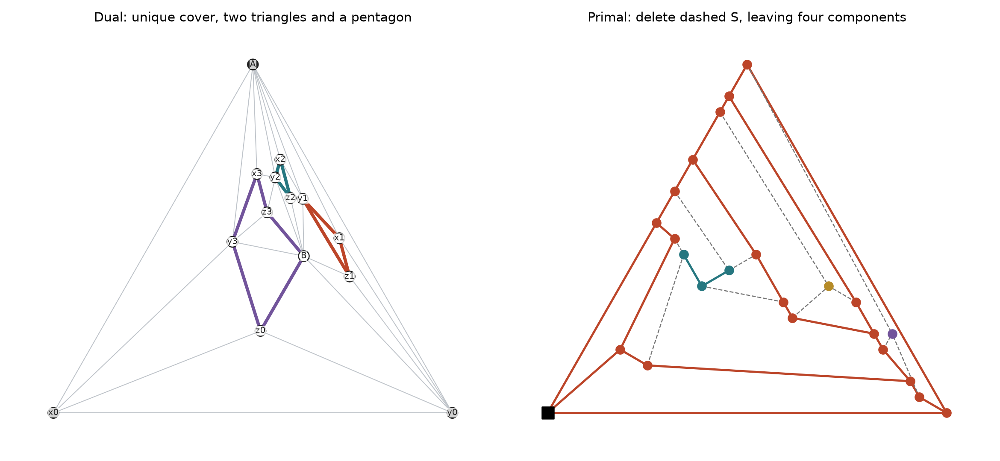

# What the cycle covers are

PROVED-HERE, T2 unreviewed. In the cubic primal graph, choose one edge at every black vertex except the root. Require exactly two chosen boundary edges at every non-root face and none at a root face. These are precisely the admissible edge sets S. Their duals are the cycle covers D. A white vertex has no degree constraint, so S is generally not a perfect matching and G-S is not a 2-factor.

PROVED-HERE. The shortest useful description is

    c_min = min_S number of connected components of G-S, minus one.

It measures unavoidable fragmentation under these face-constrained deletions. Every cover cycle is a primal bond. The bonds form a laminar family, and contracting the components of G-S gives a tree of parallel edge bundles. This explains both the cycle count and the white-vertex marks in the leading coefficient. Full proofs are in PROOFS.md, Sections 1 and 4.

COMPUTED figure, code/figure.py. The 14-vertex dual has two triangular components and one pentagon. In the primal, deleting dashed edges leaves four components. The black square marks b0. Colors distinguish components within each panel, not corresponding objects across panels. The embeddings in the two panels are independent.

## A known name

LIT. These are exactly the rooted cycle covers of David Eppstein and Elena Mumford, *Steinitz Theorems for Orthogonal Polyhedra*, arXiv:0912.0537v1, Section 3, pages 5-6. The definition covers every vertex except the root triangle and selects one side of each other triangle of its color. Their Theorem 1 relates existence to corner-polyhedron representations with the prescribed hidden vertex; Lemma 29 proves existence for every facial root of every 4-connected Eulerian triangulation. The source was opened at https://arxiv.org/pdf/0912.0537 . This identifies the object and an earlier existence route, not a published minimum-component invariant or a proof of the tree-matching bound. I inspected the relevant definition and theorem passages, not the entire geometric construction.

## The unboundedness question is resolved here

PROVED-HERE, T2 unreviewed. The explicit family T_m in PROOFS.md has 3m+2 dual vertices, no separating triangles, and a unique cover with m-2 triangles and one pentagon. Thus c_min=m-1 is unbounded even in the separator-free class. Its primal has 6m vertices and exactly 2^(m-1) tree matchings. It attains the proposed lower bound for every positive exponent. The construction has two faces of growing size in the primal; it does not settle the narrower square-and-hexagon question.

COMPUTED. Direct edge-choice enumeration checks m=3,...,10. Reference state/pair enumeration separately checks m=2,...,6, including tree counts and leading coefficients. The complete census reaches dual order 24. See CENSUS.md.

## Where minimizers sit

PROVED-HERE. Every cycle is odd; c(D) is congruent to n modulo two. A facial hexagon flip changes c by -2,0,or 2. No stronger mod-four constancy holds, as the saved examples contain both c=1 and c=3.

REFUTED, COMPUTED. Fixed-c levels need not be connected even when every simple directed-cycle reversal is allowed, a larger move set than lattice cover moves. code/levels.py finds the first separator-free failure at dual order 18, after checking every root through order 17. Its four-element flip graph is a square with counts 3,1,5,3; the two c=3 vertices are opposite. The earlier Opus 18-vertex square is independently reproduced in data/check.json, with counts 1,3,3,1. There the minimal covers themselves form a disconnected pair of extremes. The middle elements carry the tree pairs. Thus c is neither monotone in the lattice order nor guaranteed to have a connected minimizing level. These finite results remain T4 pending independent review of this campaign.

## What the first coefficient means

PROVED-HERE. With unit white-face circulation, the absolute coefficient at order c_min is the number of minimal covers with one white face marked inside each cycle. Marks are independent and may repeat for nested cycles. In the primal this is the number of admissible minimal laminar bond families with one white vertex marked on each root-free shore. In the region tree it is the sum of products of descendant white-vertex masses.

PROVED-HERE. This number is nonzero because every shore contains a white vertex. Every larger cover vanishes to higher order. At the first order all minimal covers have the same sign. A separate regrouping cancels every nonforest second state, leaving tree matchings. The coefficient therefore proves that some tree matching exists, without asserting that it belongs to a minimal cover. The 16-vertex example in the supplied fable report is exactly why those two statements must be kept apart.

| Family | c_min | Absolute leading coefficient | Status |
|---|---:|---:|---|
| 2r-prism | 1 | r-1 | PROVED-HERE by disk count; prior FAMILIES.md |
| Width-4 tube with L layers | 1 | 2L+1 | prior counting-family transfer certificate; conditional on its finite arithmetic |
| Nested q-prism chain | q | product over j=0,...,q-1 of 5j+2 | prior counting-family proof, unreviewed |
| T_m here | m-1 | 2 | PROVED-HERE, Section 2 |

PROVED-HERE. The coefficient need not equal #TM and their ratio is unbounded in either direction over these families. No bijection to all unweighted tree matchings is possible. A further bijection to spanning forests or to a nonnegative weighted tree-matching class was not found.

## Counting remains open in general

PROVED-HERE. Section 5 proves #TM>=2^c_min when B has exactly two covers, by counting shared second states. It gives an exact formula and isolates one possible equality configuration. For a single cover, all its pairs are tree pairs, as in the prior proof and Section 2 here.

CONJECTURE. More than one cover implies #TM>2^c_min. The full exponential bound and this strictness assertion remain unproved here. The census through order 24 has no counterexample. A minimum-cover orientation injection cannot stay within that cover. Induction on c-level connectivity fails on the explicit squares. Moment identities alone face the supplied Prouhet-Tarry-Escott barrier. The two-cover intersection formula is the new partial counting result; it does not justify induction on a larger lattice because a second state may then occur in 4,8,... covers.
