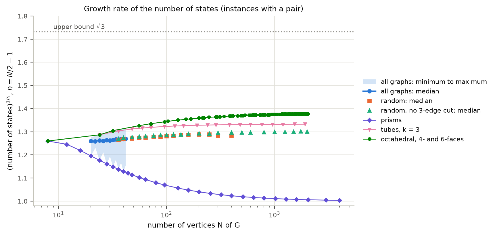
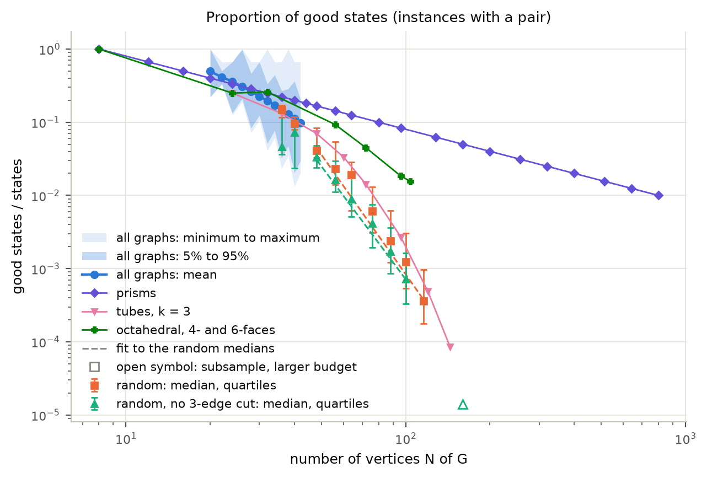
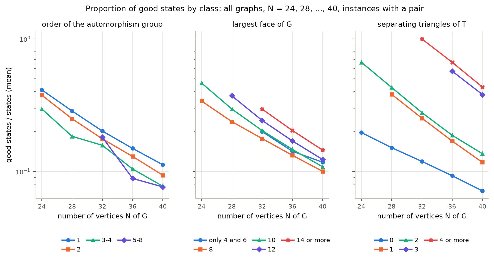
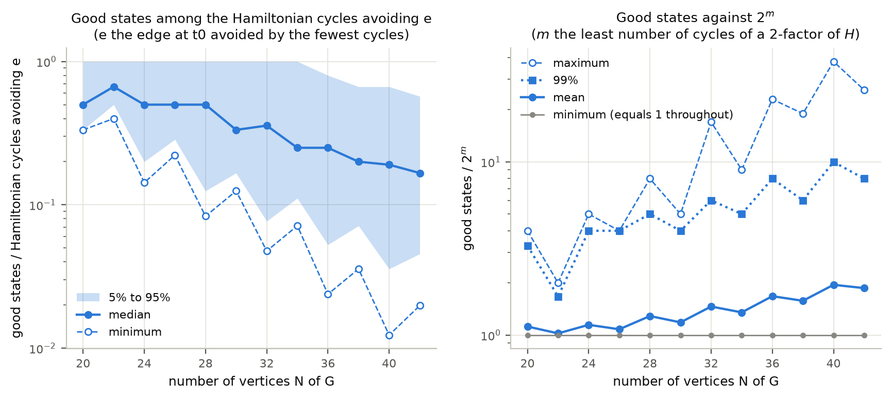
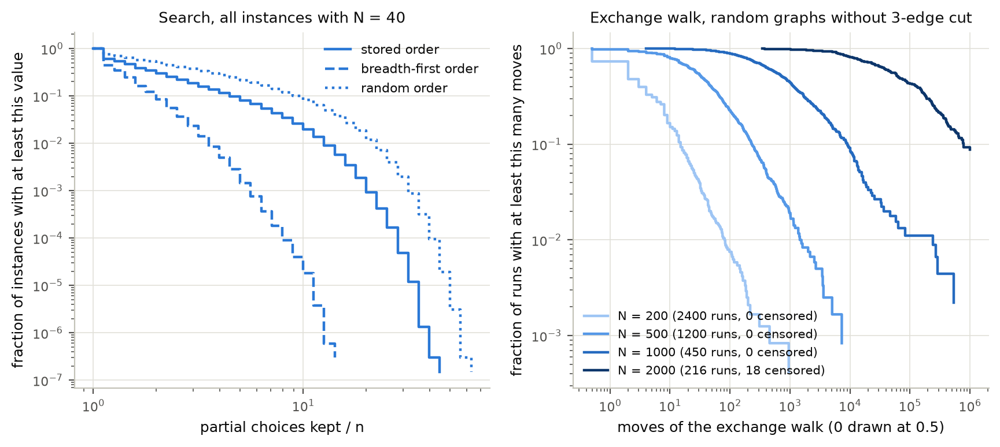
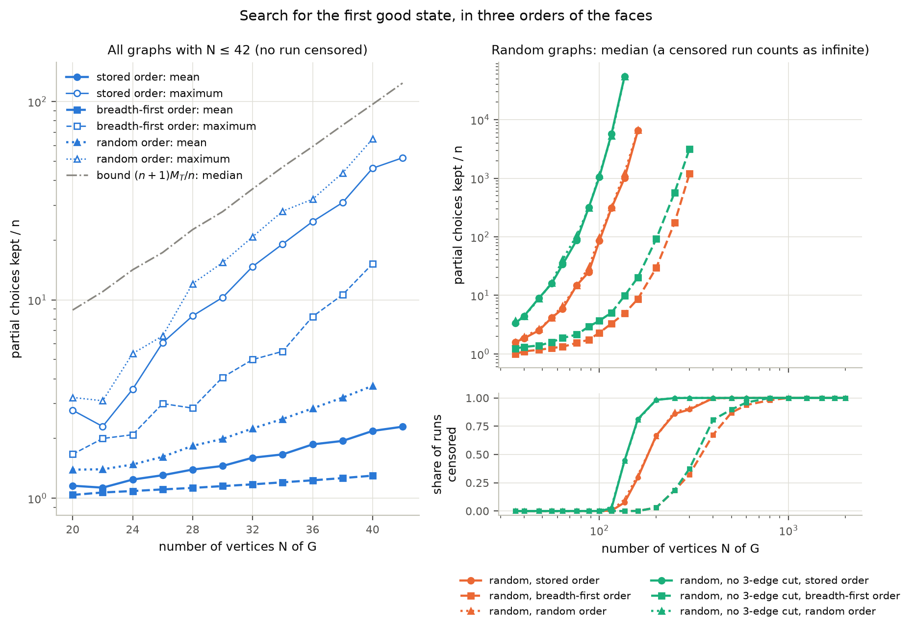
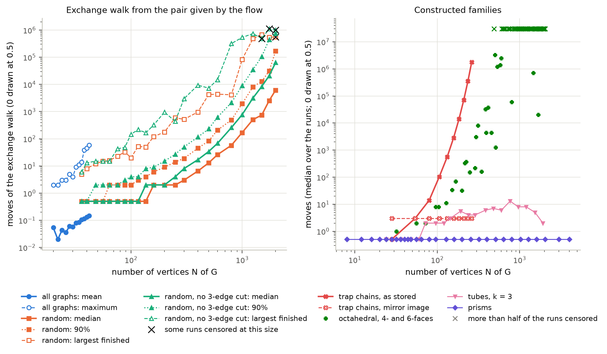
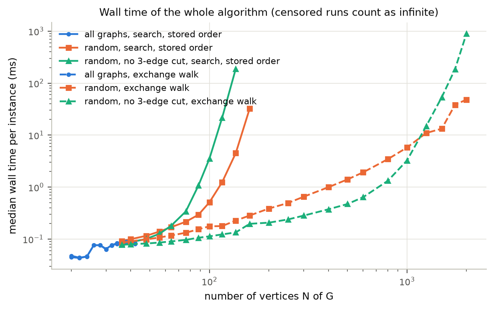
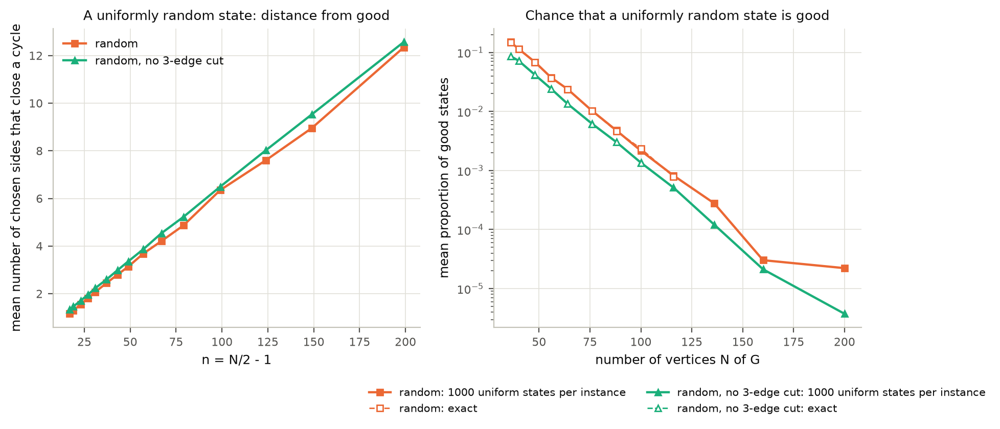

# Experiments on the algorithm

The proof of Barnette's conjecture yields an algorithm. Given a cubic, bipartite, 3-connected planar graph $G$ with $N$ vertices and an edge $e$, pass to the dual Eulerian triangulation $T$; if $T$ has no pair, cut it along a separating triangle and treat the two parts; find a good state; read off a Hamiltonian cycle of $G$ that avoids $e$. A good state is found by the search (Algorithm E) or by the exchange walk (Algorithm W) of [the algorithm note](../../proofs/algorithm/algorithm.md). This folder measures how many states and good states there are and what the two methods cost: on all 826,150 graphs of the class with $N\le42$, and on 10,072 constructed and random graphs with up to 4000 vertices.

Notation and terms are those of [the paper](../../paper/barnette.pdf). Throughout, $V$ is the number of vertices of $T$, so $N=2V-4$ and $n=|A|=|X|=V-3=N/2-1$; $M_T$ is the number of states, $g$ the number of good states, and $g/M_T$ is called the *proportion*.

## Summary

- *Range.* All 826,150 graphs of the class with $N\le42$, with every vertex as $t_0$ up to symmetry (33,585,490 instances); 1680 graphs of constructed families with $8\le N\le4000$; 8392 random graphs with $36\le N\le2000$, half of them with $T$ free of separating triangles.
- *Correctness.* Each of the 313,839,573 cycles returned is a Hamiltonian cycle avoiding its edge. No run with $N\le42$ reaches a budget. The C implementation used agrees with `workings/barnette` in 331,807 comparisons on 8100 instances.
- *States.* The number of states does not depend on $t_0$: $M_T^2$ is a minor of $A+\frac12D$ (Section 5.1, with proof). It grows like $1.28^n$ over all graphs with $N\le 42$ and like $1.30^n$ in random graphs, against the bound $3^{n/2}=1.73^n$.
- *Good states.* The mean proportion of good states among the instances with a pair falls from 0.50 at $N=20$ to 0.097 at $N=42$, by the factor 0.864 per unit of $n$; the median in random graphs falls by the factor 0.865 to 0.869 for $N\le116$, to $7\cdot10^{-4}$ at $N=100$ without separating triangles. The smallest proportion at $N=42$ is $1/50$; the prisms have $8/N$.
- *Search.* At $N=42$ the search keeps $2.3n$ partial choices on average in the stored order of the faces and at most $52n$; in breadth-first order from $t_0$, $1.3n$ on average and at most $15n$ at $N=40$. In random graphs its median cost grows exponentially, by 1.15 to 1.22 per unit of $n$ in the stored order and by 1.06 in breadth-first order, where half of the runs exceed $2\cdot10^6$ partial choices near $N=350$.
- *Walk.* For $N=42$ the exchange walk makes no move in 94% of the instances and at most 59. In random graphs without separating triangle the median is 774 moves at $N=1000$ and 64,040 at $N=2000$; the growth for $250\le N\le2000$ fits a power of $n$ with exponent 4 to 5 and a slow exponential equally well. The walk exceeds its budget on most graphs with only 4- and 6-faces and octahedral symmetry from $N=500$ on, and its cost depends on the drawing and on the order of the faces: on the trap chains, 1,757,797 moves in the stored order, 3 in the mirror image.
- *Open problems.* $g\ge 2^m$, with equality exactly when $H$ has a single 2-factor, holds for all 16,052,609 choices of $T$ and $t_0$ with a pair up to 23 vertices of $T$ (Section 6).

## 1. Instances

The states, the good states, the pairs, the search and the walk are determined by $T$ and the face $t_0$. The side $e_0$ of $t_0$ is used only when the cycle is built from a good state, and the three sides give three Hamiltonian cycles of $G$, each avoiding the edge dual to one side. An *instance* is therefore a pair $(T,t_0)$, that is, a graph $G$ with a vertex $t_0$; the problem for $G$ and $e$ is the instance of either end of $e$. For every instance all three cycles are built and tested.

Every face of $T$ is taken as $t_0$, of either colour class; the colouring is the one in which $t_0$ is black. An automorphism of $T$ carries an instance to an isomorphic one, so one face is taken from each orbit of the automorphism group of the plane map $T$, reflections included (this is the automorphism group of the graph $G$). The mirror image of $T$ has the same states, good states and pairs; it changes only the course of the walk, which is run in both drawings.

## 2. Graphs

For every graph the following are recorded: the order of the automorphism group and its type as a point group (Schoenflies symbol, determined from the numbers of rotations of each order and of reflections); the number of faces of $G$ of each size, that is, the degrees of $T$; the number of separating triangles of $T$, the diameter of the tree of the pieces into which they cut $T$, and the largest and smallest value of $n$ among the pieces.

A separating triangle of $T$ is a 3-edge cut of $G$ with a cycle on either side. By Euler's formula a graph of the class has at least six 4-faces, and the four edges that leave a 4-face separate two cycles. So the cyclic edge-connectivity of $G$ is 3 or 4, and with respect to connectivity there are two classes: $T$ with a separating triangle, and without.

### 2.1 All graphs with at most 42 vertices

`plantri -b` (version 5.8) lists the Eulerian triangulations with $V$ vertices up to isomorphism, mirror images identified. All of them are taken for $6\le V\le 23$, that is, all graphs of the class with $N\le 42$: 826,150 graphs and 33,585,490 instances. The numbers of triangulations, of triangulations up to orientation-preserving isomorphism (recomputed from the automorphism groups) and of triangulations without separating triangle agree with the table in the plantri manual for every size.

| N | V(T) | graphs | no 3-edge cut | only 4- and 6-faces | trivial group | instances | with a pair | orbits of (e, t0) | HC min | HC median | HC max |
| --- | ---: | ---: | ---: | ---: | ---: | ---: | ---: | ---: | ---: | ---: | ---: |
| 8 | 6 | 1 | 1 | 1 | 0 | 1 | 1 | 1 | 6 | 6 | 6 |
| 12 | 8 | 1 | 1 | 1 | 0 | 1 | 1 | 2 | 8 | 8 | 8 |
| 14 | 9 | 1 | 0 | 1 | 0 | 3 | 2 | 5 | 12 | 12 | 12 |
| 16 | 10 | 2 | 2 | 1 | 0 | 3 | 3 | 8 | 10 | 12 | 14 |
| 18 | 11 | 2 | 1 | 1 | 0 | 14 | 9 | 35 | 16 | 18 | 20 |
| 20 | 12 | 8 | 5 | 3 | 0 | 37 | 25 | 92 | 12 | 24 | 24 |
| 22 | 13 | 8 | 3 | 1 | 2 | 101 | 67 | 288 | 20 | 28 | 32 |
| 24 | 14 | 32 | 18 | 3 | 4 | 340 | 206 | 967 | 14 | 32 | 48 |
| 26 | 15 | 57 | 19 | 3 | 26 | 1,071 | 644 | 3,105 | 24 | 48 | 56 |
| 28 | 16 | 185 | 79 | 3 | 85 | 3,594 | 2,071 | 10,623 | 16 | 56 | 80 |
| 30 | 17 | 466 | 134 | 2 | 346 | 12,238 | 6,817 | 36,296 | 28 | 68 | 112 |
| 32 | 18 | 1,543 | 501 | 8 | 1,129 | 42,200 | 22,808 | 125,784 | 18 | 88 | 148 |
| 34 | 19 | 4,583 | 1,147 | 3 | 4,090 | 147,935 | 77,339 | 442,307 | 32 | 112 | 192 |
| 36 | 20 | 15,374 | 3,976 | 7 | 13,688 | 522,751 | 265,207 | 1,564,721 | 20 | 136 | 272 |
| 38 | 21 | 50,116 | 11,055 | 7 | 47,955 | 1,865,817 | 918,108 | 5,590,552 | 36 | 176 | 368 |
| 40 | 22 | 171,168 | 37,231 | 7 | 164,212 | 6,708,721 | 3,204,436 | 20,112,005 | 22 | 224 | 542 |
| 42 | 23 | 582,603 | 114,560 | 5 | 572,975 | 24,280,663 | 11,265,397 | 72,810,903 | 40 | 276 | 676 |

"Orbits of $(e,t_0)$" counts the pairs of an edge of $G$ and one of its ends up to automorphism; each is covered by one of the three cycles of an instance. HC is the number of Hamiltonian cycles of $G$.

Of the graphs with $N=42$, 98.3% have a trivial automorphism group. The other groups that occur for $N\le42$ are, with the numbers of graphs, in [data/tables.md](data/tables.md); they include $O_h$ (3 graphs), $T_d$ (1), $D_{6h}$, $D_{4h}$, $D_{3h}$, $D_{3d}$, $D_{2d}$, $D_{2h}$ and the groups $D_{kh}$ of the prisms. The graphs with only 4- and 6-faces (six 4-faces, hexagons otherwise) number at most eight at any size.

### 2.2 Constructed families

| Family (name in the data) | Construction | Graphs | $N$ |
| --- | --- | ---: | ---: |
| prisms (`prism`) | prism over a $2k$-gon, $2\le k\le 1000$; two faces of size $N/2$ | 30 | 8 to 4000 |
| tubes (`tube`) | two $2k$-gons joined by $m$ rings: $2k$ quadrilaterals and $2k(m-1)$ hexagons, $N=4km$, $k\in\{2,3,4,5,6,8,12,16,32\}$; only 4- and 6-faces for $k=2,3$; groups $D_{kd}$, $D_{kh}$ | 136 | 16 to 2000 |
| capped tubes (`nanotube`, `stacked-chain`) | `nanotube(m)` of `workings`, $N=6m+2$: six squares and hexagons. Its dual is an octahedron with $m-1$ octahedra inserted one inside the other, so $T$ has $m-1$ nested separating triangles. The two names give the same graphs | 24 and 22 | 8 to 1928 |
| octahedral (`octahedral`) | dual of the Goldberg–Coxeter triangulation $GC_{k,l}$ of the octahedron, $N=8(k^2+kl+l^2)$: six squares and hexagons, group $O_h$ or $O$ | 90 | 8 to 2048 |
| omnitruncated polyhedra (`omnitruncated`, `omnitruncated-gc`) | truncated octahedron, great rhombicuboctahedron, great rhombicosidodecahedron, and the duals of $GC_{k,l}$ of their duals; groups $O_h$, $O$, $I_h$, $I$ | 3 and 21 | 24 to 1920 |
| barycentric (`barycentric`) | dual of the barycentric subdivision of a plane map: all polyhedra with at most 8 vertices, samples of polyhedra with 9 to 12 vertices, of triangulations with 14 and 16 vertices and of quadrangulations with 18 and 24 vertices, the Platonic solids, prisms, antiprisms and wheels with up to 40 sides | 769 | 24 to 640 |
| Goldberg–Coxeter (`gc-small`) | duals of $GC_{k,l}$, $k^2+kl+l^2\le 28$, of the triangulations with 8 to 14 vertices whose group has order at least 4, and of every seventh other one | 315 | 36 to 672 |
| nested octahedra (`stacked-all`) | an octahedron inserted into every face, repeated to depth 1, 2, 3 | 3 | 56 to 2744 |
| one large face (`split-bipyramid`) | dual of the bipyramid over a $2k$-gon with one apex split repeatedly until one vertex of degree $2k$ remains, $6\le k\le 256$ | 17 | 28 to 1532 |
| trap chains (`trap-chain`) | [trap-chain-$k$](../instances/README.md), $1\le k\le 10$, with the stored order of the faces and the stored $t_0$ | 10 | 28 to 262 |
| random substitutions (`grow-split`, `grow-mixed`) | from the octahedron by 6 to 500 random vertex splits (`grow-split`), or splits and insertions of octahedra with probability $1/2$ each (`grow-mixed`) | 120 and 120 | 32 to 2568 |

These are 1680 graphs; the lists overlap (for example the truncated octahedron is also octahedral with $k=l=1$). Up to six faces $t_0$ are taken per graph (three for $N>600$), chosen at random among the orbit representatives; for $V>700$ the automorphism group is not computed and the faces are chosen at random among all faces. Among the 1598 graphs whose group was computed, 790 have a trivial group and 599 a group of order at least 4.

Among the graphs with only 4- and 6-faces the groups $O_h$, $O$, $D_{6h}$, $D_6$, $D_{3h}$, $D_{3d}$, $D_3$, $D_{2h}$, $D_{2d}$, $D_2$, $C_{2v}$, $C_2$, $C_s$ and $C_1$ occur in the data. No such graph with a tetrahedral group occurs; the only graph with a tetrahedral group for $N\le 42$ has twelve 4-faces and six 8-faces ($N=32$, group $T_d$).

### 2.3 Random triangulations

Two ensembles are sampled, for 23 sizes from $N=36$ to $N=2000$: Eulerian triangulations with $V$ vertices (`random3`), and those without separating triangle (`random4`).

The sampler is a Metropolis–Hastings chain on simple Eulerian triangulations with at most $V+h$ vertices. A step proposes one of the following with equal probability and accepts it with the probability that makes the chain reversible for the weights below.

- A vertex split: a vertex $a$ and two of its neighbours $b$, $d$, with an odd number of neighbours between them on either side; the neighbours on one side are moved to a new vertex $c$, and a new vertex of degree four is joined to $a$, $b$, $c$, $d$.
- The inverse: a vertex of degree four is deleted and two opposite neighbours are identified, if the result is simple.
- An octahedron is inserted into a face (three new vertices of degree four), or such an octahedron is removed.

A triangulation $T'$ has weight $w/|\mathrm{Aut}\,T'|$, with $w=1$ if it has at most $V$ vertices and $w=3.6^{\,V-V(T')}$ otherwise. For `random3`, $h=3$. For `random4` only splits and their inverses are used, an inverse that creates a separating triangle is refused, and $h=2$. A chain starts at the octahedron (`random3`) or at the smallest triangulation without separating triangle of the right parity (`random4`), makes $500V^2$ steps, and then yields the current triangulation every $50V^2$ steps at which it has exactly $V$ vertices. Each size uses 8 to 12 independent chains; the numbers of graphs are in the table of Section 5.2.

*Distribution.* If the chain is irreducible on its state space, its stationary distribution restricted to the triangulations with $V$ vertices gives every isomorphism class the probability proportional to $1/|\mathrm{Aut}|$. This is the uniform distribution on rooted triangulations, and not the uniform distribution on isomorphism classes: a class with a group of order $k$ is $k$ times less likely than an asymmetric one. For $N=42$ already 98.3% of the classes are asymmetric, so at the sizes sampled the two distributions are close, and graphs with symmetry are represented by the constructed families instead.

Irreducibility with the bound $V+h$ on the size is not proved. It was tested where the classes can be listed: with these settings the chain reached every class for $12\le V\le 17$ (`random3`) and $12\le V\le 18$ (`random4`), and the frequencies of the classes in 200,000 samples agree with the weights $1/|\mathrm{Aut}|$ (the 13 $\chi^2$ tests have $p$-values from 0.034 to 0.99; two are below 0.05, namely 0.034 for `random4` at $V=13$, with three classes, and 0.036 for `random3` at $V=12$; [data/validation.json](data/validation.json)). With $h=0$ the chain for `random4` does not reach one of the 18 classes at $V=14$ and two of the 79 at $V=16$.

No bound on the mixing time is known, so the samples at large sizes are from a chain whose convergence is checked only by diagnostics. For $V=20$ and $V=22$ the exact means under the weights $1/|\mathrm{Aut}|$ are known from the complete lists; the sample means of 300 graphs differ from them by at most 2.4 standard errors:

| source | V | graphs | statistic | mean | se | lag1_autocorrelation | exact_mean |
| --- | ---: | ---: | ---: | ---: | ---: | ---: | ---: |
| random3 | 20 | 300 | nsep | 1.510 | 0.065 | -0.057 | 1.413 |
| random3 | 20 | 300 | n4 | 11.017 | 0.074 | -0.032 | 10.838 |
| random3 | 20 | 300 | maxdeg | 10.253 | 0.084 | 0.066 | 10.090 |
| random3 | 20 | 300 | no_sep | 0.200 | 0.023 | 0.021 | 0.238 |
| random3 | 22 | 300 | nsep | 1.543 | 0.065 | 0.006 | 1.544 |
| random3 | 22 | 300 | n4 | 11.933 | 0.076 | 0.023 | 11.790 |
| random3 | 22 | 300 | maxdeg | 10.580 | 0.084 | 0.001 | 10.522 |
| random3 | 22 | 300 | no_sep | 0.193 | 0.023 | -0.030 | 0.209 |
| random4 | 20 | 300 | n4 | 10.347 | 0.075 | 0.103 | 10.269 |
| random4 | 20 | 300 | maxdeg | 9.553 | 0.079 | 0.030 | 9.487 |
| random4 | 22 | 300 | n4 | 11.167 | 0.077 | -0.015 | 11.148 |
| random4 | 22 | 300 | maxdeg | 9.860 | 0.078 | 0.004 | 9.880 |

Here `nsep` is the number of separating triangles, `n4` the number of vertices of degree four, `maxdeg` the largest degree and `no_sep` the indicator of having no separating triangle. Over all sizes, the 126 lag-one autocorrelations of these statistics along the chains have mean $-0.01$, and six exceed 0.2 in absolute value ([data/mixing.csv](data/mixing.csv)). At $N\ge 1250$ each of the 8 chains contributes three graphs.

For each random graph four faces $t_0$ are taken (three for $N\ge 800$), chosen at random among the orbit representatives.

## 3. Measurements

On every instance:

1. $M_T$. For $n\le 79$ it is computed exactly as $|\det K|$, by fraction-free elimination in 128-bit integers; for larger $n$ only $\log_{10}M_T$ is computed, from a sparse LU factorisation in floating point. When $M_T\le 200{,}000$ the states are also enumerated.
2. $g$, by a depth-first enumeration of the states that abandons a partial choice as soon as test (2) of Algorithm E fails. The count is exact unless the budget of kept partial choices is reached.
3. Whether a pair exists, by a maximum flow as in `workings`. When $M_T\le 3000$, all pairs $(r,s)$: their number, the number of 2-factors of $H$ they use, and the least number $m$ of cycles of $D(r,s)$.
4. For $N\le 42$, the Hamiltonian cycles of $G$, enumerated as the perfect matchings of $G$ with connected complement, without reference to states: their number, and for each edge $e$ at $t_0$ the number $h(e)$ of those that avoid $e$.
5. The algorithm with the search. The faces of $A$ are taken in the *stored order* (the order in which the generator lists the faces), in *breadth-first order* (by distance from $t_0$ in $G$), and in a *random order* with the corners of each face rotated at random. The cost is the number of partial choices kept, called *nodes*; it is at least $n$, and equal to $n$ when the search never backtracks. Theorem 2 of the algorithm note bounds it by $(n+1)M_T$.
6. The algorithm with the walk, from the pair that the flow gives, with the arcs $\gamma_y$ along a breadth-first tree as in `workings`: in the stored drawing, in its mirror image, and with the faces in random order. The cost is the number of *moves*, the applications of $\alpha$ and $\beta$. The first step of Algorithm W, which makes the cycles of $D(r,s)$ counterclockwise, is not counted, so a walk has 0 moves when the second state is good after that step. Theorem 3 bounds the moves by $2^{O(n\log n)}$.
7. For the random graphs with $n\le 200$: 1000 states drawn uniformly at random, by sampling the corners face by face from the conditional probabilities given by $K^{-1}$; the number of good ones is recorded, and the cyclomatic number of $Q_s$ after the roots are identified.

When $T$ has no pair, the search and the walk cut $T$ along a separating triangle, as `workings` does, and work in the pieces; nodes and moves are summed over the pieces. Wall times of the search and of the walk are those of one run of the C routine on one core.

*Budgets.* A run that reaches its budget is *censored*: it is kept in the data with its status, counted in every table, and treated as larger than every finished run when medians and quantiles are taken. For $N\le 42$ the budgets are $2\cdot10^7$ nodes for a count or a search and $10^6$ moves, and no run reaches them. For the other graphs they are $3\cdot10^7$ nodes for a count and $5\cdot10^6$ for a search if $n\le80$, $10^6$ and $2\cdot 10^6$ if $n\ge 81$, and $10^7$ moves if $n<100$, $\lfloor 10^9/n\rfloor$ moves if $n\ge100$. For $N=42$ the search is run in the stored order only and the walk in the stored drawing only.

## 4. Verification

*Against `workings/barnette`.* All measurements use a C implementation, [src/fastbarnette.c](src/fastbarnette.c), which follows the conventions of `workings/barnette`: the same order of the faces and of the corners, the same pair from the flow, the same arcs, the same choice of the separating triangle. [src/crosscheck.py](src/crosscheck.py) compares the two on every triangulation with at most 16 vertices and every face $t_0$, on the examples of the package, on the stored instances of [research/instances](../instances/README.md) and on members of the families: 8100 labelled instances and 331,807 comparisons, without a difference ([data/crosscheck.json](data/crosscheck.json)). Compared are the set of states and its size, the determinant, the good states, the first good state found and the numbers of partial choices kept and of matching tests made on the way, the pairs by number of cycles, the pair from the flow, the corner weights, the number of moves and the final pair of the walk in both drawings, the pieces of the reduction, and the three Hamiltonian cycles, which are identical to those that the functions of the package give when its reduction is combined with its search for the first good state. The numbers of Hamiltonian cycles are compared with a direct enumeration. From the stored pairs of the ten trap chains the C walk takes exactly the numbers of moves stated in the algorithm note, and 3 moves in the mirror image.

*Cycles.* Every Hamiltonian cycle produced in any run is tested twice, by a C routine and by `barnette.is_hamiltonian_cycle` with the edge to be avoided: 313,839,573 cycles, none of which fails.

*Internal consistency.* On every instance the following were tested, and no instance fails ([data/totals.json](data/totals.json), [data/open_problems.json](data/open_problems.json)): the enumeration of the states gives $|\det K|$ (33,607,743 instances); a pair exists exactly when $g>0$; the number of pairs with good second state equals $g$; $g\le h(e)$ for each edge $e$ at $t_0$.

*Generators and sampler.* [src/validate.py](src/validate.py) checks the counts of plantri against the published table for $6\le V\le 20$ (for $V=21,22,23$ the counts appear in the table of Section 2.1), regenerates the triangulations with at most 15 vertices from the octahedron by splits and insertions of octahedra and finds the same classes, compares the orders of the automorphism groups with those found by networkx for $V\le 13$, the group types with the known ones of eight polyhedra, the sampler with the exact distribution as described in Section 2.3, and the uniform sampling of states with exact proportions on 28 instances ([data/validation.json](data/validation.json)).

## 5. Results

A *fit* below is a least-squares line through the logarithms of the stated summary values over the stated range of $n$; the intervals are the 95% intervals of that regression, which treats the points as independent. All fits are collected in Section 5.8. No fit is claimed outside its range, and what is said about larger $n$ is marked as extrapolation.

### 5.1 The number of states

In every graph of the data, $M_T$ is the same for all faces $t_0$ measured: for each of the 826,150 graphs with $N\le42$ and every face, and for the 10,021 larger graphs with several faces measured, where the values of $\log_{10}M_T$ differ by at most $5\cdot10^{-14}$. This is a general fact.

**Proposition.** Let $A$ be the adjacency matrix of $T$, let $D$ be the diagonal matrix of the degrees, and let $a,b$ be two adjacent vertices of $T$. For every face $t_0$ of $T$,

$$M_T^2=\det\bigl(A+\tfrac12D\bigr)_{\hat a\hat b},$$

the determinant of $A+\frac12D$ without the rows and columns of $a$ and $b$. In particular $M_T$ does not depend on $t_0$.

*Proof.* Colour the vertices of $T$ with three colours. Let $B$ be the matrix with a row for each black face and a column for each vertex, with entry 1 when the vertex is a corner of the face, and write $B_{\hat a\hat b}$ for $B$ without the columns of $a$ and $b$; it is a square matrix of size $V-2$.

Every black face has one corner of each colour, so for each colour the columns of that colour add up to the all-ones vector $\mathbf 1$. Let $a,a'$ have colour 1, $b$ colour 2 and $c$ colour 3. In $B_{\hat a\hat b}$ add to the column of $a'$ the other columns of colour 1 and subtract the columns of colour 3: it becomes $(\mathbf 1-B_a)-\mathbf 1=-B_a$, so $|\det B_{\hat a\hat b}|=|\det B_{\hat a'\hat b}|$. In $B_{\hat a\hat b}$ add to the column of $c$ the other columns of colour 3 and subtract the columns of colour 2: it becomes $\mathbf 1-(\mathbf 1-B_b)=B_b$, so $|\det B_{\hat a\hat b}|=|\det B_{\hat a\hat c}|$. By the symmetry of the colours, $|\det B_{\hat a\hat b}|$ is one number $\lambda$ for all $a,b$ of different colours.

Let $t_0$ be a black face with corners $a,b,c$. In $B_{\hat a\hat b}$ the row of $t_0$ has a single nonzero entry, in the column of $c$, and deleting this row and column leaves the matrix $K$ of Lemma 1 of the algorithm note. Hence $M_T=|\det K|=\lambda$.

Every edge of $T$ lies on exactly one black face, and a vertex $v$ lies on $\deg(v)/2$ black faces, so $B^{\mathsf T}B=A+\frac12D$, and $\det(A+\frac12D)_{\hat a\hat b}=\det(B_{\hat a\hat b})^2=\lambda^2$. The same holds for the matrix of the white faces, so a white face $t_0$ gives the same number. ∎

The matrix $A+\frac12D$ is half the signless Laplacian of $T$. The formula was compared with $|\det K|$ in exact arithmetic for every triangulation with at most 16 vertices and every face (`src/crosscheck.py`).

*Measured.* For $24\le N\le42$ the largest $M_T$ is 16, 21, 28, 39, 54, 72, 96, 130, 175, 235, attained by a graph with only 4- and 6-faces at every size; the bound $3^{n/2}$ of Lemma 1 is 34,092 at $N=40$. The prisms have $M_T=N/4$ (checked for $N\le160$), the tubes with $k=2$ have $M_T=F_{2m+1}$, the Fibonacci number, where $N=8m$ (checked for $m\le20$), and the capped tubes have $M_T=2^m$ (checked for $m\le13$).

*Fits.* $M_T\approx c\,r^n$ with $r=1.282$ for the mean over all graphs and $r=1.351$ for the maximum ($11\le n\le20$); $r=1.287$ for `random3` ($17\le n\le199$) and $r=1.302$ for `random4` ($17\le n\le999$). In the octahedral family $M_T^{1/n}$ rises to 1.378 at $N=2048$. Lemma 1 gives $r\le\sqrt3=1.732$.

### 5.2 The proportion of good states

In the data an instance has a good state exactly when it has a pair (Proposition 6.9 gives the good state); the proportion is taken over the instances with a pair. Their share among all instances falls from 0.68 at $N=20$ to 0.46 at $N=42$.

| N | n | with a pair | share with a pair | states: median | states: max | good: min | good: median | good: max | ratio: min | ratio: 5% | ratio: median | ratio: mean | ratio: 95% | ratio: max |
| --- | ---: | ---: | ---: | ---: | ---: | ---: | ---: | ---: | ---: | ---: | ---: | ---: | ---: | ---: |
| 8 | 3 | 1 | 1.000 | 2 | 2 | 2 | 2 | 2 | 1.0000 | 1.0000 | 1.0000 | 1.0000 | 1.0000 | 1.0000 |
| 12 | 5 | 1 | 1.000 | 3 | 3 | 2 | 2 | 2 | 0.6667 | 0.6667 | 0.6667 | 0.6667 | 0.6667 | 0.6667 |
| 14 | 6 | 2 | 0.667 | 4 | 4 | 4 | 4 | 4 | 1.0000 | 1.0000 | 1.0000 | 1.0000 | 1.0000 | 1.0000 |
| 16 | 7 | 3 | 1.000 | 5 | 5 | 2 | 2 | 2 | 0.4000 | 0.4000 | 0.4000 | 0.4333 | 0.4900 | 0.5000 |
| 18 | 8 | 9 | 0.643 | 6 | 7 | 4 | 4 | 4 | 0.5714 | 0.5714 | 0.6667 | 0.6455 | 0.6667 | 0.6667 |
| 20 | 9 | 25 | 0.676 | 8 | 9 | 2 | 2 | 8 | 0.2222 | 0.2222 | 0.2857 | 0.4954 | 1.0000 | 1.0000 |
| 22 | 10 | 67 | 0.663 | 10 | 12 | 4 | 4 | 8 | 0.3333 | 0.3333 | 0.4000 | 0.4131 | 0.5000 | 0.6667 |
| 24 | 11 | 206 | 0.606 | 13 | 16 | 2 | 2 | 10 | 0.1250 | 0.1333 | 0.1818 | 0.3599 | 0.6667 | 0.6667 |
| 26 | 12 | 644 | 0.601 | 16 | 21 | 4 | 4 | 16 | 0.1905 | 0.2105 | 0.2500 | 0.3055 | 0.9833 | 1.0000 |
| 28 | 13 | 2,071 | 0.576 | 21 | 28 | 2 | 8 | 16 | 0.0714 | 0.0833 | 0.3333 | 0.2646 | 0.4615 | 0.6667 |
| 30 | 14 | 6,817 | 0.557 | 26 | 39 | 4 | 4 | 20 | 0.1081 | 0.1250 | 0.1600 | 0.2252 | 0.6667 | 0.6667 |
| 32 | 15 | 22,808 | 0.540 | 34 | 54 | 2 | 8 | 34 | 0.0408 | 0.0513 | 0.2222 | 0.1971 | 0.3333 | 1.0000 |
| 34 | 16 | 77,339 | 0.523 | 44 | 72 | 4 | 4 | 36 | 0.0615 | 0.0769 | 0.1053 | 0.1697 | 0.4444 | 0.6667 |
| 36 | 17 | 265,207 | 0.507 | 56 | 96 | 2 | 8 | 46 | 0.0233 | 0.0323 | 0.1429 | 0.1477 | 0.2685 | 0.6667 |
| 38 | 18 | 918,108 | 0.492 | 72 | 130 | 4 | 4 | 76 | 0.0351 | 0.0476 | 0.0741 | 0.1285 | 0.2857 | 1.0000 |
| 40 | 19 | 3,204,436 | 0.478 | 92 | 175 | 2 | 8 | 80 | 0.0132 | 0.0204 | 0.0930 | 0.1118 | 0.3636 | 0.6667 |
| 42 | 20 | 11,265,397 | 0.464 | 118 | 235 | 4 | 8 | 104 | 0.0200 | 0.0294 | 0.0602 | 0.0975 | 0.2078 | 0.6667 |

*Measured, $N\le42$.* The mean proportion falls from 0.50 at $N=20$ to 0.097 at $N=42$. The number $m$ has the parity of $n$, and $g\ge2^m$ in every instance (Section 6), so the least $g$ is 2 for odd $n$ and 4 for even $n$; this is the reason for the alternation of the median.

The minimum of the proportion for $24\le N\le42$ is attained by instances with only 4- and 6-faces, without separating triangle, with a single 2-factor and $g=2^m$, $m\in\{1,2\}$. Their numbers of states are 16, 21, 28, 37, 49, 65, 86, 114, 151, 200; each is the sum of the numbers two and three places before it, so they grow by the factor 1.3247 per unit of $n$ in this range. For $N=42$ the minimum is $4/200$. The tubes with $k=2$ have $g=2$ in each of the 72 instances in which the count finished, hence the proportion $2/F_{2m+1}$, which is larger: $2/89$ at $N=40$ against $2/151$.

The maximum is 1 for $N=8,14,20,26,32,38$ and $2/3$ at every other size except $N=16$. It is 1 on the capped tubes: there $N=6m+2$, $M_T=2^m$, and every state is good for each face $t_0$ that has a pair.

Prisms have $g=2$ and the proportion $8/N$ for every $N\le4000$.

*By class, $N=40$* (all instances with a pair in the first three columns; costs over all instances):

| class | value | instances | share with a pair | ratio: median | ratio: mean | ratio: min | states: median | good: median | search/n: mean | search/n: max | bfs/n: mean | bfs/n: max | walk: mean | walk: max |
| --- | ---: | ---: | ---: | ---: | ---: | ---: | ---: | ---: | ---: | ---: | ---: | ---: | ---: | ---: |
| group order | 1 | 6,568,480 | 0.474 | 0.093 | 0.112 | 0.013 | 92 | 8 | 2.182 | 46.1 | 1.299 | 15.2 | 0.132 | 45 |
| group order | 2 | 134,524 | 0.642 | 0.075 | 0.094 | 0.013 | 87 | 8 | 2.305 | 30.5 | 1.317 | 10.0 | 0.145 | 14 |
| group order | 3-4 | 5,428 | 0.832 | 0.048 | 0.077 | 0.016 | 76 | 2 | 2.268 | 24.9 | 1.291 | 7.2 | 0.134 | 9 |
| group order | 5-8 | 267 | 0.925 | 0.056 | 0.076 | 0.022 | 80 | 4 | 1.766 | 15.5 | 1.277 | 3.2 | 0.213 | 4 |
| group order | >8 | 22 | 1.000 | 0.066 | 0.096 | 0.025 | 124 | 8 | 1.928 | 3.8 | 1.706 | 3.8 | 0.455 | 3 |
| group type | cyclic | 29,520 | 0.617 | 0.083 | 0.095 | 0.013 | 96 | 8 | 2.209 | 25.3 | 1.434 | 9.6 | 0.197 | 13 |
| group type | cyclic* | 110,217 | 0.658 | 0.072 | 0.092 | 0.014 | 84 | 8 | 2.329 | 30.5 | 1.284 | 10.0 | 0.131 | 14 |
| group type | dihedral | 245 | 0.886 | 0.070 | 0.080 | 0.016 | 112 | 8 | 2.030 | 14.3 | 1.743 | 7.2 | 0.335 | 3 |
| group type | dihedral* | 259 | 0.946 | 0.050 | 0.072 | 0.022 | 80 | 4 | 1.763 | 15.5 | 1.305 | 3.8 | 0.232 | 4 |
| group type | trivial | 6,568,480 | 0.474 | 0.093 | 0.112 | 0.013 | 92 | 8 | 2.182 | 46.1 | 1.299 | 15.2 | 0.132 | 45 |
| largest face | 10 | 3,558,134 | 0.493 | 0.091 | 0.108 | 0.014 | 93 | 8 | 2.276 | 36.4 | 1.323 | 13.2 | 0.139 | 27 |
| largest face | 12 | 1,766,559 | 0.401 | 0.100 | 0.123 | 0.016 | 81 | 8 | 1.913 | 34.9 | 1.233 | 11.5 | 0.074 | 14 |
| largest face | 4,6 | 120 | 1.000 | 0.111 | 0.117 | 0.013 | 168 | 18 | 2.139 | 14.1 | 1.429 | 3.4 | 0.675 | 5 |
| largest face | 8 | 943,089 | 0.633 | 0.085 | 0.100 | 0.013 | 108 | 8 | 2.623 | 46.1 | 1.409 | 15.2 | 0.263 | 45 |
| largest face | >=14 | 440,819 | 0.331 | 0.114 | 0.145 | 0.022 | 70 | 8 | 1.584 | 35.9 | 1.146 | 9.8 | 0.027 | 4 |
| separating triangles | 0 | 1,403,871 | 1.000 | 0.073 | 0.071 | 0.013 | 100 | 8 | 3.459 | 46.1 | 1.557 | 10.7 | 0.312 | 25 |
| separating triangles | 1 | 2,018,158 | 0.525 | 0.095 | 0.117 | 0.062 | 92 | 8 | 2.297 | 34.9 | 1.303 | 15.2 | 0.136 | 45 |
| separating triangles | 2 | 2,195,878 | 0.282 | 0.105 | 0.136 | 0.071 | 80 | 8 | 1.772 | 35.9 | 1.261 | 10.9 | 0.076 | 5 |
| separating triangles | 3 | 409,458 | 0.155 | 0.381 | 0.381 | 0.333 | 84 | 32 | 1.276 | 29.6 | 1.061 | 9.4 | 0.021 | 2 |
| separating triangles | >=4 | 681,356 | 0.086 | 0.444 | 0.434 | 0.400 | 72 | 32 | 1.095 | 24.3 | 1.025 | 5.9 | 0.000 | 0 |
| faces at t0 | 4-6-8 | 1,038,476 | 0.523 | 0.089 | 0.100 | 0.014 | 96 | 8 | 2.428 | 35.1 | 1.357 | 15.2 | 0.134 | 45 |
| faces at t0 | 4-4-6 | 830,364 | 0.410 | 0.089 | 0.098 | 0.013 | 92 | 8 | 2.383 | 35.1 | 1.254 | 10.7 | 0.067 | 13 |
| faces at t0 | 4-6-6 | 774,747 | 0.523 | 0.086 | 0.096 | 0.013 | 98 | 8 | 2.638 | 35.9 | 1.331 | 13.2 | 0.104 | 27 |
| faces at t0 | 4-4-8 | 643,245 | 0.400 | 0.088 | 0.087 | 0.014 | 90 | 8 | 2.446 | 42.2 | 1.299 | 10.3 | 0.086 | 13 |
| faces at t0 | 4-6-10 | 534,663 | 0.491 | 0.091 | 0.106 | 0.015 | 90 | 8 | 2.142 | 33.2 | 1.319 | 13.1 | 0.123 | 14 |
| faces at t0 | 4-4-10 | 361,463 | 0.369 | 0.091 | 0.088 | 0.015 | 85 | 8 | 2.217 | 35.2 | 1.290 | 7.8 | 0.087 | 11 |
| faces at t0 | 6-6-8 | 329,464 | 0.537 | 0.099 | 0.129 | 0.015 | 98 | 8 | 2.001 | 33.7 | 1.337 | 10.5 | 0.301 | 14 |
| faces at t0 | 4-8-8 | 300,707 | 0.538 | 0.091 | 0.112 | 0.015 | 95 | 8 | 2.157 | 46.1 | 1.362 | 9.1 | 0.166 | 14 |
| faces at t0 | 4-8-10 | 269,656 | 0.522 | 0.095 | 0.124 | 0.016 | 89 | 8 | 1.846 | 27.1 | 1.301 | 8.5 | 0.148 | 26 |
| faces at t0 | 4-6-12 | 206,560 | 0.439 | 0.100 | 0.117 | 0.016 | 82 | 8 | 1.801 | 27.7 | 1.240 | 10.7 | 0.087 | 13 |
| faces at t0 | 6-6-6 | 190,713 | 0.535 | 0.096 | 0.121 | 0.014 | 102 | 10 | 2.247 | 32.6 | 1.329 | 9.0 | 0.275 | 21 |
| faces at t0 | 6-8-8 | 164,519 | 0.543 | 0.103 | 0.143 | 0.016 | 94 | 8 | 1.741 | 27.1 | 1.328 | 8.9 | 0.311 | 27 |

"Largest face 4,6" stands for the graphs with only 4- and 6-faces; "faces at $t_0$" are the sizes of the three faces of $G$ at the vertex $t_0$, for the twelve most frequent triples; group types are the cyclic groups $C_k$ and dihedral groups $D_k$ of rotations, an asterisk marking the groups that contain a reflection or another orientation-reversing element.

The proportion is smallest without separating triangle (mean 0.071) and grows with the number of separating triangles, while the share of instances with a pair falls from 1 to 0.086. Graphs with more symmetry have a pair more often and a somewhat smaller proportion. A larger largest face goes with a larger proportion.

The figure shows the sizes with $N$ divisible by 4, since the level alternates with the parity of $n$; a class is drawn at a size where it has at least 30 instances with a pair.

*Random graphs.* The counts of $g$ are exact for every instance with $N\le100$ and for the shares given in the column "good counted" beyond.

| ensemble | N | graphs | instances | share with a pair | sep. triangles: mean | cuts: mean | largest piece n: median | log10 states: median | good counted | ratio: median | ratio: min | ratio: max |
| --- | ---: | ---: | ---: | ---: | ---: | ---: | ---: | ---: | ---: | ---: | ---: | ---: |
| random3 | 36 | 300 | 1,200 | 0.485 | 1.51 | 0.89 | 14 | 1.73 | 1.000 | 1.48e-01 | 2.70e-02 | 6.67e-01 |
| random3 | 40 | 300 | 1,200 | 0.459 | 1.54 | 0.91 | 16 | 1.96 | 1.000 | 9.52e-02 | 1.49e-02 | 5.00e-01 |
| random3 | 48 | 300 | 1,200 | 0.426 | 1.90 | 1.19 | 20 | 2.39 | 1.000 | 4.10e-02 | 5.57e-03 | 5.71e-01 |
| random3 | 56 | 300 | 1,200 | 0.378 | 2.00 | 1.24 | 24 | 2.84 | 1.000 | 2.33e-02 | 2.17e-03 | 2.96e-01 |
| random3 | 64 | 300 | 1,200 | 0.341 | 2.32 | 1.49 | 25.5 | 3.27 | 1.000 | 1.90e-02 | 7.81e-04 | 1.44e-01 |
| random3 | 76 | 300 | 1,200 | 0.311 | 2.56 | 1.69 | 31 | 3.94 | 1.000 | 6.07e-03 | 2.14e-04 | 1.51e-01 |
| random3 | 88 | 300 | 1,200 | 0.222 | 2.87 | 1.99 | 34 | 4.56 | 1.000 | 2.39e-03 | 1.91e-04 | 2.80e-02 |
| random3 | 100 | 300 | 1,200 | 0.219 | 3.07 | 2.16 | 40 | 5.27 | 1.000 | 1.24e-03 | 4.64e-05 | 2.96e-02 |
| random3 | 116 | 300 | 1,200 | 0.198 | 3.44 | 2.46 | 48 | 6.14 | 1.000 | 3.61e-04 | 9.04e-06 | 5.92e-03 |
| random3 | 136 | 200 | 800 | 0.144 | 3.92 | 2.82 | 53 | 7.31 | 0.078 |  |  |  |
| random3 | 160 | 200 | 800 | 0.124 | 4.34 | 3.29 | 63 | 8.63 | 0.000 |  |  |  |
| random3 | 200 | 200 | 800 | 0.056 | 5.50 | 4.24 | 77 | 10.89 | 0.000 |  |  |  |
| random3 | 250 | 200 | 800 | 0.049 | 6.70 | 5.24 | 97 | 13.65 | 0.000 |  |  |  |
| random3 | 300 | 200 | 800 | 0.015 | 8.47 | 6.97 | 111 | 16.17 | 0.000 |  |  |  |
| random3 | 400 | 100 | 400 | 0.005 | 10.48 | 8.75 | 150 | 21.59 | 0.000 |  |  |  |
| random3 | 500 | 100 | 400 | 0.000 | 12.14 | 10.48 | 198 |  | 0.000 |  |  |  |
| random3 | 600 | 100 | 400 | 0.000 | 14.57 | 12.65 | 232 |  | 0.000 |  |  |  |
| random3 | 800 | 50 | 150 | 0.000 | 19.76 | 17.65 | 304 |  | 0.000 |  |  |  |
| random3 | 1,000 | 50 | 150 | 0.000 | 25.10 | 22.03 | 380 |  | 0.000 |  |  |  |
| random3 | 1,250 | 24 | 72 | 0.000 | 29.17 | 26.49 | 483 |  | 0.000 |  |  |  |
| random3 | 1,500 | 24 | 72 | 0.000 | 34.38 | 31.31 | 570 |  | 0.000 |  |  |  |
| random3 | 1,750 | 24 | 72 | 0.000 | 42.54 | 39.14 | 652 |  | 0.000 |  |  |  |
| random3 | 2,000 | 24 | 72 | 0.000 | 50.67 | 45.08 | 730 |  | 0.000 |  |  |  |
| random4 | 36 | 300 | 1,200 | 1.000 | 0.00 | 0.00 | 17 | 1.76 | 1.000 | 4.65e-02 | 2.38e-02 | 5.71e-01 |
| random4 | 40 | 300 | 1,200 | 1.000 | 0.00 | 0.00 | 19 | 2.00 | 1.000 | 7.27e-02 | 1.45e-02 | 4.10e-01 |
| random4 | 48 | 300 | 1,200 | 1.000 | 0.00 | 0.00 | 23 | 2.45 | 1.000 | 3.33e-02 | 5.32e-03 | 2.37e-01 |
| random4 | 56 | 300 | 1,200 | 1.000 | 0.00 | 0.00 | 27 | 2.89 | 1.000 | 1.63e-02 | 2.04e-03 | 1.61e-01 |
| random4 | 64 | 300 | 1,200 | 1.000 | 0.00 | 0.00 | 31 | 3.34 | 1.000 | 8.99e-03 | 6.93e-04 | 9.60e-02 |
| random4 | 76 | 300 | 1,200 | 1.000 | 0.00 | 0.00 | 37 | 4.01 | 1.000 | 4.13e-03 | 1.83e-04 | 5.93e-02 |
| random4 | 88 | 300 | 1,200 | 1.000 | 0.00 | 0.00 | 43 | 4.69 | 1.000 | 1.72e-03 | 5.40e-05 | 5.91e-02 |
| random4 | 100 | 300 | 1,200 | 1.000 | 0.00 | 0.00 | 49 | 5.36 | 1.000 | 7.20e-04 | 1.17e-05 | 2.04e-02 |
| random4 | 116 | 300 | 1,200 | 1.000 | 0.00 | 0.00 | 57 | 6.26 | 0.958 |  |  |  |
| random4 | 136 | 200 | 800 | 1.000 | 0.00 | 0.00 | 67 | 7.37 | 0.033 |  |  |  |
| random4 | 160 | 200 | 800 | 1.000 | 0.00 | 0.00 | 79 | 8.75 | 0.000 |  |  |  |
| random4 | 200 | 200 | 800 | 1.000 | 0.00 | 0.00 | 99 | 11.04 | 0.000 |  |  |  |
| random4 | 250 | 200 | 800 | 1.000 | 0.00 | 0.00 | 124 | 13.81 | 0.000 |  |  |  |
| random4 | 300 | 200 | 800 | 1.000 | 0.00 | 0.00 | 149 | 16.75 | 0.000 |  |  |  |
| random4 | 400 | 100 | 400 | 1.000 | 0.00 | 0.00 | 199 | 22.51 | 0.000 |  |  |  |
| random4 | 500 | 100 | 400 | 1.000 | 0.00 | 0.00 | 249 | 28.15 | 0.000 |  |  |  |
| random4 | 600 | 100 | 400 | 1.000 | 0.00 | 0.00 | 299 | 33.84 | 0.000 |  |  |  |
| random4 | 800 | 50 | 150 | 1.000 | 0.00 | 0.00 | 399 | 45.29 | 0.000 |  |  |  |
| random4 | 1,000 | 50 | 150 | 1.000 | 0.00 | 0.00 | 499 | 56.88 | 0.000 |  |  |  |
| random4 | 1,250 | 24 | 72 | 1.000 | 0.00 | 0.00 | 624 | 70.89 | 0.000 |  |  |  |
| random4 | 1,500 | 24 | 72 | 1.000 | 0.00 | 0.00 | 749 | 85.66 | 0.000 |  |  |  |
| random4 | 1,750 | 24 | 72 | 1.000 | 0.00 | 0.00 | 874 | 100.09 | 0.000 |  |  |  |
| random4 | 2,000 | 24 | 72 | 1.000 | 0.00 | 0.00 | 999 | 114.17 | 0.000 |  |  |  |

The median proportion is $7.2\cdot10^{-4}$ at $N=100$ without separating triangles. Of 1000 uniformly random states per instance the share of good ones agrees with the exact proportion where both are known (at $N=100$, `random4`: mean exact proportion $1.34\cdot10^{-3}$, share of good states among the $1.2\cdot10^6$ draws $1.36\cdot10^{-3}$). At $N=200$, `random4`, three of the 800,000 draws are good; for $N\ge250$ none of the $2\cdot10^6$ draws is good.

For 30 instances of each ensemble at $N=160$ and at $N=200$ the count was repeated with a budget of $3\cdot10^9$ partial choices. At $N=160$ it finished for 27 instances of `random3`, of which 23 have no pair and 4 have proportions between $3.1\cdot10^{-6}$ and $2.5\cdot10^{-4}$, and for 18 instances of `random4`, with proportions between $1.1\cdot10^{-6}$ and $3.1\cdot10^{-4}$ and median $1.4\cdot10^{-5}$. The 12 instances that were not counted are not a random subset, so this median is not an estimate for the ensemble. At $N=200$ no count finished.

*Fits.* Mean proportion over all graphs with $N\le42$: $c\,r^n$ with $r=0.864$ $[0.861,0.866]$ ($9\le n\le20$). Median proportion of the random graphs: $r=0.869$ $[0.860,0.877]$ for `random3` ($23\le n\le57$) and $r=0.865$ $[0.860,0.870]$ for `random4` ($23\le n\le49$). The minimum over all graphs with $N\le 42$: $r=0.7546$ within each parity of $n$. The geometric mean of $g$ in the random ensembles grows with $r=1.12$.

*Extrapolation.* If the fit for `random4` continued, the median proportion would be about $5\cdot10^{-7}$ at $N=200$ and below $10^{-31}$ at $N=1000$. The data support a geometric decrease of the proportion for $N\le116$ only; the three good states among 800,000 draws at $N=200$ concern the mean, which exceeds the median.

### 5.3 Good states and Hamiltonian cycles

For each edge $e$ at $t_0$, different good states give different Hamiltonian cycles avoiding $e$; in every instance $g\le h(e)$. The table gives $g/h$ for the edge with the fewest cycles, and $g/2^m$.

| N | g/h: min | g/h: 5% | g/h: median | g/h: mean | g/h: max | g/2^m: min | g/2^m: mean | g/2^m: 99% | g/2^m: max | 2-factors: median | pairs: median | 2-factors: max | pairs: max |
| --- | ---: | ---: | ---: | ---: | ---: | ---: | ---: | ---: | ---: | ---: | ---: | ---: | ---: |
| 8 | 1.000 | 1.000 | 1.000 | 1.000 | 1.000 | 1 | 1.000 | 1 | 1 | 1 | 2 | 1 | 2 |
| 12 | 1.000 | 1.000 | 1.000 | 1.000 | 1.000 | 1 | 1.000 | 1 | 1 | 1 | 2 | 1 | 2 |
| 14 | 1.000 | 1.000 | 1.000 | 1.000 | 1.000 | 1 | 1.000 | 1 | 1 | 1 | 4 | 1 | 4 |
| 16 | 0.500 | 0.550 | 1.000 | 0.833 | 1.000 | 1 | 1.000 | 1 | 1 | 1 | 2 | 1 | 2 |
| 18 | 0.667 | 0.800 | 1.000 | 0.963 | 1.000 | 1 | 1.000 | 1 | 1 | 1 | 4 | 1 | 4 |
| 20 | 0.333 | 0.333 | 0.500 | 0.700 | 1.000 | 1 | 1.120 | 3.28 | 4 | 1 | 2 | 2 | 10 |
| 22 | 0.400 | 0.500 | 0.667 | 0.766 | 1.000 | 1 | 1.022 | 1.67 | 2 | 1 | 4 | 2 | 8 |
| 24 | 0.143 | 0.200 | 0.500 | 0.603 | 1.000 | 1 | 1.146 | 4 | 5 | 1 | 2 | 2 | 10 |
| 26 | 0.222 | 0.286 | 0.500 | 0.566 | 1.000 | 1 | 1.080 | 4 | 4 | 1 | 4 | 3 | 24 |
| 28 | 0.083 | 0.125 | 0.500 | 0.502 | 1.000 | 1 | 1.288 | 5 | 8 | 1 | 8 | 3 | 18 |
| 30 | 0.125 | 0.167 | 0.333 | 0.437 | 1.000 | 1 | 1.184 | 4 | 5 | 1 | 4 | 4 | 28 |
| 32 | 0.048 | 0.077 | 0.357 | 0.396 | 1.000 | 1 | 1.461 | 6 | 17 | 1 | 8 | 5 | 58 |
| 34 | 0.071 | 0.111 | 0.250 | 0.346 | 1.000 | 1 | 1.352 | 5 | 9 | 1 | 4 | 6 | 48 |
| 36 | 0.024 | 0.053 | 0.250 | 0.310 | 1.000 | 1 | 1.677 | 8 | 23 | 1 | 8 | 8 | 76 |
| 38 | 0.036 | 0.071 | 0.200 | 0.274 | 1.000 | 1 | 1.577 | 6 | 19 | 1 | 4 | 10 | 144 |
| 40 | 0.012 | 0.036 | 0.190 | 0.244 | 1.000 | 1 | 1.951 | 10 | 38 | 1 | 8 | 12 | 132 |
| 42 | 0.020 | 0.045 | 0.167 | 0.217 | 1.000 | 1 | 1.866 | 8 | 26 | 1 | 8 | 16 | 208 |

At $N=42$ the good states account for a median of 17% of the Hamiltonian cycles that avoid the edge, and for 2.0% in the worst instance (1.2% at $N=40$). The number of 2-factors of $H$ that occur in a pair has median 1 at every size.

### 5.4 The search

| N | instances | stored: no backtracking | stored: mean | stored: 99% | stored: max | breadth-first: no backtracking | breadth-first: mean | breadth-first: 99% | breadth-first: max | random: no backtracking | random: mean | random: 99% | random: max | bound (n+1)M/n: median |
| --- | ---: | ---: | ---: | ---: | ---: | ---: | ---: | ---: | ---: | ---: | ---: | ---: | ---: | ---: |
| 8 | 1 | 1.000 | 1.00 | 1.00 | 1.00 | 1.000 | 1.00 | 1.00 | 1.00 | 1.000 | 1.00 | 1.00 | 1.00 | 2.67 |
| 12 | 1 | 1.000 | 1.00 | 1.00 | 1.00 | 1.000 | 1.00 | 1.00 | 1.00 | 1.000 | 1.00 | 1.00 | 1.00 | 3.60 |
| 14 | 3 | 1.000 | 1.00 | 1.00 | 1.00 | 1.000 | 1.00 | 1.00 | 1.00 | 1.000 | 1.00 | 1.00 | 1.00 | 4.67 |
| 16 | 3 | 1.000 | 1.00 | 1.00 | 1.00 | 1.000 | 1.00 | 1.00 | 1.00 | 0.333 | 1.33 | 1.71 | 1.71 | 5.71 |
| 18 | 14 | 0.857 | 1.02 | 1.12 | 1.12 | 0.857 | 1.03 | 1.23 | 1.25 | 0.714 | 1.15 | 2.14 | 2.25 | 6.75 |
| 20 | 37 | 0.784 | 1.16 | 2.74 | 2.78 | 0.865 | 1.04 | 1.55 | 1.67 | 0.649 | 1.39 | 3.18 | 3.22 | 8.89 |
| 22 | 101 | 0.653 | 1.13 | 2.30 | 2.30 | 0.743 | 1.07 | 1.50 | 2.00 | 0.446 | 1.40 | 2.50 | 3.10 | 11.00 |
| 24 | 340 | 0.676 | 1.24 | 3.27 | 3.55 | 0.747 | 1.09 | 1.91 | 2.09 | 0.500 | 1.48 | 4.66 | 5.36 | 14.18 |
| 26 | 1,071 | 0.545 | 1.31 | 4.49 | 6.08 | 0.645 | 1.11 | 1.88 | 3.00 | 0.463 | 1.62 | 5.33 | 6.58 | 17.33 |
| 28 | 3,594 | 0.542 | 1.40 | 4.77 | 8.31 | 0.652 | 1.13 | 2.23 | 2.85 | 0.425 | 1.84 | 7.08 | 12.08 | 22.62 |
| 30 | 12,238 | 0.478 | 1.45 | 5.57 | 10.29 | 0.585 | 1.15 | 2.21 | 4.07 | 0.381 | 1.99 | 7.79 | 15.43 | 27.86 |
| 32 | 42,200 | 0.452 | 1.60 | 6.67 | 14.73 | 0.565 | 1.17 | 2.53 | 5.00 | 0.339 | 2.25 | 10.00 | 20.80 | 36.27 |
| 34 | 147,935 | 0.406 | 1.66 | 7.44 | 19.12 | 0.521 | 1.20 | 2.62 | 5.50 | 0.310 | 2.51 | 11.38 | 28.00 | 46.75 |
| 36 | 522,751 | 0.378 | 1.87 | 9.18 | 24.82 | 0.489 | 1.23 | 2.94 | 8.24 | 0.276 | 2.84 | 14.24 | 32.18 | 59.29 |
| 38 | 1,865,817 | 0.340 | 1.94 | 10.17 | 30.94 | 0.454 | 1.26 | 3.11 | 10.61 | 0.247 | 3.22 | 16.83 | 43.67 | 76.00 |
| 40 | 6,708,721 | 0.317 | 2.18 | 12.26 | 46.11 | 0.422 | 1.30 | 3.42 | 15.21 | 0.223 | 3.69 | 20.84 | 64.84 | 96.84 |
| 42 | 24,280,663 | 0.287 | 2.29 | 13.60 | 52.05 |  |  |  |  |  |  |  |  | 123.90 |

*Measured, $N\le40$.* The cost is the number of partial choices kept, divided by $n$; the value 1 means that the search never backtracks. At $N=40$ this happens in 32% of the instances in the stored order, in 42% in breadth-first order and in 22% in random order, and these shares fall with $N$. The mean cost is $2.2n$, $1.3n$ and $3.7n$; the largest is $46n$, $15n$ and $65n$. The bound $(n+1)M_T$ of Theorem 2 has median $97n$. The instance with the largest cost at $N=40$ keeps 876 partial choices in the stored order, against the bound 2400, and 59 in breadth-first order. At $N=42$, in the stored order, the search never backtracks in 29% of the instances, the mean is $2.3n$ and the maximum $52n$.

The distribution of the cost has a long tail: at $N=40$ in the stored order the median is $1.3n$, the 95% quantile $6.6n$, the 99% quantile $12n$ and the maximum $46n$.

*Random graphs.*

| ensemble | N | instances | search stored: median/n | search stored: censored | search bfs: median/n | search bfs: censored | search random: median/n | search random: censored | walk: median | walk: 90% | walk: 99% | walk: max finished | walk: censored | walk time: median (ms) |
| --- | ---: | ---: | ---: | ---: | ---: | ---: | ---: | ---: | ---: | ---: | ---: | ---: | ---: | ---: |
| random3 | 36 | 1,200 | 1.59 | 0.000 | 1 | 0.000 | 1.59 | 0.000 | 0 | 0 | 2 | 5 | 0.000 | 0.085 |
| random3 | 40 | 1,200 | 1.84 | 0.000 | 1.11 | 0.000 | 1.95 | 0.000 | 0 | 0 | 3 | 8 | 0.000 | 0.091 |
| random3 | 48 | 1,200 | 2.52 | 0.000 | 1.17 | 0.000 | 2.65 | 0.000 | 0 | 0 | 3 | 12 | 0.000 | 0.099 |
| random3 | 56 | 1,200 | 4.15 | 0.000 | 1.26 | 0.000 | 4.13 | 0.000 | 0 | 0 | 3 | 15 | 0.000 | 0.108 |
| random3 | 64 | 1,200 | 5.89 | 0.000 | 1.32 | 0.000 | 6.65 | 0.000 | 0 | 2 | 4 | 16 | 0.000 | 0.117 |
| random3 | 76 | 1,200 | 14.9 | 0.000 | 1.54 | 0.000 | 14.7 | 0.000 | 0 | 2 | 6 | 23 | 0.000 | 0.133 |
| random3 | 88 | 1,200 | 25 | 0.000 | 1.74 | 0.000 | 30 | 0.000 | 0 | 2 | 6 | 33 | 0.000 | 0.155 |
| random3 | 100 | 1,200 | 85 | 0.000 | 2.3 | 0.000 | 98.1 | 0.000 | 0 | 2 | 8 | 20 | 0.000 | 0.176 |
| random3 | 116 | 1,200 | 310 | 0.003 | 3.3 | 0.000 | 316 | 0.006 | 0 | 3 | 13 | 52 | 0.000 | 0.178 |
| random3 | 136 | 800 | 1.01e+03 | 0.075 | 4.92 | 0.000 | 1.23e+03 | 0.101 | 0 | 4 | 14 | 50 | 0.000 | 0.228 |
| random3 | 160 | 800 | 6.51e+03 | 0.296 | 8.69 | 0.001 | 6.67e+03 | 0.315 | 2 | 6 | 21 | 120 | 0.000 | 0.285 |
| random3 | 200 | 800 |  | 0.667 | 29.4 | 0.030 |  | 0.659 | 2 | 9 | 36 | 176 | 0.000 | 0.387 |
| random3 | 250 | 800 |  | 0.860 | 173 | 0.181 |  | 0.877 | 2 | 14 | 59 | 592 | 0.000 | 0.495 |
| random3 | 300 | 800 |  | 0.897 | 1.19e+03 | 0.324 |  | 0.906 | 3 | 19 | 79 | 519 | 0.000 | 0.654 |
| random3 | 400 | 400 |  | 0.998 |  | 0.675 |  | 0.998 | 6.5 | 45 | 239 | 966 | 0.000 | 0.996 |
| random3 | 500 | 400 |  | 1.000 |  | 0.870 |  | 0.998 | 13 | 83 | 504 | 4,233 | 0.000 | 1.407 |
| random3 | 600 | 400 |  | 1.000 |  | 0.938 |  | 1.000 | 26 | 208 | 1,197 | 4,388 | 0.000 | 1.925 |
| random3 | 800 | 150 |  | 1.000 |  | 0.980 |  | 1.000 | 57.5 | 492 | 2,735 | 4,147 | 0.000 | 3.450 |
| random3 | 1,000 | 150 |  | 1.000 |  | 1.000 |  | 1.000 | 170 | 1,952 | 10,077 | 83,300 | 0.000 | 5.768 |
| random3 | 1,250 | 72 |  | 1.000 |  | 1.000 |  | 1.000 | 508 | 8,131 | 112,318 | 483,128 | 0.000 | 10.973 |
| random3 | 1,500 | 72 |  | 1.000 |  | 1.000 |  | 1.000 | 746 | 12,945 | 265,709 | 673,026 | 0.000 | 13.308 |
| random3 | 1,750 | 72 |  | 1.000 |  | 1.000 |  | 1.000 | 2,546 | 31,105 | 269,537 | 546,621 | 0.000 | 38.267 |
| random3 | 2,000 | 72 |  | 1.000 |  | 1.000 |  | 1.000 | 6,184 | 170,235 |  | 551,786 | 0.023 | 48.283 |
| random4 | 36 | 1,200 | 3.35 | 0.000 | 1.24 | 0.000 | 3.68 | 0.000 | 0 | 0 | 3 | 6 | 0.000 | 0.077 |
| random4 | 40 | 1,200 | 4.42 | 0.000 | 1.32 | 0.000 | 4.37 | 0.000 | 0 | 0 | 3 | 13 | 0.000 | 0.080 |
| random4 | 48 | 1,200 | 9 | 0.000 | 1.39 | 0.000 | 8.72 | 0.000 | 0 | 2 | 4 | 15 | 0.000 | 0.082 |
| random4 | 56 | 1,200 | 15.9 | 0.000 | 1.59 | 0.000 | 16.4 | 0.000 | 0 | 2 | 6 | 15 | 0.000 | 0.086 |
| random4 | 64 | 1,200 | 33.7 | 0.000 | 1.87 | 0.000 | 40.8 | 0.000 | 0 | 2 | 8 | 15 | 0.000 | 0.090 |
| random4 | 76 | 1,200 | 88 | 0.000 | 2.14 | 0.000 | 105 | 0.000 | 0 | 2 | 8 | 43 | 0.000 | 0.097 |
| random4 | 88 | 1,200 | 318 | 0.000 | 2.93 | 0.000 | 309 | 0.000 | 0 | 3 | 11 | 48 | 0.000 | 0.106 |
| random4 | 100 | 1,200 | 1.04e+03 | 0.000 | 3.67 | 0.000 | 1.13e+03 | 0.000 | 0 | 4 | 14 | 146 | 0.000 | 0.113 |
| random4 | 116 | 1,200 | 5.69e+03 | 0.022 | 5.07 | 0.000 | 5.34e+03 | 0.036 | 0 | 4 | 17 | 218 | 0.000 | 0.123 |
| random4 | 136 | 800 | 5.49e+04 | 0.446 | 9.82 | 0.000 | 5.43e+04 | 0.444 | 2 | 8 | 27 | 166 | 0.000 | 0.135 |
| random4 | 160 | 800 |  | 0.814 | 20.3 | 0.000 |  | 0.806 | 2 | 9 | 32 | 321 | 0.000 | 0.197 |
| random4 | 200 | 800 |  | 0.983 | 91.7 | 0.030 |  | 0.984 | 2 | 15 | 81 | 954 | 0.000 | 0.207 |
| random4 | 250 | 800 |  | 0.999 | 567 | 0.182 |  | 1.000 | 4 | 27 | 104 | 438 | 0.000 | 0.239 |
| random4 | 300 | 800 |  | 1.000 | 3.17e+03 | 0.375 |  | 1.000 | 8 | 50 | 233 | 2,988 | 0.000 | 0.283 |
| random4 | 400 | 400 |  | 1.000 |  | 0.807 |  | 1.000 | 17 | 116 | 706 | 9,393 | 0.000 | 0.374 |
| random4 | 500 | 400 |  | 1.000 |  | 0.897 |  | 1.000 | 34 | 230 | 1,459 | 7,307 | 0.000 | 0.473 |
| random4 | 600 | 400 |  | 1.000 |  | 0.960 |  | 1.000 | 68 | 622 | 3,959 | 14,978 | 0.000 | 0.641 |
| random4 | 800 | 150 |  | 1.000 |  | 1.000 |  | 1.000 | 258 | 2,137 | 14,303 | 318,261 | 0.000 | 1.322 |
| random4 | 1,000 | 150 |  | 1.000 |  | 1.000 |  | 1.000 | 774 | 8,996 | 84,095 | 536,549 | 0.000 | 3.252 |
| random4 | 1,250 | 72 |  | 1.000 |  | 1.000 |  | 1.000 | 3,157 | 34,948 | 336,413 | 741,680 | 0.000 | 14.808 |
| random4 | 1,500 | 72 |  | 1.000 |  | 1.000 |  | 1.000 | 8.41e+03 | 105,742 |  | 491,787 | 0.019 | 53.614 |
| random4 | 1,750 | 72 |  | 1.000 |  | 1.000 |  | 1.000 | 2.09e+04 | 448,175 |  | 1,104,200 | 0.065 | 185.133 |
| random4 | 2,000 | 72 |  | 1.000 |  | 1.000 |  | 1.000 | 64,040 | 766,992 |  | 999,487 | 0.083 | 893.710 |

In the stored and in the random order the median cost exceeds $1000n$ at $N=100$ without separating triangles, and most runs are censored from $N=160$ on. In breadth-first order the median is $3.7n$ at $N=100$, $92n$ at $N=200$ and $3200n$ at $N=300$; half of the runs are censored between $N=300$ and $N=400$ (budget $2\cdot10^6$ partial choices). Graphs with separating triangles are cut into pieces; at $N=2000$ ($n=999$) the largest piece has $n=730$ in the median, so the cut shifts the curves and does not change their shape.

*Fits.* Mean cost$/n$ over all graphs, $11\le n\le20$ in the stored order and $11\le n\le19$ in the other two: $r=1.073$ (stored), $1.022$ (breadth-first), $1.120$ (random); maximum: $r=1.34$, $1.27$, $1.35$, to be compared with $r=1.35$ for the largest number of states. Median cost$/n$ of the random graphs: $r=1.15$ (`random3`, $23\le n\le79$) and $1.22$ (`random4`, $23\le n\le67$) in the stored order, the same in random order, and $r=1.056$ and $1.064$ in breadth-first order ($23\le n\le149$). In breadth-first order the local growth factor rises within the range, from about 1.03 per unit of $n$ below $N=100$ to 1.07 between $N=200$ and $N=300$, so the fitted value understates the growth at the upper end.

So in the range measured the cost of the search grows exponentially in each order, at a rate well below that of the number of states ($r=1.30$) and of the bound of Theorem 2 ($r\le1.73$), and the order of the faces changes the rate: breadth-first order has about a third of the exponent of the stored order.

### 5.5 The exchange walk

| N | instances | stored: share with 0 moves | stored: mean | stored: 99% | stored: max | mirror: share with 0 moves | mirror: mean | mirror: 99% | mirror: max | random labelling: share with 0 moves | random labelling: mean | random labelling: 99% | random labelling: max |
| --- | ---: | ---: | ---: | ---: | ---: | ---: | ---: | ---: | ---: | ---: | ---: | ---: | ---: |
| 8 | 1 | 1.000 | 0.000 | 0 | 0 | 1.000 | 0.000 | 0 | 0 | 1.000 | 0.000 | 0 | 0 |
| 12 | 1 | 1.000 | 0.000 | 0 | 0 | 1.000 | 0.000 | 0 | 0 | 1.000 | 0.000 | 0 | 0 |
| 14 | 3 | 1.000 | 0.000 | 0 | 0 | 1.000 | 0.000 | 0 | 0 | 1.000 | 0.000 | 0 | 0 |
| 16 | 3 | 1.000 | 0.000 | 0 | 0 | 1.000 | 0.000 | 0 | 0 | 1.000 | 0.000 | 0 | 0 |
| 18 | 14 | 1.000 | 0.000 | 0 | 0 | 1.000 | 0.000 | 0 | 0 | 1.000 | 0.000 | 0 | 0 |
| 20 | 37 | 0.973 | 0.054 | 1.28 | 2 | 1.000 | 0.000 | 0 | 0 | 0.973 | 0.054 | 1.28 | 2 |
| 22 | 101 | 0.990 | 0.020 | 0 | 2 | 1.000 | 0.000 | 0 | 0 | 1.000 | 0.000 | 0 | 0 |
| 24 | 340 | 0.982 | 0.044 | 2 | 3 | 0.997 | 0.006 | 0 | 2 | 0.982 | 0.038 | 2 | 3 |
| 26 | 1,071 | 0.984 | 0.035 | 2 | 3 | 0.992 | 0.017 | 0 | 2 | 0.989 | 0.023 | 2 | 3 |
| 28 | 3,594 | 0.977 | 0.061 | 3 | 5 | 0.990 | 0.021 | 0.14 | 3 | 0.978 | 0.051 | 2 | 5 |
| 30 | 12,238 | 0.975 | 0.058 | 2 | 4 | 0.985 | 0.031 | 2 | 8 | 0.980 | 0.045 | 2 | 7 |
| 32 | 42,200 | 0.968 | 0.080 | 3 | 9 | 0.983 | 0.037 | 2 | 4 | 0.973 | 0.063 | 2 | 8 |
| 34 | 147,935 | 0.963 | 0.085 | 3 | 11 | 0.978 | 0.048 | 2 | 14 | 0.971 | 0.065 | 2 | 9 |
| 36 | 522,751 | 0.957 | 0.104 | 3 | 14 | 0.974 | 0.056 | 2 | 14 | 0.965 | 0.082 | 3 | 14 |
| 38 | 1,865,817 | 0.952 | 0.113 | 3 | 38 | 0.969 | 0.068 | 2 | 17 | 0.961 | 0.089 | 2 | 15 |
| 40 | 6,708,721 | 0.946 | 0.132 | 3 | 45 | 0.965 | 0.078 | 2 | 33 | 0.955 | 0.105 | 3 | 27 |
| 42 | 24,280,663 | 0.939 | 0.145 | 3 | 59 |  |  |  |  |  |  |  |  |

*Measured, $N\le42$.* In 94% of the instances at $N=42$ the walk makes no move: after the cycles of $D(r,s)$ of the pair from the flow are made counterclockwise, the second state is good. The mean is 0.15 moves and the maximum 59. At $N=40$ the mean is 0.13 in the stored drawing, 0.08 in the mirror image and 0.11 with a random order of the faces, and the maxima are 45, 33 and 27.

*Random graphs* (the three runs of each instance pooled; table in Section 5.4). The median number of moves is 0 up to $N=116$, 8 at $N=300$, 68 at $N=600$, 774 at $N=1000$ and 64,040 at $N=2000$ without separating triangles; with them it is 3, 26, 170 and 6184 at the same sizes. Runs are censored only for $N\ge1500$: 4 of 216 runs at $N=1500$, 14 of 216 at $N=1750$ and 18 of 216 at $N=2000$ for `random4`, and 5 of 216 at $N=2000$ for `random3`. The median time of a walk is 3 ms at $N=1000$ and 0.9 s at $N=2000$ (`random4`).

The three runs of an instance differ: for $N\ge1000$ the longest of the three is 10 to 21 times the shortest in the median, and the shortest has median 210 at $N=1000$ and 13,554 at $N=2000$ (`random4`), about a quarter of the median of a single run.

*Families.*

| family | graphs | instances | N from | N to | share with a pair | good counted | search censored | largest N with every search finished | walk: median | walk: max finished | walk censored | largest N with every walk finished |
| --- | ---: | ---: | ---: | ---: | ---: | ---: | ---: | ---: | ---: | ---: | ---: | ---: |
| barycentric | 769 | 4,468 | 24 | 640 | 1.000 | 0.833 | 0.092 | 120 | 0 | 0 | 0.000 | 640 |
| gc-small | 315 | 1,794 | 36 | 672 | 1.000 | 0.237 | 0.261 | 156 | 137 | 4,721,006 | 0.105 | 400 |
| grow-mixed | 120 | 594 | 36 | 2,568 | 0.034 | 1.000 | 0.285 | 662 | 0 | 43,036 | 0.000 | 2,568 |
| grow-split | 120 | 612 | 32 | 2,008 | 1.000 | 0.459 | 0.449 | 104 | 2 | 756,680 | 0.001 | 2,008 |
| nanotube | 24 | 124 | 8 | 962 | 0.161 | 0.900 | 0.000 | 962 | 0 | 0 | 0.000 | 962 |
| octahedral | 90 | 332 | 8 | 2,048 | 1.000 | 0.054 | 0.406 | 104 |  | 4,291,397 | 0.538 | 456 |
| omnitruncated | 3 | 3 | 24 | 120 | 1.000 | 1.000 | 0.000 | 120 | 0 | 0 | 0.000 | 120 |
| omnitruncated-gc | 21 | 95 | 72 | 1,920 | 1.000 | 0.063 | 0.470 | 96 | 6,478 | 4,178,045 | 0.281 | 480 |
| prism | 30 | 38 | 8 | 4,000 | 1.000 | 1.000 | 0.000 | 4,000 | 0 | 0 | 0.000 | 4,000 |
| split-bipyramid | 17 | 87 | 28 | 1,532 | 1.000 | 0.483 | 0.418 | 116 | 0 | 25 | 0.000 | 1,532 |
| stacked-all | 3 | 12 | 56 | 2,744 | 0.000 |  | 0.000 | 2,744 | 0 | 0 | 0.000 | 2,744 |
| stacked-chain | 22 | 114 | 14 | 1,928 | 0.132 | 1.000 | 0.000 | 1,928 | 0 | 0 | 0.000 | 1,928 |
| trap-chain | 10 | 10 | 28 | 262 | 1.000 | 0.500 | 0.067 | 236 | 8.5 | 1,757,797 | 0.000 | 262 |
| tube | 136 | 585 | 16 | 2,000 | 1.000 | 0.289 | 0.460 | 100 | 4 | 2,167,848 | 0.027 | 2,000 |

The walk makes no move on the prisms, the capped tubes, the nested octahedra and all 769 barycentric graphs. On the octahedral graphs the median is 8 moves at $N=104$ and about $3\cdot10^4$ at $N=384$, and more than half of the runs are censored from $N=500$ on. On these graphs the search in breadth-first order usually ends after a few $n$ partial choices: for $500\le N\le1000$ it finishes in all 81 runs with a median of $1.7n$, and for $N\ge1500$ in 54 of 72 runs, while the walk finishes in 87 of 243 and in 15 of 216 runs. On the Goldberg–Coxeter graphs of the omnitruncated polyhedra with $N\ge500$ the walk finishes in 2 of 81 runs and the search in breadth-first order in 8 of 27.

On the trap chains with the stored order and the stored $t_0$, the walk from the pair of the flow takes 0, 3, 14, 103, 552, 2801, 14050, 70299, 351548, 1757797 moves for $k=1,\dots,10$, ten fewer than from the stored pair for $k\ge3$; in the mirror image it takes 3 moves for every $k$, and with the faces in a random order between 0 and 179. On these ten graphs the search keeps at most $3.4n$ partial choices in breadth-first order and at most $9.7n$ in the stored order.

*Fits.* For the random graphs, median moves against $n$ over $124\le n\le999$: a power law $c\,n^k$ gives $k=3.7$ $[3.3,4.1]$ (`random3`) and $k=4.5$ $[4.0,5.1]$ (`random4`), an exponential $c\,r^n$ gives $r=1.009$ and $r=1.011$; the residuals of the two models are of the same size (root mean square of the logarithm 0.39 and 0.37 for `random3`, 0.50 and 0.39 for `random4`). For the 90% quantile the exponents are 4.4 and 4.9.

The data do not decide between a polynomial of degree about 4 and a slow exponential for the random graphs. They do show that the cost of the walk depends on the drawing and on the order of the faces by many orders of magnitude on some graphs, and that it is not polynomial with small degree on the graphs with only 4- and 6-faces and octahedral symmetry within the budget used.

### 5.6 A random state

The chance that a uniformly random state is good is the proportion of Section 5.2. A state can be drawn uniformly in $O(n^3)$ operations from $K^{-1}$, so drawing states until one is good is a randomised algorithm with expected number of draws $M_T/g$. At $N=40$ this is 11 in the median and 76 in the worst instance. In the random graphs it is 1400 in the median at $N=100$, and by the fit of Section 5.2 it doubles with every 4.8 units of $n$, that is, with every ten vertices of $G$. The search in breadth-first order, whose median cost doubles with every 11 units of $n$ in the same graphs, is far cheaper, and so is the walk.

A uniformly random state is far from good: the cyclomatic number of $Q_s$ after the roots are identified has a mean between $0.063n$ and $0.069n$ for $100\le N\le400$.

### 5.7 Easy and hard instances

- *Separating triangles.* They make instances easy for both methods: the pieces are smaller, and at $N=40$ the mean cost of the search falls from $3.5n$ without separating triangle to $1.1n$ with four or more, that of the walk from 0.31 moves to none. They also raise the proportion of good states.
- *Faces.* A larger largest face goes with a cheaper search and walk. Graphs with only 4- and 6-faces have the most states and the smallest proportions; among the constructed families they are the hard ones for the walk (octahedral family, tubes with large $k$), and for the search in the stored order.
- *Faces at $t_0$.* Small faces at $t_0$ go with a costlier search in the stored order (mean $2.4n$ for 4-4-8, $1.7n$ for 6-8-8 at $N=40$), with little effect in breadth-first order.
- *Symmetry.* At $N=40$ the mean costs differ little between the classes of groups. The graphs with large groups in the families cover both extremes: prisms and capped tubes are trivial for both methods, the octahedral and icosahedral graphs are the hardest for the walk.
- *Order of the faces.* It matters more than any property of the graph measured here: breadth-first order from $t_0$ lowers the mean cost of the search at $N=40$ from $2.2n$ to $1.3n$, and the median at $N=136$ in the random graphs without separating triangles from $55{,}000n$ to $9.8n$.
- *Drawing.* The walk in the mirror image, or with another order of the faces, can differ by a factor of $10^5$ (trap chains).
- *Search against walk.* On the random graphs the walk finishes in every run up to $N=1250$ and in most runs up to $N=2000$, while the search in breadth-first order is censored in most runs from $N=400$ on. On the octahedral graphs it is the other way round.

### 5.8 Fits

| quantity | n from | n to | points | model | c | r or k | low | high | rms residual of log |
| --- | ---: | ---: | ---: | ---: | ---: | ---: | ---: | ---: | ---: |
| exhaustive ratio mean, all n | 9 | 20 | 12 | c r^n | 1.8 | 0.8636 | 0.8612 | 0.8659 |  |
| exhaustive ratio median, all n | 9 | 20 | 12 | c r^n | 1.41 | 0.8620 | 0.8196 | 0.9065 |  |
| exhaustive ratio min, all n | 9 | 20 | 12 | c r^n | 3.19 | 0.7657 | 0.7190 | 0.8154 |  |
| exhaustive ratio mean, n odd | 9 | 19 | 6 | c r^n | 1.86 | 0.8618 | 0.8587 | 0.8650 |  |
| exhaustive ratio median, n odd | 9 | 19 | 6 | c r^n | 0.742 | 0.9082 | 0.8382 | 0.9840 |  |
| exhaustive ratio min, n odd | 9 | 19 | 6 | c r^n | 2.78 | 0.7546 | 0.7538 | 0.7555 |  |
| exhaustive ratio mean, n even | 10 | 20 | 6 | c r^n | 1.73 | 0.8656 | 0.8629 | 0.8684 |  |
| exhaustive ratio median, n even | 10 | 20 | 6 | c r^n | 2.55 | 0.8241 | 0.8054 | 0.8433 |  |
| exhaustive ratio min, n even | 10 | 20 | 6 | c r^n | 5.57 | 0.7546 | 0.7544 | 0.7549 |  |
| exhaustive states median | 11 | 20 | 10 | c r^n | 0.835 | 1.2807 | 1.2767 | 1.2847 |  |
| exhaustive states max | 11 | 20 | 10 | c r^n | 0.574 | 1.3514 | 1.3465 | 1.3563 |  |
| exhaustive states mean | 11 | 20 | 10 | c r^n | 0.827 | 1.2817 | 1.2809 | 1.2825 |  |
| exhaustive good mean | 11 | 20 | 10 | c r^n | 1.42 | 1.1092 | 1.1055 | 1.1129 |  |
| exhaustive nodes_per_n mean | 11 | 20 | 10 | c r^n | 0.56 | 1.0727 | 1.0675 | 1.0779 |  |
| exhaustive nodes_bfs_per_n mean | 11 | 19 | 9 | c r^n | 0.847 | 1.0224 | 1.0211 | 1.0236 |  |
| exhaustive nodes_rand_per_n mean | 11 | 19 | 9 | c r^n | 0.415 | 1.1203 | 1.1150 | 1.1256 |  |
| exhaustive nodes_per_n max | 11 | 20 | 10 | c r^n | 0.176 | 1.3363 | 1.3085 | 1.3647 |  |
| exhaustive nodes_bfs_per_n max | 11 | 19 | 9 | c r^n | 0.15 | 1.2660 | 1.2288 | 1.3044 |  |
| exhaustive nodes_rand_per_n max | 11 | 19 | 9 | c r^n | 0.202 | 1.3544 | 1.3164 | 1.3935 |  |
| exhaustive nodes_per_n q99 | 11 | 20 | 10 | c r^n | 0.658 | 1.1653 | 1.1534 | 1.1772 |  |
| exhaustive nodes_bfs_per_n q99 | 11 | 19 | 9 | c r^n | 0.796 | 1.0790 | 1.0691 | 1.0889 |  |
| exhaustive nodes_rand_per_n q99 | 11 | 19 | 9 | c r^n | 0.588 | 1.2056 | 1.1950 | 1.2163 |  |
| random3 states | 17 | 199 | 15 | c r^n | 0.782 | 1.2874 | 1.2853 | 1.2894 |  |
| random3 ratio median | 23 | 57 | 7 | c r^n | 1.14 | 0.8687 | 0.8602 | 0.8773 |  |
| random3 ratio mean of log | 23 | 57 | 7 | c r^n | 1.26 | 0.8668 | 0.8643 | 0.8692 |  |
| random3 good (geometric mean) | 23 | 57 | 7 | c r^n | 0.902 | 1.1170 | 1.1125 | 1.1216 |  |
| random3 search median nodes/n | 23 | 79 | 9 | c r^n | 0.0804 | 1.1525 | 1.1447 | 1.1603 |  |
| random3 search median nodes_bfs/n | 23 | 149 | 12 | c r^n | 0.198 | 1.0556 | 1.0494 | 1.0619 |  |
| random3 search median nodes_rand/n | 23 | 79 | 9 | c r^n | 0.0837 | 1.1535 | 1.1476 | 1.1593 |  |
| random3 walk moves, median | 124 | 999 | 11 | c r^n | 1.2 | 1.0090 | 1.0081 | 1.0098 | 0.37 |
| random3 walk moves, median | 124 | 999 | 11 | c n^k | 1.56e-08 | 3.7664 | 3.4093 | 4.1236 | 0.37 |
| random3 walk moves, 90% quantile | 124 | 999 | 11 | c r^n | 6.2 | 1.0105 | 1.0095 | 1.0114 | 0.40 |
| random3 walk moves, 90% quantile | 124 | 999 | 11 | c n^k | 4.7e-09 | 4.3620 | 3.8548 | 4.8692 | 0.52 |
| random4 states | 17 | 999 | 23 | c r^n | 0.533 | 1.3017 | 1.3013 | 1.3020 |  |
| random4 ratio median | 23 | 49 | 6 | c r^n | 0.854 | 0.8653 | 0.8605 | 0.8703 |  |
| random4 ratio mean of log | 23 | 49 | 6 | c r^n | 0.836 | 0.8655 | 0.8641 | 0.8669 |  |
| random4 good (geometric mean) | 23 | 49 | 6 | c r^n | 0.609 | 1.1202 | 1.1179 | 1.1225 |  |
| random4 search median nodes/n | 23 | 67 | 8 | c r^n | 0.0717 | 1.2196 | 1.2078 | 1.2315 |  |
| random4 search median nodes_bfs/n | 23 | 149 | 12 | c r^n | 0.217 | 1.0640 | 1.0591 | 1.0689 |  |
| random4 search median nodes_rand/n | 23 | 67 | 8 | c r^n | 0.0818 | 1.2170 | 1.2068 | 1.2274 |  |
| random4 walk moves, median | 124 | 999 | 11 | c r^n | 2.11 | 1.0109 | 1.0100 | 1.0119 | 0.40 |
| random4 walk moves, median | 124 | 999 | 11 | c n^k | 5.63e-10 | 4.5752 | 4.1293 | 5.0212 | 0.46 |
| random4 walk moves, 90% quantile | 124 | 999 | 11 | c r^n | 12.2 | 1.0120 | 1.0109 | 1.0131 | 0.47 |
| random4 walk moves, 90% quantile | 124 | 999 | 11 | c n^k | 3.65e-10 | 5.0288 | 4.5279 | 5.5296 | 0.52 |

Here `nodes_per_n` is the cost of the search in the stored order divided by $n$, `nodes_bfs_per_n` and `nodes_rand_per_n` the same in breadth-first and random order, and `q99` the 99% quantile.

## 6. Open problems

The numbers refer to [OPEN-PROBLEMS.md](../OPEN-PROBLEMS.md).

**4. At least $2^m$ good states.** For every triangulation with at most 23 vertices and every face $t_0$ with a pair, $g$ is even, $g\ge2m$ and $g\ge2^m$, and $g=2^m$ holds exactly when $H$ has a single 2-factor: these are 33,585,490 instances, of which 15,763,141 have a pair and 10,681,622 a single 2-factor. Counted without reduction by symmetry, the triangulations with at most 22 vertices have 4,656,948 choices of $t_0$ with a pair, the number given in the list of open problems, which the present count confirms and extends by one size. Among the other graphs, the pairs were enumerated for 10,127 instances with $n\le79$ (random graphs and families), again without exception: $g\ge2^m$, with equality exactly for a single 2-factor.

**5. Polynomial time.** In the random ensembles the cost of the search grows exponentially in $n$ in every order tried, for $23\le n\le149$, at a rate far below the bound of Theorem 2 (Section 5.4). The walk needs a number of moves compatible with a power of $n$ of degree 4 to 5 and equally with a slow exponential, for $124\le n\le999$, and it is censored on most graphs with only 4- and 6-faces and octahedral or icosahedral symmetry for $N\ge500$ (Section 5.5). The counts for the trap chains stated in the list are reproduced exactly; from the pair of the flow the counts are smaller by ten for $k\ge3$, and with a random order of the faces the walk takes at most 179 moves.

The list states that neither test of the search spares it backtracking. The share of instances on which the search with test (2) never backtracks is 32% in the stored order and 42% in breadth-first order at $N=40$; in the random graphs without separating triangles it is 2.6% at $N=100$ in breadth-first order, and no run is free of backtracking for $N\ge136$.

**Existence.** In every instance of the data a good state exists exactly when a pair exists; Proposition 6.9 gives the good state when there is a pair.

Problems 1, 2 and 3 concern moves between pairs, exchanges of rainbow trees and contractions; nothing here was measured on them.

## 7. Censored runs and failures

No run failed: every cycle returned is a Hamiltonian cycle avoiding its edge, and no instance fails a consistency test of Section 4.

No run with $N\le42$ is censored. Elsewhere:

- *Counts of $g$.* Exact for every random instance with $N\le100$; censored for 4% of the instances with a pair at $N=116$ and for 97% at $N=136$ (`random4`). With the budget $3\cdot10^9$, 15 of the 60 counts at $N=160$ and all 60 at $N=200$ are censored.
- *Search.* The shares of censored runs for the random graphs are in the table of Section 5.4: in the stored order 2% at $N=116$ and 98% at $N=200$ (`random4`), in breadth-first order 3% at $N=200$, 81% at $N=400$ and all runs for $N\ge800$. In the families the search is censored in 41% of the runs on the octahedral graphs and in 46% on the tubes; see the table of Section 5.5.
- *Walk.* Censored runs for the random graphs: 4 of 216 runs at $N=1500$, 14 of 216 at $N=1750$ and 18 of 216 at $N=2000$ for `random4`, and 5 of 216 at $N=2000$ for `random3`. In the families: 54% of the runs on the octahedral graphs, 28% on the Goldberg–Coxeter graphs of the omnitruncated polyhedra, 11% on the other Goldberg–Coxeter graphs, 2.7% on the tubes, one run in a thousand on the graphs grown by splits.

A censored run says only that the cost exceeds the budget. Medians and quantiles are reported only where they do not depend on the censored runs, and a fit uses only the sizes at which the fitted median or quantile is finite.

## 8. Files and reproduction

| Path | Contents |
| --- | --- |
| `src/fastbarnette.c`, `src/fb.py` | the C implementation and its Python interface |
| `src/graphs.py`, `src/symmetry.py`, `src/families.py` | constructions, canonical form and automorphism group, the families and the sampler |
| `src/measure.py` | what is measured on an instance, and the budgets |
| `src/build.py`, `src/crosscheck.py`, `src/validate.py` | compilation, the comparison with `workings/barnette`, the checks of generators and sampler |
| `src/run_exhaustive.py`, `src/run_large.py` | the runs |
| `src/analyse.py`, `src/report.py`, `src/plots.py` | tables, fits and figures |
| `data/` | summary tables as CSV and JSON (2.6 MB); `data/tables.md` has every table of this report and more |
| `figures/` | the figures as PDF and PNG |
| `raw/`, `build/` | raw output of the runs (920 MB) and compiled programs; not in the repository, regenerated by the commands below |

Requirements: Python 3 with numpy, scipy, pandas, networkx and matplotlib, and gcc. All commands are run in this folder. Seeds are fixed in the scripts, and every run is deterministic except for the wall times. A run writes one file per block of graphs and skips the blocks that exist, so an interrupted run is resumed by repeating the command. The last argument is the number of processes.

| Stage | Command | Time (approximate) |
| --- | --- | --- |
| build | `python src/build.py` and `python src/build.py plantri` (downloads and compiles plantri 5.8) | 1 min |
| check | `python src/crosscheck.py 16 5` and `python src/validate.py` | 1 min, 5 min |
| generate and run, $N\le 40$ | `python src/run_exhaustive.py 6 22 20` | 20 min on 20 processes |
| generate and run, $N=42$ | `python src/run_exhaustive.py 23 23 10` | 47 min on 10 processes |
| generate and run, families | `python src/run_large.py families 20` | 28 min on 20 processes |
| generate and run, random | `python src/run_large.py random 20` | 1 h on 20 processes |
| run, exact counts | `python src/run_large.py deep 6` | 46 min on 6 processes |
| analyse | `python src/analyse.py` and `python src/report.py` | 6 min |
| plot | `python src/plots.py` | 1 min |

The identifier `gid` of a graph in the data encodes its origin: $10^{10}V+10^6\,\mathit{part}+\mathit{index}$ for the graph number *index* in the part *part* of `plantri -b V` (the column `params` gives the plantri command), $10^{12}+i$ for the $i$-th graph of `families.families()`, and $(2+k)\cdot10^{12}+10^6V+10^3\,\mathit{chain}+\mathit{index}$ for the random graphs, $k=0$ for `random3` and $k=1$ for `random4`.
